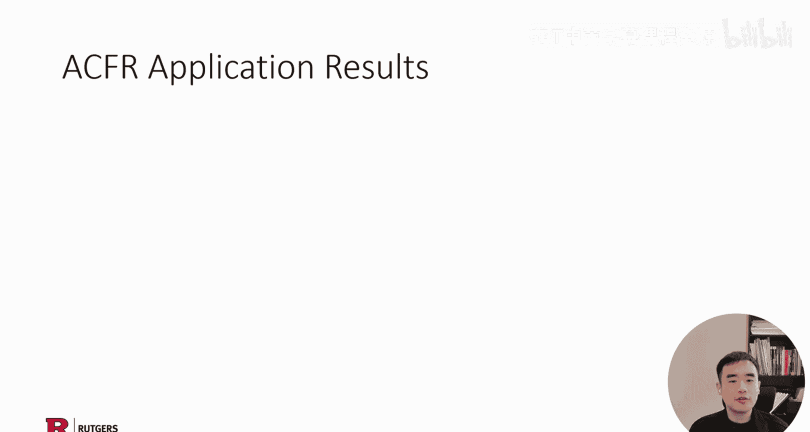
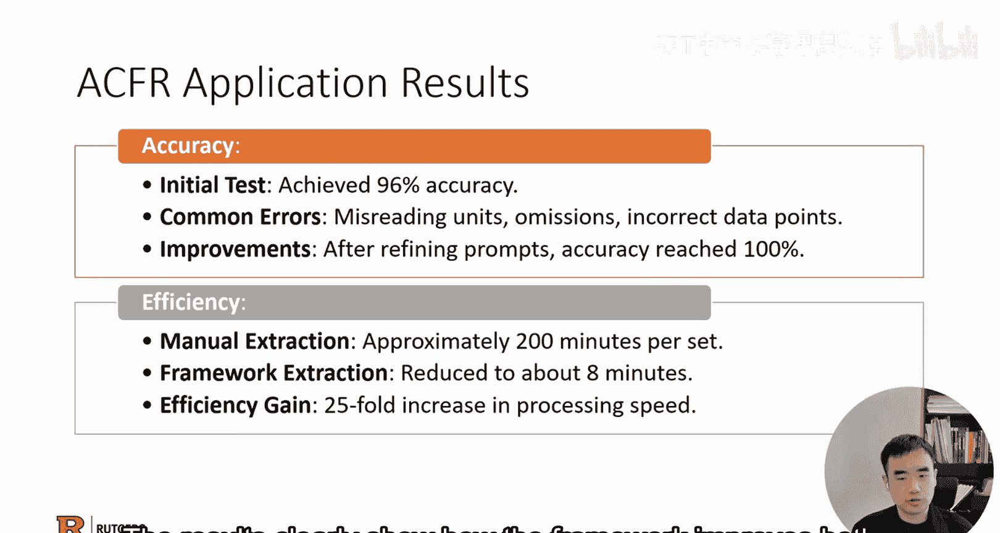
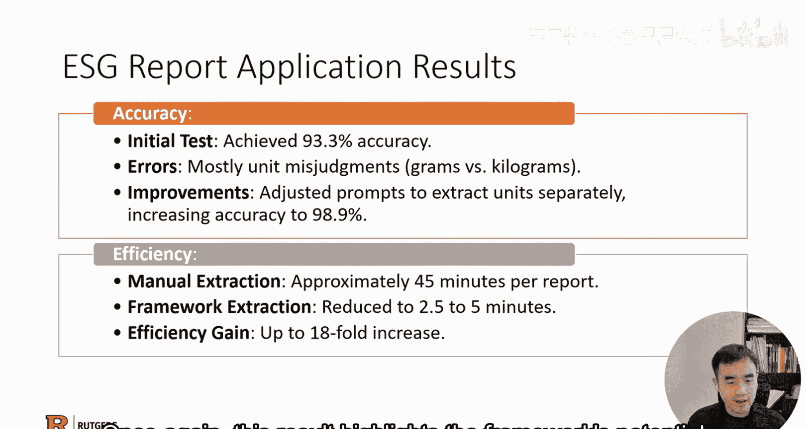
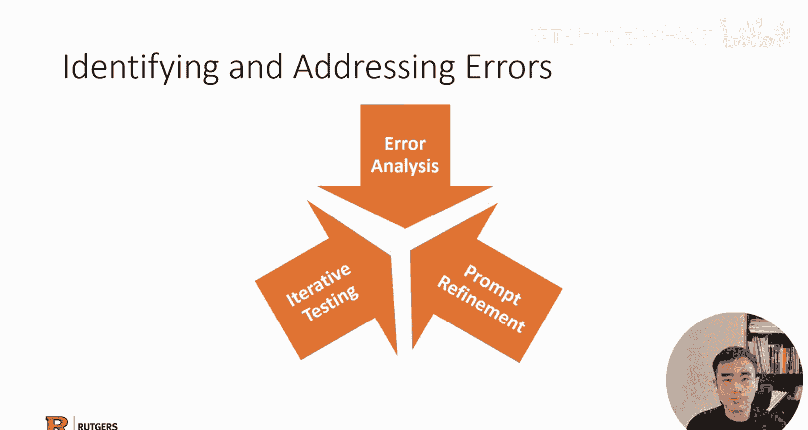
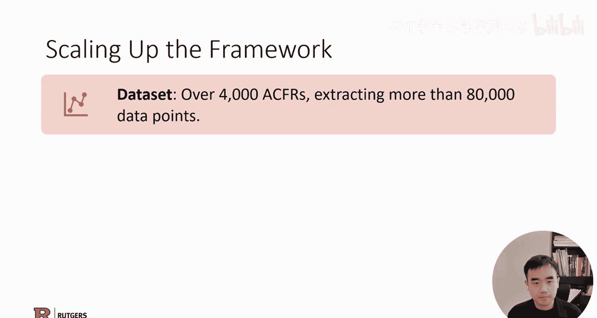
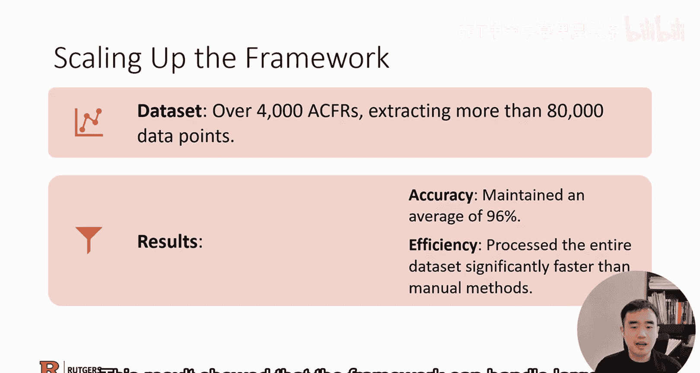
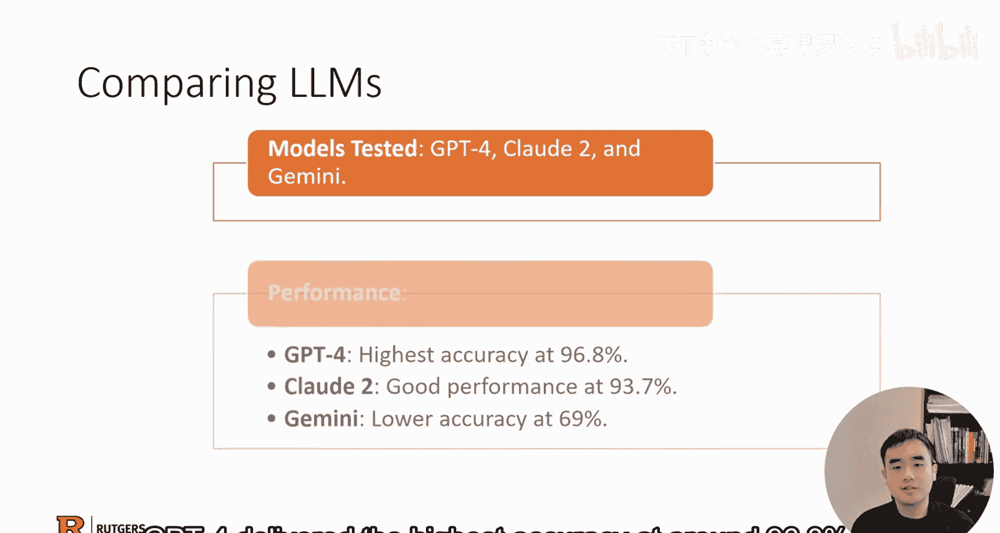
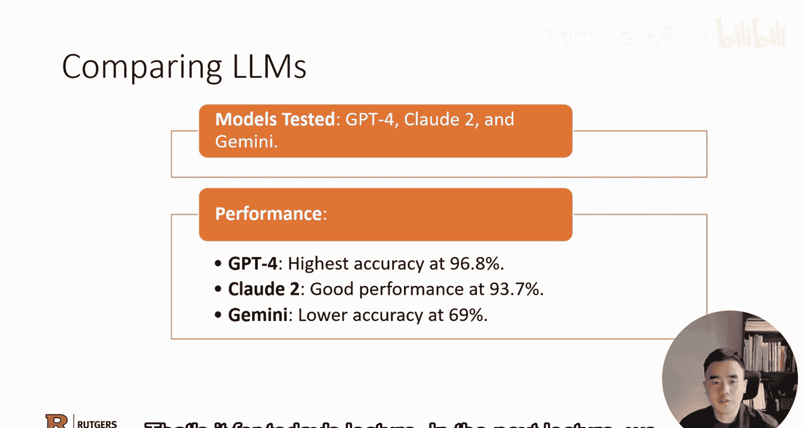

# 罗格斯大学《生成式人工智能与政府财务报告Generative AI & Governmental Financial Reporting》中英字幕 - P17：16_示例与错误识别.zh_en - GPT中英字幕课程资源 - BV1QS7GzEEAU

Hi， guys。 Welcome back。 In today's lecture， we will evaluate the results from effort and E C report。

😊，Let's review the results of applying our framework to efforts in terms of both accuracy and efficiency。

First， for the accuracy results， the initial task revealed that the framework achieved 96。

1% accuracy。

It also identify some common errors like issues included misreading units。

 omissions and incorrect data points。After refining the prompts to address these errors。

 we reached the 100% accuracy in a second one， showing the effectiveness of iterative adjustment。

For the efficiency。Previously， extracting data manually took around 200 minutes per report data。

With the framework， the extraction time dropped to about only 8 minutes for the entire report set。

This means a 25 fold increase in the speed， demonstrating substantial improvement over traditional methods。

The results clearly show how the framework improves both accuracy and efficiency。

 highlighting its potential to enhance the data extraction for complex reports， like efforts。

Now， let's look at how our framework performed on ESG report in terms of accuracy and efficiency。

First， for the accuracy result， the initial test revealed that the accuracy was 93。3% accurate。

Most of the errors come from the unit misjudgment， like confusing grams with kilograms。

By adjusting prompts to handle units separately， accuracy improved significantly， reaching 98。

9% accuracy。In terms of efficiency results， traditional manual extraction took around 45 minutes per report with the framework。

 The time was reduced to between 2。5 and 5 minutes per report。

This is an up to 18 for improvement in speed。Once again。

 this results highlights the framework's potential to provide substantial time savings and improved accuracy。

 making the valuable tool for handling complex E SG data。😊。

Let's go over strategies for improving accuracy within our framework， focusing on a systematic。

 iterative approach。Steps to improve accuracy。 First， error analysis。

We conduct a thorough analysis to identify common mistakes， and understand their causes。

This help us to see where adjustments are needed。 Second， prom refinement。Based on our findings。

 we refine prompts to target specific issues。 This might include adding more examples to support future short learning。

 explicitly specifying units and format to avoid confusion or clarifying instructions in rules sections for consistency。

After making these change， we retest the framework to verify improvements。

This cycle of testing and refining help us achieve incremental gains in accuracy。

An interactive approach to accuracy is essential for optimizing performance。

 as each improvements bring us closer to a more reliable and efficient instruction process。😊。

Furthermore， we conducted scalability testing to see how well the framework performs on larger data。

From this test， we use a data set of over 4000 efforts， extracting more than 80000 data points。

The framework maintained a high accuracy rate， average 96% accuracy。

 even with larger volume of data and processing the entire data set was significantly faster than manual extraction。

 providing the framework efficiency at scale。

These results show that the framework can handle large scale extraction tasks effectively。

 maintaining both speed and accuracy as the data volume grows。

We also compare different la la lamps to see how they impact the framework's performance。

We tested three models， GB4， Cloud 2 and Gemini。GPD4 delivered the highest accuracy at around 96。8%。

And cloud 2 showed good performance with an accuracy of 93。7%。

With Germanymini had a lower accuracy at around 69%。

These results highlight that the choice of that La significantly affect the accuracy。

 More advanced models like GB4 provide better results。

 So selecting the right letter La is crucial for achieving optimal performance in data extraction tasks。

😊，That's it for today's lecture。 In the next lecture。

 we will conclude this module with some discussion on the limitations and practical tips。

 See you there。

