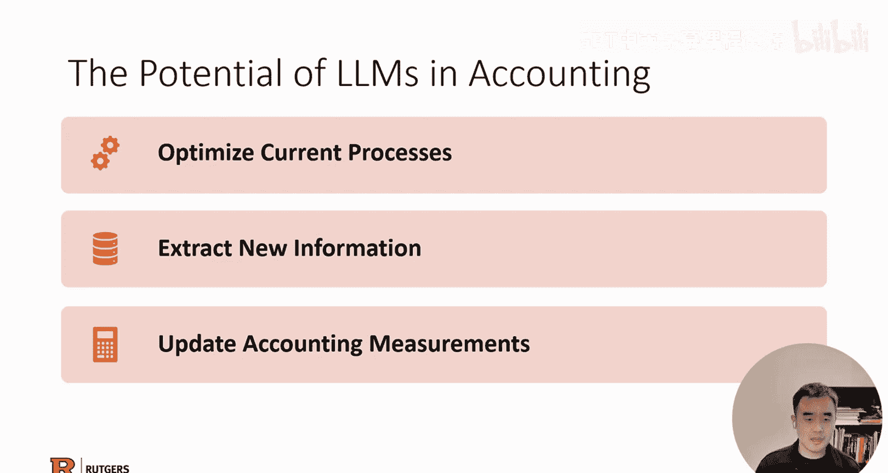
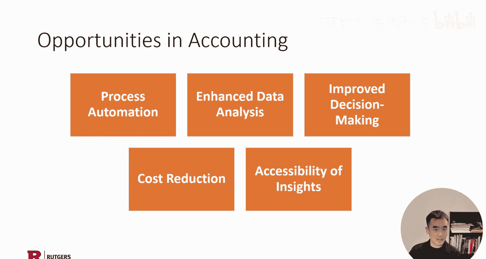
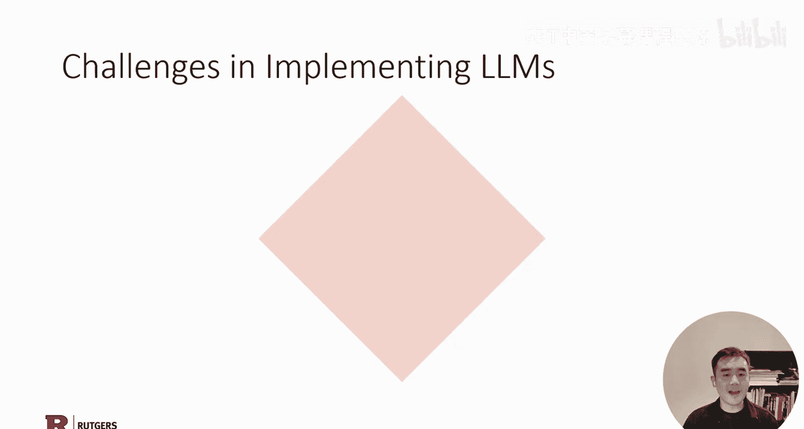
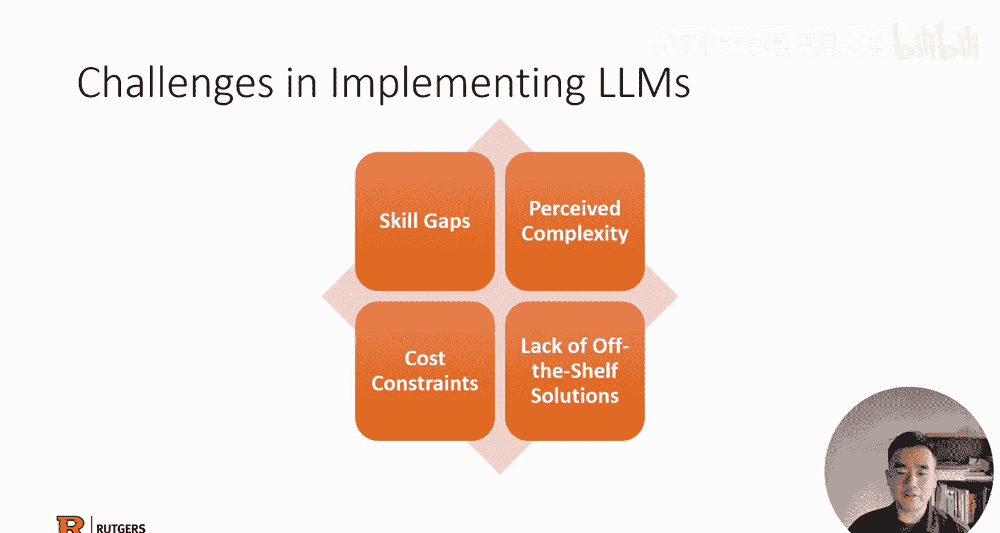

# 罗格斯大学《生成式人工智能与政府财务报告Generative AI & Governmental Financial Reporting》中英字幕 - P3：2_大型语言模型与会计.zh_en - GPT中英字幕课程资源 - BV1QS7GzEEAU

Hi， everyone。 Welcome back。 In this lecture， we will introduce the potentials。

 opportunities and challenges of applying large language models in our accounting。😊。

So how do La la lambs fit into the world of county。

The emergence of that lamps brings tremendous potential to reform current accounting practices across various industries。

In accounting， they can optimize current processes such as auto routine tasks like data entry。

 reconciization and report generation。It can also extract new information like pulling granular financial data from onstructured sources such as Pdf documents or scanned files。

They can also update accounting measurements。Like providing real time analysis and insights。

 enabling more accurate and timely financial reporting。For example。

 a letter lamb can read through thousands of pages of financial statement and extract key financial indicators in the fraction of the time it would take for a human being。

Let's dive deeper into specific opportunities that our lambs offer in your county。First。

 process automation。Little lamps can handle repetitive and time consuming tasks。

 filling up accounts to focus on higher value activities。😊，Second， enhance data analysis。

They can analyze large volumes of data to identify patterns。

 anomalies or trends that might be missed by traditional approach。Third， improve decision making。

By providing insights from our structure data， let our lamps enable better informed strategic decisions。

Force cost reduction。Automation and efficiency gains can lead to significant cost savings over time。

Finally， accessibility of insights。😊，Ler lamps can translate complex financial data into understandable language for stakeholders。

Despite these promising opportunities。

There are several challenges and concerns when it comes to implementing little limbs in your county。

First， skill gaps。Many accountants may lack the technical expertise required to implement and manage AI solutions effectively。

Next， perceived complexity。Integrating that lamps into existing systems can save down due to the technical and logistic complexity involved。

Next， cost constraints。The initial investment for AI solutions and the ongoing maintenance cost can be significant。

Particularly for smaller firms。Finally， lack of off the shelf solutions。

There is a sagacity of ready made AI tools tailored specifically for accounting needs。

 neating customer development。These challenges can add as barriers to adoption。

 slowing down the integration of AI into accounting practices。That's it for today's lecture。

 In the next lecture， we will talk about how to address these challenges。

Pro engineering and also the evolution of letter lamb accessibility。

See you there。