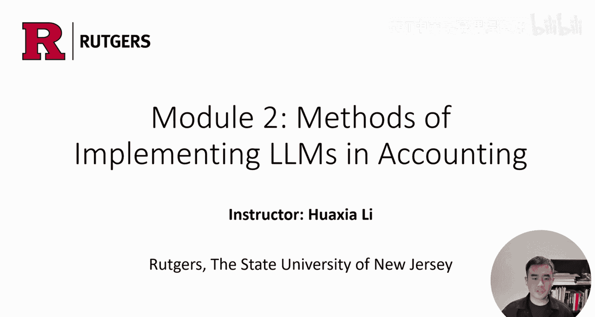
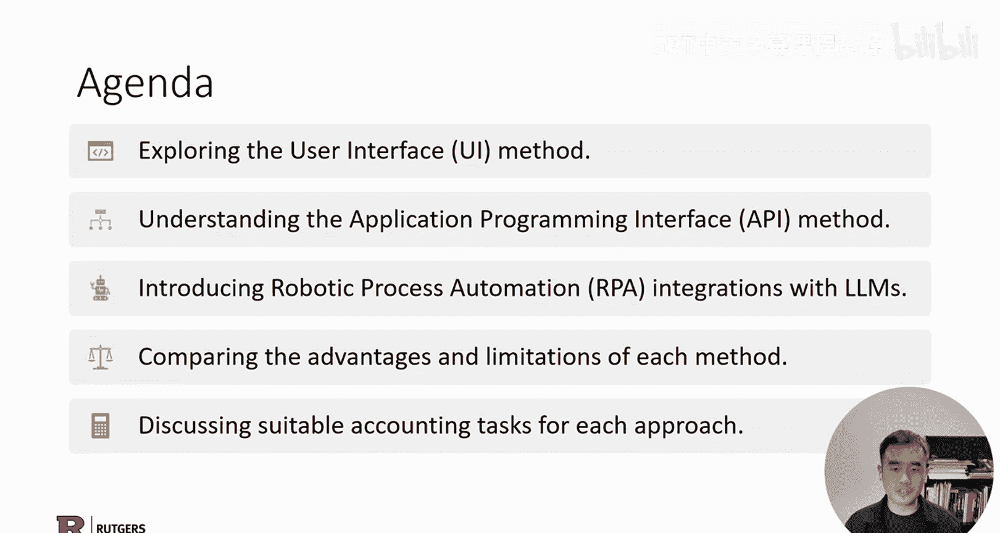
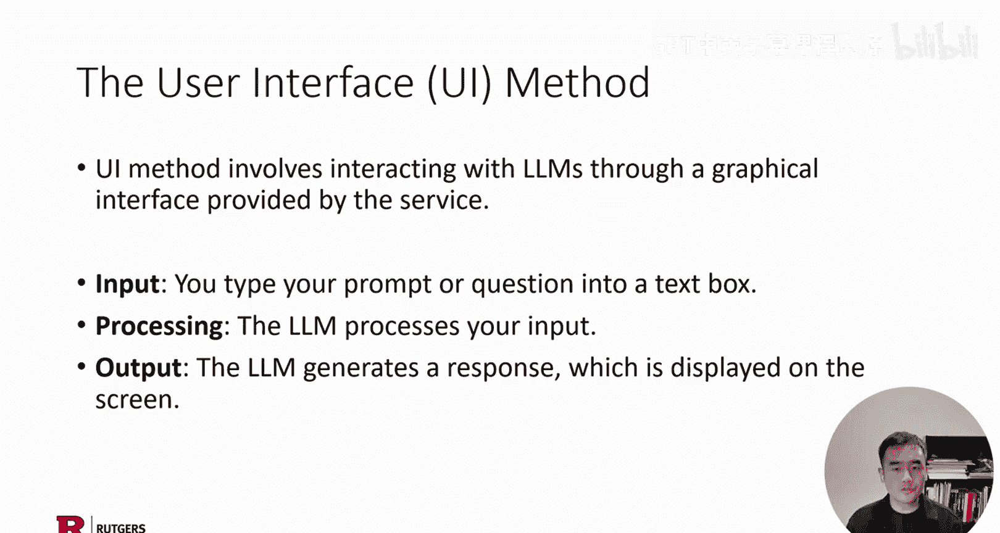
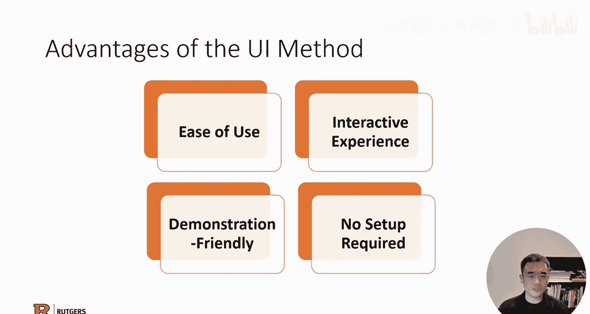
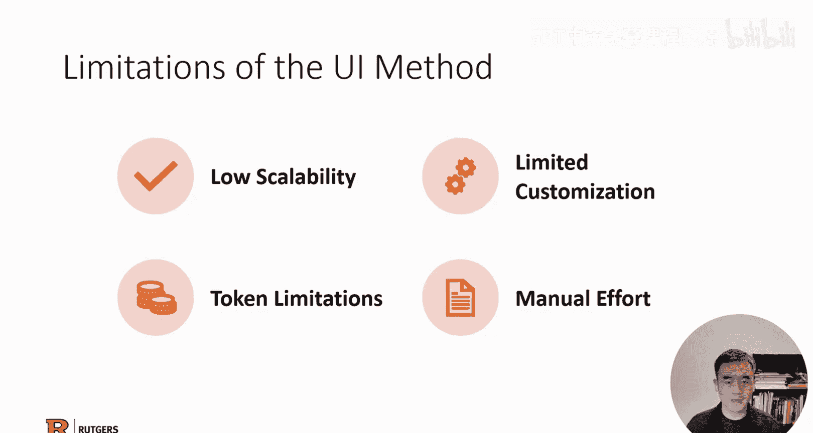
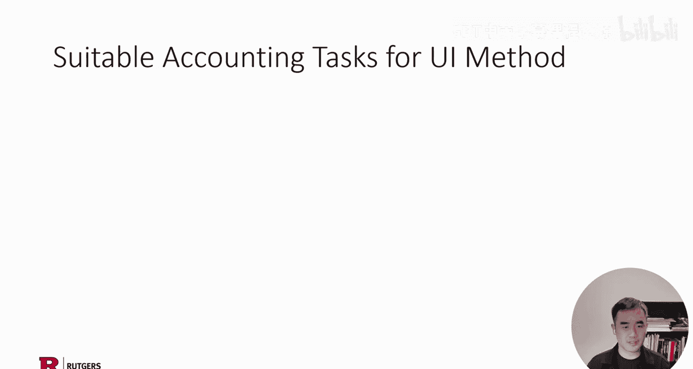
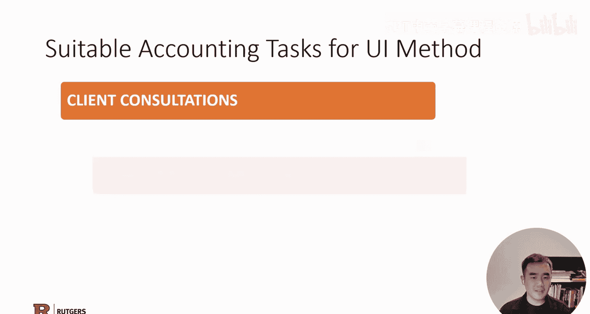
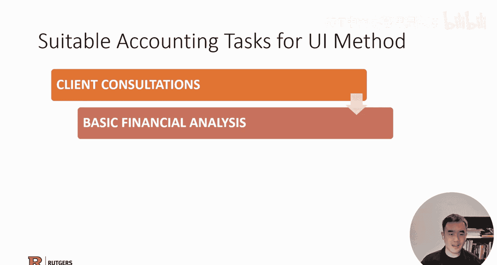
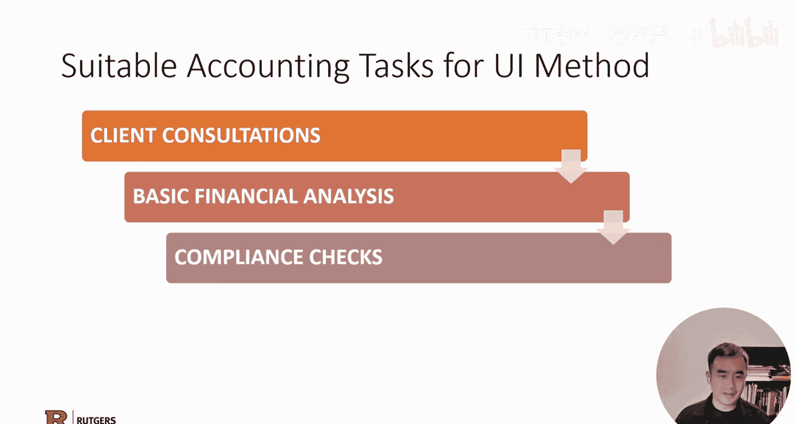
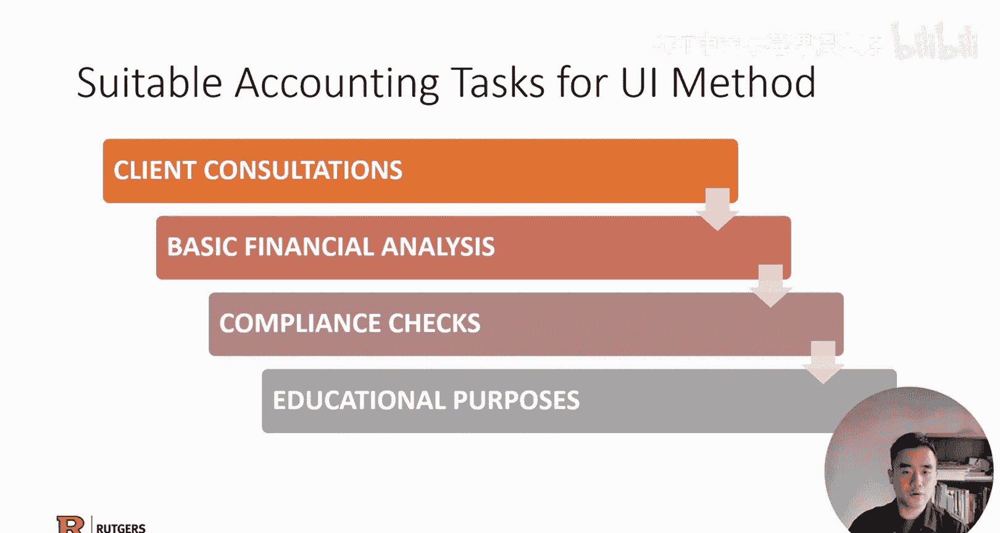

# 罗格斯大学《生成式人工智能与政府财务报告Generative AI & Governmental Financial Reporting》中英字幕 - P5：4_用户界面方法.zh_en - GPT中英字幕课程资源 - BV1QS7GzEEAU

Welcome back to our course on generative AI in governmental reports and accounting。In module 2。

 we will be discussing the various method for implementing large language models or other lambs in our accounting。

Understanding this method is crucial because it allows you to select the approach the best fit your needs。

 technical capabilities and budget。So， let's get started。

Today's agenda includes first， exploring the user interface of U I method。Second。

 understanding the application programming interface or API approach。Third。

I will introduce the robotic process automation or RP integration with large language models。Next。

I will compare the advantage and limitation of each approach。Finally。

 I will discuss the suitable accounting tasks for each approach。😊。

First， let's talk about the simplest method using the user interface or U I。

The U I method involves interacting with Lalao Las through a graphical interface provided by the service provider。

A common example is using Ch GPT， while it web interface。Here is how it works。For the input。

 you type your prompt or instruction or question into a text box。For processing。

 the letter La will process your input and for the output。

 the letter La will generate a response which is displayed on the screen。

This method requires no programming knowledge and is accessible to anyone with an Internet connection。

Some key advantage of U I methods are first ease of use。

It is straightforward and require no tech expertise for anyone who want to use the U I approach。

 Second， interactive experiences。 You can have back and forth conversations with a Lala La and ask。

 follow up questions as needed。Next， demonstration friendly。

This approach is ideal for showing cases capability to clients or team members in a live setting。

Finally， no setup required。 You don't need to install software or configured system in order to use the U I approach。

However， the UI method has several limitations。First， low scalability。

UI is not practical for processing large volumes of data， or automating repetitive tasks。Second。

 limited customization。U I has fewer options to adjust model parameters like temperature or the maximum tokens output。

 etc cetera。Next， there is a limited token for using U I。 For example。

 there are some constraints on the length of input and output。

 which can be problematic for lengthy documents。Finally， menu effort。

UI require manual input and copying of the result to the output。

This is time consuming for batch tasks。

Therefore， the UI method is best suited for several types of tasks。

First， client consultations。U，I is best for answering client queries interactively。Next。

 basic financial analysis。

You can do quick calculations or interpretations using U I for your basic financial analysis。

Next， compliance checks。You can verify specific information in the document， with the U I。Finally。

 educational purposes you can demonstrate and train your client with the U I。

In general， it's ideal when the task volume is low and require human judgment and interactions。

That's it for today's lecture。 In the next lecture， we will introduce the API approach in details。

 Thank you for watching。

