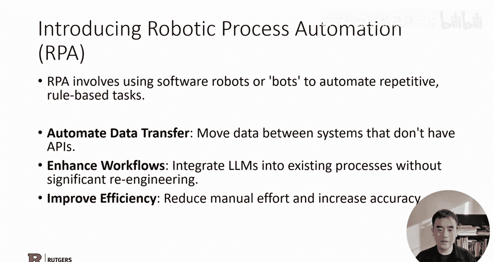
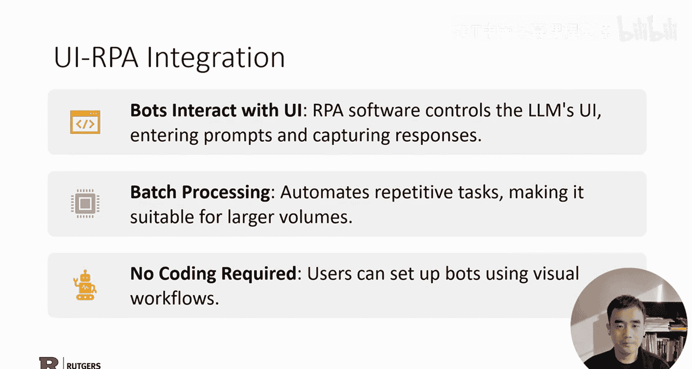
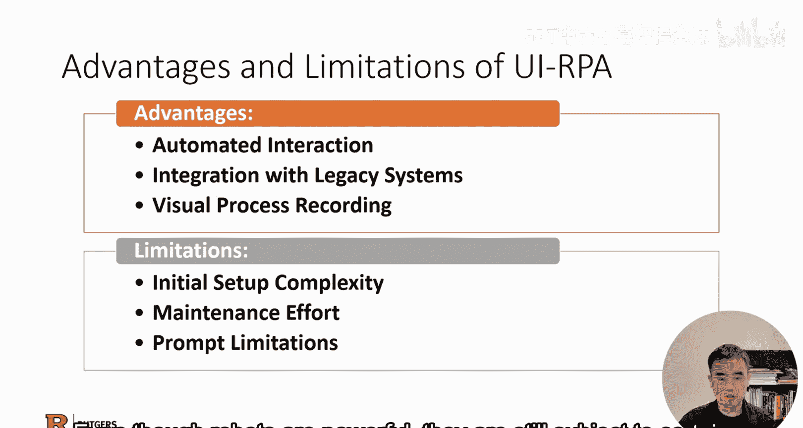
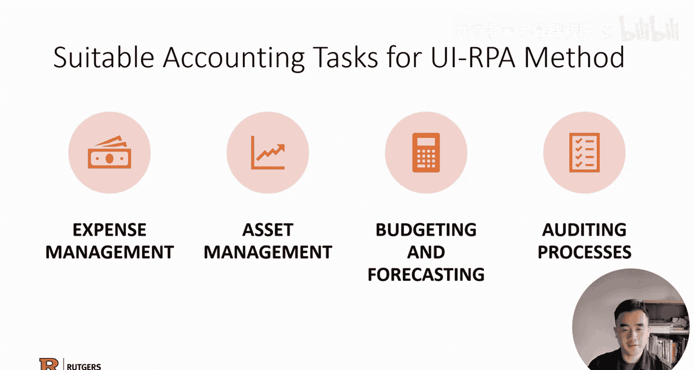

# 罗格斯大学《生成式人工智能与政府财务报告Generative AI & Governmental Financial Reporting》中英字幕 - P7：6_机器人流程自动化（RPA）.zh_en - GPT中英字幕课程资源 - BV1QS7GzEEAU

Hi， everyone。 Welcome back。 In this lecture， We will introduce the robotic process automation and how to integrate it with the UI approach。

😊，Now， let's introduce robotic process automation or R。

RPA involves using software robots or bars to automate repetitive and robust tasks。

This bus mimic make human interactions with digital systems。When combined with Lala Las。

 R has several unique benefits。For example， automated data transfer。

RRP can move data between systems that don't have the API connection。Enhance workflows。

 R can integrate La Lao Las into existing processes， without significant reengineering。😊。

Improve efficiency。RPA can reduce menu effort， and increase the accuracy。

Now， with some basic understanding of R here， I introduce one approach called U I RPA that combined the simplicity of the U I approach with the automation capabilities of R。

Here is how it works。First， boss can interact with U I。

The RPA software will control the nanom U I based on the design and enter the prompt and capture the responses from the U I。

Next， batch process， the whole U I RRPI process can automate repetitive tasks。

 making it suitable for larger volumes of data。 Finally。

 one of the benefits of U IRPI approach is no coding required。Benefit from the R software。

 the U IRP approach is suitable for users who can set up bars using visual workflows without coding skills。

So in general， this method bridgeed the gap between the ease of use and scalability。

Well， there are several advantage and limitations for using the U IRP approach。

 Let's start by looking at the advantage。 First， the auto interaction significantly reduce the need for menu input。

 which in turn， minimize the risk of errors。Another key benefit is the interaction with Lexi systems。

Even in environment where there are no APIs available。

 robots are capable of interacting with those older systems， making the technology more versatile。

 Additionally， the visual process recording feature is available to。

 It allows users to record the entire process， which the U I RRP approach。

 which can enhance the verifiability and create strong audit trail for review and compliance。Now。

 moving on to the limitations， setting up robot comes with some challenges。

 particularly with the initial setup complexity。There is a significant amount of effort required to design and configure them properly。

Furthermore， maintenance is an ongoing concern。 since robots rely heavily on user interface。

 Any change to the U I can break about， requiring continuous update。Lastly。

 there are prime limitations to consider。Even though robots are powerful。

 they are still subject to certain constraints， such as token limits and other U I best restrictions。

 which can limit their effectiveness in certain situations。

Now， let's discuss some of the areas where U IRP is particularly well suited。

One example is expense management。With R， we can automate data entry from receipt and invoices。

 reducing the time and effort needed for manual input。Another great use case is asset management。

The robot can help track assets， update the process that often take a lot of manual oversight。

This process is also highly beneficial in budgeting and forecasting。

 where it can gather data from various sources making it easier to compile and analyze for decision making。

Additionally， the U I RRP plays an important role in auditing process by automating repetitive audit tasks。

 helping teams save time and reduce human error。In general。

 the U I RPA approach is ideal in scenarios where tasks involve interaction between La la lamps and the system that the API connection。

This matches is a powerful solution when direct interaction are not possible。

 but you still need efficient automatic workflows。That it for today's lecture。 In the next lecture。

 we will introduce how to integrate R with API。 Thank you for watching。

