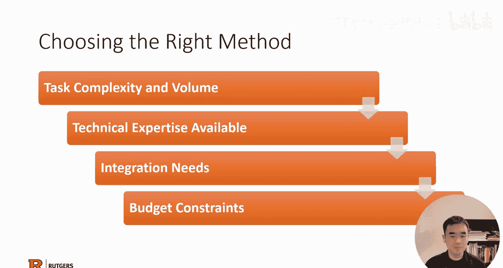
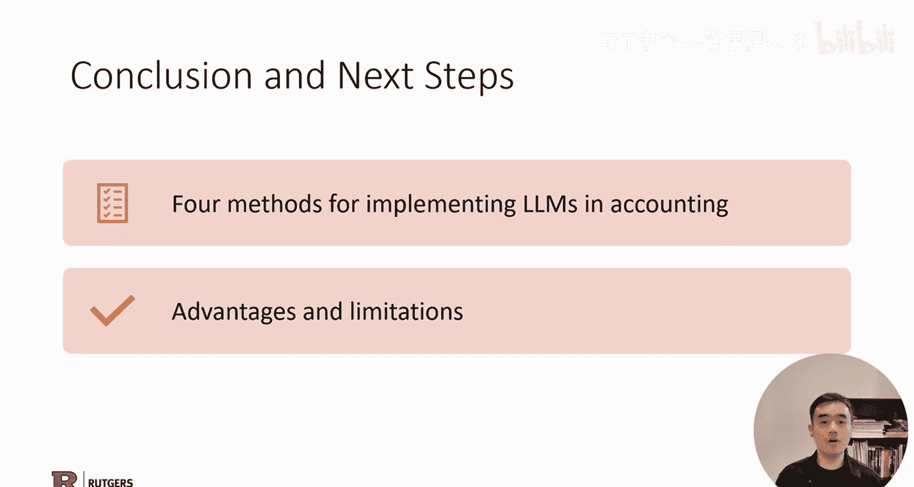

# 罗格斯大学《生成式人工智能与政府财务报告Generative AI & Governmental Financial Reporting》中英字幕 - P9：8_选择正确的方法.zh_en - GPT中英字幕课程资源 - BV1QS7GzEEAU

Hi， everyone。 Welcome back to the last lecture of this module。 In this lecture。

 we will introduce how to choose the right method and then conclude this module。😊。

When it comes to selecting the wide implementation method， there are several key factors to consider。

 First， think about the type complexity and volume。

If you are dealing with higher volumes or more complex processes。You may need a more robust。

 fully automated solution。Next， assess the technical expertise available within your team。

The method you choose should align with your team's ability to implement and maintain it effectively。

Another important factor is integration needs。You will want to ensure that the automation method can integrate with your existing system。

 whether they use API or not。Finally， consider your budget constraints。

While some solutions might require hiring initial investment。

 they can offer significant long term benefit in terms of efficiency and cost saving。In summary。

 you should carefully assess your organization's unique needs across these factors to choose the most suitable approach for implementing La la。

In this module， we have explored four mastered for implementing ladder lamps in a county。

 each with its own advantage and limitations。Understanding this method allows you to make informed decisions and effectively integrate AI into your accounting practices。

In the next module， we'll dive into a more practical application of that land in county。

Thank you for your attention。 And I look forward to continue our exploration together。😊。

Before we wrap up， are there any questions or comments about the matter we have discussed？

Feel free to share your thoughts， or ask for clarifications。

