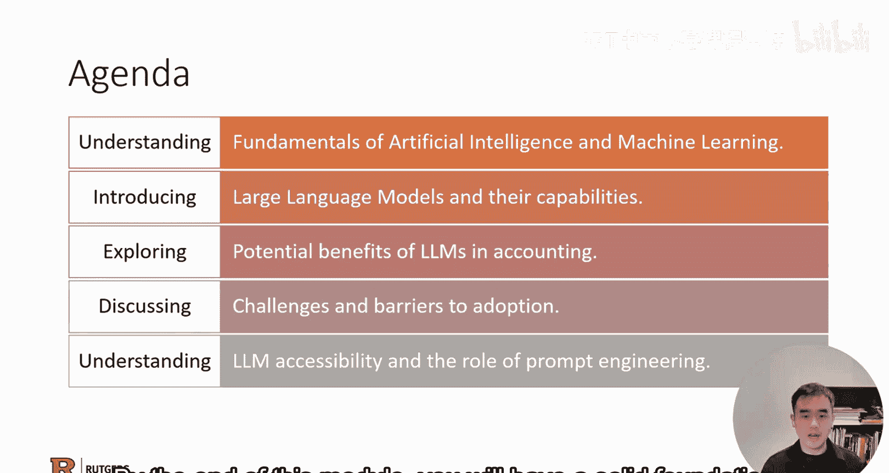
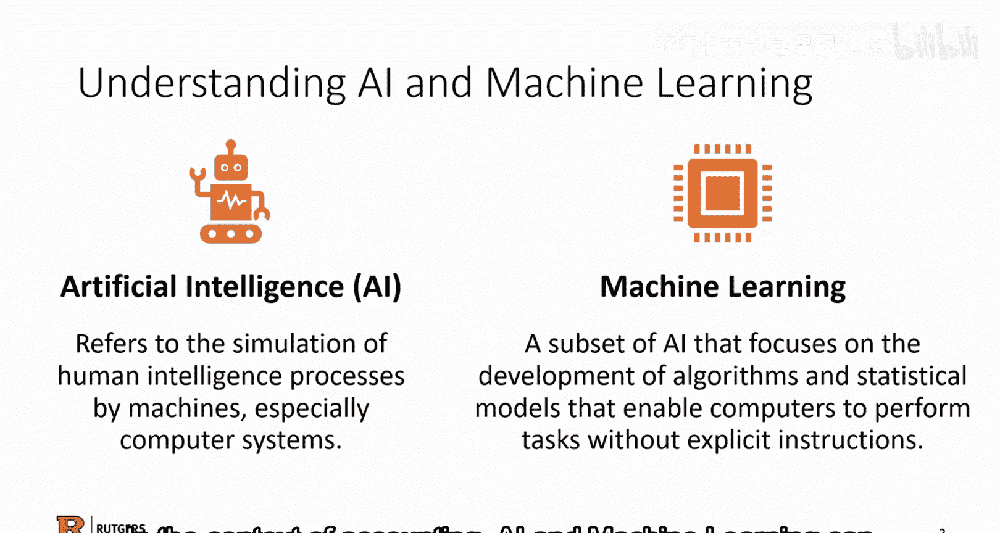
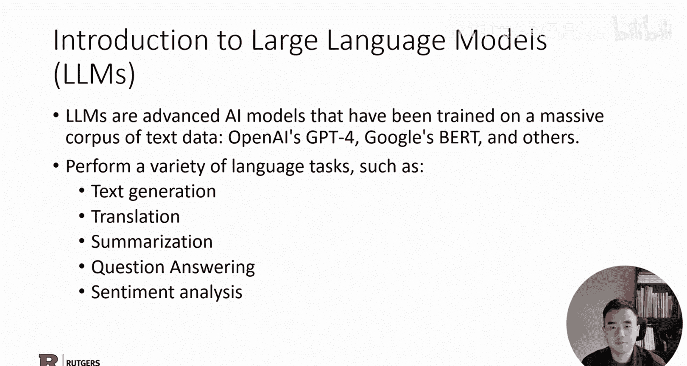

# 罗格斯大学《生成式人工智能与政府财务报告Generative AI & Governmental Financial Reporting》中英字幕 p01 0_欢迎议程与介绍.zh_en -BV1QS7GzEEAU_p1-

Hello， everyone， and welcome to module  one of our course on generative AI in governmental reports and accounting。

😊，My name is Hua Xian Li， and I'm thrilled to embark on this journey with you as we explore how cutting edge AI technologies are transforming the accounting landscape。

😊，In this module， we will be diving into an introduction to generative AI and large language models or Lala Las and their impact on a accounting。

We'll discuss the basics of AI and machine learning。

 introducetroduce you to Lala Las and explore both the potential and challenges that bring to the accounting profession。

So， let's get started。Here is what we will cover today。 First。

 we need to understand the fundamentals of artificial intelligence and machine learning。Next。

 we'll introduce large language models and their capability。

 Following that will explore the potential benefits of large language models in your accounting and then discuss the challenges and barriers to their adoption。

Finally， we need to understand the evolution of nano La accessibility and the role of pro engineering。

😊，By the end of this module， you will have a solid foundation for understanding how AI and specifically La Las are poised to revolutionized accounting practices。

First， let's let Guan work by discussing what artificial intelligence and machine learning actually are。

Artificial intelligence or AI refers to the simulation of human intelligence processes by machines。

 especially computer systems。These processes include learning， reasoning， problem solving。

 perception and language understanding。Machine learning is the subset of AI。

 that focuses on the development of algorithms and statistical models that enable computers to perform tasks without explicit instructions。

Instead， they rely on patterns and inference draw from the data。Essentially。

 it's about teaching computers to learn from and make decisions based on data。

In the context of accounting， AI and machine learning can automate routine tasks analyze large data sets for insights and even predict future trends based on historical data。

Now， let's introduce large language models， all that labs。

Lar lamps are advanced AI models that have been trained on a massive corus of text data。

They are designed to understand， generate and manipulate human language in a way that is remarkably human like。

Examples of that are Las include Open AI GPT4， Google's Bt， and others。

These models can perform a variety of language tasks， such as text generation， translation。

 summarization， question answering， and sentiment analysis。

What's truly transformative about La la Las is their ability to process and generate natural language。

 Ma them incredibly versatile tools for tasks that involve unstructured textual data。😊。

That's it for today's lecture。 In the next lecture， we'll talk about the evolution of GT models。

 See you there。

