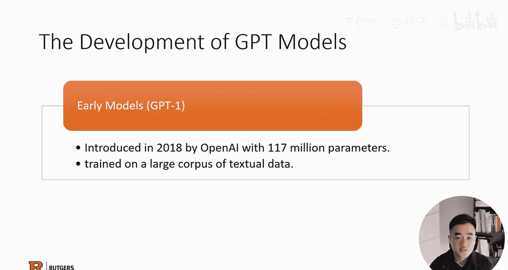
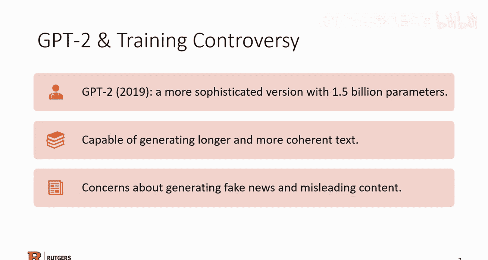
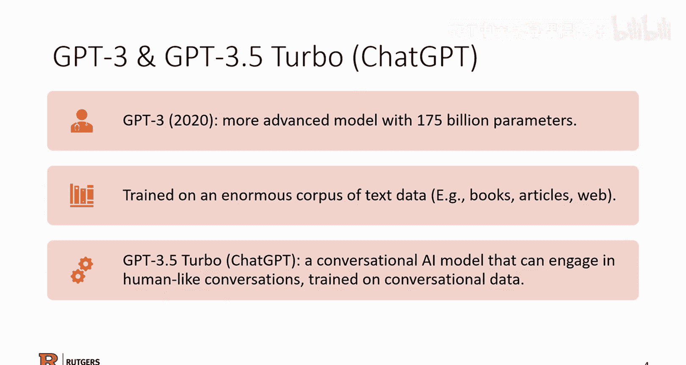
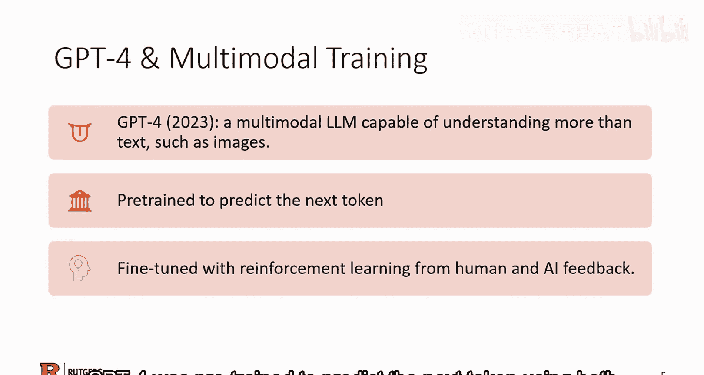
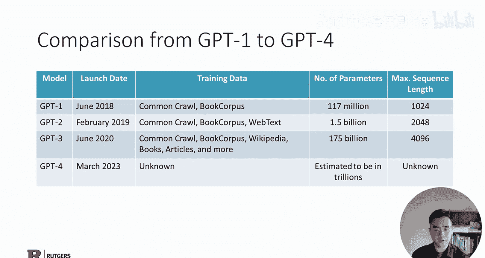

# 罗格斯大学《生成式人工智能与政府财务报告Generative AI & Governmental Financial Reporting》中英字幕 p02 1_GPT模型的发展.zh_en -BV1QS7GzEEAU_p2-

Hi everyone， welcome back In this lecture， we will introduce the development of GT models。

Then why have that our lambs become so important？To understand this。

 one best example is to learn the development of GT models。By learning their history。

 you can think critically and understand why we need to learn about them and why they are so promising。

The introduction of G 1 marked the early evolution of large language models。

GB T 1 was introduced in 2018 by open AI， with 117 million parameters。

It was trained on a large corus of textual data using unsupervised learning in to generate coherent text。

GP T 2， introduced in 2019， was a more sophisticated version with 1。5 billion parameters。

 It was capable of generating longer and more coherent text。However。

 its release sparked controversy due to concerns about its potential misuse。

 such as generating fake news and misleading content。

GP T 3 and G 3。5， which power the well known check GPT， represents significant advancements。GPT 3。

 introduced in 2020， had 175 billion parameters。It was trained on a massive cor of textual data。

 including books， articles and web pages， making it the most advanced model at that time。

Chat GP T is a conversational AI model trend on a large corus of conversational data。

 enabling it to generate human like conversations。

In more recent model， GT 4 was introduced in 2023。 It is a multimod。

 large language model capable of understanding not just texts， but also images and tables。

G B4 was pre trained to predict the next token using both public data and license data and was fine tuned using reinforcement learning from human and AI feedback。

So why do we spend time learning the history and development of these models。

It is essential to understand the progression of GT models， to appreciate their rapid evolution。

In just five years， the models have developed significantly。Initially， the training set were small。

 resulting in limited intelligence and the ability to answer only a narrow range of questions。

However， with GP 4， the models are much more smarter。The number of parameters。

 which determines the model， size and capability has grown exponentially from 117 million in GBT1 to 1。

5 billion in GB 2， then 175 billion in GB 3， and now estimated to be in the trillions with GB4。

The maximum sequence length has also increased significantly。

Further enhancing the model's capabilities。This progression highlights the improvement in size。

 accuracy and the complexity of the training data。That's it for today's lecture。 In the next lecture。

 we will introduce the potentials， opportunities and challenges of applying large language model in accounting。

 See you soon。

