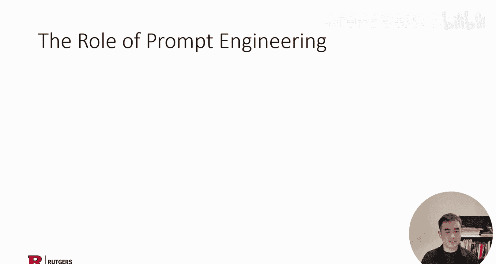
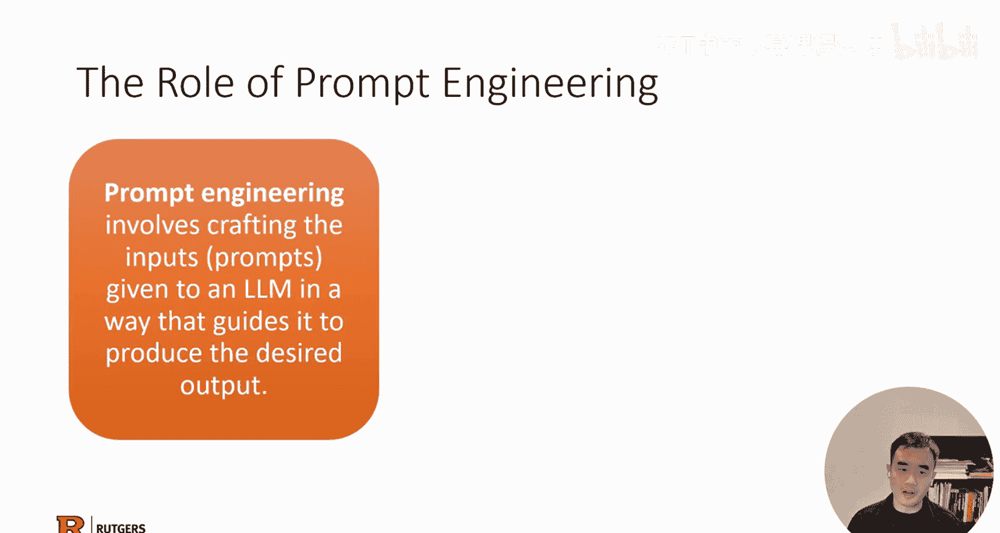
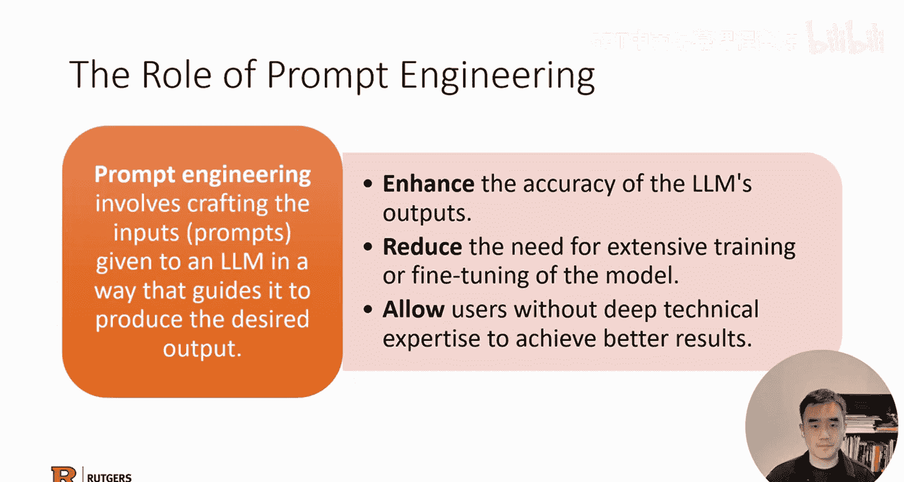
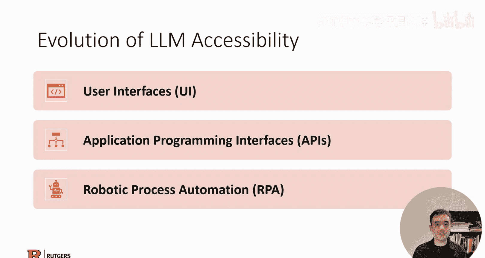
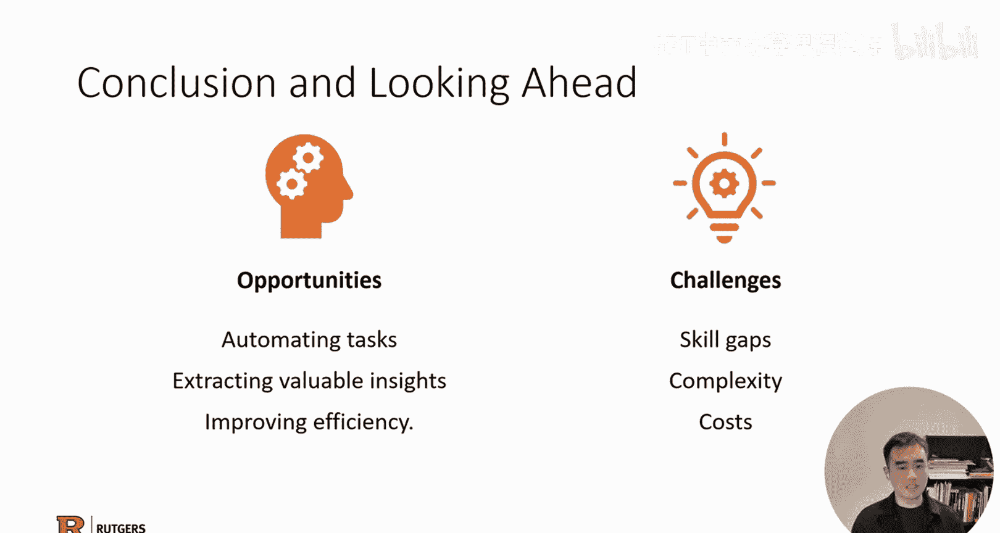

# 罗格斯大学《生成式人工智能与政府财务报告Generative AI & Governmental Financial Reporting》中英字幕 p04 3_技能差距、提示工程与演进.zh_en -BV1QS7GzEEAU_p4-

Hi， everyone。 Welcome back。 In this lecture。 We will introduce how to address those challenges。

 What is pro engineering and also the evolution of D La accessibility。😊，To overcome these challenges。

 it's essential to address the skill gaps and perceived complexity in advance。First。

 education training。We can invest in training programs to obscure accounts in AI and data analytics。

Second， user friendly tools。 We can develop and adopt AI tools with intuitive user interfaces that don't require deep technical knowledge。

Finally， collaboration。😊，Which will encourage collaboration between accounting professionals and I T experts to bridge the technical divide。

By empowering accountants with the necessary skills and tools。

 we can facilitate smoother adoption of AI technologies。

A key concept in making Lla lamps accessible and effective， is pro engineering。

Prom engineering involves crafting the input or prompts given to a another lamp in a way that guides it to produce the desired output。

This is crucial because the quality and relevance of the Lala less response are heavily influenced by how the prompt is phrased。

Effective pro engineering can enhance the accuracy of the La lab output。

 reduce the need for extensive training or finening of the model and allow users without deep technical expertise to achieve better results。

We will explore pro engineering in more detail， in the latter modules。

Previously， deploying advanced language models required significant programming knowledge and infrastructure setup。

Users had to manage software dependencies， hardware configurations。

 and understand complex parameters。However， recent advancements have made lot labs more accessible。

First， user interface or U I。Platforms like chat GPT provide simple interfaces where users can input text prompts and receive responses without any coding。

Second， application programming interfaces or APIs。

Apis allow for more advanced integration of Lala Las into applications with customizable parameters。

 while still being more user friendly than previous methods。Finally。

 robotic process automation or RP。😊，Integrating other our lamps with RP tools can automate complex workflows without extensive programming。

These developments lower the barriers to entry， make it feasible for accounting professionals to leverage la lamps in their work。

In conclusion， letter lamps have the potential to revolutionize accounting by automating tasks。

 extracting valuable insights and improving efficiency。However， to realize this potential。

 we must address challenges like skill gaps， complexity and costs。Understanding the basics of AI。

 large language models and prom engineering is the first step toward integrating these technologies into accounting practices。

In the next module， we will explore the various methods for implementing La labs in our county。

 including practical considerations for each approach。Thank you for joining me in this introduction。

I look forward to diving deeper with you in the next module。Before we wrap up。

 I would like to open the floor for any questions or comments you might have。

 Feel free to share your thoughts or ask about anything we have covered today。

