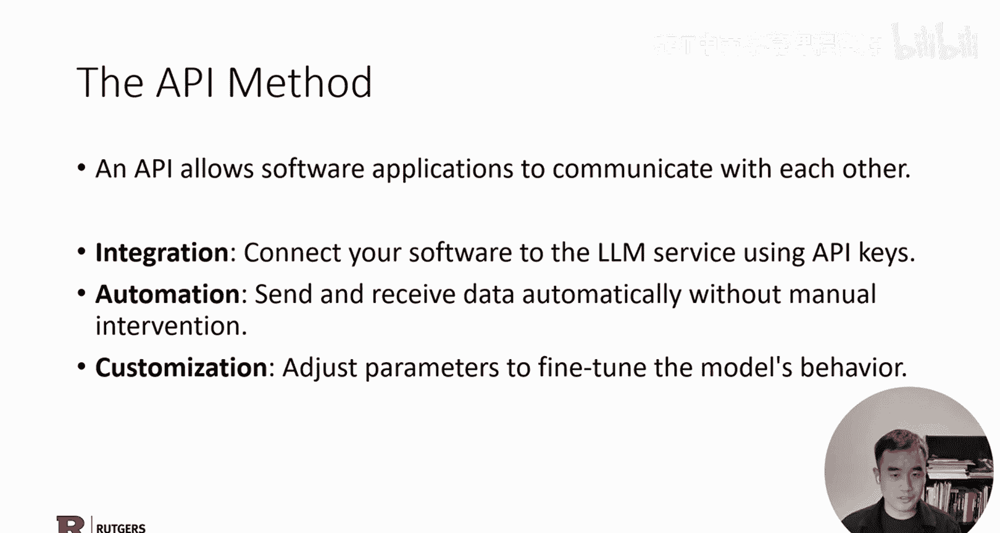
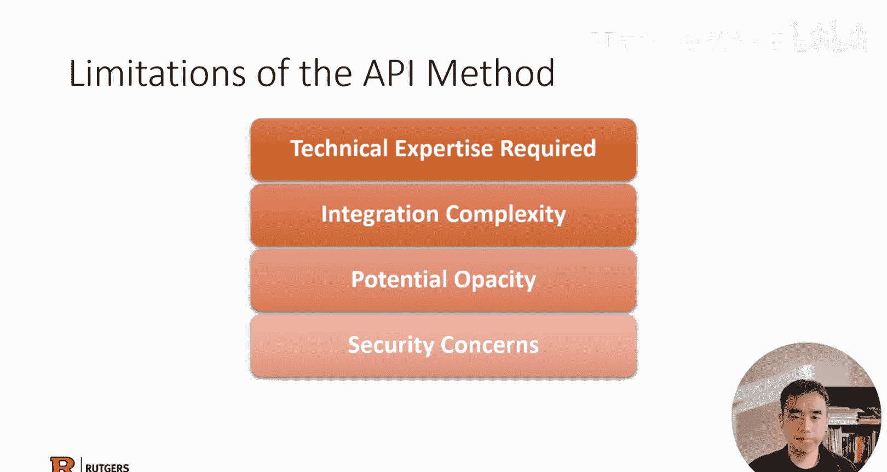
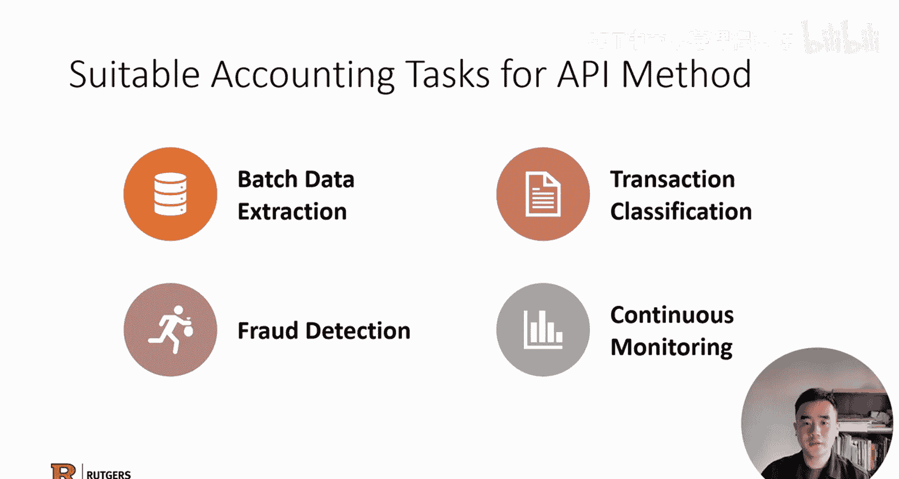

# 罗格斯大学《生成式人工智能与政府财务报告Generative AI & Governmental Financial Reporting》中英字幕 p06 5_API方法.zh_en -BV1QS7GzEEAU_p6-

Hi， everyone。 Welcome back。 In this lecture， we will introduce the API approach。😊，Next。

 let's explore the application programming interface or API method。

An API allows software applications to communicate with each other。With La La APIs。

 you can programmatically send prompts and receive responses within your application or workforce。

Here is how it works。Integration， you connect your software to the L La service provider using the API key。

Automation， you send receive data automatically without human intervention。Customomization。

You can adjust parameters to fine tune amount the behavior and its performance。

Therefore， here are several advantages of using API approach。First， scally。

You are feel free to efficiently process large volumes of data without human intervention。

You do not need to manually input and output data。Next， customization。

You can set the parameters like temperature， max token。

 or specify the rules for tragedy to perform either system， user or system。Next， integration。

 you can embed La lao La capabilities directly into your existing works or systems。Finally。

 automation。You reduce a lot of many work and effort to minimize the errors。However。

 the API method comes with its own challenges， like technical expertise required。

A PI requires programming skills and some basic understanding of its mechanisms in order to correctly set it up。

Next， integration complexity。It may be difficult to integrate with legacy systems or in house system that do not support the API connection。

Potential opacity。The process of API can become a black box。

 making the troubleshooting process more complex compared with the U I approach。Finally。

 security concerns。The data transmitted via APIs must be secured in order to protect sensitive information。

Therefore， the API method is ideal for several types of tasks， like F data extraction。

 You can use API to process large data set efficiently without human intervention。

Transaction classification。You can automate the categorization of financial transactions based on a set of predefined rules and regulations。

Fraaw detection。You can analyze patterns across vast amount of data， to identify anomalies。

Continuous monitoring or continuous audit。You can combine those different features to perform ongoing tasks that benefit from automation and classification。

So in general， the API approach is the best one when you need to scale up operations and integrate with other systems。

That's it for today's lecture。 In the next lecture。

 we will introduce robotic process automation or RP and how to integrate it with U I approach。

Thank you for watching。

