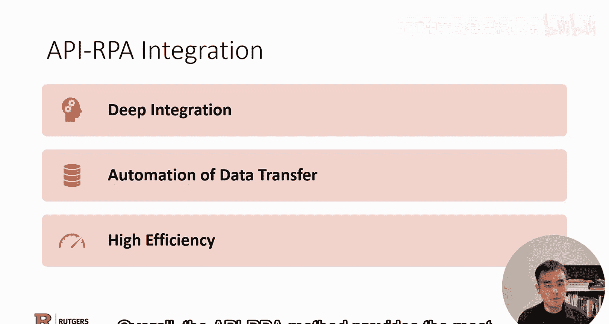
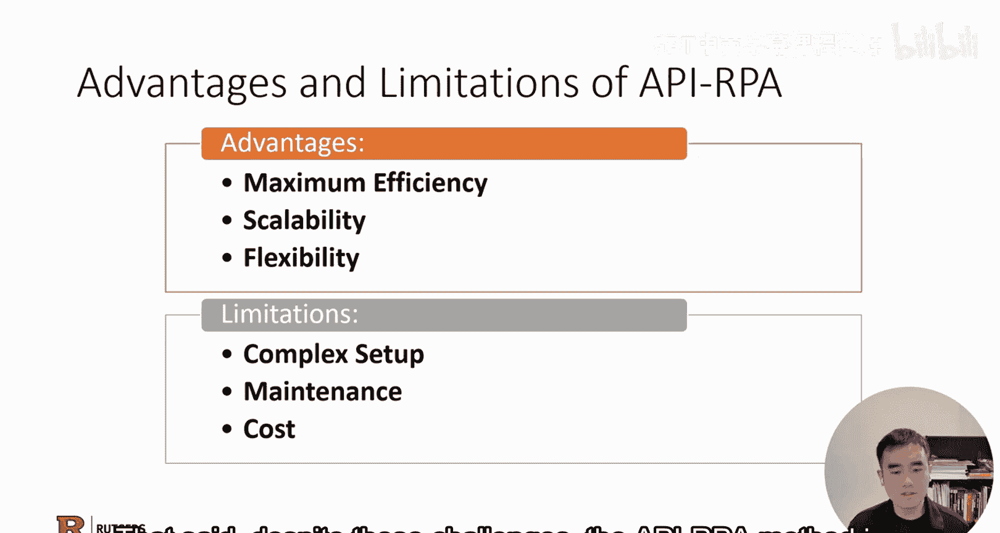
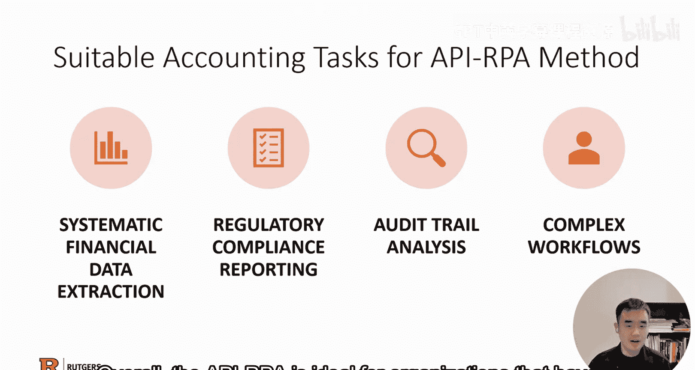
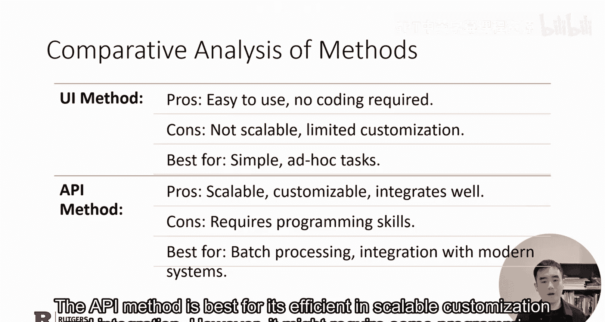
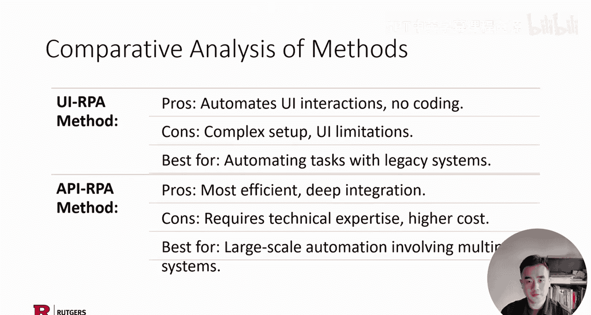

# 罗格斯大学《生成式人工智能与政府财务报告Generative AI & Governmental Financial Reporting》中英字幕 p08 7_API与RPA集成.zh_en -BV1QS7GzEEAU_p8-

Hi， everyone。 Welcome back。 In today's lecture， we will introduce the integration of API and RP approach。

😊，Lastly， let's talk about the API R approach， which combine the best of both world。

 the power of As and the flexibility of R。This approach offers deep integration。

 leveraging the APIs to execute highly efficient queries with Lala lamps。 At the same time。

 it allows automation of data transfer， where RP steps into interact with systems that don't support the API connections。

The result is high efficiency， as the end to end process can be automated with very little human intervention。

 ensuring that the workflow runs smoothly and reliably。Overall。

 the API R PMM method provide the most comprehensive automation solution。

 integrating system and processes similarly with maximizing the efficiency。😊。

Now， let's go over the advantage of the API RPRP methods。First。

 it offers maximum efficiency by autoating not only curing， but also data integration。

It's also highly scalable， capable of handling large volumes of data and workflows。

Another key benefit is is flexibility。This approach adapt well to more complex workflows that involve multiple systems and require seamless coordination。

However， there are several limitations to consider。Complex setup is one of the main challenges。

 as it requires a higher level of technical expertise in both As and R。 Additionally。

 maintenance can become an issue since any updates to system or As might require adjustments to the automation setup。

Lastly， there is the consideration of cost。The initial investment for setting up and training its staff can be higher than simpler solutions like the U I approach。

Thus said， despite these challenges， the API RRP method is the optimal choice for organizations that are looking for deep integration and comprehensive automation across their systems。

Let's now talk about where API RPRP really shines。One of its best use cases is in systematic financial data extraction。

Where it can automate the extraction of data from various sources and integrate it into the database。

It's also highly effective for regulatory compliance reporting by automating the generation and submission of reports。

 It ensures that organizations remain compliant without the need for constant manual intervention。

Another valuable application is in audit trail analysis。

 where the system can continuously monitor for anomalies or potential fraud。

 providing real time insights into financial processes。

And for complex workflows that involve multiple systems and large datas。

 the API R proved to be the most effective solution， handling these in trickycate tasks with ease。

Overall， the API RPA is ideal for organizations that have the technical capacity to support this level of complexity and are looking for robust。

 scalable automation solutions。

To summarize， here is a comparison among different method we have introduced in this module。

For the UI method。It has the benefit like ease of use， No coding requires。

 but is suffered from not scalable and limited customization。 Therefore。

 it best suited for simple and ad ho tasks， like client interaction。

The API method is best for its efficient in scalable customization and integration。 However。

 it might require some programming skills to be connected。Therefore。

 it is suited for tasks like batch processing， integration with modern systems。

Similarly， the U I RRP method has the benefit like ultimate U I integration and no coding environment。

But it is limited by the complex setup and U I own limitations。Therefore。

 it is suitable for automating tasks with Le systems。Finally， for API and RP approach。

It is efficient。And it has the deepest integration capability。 However。

 require technical expertise and involve higher cost。

 So it is suitable for large scale automation involving multiple systems。

That's it for today's lecture。 In the next lecture， we will conclude this module with some tips。

 Thank you for watching。

