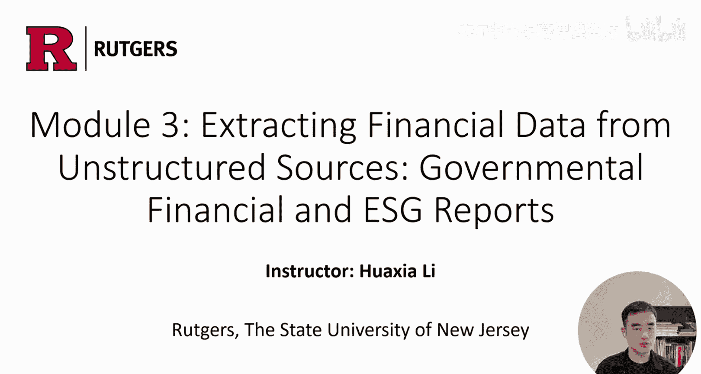
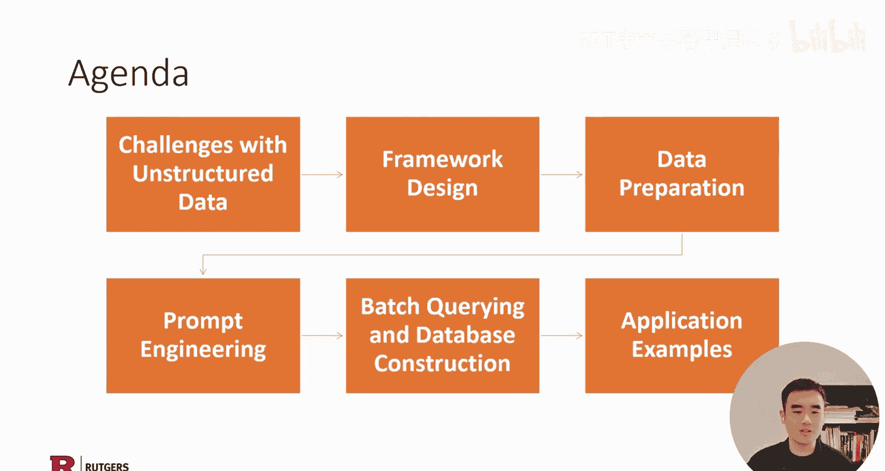
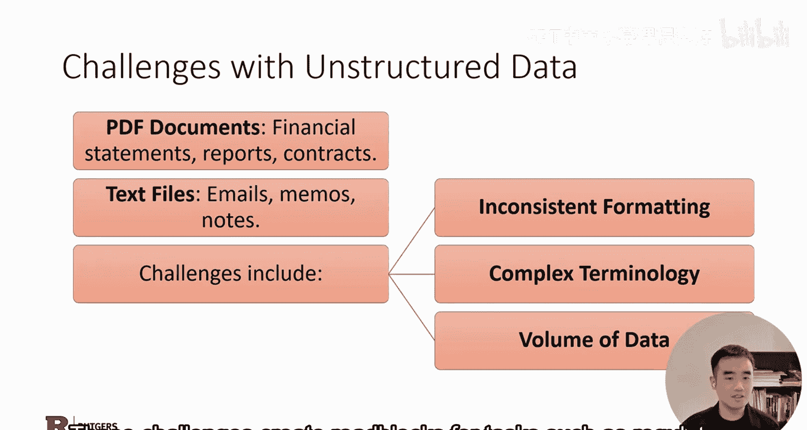
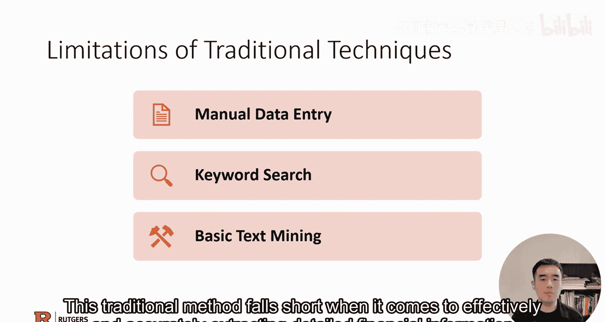
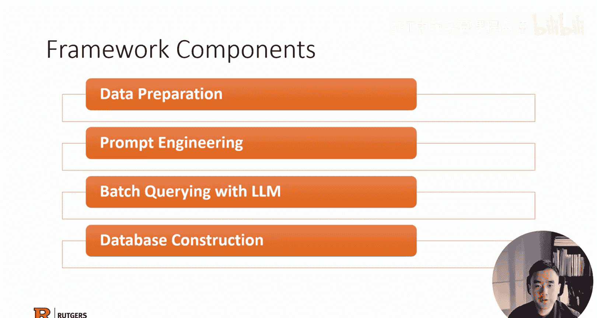

# 罗格斯大学《生成式人工智能与政府财务报告Generative AI & Governmental Financial Reporting》中英字幕 p10 9_非结构化数据介绍.zh_en -BV1QS7GzEEAU_p10-

Hello， everyone and welcome back to our course on generative AI in governmental reports and accounting。

 This is module 3， extracting financial data from unstructure sources， governmental financial and E。

 SG reporting。😊，In this module， we will focus on developing a framework for extracting financial data from unstructured documents like Pdfs。

 which is a common challenge in accounting accounting and finance。By the end of this session。

 you will understand how to leverage La Las to effectively extract the valuable data from ourstructure sources。

 Let's begin。

Today's agenda will cover several important topics。 First。

 we will look at the challenges with unstructured data and gain a clear understanding of the difficulties involved in processing documents like Pdfs。

Then well move on to framework design， where we will introduce an Li L Lang enable framework for extracting data efficiently。

Next， well cover data preparation detailing the steps required to convert and prepare unstructured data for processing。

After that， we'll dive into prom engineering， discussing how to craft effective prompts for accurate and reliable data extraction。

Following that， we explore batch cur and database construction。

 where we will automate the process and organize the results for easy access and analysis。Finally。

 we will wrap up with application examples where we will demonstrate the framework using real world cases to illustrate how it works in practice。

Now， let's begin by discussing the challenges we face with unstructured data。

Our structured data refers to information that doesn't follow a predefined data model or organization。

Some common examples of unstructured data include P D F documents like financial statements。

 reports and contract， as well as text files like emails， memos and notes。Now。

 let's look at some of the changes that come with unstructured data。 First。

 there is the income system formatting， like each document may have a unique layout。

 which make it relatively difficult for automatic tools to extract data accurately。

Then we have complex tech terminology。Financial and government documents often use specialized language and jargon。

 which can confuse standardized extraction tools that are not able to design for this level of specificity。

Lastly， the sheer volume of data poses a major challenge。

Mennuualally processing large quantities of unstructured data is not only time consuming。

 but it also in practical in most scenarios。These challenges create roadblocks for tasks such as regulatory compliance。

 research and decision making。It make it critical to develop more efficient ways to handle this type of data。

Traditional methods for extracting data from onstructure sources have their own limitations。

 For example， menu data entry is still used by a lot of organizations。

 but is highly time consuming and prone human errors。Another method is keyword search。

 but this often proves ineffective because it struggles with varying terminologies across different documents。

Finally， basic text mining tools can extract some information。

 but they tend to miss granular details and struggle to understand the broader context of the data。

 These traditional methods fores short when it comes to effectively and accurately extracting detailed financial information from complex unstructured documents。

 This make it necessary to adopt a more advanced approach。

The framework we will be working with has four main components。 First， data preparation。

This involves converting unstructured documents into machine readable text。

 which is the first step in making the data accessible for extraction。Next。

 pro engineering here we focus on crafting specific prompts that guide the large language models to extract the precise information we need。

Following that batchge curing with La。 once the pro are set。

 we can automate the curing process to handle multiple documents efficiently。Finally。

 database construction。After the data extracted， we organized it into a structure format that can be easily analyzed and used for decision making。

😊，Let's now dive into each component in more detail。That's it for today's lecture。

 In the next lecture， we'll introduce the data preparation part。 Thank you for watching。

