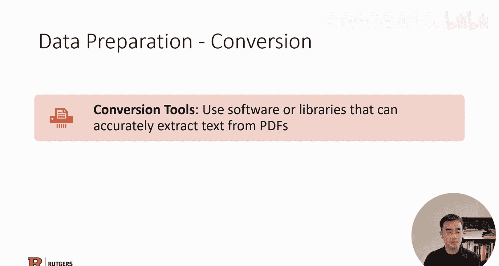
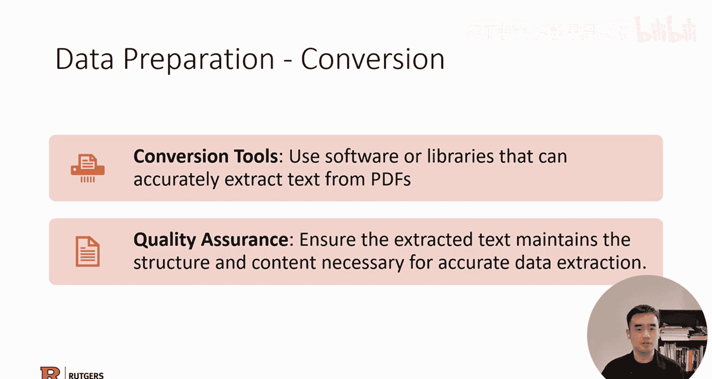
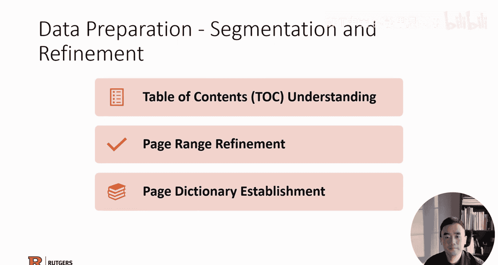

# 罗格斯大学《生成式人工智能与政府财务报告Generative AI & Governmental Financial Reporting》中英字幕 p11 10_数据准备.zh_en -BV1QS7GzEEAU_p11-

Hi， everyone。 Welcome back。 In today's lecture， we will introduce the data preparation。😊。

The first step in our framework is converting documents into machine read text。

This is crucial because without converting the outstructure data。

 we can't begin the extraction process。For this， we rely on conversion tools。

This can include specialized software or libraries that accurately extract text from P Dfs。

In cases where you are dealing with scan documents， O。

 C R or optical character recognition is necessary to convert the image of text into editable and searchable data。

It's also essential to focus on the quality assurance during this step。

The extracted tag need to maintain its original structure and content to ensure that the data extraction process is accurate。

If the text isn't properly prepared， it can lead to errors in the later stage。In short。

 proper data preparation is crucial for the success of everything that follows。

Next， after the initial tax conversion， we move into segmenting and refining the text。

 This step helps us focus on the most relevant portion of the documents for extraction。😊。

We start with type of content or T， O， C understanding here。

 we can use the letter La to interpret the T， O C and identify specific sections that are likely to contain the data we need。

 This step is key in narrowing our focus to the most relevant parts of the document。

Once we have identified these sections， we move to page range refinement。

This involves further narrowing down the pages within those sections to ensure we are only working on the pages。

 most likely to contain the target data， reducing unnecessary processing。Finally。

 we create a page dictionary， which is essentially a mapping of page numbers to specific content。😊。

This allows for quick and easy retrieval of the relevant information during the extraction process。

By doing this， we significantly reduce the amount of irrelevant data that La La has to process。

 which in turn improve both the accuracy and efficiency of the extraction process。

That's it for today's lecture。 In the next lecture。

 we'll introduce different prom engineering techniques。 See you there。

