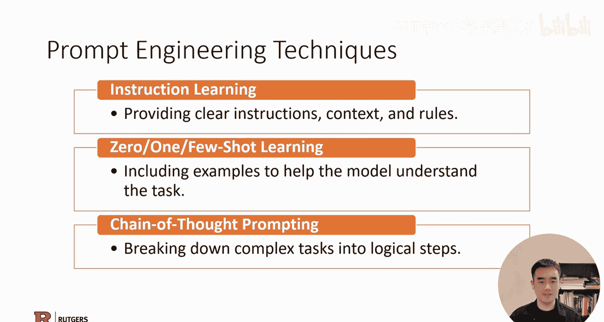
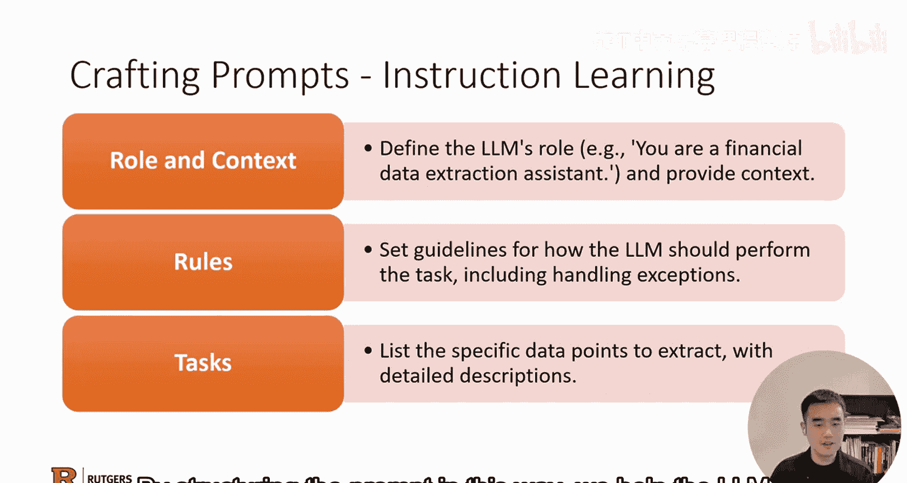
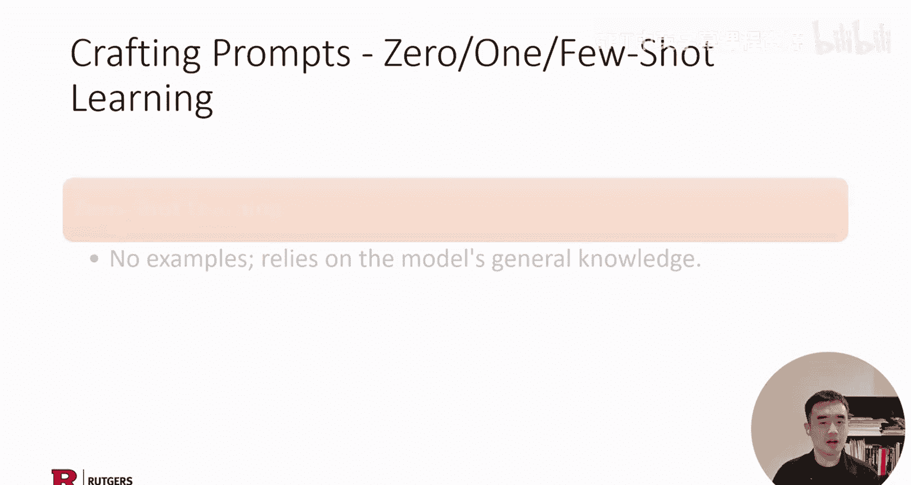
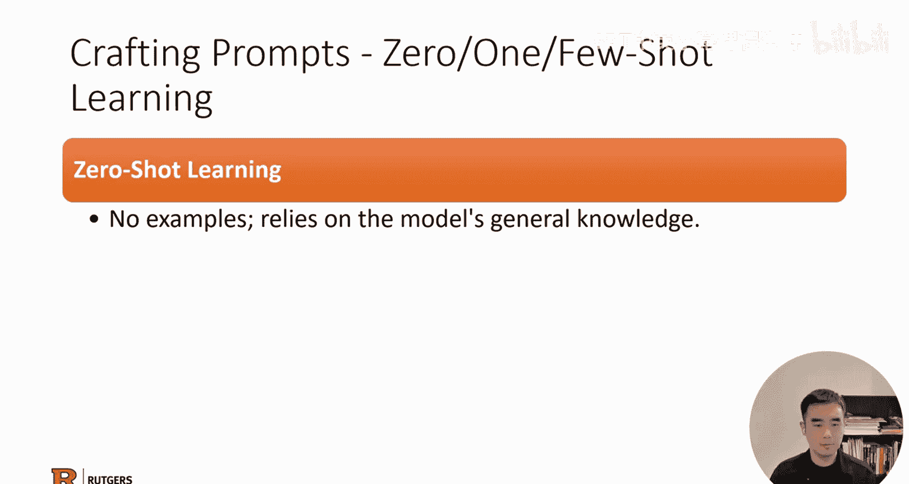
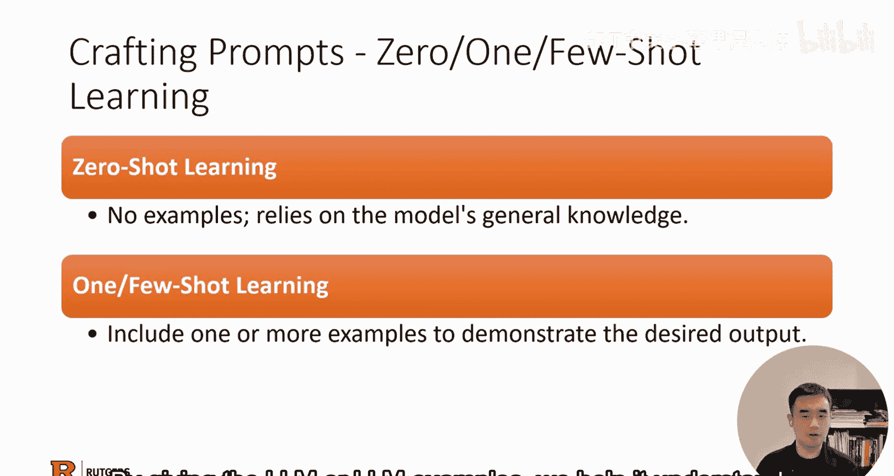
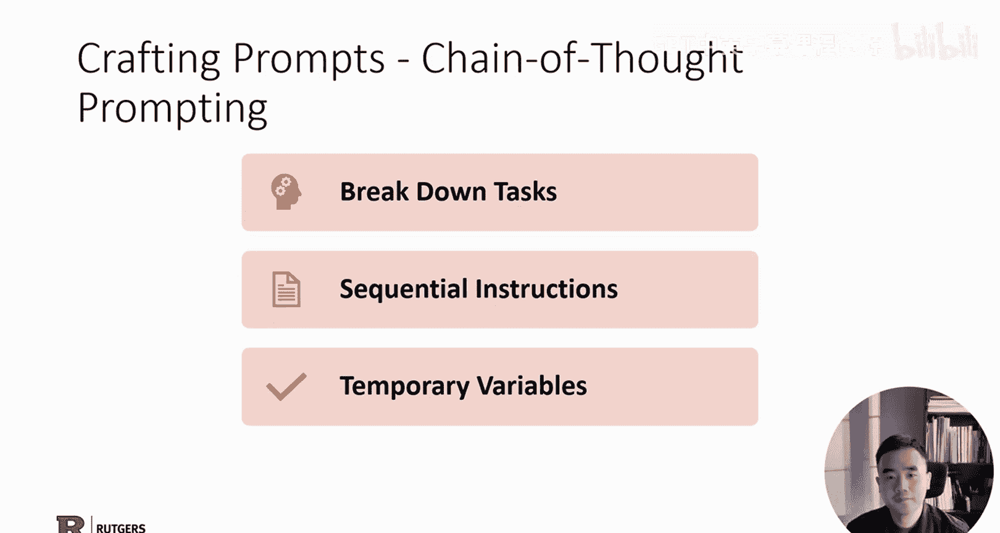

# 罗格斯大学《生成式人工智能与政府财务报告Generative AI & Governmental Financial Reporting》中英字幕 p12 11_提示工程技术.zh_en -BV1QS7GzEEAU_p12-

Hi， everyone。 Welcome back。 In today's lecture， we will introduce some prom engineering techniques。😊。

Now， let's talk about effective pro engineering， which is crucial for guiding the La La to extract the right information。

There are several few techniques we use to achieve this。The first one is instruction learning。

 This involves giving the model clear instructions， contacts and rules to follow。

 so it knows exactly what information to look for and how to extract it。

We also use zero or few short learning。 This technique involves providing the model with examples of what we are looking for by showing a few examples。

 The model can better understand the task and improve its accuracy。Lastly。

 Chan of S prompting helps to break down the complex tasks into smaller logical steps。

 guiding the model through a process in a structured way。By carefully designing these prompt。

 we can significantly enhance a lot less performance in extracting the crack data。

 ensuring both precision and efficiency。😊。

In instruction learning， we structure the prompt into three key parts to guide the letter lamp effectively。

Roll and context。 First， we define the ladder lamp rule and provide the necessary context。

 For example， we might say you are a financial data extraction assistant。

This sets the stage for the model， helping it understand the purpose of the task。Second， rules。

 we set specific guidelines for how the latter lamb should perform the task。

This can include instructions for how to handle exceptions like missing data or ambiguous information。

 ensure consistency and accuracy in the output。Third tasks。

 We list the specific data points we need the model to extract。

This should be described in detail to avoid any confusion。 For instance。

 we might specify extract the total revenue figure from the financial summary。

By structuring the problem in this way， we help the letter lamb understand exactly what is expected。

 Imp both accuracy and efficiency in that extraction。

For more complex extractions， we can enhance the letter less performance by providing examples。

There are a couple of approaches we use。0 short learning。 In this case。

 we provide no examples at all relying on model's general knowledge to handle the task。

 This can be useful for straightforward tasks。 or when the example are not available。

Next， one or few short learning。 When the task is more complex。

 we include one or more examples to demonstrate the desired output。

These examples show the format of the input and what the expected output should look like。

By giving the ladder length examples， we help you understand the task more clearly and generalize to new similar tasks。

 which lead to more accurate and reliable extraction。

Chain of soap prompting is a technique that guides the ladder lamp through a step by step reasoning process。

 which is especially helpful for more complex extractions。First， break down tasks。

 We start by dividing the extraction into smaller logical steps。

 This make it easier for the model to focus on one part of the task at a time。

 rather than trying to extract everything at once。Next， sequential instructions。

We provide step by step guidance， leading the letter lamp through each part of the process in order。

 This ensures that the model follows a clear， logical path in its extraction。

Following those temporary variables。We along the way。

 we can use placeholders or temporary variables to store intermediate results。

 This allows the letter lamp to remember key pieces of information as they move through the steps。😊。

By using chamaw prompting， we improve the ladderland ability to handle more complex extraction。

 especially those that require a degree of reasoning and logic to get the right answer。

That's it for today's lecture。 In the next lecture。

 we will introduce batchge curing with La la La and database construction。 See you there。

