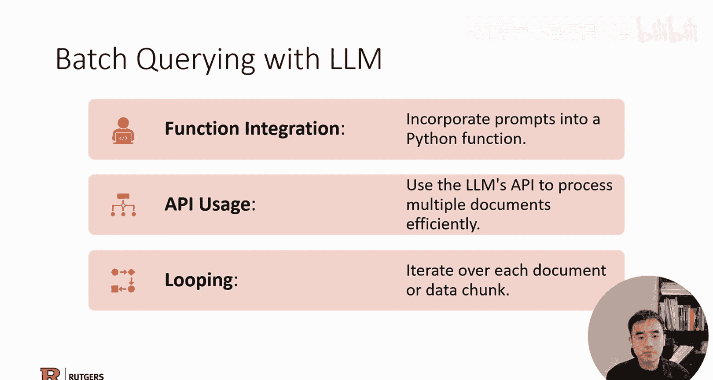
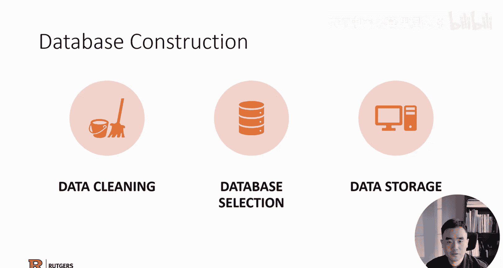

# 罗格斯大学《生成式人工智能与政府财务报告Generative AI & Governmental Financial Reporting》中英字幕 p13 12_批量查询与数据库构建.zh_en -BV1QS7GzEEAU_p13-

Hi， everyone， welcome back to our lecture。 In today's lecture。

 we will introduce batch cur with La la La and database construction。😊，Once our prompts are crafted。

 the next step is to automate the curing process。 Here is how we do that。 First。

 function integration。We start by incorporating the prompts into a Python function。

 which allows us to reuse and apply the same instructions across multiple documents。Next， API usage。

Using the La Las API， we can efficiently process multiple documents at once。

They speed up the extraction process， especially when dealing with large data set。Finally， looking。

We set up a loop to iterate over each document。This ensures that every document in the data gets processed in a consistent and automated manner。

By automating this process， we significantly reduce manual effort and ensure consistency in how data is extracted across the entire data set。

After the data has been extracted， the next crucial step is to organize the data for further years。

 like data cleaning。 This involves converting the extracted value into appropriate data types。

 such as numbers of data and addressing any missing or incomplete values to ensure data integrity。

Daabase selection。 we choose a database system that best fits our need。

 It could be a SQ L database for structure data and more flexible storage。

The selection of database depends on the type of data and how it will be used。Data storage。

Once cleaned， the data is loaded into the selected database here。

 It is important to set up appropriate keys and indexes。

 which will help the efficient curing and retrieval。

By storing the extracted data in a structured way， we make easier for analyze and generate reports enabling more informed decision making。

That's it for today's lecture。 In the next lecture。

 we will introduce one real life application of using this framework in annual comprehensive financial report of the local government。

 See you there。

