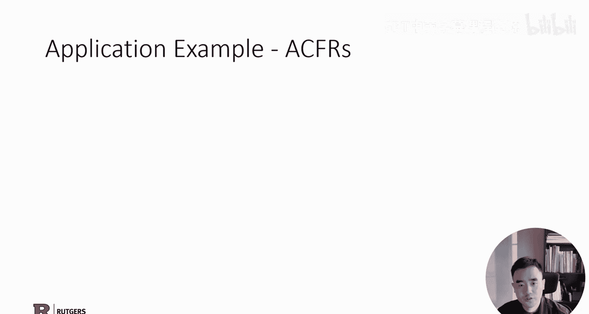
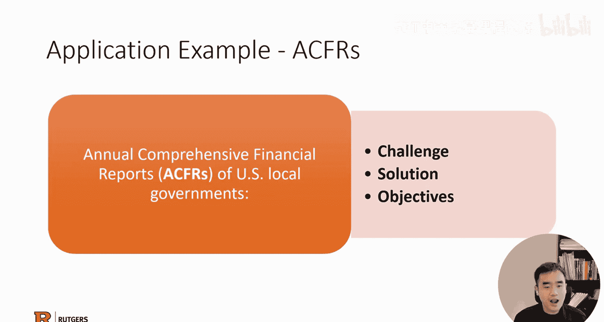
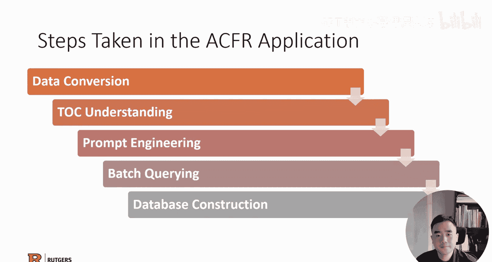

# 罗格斯大学《生成式人工智能与政府财务报告Generative AI & Governmental Financial Reporting》中英字幕 p14 13_示例：提取年度综合财务报告.zh_en -BV1QS7GzEEAU_p14-

Hi， everyone。 Wele back to our lecture。 In today's lecture。

 we will look at one real world application of this framework on efforts。😊。

Now， let's take a look at the real world application of this framework。

Extracting financial data from any comprehensive financial reports or efforts of the US local government。

The challenge with efforts is that there are often lengthy P DF documents with highly inconsistent formatting。

 make it difficult to extract data manually or with traditional methods。

The solution is to apply our ladder lending enabled framework to extract the key financial variables。

 such as revenue， expenditures and fund balances in a consistent and automated manner。

Our objective is to extract this data with high accuracy and efficiency。

 overcoming the issues posed by inconsistent formaling。

This example clearly demonstrate the framework's effectiveness in handling complex unstructured documents in a real world scenario。

 showing its value in automating financial data extraction。

Here are the specific steps we follow to extract the financial data from the efforts。First。

 data conversion。 We use software to convert the P Dfs into machine read or text。For scanned pages。

 we apply the O CR to capture the tag accurately。Second， T。

 O C understanding or type of content understanding。

The letter line was used to interpret the type of content in each document。

 helping us pinpoint the sections that contain the financial data we needed。Ser。Prom engineering。

 we crafted prompt using instruction learning and included few short examples to guide the letter La in extracting the desired information accurately。

Fourth， batchge curing to handle multiple efforts efficiently。

 We process them in batches using the letter lamp API， automating the extraction process。Finally。

 database construction。We store the extracted data in a relational database。

 organizing it for ease access and analysis。This whole process was iterative。

 meaning we refine the prompts and method based on the result from the initial queries。

 improving the accuracy and efficiency with each pass。That's it for today's lecture。

 In The next lecture will look at another example on ES SG report。See you there。

