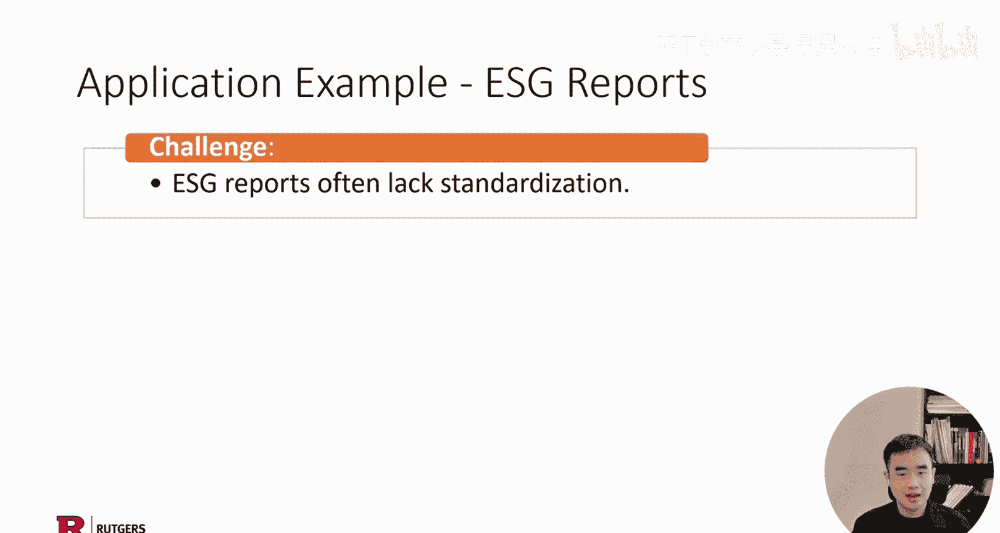
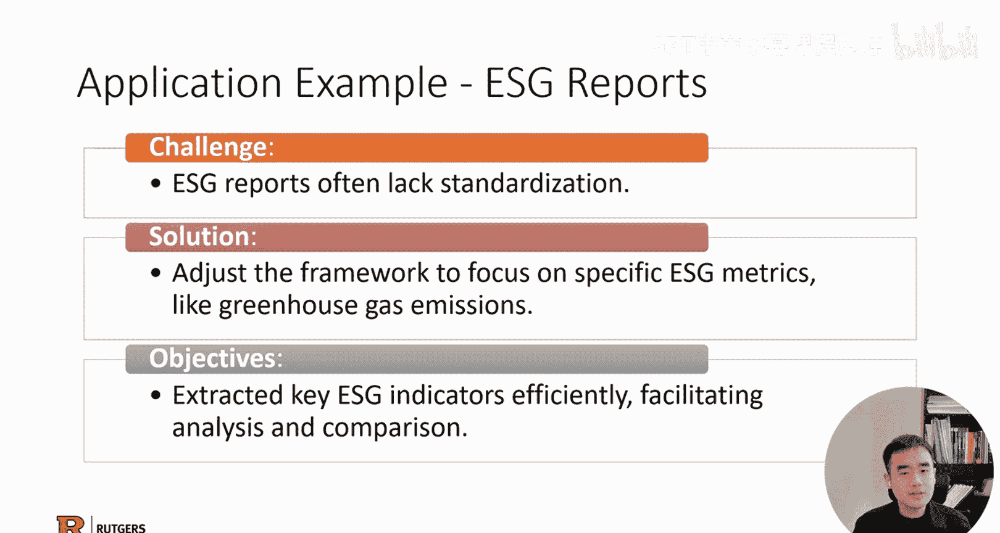
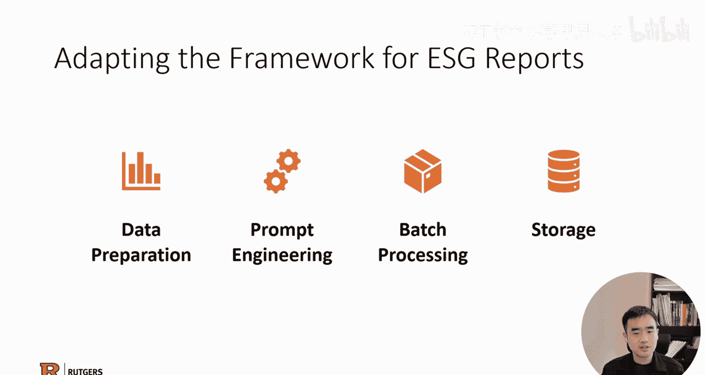
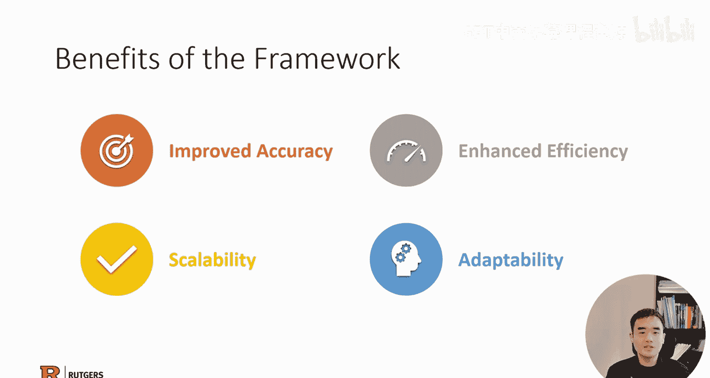
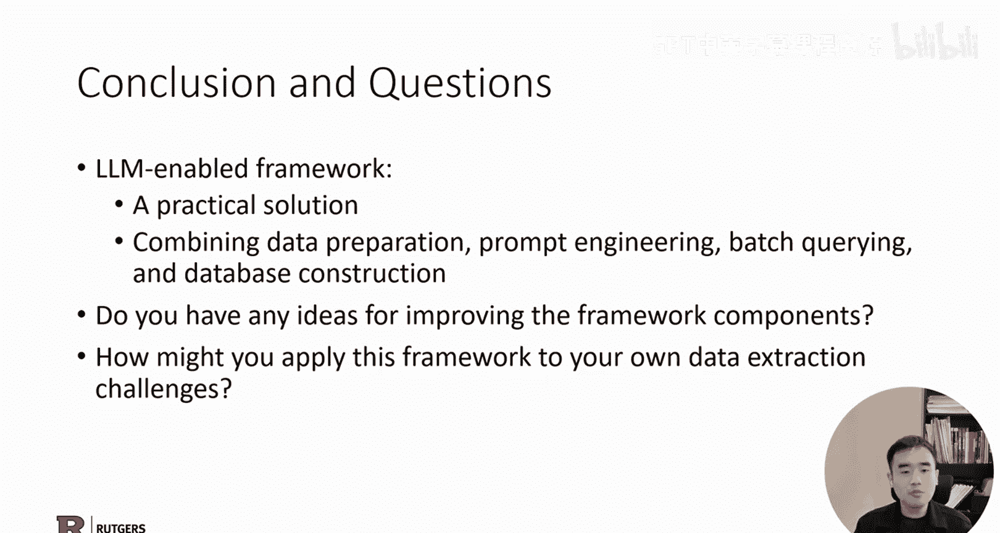

# 罗格斯大学《生成式人工智能与政府财务报告Generative AI & Governmental Financial Reporting》中英字幕 p15 14_示例：提取ESG报告数据.zh_en -BV1QS7GzEEAU_p15-

Hi， guys。 Welcome back。 In this lecture， well look at another example on ES SG report。😊。

Another powerful application of this framework is extracting environmental。

 social and governance data， or ES SG data。The challenge here is that E ST report often lacks standardization with each company presenting information in different format and structures。

The solution was to adjust the framework to focus on specific ES SG metrics。

 such as greenhouse gas emission， workforce diversity or governance practices by tailoring the prompts to target these key indicators。

 We were able to extract the relevant data efficiently。

The objective was to extract these ES SG indicators with accuracy and speed。

Allowing for easier analysis and comparison across different entities。

This example highlights the framework's adaptability。

 demonstrating its effectiveness not only for financial data。

 but also for handling different types of data like the E SG data。

 which are increasingly important for decision makers。

To adapt a framework for ES SG data extraction， we made a few targeted adjustments from our previous application。

First， data preparation。We adjusted the regular expression patterns and keywords to better capture ES SG specific terms such as greenhouse gas emissions。

 sustainability metrics and social impact indicators。Next， prom engineering。

 We modify the prompts to focus on extracting relevant ES SG data points。

 ensuring that the latter La was guided toward the right information in each report。

Following that batch processing， we apply the same automation techniques。

 as in the previous use cases， allowing us to efficiently process multiple documents at once。Finally。

 storage， we ensure that the database could handle the specific data types and units commonly used in the ESD report。

 such as tons of CO2 or percentage of workforce diversity。Throughout this adaptation。

 the cool framework remained unchanged， demonstrating its versatility across different types of unstructure data and use cases。

The key benefits of using this framework include first， improved accuracy。By leveraging the language。

 understanding capability of letter lamps， we can reduce errors commonly seen in traditional extraction methods。

Next， enhanced efficiency。Automation drastically cuts down process in time。

 allowing us to handle large volumes of data much faster than manual process。Scalability。

This framework is designed to scale， meaning it can handle large data set with ease。

 making it suitable for both small and large projects。Finally， adaptability。

Perhaps one of its greatest strengths is its adaptability。

 It can be applied to various unstructured data sources。

 from financial reports to ES SG data and beyond。Overall。

 this framework efficiently addresses the common challenges associated with data extraction tasks。

 providing a reliable， scalable solution for handling all structured documents。

In conclusion， extracting financial data from unstructured sources is a significant challenge in accounting。

This letter Lami A framework provides a practical solution by combining data preparation。

 Pro engineering， batch cur and database construction。By applying this framework。

 you can enhance the efficiency and accuracy of data extraction in your organization。

In the next module， we will evaluate the performance of this framework and discuss ways to further improve it。

 Thank you for your attention。 Now， let's open the floor for questions。

Do you have any questions about these framework components。

 How might you apply this framework to your own data extraction challenges。

 Feel free to share your thoughts。

