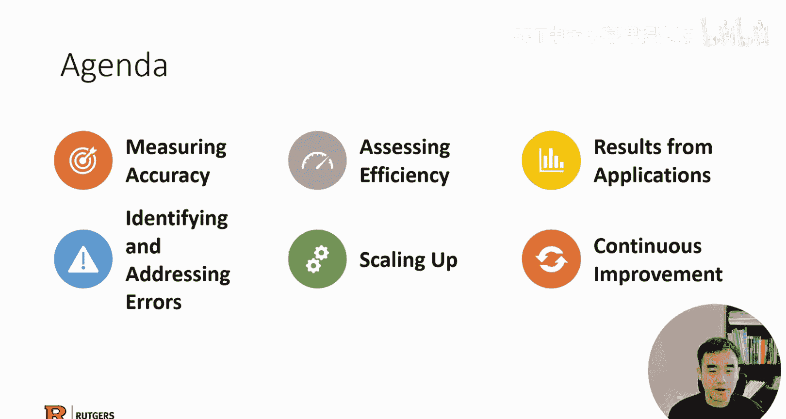
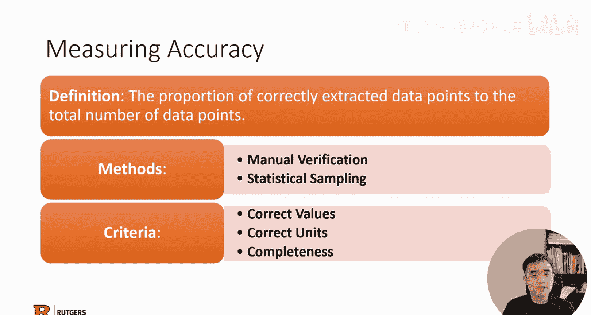
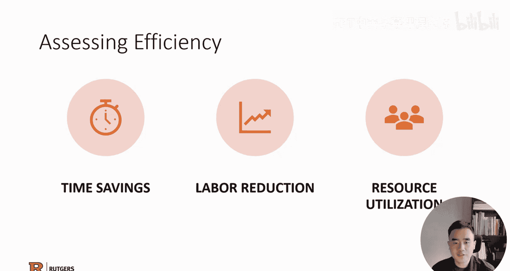

# 罗格斯大学《生成式人工智能与政府财务报告Generative AI & Governmental Financial Reporting》中英字幕 p16 15_政府与ESG报告的准确性与效率.zh_en -BV1QS7GzEEAU_p16-

Welcome back to our course on generative AI in governmental reports and accounting。 This is module 4。

 evaluating framework performance on governmental and E SG report。 In this module。

 We will assess the effectiveness of the La learning Apple framework we introduced in the previous module。

 We will look at how to measure accuracy and efficiency。

 discuss the results from the real world applications and explore ways to further improve its performance。

 Let's begin。😊，We will start by understanding what it means to measure accuracy in the context of that extraction。

Next， we will examine efficiency。 It's not only about accuracy。

 We also need to consider how quickly and resource effectively the framework operates。

Well then look at practical results from effort and ES SG reports。

 which allow us to evaluate the framework performance in a real world application。And， of course。

 every framework has rooms for error Here。 We'll discuss how to identify common errors and best strategies for addressing them。

As we move to larger data， scalability becomes essential。

 We will talk about the challenges and adjustment necessary when our data sets expand in volume and complexity。

Finally， framework should be evolve over time。 We will cover ways to refine our approach based on user feedback。

 error analysis and change in reporting requirements。

Now， we are focused on accuracy， a key metric in data extraction that tells us how much of our extracted data is correct out of the total data points。

How to measure the accuracy， The first approach is manual verification。

 This method involves directly comparing each extract data point with the source document to ensure exact matches It highly accurate。

 but time consuming for large dataset set。A second approach is statistical sampling。For larger data。

 we select a sample of data points to check accuracy。

 giving us an overall estimate while save some time。😊，Then what is the criteria for accurate data。

 First， correct values。The data should match the source exactly with no errors in numbers or text。

Then correct units， ensuring data is in the correct unit。

 like thousands or mediums to prevent misinterpretation。Finally， completeness。

 all of the required data point should be included with no missing data， which can ske the results。

In general， accurate data is the foundation for reliable analysis and for decision making。

 especially in context like governmental and E SG reporting。

 where areas could have serious implications。

Next， let's talk about efficiency， which is all about resources needed to perform the debt extraction。

Efficiency is not just speed。 It includes everything from the time saved to the computational resources used。

First， time savings。We measure how much faster the framework is compared to the menu extraction。

This metric shows us how much time we are saving overall。Next， level reduction。

Efficiency also means reducing the manual effort。By measuring the decrease in human labor required。

 we can understand the labor savings and potential to free up staff for other tasks。Finally。

 resource utilization， we evaluate the computational resources used。

 such as the number of API calls or processing power。😊。

This helps us to see whether we can further improve the accuracy。

Efficiency gainss are not only just about speed。That translate into real cost savings。

By reducing time and labor， we can real human resources to higher value tasks。

 improve the overall productivity and effectiveness。That's it for today's lecture。

 In the next lecture， we will evaluate the result from effort and ES SG applications。 See you there。

