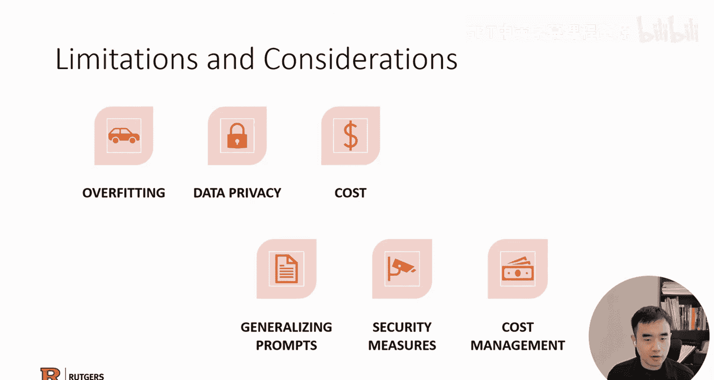
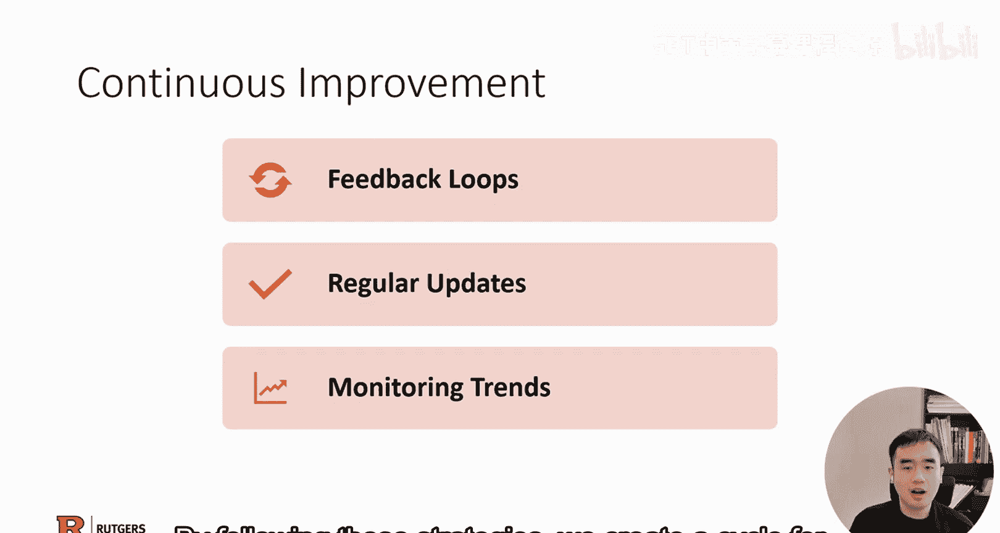
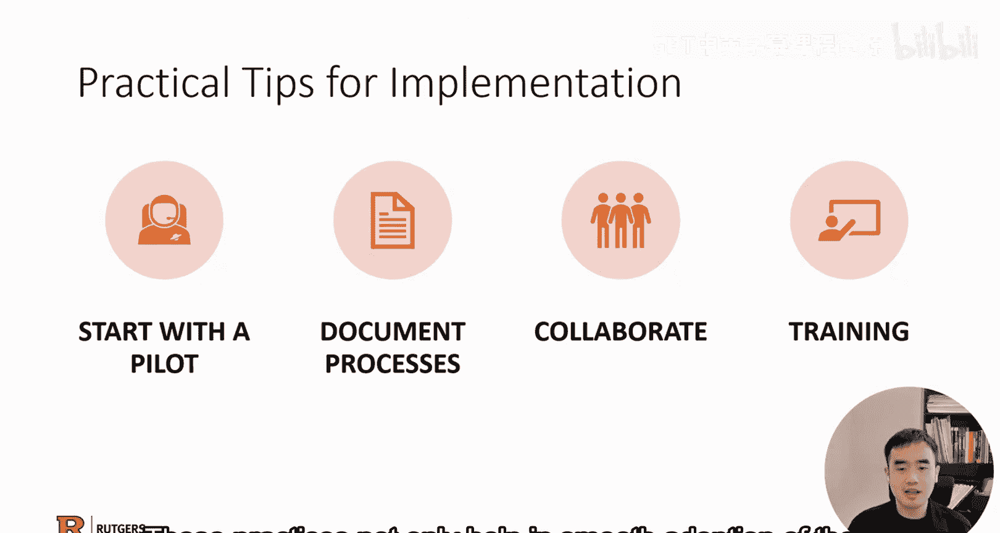
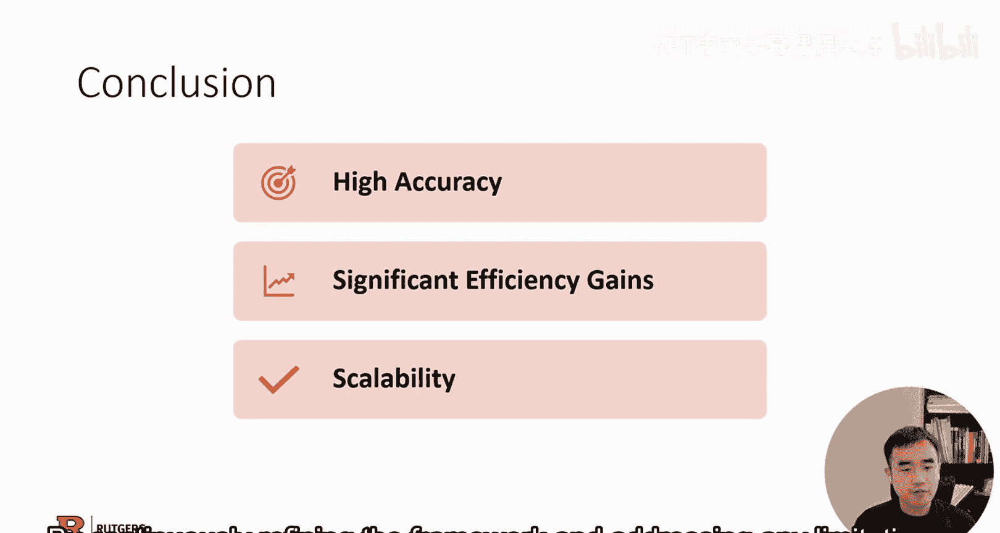
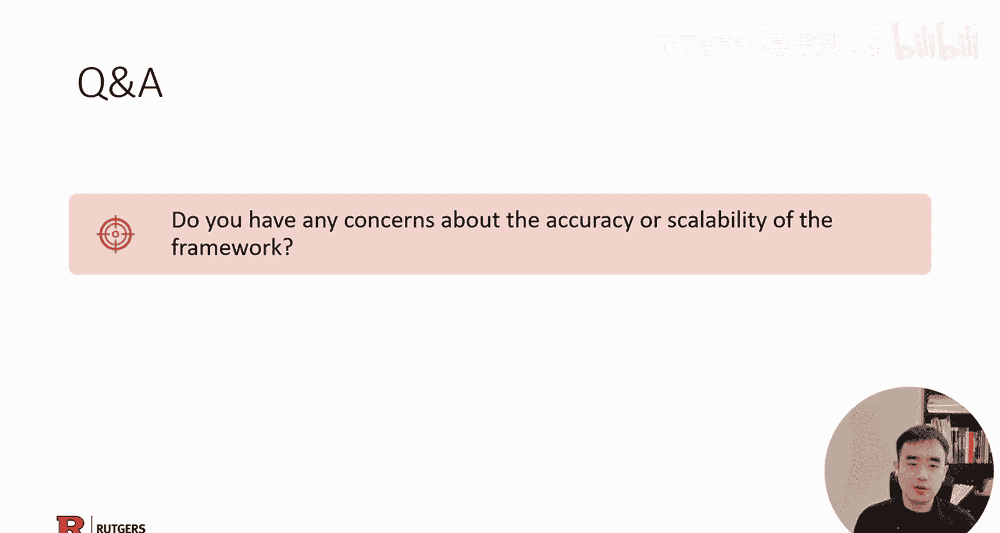
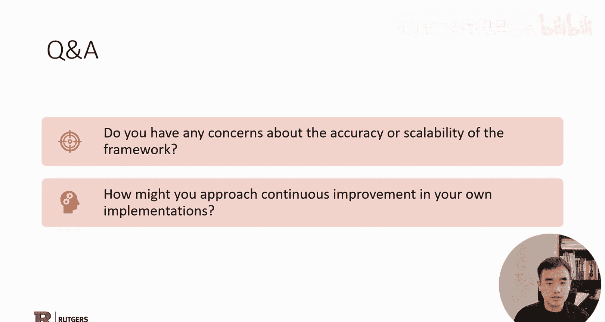

# 罗格斯大学《生成式人工智能与政府财务报告Generative AI & Governmental Financial Reporting》中英字幕 p18 17_限制考虑与总结.zh_en -BV1QS7GzEEAU_p18-

Hi， guys。 Welcome back to the final lecture of moduleule 4。 In this lecture。

 we'll discuss some limitations， considerations and practical tips。😊。

While our framework shows strong performance， there are some important limitations to consider。

 First， overfiing， when prompts are too tailored to a specific data。

 they may not work as well as on other documents。Second， data privacy。

Since we are handling sensitive financial data， secure methods are essential。Next， cost。

Advanced models like G 4 offer higher accuracy， but can be costly to use。To tackle these issues。

 we can first generalize the prompts。 We can design prompts that work across various documents types to prevent overfiing。

We can implement security measures， for example， use encrypt connections and adhere to the data protection laws for data privacy。

 Finally， we should manage the cost。We should optimize prompts to use fewer tokens and consider alternative models。

 when feasible。By addressing these concerns， we make the framework more versatile。

 secure and cost effective。

To ensure our framework remains effective over time。

 it is important to focus on continuous improvement。

There are some key strategies for ongoing performance。 First， feedback loops。

Incorporate user feedback and error reports to refine the accuracy and usability is important。Second。

 regular updates， adjust prompts and methods whenever new versions of not La are released to stay up to date。

Search， monitoring trends。Keep an eye on advancement in AI and data extraction to adopt new。

 effective techniques。By following these strategies。

 we create a cycle for continuous improvement that helps maintain the framework's performance as technology evolve。

To successfully adopt and utilize this framework， here are some practical tips to keep in mind。First。

Start with a pilot。Begin by testing the framework on a smaller， manageable data。

This helps you identify any issues early on。 assess performance in a control setting and make necessary adjustment before committing to a full scale ruleout。

Second， document processes。Maintain thorough documentation of all prompts， settings and results。

This make it easier to replicate successful configurations and troubleshoot when issues arise。

Documentation is key for consistency and reproductibility。

 especially as team members may work with each other and over time。Third。

 collaborate with I T and data specialists。Working with I T and data experts can be invaluable for assessing technical challenges。

 such as integrating the framework into existing systems or ensuring data security。

Their expertise can help to optimize performance and troubleshoot issues more effectively。Finally。

 training for team members。Provide targeted training to team members who will be using the framework。

 This ensures they understand the best practices for using the framework can interpret results accurately and are prepared to make adjustment as needed。

These practices not only help in smooth adoption of the framework。

 but also maximize its effectiveness by ensuring team readiness， consistency and technical support。

In summary， evaluating our Lala Lemi frameworks performance involves looking closely at both accuracy and efficiency。

First， high accuracy。We achieve this by using careful prompt engineering and ongoing refinement to ensure reliable data extraction。

 Second， significant efficiency gains。 Autoation has enabled a dramatic reduction in processing time。

 making the framework much faster than menu method。😊，Next， scalability。

 the framework performs effectively on large data sets。

 maintaining consistent accuracy and speed as the data volume increases。

By continuously refining the framework and addressing any limitations。

 organization can significantly enhance their data extraction capabilities。

 leading to a more reliable and efficient process。

Now， as we have conclude this module， let's open the floor for questions and discussions。

Do you have any concerns about the accuracy or scalability of the framework。

 Are there any specific challenges you foresee in applying it in your own data。

How might you approach continuous improvement in your own implementation。

 Are there any techniques you have considered to ensure ongoing accuracy and efficiency。

 Feel free to share your thoughts， ideasas or any additional questions you might have。

