# 苏黎世联邦理工《大数据｜Big Data - ETH Zurich - Fall 2024》中英字幕（deepseek - P10：-10-4. Distributed file systems (1_4) -.zh_en - GPT中英字幕课程资源 - BV1sHPKeoEJU

Welcome back so now we are moving already to path four getting it's really es ellappssing very fast once we start the semester so we are going to look at distributed file systems so so far with rehearsed relational databases right so PostgsQLqQl and one that are monoic they are on a single machine。

😊。

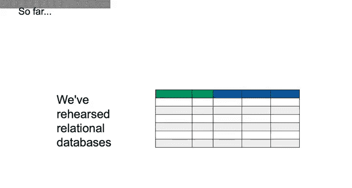

We looked into scaling out， right， the idea that instead of a single machine。

 you now have a whole cluster of machines， we saw that。

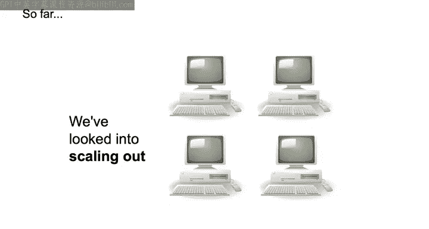

While scaling out we now can store very large number of objects or key values right in this model。

 the key value model notes that the key value model is both for object stores and key value stores right both with S3 and with Dynamo we have the key value model however be careful because even even though it's the key value model for both when you say key value store you really really mean the one that has a low latency with smaller values right people would not call S3 a key value store because the objects are too large for that but nevertheless it has a key value model right it's the idea that you assign is two values。

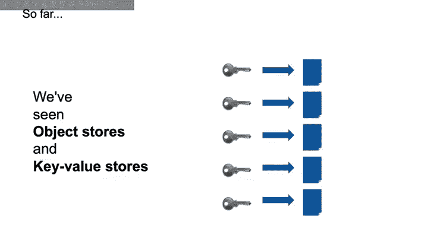

Now。We can use that this kind of storage as a drive or storing data set。

 So what's typically going to happen when you start querying data and extracting information from data is that you will have the raw data that might come from sensors or from sound。

 maybe that's what you accumulated while letting the particles collide with each other。

 So this is the raw data and at some point you're going to execute queries and you're going to get derived data right that's basically a modification of the data that you wrote with your own code and you have derived data。

Now is the question where does the derived data go especially if it's also petabytes of data and the answer is it goes back to the same kind of storage mediumn as the raw data right so maybe the raw data was on S3 and you can also write back the derived data to S3 right so I'll come back to that later when you actually look at the system that process the data but the idea is really that you read the data from cloud storage for example and you write it back to cloud storage right。

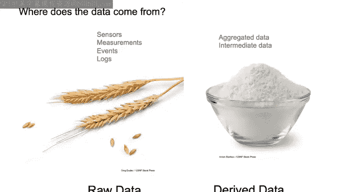

But the thing is theres big data and big data and what I mean with that。😊，In order to oversimplify。

 you can have huge amounts of large files， maybe in your data。

 or you can have a large amount of huge files and actually does make a difference with the architecture that you are going to use。

That was too fast。 Yeah， so what I mean with huge amount of large fights is billions of terabyte filess right so I'm thinking of a Netflix series as a worldwide service stored on S3。

 that's called object storage right So billions because again it's all over the world。

 everybody uses the same storage medium。😊。

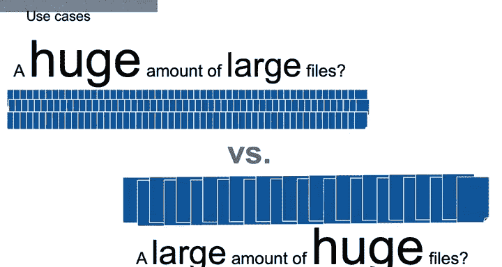

Vus what we are going to look at today where it's more like millions of petabyte bytes so the fights can be much。

 much， much larger， but it's less bytes， right？This file storage is not going to be a worldwide storage system like S3 it's going to be something you put on your own cluster and that you're responsible for right or Amazon can create it for you but it's still yours right so this is your own local file storage that can store millions of petabyte files right so again I repeat what's on the top is what we did last week that's basically Amazon S3 or Asia B storage what we look at today's file storage that's millions of petabyte files。

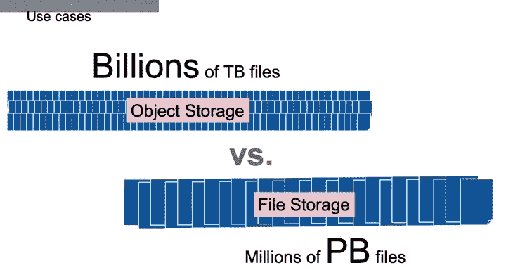

So again， to really order this and make it tidy in your minds。

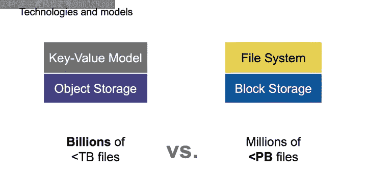

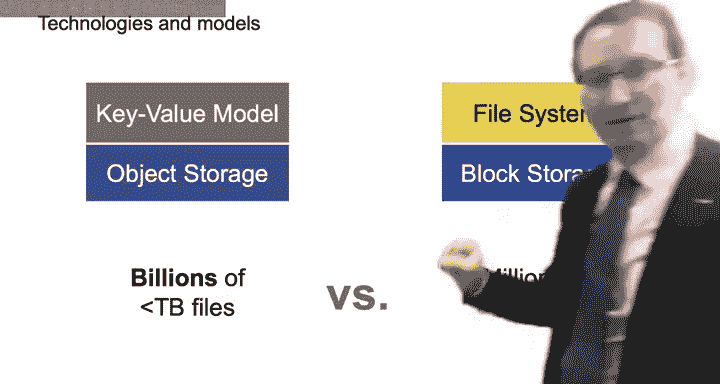

When we have Amazon S3， we have a keyvalue model flat， no hierarchy， the ss are only in the UI。

 but they are not really part of of the model right the key is just flat and that's called object storage because you have these black boxes of up to5 terabyte but now what we are going to look at has a5 system we will see does have a hierarchy with directories and files right so no longer on flat key value model and there will be block storage in the sense that we will make the blocks important just like the blocks on your hard drive 4 kilobyte blocks that you have on your on your laptops so this is where this is going。

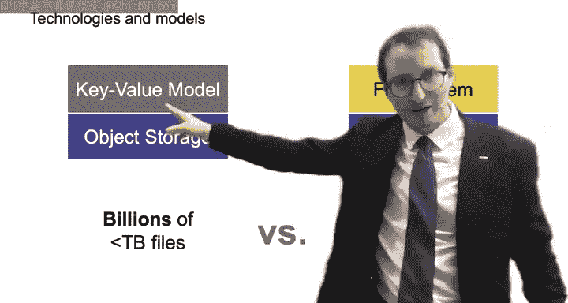

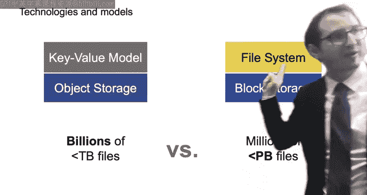

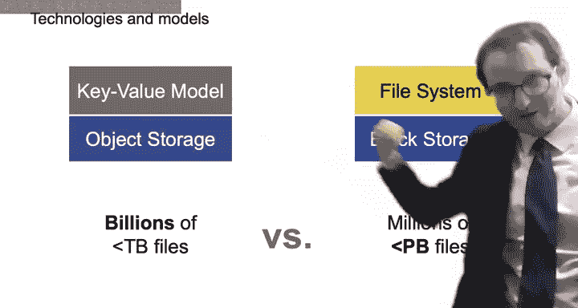

This all started actually in the 200s right 2004 roughly at Google。

 they started noticing that they have trouble storing the data and there is no technology that allows storing data on larger drives right so they hit the limits of the drive and so they thought okay we need a way to simulate an enormous drive but just spread of our machines scaling out can have1 thousand machines and we need to simulate to make it look like it's a single file system that the user doesn't really feel the difference between file system on the computer and a file system on a cluster they called it Google FS GFS right the Google find system。

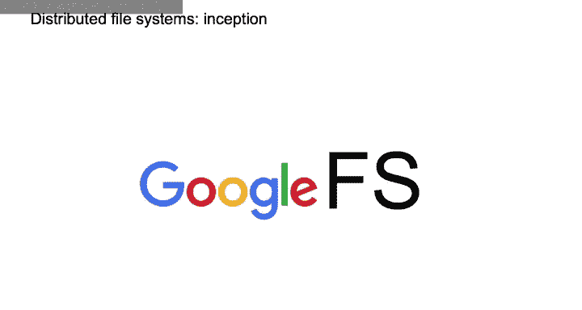

嗯。Now it's not as easy as it seems， because some things change， for example， if you have a laptop。

 it might crash once in a while， some of you probably had crashes while you lost data。

 some others never had the problem， right， it might fail。

But when you have a cluster that has hundreds or even thousands of machines or even tens of thousands of machines。

 it's not a question of if it will fail， it's a question of when。😊，Keepips failing。

 you have people that are hired full time in the data center that just run everywhere and replace the paths that crash right you need people just follow that so they will fail and that means that when you design the system you have to take these into account。

Now you probably already have a few ideas of what we can based on what we did today and last week。

 for example， replicating the data， if you store it at multiple locations。

 then you can recover from crashes but that I'll come back to。

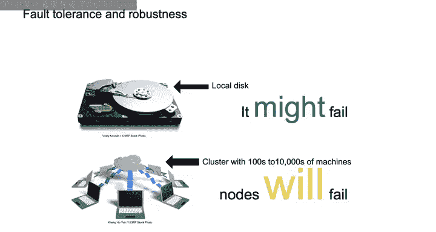

Okay， so we want a system。😊，That is immune to that even if the machines crash once in a while。

 it continues to work so the first thing you need is a way to monitor the crashes so that you're aware right you detect the errors and then you need a way to automatically recover from these errors right on the flight because they happen all the time。

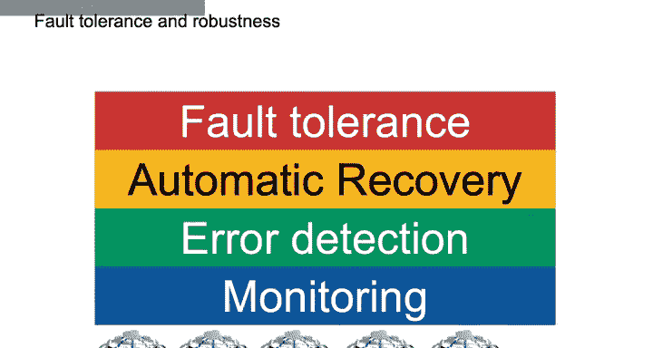

And to make it called To， so it means that it's automatic you don't need people to replace what has crashed。

 it should continue to work and when people replace the hard drives with new hard drives。

 then you just continue to work with even more hard drives right but the recovery has to be automatic no human intervention right it just has to continue to work。

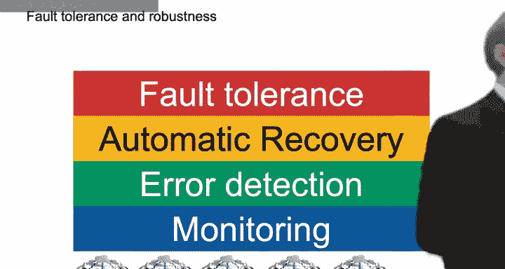

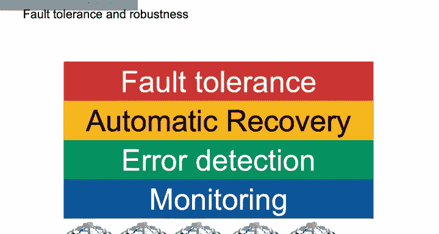

Another feature so now I'm list just the requirements of what we want another feature of the system has to do with random access versus scanning files and so on so it's basically called the access pattern。

If you work on your laptop。You use， I don't know， spreadsheets software or whatever。

 or you're basically editing files。You can access your files anywhere on the hard drive right the disk is made for that it's made for random access you can just access the data anywhere might have a bit of la C you know for the disk。

 but it's actually created for random access you can read and write everywhere。😊。

Do we want that for our distributed5 system？We could， right， we could say， okay， yes。

 I wanted to have random access。But in fact， in big data。

 we don't really need random access because what does it mean big data means we download the data。

 we put it somewhere， we write it down， and then we process something in parallel。

 then we write the output。But when you write the output of your query， you don't need random access。

 you just write it down right from the beginning to the end， so it's something linear right。

 you just open a new file， write it down in the order in which you store the bits and then you're done that's absolutely not random access。

So to the question do we need random access power system that we intend to use for querying data right analytics。

 the answer is no we do not need random access that's actually great because that makes it easier to design the system if we don't need random access。

So the system that we are going to design is going to be very bad at random access if you try to use random access。

 it's going to be very， very slow and inefficient， we want it to be efficient if you scan data。

 if you scan through the data or if you write a file from the beginning to the end that we want to be very efficient。

😊。

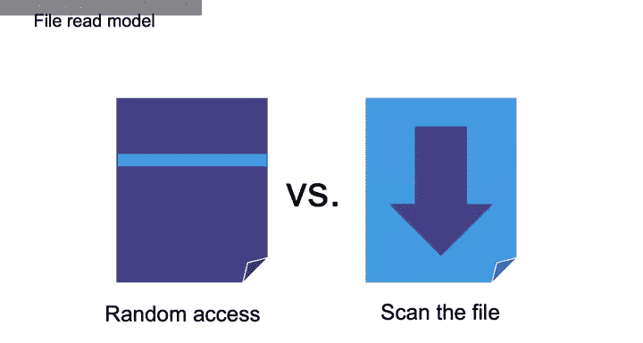

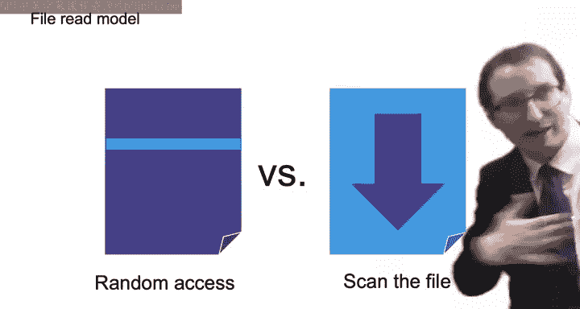

We also want it to be efficient that app data， you have a sign and you want to write at the end of the file。

I think of a log right if you have a log， you just keep writing at the ends right so this is also something that we would like。

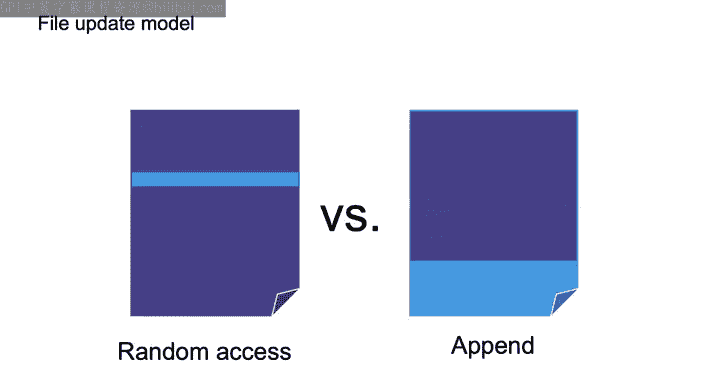

出嘟 to的第一张。Why do we want that well think of the use case whether does the data come from it could come from sensors from the collider。

 the NHC from logs and so on， this is data that just flows into the system right every second you just create new data so you want your file to basically be appendable that you keep adding and adding and adding data but this stays immutable once you have writing it written it it's immutable but you still want to add new data。

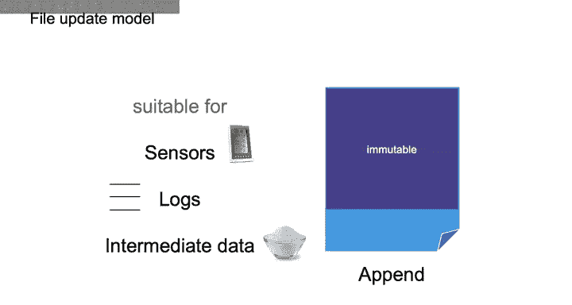

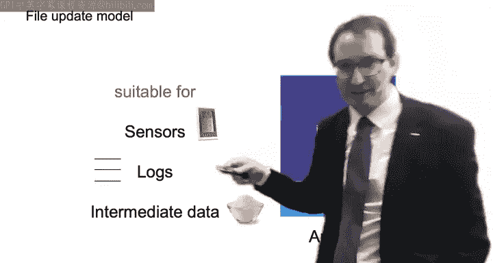

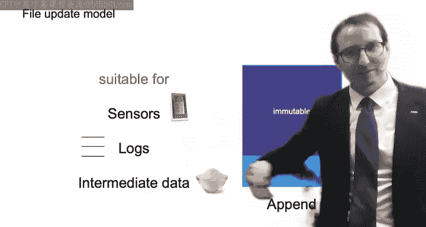

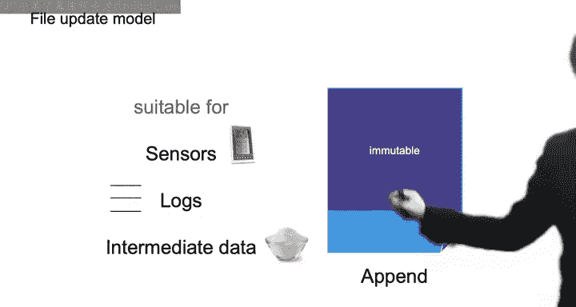

Aending at the end， think of Ionno materialsos with with sensors with temperature and pressure and so on。

 you just keep adding every second to your data。 Okay Intermedia data is also going to work that way we just keep writing the outputs for intermediate data。

 you will understand that after we have studied map produce and stuff right so for now you just have to take my word for it。

 but you will see later that the same goes for intermediate data。

Okay。Well now more， we have the requirements。But this whole thing with the scanning data and app pending data。

Has to still work if hundreds of people are doing it at the same time。

So if you have hundreds of people， maybe all your sensors that are collecting the data。

 they all write at the same time， it has to work。Notes that I said hundreds。

 I did not say millions or billions right So it is again。

 not a service at the scale of the entire planet global that everybody accesses like S3。

 This is just a service。 let's say you have a company and this is a company sized cluster right so every company has their own cluster like this。

 So it's going to be the employees of the company that really connects this to this system。

 So let's say hundreds of people as an example。Okay。😊。

And that's atomic in the sense that it's all another thing， right。

 you just append the data you want to append or you don't do it as well。

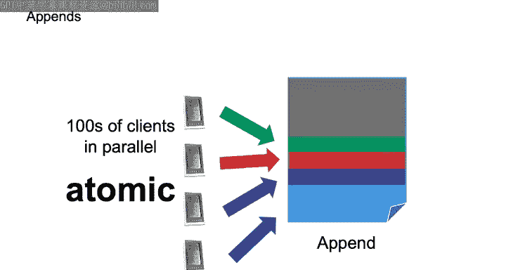

So this is one requirements。It'll have， yes， it'll have a few minutes to the break。 Let me。

Tell you when more design good。You remember that two weeks ago I told you about capacity throughput latency right and I showed you how it evolved between the 50s and today that the capacity increased a lot。

 the throughput a bit but not as much and the la C even dropped a bit less than that。

So this throughput and Latin C， this idea of throughput and Latin C are absolutely fundamental when you consider a big data system。

 so as a reminder throughputs you imagine the bits that are flowing through the network cable right this is just the bits flowing around the Latin C。

😊，Is idle you wait nothing happens then you have to wait right so this is latency so when you want to download data from the internet you're going to experience a bit of latency right for a few milliseconds nothing happens and then you have data flow around so you have two measures you have the number of milliseconds that you wait in latency and you have the number of bytes per second that flow over the network。

Now。Very often one of these is going to be the bottleneck right so either it's the laency that is the issue because the download is very fast but it's the la C that keeps you waiting or the opposite it's the throughput that's going to to be the bottleneck and the la C it's immediate right so you basically spend your time flowing bits through the cables well it's the second kind of system that we want with the AGSS with the distributed by system we really want it if you look at the system in a normal cruise mode functioning what you want to see is data flowing through the cables this is what you want to see。

What you do not want to see is nothing flowing on their cable and everybody waiting for data to flow that would be latency that is not what we want so just to give you an intuition it will become even clearer later when I'll showed you the details of HDGFS right so we want to optimize by having as many bits as possible flow over other cables to basically use everything we can from the network bandwidth。

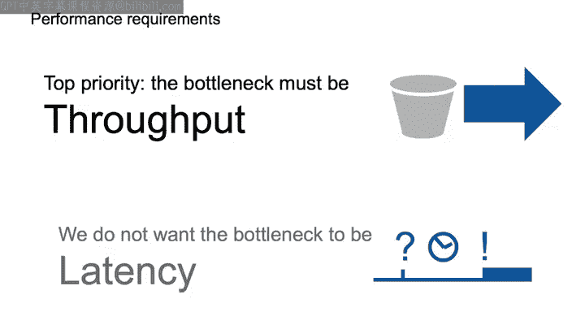

Okay， so this is again， just a reminder of what I showed you。

Two weeks ago with these three right and what we are going to be doing in the end with this system。

 we are going to paralyize in order to solve the discrepancy between capacity and through good。

And we are going to batch process。To solve the the problem with a。

Latinency and through but this I'm keeping for later right so parallelism you will see already with mappre probably batch processing we see with agebase right so white column stars So at that point it's really a highle thing I will take the time to go through this and give you all the details of how this is actually working just checking the clock so that it' is going to ring in one minute just tiny thing so Hadoop is an open source version of the same thing right it's the same thing that was done at Google it was done two years later。

 I think it was the Yahoo and Hadoop is the name of the elephant Teeddy bear it was initiated in 2006 and it's made of three components the system GfS they called it Hdf or Hadoop map Red we will see in a couple of weeks also called Hadoop map produced in the Hadoop version and big table which is called Hb in Hadoop right so they just rename them differently but this is really just an open source version。

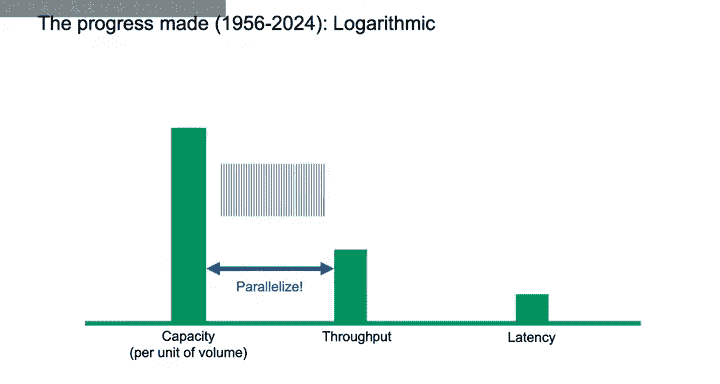

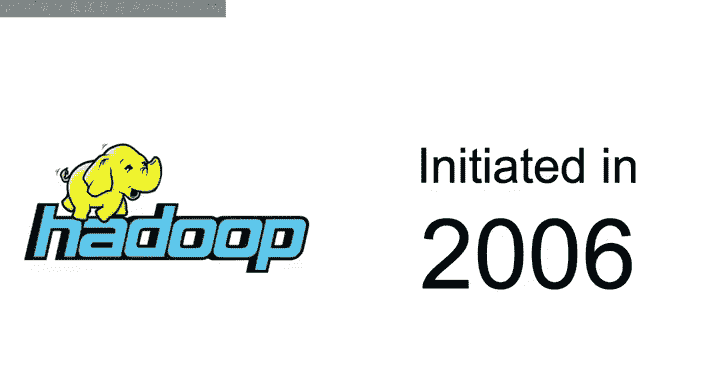

The proprietary software， we don't see this is proprietary to Google this was the the open source and we are going to use the open source Russia。

 I think I should stop because it's going to to ring we will have a presentation by the I think it's the analytics curve。

 right？Do we have the genetic exc up here？Yes。😊，Maybe they will come when we when we open the door。

 All right， so if you are interested in the analytics club， then you can stay here。

 They will present during the break。 Otherwise feel free to go for some coffee or or drink or whatever。

 So see you in 50 minutes。😊。

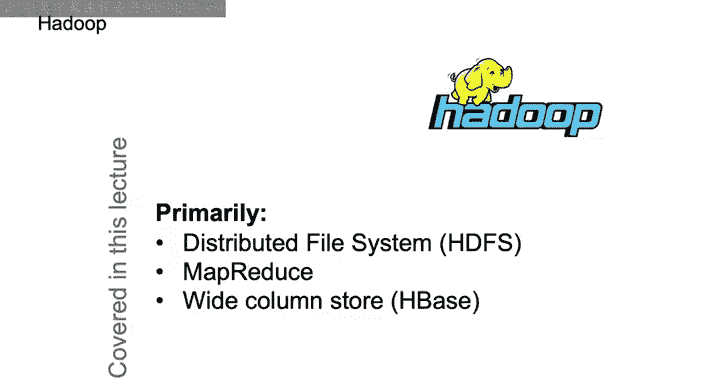