# 苏黎世联邦理工《大数据｜Big Data - ETH Zurich - Fall 2024》中英字幕（deepseek - P11：-11-4. Distributed file systems (2_4) -.zh_en - GPT中英字幕课程资源 - BV1sHPKeoEJU

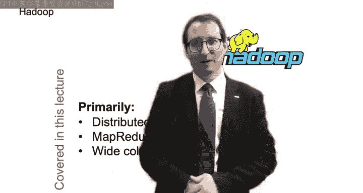

Welcome back everybody， so we are going to continue the discussion of Hadoop so I was basically telling you that Hadoop is the open source version of what Google did before so this is again what Google is calling it but this is proprietary already and this is the open source version and in fact you think going to do be in a menu for the coming weeks right we're going to study HFS now Hbase is coming soon and not produceuce is coming to in a couple of weeks right so we will do everything。

😊。

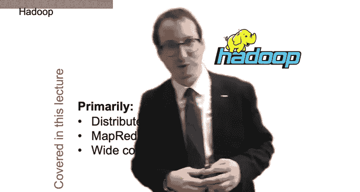

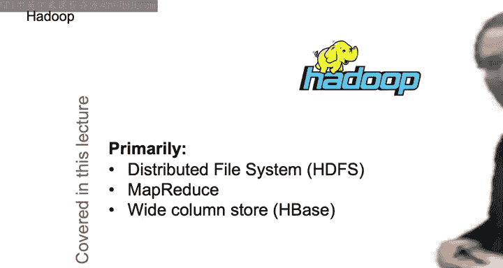

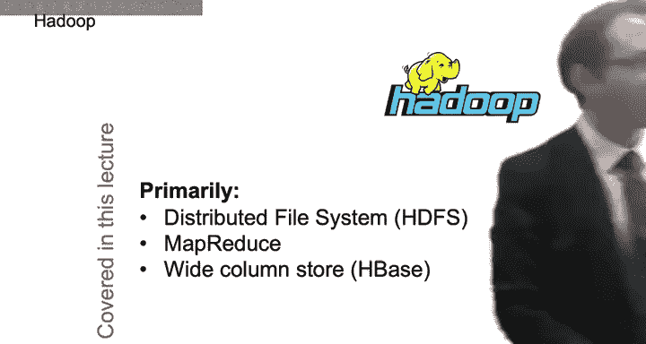

I wanted， however， to just because people have asked during reading the break so to really re explain this thing。

I'm going to use an analogy to make you understand this。

That I think is also going to make you understand the block size of AGFS that I've come back later。嗯。

Many of you， probably。Downloaded， let's say either many files from a server。

 like you connect via let's say a copy via SSH right over the network of let's say1 thousand0 files or 10。

000 files or maybe you copy a directory to a new location on your file system now it's a bad example because if you do it on some operating system it's actually instant because now they optimize it but before it was instant and it was actually copying the whole thing。

Has anybody of you noticed that when it shows the progress bar of copying all of the files？

It's not linear， it's sometimes it activates and then you say okay。

 it's making progress1 mebyte2 mete3 megabyte， then it starts stopping and then you start seeing the number of files that increases and then the number of files stop increasing and then it again has more megabytes that increase who experience that right that is not linear and why do you think that is not linear。

😊，Yes。😊，Checks， so it's probably， you could imagine that it's doing checkss that could be considered as part of the problem。

 but it tieds to another aspect of what causes that， but the checkup would add to the problem。Yes。😊。

it's just access and so floating waterfis parallel。And then it comes up the whole。

So you could imagine so basically you're thinking at the hardware whatever right so the idea that it would optimize things with some access patterns on disk。

 I could imagine that this is done because I think that in the latest evolutions of hard drives。

 they try to access their disk in a more optimized way。😊，嗯。

But there is an explanation that is even simpler than this one， even simpler at the high level。

 but that you're correct， this could also explain some of the aspects bringing unpredictability ordetaminism into the mix。

Can you think of something else even simpler than that？Yes。

If one lot file and several people want give at the southern size。Yes。

 exactly that's easy I'm repeating because there maybe there are people on Zoom Viide here。😊，Indeed。

 it has to do with one large file versus plenty of mod files。 that makes a huge difference。

Because if you have one large file。Then what you're going to observe in your progress bar is the megabytes going up It's like this is the 520 firstst file out of three out of the thousands that says block here because it's the same file but then the megabyte go up up up up up up up so you see the progress bar going to the right So that is if you have one large file。

Now， if imagine that suddenly you have 1000 fights of just 10 B。 Let's say 00 fights。

 And what's going to happen。Is that the megabytes is going to then stay blocked when you have plenty of small files。

 but the number of files is going to now be incremented while the number of bytes stays identical。

Why is that that certainly the number of megabytes per second is no longer that high。Yes。😊。

And we'll just to the block reads of life larger just segments。 So jumping around。Re requires much。

That's exactly the idea indeed， that the words you would use is on the screen。😊，Exactly。

 so it has to do with throughput and latency， Basically what happened is that if if you're reading one large file and that's exactly as you say。

 the blocks are going to be next to each other on the disc， except if it's fragmented。

 but I'm not going there， but basically it's going to read through the fight continuously and then the bits just flow So you you're experiencing throughput。

😊，But if you have plenty of small files in between every file。

 you're going to have lat C because the files might be at multiple locations and so on so it's going from file to file And what's happening is that there's lat C until it starts with the file and then the file is so small that the bits flow instantly and then you go to the next file and then you wait again forever in comparison to to the bits forever until this happens because the head of the disk is moving again and the disk is rotating and then you start letting the data flow again there's so little data that it's instant So do you see that in that second case the bottomneck is lat C。

You spend your time waiting， right， the throughput the moment same time where you actually。

 that data flow is actually is rare， right， when you have many spoil files who sees that。

 Who has this intuition。Okay， so one very large file there's the Latin C is negligible compared to the time where the data flows so it's the throughput it's throughput bound when you have plenty of small files you spend more time waiting for every file one after the other than you actually spend sending the bits over that is the intuition and when I'm saying for HDGFS is that we would like to be throughput bound meaning that we want data to flow we do not want to be waiting because of Latin C the whole time that's the ID yes。

Do you know of any maybe optimization if we need to load a large amount of files so that the process first like sorts it so that it goes I' say along the this line instead of jumping is that usually done So they are optimizations like for example。

 I think in the Apple what Apple did is that now they don't even bother copying anything they just points to where it was and that' instance when you when you copy a whole directory there is another optimization that makes sense when you send data to a server server。

What would you do if you have a million small files that you need to send to a server or what do you do to avoid the latency？

Yes。😊，Exactly， you zip it， then you get a single large file， you ship it off the network。

 no laency because you spend your time just sending the bits it's a large file。

 and then you unziip it on the other side。😊，That's exactly it。

 That is another optimization that you can do。Did I answer your question？

AwesomeSo I wanted to give it this inition because it's very important because in HGFS。

 this is exactly the sort of things that constrain our system。😊。

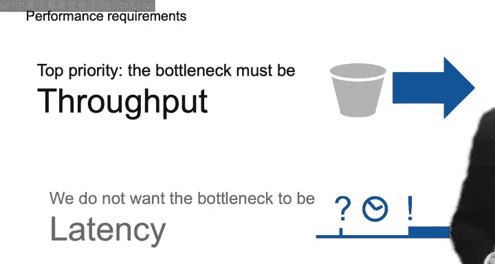

All right。

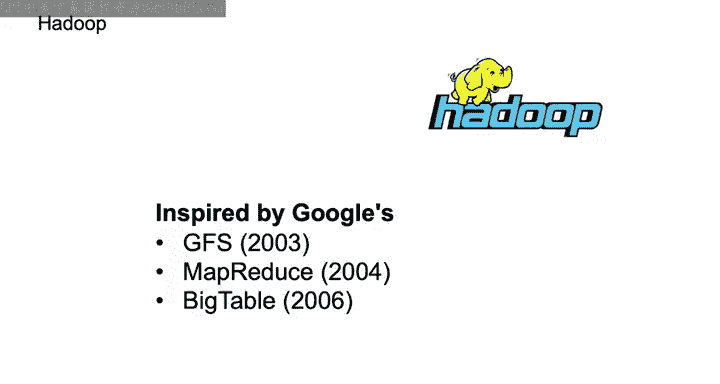

Okay， so you can see this is the golden age of the evolution of of this system started in the 2000s and then I would say mature the in the middle of the 2010th。

 So it started this is the number of computers in the cluster a few hundreds at first then went all the way to。

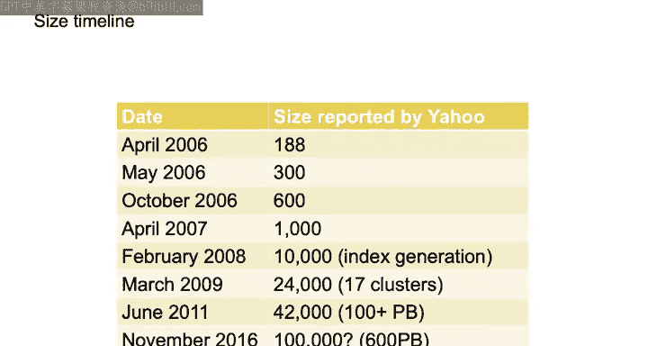

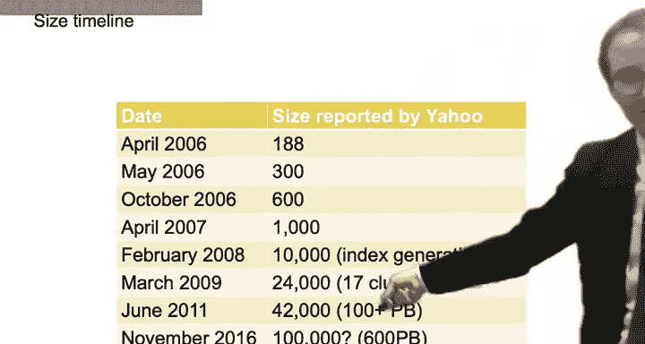

The latest known number is  roughly 2000。Around number and then 100。

000 is believed to be the case again， you reach the capacity of a data center when you arrive there number of machines。

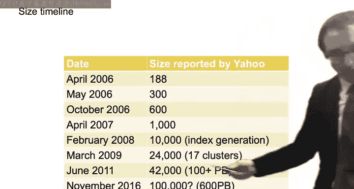

And here you would be at 600 petabytes， but this number is not perfect it's only rumors。

 so we don't really know the latest official number is of 2011 right but you already stored plus 100 plus petabytes on onefi system HDFS on 42。

000 machines， imagine your data center with racks all over other place across multiple rooms and you have 42。

000 c that start the data right to give you the orders of magnitude。Okay。

 and now we basically run out of the place in the data center because again as I said 100。

000 is kind of a hard need because of cooling electricity。

 that's okay we can have thousands of data centers this is kind of the approach now that is taken by companies all right。

😊。

Okay， so that was only the introduction actually， because I only gave you the high level overview。

 but not going to get into the technical leader。😊，What I'm going to do is very similar to what I did for dynamo I'm going to do it in two parts。

 the logical path and then the physical parts this is。

 I think the best way to learn and it's also a reminder of data in the。

1en tense right so this is exactly the same idea I'm going to start with the model how it works on the logical level and then we look at the implementation this implementation is known so that I can show you。

😊，So the logical model， I can compare it to objects to origin history so the ID。😊。

Is that in S3 we had this， there was the bucket ID and the object ID in here and then the object。😊。

But here we have a file hierarchy， so it means in HGFS， we do have directories and files like this。

 so this is the way to go， it's a real fine system。😊。

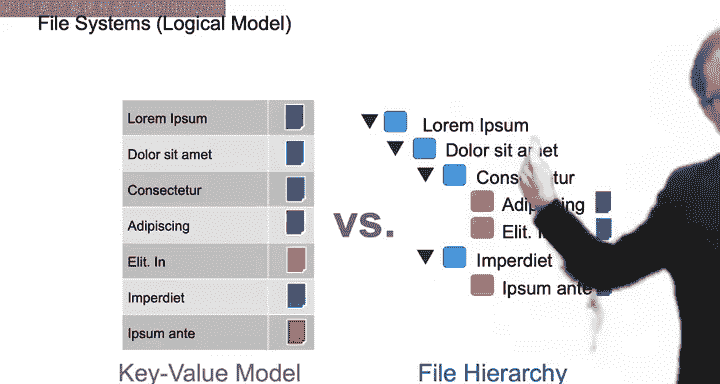

Second， different。

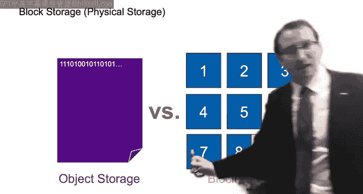

In object storage。You have the entire object as a single big chunk right that's it's this is how it's in There are ways in the API to upload it into multiple parts and then glue them together into a single chunk at the end。

 but that's an API thing it's not part of the internal storage。

 at least not that we know of So this is really just a big object and that's it。😊。

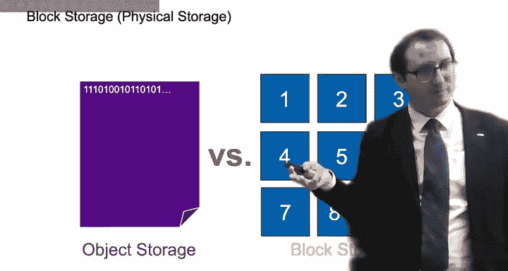

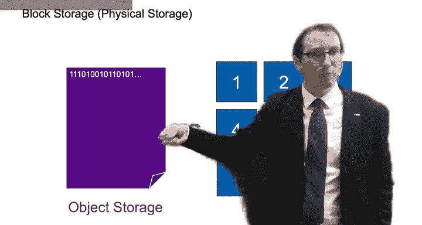

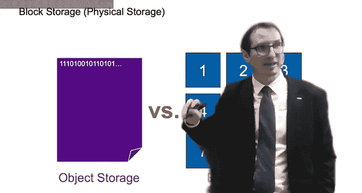

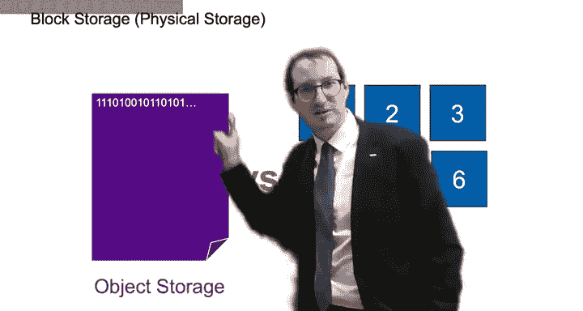

But in HFS， we will have what called block storage because the files are going to be divided in blocks and this is even accessible to the people you can see the blocks。

 just like the blocks on your hard drive。

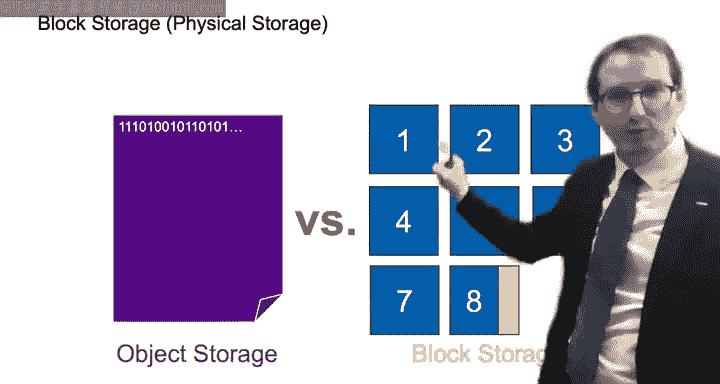

Do you think these blocks are going to be larger or smaller than the blocks on your hard drive？是。

Maybe the same， so let's do a poll in the audience who think that these blockss are roughly the same size as on your laptop。

😊，Higher so that I can see， okay， who thinks they would be smaller？😊，Give a few reasons。

 who thinks that would be larger。We have a majority here， it seems， right。

 and indeed they are larger。 and I'm going to give you the intuition of what why they are larger has to do with throughput and Latin them see again。

But I already said two wells。😊，Here， I said chunk。I said block。

 and I even said path I think for a bloodying。 In fact。

 these are word that kind of mean the same thing， but it depends on the context in which you use them。

 So chunks split sharp partition block， there's many。

 it's basically all ways to designate the same thing。 now， when you create a product。

 you just name it based on your preference。 So we'll see that in Google。 they call these chunks，1 to。

3。 They call them chunks in HFs， we call them blocks， really the same thing。

 we'll see that in the coming weeks， we use the words split Sha partition and so on。

 Don't worry too much。 Just try to remember what is used in what context。

 right they all mean the same thing。 But if you talk to people。

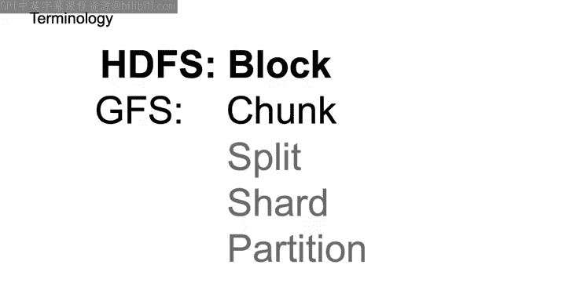

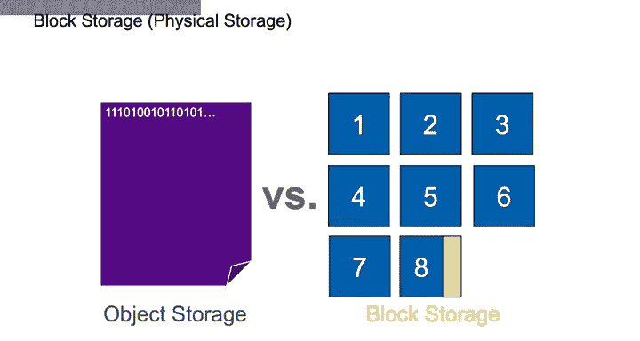

About HDGFS and you call that a split， you will just confuse people even though technically it's not incorrect。

 but so in HDGFS people call these blocks in the Google find system they call them chunks and so on all right but there is a whole I stop counting there are so many words that are used all over other place to basically just designate partitions。

😊。

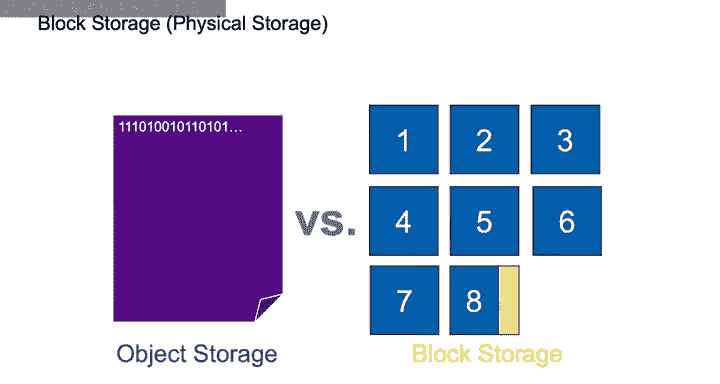

嗯。The reason we do that has to do with parallelinism， by the way。What does AGFS look like？

On the high level， it's going to be so simple that it fits on a slide。😊，So on the high level。

We have a hierarchy of directories and fight。And every file is basically made of a sequence of blocks。

Period， that's the model of AGFS。Gandov sends this。

RightThat's simple it's the beauty of data dependence and when you have a model that is simple like that。

 you expose it to the user and then you deal with a physical implementation the user doesn't need to to deal with this so this is HDGFS in fact the model isn't that different from what you have on on the laptop for the local device systems okay so that's it take a snapshot mental snapshot of this this is the HDGFS model。

😊。

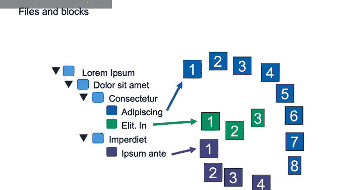

Now。Let's focus more about the blocks， or the chunks as Google called them， let's call them blocks。

 So blocks。The first reason why we need blocks and we don't actually have a choice about having blocks。

Is that we want to support files that can be petabytes in size。

You know that the petabyte doesn't fit on any laptop to date right so the largest drives we have are like 30 terabytes maybe。

 but not more than that so we anyway know we are going to have to cut it into slices or partitions or chunks or shelvess or split or whatever to blocks to basically at least split split over our multiple machines right。

And seconds。😊，We want to have a simpler level of abstraction in order to deal with the data and here we already have map produce and spark in mind when we do that I see a raised hand over over there。

 maybe we can bring the microphone。Its for the people on Zoom so that they they can hear what you say。

Okay， I was just wondering， what kind of fight is that petro bites。Cause like。

 I cannot think of any real life example。Of such big thing it basically collected data。

So imagine the data accumulated by cell。WhenWhen you run collisions at theHHC。

 right and you let protons collide。The quantity of data that is produced is actually so massive that they cannot even store it instantly。

 they already have to filter out data at the moment that this is made and then you append you you could create a file that has this size now that's only half of the answer because then there is what you can do and do what you do in practice。

And in practice， it is actually not very common to have a single file of one petabyte what people will do is rather that they will have10 files of 10 terabytes。

 for example or a thousand files of one terabytes Yeah that was my question because then it was the point of having。

😊，Such a big file when you can like in a general case partition。

 that mean multiple decent sized files。Yeah you so there are many there are many reasons why why you prefer to have several files that are smaller rather than one large file what i'm saying here is that it's possible right and then there is we can do it and there is we actually want to do it in practice I'm going to give you a very practical aspect of this。

Imagine that you have data that you downloaded from the internetnet。

To your laptop and you want to put it on S3。 So that's uploading it to S3 right so you connect to the console and upload it via your browser or maybe you want to do it via the command line。

 you can also do it with the command line。Then。There is a practical consideration。

 imagine that you want to upload。A file that actually is 5 terabytes。

 let's say you want to create a file of  five terabyte and upload it as a single object to S3。

I don't know if you've already tried that but I can tell you what's probably going to happen you will start uploading you will wait for maybe one hour or two hours and then it stops and there is an error because something went wrong with the network so you try again and two hours later or it breaks again and theres again an error then you're like okay no I don't even manage to upload this so what do you do in practice you just break it into smaller files let's say if it's five terabytes maybe 100 files of five gigytes for example and then。

It's very likely that many of them are going to succeed， maybe one hour later when is going to fail。

 but then you don't start from scratch， you just reapplo the one that actually faileds。

 so this is one more reason for splititting the data into multiple files。嗯。😊。

Does he answer your question， kind of， Yeah， all right， Yes， we have another question a about there。

Why dot we need this then and why don't we just split it up into smaller chunks and store it and like let's say S？

You can indeed do it， so now you're contrasting with S3。

It is indeed possible to take this file and to split it into。

 let's say it's one petabyte so let's make it1 thousand5 of1 perabytes。

 then you can put them on S3 right you can do it。That will work and you can even use mappreuce and spark over S3 right so it's absolutely compatible with S3 a distributed file system is an N design to S3 and it has pros and cons right there are things that are nice with S3 and there are things that our nice saw with HDGFS so I can give you a few examples of the cases in which GFS can make sense we will see it especially with mapreduce So basically with HGFS it's your machines。

😊，Maybe you rent them from Amazon that it's your machines， you control the machines。

What's going to happen is that on the same machines。

 you have the process that is taking care of HDFS while the data is stored。

And you also have the process that are running your query on the same machine where the data is stored。

That means that the query is very close to the data。😊，And when the query is very close to the data。

 that makes it so much faster。😊，If you use S3， you will have a bit more disconnection because the computers on which S3 is running installed are not the same machines。

On which you you would run mapreance Sp so it would work。

 you could steal query data in parallel on S3， but it's going to be slower because you don't have the collocation of the data with the query right so that would be one example of argument in favor of HDGFS rather than S3 right？

What stops me of just implementing S3 on my own。My own machines。

 you can't because this three belongs to Amazon。 it's proprietary and they will not give it to you。

 That's basically， it's basically that simple。 It's it's cloud storage。Okay right H GFS。

 it's open source， you can download it， you can install it on your own machines， right。

Does it make sense？Okay， yes， kind of it's kind of is also okay as an answer right means I can explain more and maybe also during the semester I can continue to extend this。

 right？Okay。😊，So。Maybe I can insist on this， S 3 and HDFS。

A two perfectly fine storage layers that both work with Spark and mapuse and so on。

 they both work with it。S3 is a cloud service that is just hosted worldwide by Amazon。

HGFS is something you install on your own cluster， possibly rent it from Amazon and you control your own machines and you can col locatecate the query in the data。

 that's the ID。Right。Also to get back to your question。

Amazon also has services that are alternatives to spark and map reduce。

 and I strongly suspect they optimize them to optimize collocation with S3 in one way or the other right so it also makes sense in this way right？

It's very good to question these things right always double like double check everything and and criticize right so basically what there is to retaining here is。

In HFS， we can have files that are larger than five terabytes。

 we can have files that are to larger than a single machine， so this is possible。嗯。😊，In practice。

 you will want to consider having more files of a smaller size right but what is very important to understand is that there are two lever there is having many files of some size and there is a second level with the files being cut in blocks right。

And the fact that a file is cut in two blocks means that the difference of performance between having a single file that is petabyte。

Sized。Or a thousand fights that I'll care about size。There's no difference in performance。 why。

 Because in the end， it's anyway going to be cut in blocks， both of them。

 So this is why it doesn't actually change much practice。 Does't it make sense。No questions。

 other questions。给。I continue when I give you the size of the block， you will also get get more。

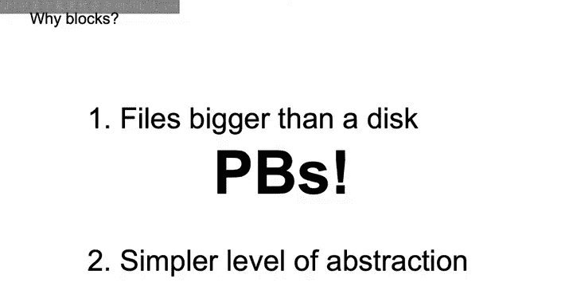

Intuition of all these， what I want to develop is your intuition。So the idea of the blocks。

I that you have all your of your files that don't have any limitation of size and these files are going to be divided into these blocks。

 so the ones that I showed you here and here。😊，So。If you have a single machine that's installed on the same disk。

What's going to happen？Is that you have a cluster of machines， many machines in that case。

 I put eight machines， let's say， and what you do is you spread the block of all these eight machines and the blocks are smart enough that they can actually be spread right。

 You can see them as atoms in the in the realm of AGFS。

 right and you spread the block all over other cluster。😊。

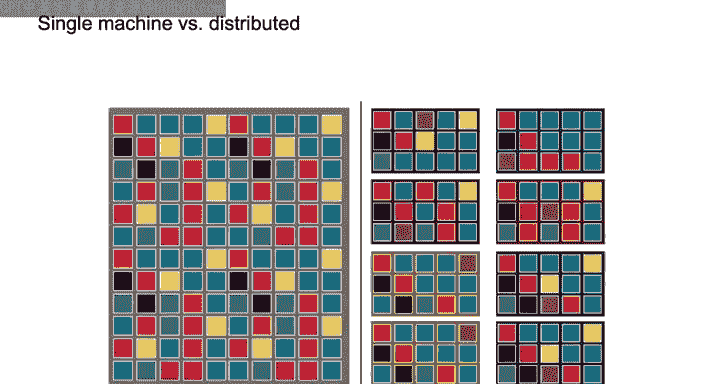

No。I already ask you is as as a order of magnitudes。 So larger or smaller than5 C。

 So your laptop is going to be 4 kiloB。 The relational database is between 4 kiloB，32 kiloB。

 So they they they they like to create。Vual blocks that are larger than the physical blocks。

 but it's still the same order of magnitude。Now the distributed by system， it's loud。

 so we've already said it's loud the size of the block。What do you think is the size of a block？

In AGFS， what would you say？3。😊，O megabyte， okay， we have a megabyte here。😡，Who says smaller？Okay。

 who says louder？So we have the majority far larger， so let's explore。

 let's continue to explore how larger， what would you say larger than a megabytes。我是以。AHow 28 mega。

 you read the textbook。Okay， well， okay。that's actually the correct answer I can say that's the correct answer so indeed it is 128 mebys this is the size of an AGFS block in practice right I think Google may need 64 mebytes。

 but again that's the order of magnitude right so indeed it is 128 MBbyte。😊，嗯。😊，Now。

 let me give you an inition of why we have this difference between what you do in a local drive and our flight systems。

On a local drive。The data flow when you read the data from this is within your laptop right the drive is connected to the motherboard and to the rest and then you read you have the head moving and the you know mechanically。

嗯。So it's basically tied to one hard drive。When you go to a cluster。

It's no longer just on a single machine。It's in a data center so it's already larger in terms of physical distance。

 it's larger plus it's connected by network cables and in fact this latency throughput thing in a data center is determined by a lot by the network cables right in fact there are two factors there are the network cables and then there is there is the individual drives how fast they are actually able to read。

But basically the idea is that if you keep the 4 kilobytes， imagine you can actually do it。

 you can try if you want as a game， you can install H GFS and set up the block size to 4 kilobytes to see what happens。

Do you think that what's going to happen is that we're going to have a lot of latency or we're going to have better latency？

So in fact， if you put it to4 kilobytes， it's going to have a lot of latency because you have to realize that4 kilobytes shipped to a network cable is very fast。

 right。😊，If you have to repeatedly ship 4 kilobytes file over the network cable。

 it's going to take a lot more time than shipping one zipped file of 128 mebyte with two days network capabilities right who has this intuition already so this justifies why you don't have a size smaller than that right these days downloading and uploading 128 mebyte。

It's okay you can do it you you may you might even do it every day like given an OS update if you download the latest Macwe it's like I don't know 10 mebytes maybe510 mebytes it's already more than that so it's basically。

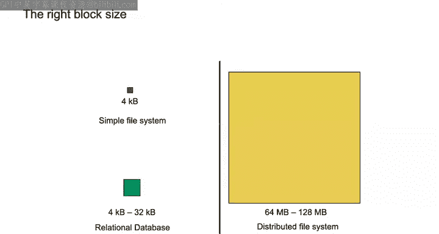

Large enough that you just don't spend your time waiting for blocks。

And it's small enough that you can spread it on all the machines because let's imagine you go the other direction。

 you have larger blocks。 Let's say， okay， you say my block is going to be 5 terte。

 I'm going to have five ter blocks。

Then what's going to happen？Is when you spread it of other machines？You might only end up with one。

 two， three or four blocks store machine， right and that's not efficient at all。

So the idea is that you would like a few thousand blocks on each machine right and that is basically what this 128 megabyte gives you is you have a couple of thousand blocks on every machine right that's the ideal configuration。

Okay。😊，Any more questions？All right， so now if I go back to the remark you made on you know why don't we just put it on a3。

 right？If you put it on AGFS as  five terabytes， it will cut it into blocks of 120 megabytes。

So if you store， let's say a terabytes， now let's do the math。

 how many blocks are there in one terabyte， so one terabyte divided by 120 megabytes should be 8，000。

 right？8000。 so  8000 times 128 MB give you one terabyte。

 So it means that if you have now one petabyte。You would get 8 million blocks。

Spread of other cluster， maybe on 1 thousand machine that spreads well。

Or you could store it as 1 thousand fives of each。1  TBte。

 but you anyway also end up with 8 million blocks。 So who sees now that it doesn't make a difference。

The number of blocks is the same， who sees that， so don't see a lot of reasons。

So but at that point I was on the high level right so now we can actually see how it's how it's implemented on the physical level so now the question is how do we connect the machines we have the data center in the case of the dynamo so the keyV store we use the Pi to PR network where everybody was communicating with everybody like this but in fact for HFS we use a centralized network right centralized network topology it's going to be the same for almost everything we do this semester。

😊，Now we have many names for that for all these notes， so let's just say coordinator and worker。

 but you will see plenty， plenty of more more ways to call them in practice okay。All right。

Now we'll have the same architecture almost every week in every system and we'll give them names just like to your pets right so let's give them names in AGFS the coordinator node is called the name node and the worker nodes are called data nodes right。

😊，So it is a centralized architecture。😊，And now you probably can already imagine if that system is available or consistent in case of the network part because we have a bottleneck here。

So do you see that if there is a network partition？😊，You have to become unva。

You cannot continue like Amazon Db to serve people because that node here has to be somewhere on one side of the network partition and the other side won't have any name node so that's going to just become un availableva who understands that。

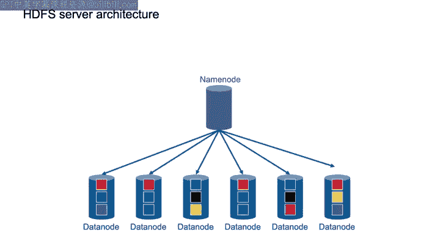

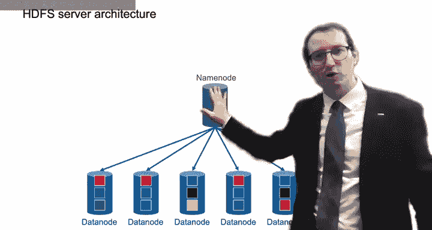

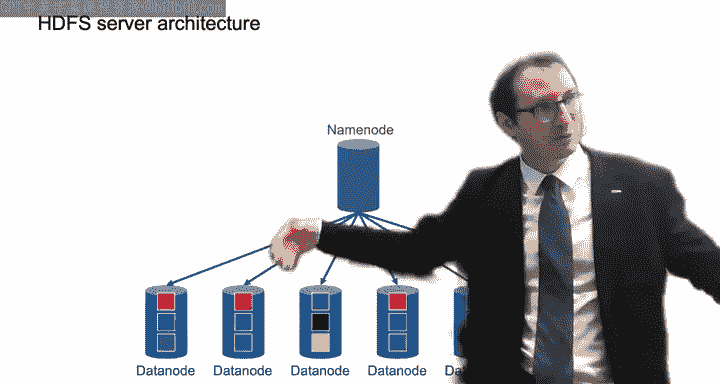

So again， the idea is that with a peer2 peer architecture。

 it's easier to lose consistency and remain available， but with a centralized architecture like that。

 you cannot remain available right so you are consistent。

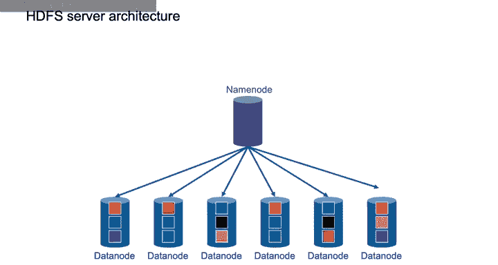

Okay now here's what's going to happen with our architecture so we have the name nodes and all the data nodes now we want to store a file it could be a petabyte file or it could be one of the terabyte files if you decide to split it in a1 thousand00 terabyte files。

 so we take the file。

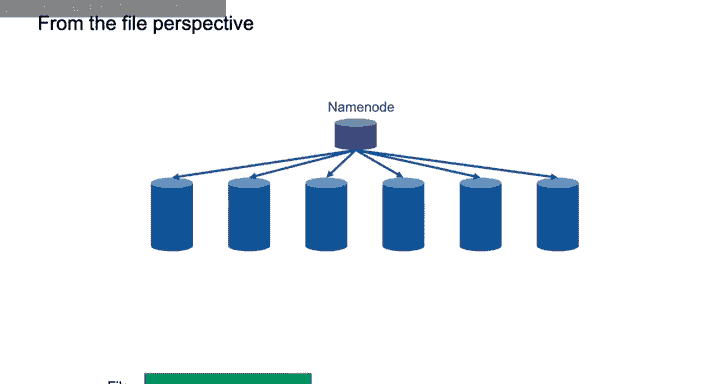

We cut it into these 128 mebyte chunks right， so as many as needed by the file。

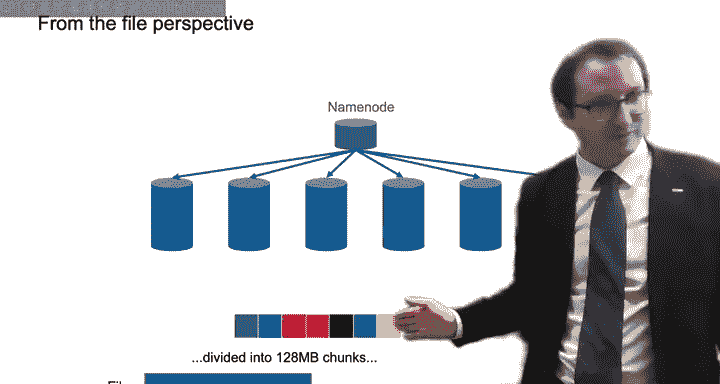

And then we store these chunks。

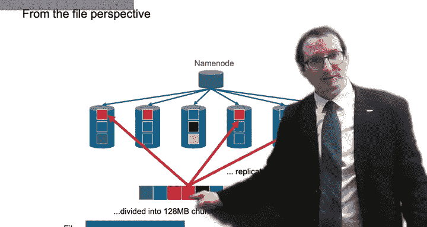

On the machines。But we store them three times。

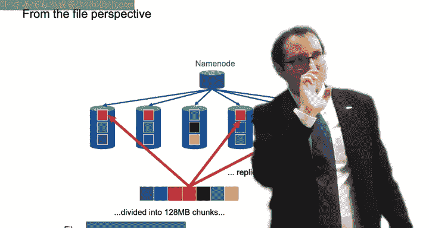

Every one of these is going to be put on three different machines why。

 because if there's a crash we don't lose the data imagine that computer crashes that's fine we still have a copy here and a copy there right so we take every one of these chunks or blocks and put them on three different machines。

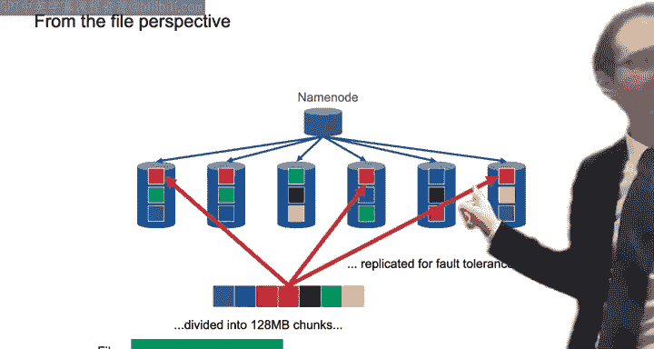

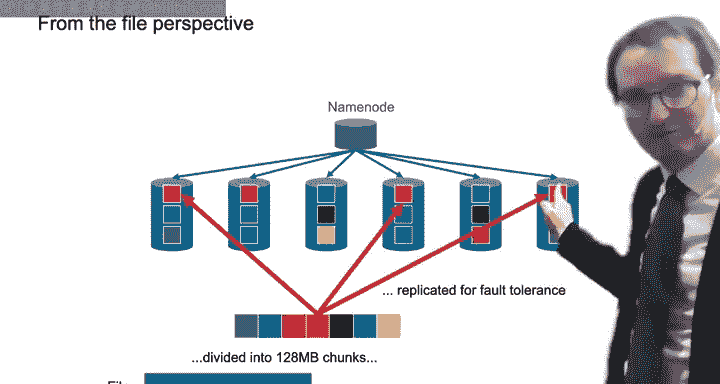

If you don't like three， if the data is very important to you and you want more than that。

 you can modify as a way to configure the system to have more replication or less replication。Okay。

 so this is pretty much how it stored right so you have a file divided it into chunks and then you spread the chunks each one three times all over your cluster。

え光。All right， very good。Now， a direct consequence of this。

 and this is a question that gets asked regularly is can we use on these computers a rate system。

 you know， redundant array of inexpensive disks right who heard of red。Right， okay。

We don't need them here。 The reason we don't need them here is that we already have redundancy with the HFS architecture because we we spread it over our machines。

 So rate would basically be redundant。You would be replicating more times than necessary All right so what we have on the machine is just normal drives that that we have there。

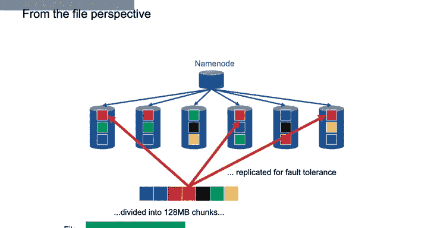

Okay， and then what we have is plenty of clients， so these are the users of the CS。

 these are the machines here， and they will primarily connect to the name node as the first point of contact in order to do something like a create a file。

 read a file， write a file， list the contents of a directory。

 and then they will go to the name analyticss。😊，Now you have noticed one thing is the data。

Is only here on the data nodes， this is where they are called data nodes there is absolutely no data in there there's just meta information that I will show you。

 but the data is really just on the name nodes。

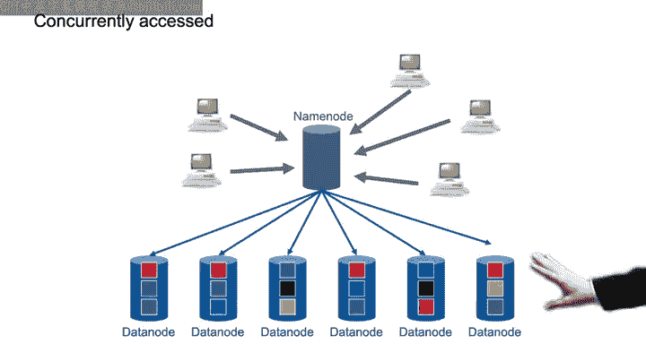

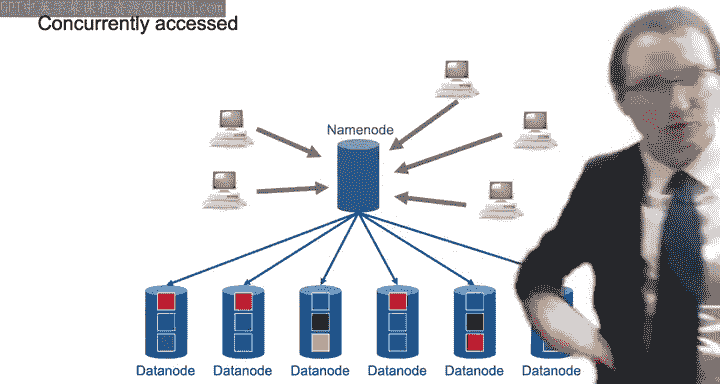

The system is implemented using Java， so the virtual machine and it's interoperable with many other systems because it has a rest API too so as soon as you have a rest API you can basically make it work with any other programming languages。

嗯。Let's dive a little bit more into it， right， to go into into the details。

 So let's look at the name node。So the name node is basically the brain of the whole system right it's basically collecting all the requests and has meta information。

 so what does it have？The first thing that it does is the five name space。😊。

What I mean with this is the directory structure。All the names of the directories and what directory？

And the names of the faith。It also has access control in fact it's very similar to what you have in a local system like very close to projects right in terms of a user group and others。

 you know in terms of a read write and so on so you do have that kind of access control here so it has the whole file name space but not the content of the files just the names of the files and the metadata the second thing。

Is that it has a mapping。From each file， each file name。

To the blocks more precisely to block Is because again the blocks are not there the block Is right so I used colors instead of the block Is。

 but this is basically the I right so we have inside directory de file one that has two blocks green and blue and file two black purple range red and file three has a single block right so we have a mapping。

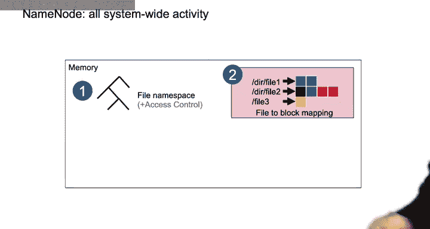

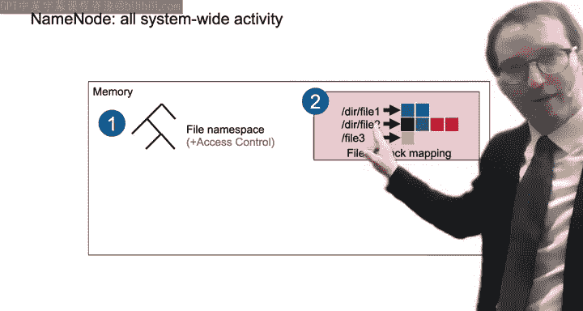

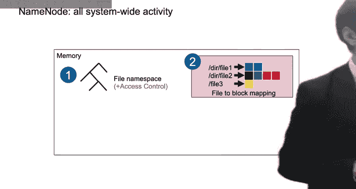

That allows us to reconstruct the whole file because we know in what order the blocks have to be assembledmb and we know what blocks have to be reassembled and finally。

Finally， it also keeps track of the block locations。If everything went well。

 there should be three locations for every block right。

 but it could be that there's a crash so that's going to be the two or at some point maybe too many of them right but it keeps track of the block locations。

If at some point a block is under replicated， it only has two copies。

 then it's going to make sure to instruct machines to replicate the block somewhere else and bring it back to three right it's responsible for doing these things。

Okay。😊，So this is the name node。

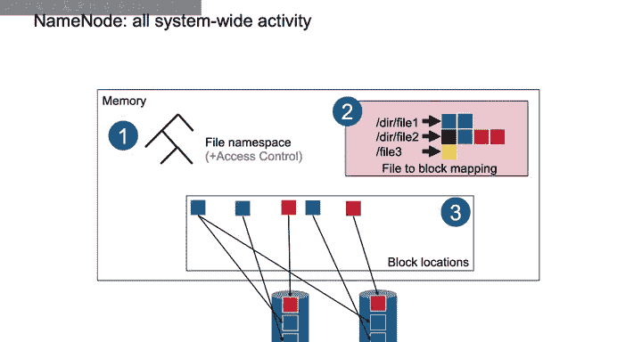

All right。And then if we look at the data node。😊。

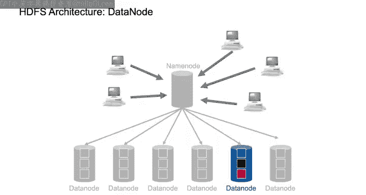

It's actually simple， there's just the blocks， that's pretty much there is really on a data。

 there's the blocks。😊，Now it's very interesting and if you want to do it as an user size。

 it's actually interesting， you can try to create cluster somewhere。😊。

Logan via SSH to one of the data node because these are your machines so you can actually do it。

 you will have them on Amazon you can SSH yourself to one of the machine。

 go to the fight system and there is a directory which has all of these blocks the blocks are actually local files on the hard drive so you will see these as local files but from the perspective of HGFS these are blocks。

😊。

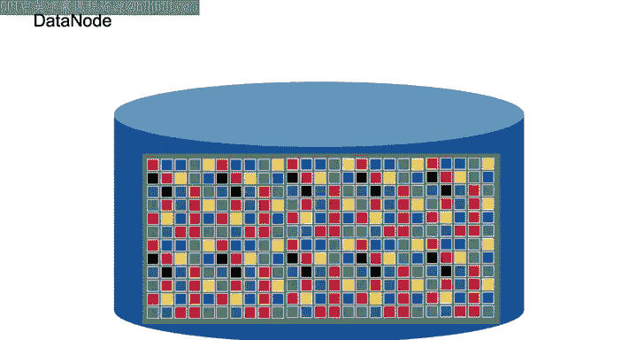

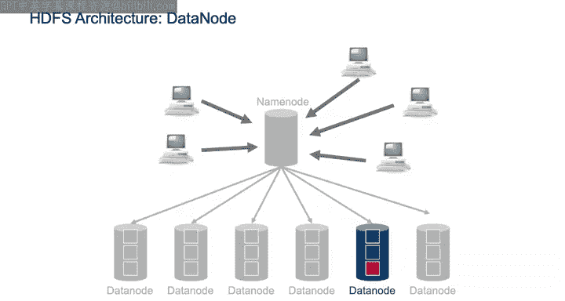

One more thing， what happens is that if a file is smaller than a block， it's a single block。

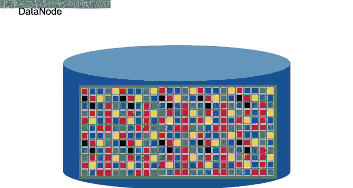

Then it's not going to eat the whole 128 megabyte of space right if the5 is 100 kilobyte。

 then that's really going to be 100 kilobytes。

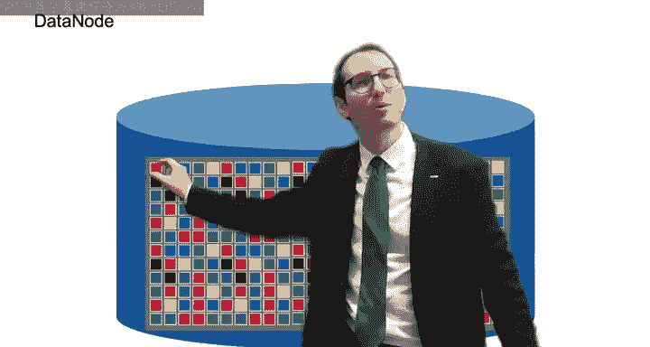

Now if you have a file that is 200 megabytes， the first block will be 128 mebyte。

 the second block will be 72 mebyte and this is really going to be a block of 72 megabytes it's not blocking the rest of the space so this is the difference with the blocks on your laptop that really block the4 kilobytes right here you really don't waste any space if the blocks are smaller。

😊，And again， these blocks are stored on the local list。😊。

This is an instance of data independence we basically have on the physical layer。

 you log on the machine you see files on the logical layer you see them as blocks right so this is again a matter of at what level of abstraction are you located right？

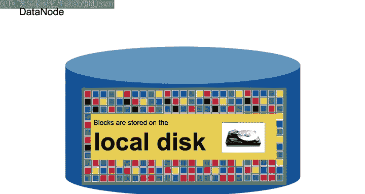

All right， so then what happens is that the server are going to monitor the how drives。

 the name node is also going to monitor the data nodes that are still there。

 there is a mechanism with H bits as we will see。

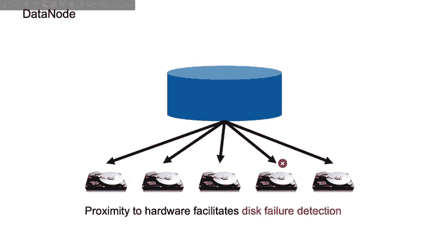

嗯。The block IDs are basically just integels， so it's made of 64 bits。

I think that 604 B basically goes from one to 16 Quintilians if I'm if I correct yes we have a question there time。

Yeah， my question is more on the implementation level。

 so is HDFS something I formatte my disk with or is it something that is on top of NFS and EXT4？

The disk here， if you connect to the disk that's just the normal disk it's going to be formatted with the typical ways you format a disk right so on the nus or typically it can be Ubu2 machines。

 for example in Amazon you can have an Ubu two machines the disk is just going to be formatted the usual Ubu2 way right these are really fine on your disk So if you want to be really technical when when you have a block of size I don't know 32 megabytes you have。

It's or like something uneven then you actually have to still account for like the EX for the underlying file system might still you know make it a little bit bigger just to account for its block size Yes。

 it is absolutely true。 So now this is already getting into the physical details Now if you look at that machine you SS yourself to that machine。

This here， so the blocks， this is the sign。

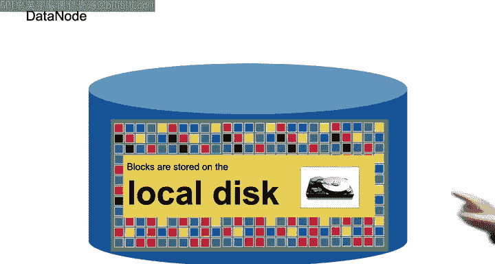

This file is stored on the local hard drive。In four kilo ba blocks。Of the physical level。

 So indeed it's going to be rounded to the next4 kilobytes。

 but now we are looking so you know it's really the physical layer inside the physical layer right so when you when you basically look atGfS you don't even look that close right as a user AGFS but indeed it is absolutely correct if you do want to log on that machine and look at what's going on then you will see that indeed these blocks are stored as files on a system that is formatted the usual way in Uuntu and indeed this ends up as blocks of4 kilobytes on your local machine but it's not the bottleneck of your system So this is why you don't even need to worry about this that much of physical detail。

😊，All right， thank you， you're welcome。All right。

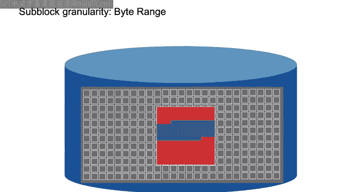

There's another question， yes。Thank you， I think there is a problem in architecture。

 I believe that name notes in the system is the single point of failure。

And if it fails， then the whole system becomes down， isn't it something but？Yes。

 you're absolutely correct， you see the single point of failure。

And I we explain how we solve that point of failure tomorrow。

 Okay so that's a great a great announcement for what is to come。 This is indeed you're really good。

 This is a single point of failure indeed， and there are strategies in order to solve that point of failure。

 And in addition to that I believe that it also maybe bother if there are lots of concurrent users trying to is a absolutelyute and theres also solutions for that。

 Okay yeah， which we also see tomorrow or the week after that Yeah so that's great because now you start thinking ahead like the engineers to create the system right so this is exactly the right mindset。

 right so it's a great way to to end today's lecture let me。😊。

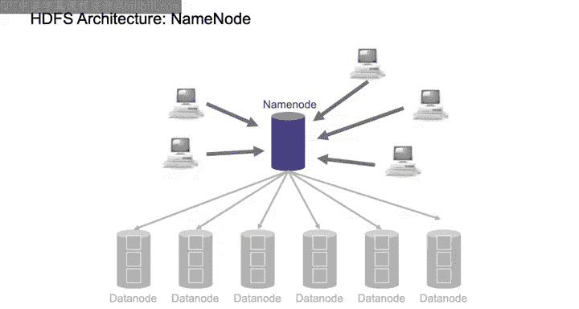

Just check。

Oh， I don't have the。If you give me just。managed to break the system， what is going on。

Okay， so。I'm going to let me take this one。I have a few more minutes before it end。

 so let me that's why it's not the right， it's not the right one。Big data， big data， big data。

 that's the first of October。 Let me take this one。And set it on。Tuesday。Like个で。

At the first of October。And there we have it。So now I can ask you。

Just want to make sure there was a couple of questions。

I sense a bit less reaction in the room when I ask if everybody is following。

 so it's very important for me to really check and see if I exceed a rate if I slow down。

 so very important for me to do that。ThisSo this is above 80%。And not so many other 100%， okay。

 so deep is perfect， so it means your following。Very good do not hesitate if you it's okay if you're below 80% and so on ask your around depending in mails ask questions in the moodle you know we are here to help you read the textbook we'll be very happy to to explain to you so thank you very much for attending today's lecture and see you thank you Tobias for moderating Thank you for your great questions See you tomorrow。

😊。

