# 苏黎世联邦理工《大数据｜Big Data - ETH Zurich - Fall 2024》中英字幕（deepseek - P12：-12-4. Distributed file systems (3_4) -.zh_en - GPT中英字幕课程资源 - BV1sHPKeoEJU

Welcome everybody in the lecture hall， welcome everybody on Zoom。

 from everybody watching us from the future， so we left yesterday on a cliffhanger because somebody askeds what is this with the single point of failure with the name node。

 what if it crashes？😊，And this is what we will address today， but before we do that。

 I will continue to say a few words about the physical architecture。😊。

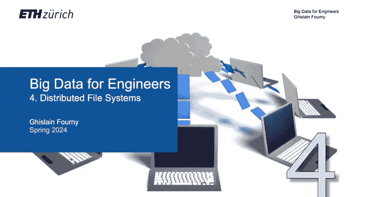

So just as a quick reminder， this is the data model fits on one slide。

 directories and files organized as a tree hierarchy has also access control and so on。

 and the files are divided in blocks of web size。😊，Exactly 128 mebyte， it's much， much larger。

 it's 32000 times larger than the blocks you have on your laptop， right？😊。

Then what happens is that we take these files and we divide it into two chunks that's what Google calls them or blocks。

 that's what AGFS calls them and we spread them over to the data nodes。

 but before that we replicates them so we saw them on three by default。

 three different data nodes we have three replicas， there is no order in the replicas。

 just three replicas， there is no such thing like a main block and then two other demoies that doesn't exist so just three replicas。

And that's it， we don't have the size limit of five terabytes like we have on cloud storage。😊，Again。

 it's what I addressed yesterday， it doesn't mean that you have to go beyond five terabytes because you can always make mock fines of less size and we see it's actually a common practice in AGFS。

 right？Okay， so this is the how it's best。 So you have the name node and the data node， right。

 This is a centralized architecture and we' see we'll have plenty more of these architectures later。

 we just have fancy new names every time for the for the coordinator in work elements。😊。

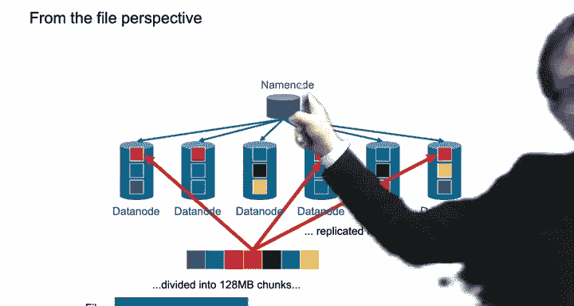

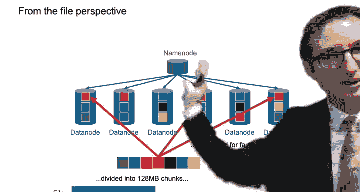

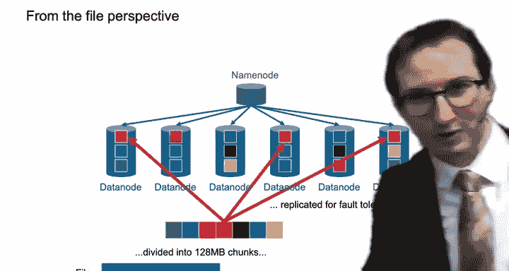

Okay and finally， this is what happens inside the name node， it has three things。

 The name node has the whole hierarchy of directories and files in stored over there what's very important is that this brings the bottleneck This is the reason we cannot go to a world service with billions of files because that wouldn't fit on the name node so this is a limitation on HGFS HGFS is typically company wide。

 but it's not a worldwide service like S3 so we have the file name space we have access control also in there so the company can handle which employee has access to what the second thing we have is a to block ID mapping right it's block IDs are 64 bits so we map each file to the list of block IDs and then we have the third path which is the location of the block so every block has normally in normal mode three different locations is's basically the I addresses of the data。

😊，Notes that that have them。Now I have to mention that I tend to use data node both to designate the machine and the process it's something that people typically do。

 but if you want to be very precise the data node is not a machine it's a process running on the machine so you have let's say a thousand machines and on each one of these thousand machines run the data node process and there had be other processes that run on these same machine right but they're not going to be more than one process more than one data node process ball machine right so we tend to say data nodes to also designate the machine do we have a question on them Yes can you describe how would API called look。

How would an API call look here process from sending the API call and receiving the response back I have an animation for you con in just a few seconds perfect I have we out that but we'll be able to show you the details of that yeah。

Okay， but great questions。 do you think like engineers。

 So the goal is really not that you see yourself as users of this， but also as engineers。

 because maybe some of you will work for these companies or I don't know for data break Fox snowflake。

 maybe you will design the new architectures， the next generations of the architecture。

 So it's good to put yourself in the mind of the engineers who design these things and ask yourself why did they do it in this way and not in this other way right So there' are plenty of lessons to learn here。

 So let's talk about the communication then we are getting in the direction of the question that was just asked on zoom。

 So here's all of these machines communicate with each other right So you see the name node。

 I only put two data nodes in there， I could have put a1 thousand。

 but I just put two of them just to show how they communicate。😊，And then there's the client。

 The client can be two typical settings could be your laptop connecting to the Amazon cluster you've created。

 so that could be your client or that could be one of the machines in the data center In fact well see a bit later that the client could be one of the machines on which theres the data nodes that's what people typically do they SS their cells to one of these machines and from there on the command line they run stuff against HDFS right But for now I just put client as a general thing and we'll talk more about what the client is exactly right but the client communicates with the name nodes and with the data nodes and the data you see only flows to the data nodes and between the data nodes。

 there is absolutely no data going through the name nodes right So let's go more into detail end theys the name for all these nice protocols that allow them to talk to each other we have the client protocol here between the client and the name node we have the data transfer protocol as you guess that's transferring the blocks。

😊。

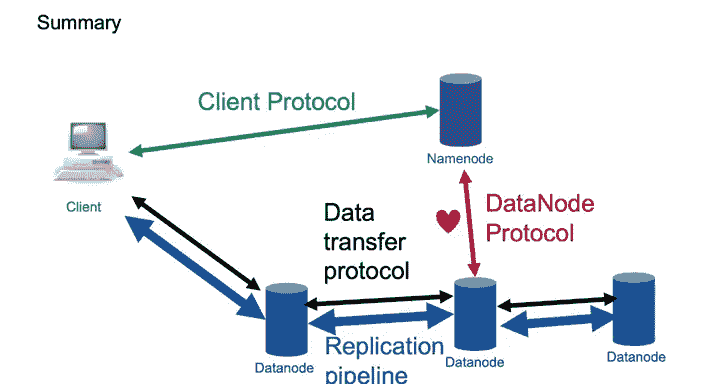

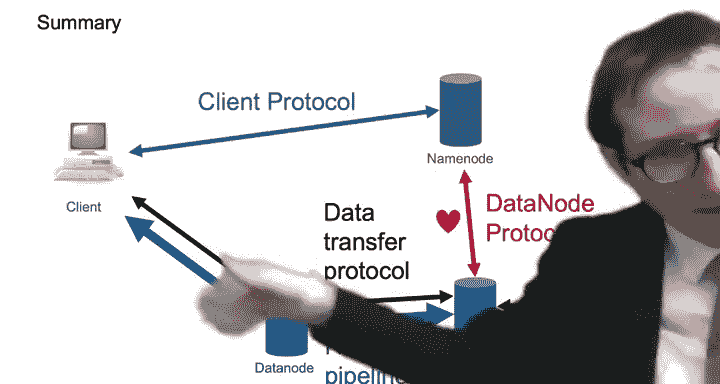

The actual data， we have a data node protocol for the communication between the coordinator node and the worker node so the name node and the data nodes with a detailed hat here。

 you will understand why soon。😊，And then you see the data。

 this is the replication when you replicate that's called the replication pipeline。

 This is how you replicate the data。 that true ring a bell because we saw that with A block storage。

 you might remember this replication protocol intratamp Intert it's the same kind of thing right we just replicate the blocks across data nodes。

 I even went ahead and put three data nodes in there just two because there's three repas Okay that's it any three of the thousands data nodes。

 So let's dive in the details of each one of them when after the others。

 So let's start with the client protocol。 So the client protocol is the the way you communicate whenever you want to do something。

 your first point of entry is the name node。 So it's not like in Amazon Dynamo where there's a load bad seeing and it's random node here it's the name node。

 there's only one of them。So the client connects to the name node always and says I want to create a directory。

 I want to delete a directory。 I want to create a file。 I want to read a file。

 I want to delete a file and so on and so on。 and the name node is going to respond with whatever other client needs in order to do whatever it wants to do can be the locations of the data node typically that has the blocks that have the blocks it's looking for the ideas of the block that it needs if you want to read the files and so on and so on。

 and typically that happens of Java but again you also have a rest API and so on。

 So there's other language is possible and the name thought that's for the actualctor protocol it's R PC who have R PCc before many of it's the remote procedure call。

 So it's basically this idea that it looks like it's a local call but actually in the background you ster realize something of the network and then it's actually called on the other side it's not a detail that we need to understand for the purpose of understanding HDF that's really just an implementation detail of the。

 so that's the client protocol。Then we have the data node protocol。

 So the data node protocol is how the name node communicates with the data node。

There is one thing to understand understand you know that communications between computers is always done with a client and a server。

 right so it's always the client connects to the server and the server response。

So here what's important to understand is that the server is the name node and the client is the data node。

 I'm not talking about the client of HDGFS。 I'm talking of client sal communication。

 It just means here that the data node connects periodically to the name node and then the name node answers this is what I mean So when the data node connects to the name node what is it doing well the first thing it will do ever is to register it's going to say hey I'm here and I'm back of the cluster please now include me in the protocol that can happen at any time even later new data node can join so that's the registration。

😊。

And then。Every three seconds， the data node is going to connect to the name node and just say， hey。

 I'm here。

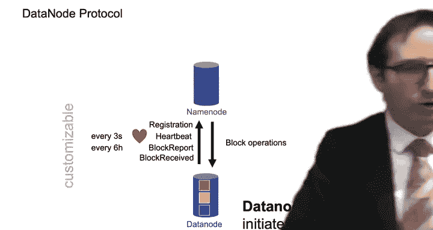

Hey， I'm seat here。Hey， I'm still here every three seconds That way the name node will know if it doesn't hear anymore more of a data node and it will assume it's under trouble。

 and maybe after a while， it's just crashed or we just forget about it and we consider that the blocks are lost right So this is the hardbeat every three seconds。

😊，Every six hours there will be a block report it's like here's the list of all the blocks I have and that's it and now the name node basically is able to then out of these reports you know build the block locations map here okay。

😊，And then block received that's part of when you create new files， the name。

 the data node can also acknowledge that it received the block from the client， right。

 So it received the block from the client， but it acknowledges to the name node that it received it right。

 So it's just a confirmation that yes， I received the note。😊。

Then the name node can also make requests to the data node it can ask， for example。

 hey this block is underreplated， there's only two copies of it in the cluster I need a third copy。

 please store a third copy of it by asking this other data node to ship it over to you right and then you bring it back to three so this is what you see on the right here what's very important to understand is that the name node is never going to initiate a connection to ask the data node to do that it always waits for the next heartbeat and answers to the heartbeat saying oh by the way will you please so kind as to do that for me right so this is always an answer to the heartbeat。

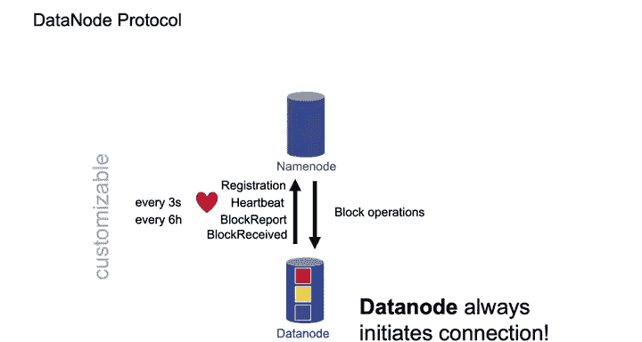

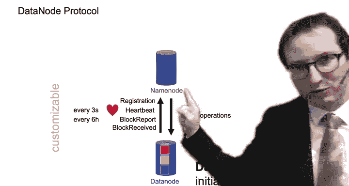

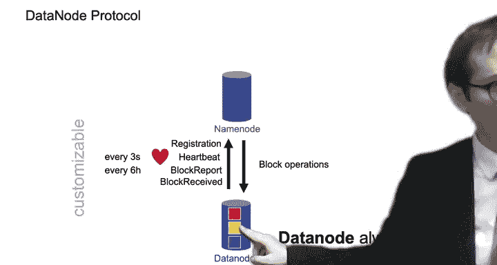

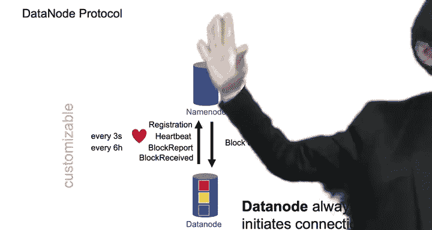

Or who is that fear？All right， so this is how they communicate with each other。

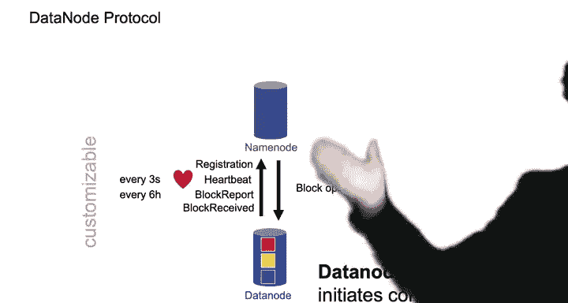

Then how does the clients of HGFS communicate with the data node？

So it's going to basically send over。Blocks， you know， these 128 MBby blocks。

 So it's going to ship it over the network to a data node， but only to one data node。

 not directly to the three that should receive a repa just to one data node then。

To replicate the block to two more data nodes， this is done with this pipeline you see below。

 So the client would also say to the data node， please also propagates this block to this and that other machine and then the first data node is going to organize the pipeline and is going to ship over block to the second data node which is going to also ship it over to the third data node right So this is how you have a pipeline that propagates Now it's never going to be well。

 it's not always going to be the same three data nodes。

 there's1000 data nodes maybe and the pipeline is going to involve three of them。

 but it's every time it going to be three different data nodes of course。

 that have the pipeline right every new block is a different pipeline and a different subset of three data nodes。

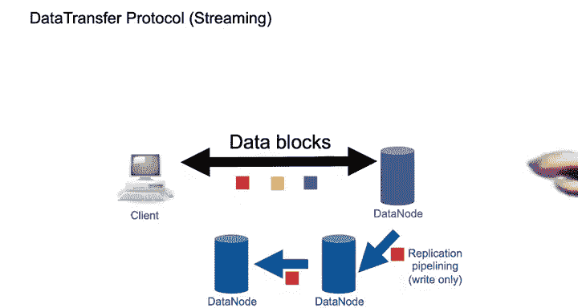

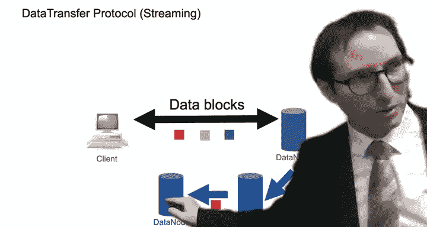

Okay， so this is the data transfer protocol。 We have a question on Zoom。

 I think the paper says that the client sets up the pipeline， not the first data node。Yes。

 you could also formulate it that way it's a matter of formulation so basically the client instructs the data node to make a pipeline between the three。

 but then there is some work it's not like the client does everything the data node also needs to ship over the blocks and so on to the next ones but this is a good mark the client has some responsibility it has it knows from the name node which three machines are supposed to receive these blocks and and then create the pipeline yes。

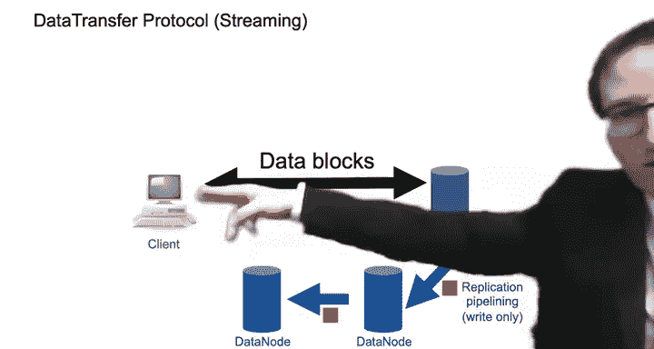

嗯。Like because the client can directly read and write to the data note。

 does this like raise any security issues or like make it even more difficult to get the correctness right rather than having some like intermediate note that I interacts with as a API I guess So yes。

 the security aspect。 So here I'm going to differentiate it from the blockchain。

You know that when the blockchain was invented， it wasn't the first distributed system。

 there's plenty of systems that existed before like Paxos， by the way。

 Paxos is a beauty who read the Paxos paper。It's a beautiful paper。 if you haven't read it。

 then you should read it。 Beauti story。 but Tos existed before the blockchain。

 The real problem that the blockchain actually solved is that it even works if you cannot trust the machines so the the blockchain protocol has anybody can connect to it and its designeds so that it's resistant if they are bad actors。

😊，Here it's totally different you assume that all of these machines are within your control behind the fire world and so you trust whatever is in there right it's within the company and so you assume that there is going to be no bad actor it doesn't mean you don't have some security you still have access control and so on that the employees in your company can do what they want but you still assume that people are going to use the regular software of HGDFS。

 the regular drivers and so on and use it use it accordingly right。

Does he answert tell you your question？Yes， thank you。 Yeah， all right。But in practice， of course。

 you can bypass some of the things， in fact we see in mapreduce that we do bypass some of the protocols in order to accelerate the whole thing。

 but it's actually designed by the same people right so the people who design mapreduce Had mapreduce also designed a GFS so this is why it plays a little bit together but you do assume that when the client connects and ships over our block to the data node you assume it previously connected to the name node and was instructed to use this and these block IDs and these and these locations。

给。Other questions。 Yes， will that up question of that one。 so the。

 the data will not re receive anything from the name node before receiving that from the client。

 So it cannot check whether the client has communicative with the name node。

That is true in here theres no name node communication so the client directly connects to a data node and uses this protocol in order to say here's a new block and please also set up this pipeline and share it with the others to data node but the access control is in the name node so if there's no other security measures we cannot like to secure the access because we cannot check whether the client has got the permission from the name node Yes so this is a good question so I do not know the details of the implementation of the access control。

 I imagine that its there are some things in place in order to make sure that so basically when when you are the client you are connected with some accounts to the system。

 I assume that there are some measures in place in order to check that you do have right access or read access to the to do what you are doing right but again I don't know the details of that so I wouldn't be able to give you a more precise answer but it's actually good homework。

Right， we could try to see if we can investigate a little bit and find out with more of the details about that。

 right， So this is， yeah， So I I take it as offline homework and and then get back to you。 Yeah。

 so there's also something done on the data。 I know for that。So is it correct。

 that there's also something done for that on the data node。嗯。I don't know。

 I would assume that there is something in the protocol that interoperates with with what you have on the on the name node right so the name node basically as part of the find name space。

 we know which users have read access， which users have right access。I can， I can make a guess。

 Let me try to make a guess， but I cannot guarantee it's correct。嗯。In the end。

 imagine that somebody would just connect to a data node and just upload whatever data for a new block ID。

 just has a new block ID and uploads data。Do you see that it's actually totally harmless because the block IDs are not tied anywhere So as long as the block Is are not actually somewhere in the on the name nodes mapping to the files you can upload all the blocks and block Is you want it's totally harmless that are just useless so you can see that tying the block ids to the actual files that is done on the name nodes these things so there still a the control of that is is on the name node so now if you continue to things and say okay how could I harm the system maybe I could try to reupload block ids that already exist and then try to overwritedes a block Is and here I assume that there's something in the protocol if you want to overwride a block that has an idea that already exist there's probably things in place that either prevent you from doing that because normally only supposed to append and create new files or or maybe there is a system in place that。

You do need some extra authorization like a security token of something that you received from the name node that would allow you to to do this right it's only a guess we will try to investigate that and see if we can provide you with more details on the physical implementation right Nobody has asked that before so it's great that somebody does and then that gives us a good good thing to to look into right。

😊，Yes， Wal there。If I understood it correctly， the data transfer protocol is used by the client when he wants to load file。

let's say he wants to load a very big file that doesn't fit in a data node in a specific data node。

 does the client choose the data node in which he wants to load。

So I have an animation for that so because here it's only one block right here we only upload one block but if you have a bigger file then you just do it multiple times every time with a new block and it's going to be different data nodes every time right but I have an animation for that so I will show the animation and then you you can tell if that answered your question right thanks okay。

All right。So here's a list of the functionality you have when you want to interact with HDFS。

 so that's the API typically it's very much like Posiques like the sort of things you would do on your laptop。

 you can create or delete directories， the right files appends to a file。

 remember we can also do that， we don't have random access， but we can append to a file。

 we can read a file， we can delete a file。😊，Okay， so here's the animation that that that I promised all right。

 so the client wants to read a file that already exists the client is going to ask for a file。

From the name Lo and signal its intent to read a specific hi file with some path in the hi eye。

The name node is going to reply with the block IDs and the block locations where they can be obtained with multiple data node suggestions for every block because it's at three places sorted by distance。

 it's basically going to figure out what's the nearest data node and puts that data node first in the order of the locations。

So that's the it's more efficient and the client is going to first try with the nearest one。

 the first one in the list， and then the second one if the first one didn't work and so on。

Now let put my security hat because you asked about these things。

 So here I would imagine that the clients would have a user and the name node checks that if that client actually has access。

 has the right to access this file。😊，What I imagine would be done because this is how it's done later in resource management is that there is some kind of cryptography based token。

That the client would receive to prove that it was authorized by the name node to access it right so that's how we guess that these things after P done right and then that security token can be used when connecting to the data node to prove that you are authorized to actually read or write what you're doing。

😊，Okay。Now you might critically think about this sorted by distance because I told you the client can be your laptop or it can be one of the machines in the data center。

 Do you agree that if the client is your laptop， the distance doesn't make any sense right because the data center is anyway far away so it doesn't matter which data load you connect to who agrees with that。

So the distance， the soft by distance really makes sense when the client is in fact on one of the machines in the data center。

 then that notion of distance makes sense and we'll see with mapreense back that the client is in fact very often going to be one of the machines in the data center so this is why this actually makes sense。

😊，Okay， so now the the machine has the list of block Is and and the data nodes and so on。

 and then is going to connect to the to the data nodes and read the blocks so download over the network cable。

 download the blocks， 128 MBbytes。Now it's going to do it。

Block by block right so if you go to the physical level it's going to request the first block from the first closest data node。

Then it's going to request the second block from the nearest data node that has it and the third block from the nearest data node that has it and whenever the first data node in doesn't work just twice with the second one or with the third one now what I put here。

Is an abstraction of the Java library that is used by the client who has ever heard of these Java input streams。

 the output streams， and so on， is basically an API that gives you an abstraction over reading and writing bits or text。

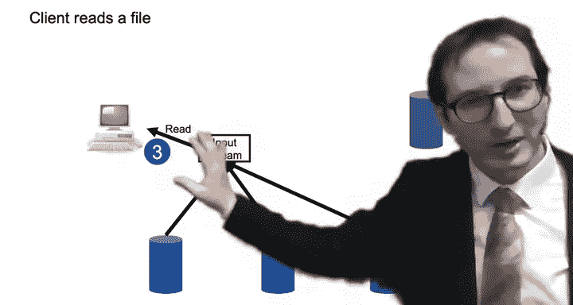

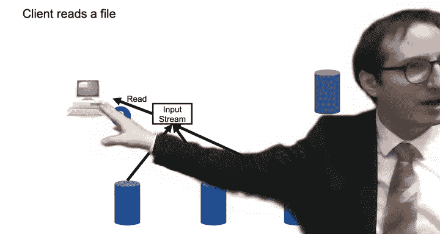

So what actually happens is that the is on that Java library that is here。

 some high level input stream。😊。

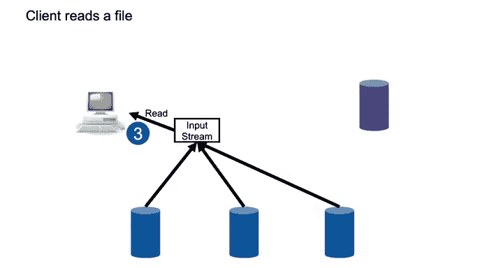

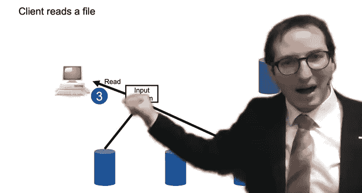

That makes you think it's just a single enormous file， a single sequence of byte， like a terabyte。😊。

Huge sequence。

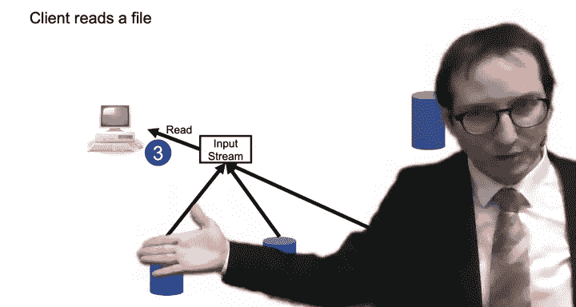

Encapsulated in this， there will be all the programming logic that is going to connect to the blocks to whichever data node makes sense。

 but this is all hidden right whoever of course the read from the input stream will not even see the blocks from here。

 but inside that Java library is the actual the actual switch between the data nodes to go block by block for whom does that make sense。

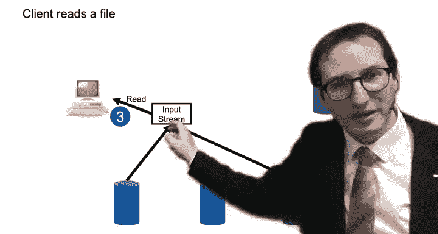

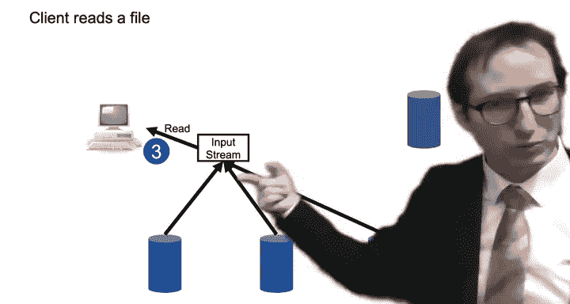

Right and again， this is in the Java library that runs in the client right so the client has a Java library and needs the Java library that takes care of switching between the data nodes。

 Do we have a question， I think I saw raise that There are two questions Oh zoom Yeah the first one is。

 so does there exist mapping inside the data nodes that makes maps block Is to hardware locations。😊。

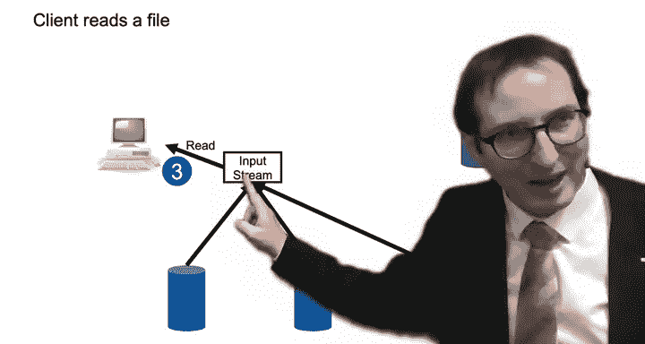

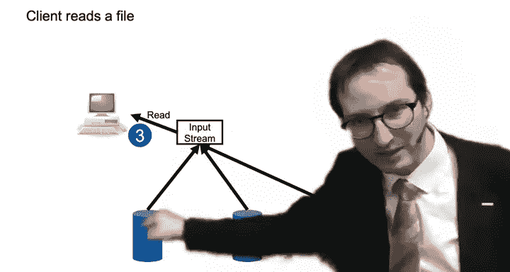

So the blocks are technically filess on the hard drive of the machines right so there are really files so I could imagine several designs。

 either the block ID is the name of the file right you use the block ID as the name of the file and then you just read whatever file has the block ID or there would be some map somewhere that has the relationship between the block IDs and the path to the files that are in there that's the two ways that I could imagine。

Does it answer your question？I think yes but yeah， yes does that does And then the next question is wouldn't sorting by distance also makes sense if we distribute the blocks over multiple data centers to get some geographic redundancy。

 multiple data centers。 I that I love that HGFS is not designed for that。

 So typically in HGFS you are in the single data center。

 but I will show you probably next week or in two weeks that they are extended designs that span over multiple data centers。

 I think it's called Colosus at Google。 I don't know if it's the latest version。

 the latest that they have。 I think it's called Colosus and Colosus is basically the same as HGFS but you have many data center and every data center has plenty of machine。

 and then you go into that sort of things。 And then indeed that notion of distance is generalized to also cover the distance between data centers。

 but that's not part of HF。 again， HGFS typically its in the same data center。😊，Okay。All right。Okay。

 so that was for reading a fight， right？😊，Awesome， so I assume that answereds your question。

 So let's write a file now。 I also try to have my security hats top of my mind when we think through that。

😊，So now the client signals its intents。To create a new fight。So it connects， of course。

 to the name node， this is where everything begins and signals its intents to create a new file。😊。

The name node of course is going to check with the excess control that the client is authorized to do so and if it is authorized to do so it's going to say okay fine。

 you can go ahead and write your first block with this ID that I'm giving to you so the name node gives an ID and says。

😊，Please write it to these three data node， right to the pipeline to these three data node。

I imagine that could be one of the designs that here the name node could give a security token to the client to say。

 use that token to prove to the name node that you're authorized to do that right could be designed like that。

😊，So then the client is connecting to these data bills and organizes the pipeline。嗯。

Regarding the question on Zoom， what I don't know and will check is whether when the client organizes the pipeline。

 it only connects to the first one and then the second one is going to take care of reaching to the other two or if the client also contacts the other two we instruct them to do the pipeline that is an open question that will also check off lines but once you have organized the pipeline。

 you ship over the data to the first data node which ships it over to the second one we ships it over to the third one and then you have some acknowledgement protocol at some point the client receives some confirmation that the data was actually received so that it knows that it was transferred Now if you want to zoom in even not to the physical level on what's actually happening over the network you would see that it's sent in packet network packets I'm not a network expert to be honest but I just know that when you send over the networks you have these IP protocol and so on and you send in packets the packets are actually 64 kilobytes so the。

Your sending of N20 megabytes is divided into network packets just for the purpose of sending with another wire。

😊，And here what's going on is that you do have some slight asynchrony between the packets and the ae。

 it means that you send a first packet， you send the second packet you send a third packet。

 you might not yet have the agments of the first one right so you just start shipping over packet then you start receiving aments from the first packets you send right and then you just continue shipping packet packet packet all the way to here that's going to be probably 2000 packets if I'm correct。

And then at some point you start you wait for the latest a from the latest last packets and then you have the confirmation that all packets are received and then these packets of course。

 are going to be assembled into a single 128 mebyte file that is stored locally on the drive on the data nodes。

 or whom does that make sense？😊，All right。Okay， and so then the client is going to connect to the name node again saying okay now I'm ready to send my second block because that might be a large file so that's the question that was asked before if the file is larger than 128 mebyte we just asked to write a second block and so again we received the block ID of the second block the three data node for why did I write first here should be second the three data node for that new block。

😊，And then we set up again the pipeline notes that these three data nodes may not be the same ones as the one fathers host block。

 right they change every time I tell you more about the strategy for picking the data node。

 then you organize the pipeline。You send the data over and you receive the acknowledgements。

 maybe you need to wait again for the last packets at the end that might take a bit more time and then you have the acknowledgement。

And then you drift over and over and over and over and over and over。

 maybe a thousand times if you have a thousand blocks。

 if it's hundreds of gigabytes that the size of the file， you just repeat， repeat， repeat， repeat。

 repeat。And then at some point you're done you have sent all your blocks and you have the aknowment by the data node that this has been received。

 so now you connect again to the name node and you say。

 okay now I'm done I have sent all the blocks that I wanted to write so now you can release the log What is that lock it's just something to make sure that nobody starts reading the data before the file is fully written right so there is some sort of protocol so this is a log similar to the logs you have also locally when you work on concurrent programming right so you close the file you release the log and say I'm done I've uploaded my file I still a bit of paperwork to do for the name node after that。

So the name node。Is now going to wait for a confirmation from the data notes that they have successfully received。

Dve looks。When does that happen as a answer to the heartbeat。

 remember that there is no sorry what am I saying， not as a answer to the heartbeat。

 it's back of the heartbeat that you inform the name node that you have received the bs right go back。

There's this protocol between the data node and。

Protocols， so every three seconds it connects with the heartbeat and it also says， okay。

 I have received that block right so we can inform the name that you have received a block。

 you these protocols。😊。

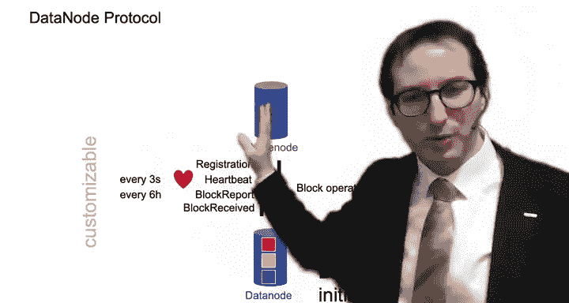

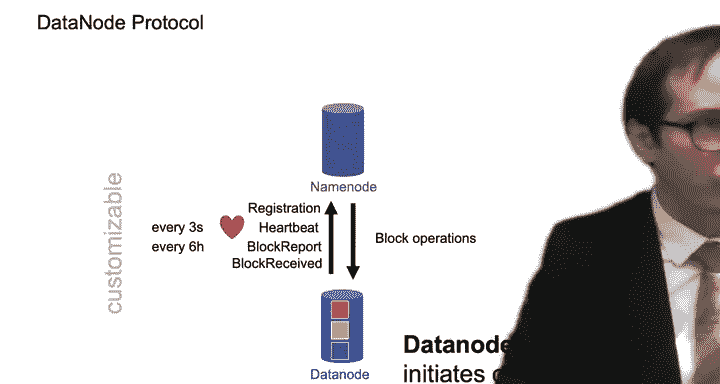

Okay。😊，All right。So what the name nodeote does。Is that it waits。

For what's called a minimal replication。That minimal replication is typically one by default right is's going to wait for at least one confirmation that the block was at least installed once。

Why not three， three is later， a bit later is going to further confirm that the second one and the third block have also been received。

But in order to release the lock and read the client and tend to the client that's okay。

 it's only waiting for one confirmation That's the minimal replication right at that point。

 the client is still waiting， still connected to the name node and anxiously waiting for the confirmation。

 as soon as one of the three data notes has confirmed the successful reception of the block。

 then the name node says yes， that's fine。 every block has at least one confirmation。

 So now I can confirm this is done。 Then in the background， the pipelines， you know。

 it continues to to asynchronously replicate to until it reaches is a factor of three。 Now。

 if you're lucky。😊，That happens at once， right， If you set up the pipeline and nothing goes wrong。

 then you immediately replicate to get a factor of three。 And that's fine。 And that was very。

 very quickly， right， But in case that note crashes or whatever happens。 And it， in fact， only two。

Were actually successfully acknowledged the name node is just going to make sure it's copied over somewhere somewhere as a thirdtype。

 but this is alwaysynchronous right the clients don needs to wait for that for whom does that make sense。

😊，Allright so this is the animation， this is how it works， how it works， Did it answer your question？

😊，Right， awesome de。So I understand that the Java API can handle all of these requests。

 but if there is a simple rest API that is called not from Java。

 then how does all of this handle like connect to the name node and then connect to the data node and then connect again for the acknowledgement So the way I think about T in terms of layers of abstractstruction。

So it's like the Internet， right， you have the。The hardware and then you have the IP and then TCP and so on and so on。

 right So here you have a first layer。That is just the protocol of the system， it's RPC and so on。

 This is how the machines connect to each other。And then whenever you build a system like that。

 you give people drivers or libraries so that they can connect to the system and typically these libraries you can write them in many ways。

 you can write them natively that they directly know the protocol and use it。

 but sometimes what people do is that they put in between a rest API in order to implement it just once the system and then on top of the rest API you can add plenty of languages。

Now， the way that it's package here， if you think this this here。Where is it。Yeah， here。

 So this is really part of the library。 This is implemented in Java and specific to Java that wouldn't be in the rest API right because this is really within the same machine that you do this logic。

 So this is the convenience of the Java API。 If now you have a rest API and you also want to handle Python and so on。

 then you would need to rewrite the same thing in Python。

 that wouldn't be in your rest API right that would have to be packed of of whichever driver takes care of that。

 The reason is that this is outside of the machines。 This is not on on the data node or they。

 this happens on the clients。 So you would have to put that in whatever software you give to the people right But once you have the network protocol in place。

 you can write drivers for any language you want。As long as you implement the the protocol， right。

 other languages might not have the input stream abstraction， right， It might be Java has it。

 I don't know what Python has would also have its own its own way of dealing with it。

 Did it answer a question， Yeah， awesome。公此判决。Does this acknowledgement from the name note to the client in the end only happen for the last block of a file or for every block？

诶。I think it's at the very end。at the very end， once the name node。

 it's an acknowledgecment to the close right， so the close is at the end。So at the very end。

 when you want to close the name node checks that for every block it has at least one confirmation and if it does have one confirmation for every block。

 then it technologies and that's the synchronous path and says to the client that's over and the rest is asynchronous。

 right？In fact， this asynchronous part is forever because it might be that a week later a node crashes and then you have only two replicas left。

 then the name node is going to uns to a half bit and make sure it's a self time so this is actually forever this asynchronous right。

Did you don't answer a question。啊什。Yeah， another question there。

So when I as a client upload a file which is larger than 128 megabytes。 So the block size。

 do I have to keep track of the different blocks or is there。Some service that handles the fire。

In total and not best the different blockss。 So I think you don't need to。 And the reason is simply。

That is here。 It's on the name node。 So even if you forget it， you don't keep track of it。

 you forget it。 You can always ask again the name node when you want to read it。

 right so you can forget about it。However， your question makes sense because in practice you might want to cache the list of block IDs and locations in fact you can do it in mapreduce and Spar and so on because if you do it you can then shot your hit the whole thing and refresh the blocks without needing to communicate with the name node right so this is an advanced use of it but you do not have to do it it's perfectly fine to forget about all of these block IDs because you can always ask later again to the name node does it make sense。

😊，Yeah， thank you very much， Yeahep， you're welcome， all right。😊，Yes， let's address it。

Why do we set up a new pipeline for every block。Or because it's never the same data notes。

The three data nodes are different every time， so you can just set one and for although otherwise you would have all your blocks on the same machines and if it crashes then you have a concentration of problems so this is why you want to diversify the places where you put your blocks right。

It's also important for map produce that we spread it over the cluster because for querying it's nice if it's the spread of older cluster forism。

呃，诶。Okay， so now let me tell you about replicas。 there's a replication strategy。

 So the number of replicas called default is three。

 So one is to acknowledge synchrony to the client and three。Is forever， you need to ensure that。

You are at least with three ra gas Club block。Now。You need to be smartmacked about where you put these blocks。

 There's a few things to consider。 can be the network bandwidth width， the distribution and so on。

 but basically。On the high level， this is the strategy。

 you have this notion of distance between nodes， nodes are machines， right。

 cell that are piled up in the racks。嗯。yeah， go ahead。 I will question。 So again to to this question。

 but couldn't the first data note distribute over different other data notes。

 leaving us with replicas over or many different notes。😊，Yes。

 but then it would constrain you to always use the same data and rules as the first node。Right。

 which actually we do use always the same one as we will see in here。

 But the problem is that it only works for as long as the machine is not full。 Right。

 So this is why you don't want to。To f yourself or limit yourself。

 to always use the the same first data nodes。 right。

 So it gives you more flexibility to just be open every time it's just a new set of three data nodes。

😊，Does it make sense？Yep， yes， al right。 perfect。Alright， so let's talk about distance。

 When you agree that these two nodes。A closer that these two nodes right And if we had yet another data center now because of the question that was asked。

 Imagine there's yet another data center， that would be an even higher distance if between nodes in different data center。

 So we have this notion of distance， right， let's say this is a distance of two。

 You basically counts the edges。 There's some network switch within the rack that there's a network cables that would be between the racks。

 So this is a distance of four。 This is a distance of two right we're agree with that right It's pretty intuitive。

 It's the length of the cables basically between the machines and the number of network switches in the middle。

 here has the strategy that is used。 The first replica is going to be the same node as the clients。😊。

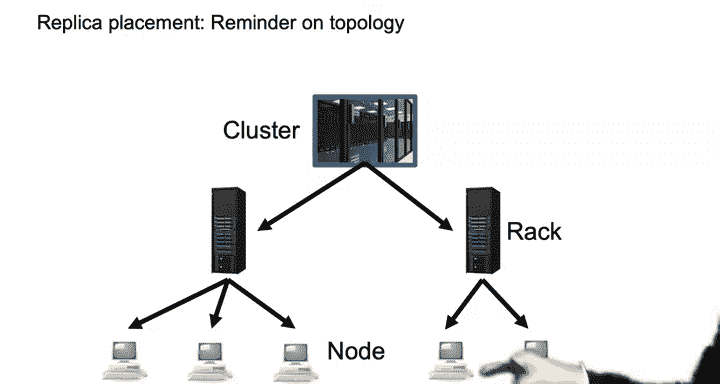

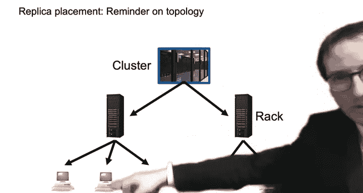

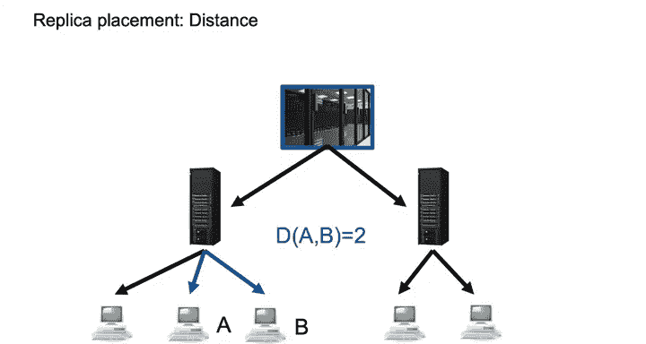

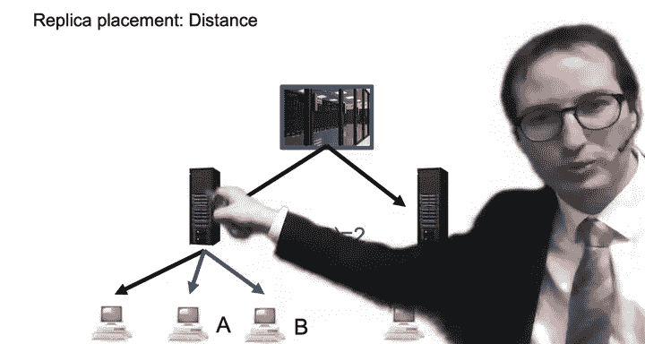

So this is why the last question on Zoom actually makes sense， if you are。

 if the client is on the cluster and the client is one of the machines on which there's also a data node。

 then that data node will receive all of the first blocks that the client is writing very convenient because that's already on the same machine right so it's going to be very quick。

😊，But it cannot be the same。For everybody， because the client could also be your laptop。

 So if the client is your laptop， you of course， cannot put the block on your laptop。

 So then it's a random random node in the system。 And that's why it can be different every day。

 Okay the second replica is a node in a different rack。

A different rack and the third replica is another node in the same different rack right。

 not the same rack and replica4 and beyond if you want a replication of node and3。

 you just require that there's no two replicas on the same node because if the node crashes。

 you just lose two replicas in one shot So at most one replica per machine。

And then you want at most two replicas per rack。 One or two is fine on a rack， but not three。

 You try to diversify them over multiple racks。 Now， here's。

An explanation of why we don't put the second repa on the same rack as the client。

 which might have been your source ID。So what happens is that if the client is the one on the left。

 you place the first block on the same machine that also has the data node running and then the other two blocks on a different rack on two machines of that rack。

 This is what happens Now what going to happen if you have a second block I that the copy of the second block would also be stored on the client the same machine and the other two replicas are going to be on yet another rack because you want to diversify but two on the same rack two machines on the same rack So you see the yellow and the green。

 So that kind of spread it over now if you did use the same rack for the first two replicas。

 do you see that this would need two more concentration here Now you have four blocks four replicas on the same rack。

 these start being dangerous right so we really prefer to do it like this we try to change the racks and put it somewhere else for the other two replicas。

 We have a question Yes about the pipeline。 Does it first leave the rack for the second note and then reenter for the third one。

For the replication pipeline。So you would probably connect the first to the first the client to the node in the order rack and then between the second and third。

 it's within the order rack right you want to optimize the distance。

 but that would be that we not leave the rack between two entry。

That's also one more reason why they are on the same rack。 It shortens the replication pipeline。

Does it make sense。Yep。Okay。So yes， so this is the replication strategy and again。

 this is to avoid the concentration that we don't put the first replicas on the same rack。

 but instead the second and third replicas on the same rack that's in order to concentrate it a bit less。

 right？We'll see you could think， okay， there's a concentration here。

 but you'd see in mapRduce that that's not the case because in practice we'll have plenty of clients or other cluster。

 so in fact there will be not so much concentration here。

 but that will only see in mapreduce of course。So I'm going to stop here。

 I didn't have time to uns the cliffhanger， so the cliffhanger actually says for the for the。

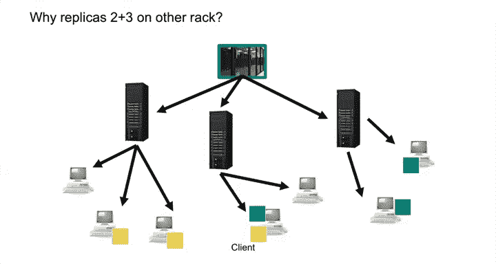

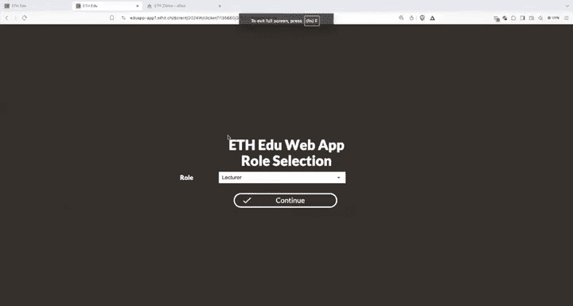

For the single point of failure。 but then we'll address it next week。 All right。

 so let's check quickly the speed。Before you go， this is your opportunity to tell me slow down or accelerate。

Okay perfect so this looks good so we'll do our homework first homework is to figure out the excess control implementation if we figure it out second homework is to find out if when you set up the replication pipeline the client also talks to the other too so that we'll try to investigate Thank you very much Android the exercises if there's anything right to us in the Moodle forum of the element chat and see you next week in E7 at 2 pm on Tuesday Thank you。

😊。

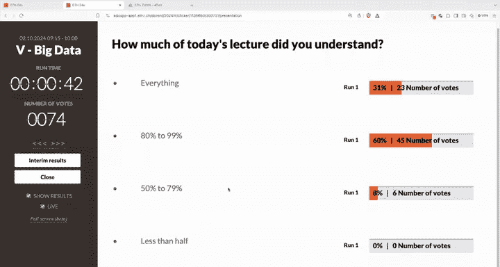