# 苏黎世联邦理工《大数据｜Big Data - ETH Zurich - Fall 2024》中英字幕（deepseek - P13：-13-4. Distributed file systems (4_4) -.zh_en - GPT中英字幕课程资源 - BV1sHPKeoEJU

Welcome everybody in the lecture hall， welcome everybody on Zoom。

 welcome everybody on YouTube watching us from the futureture welcome Tobias we'll moderate today's lecture so what's the plan today I will finish this about HGFS because we have this cliff hanger on the single point of failure with the name node so the last bit we need to discuss and then we'll look into syntax in the world of big data and why does actually syntax matter but before that I have a few questions for you。

😊，Here， so this is my first question。

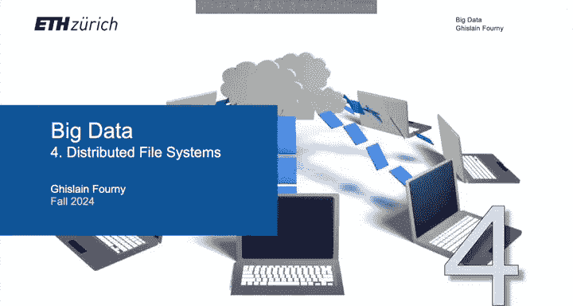

Dynamo or Dynamo Db， which is implemented on the name of the product， is it consistent。

 available or and or partition tolerance？You remember CA P， the C F orM， so。

Consistent available of partition to。 with consistent， I mean atomically consistent。

 So atomic consistency as in C P。So remember that atomic consistency means that all machines will return the same。

The same results。Available means that the system continues to operate。And both of that。

 in case of a partition tolerance， and of course， if the system just crashes in a way that is unrecoverable。

 if there is a partition of the network， then it's not even partition tolerance。

So let's see what you say。So you say available and partition tolerance and this is indeed the case so the first thing is that it cannot be all three right that's the CAP field what it means is if you are part tolerance。

 then you have to make a choice between being available or consistent when there is a network partition right。

Okay， so indeed the ID is that do you remember the vector clocks when you have the vector clocks。

 it means that in case of a network partition time is no longer a line it's no longer just a linear timeline it can split and fork into a dependency graph or directed thesyic graph and then you no longer have a total order between the versions of the data and the moment you no longer have a total order。

 you become not consistent eventually consistent but not consistent for whom is that here。All right。

 and another system that would be consistent and part to。

 that would be that during the partition it stops being available。

 but it will still recover when the part is resolved。

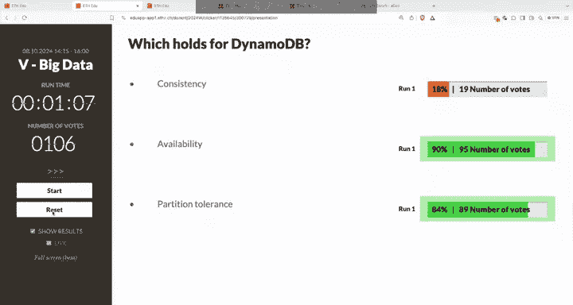

Okay。Here's another question for you if you need to use HGFS。

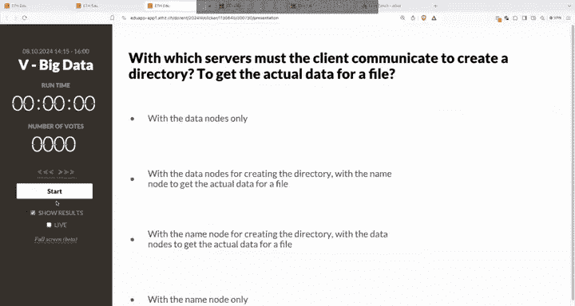

And you want to create a directory。To whom do you speak with whom do you communicate the name node。

 the data notes。Or for getting the actual data for a fight to the blocks。

 do you speak with the data node， the name node？So this is the question。

 So the first one means the data node for both of them。

 then the second answer is for creating the director。

 the data node for getting the data is the name node。Or vice versa。

 or for both of them the name notes。You notice this that here I use the lower case name node data node。

 it's very common and I last week to use the Caml case that's because that's the name of the Java classes。

 so this is why we tend to take them over when we call them。Let's see what you said。

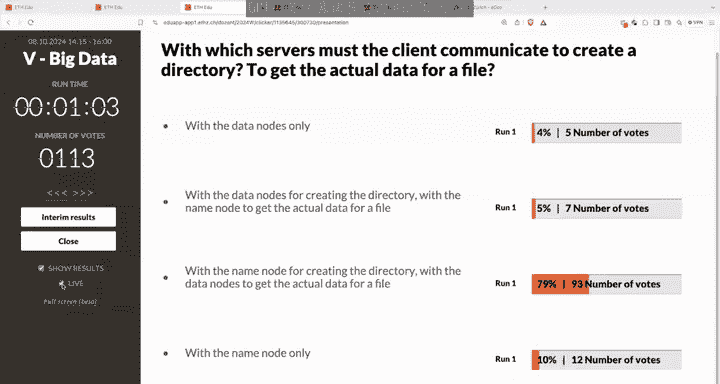

And we have the majority， and the majority is correct， indeed。

So all the metadata is handled by the name node， which is the coordinator on on the top and to get the actual blocks。

 the blocks are stored on the data nodes and this is why they are called data nodes because this is what the data is。

What was left out of the question is that of course。

 you need to know in what order the blocks should be assembled and which other the blocks for that file and that is actually stored on the name node。

Okay， and finally， please answer as quickly as possible。 What is the size of。

The order of magnitude of the size of a block。Quly， quickly。That you should know now。

 I didn't start it。 That's why。 Yeah， now you can。😊，Let's see life。I want 100% here。Yes。😊。

Let's see if he tour。Right。There was a question by the way on the Moodle forum that that I answered to try to give the motivation。

 So basically， in fact， you could try to go ahead and implement AGFS so install an AGFS cluster you can do it with a few clicks on Amazon。

 for example， with EMR elastic map reduce。And you can change the configuration and try to set the block size to for kilobytes。

 You can try。 but then you will see that it's going to to cause problems。

 and the same goes for larger partitions。 So the idea is really that。If the block size is too small。

Then as soon as you have a file that is like one terabyte for example。

1 terabyte isn't that large right but if you have blocks of 4 kiloytes then you basically are looking at 250 million blocks and you have to imagine that every time you fetch a block some software needs to be executed right some Java code needs to be executed so this is why it's very costly and you should avoid having millions of blocks with 128 meabytes you only have 8000 blocks if they are that size for a terabyte file right and now the question that was a very good question is like but anyway physically on the disk we do have the kiloytes blocks because this block here is a file on the local drive if you actually go locally and see the hard drive it's actually a fine so it will be physically on the actual hard drive also 4 kiloyte blocks but you have to remember that when you are looking at the hard drive this is much smaller。

😊，In size so things are much faster and actually fetching these 4 kilobytes is also optimized by a hardware so it doesn't matter that you would fetch 250 million small blocks on the hard drive itself because this is highly optimized but here when you look at the scale of HDGFS the actual codes that would get an AGFS block is much more costly to execute and then you get the Latin C and so on so this is the idea。

😊，So the mental picture that you should have， imagine that you do it in a linear way。

 right we will parallellyize later， so it means you wait for the first block， download it。

 wait for the second block， download it， wait for the third block。

 download it and so on through alternate between waiting for a block and actually sending the data。

If your block size is too small。😮，Then the waiting time will be a constants。

 so you will wait and then it will immediately download the small block if it's a small size and then you wait again and immediately download。

 so you spend most of your time waiting if you make the blocks bigger the waiting time is going to to stay the same but then every time you wait you will download more So you basically batch together the download if you want it's like using a zip file when you approach to the server So this is why when you have larger blocks like 128 MBbyte then you're going to wait a little bit。

 but then it's large enough that then the downloading takes a lot a lot of time in comparison to the waiting time so it means that most of your time is spent downloading and since the number of blocks is smaller because they are larger then it means that the number of waiting time period is also smaller right so what we want in HGFS is to spend more time downloading data than waiting for data to be downloaded。

Then if you go even higher and have absolutely enormous blocks。

 then you'll see that you start running in other issues。

 but this happens more in parallelism right if you have huge blocks you can no longer spread them over multiple machines to read them with mappreduce so this is why it's not a good idea to go to go to that large blocks in the end so 100 mebytes is the proper order of magnitude now a word of warninging this is 2024 things are evolving the hardware is evolving the properties of the drives and networks is evolving what is true today might no longer be true in five years or 10 years right so in fact Microsoft already is switching to higher block sizes I think they are now at 4 gigtes right it's kind of 10 times in terms of order of magnitude so you see that things are developing right but 4 gigabtes 100 mebyte it's still kind of the same order of magnitude this is what what you need to remember the ballpar。

Of that and maybe in 20 years it will have been it will be so different that you need a completely new architecture because it could be that suddenly things become much faster over the network。

 much faster than on the hard drives and so on， for example。

 what some people are doing is that with everything in memory， then there's no hard drives anymore。

And so on。 So you need， you see that actually is evolving。Al right。

 and some of you might actually design these future systems that will work on the， on the new。呃。

Kind of how。All right， so let me know。Switch back。To the。

 my goal was really to give you an intuition of why that is。

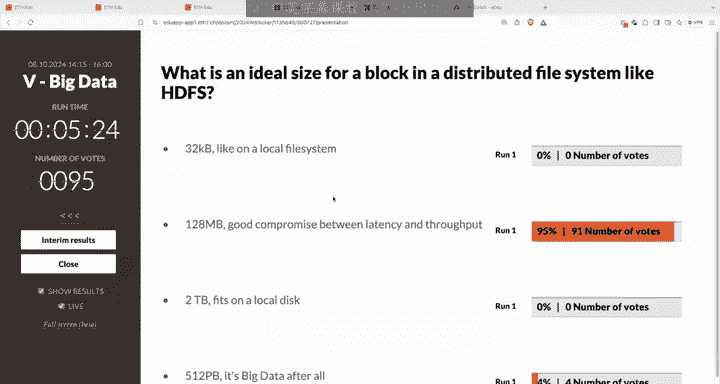

Who would say you now have a good intuition of why these size of blocks？Right， okay。

And you'll see when we do map Red and spa， it will all make sense。All right。

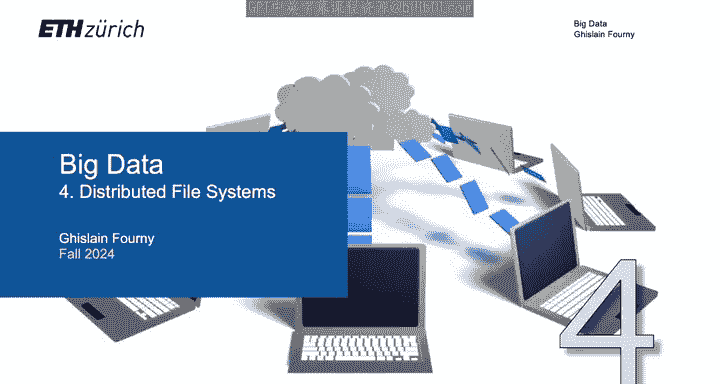

So the cliff angle， the name node is a single point of failure。 there's only one if it crashes。

 we are doomed， so let's address this。

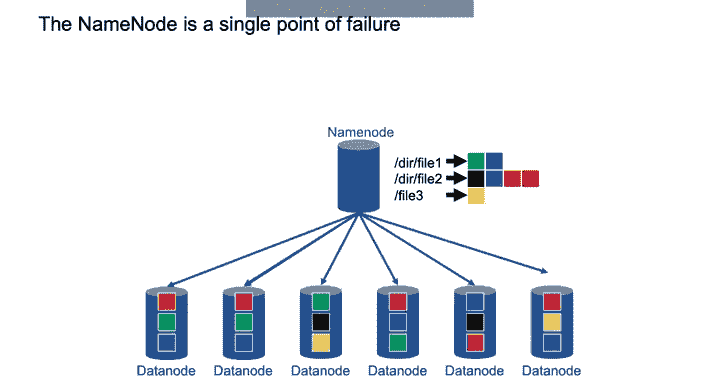

So， so yeah， let's imagine it fail。 There's a crush。What do we do？Maybe we restart it， right？

So that's optimistic right it's assuming that we took up precautions and backed up the data in some way of what is there but then we restart it so what is there that we need to be careful to consider when we restart so this is something we saw already last week we have the file name space that's the whole bunch of directories and file names you know the size structure。

😊。

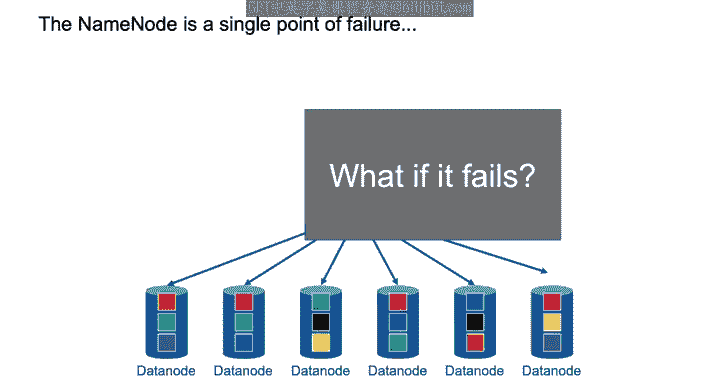

With access control and so on， then we have the mapping from the find names to the block IDs。

Cll just integers， and then we have the block locations。😊，That is for every block ID。

 you have the by default three data nodes， the IP addresses of the data nodes that have these blocks。

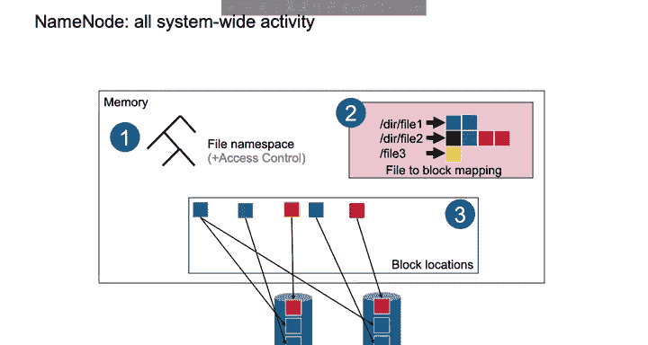

Now。If you want to be resilient in case of a crush。

 if the name node suddenly crashes and you want to be able to restart it you need to make sure that this is saved somewhere so what do you do well you put the file name space and the mapping from the file names to the block IDs to a file on some storage I'll tell where in a few seconds but we need to store this information about the file tree and the mapping from the file names to the block IDs who agrees that if we lose that information。

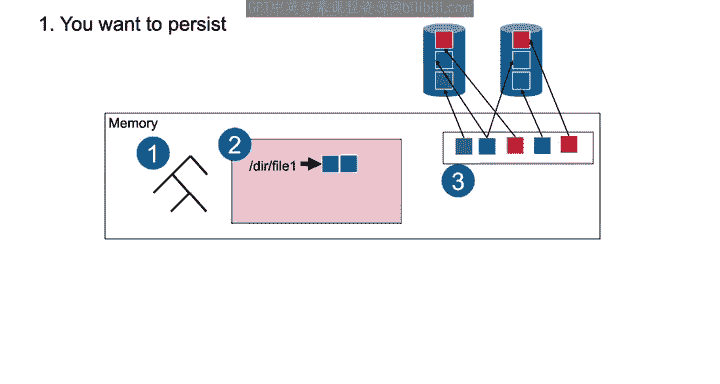

We cannot do anything anymore with the data。Who sees that the blocks alones are not enough。

RightBecause you wouldn't know how to glue them together anymore。

 this is how to glue the blocks together it tells you which blocks belong to Webfi。

 so we need to stock somewhere to persist send storage the this information that's called the namespace file has the wholeified namespace and mapping to block IDs why do we not need to persist the T thing the mapping to to the data nodes。

 why are we not saving that？Yes。😊，でし。Exactly， this is in the block reports。

 so you would anyway just request block reports when you restart and then the data node will tell you which blocks they have and that you can rebuild right who agrees。

Okay， so we can save ourselves the backup of this。Now what kind of persistent storage well typically at least in the early versions it's a network attached drive NAS right so you basically store it on some storage that is shared over the network because it might not be the same machine that you restart the name node on so you put it on network storage。

You just need to be aware because that might be something that comes to mind is this stored on HDGFS no of course it's not stored on HDGFS because then you have a bootstrapping problem right because if you store it on HDGFS but you lose the ability to read from HDGFS you wouldn't be able to read it who sees that？

So it needs to be outside AGFS so we put it on some network drive that can be read independently of AGFS now here's the thing we might have done some backup but then the system continues to run and so we might have edit files or modified or append to files and so on what do we do well here it's more efficient to not save every time a new namespace file but indeed instead we store a second file that's called an edit log an edit log and thats really a journal。

It's all the updates。😮，In the order in which they are well made like a blog。

 right it's you keep a journal of every modification here， I created a directory。

 I added this new blog with that I， I that file and so on。

 it's just a journal for whom does that make sense。

RightAnd we just keep app to the edit log like this。 Okay。

 and it grows and grows and grows as time eapses， right？

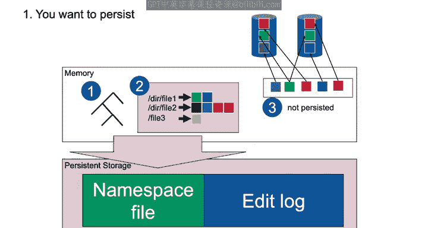

Now you probably don't want to keep it only on the natural drive。

 you probably want to back it up as well， but for this you can put it on some other drives to some backup drives。

 maybe some tapes， to cloud storage or glacier and so on， all right。

So then you have even copies of that。

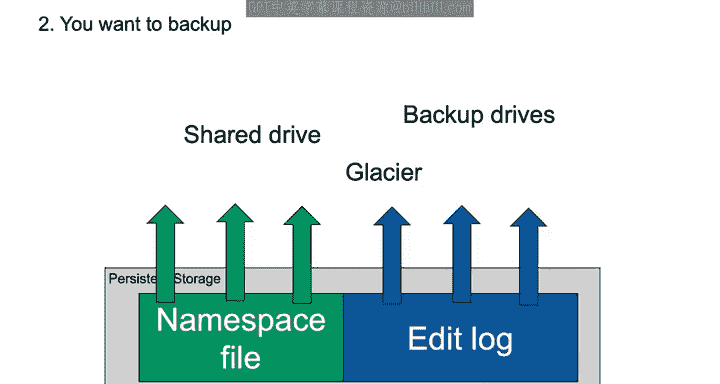

Now。If we've done that and it's on the network storage， plus it was backed up。

If it fails now we have the answer， we restart it， right？😮。

How much time do you think it's going to take to restart it？Who thinks just a few seconds。

Who thinks maybe half an hour？😮，Who thinks an entire day？

Okay so you are in the right ball back so most of you said half an hour。

 it is indeed roughly half an hour because what has to happen so first you need to reboot the system and so on but you also need to reread that and reinsantiate all the memory of of the name node right so first what you need to do is take the name space file so that back here and you just read it into memory so you have the file name space and and the mapping and so on I didn't put the file name space but it' it's in there too and then you play the edit log who has already seen a media file in music。

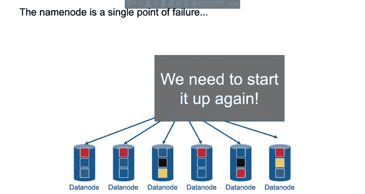

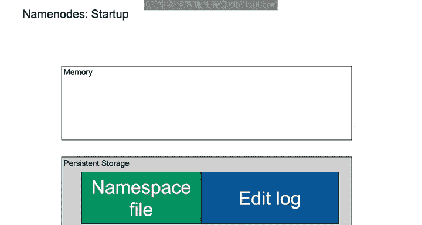

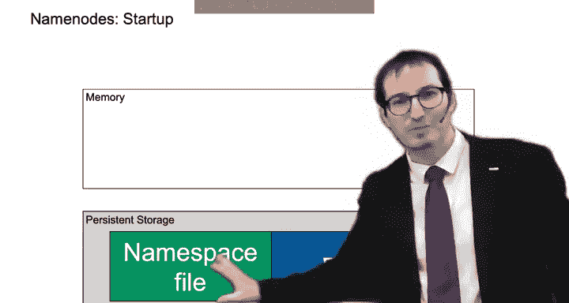

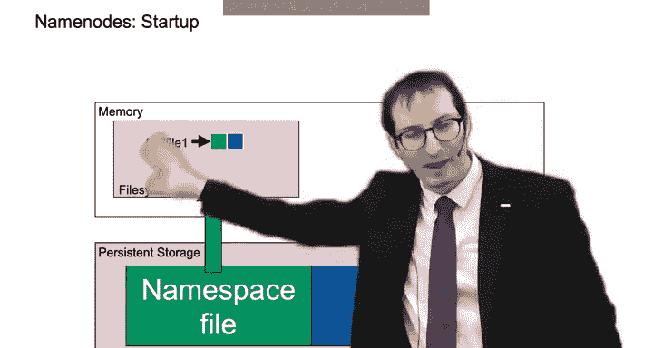

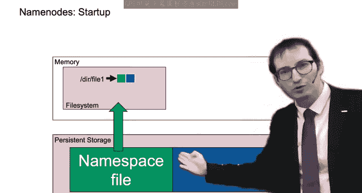

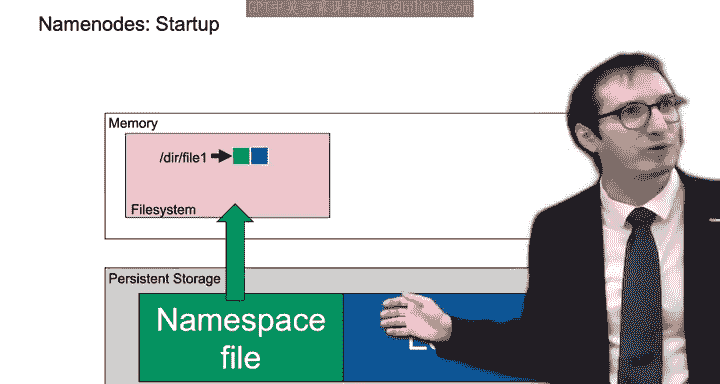

It's like playing the music from a MI file a MIdi file contains all of the notes that you play。

 It's like a journal of the music you're playing and you play it。

 it's called the sequencer when you do that well here' is the same thing we read through the journal and we apply every creation of a directory adding a block ID and so on and we just play it like this I put this little play here basically say that this is what's happening and then you basically bring that snapshot so the namespace file was was a snapshot in the past and then you play the latest edits and now you are in the latest state but then you also need to wait as one of you set for the block report of the data notes until they connect to you and then you can actually infer the block locations and after half an hour and you're ready to actually sell as a name node。

😊。

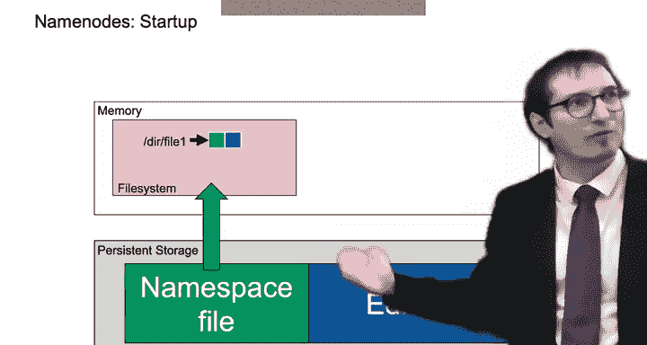

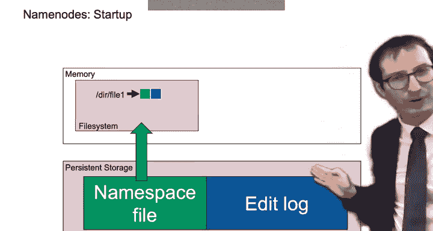

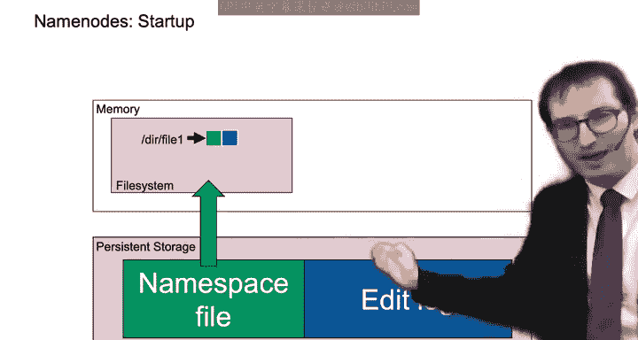

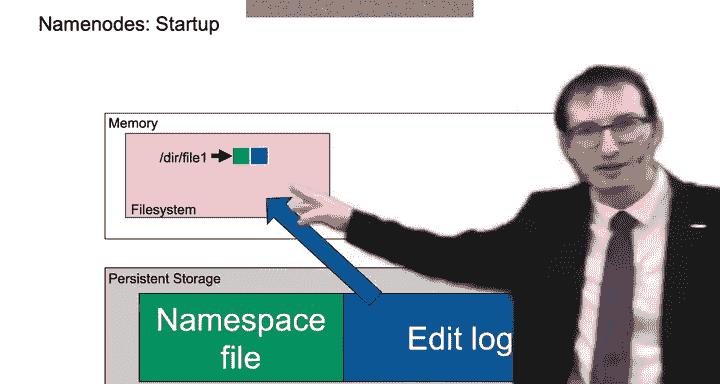

But who is that clear？

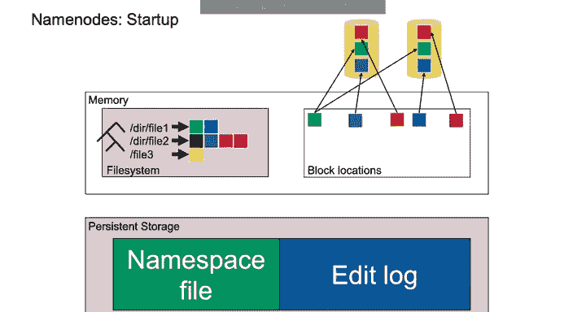

All right， perfect。 So this is why it takes a bit of time to start the up again。

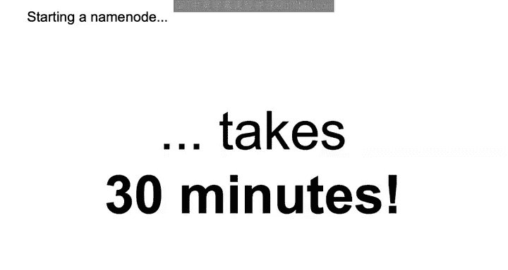

Can we do better， Of course the answer is yes， because otherwise it wouldn't be very very fun to study So the first thing that we can do is since we notice that the edit log takes time and that the more time itapes。

 the more time it will take to actually play the edit log you can periodically repe a new namespace file and start again with an empty edit log right you just take a new snapshot like this that it's a bigger namespace file but then there's no edit log anymore you just load that into a memory and your order and then you again create a new edit log starting from zero or whom is that clear。

😊。

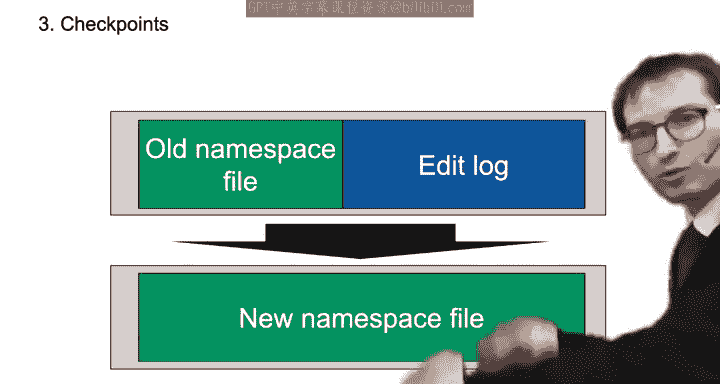

All right。So。Now there has been a few modifications to the system after other years because that's already more than 10 years old。

 I will tell you what the latest state is of the system what is right now implemented it in order to to mitigate that what happens is that we will have more than one name node。

😊。

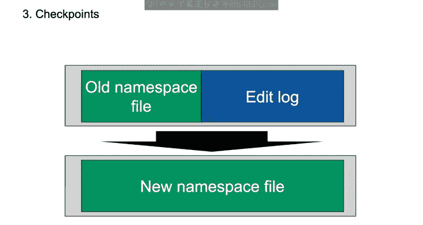

One name node is the active name node that's the one that is in charge of reading and writing。

 so that's the one that we've studied last week but we have more name nodes that are called standby name nodes。

 these name nodes do absolutely nothing except keeping track of the state of the file name space and the block IDs in exactly the same state as the active name node but they do not process any reading or writing requests right？

And they are just a mirror of that。Now the way they do it。😊。

Let's talk about the case where you have the namespace file and edit log in the network attached storage here。

 then what they do is that they read the namespace file and the edit log and they do what's called tailing the edit log It means that they keep tail is a command right if you want to see when file is is a log that you append to you can use the tail command and see the end of it right as it goes。

 So you tail the edit log And so these once basically look at the edit log and keep implementing the changes that are ongoing at the same time。

 maybe with a slight delay behind the name node right And so here they should have exactly the same information。

What's more all the block the heartbeats and the block reports are not only sent to this active name node they are also sent to the song by name nodes。

 so it means they also know the mapping from the block IDs to the Is of the data nodes right so in here you have all three components of what's in the brain of the active name node。

 the file name space， the mapping from file names to block Is and the mapping from block Is to data node for whom is that here。

RightAnd so now if the active day node phase。You just promote one of the standby name nodes to be now the new active name node。

 and that's much faster。Because they are already ready。

 they already have everything it takes right and in the meantime in the background you can restart this one and just turn it into a standby name node。

😊，OkayNow you have a different way than the network attached storage for storing the names by file and edit log。

 it's called the Qum journal manager。 I will not say much about this。

 but the idea is that you have journal notes， journal notes。

 it's a lightweight process just like the name node and the data nodes are processes that run machines。

 you have done journal node。😊，And you need basically a majority to agree on an native log and name space5。

 So for this reason， you need an odd number， you know how it is when you create a committee and you need a majority。

 you pick an odd number， it's an even number there's a risk of having a tie So an odd number of general notes。

 typically you make them run on the same machines as the name notes active log standby。

 but it can be 3，5，7 and so on。And so that's called the Qrum journal manager and then they just will agree on the latest version of the namespace finding8 look the now downate methods。

So this here is called high availability， HA， high availability。

 and this was implemented in order to make sure that it doesn't take half an hour to restart， yes。

And why do we want to run chromrome journal manager on the same machine as the name node。

 Because if that machine crashes， the journal manager will be gone too。 absolutely。

 this is exactly why the way that the the journal managers are designed。

 So the quorum journal manager is designed is that it continues to work there's not than half of its still life。

 for example， if you have seven of them you still have four。

 That's enough to continue to function right， So this is the reason you should have at least three basically to be to be safe。

 but it's also resilient to crashes。 This is really the nice feature of of the Qrum journal manager。

 and Qrum really means majoritys whichever majority you have is enough does it answer your question。

awesome。Okay。嗯。Now there is something else， it's a third type of name node。

 so standby active there's a third type that's called Ob serverver name node that also is available。

 An Ob serverr name node is kind of a standby name node plus plus。😊，Is basically a standby name node。

But it's authorized to serve read requests。So if people want to read something from AGFS。

They can connect to the active name node of course。

 but they can also connect to the observerserv name node and the observationserv our name node will be able to give them the information so the block IDs。

 the data nodes for reading data so what's very important is that for writing data it's always the active name node that takes care of it but the observationserv name nodes have the right to also serve clients with the read requests right so you have standby name node Observ name node and the active name node。

😊，Okay， for whom does that make sense？Allright， now you might see in the literature。

 if you Google around or ask chat GT， you might hear of checkpoint name nodes or backup name nodes or secondary name node。

 you can forget about that。 It's history that basically the intermediatemedia implementations before we have the we had the current version it's basically the ancestors of the standby name node right so you don't need to know anything about checkpoint backup。

And secondary name node， because now they' are just sent by observerr and active name node。Okay。

Very good。Now， there is another feature。 So this is high availability。 It's called。

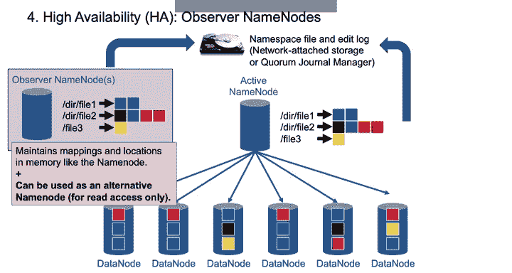

We have another feature that's called the fedderated。😊，Yes feder distributed file system。

It's basically exactly in the same way as when you already installed Linux。

Do you remember that I don't know if it's still today but back then when I tried during the installation you can create partitions and then you can allocate the parts to some paths like there's a part for slash one for slash route another one for slash room and so on do you remember that you can do the same thing with HDGFS you can basically allocate your site system to some director is saying I have a name node that is responsible for this part of the site namespace and another name node that's responsible for this one so I did it with slashwo and s bar。

The way that works is that depending on what files you want to read all right。

 you're correct connecting to the right name node that has that covers the directory you're interested in but basically these two do not even communicate right it's really like as if this was a name node of its own on its own cluster and another name node of its own on another cluster except that they shadow the data nodes。

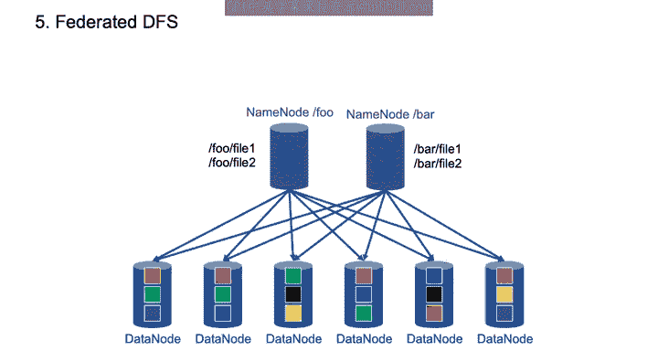

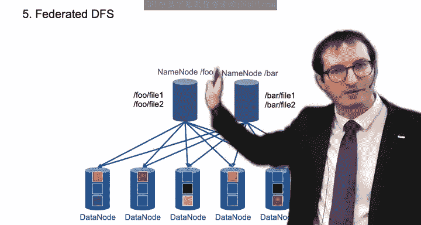

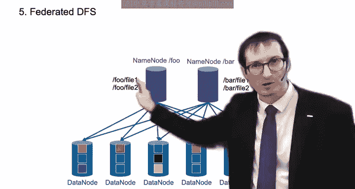

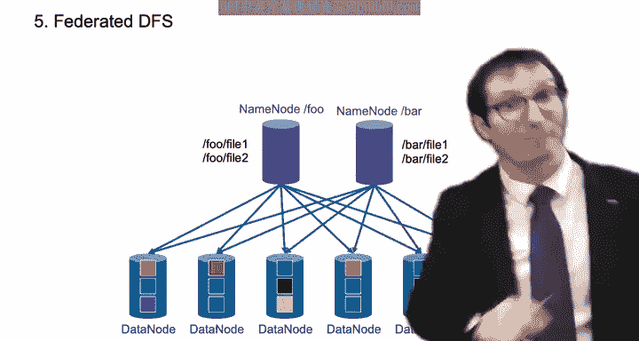

But you can imagine the data notess they just have blocks right so sharing them is no problem at all you just put all the blocks spread all over the place and and and that seats right you just have every block ID that is in either one or the other who is that here。

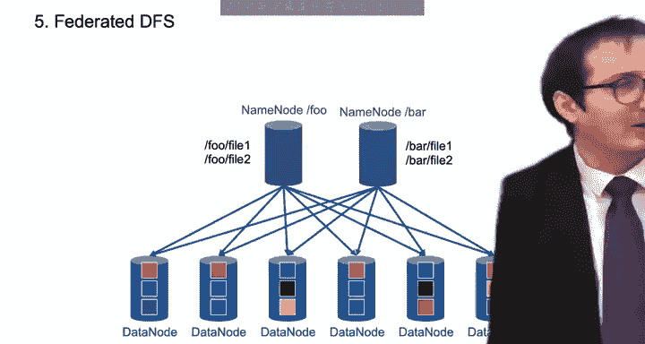

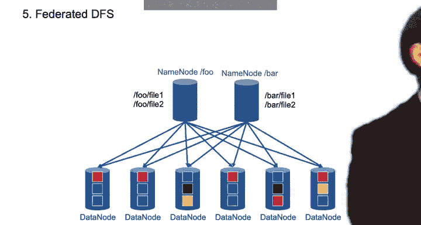

So this is called the federated HDGFS federated P system where you have multiple name node。

 so that also helps to scale up a little bit if you want to process more data。😊。

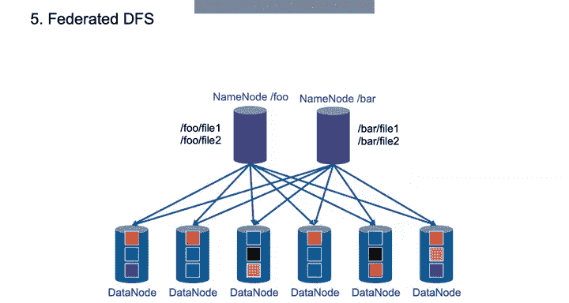

Okay。So that was the single point of failure， the way we address it。Now。

 how does it fit to use HDGFS Well in fact， you can use it on the command line in a way that's quite similar on what you do on your laptop in the command line when you create directories or CAs for steal a file and so on。

😊，The way it looks like is that you have a comments that's called Hadoop Hado Ps and then let me show you here Hadoop Pf。

 LS， Hado Pf cat， Hadoop Pes RM， Hado Pf， MKD， these are basically this is the Pus Tom that。

 FLS cat RM， NKD these are basically comments that you have who knows them， most of you right？😊。

So the way you use them is you just put a dash in front and you put it after a Hadoopbefest and when you do that this is going to be working on the actual Hadoopfi system there is one difference is that when you press return it's going to take one or two seconds to actually respond so it's much slower than when you do it on your own laptop but of course you're communicating with a huge cluster right so just that you're aware that there is some latency here of the one or two seconds。

😊。

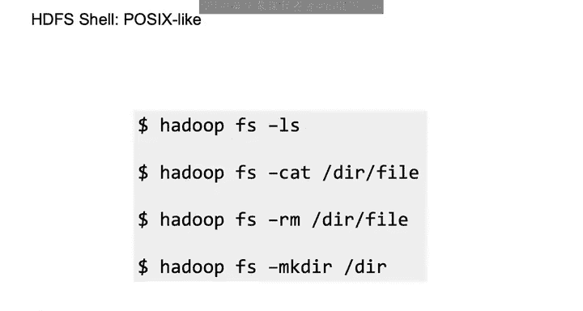

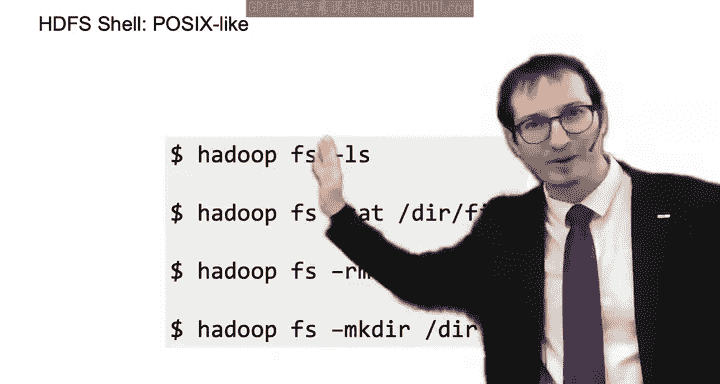

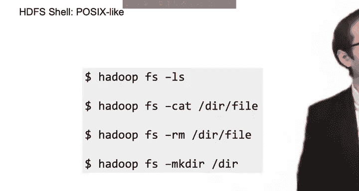

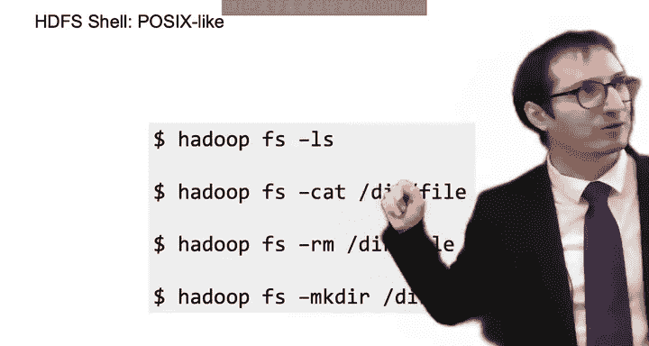

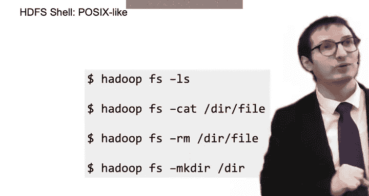

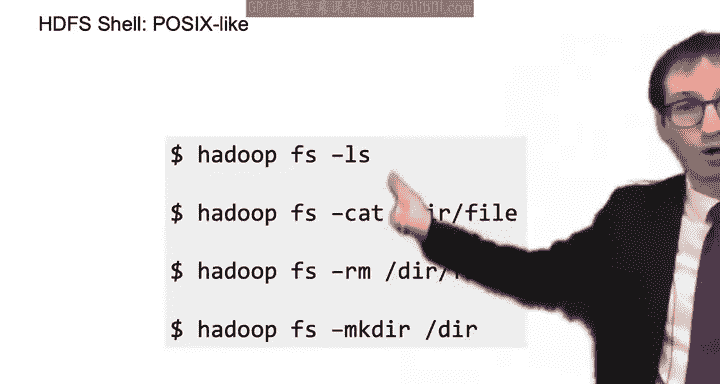

What's really nice is that this program here doesn't just work with HGFS。

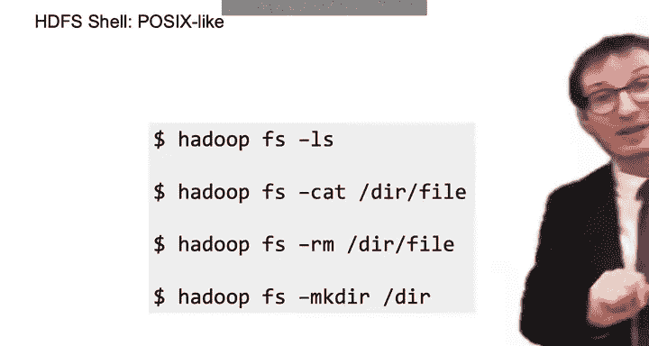

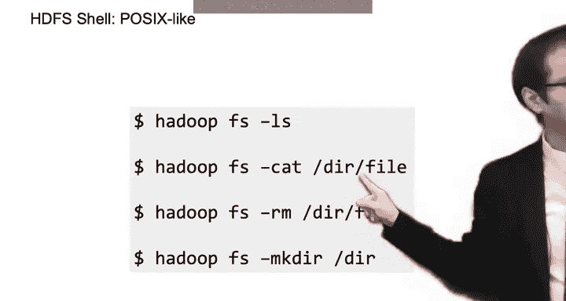

In fact， it will also work with your local file system if you use the file。

 so you know the file scheme file column blah， blah lights for the local file system。

 it also works with S3， you can also connect to S3 there's special S3 URLs for that and so on so it can connect to multiple places and the way it works is that the underlying command is actually called AGFS but this one is hidden and instead you use that command that depending on sorry what you put in there it will either do it locally or on AGFS or on S3 or on any other system so it's very very convenient。

😊。

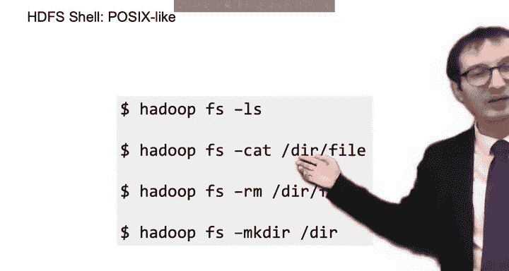

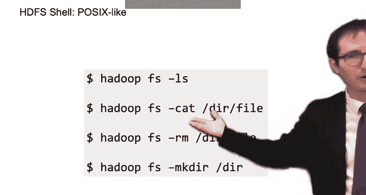

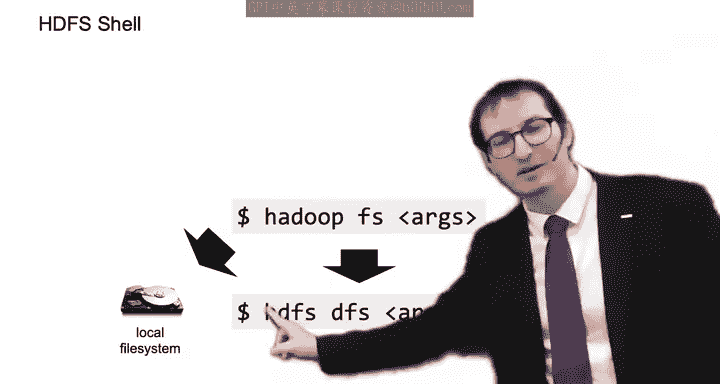

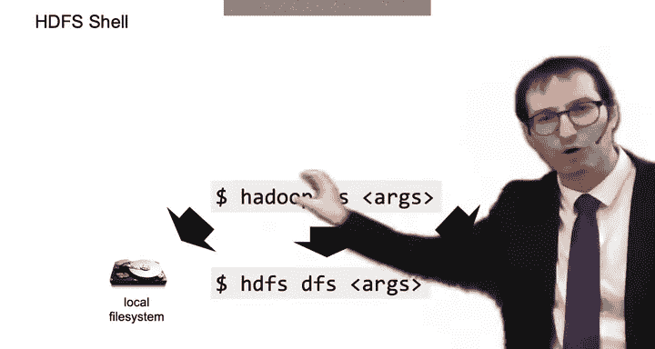

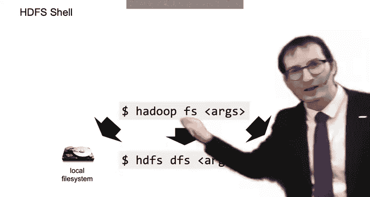

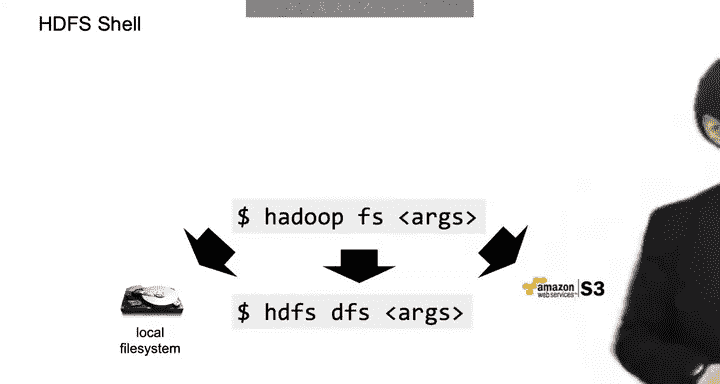

Okay so basically the idea is that these are URLs just in the same way as in the rest API the scheme is just implicit。

 so if you don't say anything by default typically it's HDgFS so they actually start with HDgFS column slash slash and then the host and then the path but in order to not have to type that URL every time it's convenient to just put slash with the root of the HDgFS system and somewhere else you specify that by default this is HDgFS on that host for whom is that clear。

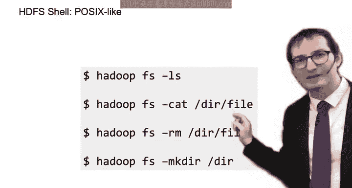

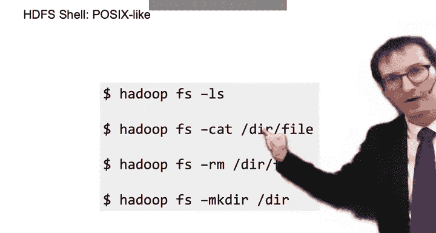

Right awesomesome perfect， so we can actually try that I would if you yes。

 go ahead when I have separate note and when I have a separate name node in the federated Ds for the sections fo and bar of the namespace。

 how do I handle creating a news section， for example， who bar。😊。

Does it just randomly assign it to one of the two name nodes or do you start a new name node？

Well I think that in that case， I'm not very knowledgeable specifically on federated AGFS。

What I would say is that。If you're not the system administrator。

 you probably cannot create a new directory if it's not already handled or it might be that there is a mechanism that says everything else goes there right so who is here Bar is here and all the rest would go to that one that is also a design possibility but I don't know what design decision they made that we would need to look at the documentation right？

I'm not sure if I actually answered your question or maybe it's a disappointing answer， but yeah。

 that's I would what I would assume yeah， all right。Thank you， Any other questions？All right。为什。Yes。

I wanted to ask about the the federated shape， if we're working with this the file one and file two under Naspace F are these separate files from file one and file two under Naspace bar like this is not duplication that's going on。

Oh yes， exactly。 There's no applicationplication here It's just this example happens to give the same names to the file because I didn't have a lot of imagination when I did the site。

 but this is really not a duplication My implication could happen like there could be multiple name nodes that are like duplicating the same content within one but the question is is it a good idea because you already have replication with the blocks right you already write every block three times so if you want to replicate it would be maybe a better idea to increase the replication factor rather than to bother trying to mirror the the data however。

 you could imagine mirroring across data centers you could have some architecture that makes sure that what there is in the data center is regularly mirrored with another data center it's actually a common thing that companies do to have a mirror of their database somewhere else maybe with a delay。

RightI also wanted to ask about quorums and voting on each individual vote。

 I may have just misunderstood this is each individual vote one name node or what is the unit that we're talking about here。

 the journal node it's called the journal node， but it's very common to put them on the name nodes。

 So again， I repeat for the case that it wasn't clear。

 I tend to say name node or name data node to designate the machine， but it's really not a machine。

 it's a process running on a machine And on the same machine you might have other processes。

 So did machines here at the bottom， they run a data node process。

 but we would see later that they also run other processes map produce and spark and so on So that's not just the data node process but when we speak it's much just it's convenient to just say the data node。

 the name node because it's faster to speak in this way。

 but always keep in mind while talking about the process。

 And so basically the journal node they are also processes So there is a journal node process but it's running on the same node as the。

e notess typically， right， It's very lightweight。 doesn't take a lot of memory or power。

 So you just put it on the same notes that as the name notess。 Thank you。 Okay， Thank you。

 Another query， I think I saw a race sense。Yes， well there。Yes， you can try if I hear you and repeat。

That yes。And we won' to havet Ser an name。Does we have one observer per。

Unless' say short name。Or the observer。然后。So I was wondering the same actually。

 and I didn't find an answer。 I read， Maybe you find it。 I read through the documentation。

 there will be a link in in the lecture。 So if you look at the documentation。

 then they have one page on high availability as if federated didn't exist and they have one page of federated AGFS as if high availability didn't exist so they don't say however I can make a guess that that's all I can do So my guess is that since the idea is really that the two name nodes are running independently of each other I would assume that we have a whole bunch of standby observer and active name nodes for one on the left and another bunch of active standby and observer name nodes for the one on the right that is my guess。

😊，Does it make sense？Right。All right， questions， one question on Zoom again Zm yes。

 would every name note in federated DfS have knowledge of all the block allocations on the entire architecture in order to use that knowledge in a case of a crush？

Or that is the yeah， that's a very good point。 Go ahead。

 Or is the name node metadata atomic and separated。

 And So this is basically related to your question， right。

 If you think about the architecture you want to have， that would be a second guess， right。

 a second guess。😊，Could be that you have a way。That this name node on the left could be an observer or name node or maybe a standby。

 I would say why not an observer but a standby name node for the other one。

Basically this is the active name node for who and the standby name node for a bar and this is the active name node for a bar and the standby name node for who you could also imagine something like this。

 you basically use the same machines this is also that the second guess makes a lot of sense to so that could also be designed in this way。

RightWhat I don't think is happening though， is that you would have an observationable name node that has everything because the whole point is two spies。

 but I could imagine that that you might consider reusing the processes。😊。

Wait。Okay， any other questions？

Does the client know about all the name notes， for example。

 if there's federative DFS or the like when we switch to another name node because one crashes because it' it's hard to track maybe there's a name notes for name node absolutely so here too there could be I'm thinking out loud right about if I were to design this。

I can think of two different designs。The first design could be。

To take literally the fact that this is really a name node as if it were alone and this is a name node as if it were alone。

 So they are not aware of it for each other， then I would push the button to the client。

 It's basically the client that has to know。

Basically the Had of comments would have to know to whom to connect。

This could be one way， a second way would be to try to make these extra smarts so that they are aware of each other and can redirect I don't know which one was taken I would maybe think of rather the first one because of the way they formulated saying they really are completely isolated but I could imagine these two designs it's a little bit if we were basically to redirect it's a little bit like what happens in dynamo that they are able to redirect to each other the request right so again the way I answer this question probably is a pattern right of the design is that。

The engineers that designed the system now I'm giving you directly the results of what they did right but when they actually did it they had to think in this way。

 they had to consider all the possibilities and then make a decision sometimes it happens to be the right decision sometimes another decision would have work just as well Sometimes somebody actually tries another decision five years later and finds out that it actually works better right So what I want to communicate is really two things that you know how it's been done because then you're aware of the mistakes that have been made but at the same time that you're able to also think by yourself put yourself in the shoes of these designers and ask yourself this kind of questions right so what's important is not so much the answer that I'm giving you but the thought process behind the answer that is more important does it make sense。

Awesome。

Okay， so these are the comments basically when you when you connect from the client and you have extra comments that don't actually exist locally it's copy from local and copy to local it's basically how you upload a file that is on your flight system you upload it to HDGFS。

Or how you download the file from AGFS to your machine。Of course。

 if you don't load a file from HGFS to your machine。

 this is assuming you have enough disk space right you would not do it if the fight is actually enormous and larger than your drive。

 which is absolutely possible， but this is a common thing to do when you have a data sets that you would like to process with mapre you might have to use the Qpi from local command in order to just put the the all the all the files there HgFS or S3 or you know any other file system Another way of doing that is to use the UI you can also just connect to the S3 UI and upload from there right so there there are many ways the shell the UI from a computer program in Java there's many。

 many different ways or the rest API yes。中。So you want to move say completely or something。Yes。

 absolutely， you could imagine streaming the Sun file to H GFS。😊，In that case。

 you probably would not be using this command here because this command is convenient when you have a file that already exists and you upload it。

 but you could imagine using a Java program you write a Java program that uses the AGFS API and that creates a file and creates blocks but it just makes up the bits on the fly you could absolutely do this because to HGFS it doesn't make a difference through the API you just need to send bits right so whether the bits come from the local disk or whether you just compute them on the fly that doesn't make any difference in fact when you have logging like you append and create a log that's exactly what's happening。

And that's also what's happening when you write from HGFS。

 you just make up the data as you computer or my previous job， right， as we will see later， right。

 does it make sense？I could imagine that there's a way to hack the whole thing by copying from a file that you on the fly and some。

 but that's probably advanced IT and it probably would be easier to just write a Java program， I。

Okay。😊。

Okay， then that's because yourre computer scientist I'm not scaring in big data for engineers I'm not scaring the students of other departments with this。

 but basically you have some configuration files that you can find on the machines on your cluster。

 they are well hidden but you can find them。

And there is a place， for example， where you can say the default is H TFS host 8020， for example。

 if that's the name node where it is and the product of the name node， HFS scheme， it's a UI。

 that's going to be。

Rerepend it to every one of these So in front of these you always have HDFS or blah， blah blah。

 you can change it， you can set S3 instead of that or files or the local file system and so on you can change。

 but that's basically the default if you don't specify your scheme in your UI just slash it takes the default from the configuration by default the default with the HDDFS of course。

All right and something fun to do actually if you want to explore and create a cluster somewhere with a few clicks and if you find out where the local directories for the name node and data nodes are。

 then you can SSH yourself to the actual machines and go and see the files if you go here for example you look for the data node name there and log yourself by SSH onto the machine on which there is a data node you will see the blocks。

 you will see the actual blocks that are actually local files。Does it make sense？

For whom does that make sense？All right， awesome， but this is really for the ones who are curious and want to see what's happening behind the scene because the actual users wouldn't actually bother with with this。

Okay， then I just wanted to issue a warning about the vocabulary。That the world might change。In GFS。

 they don't say block， they say chunk。 They don't say data node。 They say chunk server。

 They don't say name node。 They say master。 They don't say a namespace file or Fs image。

 they call it checkspoint image， edit log， they co log and so on。 But that's okay， right。

 It's just termin。 It just like using another language。 terminlogy is still important。

 It's important when you communicate with other people。 if you use the same word， it makes it easier。

 But it's good to have the flexibility to use other words to mean the same thing。

 right So this is the idea， just be aware of it。 And by the way， block chunk， I'll have so many。

 so many others during the semester block chunk split chart partition and so on and so on。

 there's many， many other versions of that。 Okay And the other aspect is that when I say 128 MB。

 that's an order of magnitude， right So the original one had 64 me。 There's also flavor of a Gf。

 by the way， theres cloud G There's A GS。😊。

It's actually just like U2 and DPian and you know all the flavors and distributions of Linux。

 then you also have the distributions of AGFS like this and they might have different defaults， okay。

😊，And that's pretty much it with the distributed advice systems， do we have any other questions？

Anything you want to know？On zoom。Nober的。

Do you want to have a break？