# 苏黎世联邦理工《大数据｜Big Data - ETH Zurich - Fall 2024》中英字幕（deepseek - P14：-14-5. Syntax (1_3) -.zh_en - GPT中英字幕课程资源 - BV1sHPKeoEJU

So I hope you enjoyed the talks during the break。 I like the invitation。

 I hope we get more people to talk with a suit in front of a green screen here at TthH。😊。

So let's go ahead with syntax， which is the next step in the lecture。

The idea is that we have all of these data shapes that I told you at the beginning。

 so it's basically trees， graphs， cubes， tables and basically vectors now because we kind of know that now for text。

 we like to start these as vectors in a vector database。

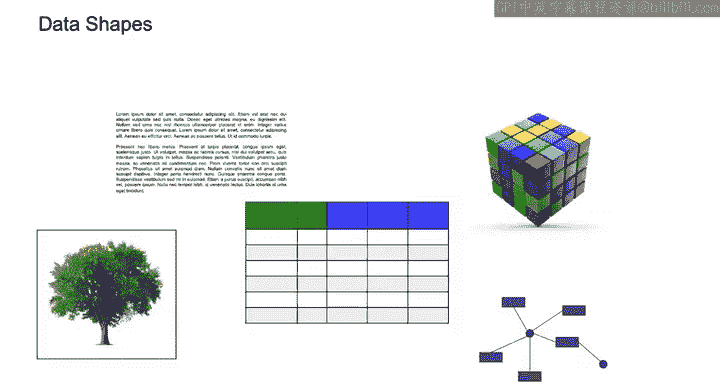

So these are the five fundamental shapes and today we are going to start focusing on trees and why trees then I will explain why but this is basically what's going to keep us busy actually during several weeks tables are already cover at the bachelor's level will also brushed them up in the first week and then at the end of the semester wed also look into cubes and into graphs one week for each vector databases or text so there's information retrieval so for some of you who took it last semester in the bachelor's there's also LLM lectures here at TTH so this is also addressed that other places so。

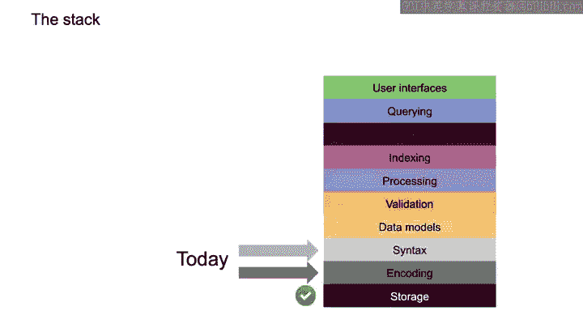

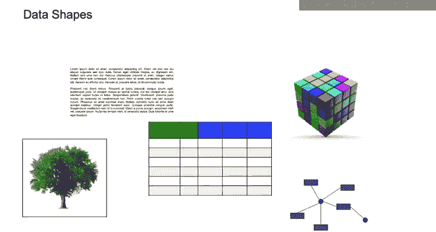

This is the stack that we've seen in the first weeks and we are now here。

 we already know how to store things， now you can store in S3， you can store in Asia Cloud storage。

 you can store in AGFS， so these are very commonly used for big data， right？

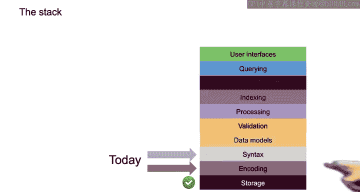

And then we are going to look at these two two days。 So there's many syntaxes。 So text CSV。

 you probably know CSV XML， Jason， you probably heard RDF for XML。

 it's for graphs after is for graphs， XBR is for cubes， So there's syntax for everything。

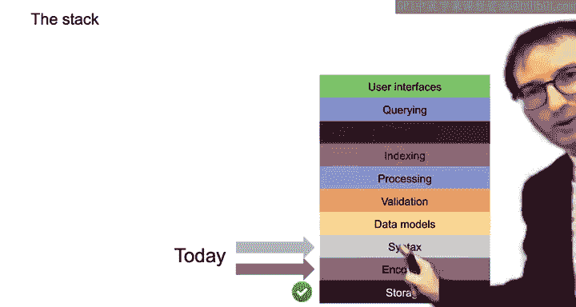

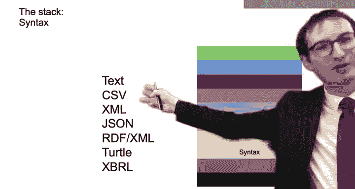

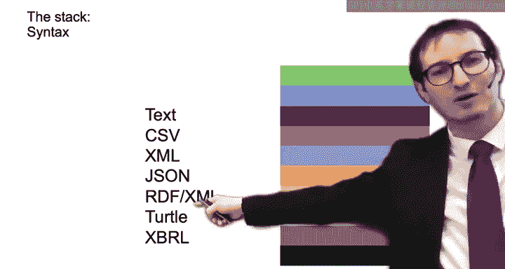

Why is it that we need syntax where it's probably for two different purposes。

 one of them is because we want to store data as text text has the advantage that it's readable by a human being。

😊，It might seem unimportant like why would it matter that a human being can read it。

 but it has advantages One of them is that you can modify it yourself。

 you can open it in a text editor and modify the data makes it very convenient but there is another reason which is how far away into the future can you still read that file because at some point we imagine our descendants in a thousand years that are archaeologists and they want to know everything about us and they found a file if it's a text file that's going to be much easier for them to actually decipher than a binary file and in fact this is exactly the reason why you know the ETH library they have a data repository or a research related data that you can also submit to so-called data journals and they require that the formats that you use are not like OPAC binary formats。

But these kind of formats that can basically be read by by humans。

 So it's important for this reason Another reason is that you want to ship them over the network if via some some protocols and that's related to red。

 So XML was very common back then Jason is becoming a bit more dominant now compared to XML。

 but these are basically things。That can be spent over the network and again。

 in a way that also humans can understand them。I'm not saying that this is the only thing out there in fact there's also binary formats that can be useful。

 I will also explain to you how we can turn these into binary formats。

 that will be more efficient because they are smaller so it's actually much quicker to read but in the very long term we actually like to start data sets in that kind of textual format for these reasons or whom does that make sense。

😊，All right， perfect。So today I focus on the X and Jason， I just say a few words on CSV But first。

 since we want to store a text file， I still have to quickly talk about the discrepancy between the fact that in HGFS or S3 I said that the files and the objects there are bits right it's just zeros and ones So if you want to store text you need an agreement you need to agree on how you store the letters on top of the bits right how do you convert the characters to zeros and ones this is called an encoding right so I'm going to go quickly about that but to make sure that everybody knows the most important aspects probably for many of you that's already clear there are different encodings there's not only one。

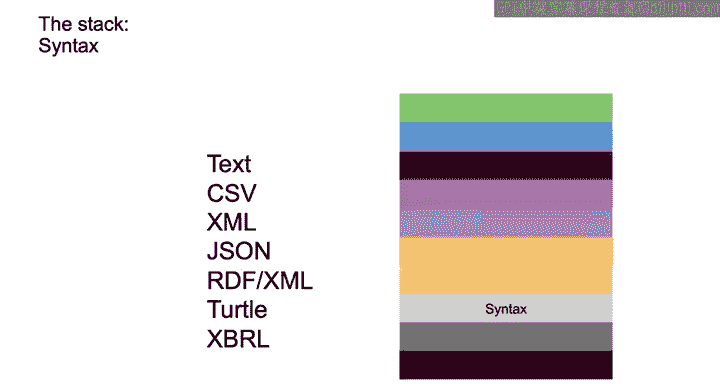

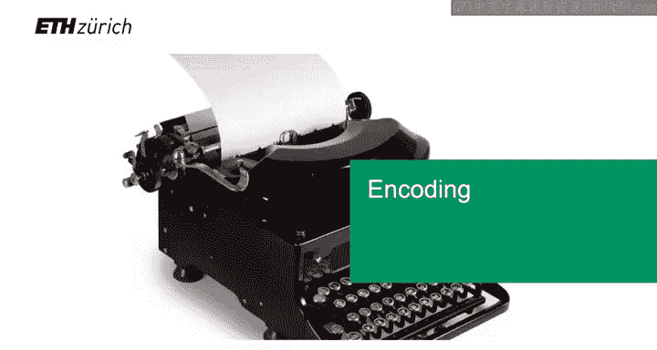

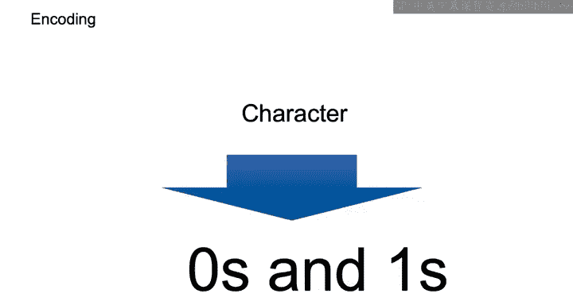

The oldest one coming from the US is the ASI encoding。

 it only had 128 characters basically based on the English alphabet。

 It had the advantage in English alphabet of having two digit number of letters so that makes it much easier than other languages that might have thousands of them So this is why it's actually so small。

 but then of course we need to cover all other languages， so there's a lot of IO extensions。

 Latin one is one of them for Western Europe but there's many。

 many others that that were invented but of course they encode in different ways because the alphabets might have different letters So this is the reason why later we changed the approach and instead of designing competing encoding we tried to have a unique encoding for once and for all but that is based on a huge catalog of all the digits all the characters that you can have like millions of possible characters and UTF。

in fact another s way of encoding disc codes， it's called Uniicode。

 so Uniode is a huge catalog of the characters by the way right now they still continue to invent new ones。

 I think it's mostly emojis so every couple of years they just add new emojis to the catalog because we did a good job already for the alphabets。

Okay， and then UTF 16， that's just an alternative encoding， but it's still the same code points。

 it's still the uniquecode catalog。 So this is more of a historical value here that's basically the S key encodecoding where you see on the right all the characters and then you see on the left how they map to to zeros and ones right So you have here what are called the control characters like line feed carriage return。

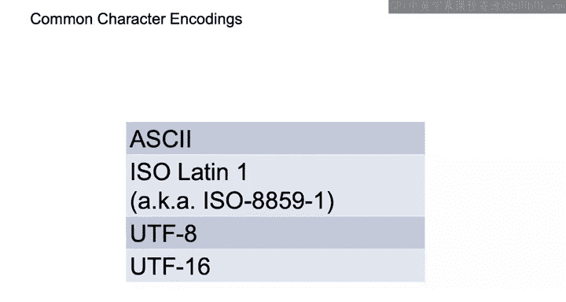

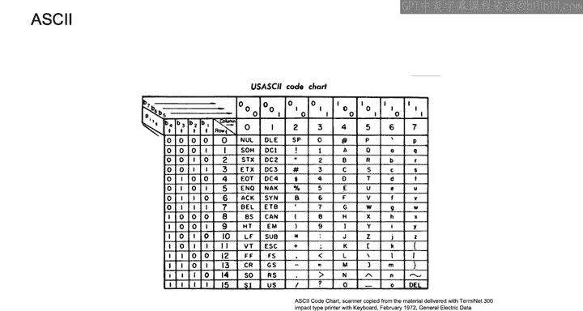

And so on。 And here you have the actual characters。Then。

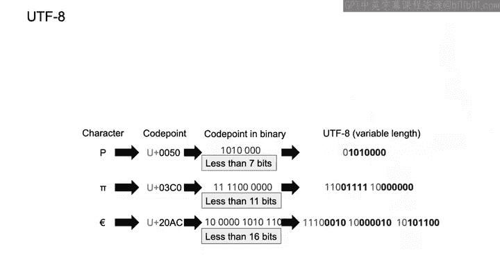

Today you shouldn't be using that at all anymore It is over。

 you really have whenever you write a new software。

 you really have to make it international from the very beginning。

 so you should use something like UTF8 in a way that is far up compatible you also need to make sure that it can be swapped you know like Arabic goes right to left and so on so all of that in mind when you create a start and you might grow later So basically I said it's elastic and the reason why it's elasticelastic is that depending on where the code point。

 so the code point is just the number in the catalog。

 every letter has a number if that number is atmost 7 bits。

 then you just encode it encode it on8 bits。 if it's less atmost I should have said atmost 11 bits you encode it on two Bs So 16 bits if it's less atmost 16 bits then you encode it on three packets and you see that the bits marked in red they are basically called the continuation flags So this is the one zero means that is just not the first。

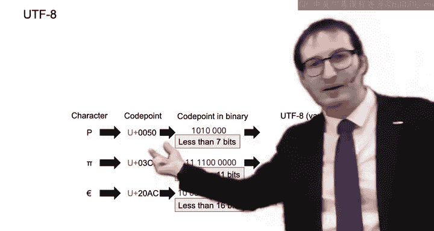

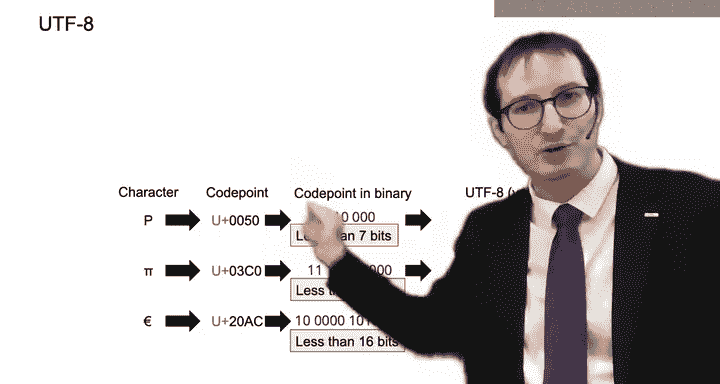

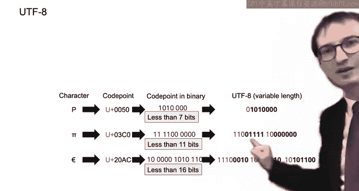

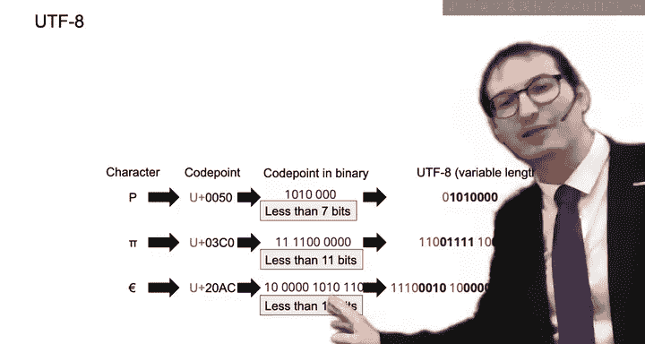

It's a continuation of a previous encoding and here these indicates a 110 means there's two packets。

 1110 means there's three packets and just a0 means it's the only packet right so basically if it's called UTF8 UTF 16 is the same thing except that the minimum length of a letter 16 bit but really really if you write new software now already use that encoding from the very beginning simplifyplify really a lot of things to avoid painful migrations at later points。

😊。

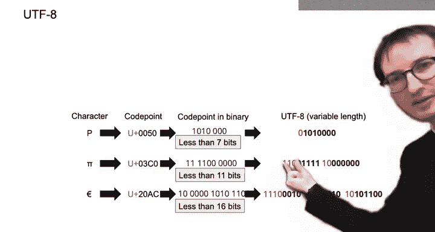

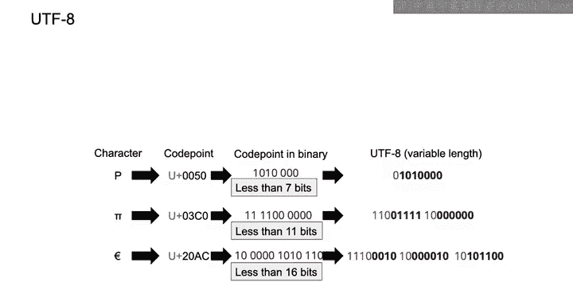

Okay， that's pretty much all I wanted to say about this， so now we know how to encode how to encode。

The， the data， the text into the bits。 So now we need to know how we put the data into text， right。

 So one level higher。嗯。So before we study X7 and JSON。

 I need to explain to you why X7 and JS and how they relate to CSV。So you might know CSV， right。

 who knows CSV？All right， I assume more of you co separated values you probably saw it on websites like I don't know the federal Sta office where you can download data。

 you typically have the choice between CSV XMN J and other formats so CSV just works as one record per line the first line optional can have headers and then you separate the videos with coas and in fact if you look at that CSV file。

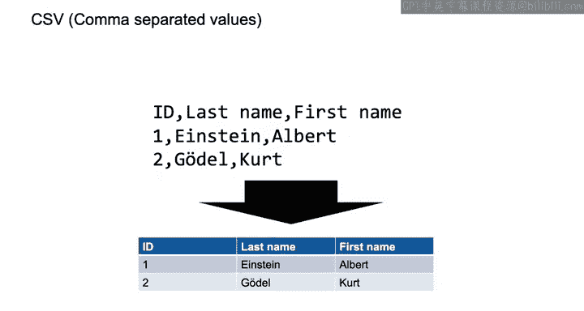

Your brain， if it's used to it， should automatically see this， right？😡。

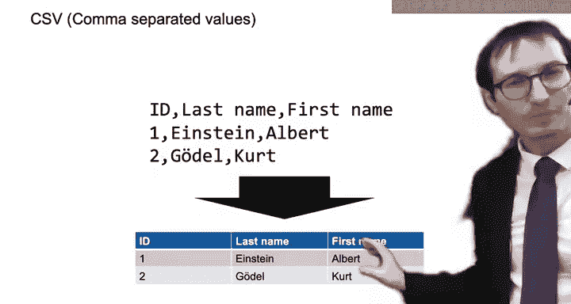

Who is already like this， Like if you look at this， you already see your table。RightSome of you。

 I would like for it to be the same thing with XM and JO that if you look at X or Json you see the tree。

 this is my goal right but basically this is just a logical level visual and this is the weight it's encoded encoded in CSV。

😊。

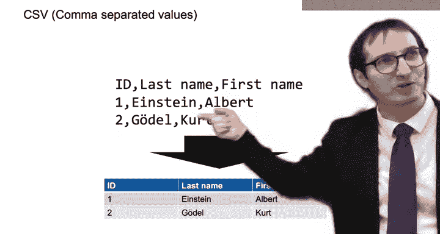

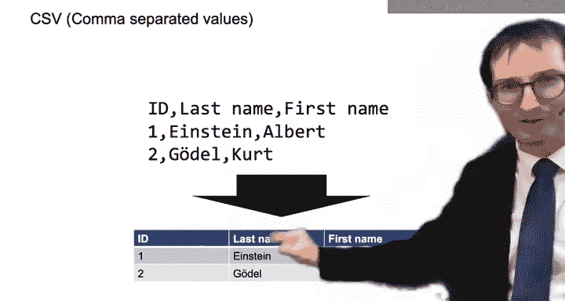

Now it seems simple， it's actually not and in fact it becomes very complex very rapidly because first how do you handle spaces or coas if there's a coma inside inside one of the values then you use quotes。

 but then how do you encode quotes， then you double the quotes。

 and the problem is that not everybody does it in the same way， there's an RFC and so on。

 but as soon as you want to read CSV and I'm sure anybody who does machine learning and try to import a CSV file into a machine learning system has to go through the agony of setting up all the options like what is my separator。

 what is the encoding for the quote and you probably half a day for doing that because you know all of the who went through that already。

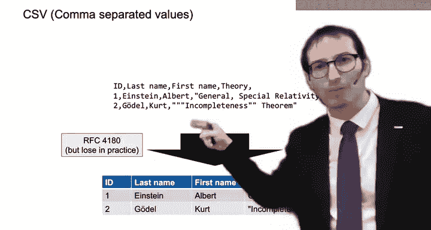

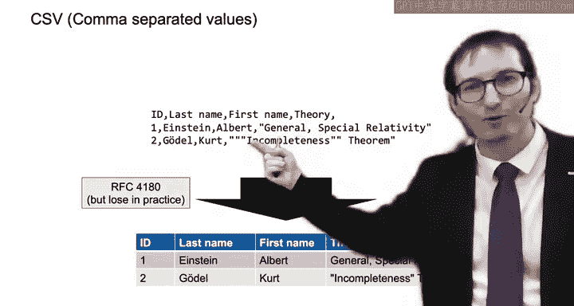

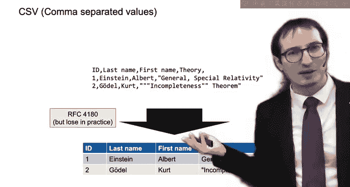

Okay， so you know what I'm talking about。 So the good news is that XML is not like that for XMl。

 there's only one way and that fit makes it much easier。 So Jason， it's kind of like XM L。

 but with a few。😊，A few small options okay but that's all I wanted to say about CSV here is basically it's don't underestimate how complex it can get I think it's probably due for the fact that it wasn't standard early enough if there had been at some point a single standout and then everybody would follow it would have made things simpler but now we are in front of the Theta complete that that's already the case that they' are competing flavors of CSV and we just have to leave with that。

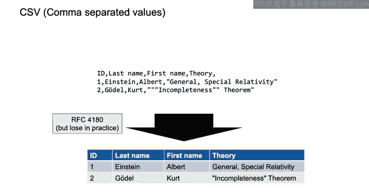

Okay。So you might remember that in the first week I scared everybody with the normal forms。

 some of you saw it in your bachelor's， the authors were like what is the normal form and why is it so scary？

The boycott normal form is probably the the simplest one to teach。 but really。

 the idea of normal forms is that。Instead of having a big table that has everything you try to nicely separate your tables where when every table does one thing at a time。

 one table for the customers， one table for the products one table for the others and so on。

 And if you have nicely separated it into tables that's called normalized and it's in normal form Of course it's not formal than that there's actually a mathematical ways to define it but that's just the intuition here but I have good news for you is that this is where it goes for the purpose of of this cost so this is very good news because all you need to understand is this idea that normalizing the data means fitting it in two tables deormalizing the data is the reverse you join back the tables into a larger tables and that's exactly what we are going to be doing So typically a data set will not be of our multiple tables we just merge them into just one but when you do that。

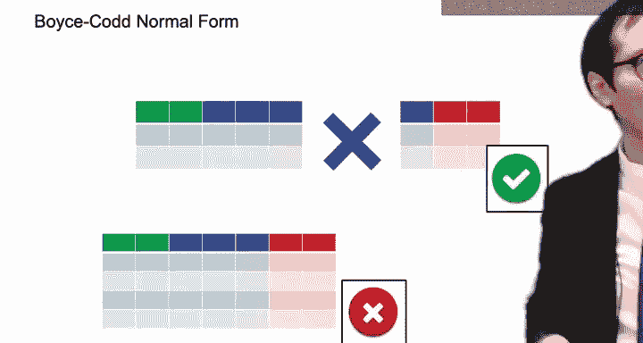

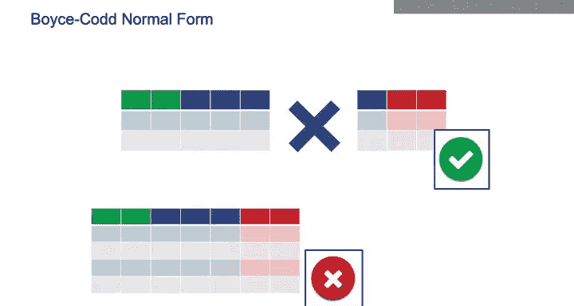

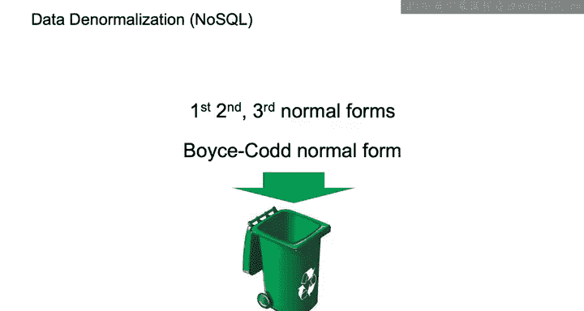

What's going to happen is that not only when you get a big table。

 but you might even get a big table that is not even a table because there might be a table in a table in the table。

 this is when we get trees and I'm going to give you the intuition of that in this lecture。

Why do we do that， Why is it？😮，That we send novel forms into the trash can。

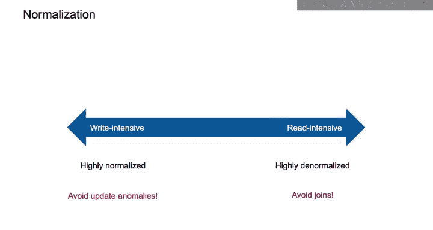

This is because in data analytics。😊。

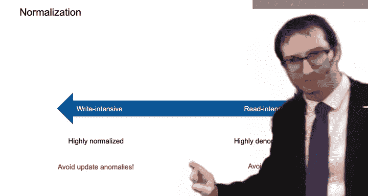

We are here。So。We are going to download data sets from the internet。

 put them on S3 on HGfS and that's it it's there and then we query them in place as it is。

 This is really intensive。 We write it just once and then we read it。

 This is the opposite of SQL database that is serving for example。

 digtech galaxies right then it's write intensive keeps being modified， then you want normalization。

 you want the SQL database with plenty of table because of the data noomaities but not so in big data in big data on Hgfs or S3 you highly normalizedmalize the data because you would see it's much more efficient to actually read through that because you don't care about anomaities because you just write it once So you don't care about modifying it because you will not modify it and you don't have to join So this is great news because joins actually are more expensive than they seem So it looks linear so you might know that an equi join or join based on an E predicate can actually be implemented in an linear way So it sounds like okay what's the big deal but in practice that not like this doesn't。

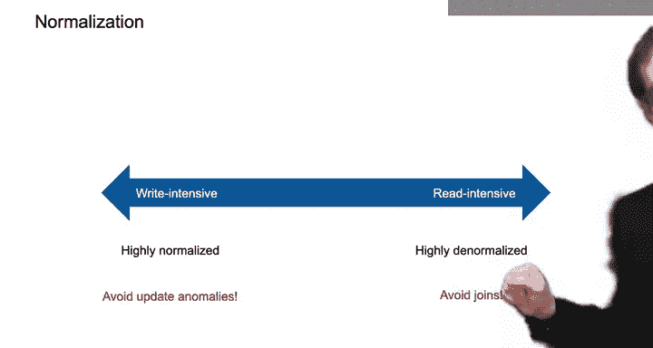

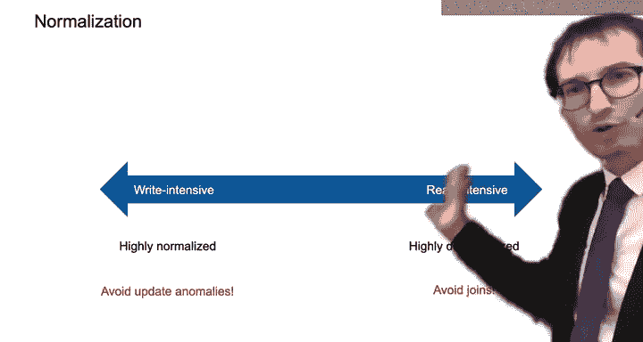

Feel like is there's a constant factor or so there's joints that are not equal joins and so on so basically if you denammalize the data。

 you don't have to join anything because there's only one big table and thats it right so no join so this is really that belongs together try to take a snapshot of this because there's really a correlation between these properties right and right now we are here we read a lot we denormalize the data and we don't want to have to join it。

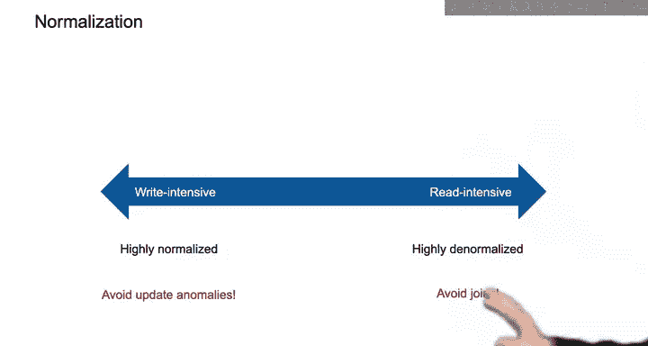

So concretely this is an example of for example， something that could be a simple digteg galaxies right where you have the data nicely separated like this what if we want to denormalize it and this is what we get right when we demalize we just merged it into a single table you might remember that in a table like this once we have demalize we basically have every record is called the Tupper there's many names right Tu row record and so on but this is basically a mathematical partial function that maps the attributes some attributes to the values with with me on that。

😊。

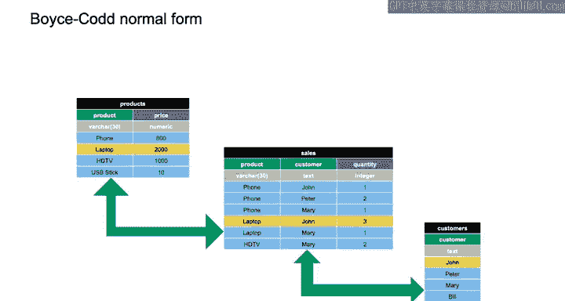

Okay， this is the so the we markcking green here phone 800 John1， that's actually。

 you see it's a function from the purple to the green。

 So product is mapped to phone price is mapped to 800 customer is mapped to John and quantity is mapped1 and the same would be for every one of the other records who with me now。

Okay， now I'm going to press and slightly each channel the way we write it。

Do you know what this is called？jason。And in fact， that's the same thing Jason is literally your partial function。

 you basically an object is doing exactly that it maps an attribute to a value and we call the attributes keys in Jason。

😊，So this is is the idea， this is what we will focus on today because it means you can have syntax that actually is text for each one of the toers。

😊，In there， okay？So now you can do it for every one of the records and this is what something that people typically do。

 it is called JSON lines because now you have multiple objects。

 one per line and every one of these records here， this one is here， this one is here。

 this one is here， and this is a data sets that you can put on S3 or HDDFS。

 this is a JSON lines file。😊。

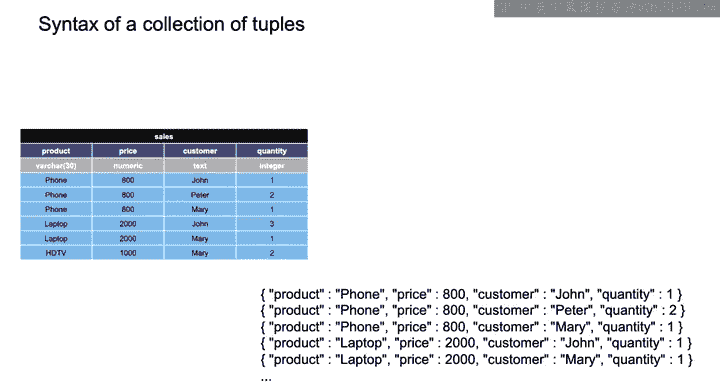

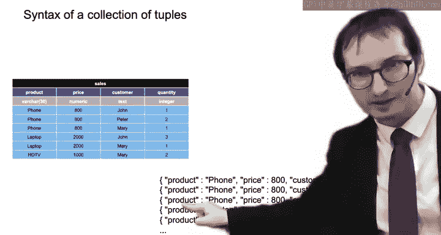

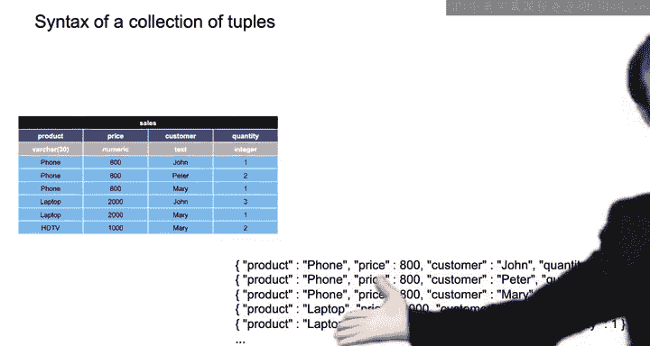

Whos with me？Yeah very good。So I told you we are going to break a lot of rules in this course and indeed we are going to leave the beautiful world of ID normalmalized data with SQL。

 we are going to break relational integrity， break domain integrity and break atobomic integrity。

 this is the beautiful world of No SQL， which means not on SQL and not just about no SQL。😊。

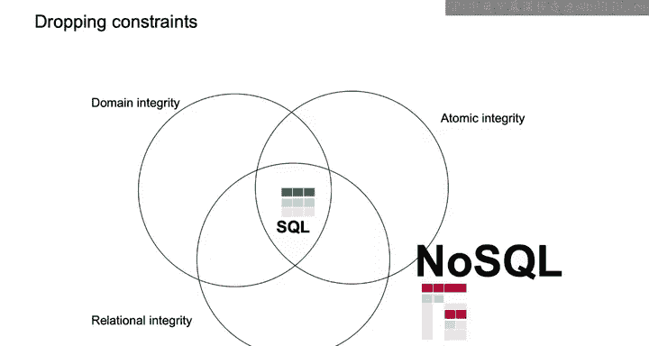

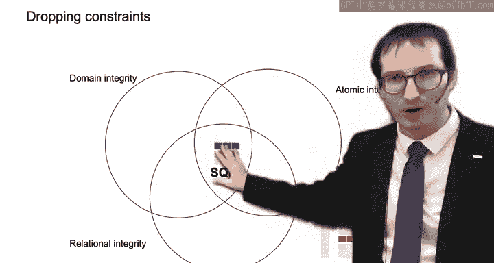

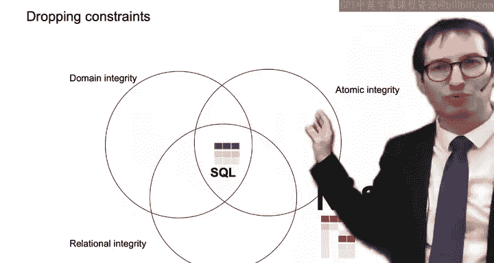

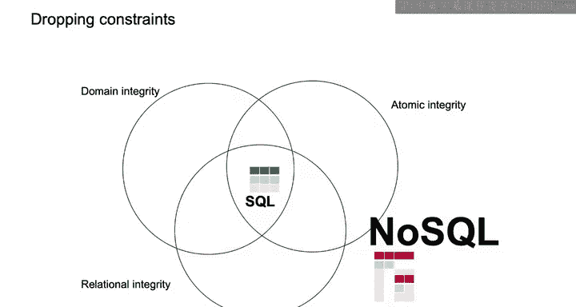

So as a reminder， the first normal form was about not having a table in a table in a table in a table but since we're going to break this we are actually going to have a table in a table in a table so that goes down the bin so it means that this we will very happily support today with J and XML as we will see。

😊。

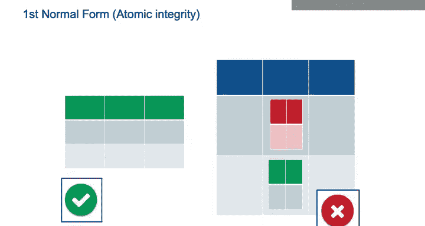

Because。This can actually be stopped in Jason in this way， right。

 So let me explain that which going be more in details into Jason later， but the product is the full。

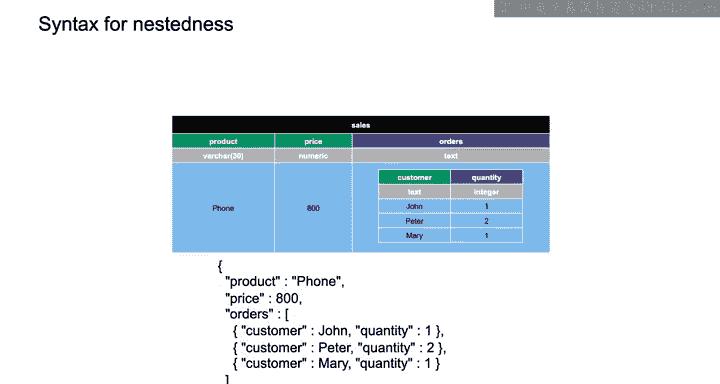

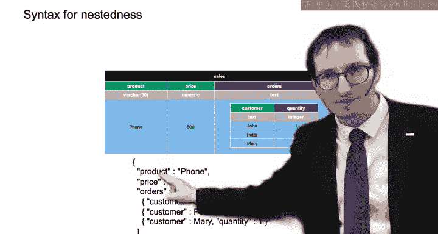

Price is 800。And then you have orders， but order is actually a complex thing。

 This is why it's not the first novel form anymore。

 This is the table in the table and to implement that table。

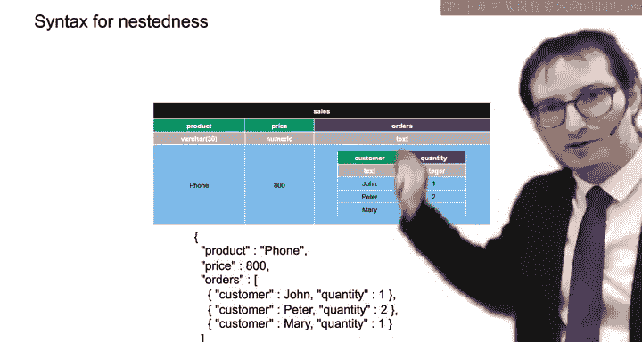

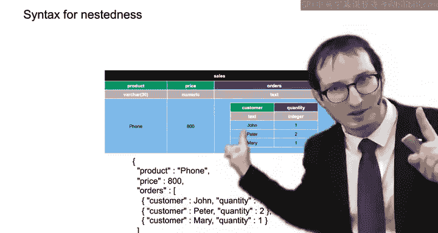

We use an array， which is a list。

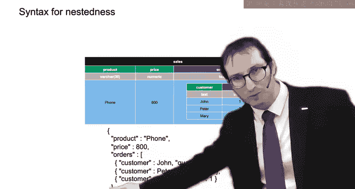

With three objects， like these three。

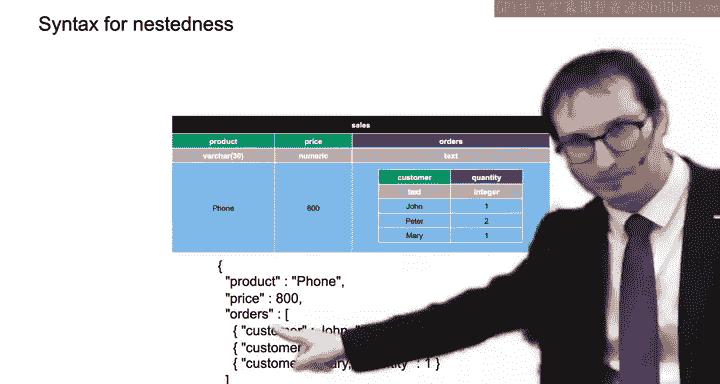

Customer run， quantity， one and so on and so on。Well whom does that make sense？😊。

Right and we could not do this with CV Cv is not capable of that。

 CSsv can only do it flat right so CSv requires the first normal form。

 but now we've discovered that Jason doesn't require the first normal form So it means that denormalized data goes very well head in hand with Jason and XM This is the intuition that I want to give to you and this is why there are very important and that's the reason why many data sets today are looking just like just like this but what's even more exciting is that you can even have let's break rules here let's imagine that that's not even a table because theres a missing value here and here it's not even respecting the domain integrity right So it's whatever I just put a whatever in there So basically here that means you just drop it because Jason lose that and here you just put a string instead of a number and that's totally fine right。

😊。

So this is why we can break all the rules using。

这一次。So what's going on here， this， yeah。We have tables and tables and we define the type of the column there I saw it。

text assume Yes， absolutely。 So text is the name for string in SQL。 T would be the the。

 the name of the data type itself tables in a cell。 still， the type should be string。Oh， no， no。

 yeah。 that that's a mistake。 Yeah， yeah， you're correct。 Maybe I should fix the slide。

 So what you mean is。

Here， right， yeah， you're absolutely right， I should actually change that to to to say table。

 for example， here， absolutely or we we also put here。

Yeah。Additionally， would you be able to use compression within a large data case Yes you can。

 but that's a physical feature so basically from a logical perspective you don't see the compression but the way you implement the table you could compress the data for example。

 with dictionary and coding and so on and so on but really it's data independence at play the data independence principle tells you that any compression should be done physically in a way that the user doesn't see the user will notice that it's faster but that's all they will notice。

Is there an advantage in by domain integrity or is it just something that happens？

It's just something that happens let me tell you how it happens data sets they can come from many places one of the places that they can come from is from logs you basically have a piece of software in a company that just keeps writing a log and it does it for one year for two years for five years for 10 years for 20 years。

😊，At what happens is that the version of the software is going to change and when you change the version of the software。

 you might modify the way that you actually write the log， so maybe a field is going to be modified。

 something that used to be an integer will not now be a string and so on and so on。

And what happens is that the past data you're not modifying it。 So it's as it is。

 but one day to the next new release， suddenly the new records will have a different schema。

That's how it happens heterogeneity， So its really something that happens to us because of the real world and if you want to be able to query that data in AGFS or S3。

 you have to design your architecture in the way that it's accepting this heterogeneity。

Does it take sense yeah so now this type of data has the issue that to use to use it basically we need to realize that one string is actually one the number right？

Exactly so basically then you push the button into the user it's whoever needs to query this who will basically need to deal with figuring out what is what right so it has advantages and it also has the drawbacks right but this is something I will address a lot especially when we look at query languages right thank you okay。

😊。

No questions， Zoom。Okay。Alright， so now if I summarize the sort of things that can happen when you deormalize the data is that you can have extra values。

 you can have missing values， you can have invalid values。 So this is the the string， you know。

 instead of an integer， it can be nested， you can have nested values。😊。

So basically， you're going from something that is flat。And homogeneous。

 that is basically relational tables highly normalizedized and instead of being flat and homogeneous。

 you are nested and heterogeneous， this is sQl， this is no sQL。😊，Okay。

 so this is the idea and in fact Xm and J basically addressed this。

 this would be more like CSsV on the left。

So we are going from these flat homogeneous collections of flat items in relational data to heterogeneous collections of arboreorerescent items。

 aorescent is just a fancy term for three items， nested item。

 so you can see here that here this is breaking many， many rules。

 this thing here but it's no problem at all to represent in Jason as you can see here。😊。

That is called STmi structure data as opposed to structure data for relational table stemmi structured this is really XMM J that kind of data。

 so this is the intuition that I wanted to give you so we really had three levels here。

Highly structured that would be tables and cubes， semistructure that would be trees。

 maybe you can also put graphs in there bit later and then unstructured data that you need to find other representations of and again set vectors or vector database are one of the ways。

😊。

What's very important about these kind of syntaxes has to do with standardization。

The reason why XM and Jason are actually so important to know。Is not that everybody would love them。

 I mean， you will find a lot of criticism on XML on if maybe some of you might have some negative feeling about XML。

嗯。Maybe because it's older， but the idea is that it's a stout。

What does it mean that something is a standout， it means that you will find on the internet1 thousand different libraries that are able to pass and write XML you will find thousands of APIs and software pieces of software that can read and pass Jason this is why it matters to have a standout and then you can ship them to other people who can open them with a different library that is also going to be able to read it。

 this is why having a standout is so important。When people try to deviate from these standouts。

 people tried with XmL to fix it or to figure out some other ways。

It doesn't succeed if you don't manage to get everybody on board so this is really why standardization matters so much so XM is the W3C standardout Jason is a ECma standardout the same body as JavaScript W3C you might know from HTMLLHTTP so this one was created by Tbernerley when the web was created in the early days。

What can I say about standout so standout take time。

 so typically when you have a standout you have plenty of companies that send some of their people to these working groups。

And they meet every week four years， and they try to get to an agreement。

The agreement will be a compromise， it's not going to be perfect or as perfect or maybe technical purists might wish for it's a political compromise you get companies to agree。

 but then there is an added value at the end to have disagree agreements because then everybody can implement it and then it makes it easier to be interoperable between the systems。

几。😊，There was a saying that we are used to be in a working group at W3C for X query。

 and we love to make the joke that if you have 20 experts in the working group。

 you have 21 opinions because of all the discussions that take place for a long time。

All right。So having said that， the benefit of having a standout and it's not necessarily a idea to a good idea to try to change the standout。

Let's dive into syntax。嗯。There's two adjectives that we are going to use a lot in this course。

 The first adjectivity is well formed。The second objectivedject is valid。

One very important message that I have for you is to not confuse the two。Today。

 I will only talk about wellformness， validity I'll address in two weeks。 So wellformness is a yes。

 no question。 I give you a document that is just text， something you download it from the web。

 You try to open it with your J library or your XML library。😊。

The path is either going to succeed or fail if it succeeds then it's well formed that's a yes。

 if its fail there's going to be an error， then it's all not well formed hopefully the error should tell you why it's not well formed right but it's a yes no question。

Such a yes， no question you might know in computer science as the definition of a language in the theoretical computer science。

 right， you can accept or reject a world as belonging or not to a language who heard of I don't know。

 rigorous expressions， context frees， deterministic automata。 That's exactly what this is about。

 right， You can have all kinds of levels on the way to define a language。😊。

XM and J are obviously not it's not possible to give just a regular expression for them it's much more complex than that there the level at which are is higher than that。

 but this is really the idea that there is an XML language and adjacent language。😊。

And a document is either a well formed XmL or not well formed XmL。

Or it's well formed Jason or not well formed Jason。So again， I insist do not call it valid。

 do not use the ajective valid for that because valid means something else that we'll see in two weeks so wellformed XML wellformed Jason okay that's also a message for the TAs who listen to me when you design the exam question I mean I check these thing but also make sure to say wellform and not valid for that purpose。

All right， so this is this is this is the document。

 so this is an example of XmL document right looks like this and this is an outdated Jason document I thought I had a date to date but obviously the latest version did make it but basically this is Xm and this is Jason I'm going to go into the details of the syntaxes for you to learn basically you cannot not know them right so even if you're scared of Xm is's actually used in practice very popular with government you wouldn't imagine the number of the Xml based turned out even here in Switzerland did you know that your tax return who write the tax return。

😊，The tax return is in fact XML， the QR code so the backcode contains an XmL documents。

 the bank statements that you might get contain XML it's everywhere this is really what people actually use in practice JO is also taking over but again XM is more mature in terms of ecosystem the enterprises and the governments rely a lot on that。

😊。

Okay。So let's start with Jason because it's easier。

嗯。So。Jason syntactically is made of exactly six building blocks， six syntactic building blocks。

 strings numbers， nerves， bulloleans， objects and arrays just going to drive you through them should be very easy your computer scientist right so the strings that might not be surprising it's actually double quote it。

 you can escape special characters with a backslash right as is' very common in many languages backslash n is a new line and you can encode special characters。

 remember Uniodes， UTF8 and so on this catalog well if you know the inte that that corresponds to the character that you want to have and you can convert it to base 16 right in hex that a symbol form then you can just put backslash U followed by the code in base 16 of the character right and that's how you escape a unode character。

All right， so Jason means JavaScript object notation it originally comes from JavaScript right but now it has nothing to do with JavaScript anymore it really has a life of its own Okay okay so that's that's a strict shouldn't be very surprising to US computer scientists or data scientists then we have numbers notice that they don't have quotes they just have a life of their own that also shouldn't surprise you。

😊，Now what can we have in terms of the numbers I'm talking about syntax here This is not the same as the mathematical value。

 The syntax means the set of characters that represent that number This is called a literal or a lexical value what you see here This is not pi this is the sequence3。

1415。 This is minus 1。2345 e plus5。 that's a lexical value it's a literal because we're talking about the syntax you can pass it and turn it into a number that yeah I'm interested about the syntax so you can basically have digit in base 10 then you have a dot in the middle you can also have without dot is fine and then youre allowed to have powers of 10 that's the scientific notation right that's basically also called floating points but basically moves the point so this means times10 to the power of five right so this is all fine in J This are called numbers There is no its syntax there is no distinction between in。

😊。

Short， long Dymo float double that doesn't even exist。 It's just a lexical representation of numbers。

 And that's it with with me。All right， very good。Then there's bulloles， true force without outputs。

 I don't think I need to say anything more about that。

Then there's null null is just also you know it from many programming languages。

 it's a special value， but I just need to tell you。Is that。You can interpret nu in different ways。

You can interpret that as a value you don't know as the absence of value then on the software that you use some software is going to consider that null is the same as if the key wasn't there so if you have full color null then it's the same as if who wasn't there some other pieces of software make the difference right so this is why JO makes the difference it gives you the power of distinguishing between the two so you can have a null value in in your adjacent document and again this is just syntax it's just NLL that represents a null it's up to you what you want it to mean right。

But it's part of this index。These four are called atomic right these are atomic values。

 there' are no nestedness in there， but I told you we didnorize the data so we need nestedness。

 which is why the last two atomic building blocks。😊，A lot the nesting。 So the first one is array。

Which is on the very high level， right in terms of abstract data type， this is a list。

 It's just a list。So it means that it has an order， there is a first member， a second member。

 a third member， a fourth member， so there is an order， the order is important。

The syntax is again taken common to many programming languages， but this is with this。

Square bracket。That you designate the array and you separate the values with command。

Now， what are the values， Any one of the six。

So here I put a number， I put a boan， I put a string。

 I put an object thats show them on the next slide， and I put a another。Notice the heterogene easy。

Because they are not all of the same type in here， I can put whatever I want in any order and be absolutely heterogeneous。

 no problem at work。So that's your array。 Next， I have object， an object， the abstract data type is。

 you know what it's called。😊，Start with an M， anybody。Map， yes， exactly that is a map。

 so we have lists and we have maps， they' are just call a raisin object。

 but from an abstract states least in a map。😊，So the keys have to be strings， quoted strings。

 you're obligated to have that and then any values you want so again you see it's fully heterogeneous and you see it nests I can here have here an object in an object here I have an object in an array。

 I could also have an array in the object， I could also have an array in the array。

 it fully generally mixes okay。😊。

Now， just a few more warnings， common things。The keys in the objects must be quoted strings really they must be quoted strings you cannot have an array like that like this is marked here as as a mistake that is not a load。

 cannot have anything else that a string and you have to quote them you really have to quote them Now this is what I meant with Jason is not as strict as x。

Some J libraries will tolerate unquoted keys， so this is something you will see。

The recommendation in these cases is to be very strict when you write。And linenient， when you read。

 this is kind of the way to go。 So if you produce Jason。Quote all the keys， you make it safe。

 If you want to read Jason， then it's time to be a bit lenient and to accept more。

 right so strict when you write， lenient when you read， it's kind of the way to handle these things。

So always put quotes to whatever Jason you produce。

 but be prepared to see some unquoted keys here and there。Then。Within the same object。

 the keys cannot repeat。That's not allowed to have twice the same key here and here。

 you really have to have different keys in the same object right if it's different objects。

 that's fine。

But I put something in parenttees here。That's the should so you know that when you have a standard that there are these these worlds。

 these model worlds that are marked in uppercase must should should not can can not may may not and so on This is it's called the species right it's the language of specifications there are always uppercase in the text。

This rule that the keys cannot repeat is actually a should， it's not a must。

So you need to be aware of that what does it mean strict when you write linenient when you read it means if you create Jason do not repeat the keys never and in fact we see many of the NosQL products and database products do not accept repeating keys right you can also you might have heard treat a warning as an error right so many people just consider you treat a should as a must if it said should then treat it as a must and just don't duplicate the keys in this lecture we take it as a must we will not have any repeating keys in Jason objects okay？

All right。This is an example of actual data because that was just made up examples。

 but this is actual data that's taken from data sets that was known as the Great language game。

 we ever heard of that one。😊，Very popular a few years ago， it was a game online that you could play。

 it would play some voice speaking in a language， give you flock choices and you had to pick which one you think is the language spoken there's a question about that。

Yep。嗯。In principle， could we use multiple key assignments to represent like like a conflict between the data like two nodes updated the table at the same time or like their vector vector clocks can't be resolved immediately and then like the next time you can you update you have a more recent vector clock and you can just pick that one。

You could， but not in my cross。We don't sell that way so we really treat as you should So now there are systems that basically do accept multiple keys and they have special semantics This is always at your own risk right the moment you start having multiple keys here you're basically restricting the set of libraries that will be able to read your file a lot of them will just reject it So you're basically making it not interoperable because only your own piece of software and some others will be able to open it if on top of that you put assumptions of semantics on what it means to repeat your key then you're even less interoperable because now only your own software is able to read it Does it make sense thank you and and just one more question on the previous slide so in principle can we have。

😊，Like a table as a key or something。 No just a string string Yeah， you can have a table as a value。

 but by now， you know that by table Jason that's an array of objects， right。

 we represent a table as an array of objects， but it has to be as a value。

 you cannot have a table as a key or key is a string。

 So those are the key rules about the types of the keys are hard rules， whereas the it's a hard rule。

 it's a strict The repeating one is like just good good practices versus。

I think it wouldn't even allow you， so the J standout requires the quotes。

Historically some of the par cells accept and add the quotes automatically。

 but even if you try to put a table in there I think it it will be lenience if the string is simple like full or bar unquot it it will add back the quotes product key if you try to put a full array of objects in a key I don't think many par cells are going to add quotes around that they will just say no common that's you're pushing it that's not Jason does it make sense。

啊十。Okay。😊，Allright。Okay so this is one of the dataset sets that we use in the lecture it was the game played so you see here the f choices that were given to a user right here that was the guess of the user that was the correct answer so they got it wrong here probably somebody was speaking Italian with a German accent or something here that's UID so base 16 ening of the sample that's actually a binary format we'd see in two weeks you can actually validate that。

This is a date we'll see also that you can validate that but that's only in two weeks for now it's just a string and the country right so there are 60 billions of these objects that are nicely put in a file that is I think two gigtes or something and that's perfect for querying so well use that in the exercises this is just one object among the many。

Now if I come back to what we've seen before， basically any table like this can be saved as a list of JON objects like this JasonO lines。

 but what you do typically is that you just put one object per line。

 you remove you see here there's a new lines and tabulation and so on it's great for us humans。

 the new lines and the tabulations easier to read a computer couldn't care less。

 so this is why when you put it as a data set you remove these new lines and so on and you just put one object per line。

Jason， nice。

Next， if you want to nest， as I told you， remember this pattern。😡。

A table in a table will typically be as an array of objects。 This is how you do it。

 You could also have directly an object in an object or an array of strings in and so on。

 But if you have a table， that's really an array of objects， right。

Questions。Yes。😊，Maybe the microphone or。We still have a few minutes to regret。

In the in the last slide， would you also store all of those in some array or how are those like managed together like each of those lines are they sort of separate objects or how do we recognize that they're coming from the same table？

Oh， so it's just what the format means， so basically when you download' a file like that that has an object by a power line。

😊。

The assumption is that it's a collection of objects。

 the collection of objects and when it's flat because here you only have atomic values。

 then you know that you can interpret that as a table right but all the format says it's a huge file where every line is adjacent object in in text does it make sense。

😊。

And so if you wanted to represent like two different tables though in sequence。

 would you say one is a well so you could create two files two different files。

 it is one way one file for each table or you could merge them in the same file you could just drop everything into the same into the same file right but probably I would put them in different files do it makes it easier to process。

Okay。Just thinking if I annoy you with more things or if I let you go where okay。

 I let you go that's X that's that's a big chunk of of of data to digest。

 Maybe I can still ask you if you if you follow it you want to be so kind as to。

电力。😊。

This one。So yes， I hope it made sense that I basically try to not just teach you Jason but teach you the perspective of JasonN and XML how they fit into big data。

 they are absolutely important we'll see later that JasonN actually can be seen as data frames like Poass we'll see a bit later。

So we are above 80% that is perfect and not too close to 100% that everybodys bought so thank you very much enjoy the exercises and I'll see you tomorrow at nine or not there Thank you。

😊。

