# 苏黎世联邦理工《大数据｜Big Data - ETH Zurich - Fall 2024》中英字幕（deepseek - P15：-15-5. Syntax (2_3) -.zh_en - GPT中英字幕课程资源 - BV1sHPKeoEJU

は。Wecom， everybody welcome everybody on Zoom， welcome everybody from the futureture。

Today I'm going to finish this part on syntax。 hopefully， then we wrap up for the week。

And more precisely， I'm going to look into。not sQL XML。So， I explained yesterday。

Why syntax is important， There are two aspects there is first the fact that syntax is more important in big data than it was in the 70s because I told you remember last week about data lakes that we can just drop data on top of some storage layer and so we need this data to be to be files right that we dropped there and an example is JO lines files。

 XmL files and many other different formats。Now in a system like PostgsQL or a typical database that is not a data lake。

 you don't really need that form of syntax because you lets the system handle the underlying mapping to the pest system and storage for you right so syntax plays a more important role in big data。

The other aspect is that it should be human readable。

 you should be able to open it also so that it stays for far longer and at the same time machine readable as we see because we want to query it with data and finally we need its syntax that breaks the rules because if we just stick to CSV we will not go very far because CSV was built for relational tables right when it's platin homogeneous and now we have syntax X and J that applies to heterogeneous collections of nested data so we break rules。

All right， so I covered up Jason yesterday and now I'm going to cover XML so I told you XmL used to be a hype 20 years ago。

 everybody was talking about XML there was plenty of papers on XML in conferences in research and so on and then at some point the hype paid it away Jason took cover and so a lot of people started dismissing XML saying like this is the past and so on but the thing is maybe in academia but in reality it's actually there and widely used。

So for example， if you go to oh now the toolbar just。I'm on top of that in the zoom room。 So yes。

 you can see it now。 So this thing right here。 These are the Egovern standardsouts in Switzerland and the tax offices use them a lot so the underlying data is only in XMl and even the QR codes are in XM and you can see how it's really centered on the names of the elements we come back to what an element is。

 but you see canal tax federal tax taxable result increase reason you can see that they have a good sense of humor in in the government standardsout this is actually on the website what you see here All right it's a sample。

 of course， that's not that's not a real report you see so。

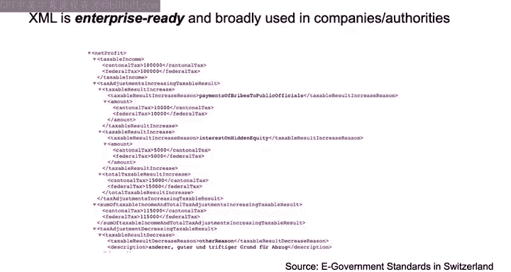

What do we have in XmL so just like Jason I told you the building blocks and we do the same with XML So you might remember that in Jason we have a lot of curly braces for the objects and we have a lot of square brackets for the arrays right when in XmL。

We use angle brackets。 It's these smaller than greater than signs。

 These are also called tags because we actually tag some text with with these。

 And some people refer to XM as the tag soup for this reason。😊。

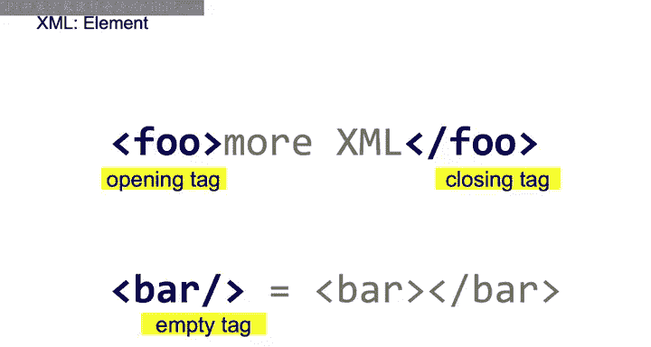

So。An opening tag looks like this。 It's just some name that is enclosed in these angle brackets。

 And then we close it with this slash。 It's a little bit like in many countries when you leave a city it's the same sign。

 but with its crust。 So you can see it as leaving。 So it's the end of。

 And basically it's opening and closing because in fact， there is something in the middle。

 This is called an element and an element has contents。 This is the content of the element。

 And inside you can have whatever you want can be more elements and so on。 we look later。

 but it's just like in an array Jason， you can have anything in an object， you can have anything。

 So between these tags， you can have anything。 So this is an opening tag， a closing tag。

 And together， they form an element that's called the element。😊。

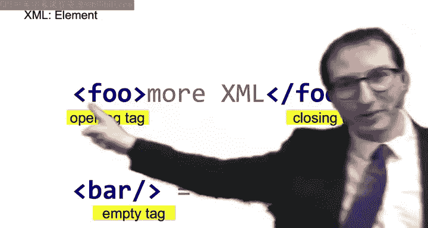

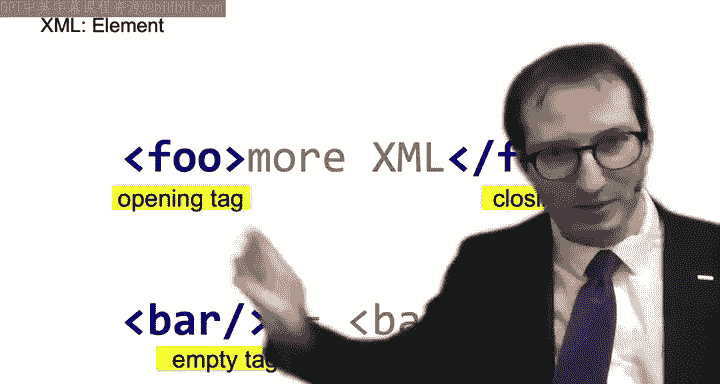

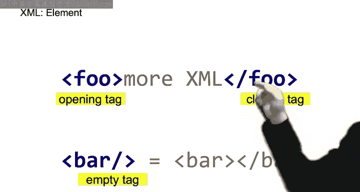

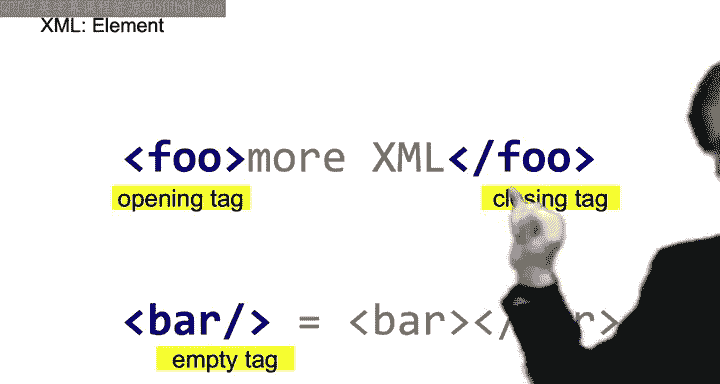

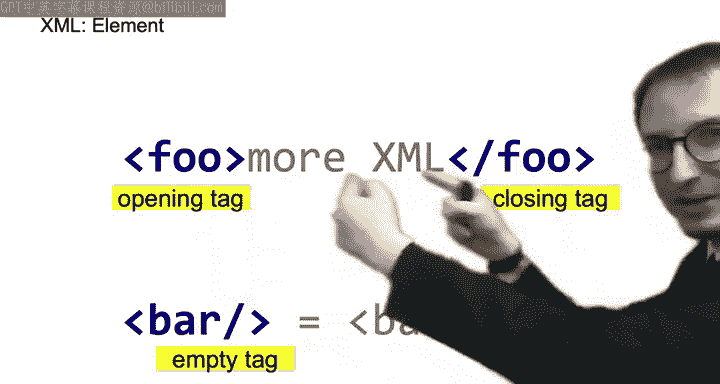

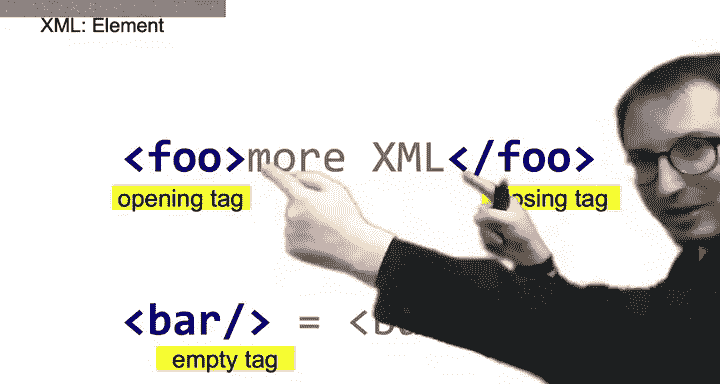

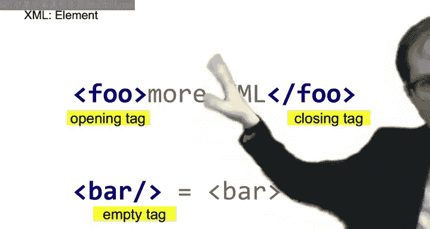

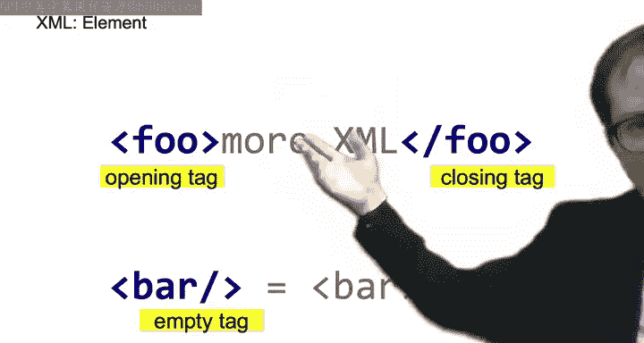

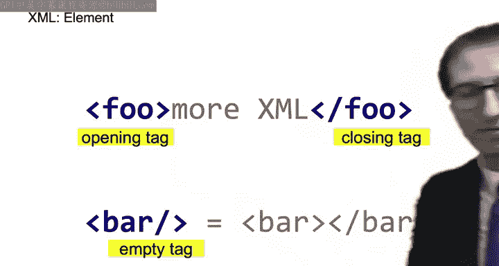

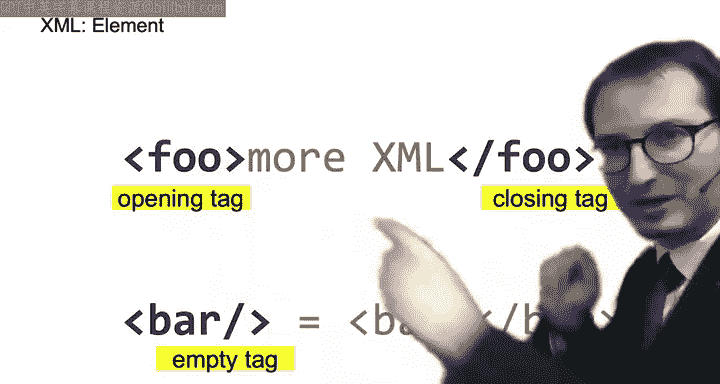

Now we computer scientists are a bit lazy， so if you have empty contents。

 you would basically have an opening tag and a closing tag with nothing in between。

 but because we are lazy and we don't want to write it twice， we have this shortcut。

 but it's really just a shortcut where if you put the slash at the end。

 that's just a shortcut for opening and closing immediately with nothing in between So right so just make sure you see that if it's at the beginning that's a closing tag here it's an empty tag right and you can still write this if you want。

 it's the same right but it's just taking more space we' see that it doesn't matter in memory right this is just the syntax in text but once you pass it and put it in memory doesn't have to take that much space。

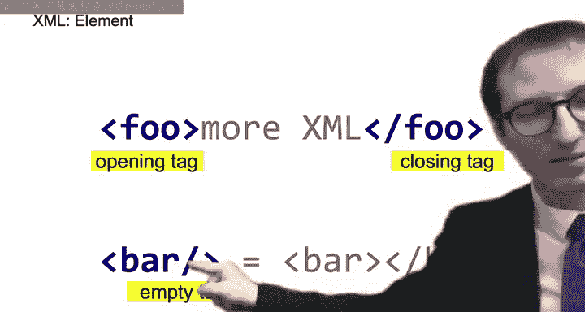

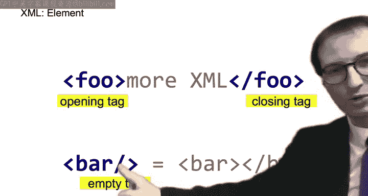

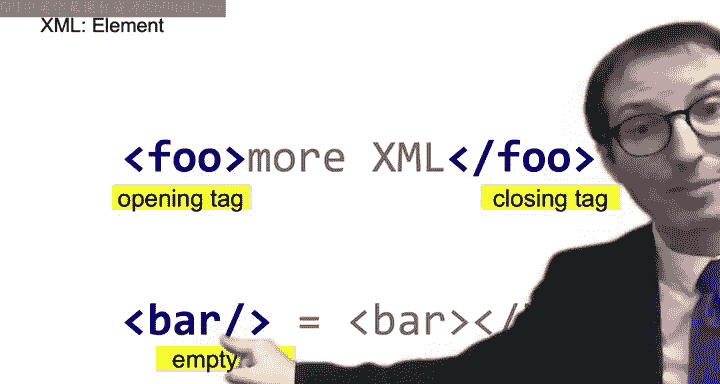

And come back to that in the coming weeks。Al right， for whom is that ti and elements， Okay。

 the names of the elements are very important again， as I said， when you when you draw standards。

 it's really heavily centered on the name that you give to the elements that actually have a meaning in real life。

 we also call that taxonomies。😊，So these are elements。

 then you have attributes inside an opening tag。😊，Or an empty tag you can have key value pairs and the key value pairs are called attributes so you can have you basically have an equal signed in the middle and on the left you have the name of the attribute and on the right you have the value of the attributes the name of the attribute doesn't have in equals just like this。

And the value has is double quoted or single quoted， but you need the quotes。Now， if you。

 if you know H TML， you know in H TM L， the quotes are not required， but in XM L， it's very strict。

 right， you really are required to put to put some quotes in there。 So you can have， of course。

 multiple attributes in the same in the same element。

 but this is another building block of XML right， So element attributes。 then we have text。

Text just goes in between the text。There is no quotes unlike Jason you don't need to quote the text。

 you just put it directly because the angle brackets already give you the limit of the text。Now。

 why don't we have any quotes and so on where it has to go it has to do with the history of XmL。

 which historically has been pushed a lot by the publishing industry the publishers。

 the publishing companies for example you will find a lot of scientific papers or books that are at some point converted to some Xm format it probably makes sense right because if you know what an HTML page is it's a bit the same on an HTML page you have a lot of text and then you might know that you have tags for bold italic and so on and so on these are the beginnings of HTML so this is really X at first was really text oriented you just put a lot of text and then you tag the text by adding these angle bracketed elements in the middle of it right so just remember that historically it was pushed by the publishing industry。

The ancestor of XmL is called SGML， but it was so complicated also used by the publishing industry that XmL came as a simplification of HTMLML。

 so you might find some features of XmL that are strange or coming out of nowhere， but in fact。

 this is just because it's inherited from SGML's just you can almost see it as archaeology。

 It's an archaeological or artifactef of the ancestor of XmL。😊，All right。So yes。

 this is text and you can just put whatever text you want in between tags between an opening and a closing tag in an element。

So elements attributes text and comments so I told you about this archaeological stuff this exclamation marked dash dash is an archaeological artifactact that dates back to SGML。

 this is the way it is it's just like that and then you finished a comment with dash dash right so there was a lot more construct in HGM SGMl that have disappeared but this one this one survived。

😊，There is a difference between comments in XmL and comments in the programming language like C++ or Java。

 is that if you put comments in the programming language。Then these comments are actually discarded。

 It's really meant for humans， but they are dropped once you compile， it's all forgotten。

 An exception could be the documentation comments， right like Java doc and so on that actually can be used for other purposes。

 But other than that， the comments are discarded in XMM， that's not the case。

When you pass with an XML library， you open an XML file and you pass it and then you programmatically process what you pass。

 you will see the comments， they will be forwarded to you so they are not just discounted when you pass XM you see the comments so they belong to the syntax as well。

嗯。And finally， this one is actually kind of special。 It's not really a bi block。

 but it's just something you might see at the top of the file。

 which declares that the document is XmL right so it helps you determine that this is an Xml documents。

 Again， this opening bracket and question mark bla blah blah is archaeological artifacts coming from SGMl but this is just how it is Xml version 1。

0 there's also a version 1。1， but the difference is not really so big so for practical purposes。

 you don't really need to worry， it has to do with the hand of encodings and international alphabets and then the encoding of the file by default if you create one just use it UTF right but it would youve got other other encodings than UTF So that would be the way the text is actually saved in bits on the hard drive this is optional but if you see that then normally't your。

 this is just what might occur at the top of an XM document。Now， there are other blocks than that。

 I'm just sticking to the 80%。Of the cases， there are some others， but they disappeared or in use。

 They are less use than before， or they are bit less relevant for data purposes。

 So this is why I'm not bothering you with them， right， So element， attributes， text comments。

 and then maybe what's called the text declaration at the top of the at the top of the file。

Okay so now this is actually an XL document it is well formed remember I told you to use the word wellform not valid valid within two weeks it's a wellform document so what can you see when it has the text declaration that just says this is XM so this one doesn't really count and then you have one element it's called the top level element because it's not inside anything else。

😊，You can see that it's an empty element right has a slash at the end so it's an empty element。

 nothing inside。 So this is one of the simplest Xml documents you can have when there's even simpler if you omit the text declaration because it's optional So you can also just have this。

 You just need to know that it's XMl。 then you probably need to put the extension to the5 dot XMl or something that you at least know what you're dealing with Okay so this is one of the shortest Xml documents that you can ever have even shorter would be just with a single letter and that you can you cannot do any shorter than that Okay so this is wellform。

 This is wellform。😊，This is not well formed， because。

You cannot have one top level element in the nextM documents， only one top level elements。

 and here you have two， you have4 and then you have bar。

 you cannot have that in the nextM document on the exactly one top level element， not zero， not two。

 exactly one。Okay， so this not okay， but this is okay here there's only one top level element。

 that's full， right， you see the opening tag fo and then two lines later。

 the closing tag and in the middle， you have a nested， you see nested nest。

 a nested element bar that that is in the middle， but this is fine because that second element is insideful。

 It's not a top level element for whom is that here。😊，Right， okay， so we have one level element。

 and that's totally ifying。 So now you can see in between the tags。

 you can have text that you can also have nested elements。😊。

This is not fine because you cannot have text outside of any elements at the top level text is forbidden right so this is not wellform that would be an error if you try to to open that you can have comments on the top level comments are fine。

 but not text。And not additional elements。This is fine。

 Here you have text that is nested within an element and look at what's happening。 You see。

 there is a top level element and some text and then some nested element and then some text again。

 This is what X ML can do。😊。

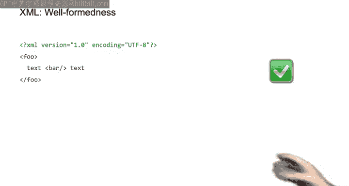

That Jason cannot do what is not not so easily。 So you see here。

 this is why you see how the publishing industry uses that because you really have text like a scientific paper and then in the middle of the text。

 you can annotate and tag some of the text in the middle for example in HTMLml do you know the BR tagging right for new line So this is the sort of tag you can have。

 So instead of bar it could be BR， meaning that's a new line。

 So text Br text just means you go to to the next line right。Okay， by the way。

 another name for the text is Markup， this is why it's called XmL， right， extensible markup language。

😊，Okay。Here that's not well phones because we try to put an element。

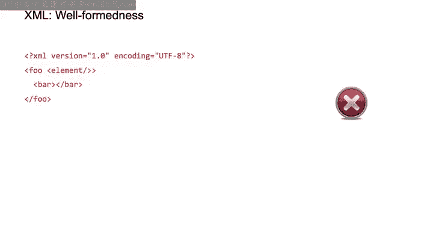

Inside the tag， inside the opening tag， right that you cannot do That sort of nest。

 nest is not a load。 You can put it in between is fine， but not inside the tag。 So if you have a tag。

 you cannot open another image。 That's not okay。

All right。And of course， you can have attribute inside here。 I come back to that。

 The problem with with this one is that you have this symbol。

 this character that normally is for opening attack。

 it's normally not allowed to have it anywhere edge then for actually opening attack。

 So this is here what would cause the the issue。 All right。

 but I' come back to how to escape these characters This is fine， right here we have。

One top level element。 It has one attributes that has the value elements called the attributes and bar。

 bar。 Okay， that's the next。So this is just to give you an impression。

Now you might sometimes see that's also optional a doc type insight already so doc type H in an H file right This is kind of the same thing right So it basically says this is a document。

 the type of which is and then you have the name of the top level element always have to be the name of the top level elements right So this is why doc type H because Hl is the top level element in an HTML file。

😊，Okay， so right， so the do type is actually something that can get much more complex than this。

 but it's considered maybe not obsolete but but let's say it's been superseded by newer technologies like Xm schema which we'll see in two weeks but historically in the do type you could also have some constraints on the structure of the documents basically say that this element can only have these and these elements inside and so on and so on but I'm not going to include that in this code so you don't need to worry about that just telling you there is these do type if you see something inside and you know that's also that's called DtD right but we are not going to talk about them。

What else can I say yes so what about HMN。HTM is a cousin of XML。 they both come from HTMLL。

 but HTMLM is not necessarily XmL。What's actually what actually happened historically is that it kind of fucked。

And there's the HTML community and the X community。

 and they have different mindsets and there was for a little while。😊。

A debate between these two communities。 So the mindset of the XmL community is。

You need strict rules for well formness to say that a documenter is well form。

 You have to follow the rules。 You have to quotes your attributes。

 You have to close the open targets so on and so on。 So it's very， very strict。

HtM is more lenient in HTML， you don't have to quote the attributes。

 you don't even have to close your tag， for example。

 BR can just be just the opening tag and nothing else in HTML in the HTML syntax that's totally fine。

Plus， you can even， you don't even need to throw an error if there's a problem。 Did you know。

 I don't know if they still do it， but did you know that， for example。

 Google opens the H L pages with H T M L and then head and body， Right， You know in the HTML syntax。

 what you have。 But if you look at the bottom of the page。At least last time I checked。

 there is no closing body and closing H TM L， just to save energy。

And the reason it's done is simply because the browsers are not going to complain about that。😊。

So you see it's really different mindset than XML in XML， you would complain if you。

 if you' are not closing the tags the elements properly。Now， what happens is that。When H T M L 5。

 the， the fifth version of of H T M L was designed。

The debate was still on like the XML community tried to push HTMLL5 to strictly adhere to Xm。

 that's what we call also X HTMLt right that HTML should strictly follow the Xm rules。

Went on for years and years， it was even regularly in the news that is the technical news。

And at the end。A compromise was reached。It's a lot of people in the working group。

 I remember there was once a techlenary。Where so I wasn't in that working group。

 but I could see like there was 100 people in there。

 and you can imagine the time that it takes for everybody to to express their their opinions from all the older companies。

 But the compromise that was made is we are going to have two syntaxes for Hm。

 So's the data model of H。 And then we have the H syntax。

 and we have the X H syntax and they both live their own life。

 So X Html will strictly follow the Xtml rules。 The H syntax will not。

And there is even some people who try to make everybody happy with something called HTML polyglots that tries to both part as HTML and as X HTML right to be even even nicer So you see it it's a complicated thing but I wanted to tell you that so you know the link with with the HTML and why is it that HTML looks a lot like like Xm but with some differences okay。

😊，Now HtM is for web pages XmL will use it for data for storing actual data。

 so it's not just XHtM So this is a summary of what I told you So elements only one at the top level then you can stem attributes can only be in the opening elements tag or the empty tag is fine too。

 but not the closing one。

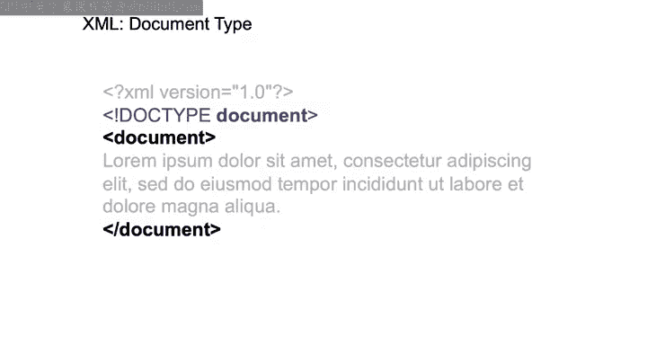

Text can be in between elements， neither at the top level nor inside stacks。😊。

And comments can be at the top level of between text， but not inside tag， right。

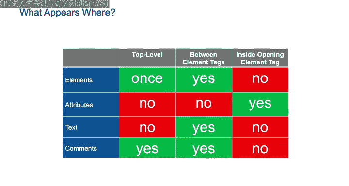

So this is just a summary of what can be wear。Now， just like I did for Jason， if you do， then don't。

Just like in Jason objects， you should not。Repeat the。The the， the keys。

In the same XML element you are not allowed that's strict。

 you are not allowed to have twice the same attributes。

 so here if you have who and again who that's not okay that's going to be an error you will not be able to open that or past that you can have multiple attributes as long as they all have different names or whom is that here。

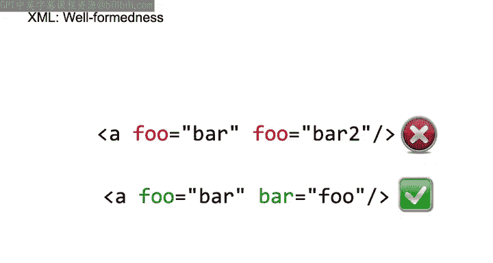

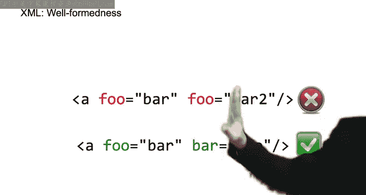

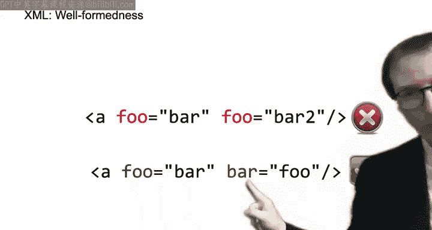

Alright， very good。Then have you heard empirical theoretical computer of science of well parenthesized expressions right It's a bit similar the way you close your tag has to follow a rule So for example。

 if you open tag A and then you open tag B inside tag A then you need to close B first and then close a right so it means that B closing opening and closing must be fully inside a you're not allowed to intertwin them So intertwine intertwine。

 I don't know so A a open close， you cannot just open B inside a and that's it and then close B outside that's not allowed you really have to open and close it first because before you can close a right so think of well parenthesized expressions but more general you have a question on them。

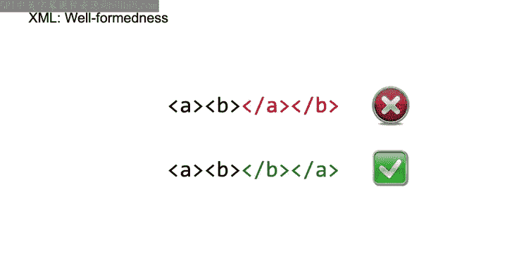

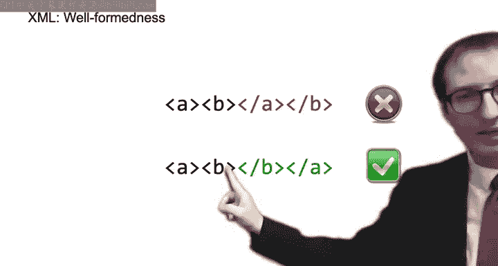

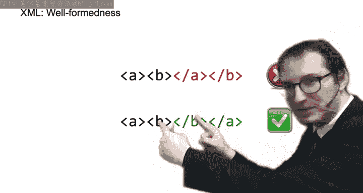

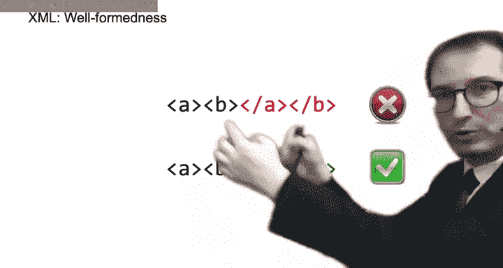

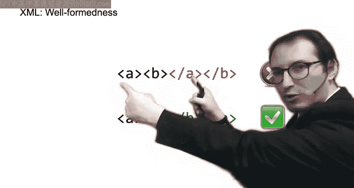

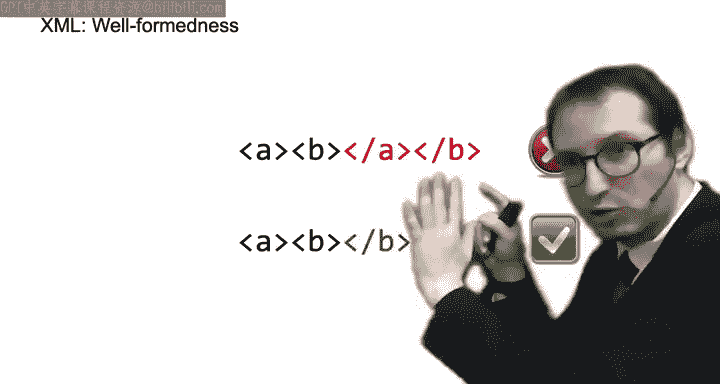

Does it work， let me see maybe it the way it's connected or it's not switched on。

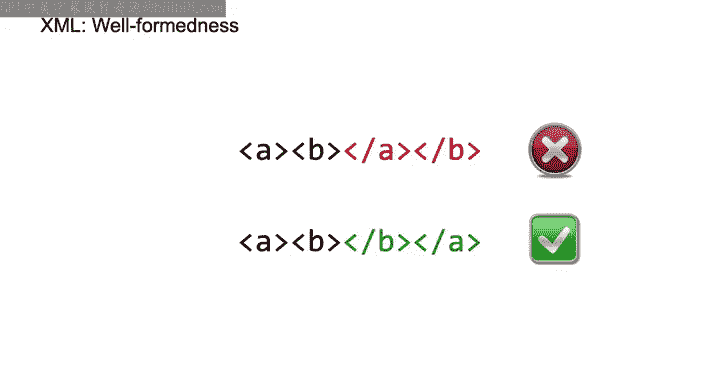

Right， okay， nice。 can you have the same argument name， So the key in different tags。

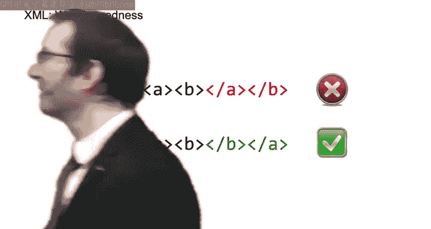

In different tags， Yes， absolutely。 If it's a different tag， then you can repeat the attribute。

 In fact， it happens a lot because typically a with the same name will typically have similar attributes。

 And we'll see that when we look at schemas a bit later。 Yeah， that's a good question。

 This is really within the same tag that you cannot repeat。Just like in J。

 it's within the same object that you cannot repeat the keys。 Al right， so you see， in fact。

 that means that the attributes within a tag follow a key value model right the attribute name is the key and the the attribute value is the value。

All right， so the wellform nest， you really have to properly nest the tag。

And I said I would come back to these model band symbol。It's also for historical reasons。

 but also practical reason is that if I show you that you probably would be able as a human to pass seat right so you open。

 you close， and then this is one smaller than to fact that could be JavaScript in HTMLs。

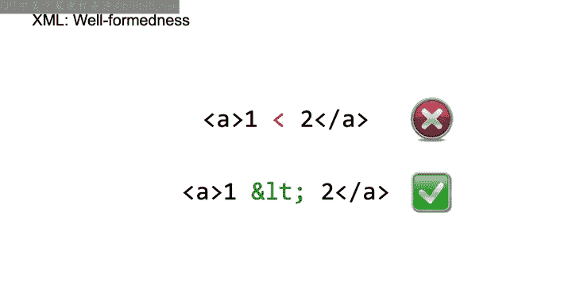

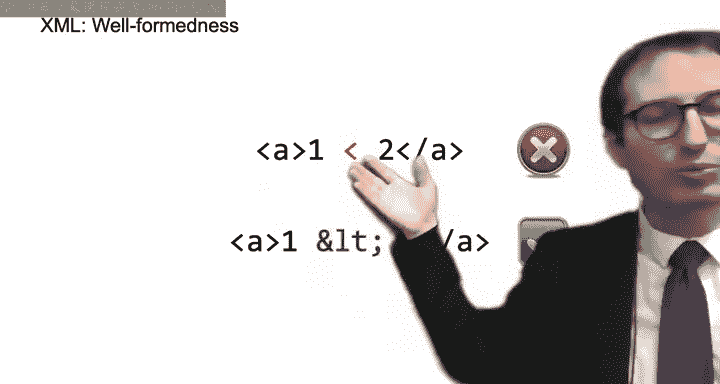

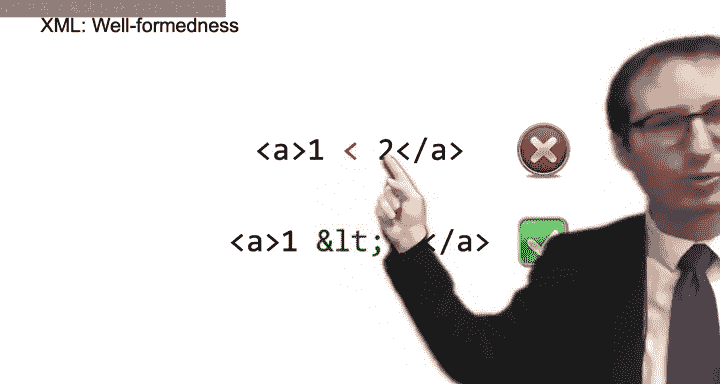

So now the thing is that this character here。

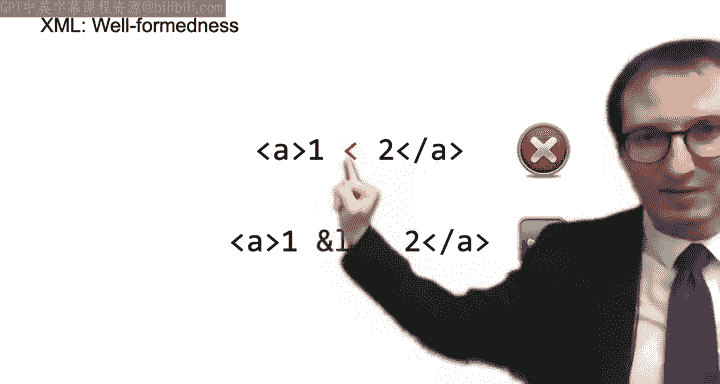

Someone all done。Is really something that the Pax， the XL Pas rely on to find the attacks。

For this reason， you're not allowed to just use that symbol as is because it would confuse the parel。

 so this is why XML forbids it， you cannot use that symbol for anything else an opening attack as the only use that per。

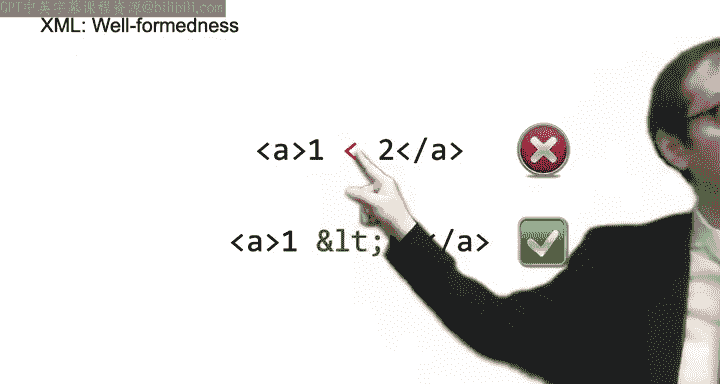

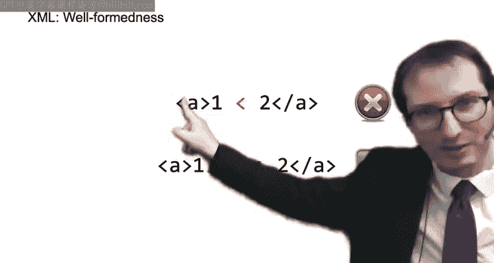

But now comes the question what do you do if you really want to have one smaller than two in in as text right and then the answer is you escape it escaping is something you know for many languages in J we use back slashes as is' very common in XM we don't use back slashes we use Empers sense right this end symbol here LT means lower than and then the semi elon right so this is the next sequence。

I have good news for you。There's only five of them。

LT lower than GT is greater than upper is for the aposttrophy quote is for the double quote and m is for the m itself。

If you know HTML， you know that in HTML， there's many， many others。

 but that's HTML in X there's really only these types， if you want more。

 you can define them but I'm not showing you how。😊，Okay， so these are just these files。😊。

Now there's a story I like to tell about the Emperserson steamboat。You know that today。

 the English alphabet has 26 letters， right， A through Z。Where it used to have more。

Some of them actually survive like the thn， I think well th letter in Icelandic is still low presence。

 so you still have traces of these letters。😊，But they just disappeared in the English alphabet with type。

 So it was replaced with D H， for example。The Em is actually one of these letters that disappeared from the alphabet。

 even though it didn't quite disappear completely because we still use it。

 it's just not in the alphabet。But he used to be in the alphabet。

And you know that this symbol is used to say end， right， when you use it as to be an end。

German people might use a plus symbol more than this one。

 but in English we use that it's actually if you know a bit of French you can also see it if you look very carefully as a E T right A which means n in French that's kind of the E here and the T so historically it also has to do with with this but basically why is it calledemp%。

😊，Because when you teach it to the kids at school that was in the 19th century。

 in the 19th century you would go ABC， blah， bla， blah， X， Y， Z and。

 and so it was weird to say just X Y Z ends that sounds very very strange。

 so they try to make it more poetic。😊，So they basically said because it's by itself at the end。

 so by itself you can also say per se， so basically they said okay X Yz and per ends and by itself ands so X Y Z and per se ends and when you say very fast N per se and if X Y Z and per se and that's why N per it's a contraction of N per se ends right just for historical anecdotes that you can tell to your friends。

😊，Okay， so Em sense， and we use that for escaping and then the semico here。

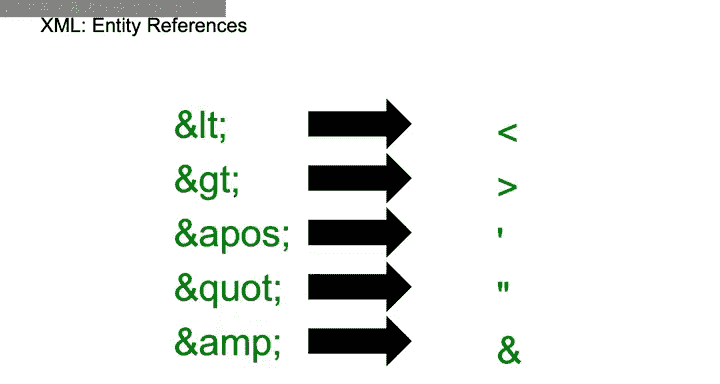

Okay。

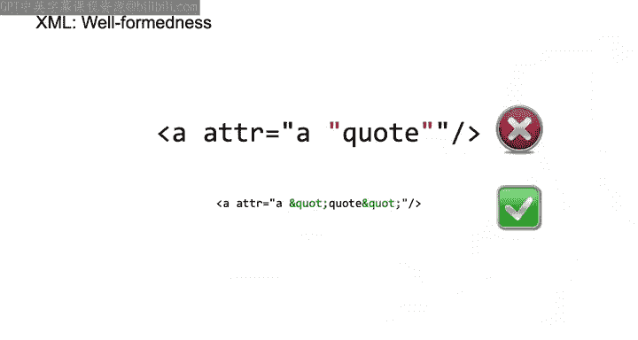

Now why do we need to also escape quotes， not just this one， because of attributes。

 because if you have an attribute like this that is double quoted。

 you cannot have a double quote so you just use the escape sequence？

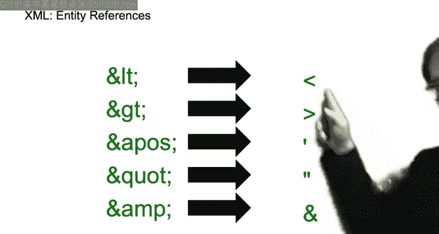

Likewise， you cannot use this inside an attribute value。 it's also not a allowed。

 So you use the escaping sequence with Lt right if you look at everything。

 it's actually quite simple to to retain these two here must be escaped everywhere if you want just lone m percent and smaller than wherever this is in text in attribute values you must escape them always on top of that in double quoted attribute value you also must escape the double quote for obvious reasons and in single quoted attribute values meaning the apostropphy is used as a demeter then you must escape the apostropphy So you see this is well found here it's fine not to escape this but these two you must escape smaller than m percent here it's fine to not escape the apostrophe inside double quoted it's fine to not escape double quoted inside of double quoted but you must escape this。

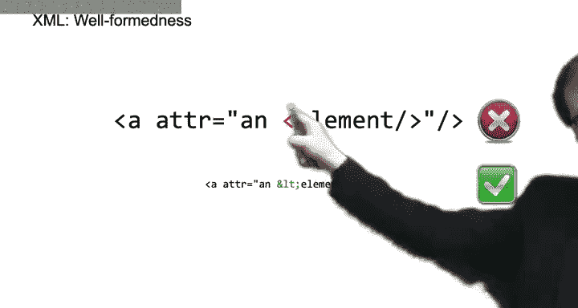

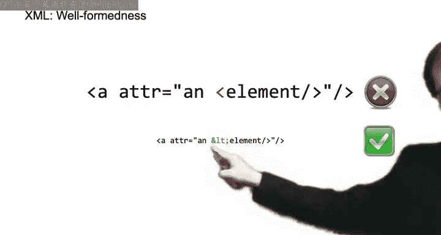

Okay， so there's only five to remember。

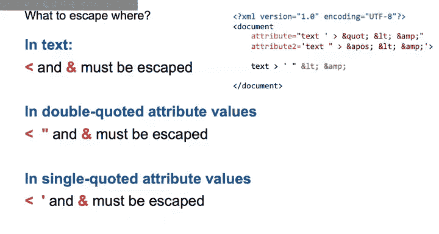

And these are the woods。Now regarding the XML names it's actually pretty simple because that's pretty much like in many programming languages called the names of variables in S plus+ in Java in Python and so on so it should be very intuitive for you。

 for example it cannot start with a number， like you don't start the variable with a number in Java。

 it cannot contain any special characters， the underscore is fine， the dash is fine。

 the dot is fine but but you cannot have， for example this as part of an element name。

 not a load even escape that doesn't work。

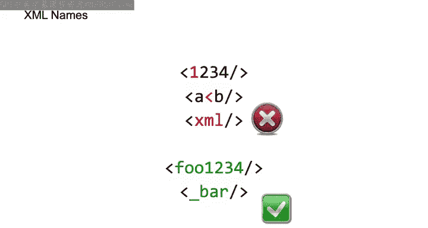

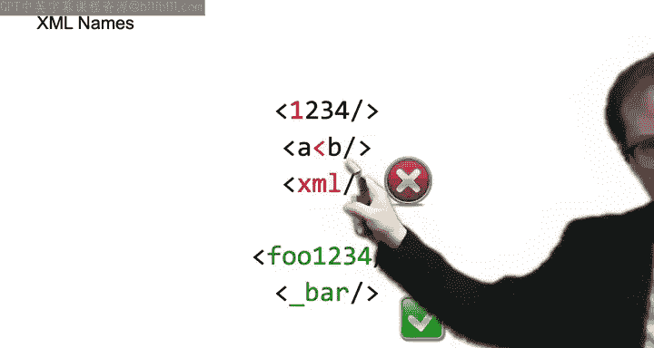

Now the X ones are resolved。You're not allowed to create them except if it's part of a standard。

 This is just something reserved by the standardization body at W3 C。 So if you do it。

 nobody will complain， but you're not supposed to right I will tell you what they can be useful。

 but don't do it on your own。 anything that starts with XM M， in any case， you cannot do。

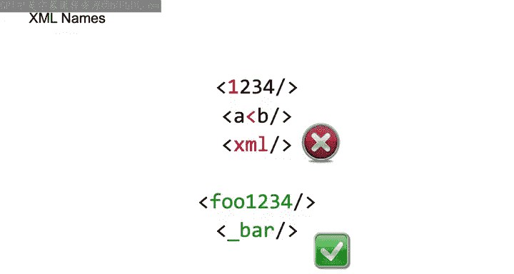

Okay。Now， generally， and again， that's not going to surprise you。

 It's really just think of the Python variables or Java variables。

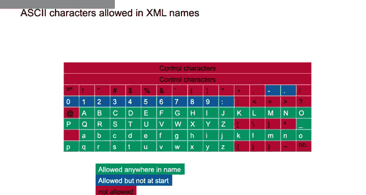

You can use letters plus the underscore and you can use， but not in the first position。

 digits and the colon I'll come back to it and the dash and points right， but just not at the style。

 just like you do not start the variable name with the digits right So this is it And all the other characters it's just not a lot。

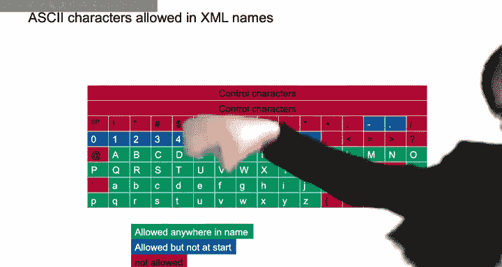

Okay， so this is， you you， this is really just natural。

 Just think of variables in Java and in and in， and in many languages。 It's it's pretty intuitive。

Something else just like Jason actually is that the white space is not really relevant we like just like J to nicely indent and add new lines and just to make it readable by a human right you don't have to you could also just put it all on one line but it's convenient for for humans to actually to actually view it in this way in fact many editors of Xml or Jason have a magical shortcuts where you can copy paste any Xml or Jason and it magically makes it readable like this it is called Pre printing also right so just does it for you nicely indent it。

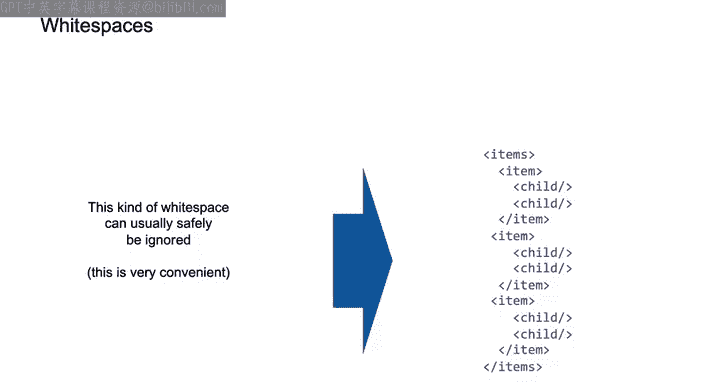

Okay。All right， and now I'm going to a feature。Of X， M L that some people hate。

But it's actually in the enterprise world， in the standardization and company world。

 it's actually important we don't have this in Jason， this is one of the limitations of Jason。

So let me start with modules and functions in any language。

 you know that in Python when you define functions and you create a library。

 you put it in a module right and that module can be put as a P package right on ppe。

 org not sure the pro is correct but basically you give it a name and everybody agrees on that name and then you can do PP install and with the name of the package install it and so on and then import。

In order to use it。So basically， when you create functions。

 you organize them nicely in modules in Java， that's called the package， right， in Java。

 you have packages and inside the packages， you might have classes and and and and methods。

Now you know that within the same package you cannot have any collisions。

 you cannot have two classes with the same name in the same package。

 but it's time to have two classes with the same name if they're in different packages right and that's what packages are for it's in order to keep it tidy and avoid collisions。

Well， the same thing happens with XML because you have all of these governments and and standardization bodies and all the users of XML。

 they come up with names for their elements。 For example， you saw them for the tax purposes。

 like revenues and so on。 These are possible names for elements。Well。

 we need to keep it tidy because if millions of people are doing that at some point。

 it's going to clash， people are going to create elements that have the same names and that is actually problematic。

Just a simple example here that he's recurring his clients。

You might have an X ML environment in which it's for networks like client Salver。

 and then maybe you have the CRM customer relationship management of a company where we use the word client for a person or a company。

 that is your client。When you want to put constraints as we will do in two weeks on what can be in these elements。

 you need to distinguish between them but if they have the same name you cannot really distinguish so for exactly the same reasons that you nicely group in a tidy fashion functions。

 python functions in modules and Java classes in packages we also do the same forD element names and that's called the name space。

I think in C++， you also have namespaces if you know C+'s also so called the namespace there。

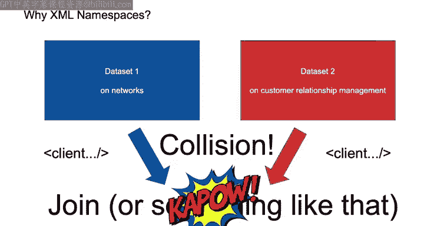

So that's to avoid that， so we will nicely tidy that up。So this is prior to tidying up。

 this is what an XMM document could look like， where you didn't bother to create any namespace that's like the default package in Java。

 so here it's not anywhere。If you want to nicely put it in a package， this is how you do it。

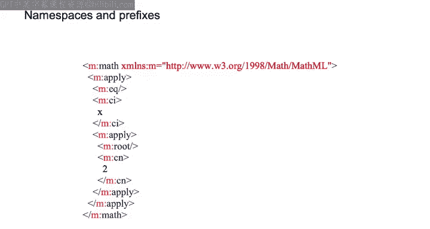

You use something that starts with X M L。 So this is one of the reserve uses。 You basically say。

 this is my namespace。This is like the name of a package in Java。

 like the name of a module in Python and so on， you just put it in there。

But we are all lazy so we are not going to repeat it everywhere， so you just say。

 okay let's have the shortcut M for this can be anything just call it M and then you add M in front of every element and that means that all of the elements that have M as a prefix are in that package right。

😊，Now you might render that's a URL， I should be able to type that in my browser。

 so you know it's weird that we just use that for a namespace。

But the thing is， remember in the rest API paradigm or in general， that's the mindset of the W3C。

There's the concept of a resource a resource can be absolutely anything and in the W3C we love to use Us for resources a package is a thing it's a resource。

 so we also give it a UI。Now it turns out that it has established itself historically that we use the HttP scheme in the UIs for。

Or a namespace。But it's really just a historical reason it would not work in your browser it might have a fancy page that has some explanations but it really has nothing to do with HTTP right so don't let yourself be confused by the fact that it up with HtTP that's really just a convention right so UI start with HTTP the idea here is just that when you create your namespaces you should only create them in a domain that you own right nobody would prevent you to create a namespace in any domain but it's just to be nice to other people just create the namespaces when you design elements in a domain that you own。

Okay。Does it make sense？Well actually maybe doesn't make sense that we use HTPP for the for native space。

 but yeah that's just how it is， which has to have to take it for how it is Okay。

 so that's the math MLl package it actually exists It's macro language for mathematics formulas just like latex it exists iss defined somewhere as a standardout and it defines all of these elements like the the root apply and so on。

😊，EQ equals and so on， so that's math ML。If you don't even want to bother with a prefix you can use what's called the default namespace。

 then you just use XNs like that and you say， okay。

 that's the default and anything in there that is in that document unprefixed belongs to that namespace this is exactly the same this is exactly the same thing here we use a prefix here we just use the default namespace right。

That is not the same here， there's no name space at all。

And if you are a government or a standardization body and you define elements。

 you should not be in no namespace， you should always tidy things up and put it in no namespace right so this is a load but it's not a good idea if you're the tax office and you want to design some exempt okay。

Do we have a question？Sorry， so I don't quite understand why we need namespaces。

 the example you give in programming languages the things I can import other things right that's where the clash happens。

 but if every file is just separate， when does the clash happen？

It's basically it's a practical reasons because here I'm just showing you the syntax right so it's true that you could put in syntax colliding elements and at first it seems like it doesn't create any trouble but the same was in Java right people could create Java files in the default package that have the same names if they just use it on their old machines it doesn't clash right but if somebody tries to use the two together。

 then it's going to clash。

So now this typically clashes if somebody is using XML data from two different sources and tries to query it and the reason is that when you query it later。

 you might filter by element name， you want to say what are all the revenues for all the tax reports that I have in there for example。

 then you rely on the element names， Another reason you rely on element name is for validation that we see in two weeks right you might require that a specific element must have a specific structure。

 and you want to keep it ti when you do that， you really want to make sure that every element is uniquely known as belonging to a specific namespace and in the same way that you can import modules in Python。

 you can also import namespecs in XML， but you do that when you validate the documents。

 you do that when you actually constrain the structure of the documents and then it's important that it doesn't clash。

Does it make sense？Yes， but the question is what happens with the default namespace then like let's have two files in the default name space。

 but I have the XML S and on top。So what's going to happen if you put everything in the default name space and you even put your schemas in the default name space？

What's going to happen is that when you try to validate， you will basically have two。

Specific constraints for the same elements。And when you try to import everything。

 it's just not going to work because you will have conflicts between the constraints on the elements。

 So it's going to start causing all sorts of issues。Right。

So this is the reason you want to you really want the element names in XML to uniquely specify what they are about and to uniquely specify the constraints that they have。

Great， thank you。But they've come back to validation in two weeks。Just on that then。

 there is no difference between no name space and the default name space because you're going to have collision in both ways。

Oh what's the difference So there is a difference because here。If I have the default name space。

Let's say I have these documents。

There is somewhere a specification and a schema that we' cover that in two weeks。

That basically says what the constraints are。

For example。It might tell you。That CI must have the name of a variable insight that you're not allowed to have other elements。

 it might tell you that CN must be an integer for example。

 probably for constant right so it basically defines some constraints of on that structure and so what happened is that if you're aware of this name space and on the fact that it expresses constraints on these elements that are in that name space then when you process that document in a proper enterprise environment that knowing that it's in that name space is going to enforce the constraints and throw errors that you if you do not put the tags in the way that they' are supposed to be put。

Now， if you do it like this。

Then there is no schema for for this so here you would do any you could do anything you want but you have no idea if you're doing it right so again the idea is that the moment you put it in a name space it makes it possible to actually tie it to a schema for that name space and then constrain the structure of the documents。

If you define the schema like this with no namespace at all。

 then you might have multiple people doing the same thing and then you will have a problem when you try to validate the document because there will be multiple sources of truth to define what you can and cannot do。

 does it make sense？

But also with the default name space it that could be default name space。 Yeah。

 So the default name space really says that everything here belongs to that name space。

The mindset is that it's really the same here。 It is the same thing。

So if you have a default namespace， these are not in no namespace， these are in this name space。😊。

Okay， it's not a namespace that everybody' is using。 Its just， I see it。 sorry。

 So this is basically saying that this is the namespace of all these elements here。

 And it's the same thing as this right here。 none of these is in any namespace。

 That's the difference。 Okay， I misunderstood。 different namespace。 thanks， awesome。😊。

All right。And so the ID this is called the Q name， the ID is that you bind the namespace to a prefix。

 and then you use the prefix right here to say that this element is in the namespace that you would well you would find the binding in here so technically the name of an element is made of a prefix a local name and a namespace but when you compare them it's really just the local name in the namespace that matter because the prefix is only a shortcut only a way to bind it in fact you do the same with Python when you import the module you might bind it with some name just for the fight that you're in and then you use the name that you tie it with right so it's exactly the same when you import the module in Python。

Right。When you you use as I think。All right， I think there's even memes on that that how to confuse somebody like import pondas as NP or something right just to confuse me it's a bit the same So here too you can actually bind it to whatever you want and the prefix is not relevant it means that all of these are exactly the same only the prefix changes but it's the same namespace and even that one is the same this is where it's the default name space so you don't have any prefix here but again it's the default name space because of that。

These are all the web and same thing， no difference。

All right。Now。It's very easy to get confused with namespaces。

 So what you should do and that's a very， very strong recommendation that I have if you ever declare namespaces。

 do it at the beginning in the root elements only here， just like in Python。

 when you import your module， you do it on the top of the file and that's it you don't import in the middle of the file right So only import at the top in the root elements。

 do not put it anywhere else。 for example， I could say here's the namespace。

Bar and another namespace and then you can use both of these the elements in these two name spaces。

 So I put it in blue and in red， and you might have somewhere a schema that says what the constraints are for these elements and somewhere else a schema for that namespace that says these are the constraints for these and these elements For example。

 the constraints here might come from the tax office right and the text office says this must be used that way and the constraints here might come from FMma。

 for example， for financial re and then it tells you this has to have these and that structure。

 So really think of the namespaces just like names of modules in Python。

 except that instead of being functions， it constraints that we are talking about。

 but that had come back in two weeks on the constraints I didn't intend to go too much in these details for whom is that here。

Right， okay， so really think that behind every name space。

There is a government authority or some association or whatever that handles that namespace and that decides what it's for MaML HTML is another example。

 there's an HTML namespace that says how XHt has to look like。

And so on， okay？So that's going to be for today， my last slide， only use namespaces like this。

 either no namespace at all， but be very careful， Don't do it if you're a government or you know a public。

 avoid no namespace at all。 just you can do it。 you can use a default namespace or one prefix namespace。

 This is really the same thing or you can combine namespaces。

 multiple ones in the same document where you use multiple sources for your data and you combine it。

 but never use the default namespace in that case。 that's just too confusing So give them all a prefix if you use multiple namespaces right So this is it。

Thank you very much for following I'm almost done actually just last week I'll finish up and then we'll study white Col stalls in fact。

 the next time with how to store XmM and Jason in some some storage layers that looks like papers So thank you very much。

 I enjoy the exercises and I'll see you next week on Tuesday as two for the continuation Thank you。😊。

