# 苏黎世联邦理工《大数据｜Big Data - ETH Zurich - Fall 2024》中英字幕（deepseek - P16：-16-5. Syntax (3_3) -.zh_en - GPT中英字幕课程资源 - BV1sHPKeoEJU

Welcome everybody in the lecture hall， welcome everybody on Zoom。

 welcome everybody from the future today we are going to finish the Pat syntax。

 I have just a few slides left， but actually it's mostly because I read the slides so I'm never completely satisfied you know I'm only satisfied if everybody understands。

😊，So。Initially， I talked about namespaces without really anticipating too much on what we would see in two weeks in two weeks。

 we would see that you can define structures on top of XmL and JasonN and then enforce constraints and and in fact。

 this is when namespaces actually start making sense。 so I didn't want to anticipate on this。

 but now realize that it might actually be useful to say a bit on this So I will do it like this So I completely read these slides should normally be re uploadload it。

Everything everything fine on Zoom， you can hear me。Yep， awesome some。So。

Waiting for this little toolbar to disappear in the lecture hall， it's not disappearing。Oh， yeah。

 now it is。 Okay， so the idea is that XM L is all of other place。 So is Jason， actually。

 and it's used for many things。 So， you know， it's used for web pages， even though for web pages。

 there are two syntaxes， there's the XM L1 and the regular H TM L1。

 We have math M L for mathematical formulas。 It's like latex。 But written in X M L。

 So this is you recognize the equation。😊，确定 go。So you can do this with a MaML。

 you can use it to encode music music sheets like all the notes and the rhythm and so on I told you it's also like the when you file your tax declaration that's all XML as well and there are also constraints and so basically there's probably millions of them across the world。

 everybody just synses their constraints， there is usually an association a standardization body。

 the government， the companies and say they can all create constraints。😊。

What has established itself is that typically， in order to not create a big mess。

 they use namespaces and use their domain。 So you're supposed to use the namespace with the domain you own。

 for example， the Swiss eover standard。 It's E do C H。

 And so this is they use namespaces that start with that X HGMl and mathM。 They start with w3 do org。

 which is the domain of the worldwide Web Con counded by Timbernerley with the web。

 So this is how it works。 And so the idea is that they have namespaces like this。

 So I'm showing you a few examples。 This is the web the namespace of XHMl。

 This is the one of Ma Ml music Xml Swiss eovers。 This is just one of them。 There's actually many。

 many of them can go to the website and and see for yourself。😊。

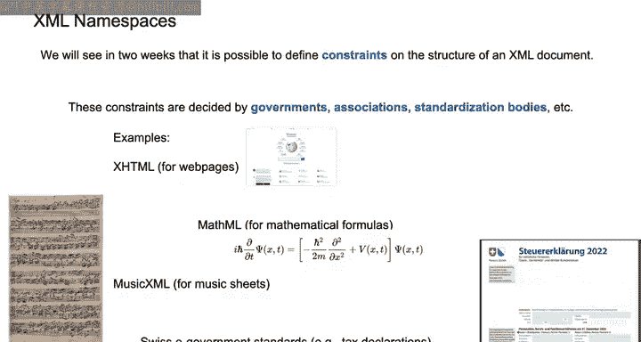

What's important is that these namespaces are not really meant to be put in a browser address box this is not the goal right they are just resource identifier us and they identify some constraints that you might have in XL。

Very often， though， the people who do this are kind enough to put a page at the location in case you type it in your browser。

 Sometimes you do have some landing page that says for your information。

 you just type the namespace of some constraints and so on。

 but not always so you might also get a for And so the idea is that once they have done that you need to slightly modify your Xml file in order to clarify that all the elements in there are in a namespace like in that case it's mathml。

 the way you do it with a prefix that here we called M that is tied to the namespace but I put a python example because I think it's easier to understand it like this it's exactly when you import P install and so on then you import the module as something like Poas a speed as N and this would be the prefix。

 This is when you use what you use in the python code when you refer to the functions who's already seen this many of you it's the same thing here。

 we just say okay。

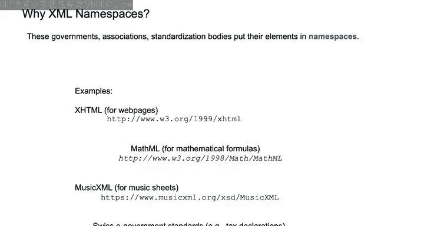

P this horrible thing as M。 And then you use M everywhere with a column， right， Everybody with me。

Now something magical happens when you do that normally there's a mechanism in effect it will check that the structure in that case of your formula is correct。

 so if you try to put the elements in a way that don't make sense it will throw an error and not actually accepted This is called validation we see it in two weeks so this is why once you add the namespace this is actually going to kick in all of that mechanism of validation now I told you about default namespaces and again it's so much easier to understand in the context of Python if you have a default namespace instead of the M it's exactly the same thing but it would basically be in Python if instead you say from banddas import star and then you directly use the names of the functions who did that already。

😊。

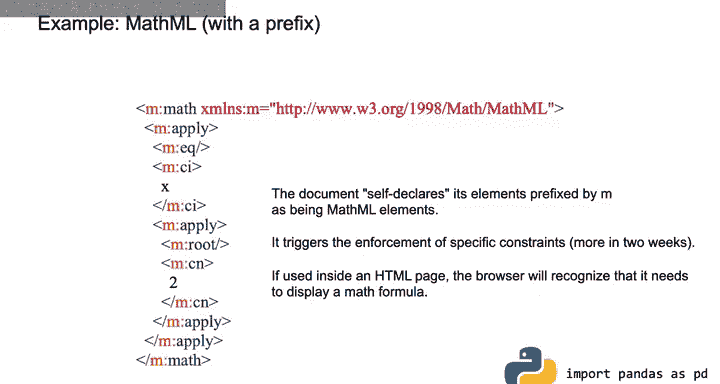

RightSome of you it's the same thing， so it doesn't matter in Python if you say import Podes S PD or from Ponds importbox style just modifies the way your code looks like。

 but it's the same effect your importing functions and you're using them。😊。

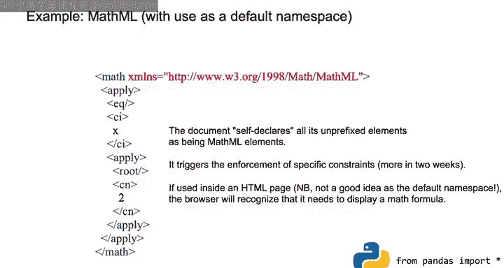

So just the same way that again in Python， it doesn't matter which prefix or as you are going to use for your module。

 any of that is exactly the same thing， the same goes here。

 it doesn't matter what you call the prefix that you made it with for whom does that make sense。

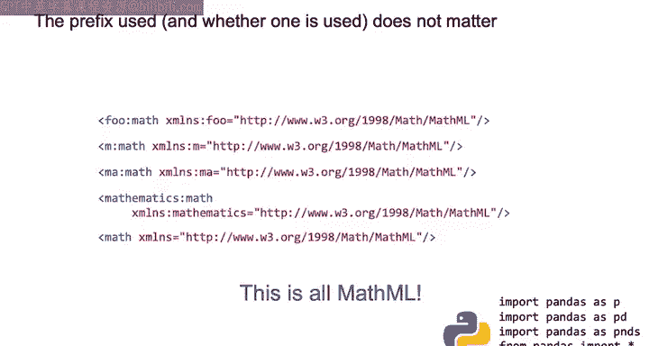

Alright， perfect。 So now this is a concrete example that mixes two name species。😊，This is， in fact。

 a web page because you see this is H TM L and it's in the you see that H TM L， the prefix is in the。

X Ht namespace。So it's as if in Python I was emboxing basically Ponda and Nai right So I'm emboxing H Hml and mathml and I'm giving the adias or the prefix H and math And now I nicely color in blue all of that that has the H column and all of that that has the math column So all of that is mathml that would be a mathematical formula and all of that is H you recognize by the H1 P this is all H right It is exactly the same as having pondnda and Numbai and then you have Pd dot something or NP dot something when you refer to them Who is that here。

😊，RightI hope it's easier to understand then last week。 This actually works。

 You can take that copy pastse it， put it in a dot text HTMLtl file。

 open it on your browser and you will see what's on the top right and you see the formula beautifully displayed because you used the MaMl namespace。

😊，RightSo that is the X M syntax。 The HM syntax might be different and doesn't have namespaces。

 but this is the X M syntax。 for whom does that make sense。

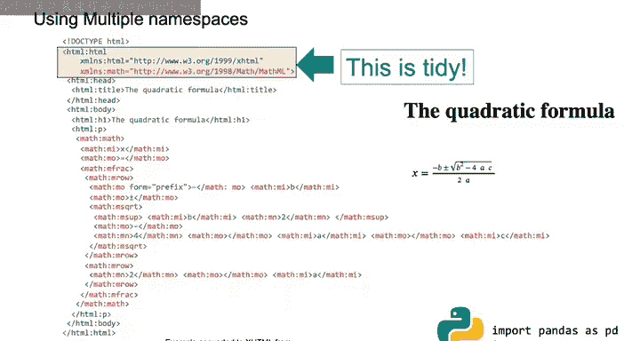

Alright， beautiful。 So this is the the beauty of namespaces。 And now it's easy to。

 to create a huge mess with name spaces because it's actually very complicated。

 So this is why I'm only give giving you specific。😊，Patterns。

 the first pattern is no namespaces at or it's when you don't even bother to have anything in the namespace。

 It's like writing a Python code with functions that you don't put in anymore modules， right？

But as soon as you try to release some software and release a product and then for constraint。

 then you should put somewhere in the namespace So this is the default name space。

 So that's what you use with from Poas importbox star right and this is with one prefix name space this is the import uponas as PD right so this is equivalent the two are equivalents and then finally you have when you have multiple namespaces just like you import multiple mods in Python here I put four of them and this is it note that this and this corresponds exactly to this。

😊，This。And this， right， This is not new。 I'm just saying you the therefore。

 do not do anything other than that。 You can do something different like this。

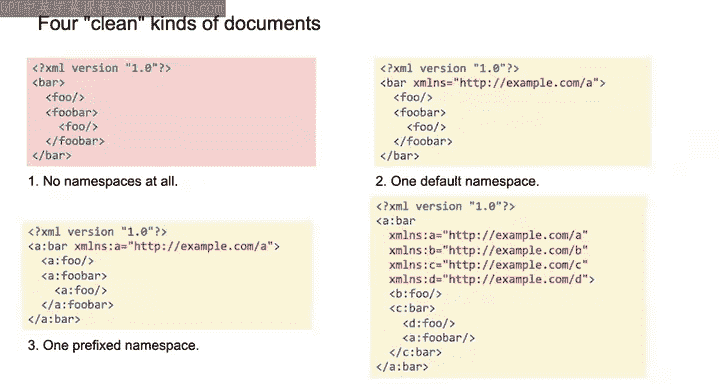

This is a huge mess。 Don't do that。 Nobody will understand it。 It's hard to read。 It's hard to paths。

 It's hard to figure out what belongs to where。 So this is an absolutely big no。 Just stick to that。

 Clean， tidy and yeah。

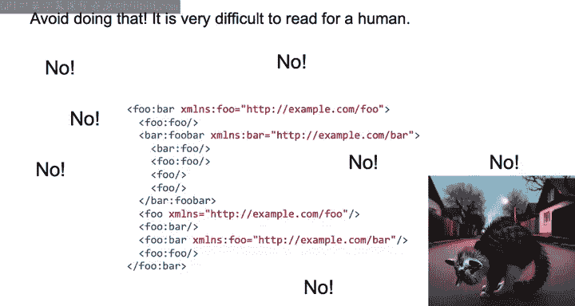

Okay。😊，All right。So now there is a piece of software that would be nice if you could download from the IT shop it's itshop。

ethz。chh right you already had software， it's called oxygen。😊。

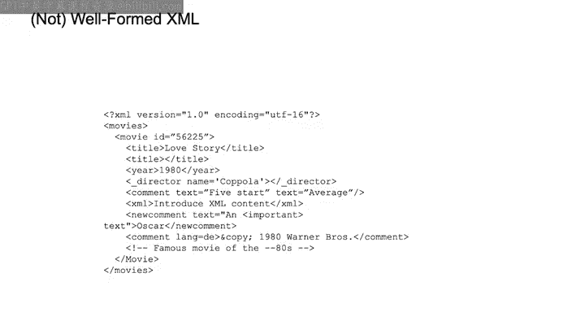

嗯。😊，Oxygen is an editor that has a lot of functionality related to XmL J JO schema。

 Xml schema and so on it's very convenient when you want to open data sets or look at data or curate it or fix it and so on so it can even be useful not just for these costs but also for your projects if you have some S projects or master projects that involve that kind of data The good news is that TthH was kindly enough to purchase a site license for everybody at TTH so it means you can just have it for free as a student so please go there and download it and you will use it in the exercises don't have to do it now but at a letter point and the subtle of things you can do is try to open a document that has wellform nest issues right remember wellformness means it doesn't pass as XML does mistakes and I give you an example here that has a lot of mistakes for example I directly give it but typical mistakes is mismatching case right big small M for the same M so that doesn。

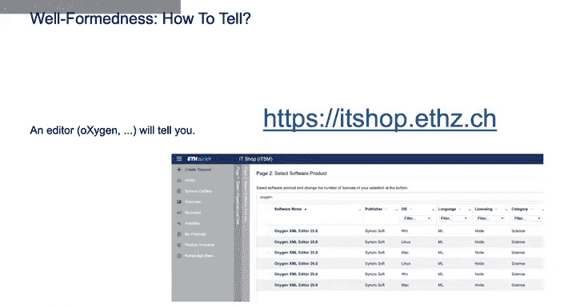

Work here somebody used something that's updateded with XML here you have twice the same attributes name in the same element that's not a load here you have this forbidden smaller than that is un escaped that's also not okay here you have an escaping that is not one of the five it has to be one of the five that would work in HTML but not in XML here you have unquoted an unquoted attributes here you have a comment that has a double dash that has nothing to do with this and here you have somebody who copy pastD probably the document from somewhere and of course it automatically enhanced the quotes to these fancy quotes but the problem is that they are no longer recognizable as quotes right so the nice thing is that if you put that in oxygen it will tell you like any Xm editor that's the beauty of standout and it will help you fix them show you the errors just like when you have compile errors and then you can fix it and once you have done it even beauty for these syntax highlights the document right so。

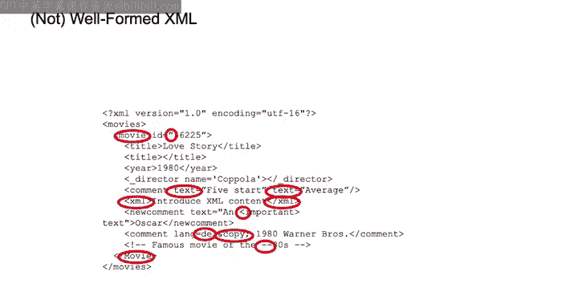

This is the ID， by the way， just so you're not scared。

That here is not part of the course material it just happens to be that you can also define your own codes like this。

 but this is absolutely not part of the material that's what I said is a bit obsolete now with the DTDs because we see schemas instead in two weeks not DTDs。

嗯。Alright， so that's what I wanted to show you about XMM。

 Hopefully now it's clearer what namespaces are for and why they are useful to basically scale the infrastructure worldwide。

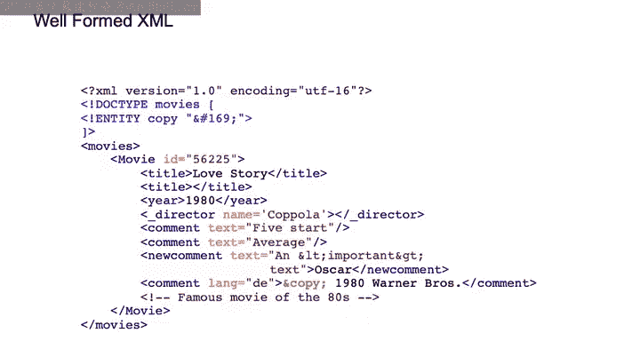

In terms of wrap up I wanted to link it back to the normal forms so this for example。

 is a table that has rows and every row can be expressed in XML in this way Jason I showed you last week right but now XML so the idea is that you can use elements for every one on the of the columns right so there's four columns so you can put four elements and then you can wrap it up in a parent element that has the name of the table but typically in the singular right because this is one one row of the table right so you have a parent element and then the children element and they have just text inside who sees that this is basically a representation in XML of that row。

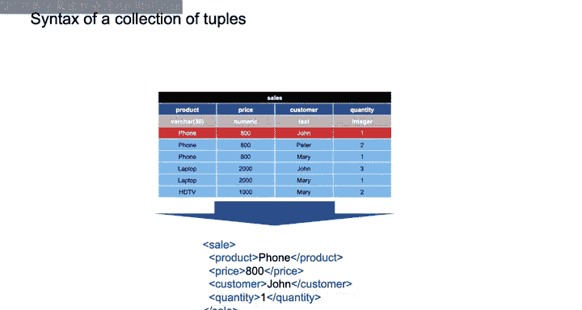

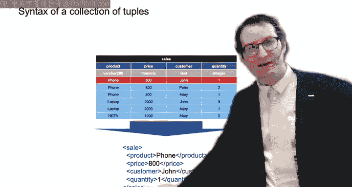

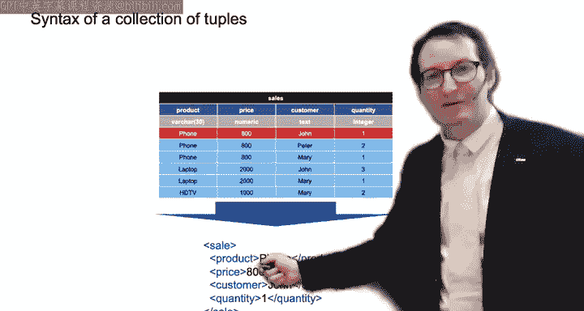

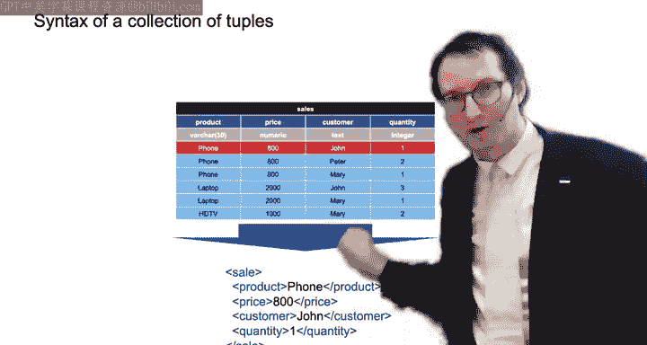

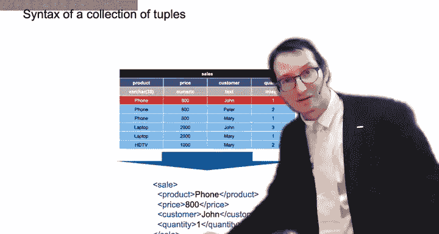

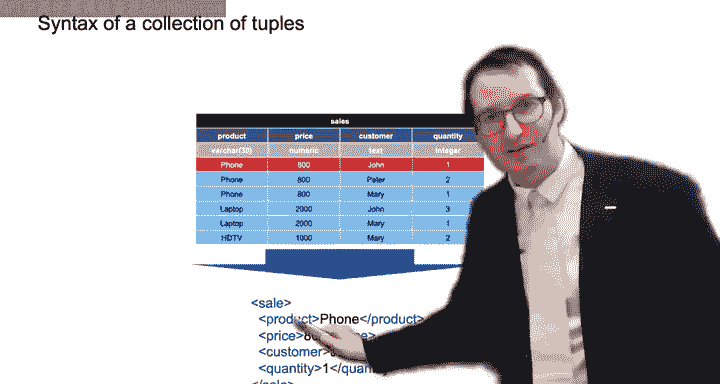

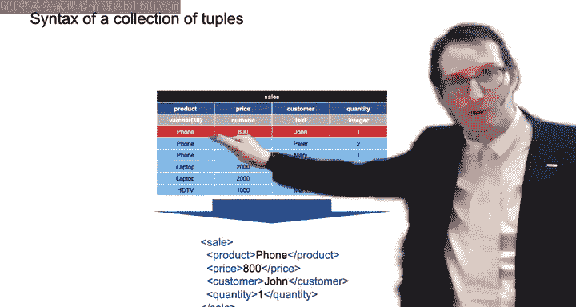

Right， okay， and then when you have multiple rows。 So if you want the entire data set， what happens。

 And again， this is the convention。 we put all of these sale elements。 So there is one pro row。

 We just put them one after the other inside another parent element。

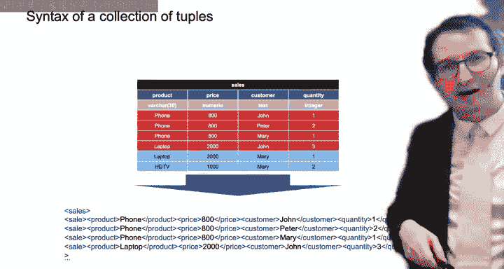

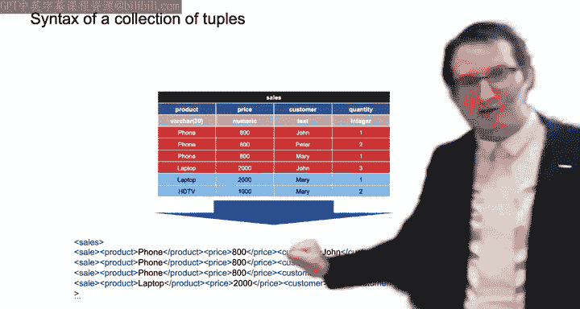

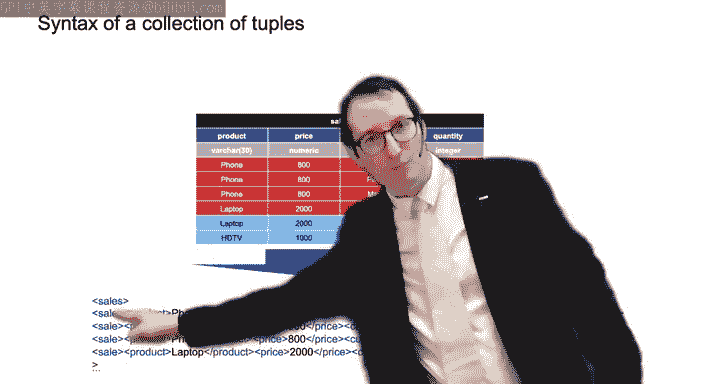

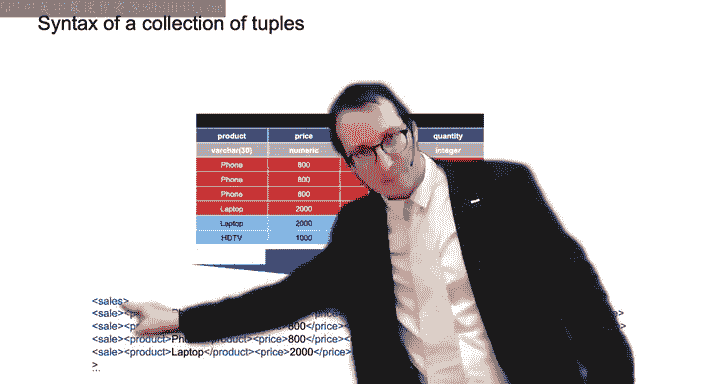

that typically uses the pole form， right so the proole form would be the entire table。

Then the singular form is is the name of each one of the elements。 You see that they repeat right。

 It's unlike keys in J in XmM， you can repeat。 So typically you have sale， sale， sale， sale。

 sale as many as row and they are nicely nested inside the sales elements And so once you add namespaces to it but that will see in two weeks you can actually have a schema that en fox see that sale has a product a price that is an integer a customer that is a string quantity that is an integer and that will throw an error if it doesn't but again we see that in two weeks Okay So this is the reason why it's always call sale because the name that you give to an element is what ties to the validation constraints or whom is that here。

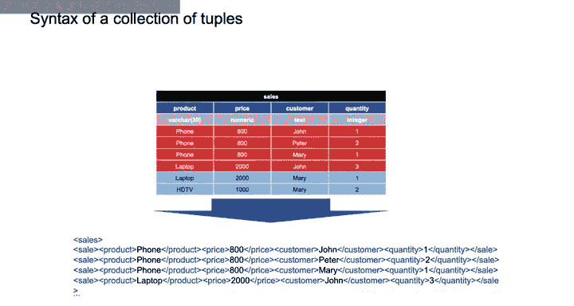

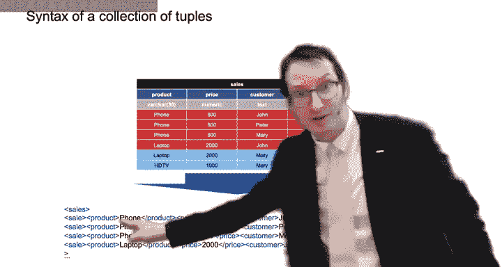

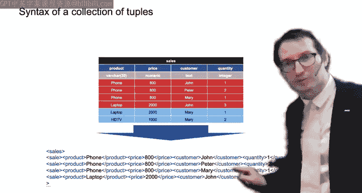

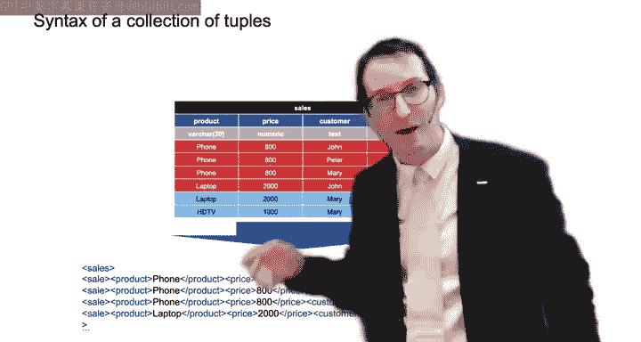

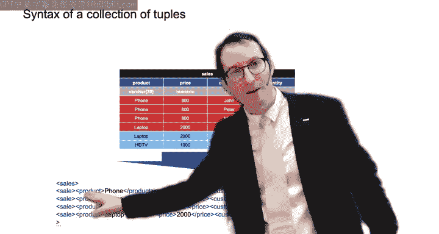

So then we get the same benefits as in a relational table when you can actually enforce the structure。

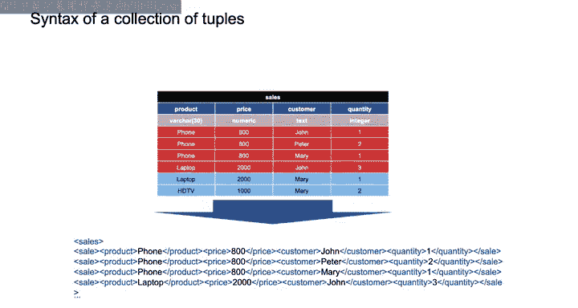

So this is another example， but what I did here is it's the same as here。

 except that I indexed it nicely， but this is only for readability by a human that actually it's totally relevant to XML。

 but human beings like to see these nice andentations。

 Oxgen can also do it for you if you don' it an Xml file。 It's not on the same line。

 you have a shortcut。 I think it's upper shift P or something on Mac as probably one on Windows and it automatically pretty prints the Xml adding the spaces and indentation and new lines to make it look nice like this。

 Okay so this is one auto benefit when you want to discover a data set that you just download it from the internet and you want to see what it looks like。

😊。

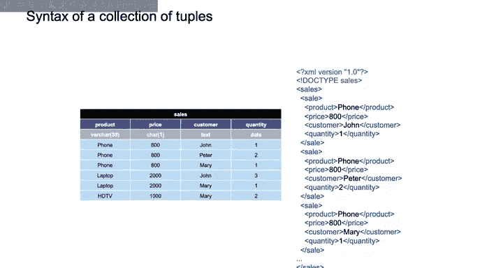

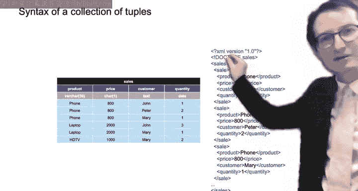

What about nested data， when in Jason， I showed you this is done with arrays that have objects right。

 with arrays of objects that are inside the bigger objects。

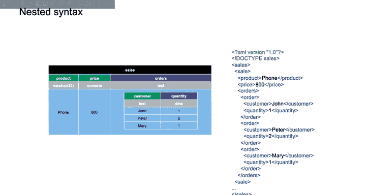

In X M， we just nest elements。 So let's look in details here。 We have the same table。

 I just have one row， but you can imagine other row。 So the same table。

 this is one row sale in singular。 It has product。😊。

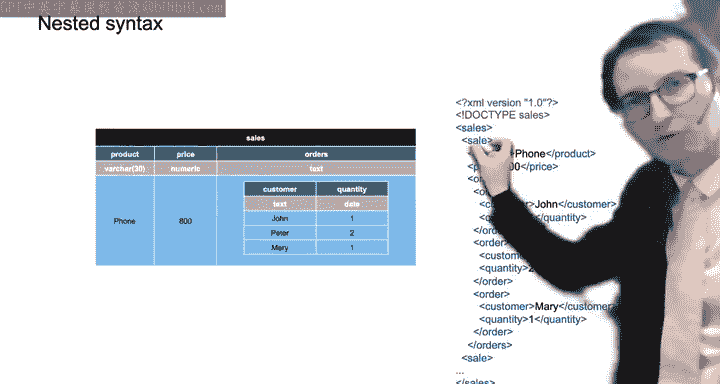

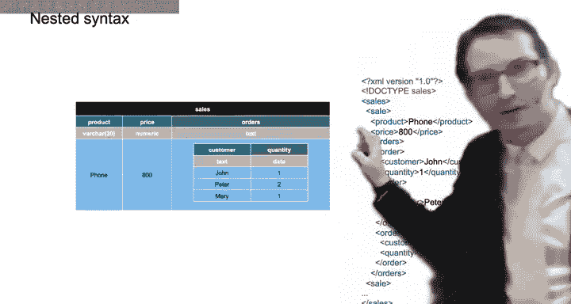

Rightice。And orders right This is why it's nested inside that should be table I don't know why I forgot to fix it。

 I should put table in there。 somebody object it So orders and then what happens is that because it's nested inside this order that goes all the way to here we again nest other other order just like in the British parliament right So the idea is that you have one row here。

 one row here and one row here and you just nicely put them one after the other okay。

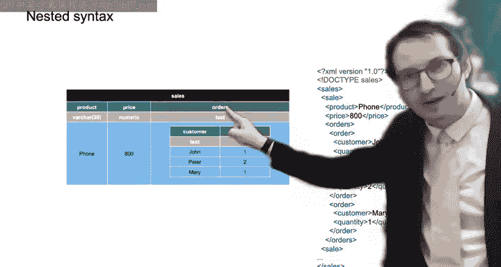

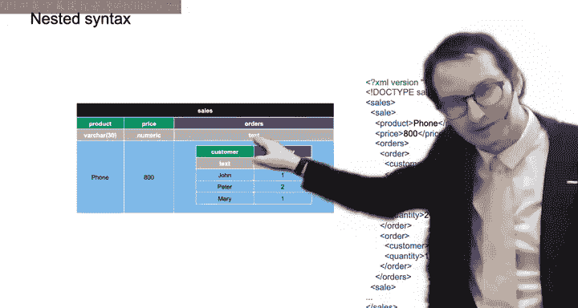

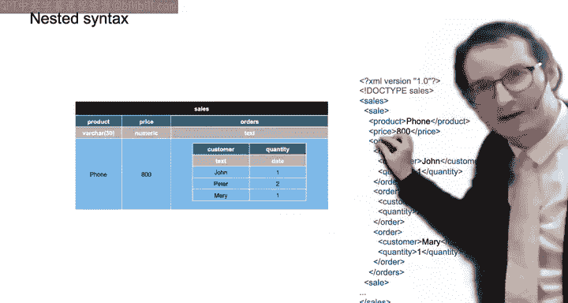

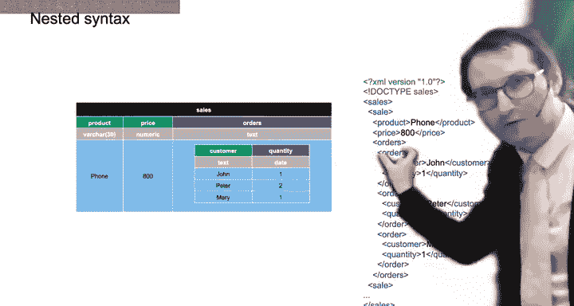

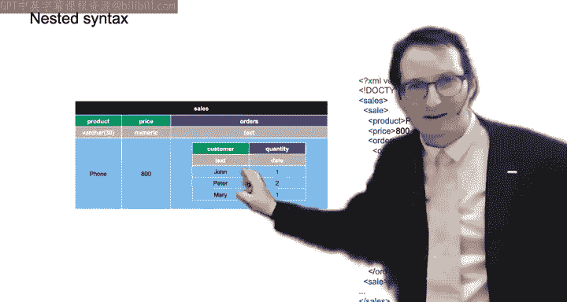

Who's with me？Right，So this is how you get nested nest in XM and in Jason。

 and you don't get it in TSV。 Now， if you want to draw the Internet fors。

Just speak a polarizing topic like is XM better than Jason。

 and then you get millions of replies like， oh， Jason is better， no XM is better and so on。

Do not call for it as a computer scientist， you need to look at every use case。

 There are use cases in which XmL is actually good。

 especially in the publishing industry or in government standard and there are other use cases in which Jason might be actually a better alternative because we've seen two weeks it's closer to data frames and tables all right and furthermore there's not the only two in town these are not the only two in town there's others other syntaxes one of them is Yamer so whenever you have something that start with yet Y aids yet another yet another macro language Yamer it's gaining in popularity I think it's very popular with Kubernetes who already saw that in Kubernetes right many of you so。

😊。

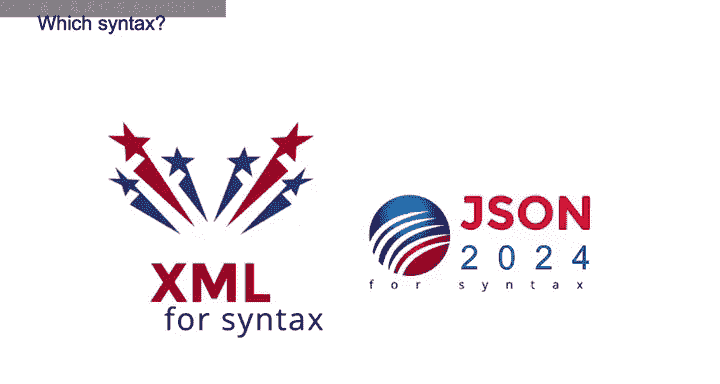

If you look at it， actually， I don't even need to teach it to you。

 you probably already see it who sees the object structures and the array structures here without even me you anything。

Do you see them？Right， many of you see。

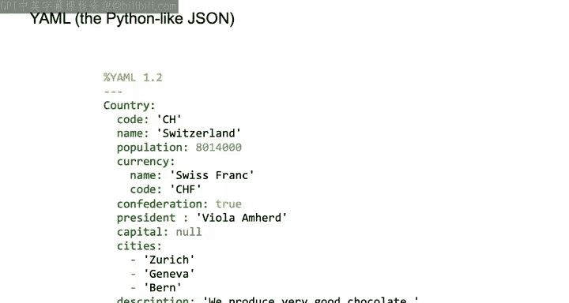

You have here an array。It's a list and you have here an object and you have here an object。

 So you see you can have exactly the same kind of structures as in XM and JN and so maybe some other syntes will start appearing later。

😊。

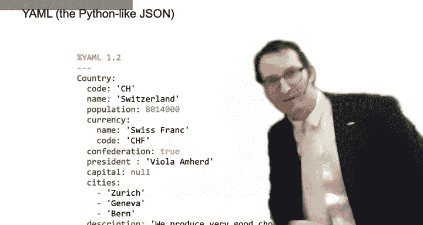

The convenience here is that， compared to Jason。If as a human you want to edit the file。

 it's a bit easier because with J you need to match the curly braces and the square brackets。

 but in Yammer you don't need to worry about that if you want to add something you just add a new line and so on so it's a bit quicker to edit right but in the end it doesn't matter we'd see in two weeks we have data models we basically see all of these as trees。

 deormalize stables and we see that it doesn't really matter which one we use because in the end from a modeling perspective from a data modeling perspective。

 these are really just collections of trees。All of them。Okay， do we have any questions？😊，Yes。😊，Like。

 could you suggest or give an example when it's better to use XmL and when Jason， yep， absolutely。

There is one use case that is the most commonly cited that something that Jason cannot not do well。

Is when you have paper or books or documents that basically contain text， a flow of text。

That is annotated like this is a section， this is a chapter， this is a paragraph and so on。

This has this style， this has that style。This is much easier to do and more natural to do in XMM than in Jason right so in Jason if you have data sets it's very natural to do。

 but if you try as an exercise to take like Dobook is one of the standards in XM to have text if you try to do it in Jason you will see that it's less natural and that it's very cumussome you could of course because it's always possible but you would see that it's about cumussome to do because in XM when you have text。

 I mean anybody who already wrote by hand HTML pages。😊。

Right it's exactly that experience if you use XmL for publishing and for text。

 it's exactly like this you write the text， then you add the tags all over the other place to format it。

 so this is one perhaps the most prominent use case for using XML that is preferable to J。😊。

Another one is for the government standout， but here the reason is different because technically you could also do the government standout in J。

 it would work as well but the reason。Why the governments typically prefer XM is because of the maturity of the ecosystem they basically rely on 20 years of standardization of XMX K and so on and you have a lot of enterprise ready tools that perfectly work today and that are highly reliable it might be that in 10 years Jason catches up a bit more and that we have the same level of maturity and then you could absolutely consider using Jason right did he answer the question。

Yep， awesome， any other questions？On Zoom， nobody。 Okay， so again， the takeaway message here is。

If we dot normalize stables， we get trees。CSV cannot do that。 CV can only do tables。

 so we need other kinds of syntaxes。 and this is why we have XML， J， Yamel and all the others。

All right， so now I'll move on， so let me stop the recording and see you on the other side。😊。

