# 苏黎世联邦理工《大数据｜Big Data - ETH Zurich - Fall 2024》中英字幕（deepseek - P17：-17-6. Wide column stores (1_4) -.zh_en - GPT中英字幕课程资源 - BV1sHPKeoEJU

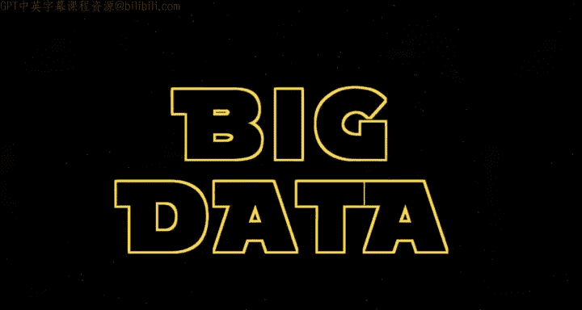

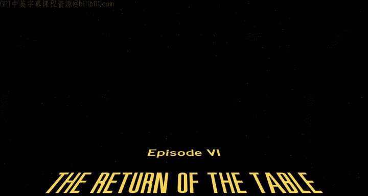

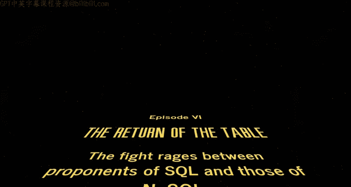

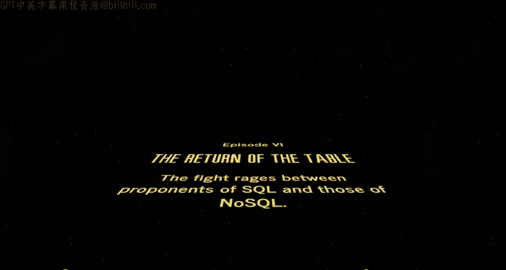

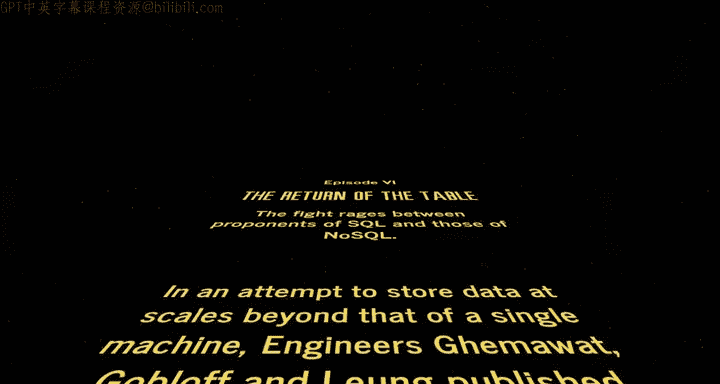

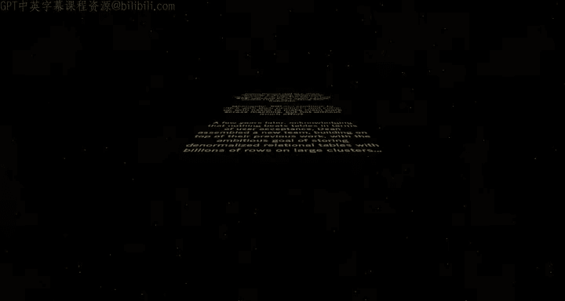

So I need to give credits for the music。 So it's。By Scott Berkeley。

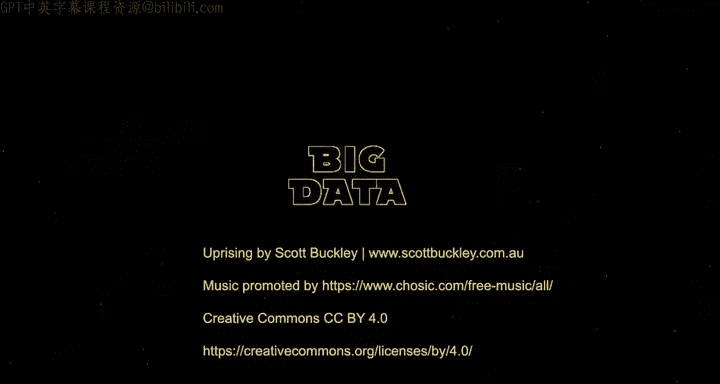

So we are moving to a new chapter so。This is white coat stores。

We are here if you look at at the stack， we cover storage， we call encoding， we cover syntax。

 XMH J and CSV， and now we are going to start looking at data models。

 so as the semester ellpsses we are going to basically work our way up towards the top of the stack。

So now。Hereず thing。We do have data independent systems。As opposed to data linkss， right。

 So the nice systems that take care of everything for you， you have a nice language like SQL。😊。

You can put the data in there and fes the schemas and so on。

 But the problem is that this was designed for one machine。 It's very monolithic。

 You have one machine， one server， you can put Poweque8 on it， and that's it。

 So as soon as you have data that goes beyond what the machine can store， then you have a problem。

So what you could do is scale up right， you could just buy a hard drive that is basically larger or you can buy more memory or better CPU and so on。

 but you know that this is going to hit limits at some point。So can we fix it， the answer is yes。

 in fact that's exactly what people started doing 20 years ago at Google and Yahoo and many other companies。

 so what they did is exactly what I told you a few weeks ago。

 they purchased hundreds of computers that are just semiconductorductwell laptoptopian Per and they installed PostgsQL or some relational database C on every one of these machines。

😊，And then they managed， but then they had to do it by hand。To spread the data of all the machines。

 they basically have a general program that connects to all the machines and that stores part of the data here。

 part of the data there that also has some replication， you know。

 it might remind you a bit of a GFS right this idea of spreading all over a cluster and replicating multiple times。

The problem is that not only is it very difficult to set up actually took a lot of people and even after all that very high maintenance costs to continue to make it work so basically at some point the engineers quickly notice that that doesn't work right you cannot just do it forever。

 you need something that is designed for this that is specifically meant for this and so this is how big table which is the Google the initial product by Google how big table was born it's supposed to work on a cluster of machines natively。

😊，That cluster of machine was running GFS， the Google find system。And on top of that。

 we have this logical model that is very similar to tables and relational tables with the data stored on the Google file system。

Now this is proprietary right big table is proprietary GfS is proprietary so this is why we have the Hadoop ecosystem with HGFS that is the open source version of GfS H base is basically the open source version of big table we already heard of big table somewhere。

😊，Right， H base。So big T is a bit more it also has a catchy name right but basically what we are going to do now is run H base on top of HGFS HGFS you know how that works it's a five system runs on a cluster of thousands of computers blocks spread all of other place replicated three times and the name node knows how to assemble the blocks back together so now we'll focus on what's on top of that trying to run a system that looks like tables on top of HGFS I need a bit of motivation and I think the most convincing arguments that I could find to actually justify doing this。

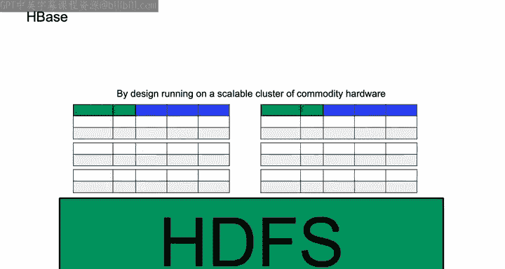

Is。That every one of the existing systems has limitations， for example， if you look at object stalls。

 they don't have low latency right because it's very big objects updates。

 you need to write them again so you cannot just modify an object in place you don't have random access RDBMS these the relational database management systems RDBMS it doesn't have high throughput right when you use one of these systems it's typically used for a small reads and small rights right just in milliseconds you can randomly read and write data so it has random access it also doesn't scale beyond that I mean people invented other systems that make them scale beyond that。

 but the original ones did not really scale beyond the single machine HDFs has doesn't have low latency I told you every time you hit enter after a comment you we wait for a couple of seconds that's not acceptable for a low latency use you cannot update in place you have to delete the file and rewrite。

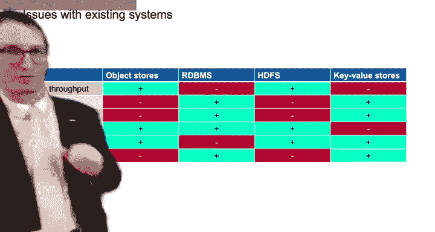

your web， so this is a limitation， you can append at the end of a file。

 but you can change or modify your file in place and you don't have random access also for reading。

Well you could， but it's going to be extremely slow， it's not designed for that。

And then we have keyvalue stars。 the keyvalue stars。

 they don't have high throughput because this is meant to be getput delete and they don't support larger values because as you remember。

 it's limited to a few hundreds of kilobytes right So you see， none of them checks all of the boxes。

 It would be nice if we could have something that checks all that check all the boxes right We probably guess that basically Hbase and big table do。

 So this is， I think the most convincing argument for a system like that。 We have everything。

 Well have high throughputs we can do analytics in a few weeks on top of that low latency。

 it's it's quick to answer。 You can update the data in place you put larger values than just small atomic values。

 larger collections， random access。😊，So of course， I have to explain to you how that all works。

 right， how this piece of technology actually achieves all of that。Okay。😊，嗯。Alright， so now。

What I'm going to do is the same approach that I took in many of the previous weeks。

 in particular HDFS。I'm going to follow the data independence approach。

 It means that I will start with the logical model of age basease I will not care about the cluster or anything on the machines。

 just the logical model tables， and then I'll explain to you the physical implementation of that right This is I think the way to go。

So let's look at the logical model。 so that I told you it's inspired by Google Big T。

 the idea is that。Because we want to be high throughput and to query。A lot of data。

We need to stop together what is access together when in fact that's not going to be new to you because that's just saying we want to avoid the joints we don't want to want we don't want to bring from different places data we want to already have the data together stop together when it's access together so it means concretely that。

Remember the very high normal forms that you use in these classical relational database management systems behind the websites。

 you have to join tables right so for example， the table on the left might be table of products right and this might be a table of orders and these are the product ideas right and whenever we want to display on a page like a list of order products。

 we need to join the two tables by bringing together these records with these records right the problem is that it's a bit expensive to and so if we want something very。

 very quick， especially for website it can actually be useful to deormalize and remember deormalize basically means precomputing the joins if I simplify a little bit right so we deormalize this thing here。

Still looks like it's in first normal form， but one actually it doesn't need to be。

 but basically it's no longer in third normalmal form or second normalmal form because now we squeeze everything in the same table。

 even though it came from different sources so it means that we are going to have undesirable functional dependencies undeir for the purpose of the classical system of the 70s but for the purpose of querying data and running data analytics we don't care that we have deormalized and put it all together on the contrary。

 deormalizing is going to make it faster to query and analyze obviously it means that you will not use this to run the website that has to be done somewhere else on a cluster。

 the websites it's still going to run on these on these ones。😊，Okay。

 so now we have basically deormalized。The the data。

 so this is the idea and this is why it's called big table。

 not only because it's big in terms of the number of rows。

 but also in terms of the number of columns right because we de normalmalize。

So let's now dive deeper into the model。First。One of the columns， it looks like a table。

 so that's the firsting unities looks like a table， one of the columns is special。

 it's called the row ID。😊，So unlike PostgresQL， where you can select your primary key。

 you create your columns and then you select your primary key in each base you don't really have a choice。

 you really have to have a special column that is the raw ID and that's what it is right it's only one column。

And furthermore， the records in there are sorted by raw ID you can think of them as integels or actually whatever you want in the end the raw ID is actually just made of bits right so it's just a sequence of bits and that seat okay。

😊，嗯。All right， now， just so you know， H base has only one column for the primary key。

 the already other systems like Cassandra， who heard of Cassandra。

RightIt's a competitor of edge base in Cassandra， you can have multiple coordinates to for the priority。

 but here is just one。😊，Okay， so now you see， okay， that's a key value model， right。

 I'm not saying it's a key value story。 So key value your model。 The raw I is the key。

 and then the value is the rest of each row， okay。Now something， so here it looks like a table。

 but actuallys what differentiates it from a typical relational table is that the colorss are grouped in families。

 so I use colors here they' are basically the blue， the purple family。

 the yellow family and the red family， so we have these grouped in families。😊。

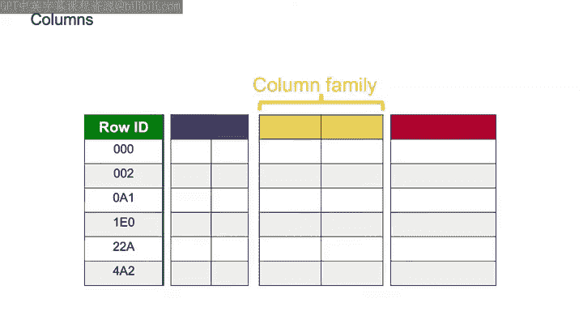

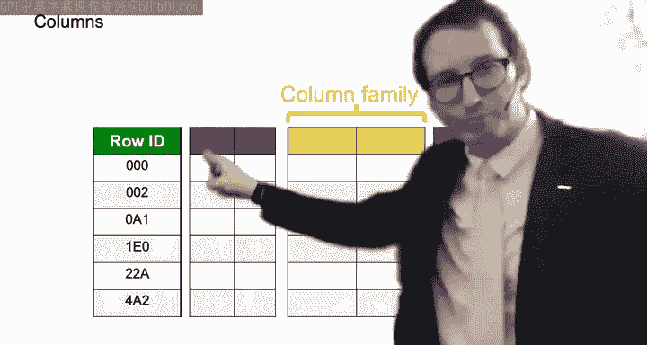

Just to give you an intuition， very co intuition of that the families can be seen as coming from the denormalization。

 it means that when you take these two the one on the left gives you a family。

 the one on the right gives you a second family and when you merge them you basically have this family may be colored in yellow here and a family colored in red here right so basically you can think as of the families as what used to be the tables when it used to be in high normalmal form and when you deormalize theyre altogether in the same table that you you still have this different families in there All right。

😊。

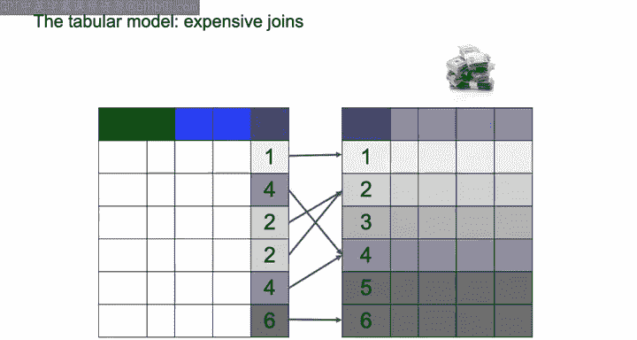

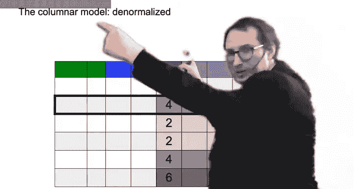

Who's with me？ok。😊，Then you obviously have the column names all right so I use the Roman no the Latin alphabet here。

 the In Arabra fbet here and here I use the Roman alphabet but just to differentiate them in practice it's again binary stuff so you can think of it as strings that you can encode as UTF8 but in the end it's just sequences of bytes that the colon names。

😊，And the Koon family as well， I mean， here I'm using colors。

 but the Koon family is also a sequence of bes or a string。Alright。And what's more？

After I have created my table and I have a lot of data。

 I can make up new column names on the fly just like that and without any performance penalty。😊。

That is very unlike a traditional relational database right if you have a traditional relational database and you want to add a new column。

 it's going to take time maybe an hour if the table is very big to add it everywhere here it's instant you can just make up when you insert a new records。

 you can just insert new column names that Disney exist and that's totally fine。😊。

The result is going to be a very spae table， right a lot of these sets are actually going to be empty right so you see that it's not respecting relational integrity in that sense。

All right， but the colon families it's different， so you can make up colon names within existing families on the fly。

 creating new colon families is possible， but it's not something that is just like snapping your finger and that's it right so it's a heavier thing to do to create and remove colon families but colon names you can just make them up on the fly just like that。

😊，All right， so again， I insist everything here is made of binary values， sequences of bytes。😊。

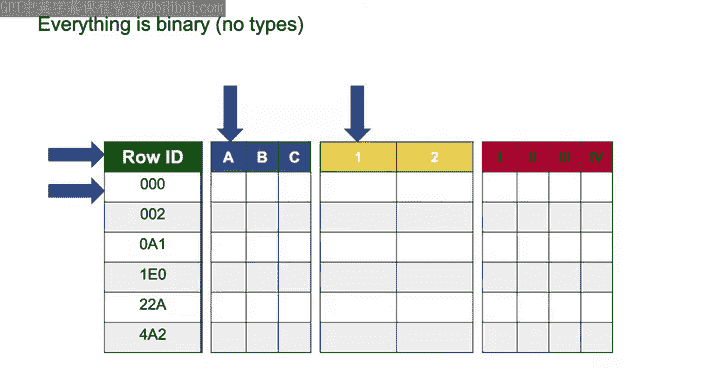

So。The raw I here。

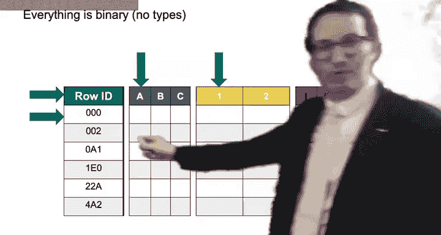

Is the sequence of bys， the colon families are sequences of bites。

 the colon names are sequences of bites， right。In other words。

 it's not it doesn't have the high level aspect of a programming language like Java or a query language like SQL that offers you strings and integers and dates and all of these restaurant manure of data types。

 it has nothing like that just bys you can add back types on top of that but it's basically outside of H basease for whom does that make sense。

😊，喂。Okay， so everything is basically based everywhere， of course。😊。

The libraries and drivers that access age basease， they help you do that。

 they will provide you some convenient functions and methods to put integers and strings and things in there。

 but just remember that on the physical level these are just back。The values are also bite。

We have a question。Yeah， I guess it just got answer I was wondering if there is like size to the bys。

A size。 Yeah， how big they are。 Yeah， so let me start with the value。 and then Ill come back to the。

 to the rights and the， and the， the column names and values。So。

In a traditional database management system， the values are supposed to be small and atomic。

 Remember， the first normal form。 So you typically have have values that fit on the screen right they fit。

 You can have many of them on the same screen。Now， in a space。

You can easily push the size of the valuesus to1 10 megabytes。

What would you put in 10 mebytes could be an image， could be an Xm document， could be an J document。

 could be a Yal document， you know this is how it fits in what we've studied before right so you can squeeze J Xm。

 whatever you want in there pictures， videos。And it's going to continue working quite well all the way to 10 megabytes there's no hard limit right if you go beyond that then maybe at some point the performance is not going to be that great anymore。

 but basically this is how you can push it so this is an improvement over the classical database management systems。

😊，嗯。😊，And again， that could be considered a form of deormalization in the sense that we wouldn't be in the first normal form right because when you have 10 meby of blob starting in a cell。

 you are not going to make me believe it's atomic right This is typically something nested and structured that you put in there。

 So then it's not even going to be in the in the first normal form right But of course。

 that can also be atomic values without any problem right and the table is typically going to have a mix of the two For example。

 you could imagine that what you store in there。Is a blog all of your blog posts are stored in a table like that HTML pages。

 you could have HTML pages in these cells and the images and so on。😊。

You could also store an index of the web。😮，Every row could correspond to a web page when you index the web to build a search engine and you can put all of your web pages in there and maybe you even copy the web page as HTML inside the cell for all of them right so this is the sort of things you can do in here。

Now， what about the raw ID and the colon family and the colon name， which is your question？😊。

Here you have to be a bit more careful， you shouldn't make them 10 megabytes lower The reason we will see when we look at the physical implementation。

 they are repeated a lot in the the in the data when we start sortoring it physically。

 so you have to be careful。To not be too generous in the length of the colonne families and colonne names and royal ideas。

 right。So that they should be rather atomic， So to say， okay。Any other questions？Right。

Just as a compliment to my answer， I think there are people who use the color names as the Trojan host to also put data and in that case it would be a bit longer and somehow it worked so I don't know exactly what whose case it is but I heard that they can also be used to put data and apparently some people found using that right。

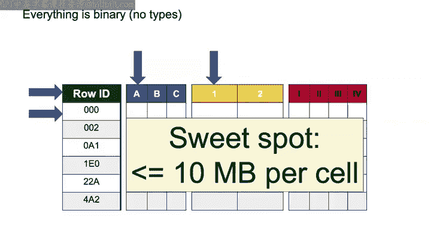

Okay。So this is the model， who understands the model。RightIt's simple right。

 we have rows that have an ID R ID， we have colon families， colon names inside the colon families。

 and then we can create and make new colon names as many as we want Col families is a bit more complicated Everything is a sequence of bytes We can easily push the size of the sense to 10 megabytes and we have to be just a bit more careful for the raw IDs and colon names and families that should be rather small。

😊。

So that's the model， so let's now proceed to what we can do with that。

 what sort of queries can we run？So the first warning that I should give you。

 but you probably guess because that's already quite physical with frequencies of bytes。😊。

What's going to follow is not a full FSQL language， it's going to be a rather low level of access。

 a bit similar to the Getput delete of keyV stars and also of the rest API。In fact。

 it's so much similar that there is actually a get， there is a put and there is a didit。

 and there is a fourth one that's called scan。😊。

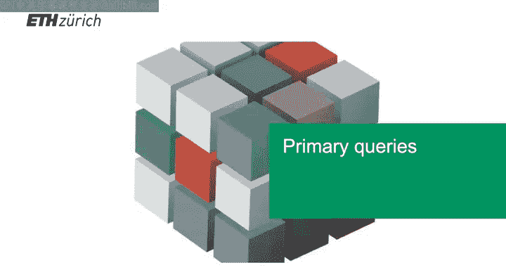

So this is the get， the get allows you to retrieve the values all the cells that are associated with a specific raw ID so you can say okay get。

😊。

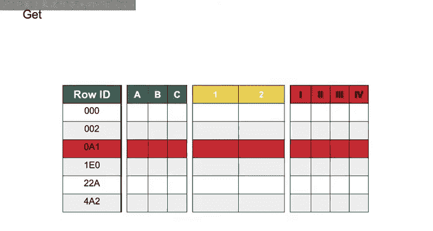

D through ID， and then you return all of that and get the results。

You can tweak it， you can also say I want to get only the purple values or only the yellow values or only the purple and red values and so on right so you can red and yellow and so on so it can be also partial on colon families in fact this is where colon families are useful because if you only require specific colon families it's even faster because the colon families are typically grouped together as we will see then there is put put is when you want to create a new value that didn't exist and you say okay let me insert that row with rh ID 204 with these values right or you could erase an existing row with these values。

That also doesn't have to be for old families， you can also have a Pel boots where you say puts these only into the purple or only into the yellow and so on right so this can also be a partialel in the current families。

Scan。Now scan is new and here we go in the direction of all these big data and analytics scan means that you are going to go through many different rows and you can control how many you can control to do the scan only on a specific family or some families you can also limit your scan to an interval saying I want to scan between that ID and this ID right and then you're going to get some way to iterate with other values and go through them right。

All of that， this getput delete scan and so on， imagine that you're doing it from a higher level language like Java or C++ or Python or the shell or whatever。

 right， but you have an API that allows you to do this getput delete and scan。😊，Who's with me。给。

All right， and you can also scan， of course， just to specific family and region very good and finally you can delete right if you want to completely delete actually or completely what is in a row。

 then you can do it as well。I just have my eyes on the clock because it's going to be the break。

Let me just tell you， I think I can squeeze that before the break so quickly。

The key value model already saw it it's everywhere right The key value model S3 has a key value model the key value stars have a key value model Yeah too。

 the raw Is provide that。 In fact， that's universal JO objects have a key value model。

 the attributes in an element have a key value model like everything that corresponds to a map basically an associative array。

😊，That's terminology that I'm giving you here。 Another terminology is colon oriented storage。

 not to be confused with white colon dos， what is meant with colon oriented storage。

Is that physically when you store the data on the drive， it start column by columns。

 This is unusual the early database systems。Had row by row on this record by record。

 But there is a whole new generation of database systems。

That store the data column by column and that can be actually very beneficial when you only access specific columns at the same time and finally white Col stars is this idea of having the colon families which is kind of an extension of column stars which leaves us to the break so there is no presentation today so you can use the full 15 minutes to relax and figure out questions that you want to ask。

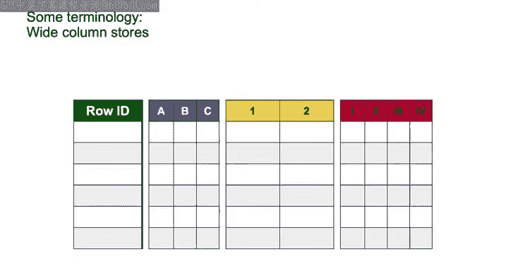

See you in 15 minutes。