# 苏黎世联邦理工《大数据｜Big Data - ETH Zurich - Fall 2024》中英字幕（deepseek - P18：-18-6. Wide column stores (2_4) -.zh_en - GPT中英字幕课程资源 - BV1sHPKeoEJU

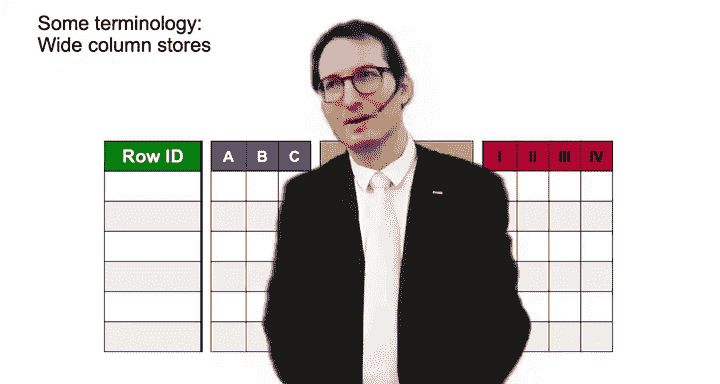

Welcome back， everybody。So we were in the middle of looking at the logical level of the white cotton stars。

 we looked at the model with columns， Col families， rose row IDs。

 we looked at how to query them with get with puts with did with can so again I repeat this is all low level right but we will keep adding stuff on a higher level right so the ID is a separation of concerns right you first focus on the implementation of the whole architecture using just bytes and then you can add the layers on top。

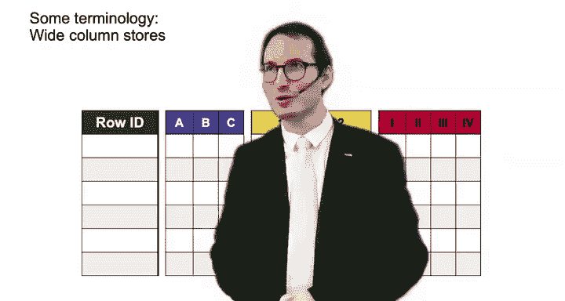

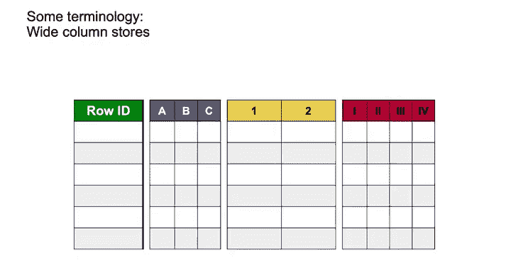

All right， so now you know what the key value model means it's everywhere。

 you know what color oriented storage is that even exists on a single machine right。

 this is really just about the way you store it on the hard drive and white color installed now this is for clusters of machines like the ones we have。

😊。

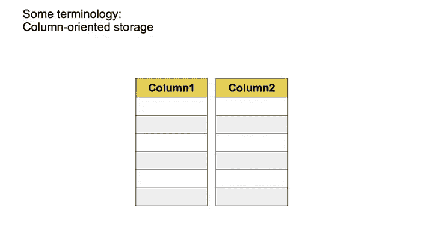

There are actually plenty of implementations that would there。 Google's big table is the first one。

 Agebase is the open source thereof， and Cassandra is another one。

 And now there's probably more out there。 There are even some of them that are even larger。

 I will come back to it probably tomorrow。

All right。Is everybody ready for the physical layer？

This is the most complicated lecture of the whole semester。 If you survive this。

 you survive the course， right， I'm just warning you so I will take it step by step。

 we'll take the time， I can repeat， take the time to answer questions。

 come back on some of it tomorrow if necessary。😊，All right， so fast on your seatbelts。

So the first thing， now we are looking at the physical level。😊。

What is the first thing that we did when we put files in HDFS we cut them into chunks right so there's the idea of partitioning the data to make it fit and spread it over our clusters。

 we had exactly the same idea of the partitioning the data。

 the most natural way to partition the data。Would be on the roads or on the Cols。

 Who thinks it's on the road that is the most natural。Okay， we think it's on the Collins。Okay。

 who thinks it's on both？Aha， yes， it is indeed on both because。

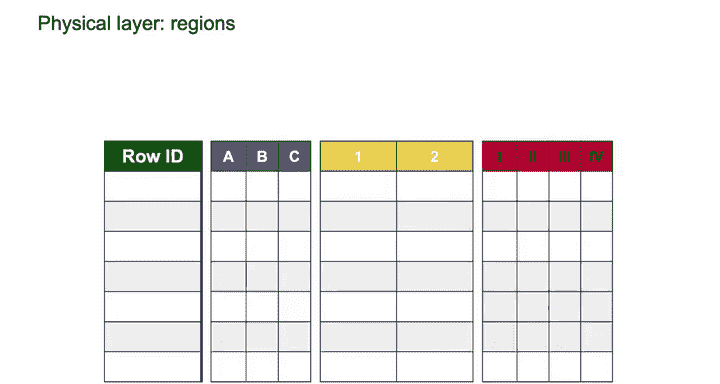

On the rules， remember that the royal is asserted。😮。

Right by increasing value so that we can define the intervals so every interval is basically made of a raw ID and a raw ID now the convention because it's actually very convenient and beautiful is to have a mean inclusive so this is really the first one that is in this interval in this region。

😊。

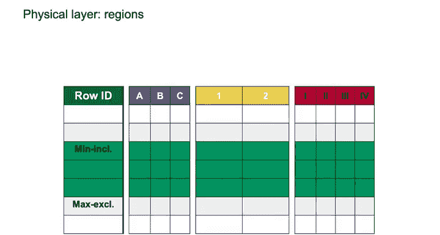

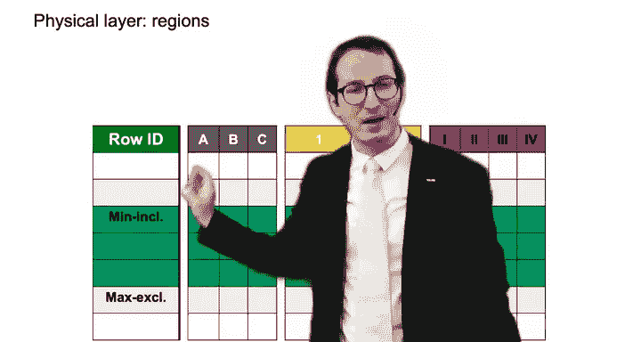

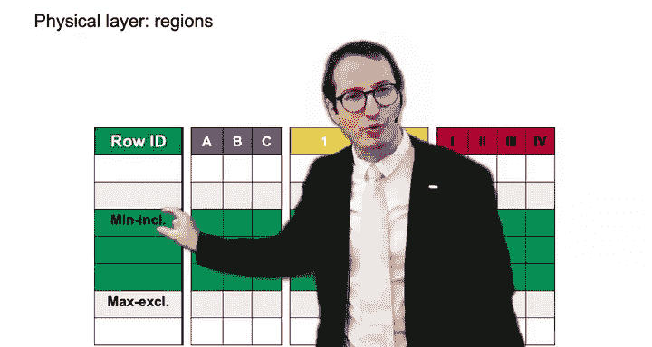

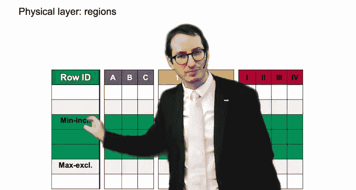

And the maximum exclusive， meaning that it's not the last one， but it's the one after that， right。

 Why， because then the maximum exclusive is the same as the mean inclusive of the next one， right。

 So this is the the main I。 So this is called the region， right。

 So this is the horizontal partitioning of the of the table in regions。

 You can have a lot of regions。 You can have thousands of regions， even more than that。😊。

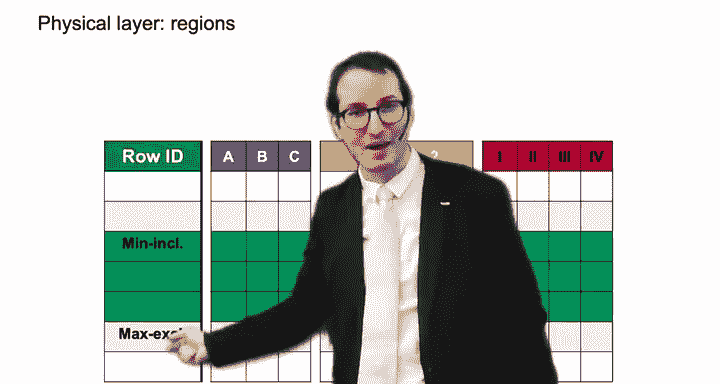

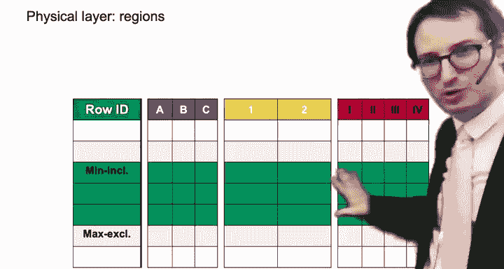

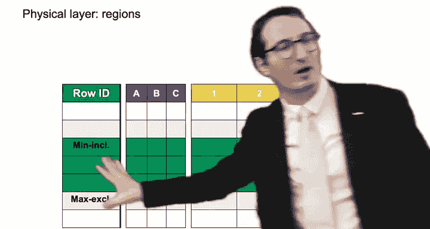

Okay。And we can also partition by Collin families。 So indeed， we did， we do the both of them。

 So a part is basically。😊。

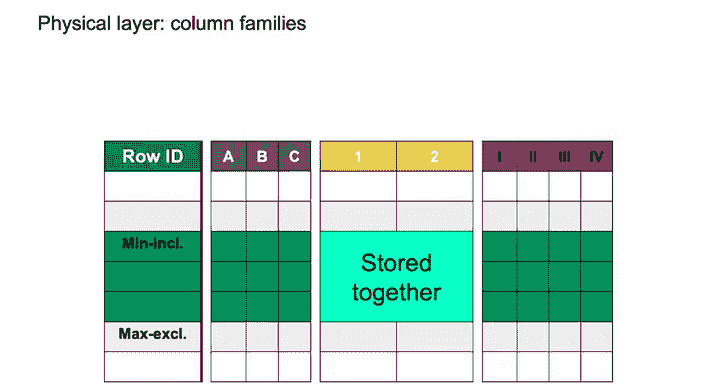

Like this it's actually like a wedding cake right so you basically cut it both horizontally and and vertically and this is dos together This is something that we call a store actually what we what we put in there。

 but I'll come back to that So the intersection of a region which is an interval of Ruids and other colon family is a store。

😊。

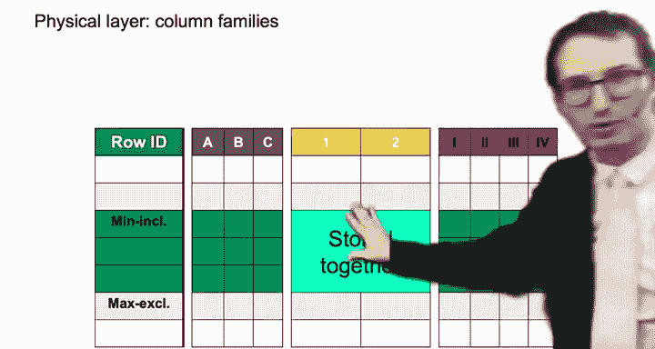

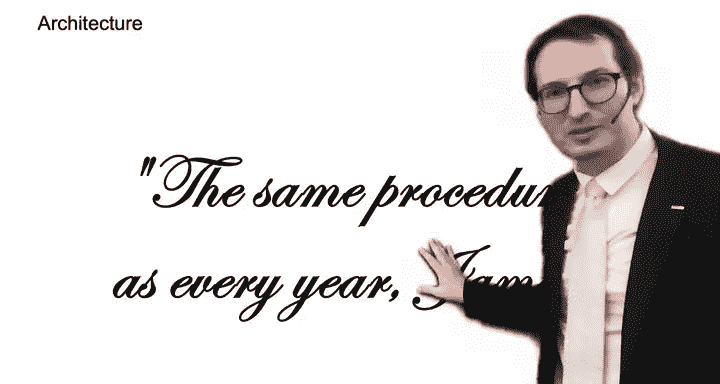

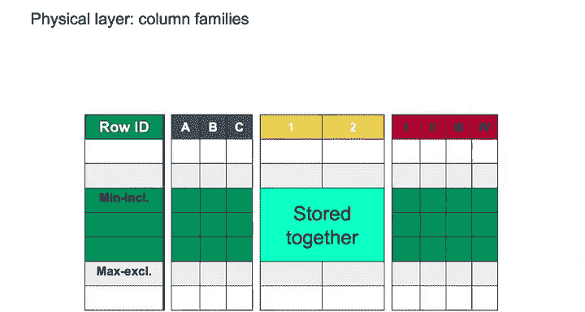

Now we are going to be doing something that actually we've already done plenty of times and I keep repeating it over and over and over again。

 Who knows the reference did not fall one。Okay， if you don't then watch dinner for one on New Year's Eve。

 anyway。

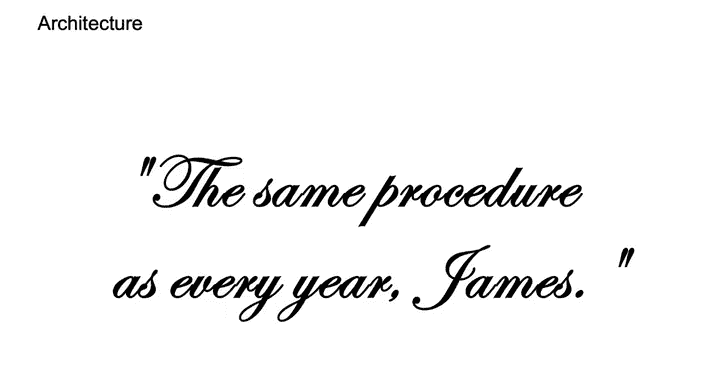

So you know that we have a centralized architecture with a name node and plenty of data node。

I told you， be careful the name node and the data nodes are actually not machines。

 there are processes running on the machines， and that means we can have multiple processes。😊。

And we actually are going to have more processes。 now we are going to have a process called H master turn that is running on on the coordinator's node and we are going to have region serverrs that are running the on the same machines as the data nodes。

 right， So it's very common。 Do we have a question。😊。

So saw raise sense so we have the region of processes on exactly the same machines as the data nodes you will soon understand why and typically the H master runs on the same as the name node。

😊，Now I can say quickly because since we already covered out this with AGFS， just like in AGFS。

 we have standby and observe our name nodes， we also have backup H master。

 you can have up to nine backup Hma making it 10 in total and they can take over so we have the same kind of of redundancy to address the single point of failure。

All right。And so now I'm going to first go and describe the HS。

 and then we'll go to the description of the region server， right， so one by one。

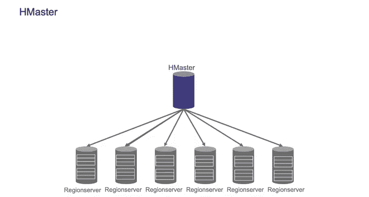

So that shouldn't surprise you just like the name node is responsible for the metadata operations in HGFS。

 the Hmaster is responsible for the metadata operations in HBase in particular。

 if you want to create a table or delete a table that all goes through the Hmaster right to do these sort of things。

 also creating current families， removing current families。

 all these things have to go through the Hmaster BDL means data。Defin language， right。

 as opposed to DMML data manipulation language。 So DM DDR is the high level and DML is when you actually query or update the data。

Okay。No。The distribution of the data over other cluster。Is actually done based on the regions。

 This is why they are called region servers。 In fact， So it's done based on the regions。

 So it means that。

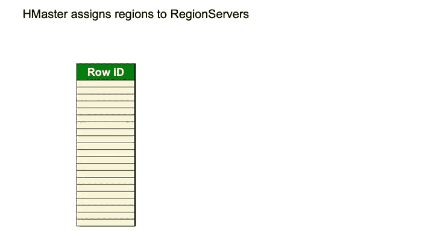

What happens when you create a big table is that it's going to part these space in regions and then the regions are going to be assigned to the region server so here I put four region server as an example and every region server is assigned multiple regions now my slide I just put two of them in practice that can easily be 1 thousand regions on each server right just like you can have thousands of blocks on the same data node in a GFS so we can have easily do1 thousand regions assigned to the same region server okay。

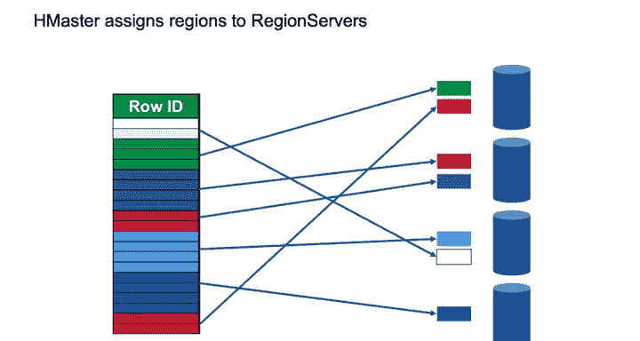

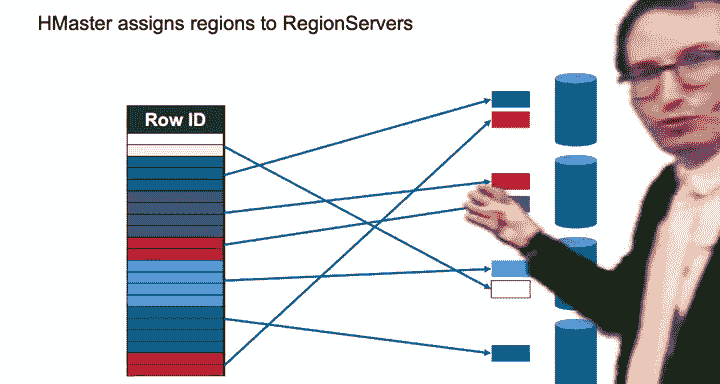

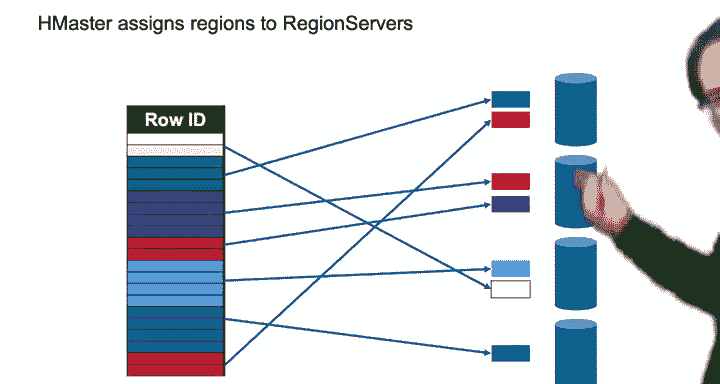

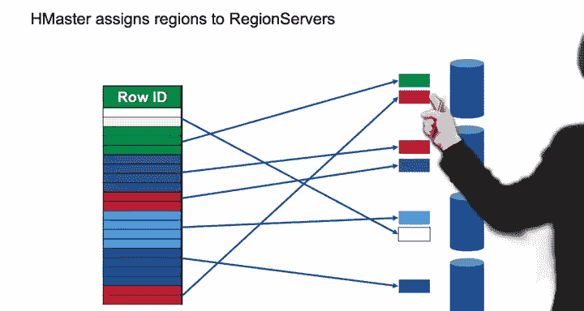

Now。What happens is that unlike HDFS， where we can only append at the end of the file in each base。

 we can actually add rows anywhere we want even in the middle， completely in the middle。

 It doesn't have to be at the end。 So what happens is that you could have at some point。

 some of the regions that grow because it's based on an interval， right， So if at some point you had。

 you add a lot of row ideass inside the same interval。 That region is going to， to be very， very。

 very large at some point。 Allright。嗯。And so what happens is that when it's too large。

 something is going to be done actually locally by the region server。 So for example。

 this region server here might have noticed that this region here has become too big it might have。

 for example， four rows， but it has very large objects in there or whatever So it's basically exceeding a certain size。

 So there is a whole process that splits the region into two very carefully designed in multiple steps to make sure that nothing breaks but basically it cuts the region into and now it's two regions So initially these two regions they stay on the same region server。

 so they stay assigned to the same region server iss just that now it has two three regions instead of two however。

 at some point you might have some rebalancing in the sense that the H master might notice okay there are too many regions for that machine。

 let me redirect that region over here to the alarm machine。

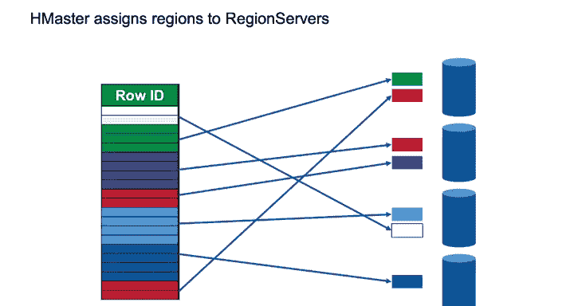

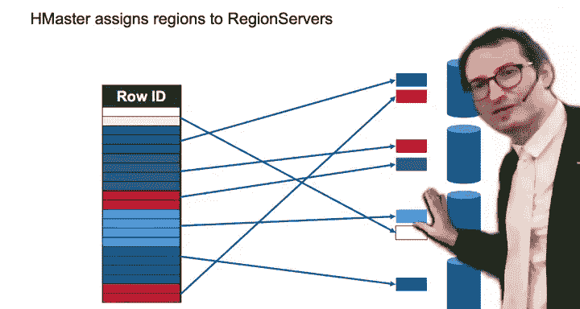

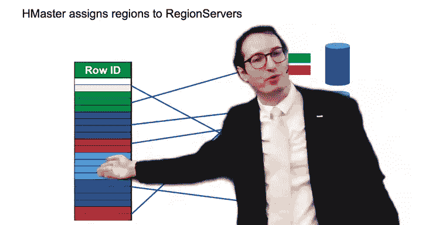

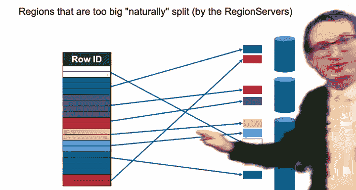

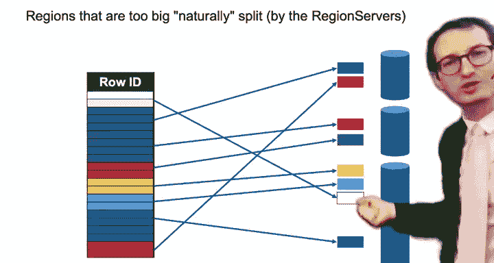

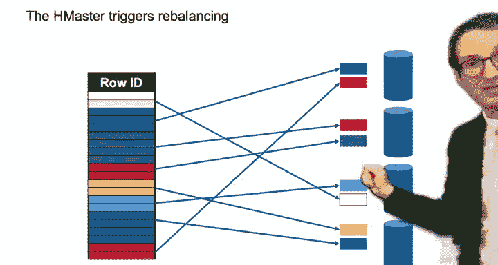

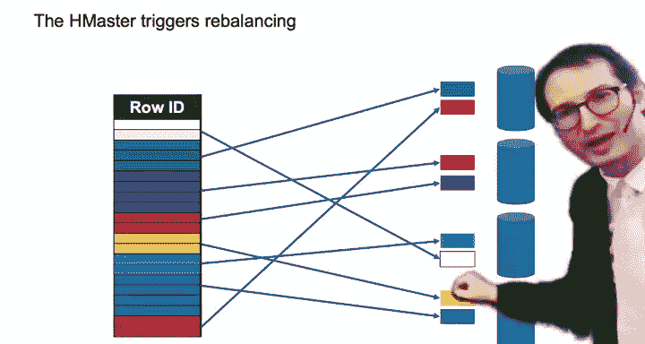

Right。Some of it might remind you a bit of AGFS because in AGFS2 the name node is able to say okay there are not enough copies of that block。

 please this data node should store one more copy of that block right so you can also do these sort of things with the blocks on AGFS as the read the regions here。

😊，But there are a few differences， and so I will try to give you the mental picture。嗯。First。

The regions。Are assigned。To the region cell。 I didn't say the regions are stored on the region cell。

 They are assigned to the region cell。 It's only a responsibility。 It's a hat。

 So basically the region cell right there is wearing two hats。 The yellow and the dark blue hats。

 saying I'm responsible for these two regions。 It's only a responsibility and actually switching responsibility is very easy。

 You just say， okay， now the responsibility。 for the yellow region is no longer the third one。

 It's the fourth region server。 It's only an assignment。 It's only a responsibility。

Why am I saying that， Because where do you think the data is actually stored？This。

If you have those manage。Exactly， yeah in HGFS， it is stored in HGFS。

 so the data is in blocks in HGFS blocks handled by the data nodes that run on the same machines。

 right？😊，But the regions are only assigned as a responsibility。

Now let me explain what happens when there is this change here。

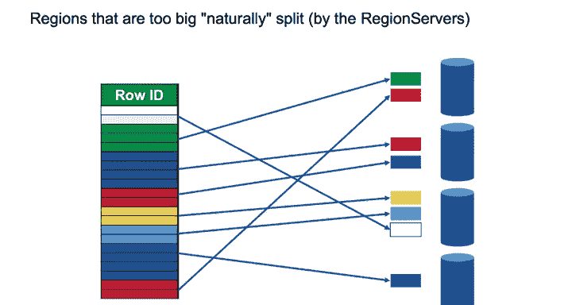

What happens is that。This is a region， this one is responsible and that region is stored somewhere I will explain how in a moment。

 but basically stored on HGFS as fights on HGFS that themselves have blocks。😊。

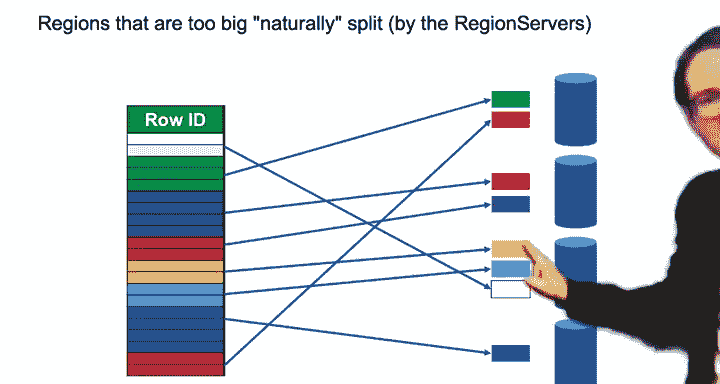

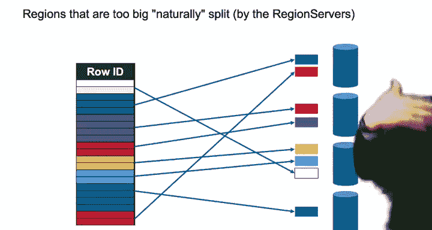

The blocks by the way many of them might be here if it's been there for a long time。

 many of the blocks might be here， but you know that in HGFS the blocks can also be spread right so maybe some of the blocks for the yellow regions might sit here or here and because of the replicas that will even be stopped three times so the blocks might be here here a little bit everywhere so do you see that if I switch the responsibility of the yellow regions from here to here the blocks don't move。

 they stay where they are right theyre on HGFS everybody can see HGFS so if this could see HGFS this one also sees HGFS the only thing that might happen is that if this region serverr has been responsible for a very long time for this block it might have a lot of copies of the first replicas of the blocks in here and when you suddenly hand over then maybe at first this one is going to have to read remotely over the network from here that might happen。

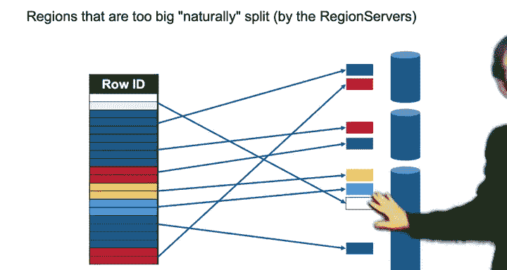

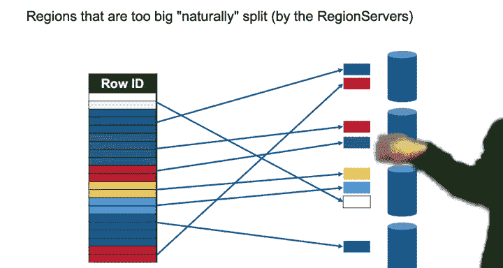

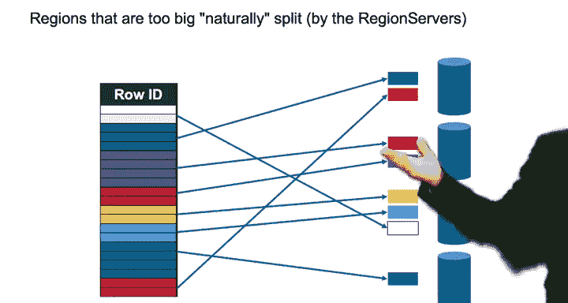

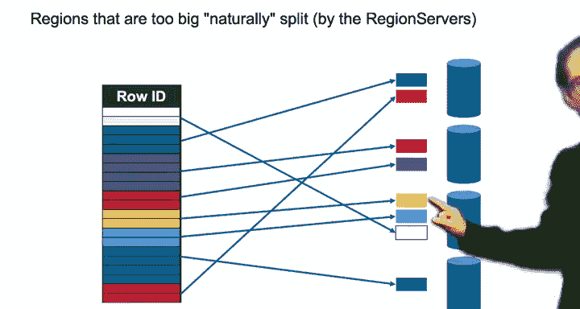

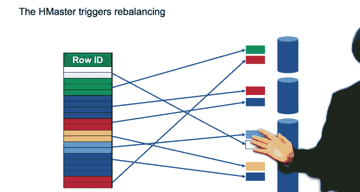

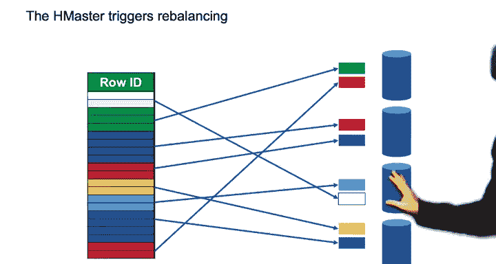

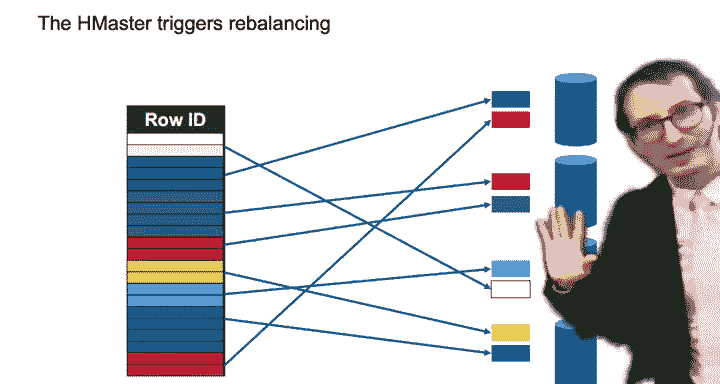

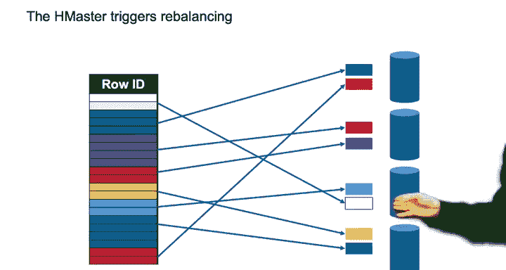

After a while， it will be localized here， we will see well， for whom does that make sense？

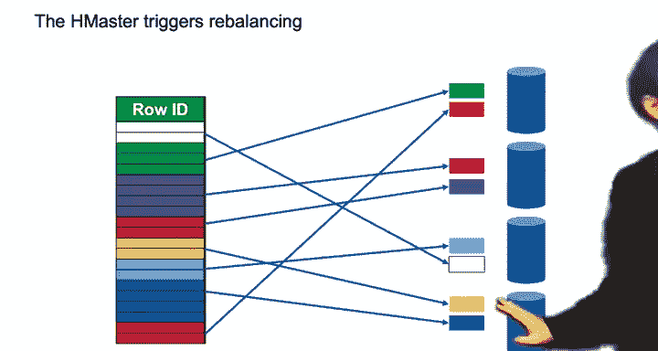

All right， do we have a question？What does it mean to be responsible then for a region in a practical sense be responsible for a region basically means that when a client wants to use age base。

They I will come back later to it， but they basically request who is the server responsible for that region or for this I'm interested in a specific ID。

 who is responsible for it and there is a central place where you are told okay this server is responsible for that region and then the client once they know that the yellow region is handled by this one。

 the client has to connect here。What happens is that the client could also attempt to connect here because it might think that this is still this one who is responsible for the region right so the client could connect here。

 but in that case this server is going to answer sorry。

 not my domain of responsibility just like in real life right you ask a work colleague to do something and they say no no。

 that's not my responsibility it's the same thing it's really that。

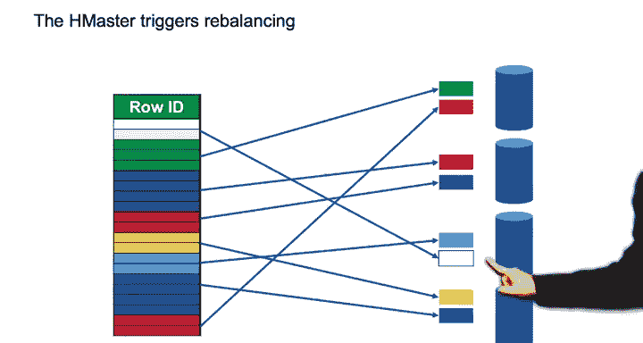

Right，Does it make sense？

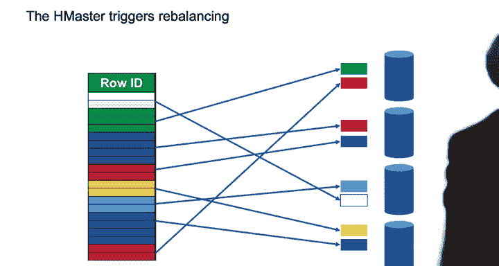

So then the data is retrieve from the HDFS system and。

With the same process that we saw last week yes it's on AGFS exactly what we saw last week and the week the week before that right it is in AGFS it all files on AGFS stored in blocks on the data node and as you know anybody can log log into HGFS and see their files so what is very important to on stands is that all of these machines in spite of being responsible for specific regions every machine can see all the data。

The only reason they would deny a request is just if they are not being put in responsibility of it。

 but they can all see all the data through H GFS。喂。Any other questions？ Yeah， I there。Excuse me。

 Can you just repeat what happens when a reduce server was responsible for a long time for origin and what dealing with the cookies as long as。

So， basically。I will explain to you in the rest of the hour and tomorrow what actually happens。

 the way that its stored in AGFS， I will tell you all of the details of that。

 what the files look like and how they are written and so on。

 but basically now you just need to trust me for now。

 but in an hour or tomorrow you will understand why I'm saying that。

Because of the way that the filess are writtenden。

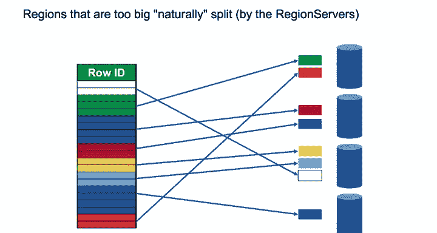

If a region serverr is responsible for a very， very long time for the same region and it's not moved to somewhere else。

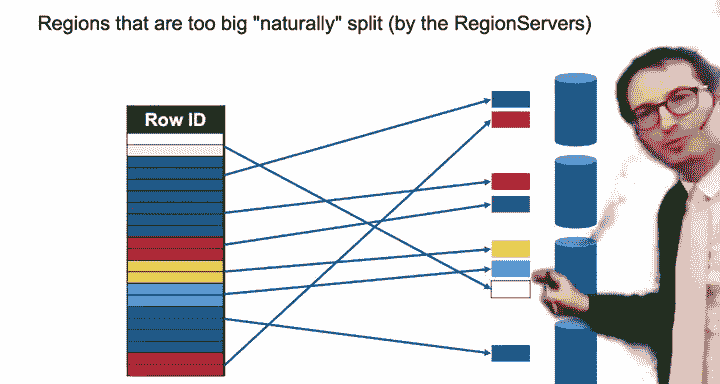

This server is going to write a lot to HDFS data from that region because it's responsible for it。

 Do you remember that in HGFS I told you that when an HDGFS client connects to HDFS and createates blocks。

 where is the first repas start。

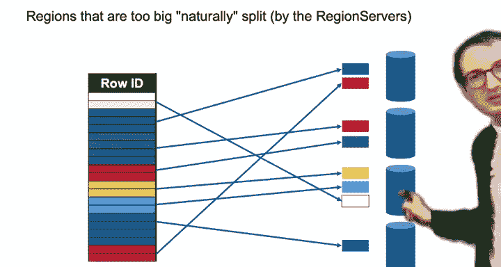

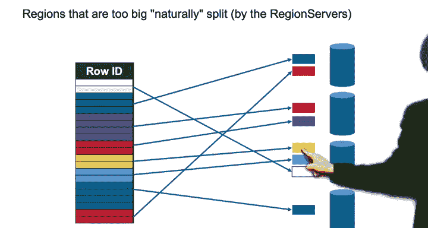

On the same machine， who is the AGFS clients？The region suffer。

So it requires a bit of mental gymnasticastic because you have both age GFS and and age base。

 but basically。These regions have here。Is in particular an HGFS client like anybody else it can write to HGFS and as an HGFS client。

 it might write block to HDGFS and because it turns out to already be on a machine。

 then every block will have a copy on that same on the data node that runs on the same machine。😊。

That is the reason why if you stay responsible for a region for a very， very long time。

 you will tend to have a copy of most of the data you're creating plus it's replicated at other places but of course。

 if you start creating so much data that it doesn't even fit anymore。

 then the blocks are going to go away and spread all over the cluster and then it's going to be slower。

😊。

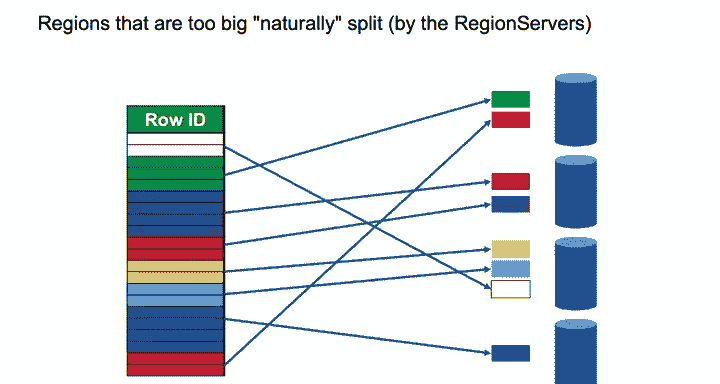

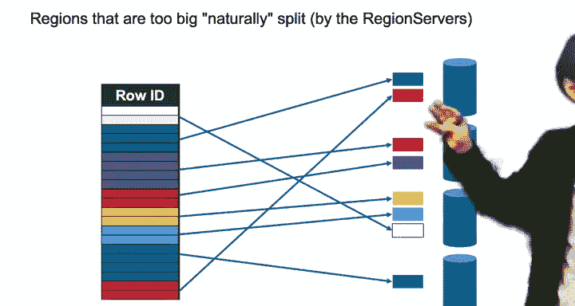

Did I answer your question？And a lot of that will become clear once I have explained what happens with the fight because I still have to explain that to you。

 all right？

So again， I repeat the most important， we have two layers here， HD basease and HDFS。Now。

 two weeks ago， I told you about the logical level of HDGFS and the physical level was the hard drives。

On the cluster cells， but now we are one step above now the logical layer is age base and HDGFS now is a physical layer right so you really need to think in this modular way in terms of all of these layers that are on top of each other。

😊，And so it means that HGFS， sorry HBase is the user of HGFS。

 right HBase uses HGFS as the storage medium for all the data for the tables。😊。

And this is why each region serverr is also an AGFS client and will read and write data to AGFS。

Now who is in charge of managing all of that data stored in a GFS it's aGFS right so it's the name node and the data nodes that are going to handle all of the the find name space and the blocks and so on we have a question over here but for the is the H master and the name node is this the same thing or is this like two separate。

So these are two processes。That are running on the same machine。 Yeah， you don't have to。

 but usually this is what people do。 They basically install the data nodes on the same machines as the region server and the H masters on the same machines as the as as the name nodes。

 Now in practice， I think that the backup page master， you could also put them on the region server。

 So you you would basically have the main H master here。

 and maybe these region server could also have a process that is a backup page master that could take over。

 right So you have flexibility because you can run any number of processes on the same machines right And then it's just best practice to do it this way。

 Did it answer a question。

Yeah， all right， so we have another question we are here。

So I'm thinking about a common SQL use case and like one thing I would anticipate doing is pulling up a row or a given set of rows and having a bunch of different fields and in this situation it seems like for any given record that a bunch of the different information for those fields might be distributed across a bunch of different places and so then is the paradigm that this kind of computation in which you're operating on multiple fields within a record all at once is discouraged so you can try and make these operations independent of each other so they can be distributed or do we kind of accept a certain degree of latency when doing that full record access。

So that kind of patterns is absolutely encouraged you're encouraged to do that but it might sound like magic right I'm telling you you can actually have random access all over other place in the table and so on and it's running on top of H GFS that has highlighted and see right so it might be a mystery but I will explain that it's the magic of the technology that we manage that but basically the answer is definitely yes。

 these patterns are encouraged you can read anywhere you want in the table and that actually is going to work and it's going to be very。

 very efficient right but I have to tell you how I will basically give you all the details of that Thanks。

😊，You have the right thinking， exactly the right questions。诶。😊，Now。Since I've explained that to you。

 can anybody tell me why we don't assign every region to three region server？😡。

To avoid data loss， yes。Exactly， HGFS takes care of that。 HGFS already duplicates the blocks。

 at least in three can change it。 So there's no point in replicating the regions right because the data is already redundant。

 If a server crashes， imagine that let's say this one crashes。 that's okay。

 you just assign the responsibilities to somebody else。

 you don't lose any data because AGFS had already be been redundantly tooring it。 Yeah。

 so that's exactly。Okay， perfect answer。Alright， just checking for race hands。

 Is there a raised tense。Yes， the little there。If the Hma lets the HFS system handle all the redundancies。

How does it know which region server to？Assign the new responsibility to to not assign it to something that doesn't actually have a single copy。

 for example， in the worst case。So two things first。There is a place， it's called the Me table。

 I'll come back to that。

One of these。

Or is it here。One of these machines。

Has a small table， just a few megabytes， hits on one of the machines that say this one。

That's called the meta table， that meta table is a catalog of all the regions and all the machines that are in charge of the regions and it's kept up to date the whole time so whenever there is a change they will communicate with that one and the table is kept up to date with the instructions。

😊。

Now。Imagine you change the responsibility of the region because the serverva crashed， for example。

 and you want to assign it to somebody else。So the first thing that I want to say is。

You could technically， if you forget about performance。

 you could assign the region to absolutely any region server， they all have access to HGFS。

 they all see all of the data。However。You need to be careful because some of them。

 as you correctly said， might not have any local copy of the blocks。

 so it means that if they want to see the data they will have to connect to other machines and it's going to be slower so you absolutely have a point and it is absolutely true that ideally if you have a way to know if there is if a lot of the blocks tend to be connect at the same place。

 then you will pick a region serverr that already has many blocks。

The problem is that it's not so easy。Because you might remember that the first rep clicka is on the client。

 so when you are， you have been for a very long time responsible for the region。

 you have a local copy。But now。You will not really have any other machine that would have a high concentration of the blocks right because by design we spread the blocks all over right but that's not a problem at all because what's going to happen is that at first when the regions have starts being in charge of that region。

 it might be a bit slower。But over time， as it takes responsibility for the data。

 somehow the data will come back with a local copy on that machine。

 it's just like the collapse of the wave function in quantum physics the same thing is happening like at some point all of the blocks tend to come back to the region server over time。

 right？😊，Okay and it goes both ways actually because also as you have many， many blocks。

 they might start spreading all over again that this is allocagonal to the system because everybody can see everything。

 does it make sense？😊，诶。Yes， we have another over here。

I there maybe be a point in the in the fact that the data is completely over like in the in the HDFS data is completely written like from the like end to end and like。

In this case， when the。哎有不不认。Like just like that point which you said now， like last one。

 does it have connection that data is always like。Completely written。

 And like that's how the data comes back to the to this data node， which was assigned to。

 because if you。Like kill previous copy and now the client again connects yes and the data comes now to the that is exactly that is exactly what happens So basically the reason why the blocks tend to come back is that when users use age base they are going to modify the data to update the values to add values and so on and we will see when I come to that that what's the region server is going to do is going to get rid of files and recreate new files So the old files are the that were on other machines and that it will delete and the new files that it' going to create will have a local copy on the same machine that's the reason right this is really because of the turnover you keep replacing and rewriting new files and deleting the old ones does it make sense。

Okay。Alright， yes， another question right there。Thank you， how does Hmaster know if， for example。

 regionion server crashes， how do they communicate？😊。

So it's the same sort of protocol as we have in AGFS there is a way to keep track so in AGFS we use hardbes that allow you to keep track of the available processes and so there is something similar in HBase that allows the H staff to know which region server are available and which ones are not available it might not be exactly the same as hardbes in AGFS but there is something similar that basically allows it to take care of that right thank you。

All right， there's one question on Zoom that is almost the same question I think does the communication between H master and the region server also rely on heartbeats just like HDFs？

😊，So that I don't have the details of， but that's a good homework。

 maybe we can work on that and try to find out the details of the communication， right？😊。

That's a good point。

Should we continue？Okay。So it didn't scare you so much just yet。

Okay， so now we've discussed the difference between the H base layer with the region server and the HDGFS layer with the files we've discussed what happens if there's a crash that you redistribute the responsibilities。

 let's go to the region servers now which have the responsibility for for serving the data to the clients。

So I told you about this wedding cake that has both the horizontal and the vertical。

Separation。

Here， this is basically going to be served by the same region s。 This might be another origin s。

 but nevertheless， we also have this vertical partitioning。

 So this is now why I have to tell you why it also makes sense to part vertically technically。

Every one of these intersections between a region and a colon family is called a store。

It's called a store。 Now， if I look at one store， so it means that I'm looking at just one region。

 it's an interval over raw ideass。And just one Col family。

 so the same color here I have these indoordo abaic numerals。

So look at the sense here。嗯。This here is one of these values could be atomic， could be an XmL file。

 a picture or whatever up to 10 megabytes or maybe even more just would be slower。

 so this is called a cell。😊。

Now what happens is that this is the logical view， it's purely logical so table has rows and columns。

 that's logical， but how does it need to be stored in HDGFS。

 the only thing that HDGFS knows just like any five system is bits。

 we can just store bits1 then zeros so how can we turn that into bits。😊。

I will explain but basically these bits are called H files。

 so the files that are created on top of HGFS so HGFS files。😊，A called H types。

 I will show you everything about what there is inside and how they are structured and so but this is called an H file。

The same store which is one region why one Kon family might be of our multiple files I will also explain to you how this is done over multiple files and how it evolves over effect so basically we store and persist the data into one of these stores over multiple H files on HDFS and typically after a long time after writing them you will have a local copy of almost all of the data locally on your on your machine。

Now let me dive a little bit into that how this is done， so basically。😊。

What happens is that my H file is just a list of the cells。 Remember。

 a cell is the data of a raw IDd and column。 That's one value。

 So basically my H file is just a list of them。 So here how many cells do I have。

6， right， three times to1，2，3，4，5，6。 so I store a list。

The， the red one， the purple one， the Oh I didn't put the same。 Oh yeah， no。

 because it's other like these legs so very quickly。 So A 1， A 2， B1， B2， C 1， C2， right， So A 1。

 A 2， B 1， B 2， C 1， C 2。

More exactly what I store is the。

Coordinates of the cell and the value of the cell， right？

The coordinate of the set is like playing battery sheet， right， A1， A2。

 So this is basically the raw ID and the Col family and colon name， right So that is the key。

And here is the value of the cell， yet another key value model over all over again。

 deeply the key value model， the key is just the coordinates。

 the batteryship coordinates of my cell and the value is the value of the cell an H file is thus just a list of these key values。

😊。

The key values in that context are very often written camel case， A E， Y， V。

 A L U E with capital K and capital V very often。So basically an H file is the list of key values where the key is the coordinates of the cell and the value is the content of the cell。

😊。

That's what there is in an H file。If you look even closer to the H find。

What you will notice is that it's not just a value a list of one value for each cell。

 it actually remembers the past， there is a whole versioning system that remembers past version so if you look at a1。

 then in that age file you might even have formal version so the latest version is version4。

 but you will also find version3 version2 version1， it will remember just like Gi Gith。

Okay， so this is a very nice feature。Another aspect of the way that these handleds is that when people want to modify。

or modify a value or add value and so on it's locked by row you can never have two clients that are modifying the same row if anybody wants to touch the same row they have to wait and queue in line so there is a lock on the on the row and this is why when you have a lock like that it allows you to have a total order version one and version2 then version three。

This is to be contrasted with dynamo in dynamo Db we did not have this。

 we could have inconsistencies， we could have conflicting values and then we had a da of the versions right like in Gi it's a da of versions but here it's not a da it's really a line because it's a total order and the total order is achieved with locking the row every time you never have more than one person at a time that touches the rule okay so it's consistent does it make sense。

😊。

Okay。All right， so now let's dive deeper because I told you we started the cells in the batteryship way with a list of key values more exactly a5 is a sequence of bits right so basically every key value is going to be a sequence of bits and so in theH slides I just put the key values one after the other and if I zoom in on these key value right here it's made of bits and I can look now at what there is in there。

😊。

So if I look at what there is in one key value。I will first have a key length。

Which is the length of the key because it can vary， right。

 The key has the raw ID It has the the colon family， the colon name， it's not a fixed size。

 So I store the length of the key here。

I store the length of the value which can be very small。

 but also be like 10 mete so I need to store its length and then I store a key which has a variable length and I store a value which has a variable length。

 right。😊。

This doesn't vary。 I think it's 32 bits。 and this is 32 bits。 So that is already known。

 You know that this is 32 bits，32 bits。 But if you read this and you read that。

 you know exactly how many bits you read here and you know exactly how many bits to read there。

 right So in spite of being variable， you know the boundaries of the keys and the videos。

 It's important because you're looking at bits。 if I just throw a million of bits at you。

 you wouldn be unable to tell me where they start and where they stop， right， the only way to know。😊。

Is to store the length of of the feed that you want to eat， for whom does that make sense？

ok。This is actually known as a prefix code。😊。

Who was in information retrieval？Okay， so I open a parentheesis for those of you who are in information retrieval。

 you already know a prefix code that's the gamma code the gamma code is a magic code that allows you to write sequences of intes of any size one after the other and you know exactly when they stop its magic so for example here you know that this is。

😊。

When you ready， I will come to you to your to the question on Zoom so basically。

The way that the gamma codes work is that you counts the number of ones until you reach a zero so here there's just one of them so you read one more bit then you cut here you know that it stops here and then you take that proper beat and add one on top。

 so that's the number two in base2。

Next one， how many ones，1，2，3，4，5，6，7，8， once， and then a0。 So now I called1，2，3，4，5，6，7，8。

 and I know I stop here， right， So now I can just。😊。

Take that over。 I just need to always add back the one on top of it， but I take these bits。

 and this is the number。 and I know that I need to stop here because of the sequence of ones that stops with a0。

 Then again，11， two of them。 So I read two more bits here。 and that is01。 I add back the one on top。

 that's the number 5 right and then1，1，10，10111 more number。 This is called a prefix code。

 just like the phone numbers when you dial a phone number， it's a prefix code as well。

 it exactly knows when the phone number stops it's magic。 I mean。

 on a mobile phone you no longer notice but on a online phone you do notice that it starts dialing exactly after the right number of digits yes。

Yeah， that's called the gamma code， it's not for those who had the information re to connect it。

 it's not important， it's not part over the material of the lecture。

 but let me give you the intuition， the idea of the gamma code。

Is that。When you start reading from left to right at that point you don't load the boundaries of the individualss it's just a bunch of zeros and ones but the way that it works is let you sat on the left you consume ones until you reach a zero so there is one oh then a zero I stop how many ones while there are just one so I take one more bits here and that stops here then I have0 I always add back a one here okay then I do the same here I consume all the ones all the way to the first zero here and then I count the number of ones that I had and I consume as many bits right here and again add back a one on top that is the game I could and I can go do it over and over and over and over and over again right？

😊。

即关系开。Geting why we have the one。Oh you could also not add it， but you gain one bit。

 it's a compression thing you basically gain space， so to say it's an optimization。

 the ID is very simple。It doesn't work in base 10， but in base 2， except for0。

 any number starts with a1。 you agree with that right， Any number starts with a1 in base 2。

So what you do is you just remove it。 It's incase it。 right Does it make sense。

It's a very good question because that doesn't work in IR bases then two， yes。Not necessarily。

 because， oh it just happens to be， this here could be a one， it could be a one yeah。

All right， so this is for those of you who had information retrieval。

 I just wanted to remind this and for the others， don't worry。

 am I cause they not part of the lecture？😊。

What I wanted to say is that these are the sort of tricks。

That tell you the boundaries of the regions of bits that you're reading which brings us I think to the question on Zoom which is the continuation of this there was one question how do we know the length of the key length and the length of the value length but you already mentioned that that was also answered in the chat already so it's fit we know the ba of Rchausen with the bootstap we call it bootstrap because he can just pull the straps and you get in the so this is exactly what's happening here we need to bootstrap it it means that we don't know the length here but here we know the length because it is always 32 bits and here it is always 32 bits so we bootstpped it and then we know the length that follow。

And the next question is， but if we want to read some key value in the middle of H file and we still need to scan from the beginning。

 yes absolutely you need to be careful you need to at least know when you start because if you just land in the middle of things。

 then you don't know where you are。Okay。All right， let's continue then。 Oh， another question。

But the region sell state。Oh， that's okay。 We just give the responsibility of the region to somebody else。

And there is no data loss because this is only one copy of the blocks and they are stored at other places。

 does it make sense？我我说。So this value can be， we said anything， it can be a table。

 it can be an extra sequence of is it possible to insert something in the middle of the value？

As a command， or do we have to like fetch the whole value， then edit it， and then。

Get the whole value back to this server。So typically we read that I would explain how we write that。

 but typically now we are reading right， So it's already there and we read the whole value。Right。

 did you also have an injection attack in mind or was it going in cybersecur or did you not go that far。

 it was depend on your answer， but I will wait until we get All right。

 so I will explain how we write the idea is that imagine it's already written。

 I'm explaining to you how to read it right， read the key length。

 the video length and that tells you how many bits you read for the keys and the videos。😊，Okay。

And then you can tell me if that will answer your question later。

O。Let's now zoom in inside the key。 So the key would be。

That would be the this here， the this part here。 Now I'm zooming in inside this。

What would I find here when you probably guess it's the raw ID， the colon family。

 the colon name and so on， but we have to be careful because again we need to account for the variable length。

 So here's what you have here again left to right first there is the raw length again that's a fixed number we know how many bits to read that tells us the length of the raw ID right the raw ID is here I told you the raw ID the sequence of bits variable so this is variable but the length is taught here then we have the length of the colon family that's also a fixed number of bits that encode that length so we know how many bits we read this is also variable right。

😊。

Then let me go from the right to explain this， I will come back to the column quaifier。😊。

Here。😊，This is just a de flag。 It's a way to mark if a value was deleted or not deleted right so this is a fixed number of bits。

 And here this is the time stampamp it's for versioning version1 version 2。

 that's also a fixed number of bits。 Can anybody tell me why on earth we do not have a column quaifier length here。

In spite of being variable。Yes。😊，Exactly we subtract because you remember here we have the key length。

Here we have two key length。

So if I know the total length， plus the row length and the colon f length and the fact that times1 and key type are fixed。

 if I subtract that gives me the length of the colon qualifier。😊，Who is with me on that？All right。

 X and answer。Alright so this is how we manage to reach the key and know exactly how to pass these things now you probably start understanding why you have to be careful to not have too long names for the rows and the columns because they are in the key values if you have very long names you will have very long key values and you have very long billions of very long key values so this is the reason why you need to be passimonous with the length of the names。

😊，Any questions？几。😊。

I still have a few minutes， Oh yeah， on Zoom。

And the store share the same family that is a very good question I actually I have also been wondering that if there's not a way to optimize and get rid because indeed you're right if you're looking at the specific storage its the same color family for everybody so why would you store it。

😊，I assume it probably makes things easier when you start moving data around and you basically look at the keyVs outside of a context outside of knowing which store you are in。

 so it probably makes it a bit more resilient that it carries over the exact context right but I've also been wondering if there's not a way to get rid of the colon family because that's redundant。

So that's half an answer， but I don't know if that was okay， right。

All right。

I will keep that for tomorrow this one here。I think we've already touched a lot today。

So。I will only ask you。Rebly needs to refresh the page。How much you followed。

 I warned you it's the most difficult lecture of the whole semester。

But we'll see how much damage I have done today and if I need to repeat an accelerator。

On the contrary， if you've been following。Wow， this actually looks good。😮，Very good。 Yeah， slightly。

 of course， less than usual。 But because I told you it's very difficult。

 but this is this is this is what our goods if you have。

Sorry question it's going to oh we have one minute。

 maybe we can go for that question have the sameifier and two current indiffer families have the same quaifier。

 Yes， absolutely it's like two people having the same first name and different femin names yeah。Okay。

 so thank you very much， if you have questions prepare them for tomorrow I will take the time to make sure you understand then I take it from there so enjoy your evening and see you tomorrow。

😊。

