# 苏黎世联邦理工《大数据｜Big Data - ETH Zurich - Fall 2024》中英字幕（deepseek - P19：-19-6. Wide column stores (3_4) -.zh_en - GPT中英字幕课程资源 - BV1sHPKeoEJU

So welcome everybody in the lecture hall， welcomel everybody and Zoom。

 We everybody watching us from the future today I will continue probably not finish because again there's a lot。

😊，And before that， I have questions for you one questions。So what is the keyU in each base？

Almostly what indexes it？So it's the smallest unit of physical storage。

 is it indexed by columns andversion and shouteded by colon families and time intervals or is it indexed by raw and column and shouteded by regions and colon families。

 or is it indexed by row column in version and shouteded by regions and colon families。

 or is it indexed by R ID and shaed by regions？So I told you that key values are everywhere。

 so the notion of the key value model is absolutely everywhere。

 but in H base we write key values with a capital K and a capital V。

 so this is usually when you see it written in this way， it's the H base key values。Partly two。

 that's a good number of two ends。We have a majority right here。And the majority is， in fact。

 correct。So indeed， a key value， what's in the key。Is the row when the row ID。

 the column more specifically the colon family and the colon name who qualifier and and the version because I told you that on top of it it's versioning the data so it keeps multiple versions on the same of the same cell stored in the background so this is why you also have the version。

😊。

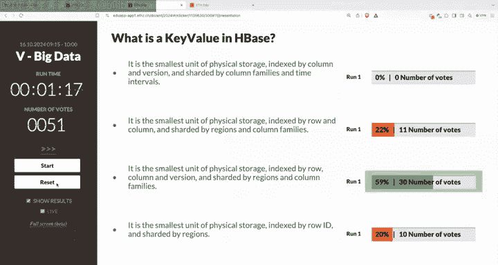

And it is shouteded indeed by regions， which are intervalvers of RoDs， right？

And by colon families and when you have a region in a colon family。

 the intersection of the two gives you a unit of where the H5s basically are stock from it's called a store right and so a store it is just made of plenty of key videos。

Now I insist that KVs are a physical thing in H basease， the users when they interact with H base。

 they see tables and rows and currents， but the QVLU that the physical thing that you actually start storing in the age files。

😊，Allright， and basically what's interesting is that the key value the key has multiple dimensions this is a bit different from keyvalue stars you remember in the key value store the key is just a value it's one dimensional right it's on a ring there's only one dimension one way to look at it H base is a two dimensional version of the key value store meaning that now it has row n columns so now the objects are organized in a grid and not in a ring。

😊，And the other thing that key stars don't have。 and well。

They kind of don't have the versioning let me say why you do have versions in keyvalue stars with the vector clocks right so this is meant for conflict resolution but the difference is that in the keyvalue store the versions are organized in a D because you might have conflicts because of eventual consistency but in each space the versions are in a total order there is no dag or anything it's a total order and the way you typically achieve a total order on the versions is with locks if you have locks that prevent you from having any conflict that then you have a timeline that is just a line don't have any D or whom is that here。

All right。There's a lot of very general wisdom in what I'm telling you。

 right the ID that when have when you're not consistent， you have a da， when you're consistent。

 you have a line， this is a very general thing that you have in many， many database systems。

 not just age base or what we are looking at。SoLet me get back to the sites。Okay。It not。你走吧。As。

Somehow， I'm not able to。Click in advanced。Slightly reduce that so that I。

I basically need to able to click here so that my clicker works。 which is very weird。

 But this is the way it is， alright。So you remember this architecture。

 which is the same one as in HDFS with centralization right you have a coordinator on node and you have the worker node。

 the H master is typically on the same node as as the name node process。

 these are processes and the regions server process。

 these are also running on the same node as the data node processes。

Now I owe you an answer and Tobiia sounds the answer to your question。

 you asks what about the communication between the Hmaster and the region cell are there heartbeats。

 the answer is they are used to be heartbeat in the earlier versions of age base it was heartbeats just like in HGSS。

😊，Now， you might remember that I mentioned that in HGFS。

 the synchronization between the name node and the standby name node and the Observal name node was handled by something called Zookeeper。

Zookeeper， let me say a few words about that。Zuki Perf。Sos the problem that in many of these systems。

 HGSS， HBase， mapp Red and so on。It's a distributed system。

 So you have the problem that the nodes need to communicate together。 The hardbeat is an example。

 like how do you keep track of all the nodes that are running when you have the name node that fail。

 how do you synchronize on who is going to take over as the new name node， right。

 all of these things。And so in the first versions of all these systems。

 the developers implemented that by hand from the beginning。😊，So in the first versions。

 they did not even implement it and then you had race conditions and then it just failed。

 you know what a race condition is right race condition is is when you have parallel processes and then you have uncertainty of the order in which it gets executed and then you get a wrong order and then it crashes so this is a race condition you can have deadlocks that the whole thing gets stuck also because of race conditions。

😊，And basically in the first versions because the developer every time implemented it all over and all over and all over again。

 the way they implemented it was not perfect， so at some points there was some people took action they said okay let's do this right once and for all let us implement something that does it and we find tune need to the point that it really works very nicely and then everybody else can just use us and that is zookeeper so zookeeper is a very simple system that provides you a synchronization。

 naming grouping and so on so it allows everybody to have some coordination protocols。😊。

So this is the reason why the half bits in each base were removed。And instead。

 Hbase is using zookeeper and zookeeper is just some distributed system where the region cell valves just declare themselves to zookeeper and say。

 you know I'm here so they send a hubbeats to zookeeper instead and then the Hma also looks into zookeeper which region cell valve are actually alive right and what is thought in zookeeper doesn't take so much space right it's just a list of the region cell valve with some small data related to them and that sits right so it's very。

 very small and so that that's why it's it's very lightweight for whom does that make sense。😊，Right。

 so no how beats。Between Reg servers and the Hma and now a natural question we had with Tobias is what with howbes in HDDFS。

 will it be that in the next version of HDDFS they will also move to zookeeper instead of the Habes。

 maybe who knows we'll follow that and see if that happens too right？😊，Alright。

 but you see what's interesting here is really the idea that。

When you see that many people do the same thing all over again and they do it imperfectly。

 then it's worth actually building one piece of software that does it really， really well。

 and then have everybody use it， right And then come back to these general principles。

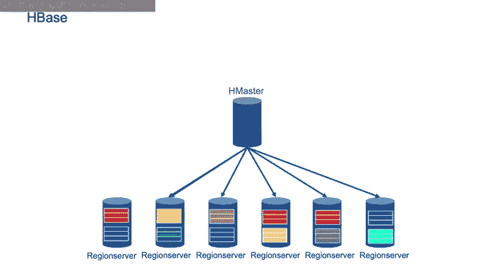

Alright， so that answers other questions about the， the heartbeats。

So now let me come back to where we stopped last time so I was saying that if you look at one partition that is a region in a colon family in that section of that。

 you persist it as H5 to onHGFS and I need to explain to you where there is in an H5 so basically I explained that these descend cells in here needs to be serialize that sequences of bits and every one of them is called the key value and then the key values I explain to you all the details of that it's just a sequence of bits that has a variable size but there is some magic so that you know exactly when they start and when they stop with the row length and the key length and so。

😊。

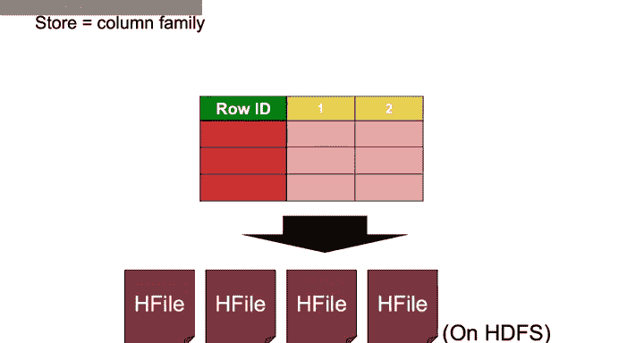

All right， so this is where I stopped。

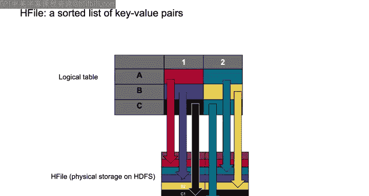

And then what I want to tell you now。Is that when you read key values。To and from H fights。

You don't need one key value by itself。 You read them in blocks。

This is exactly the same idea as not reading individual bits from your hard drive。

 but reading them in these 4 kiloB blocks。It's the same ID in HDFS that you don't read the files bit by bit。

 but you read them in HDFS blocks， right 128 megabytes。And here we have H base blocks。

That I call H block for the purpose of these course。

 so an H block has a size of 64 kilobytes that is an H block。

 so you read key values in chunks of 64 kilobytes。This is。

An extensible block in the sense that unlike H GF S blocks and hard write blocks that are in exact number of bits。

 So an H GF S block can be less than that， but no longer not， not more than 128 MB。In an niche block。

You cannot cut a key value in half， you cannot cut in the middle of a key value。

 so it's very unlikely that the 64 kilobytes would exactly come where a key value stops so instead what you do is that you look at the last key value in the 64 kilobytes but you still included all the way to its end right so it might be actually larger than just 64 kilobytes depending on the size of the last key value or whom is that here。

Right all right， so it's always a whole number of key values that you have in a block and notes that this is configurable。

 you can change that the H block size that's entirely configurable and notes that if you put XM and JON in there and you start having values that are like 10 megabytes and of course that exceed the size of an H block and so that means that either you would have only one key value in your H block which might be fine or you can change the size of the H block do we have a question。

It the keep。没别，你就睡去的了。

Indi。There you go Okay， if the key values are stored in HDFS。

 wouldn't you always have to get at least 128 megabytes at a time anyway。

 what's the benefit of retrieving less？

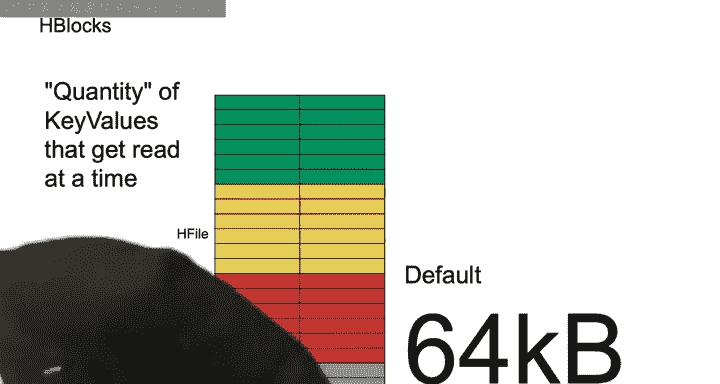

So that is a very good question。The way that it works is that。When， when I。

Talk about a niche clock like this。 It's more logical than the HDFS block right So basically the way to look at the age blocks。

 maybe I show you that slide and then come to your question because it would make it easier。

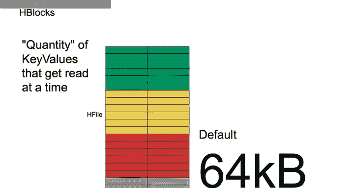

So the idea is that。When you look at inside on H5， it's basically a list of key values。😊。

But it has an extra index structure。 So on the right。You have all of your key values。

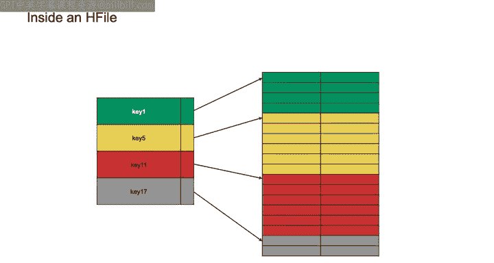

Can have a lot of them， right？And they are organized these age blocks。

 So this is at least 64 kilobytes， 64 kilobytes，64 kilobytes。

 64 kilobytes and so on right And so what you have in addition to these these blocks you have some index that is a way to accelerate the search for a specific age blocks so you you're looking for a specific key you don't know where to look you first look at the index that tells you what the boundaries are of the H blocks right and then for example so you load that index in memory it's also in the H5 you load it in memory and then you look for key14 for example so you can very quickly see that it's between 11 and 17 so you know that it's going to be in this orange H block so you just need to read this。

😊。

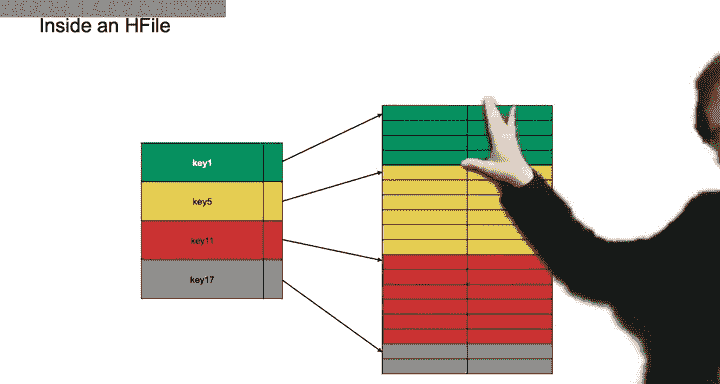

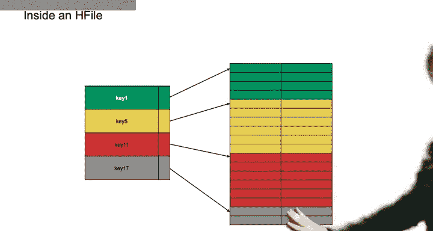

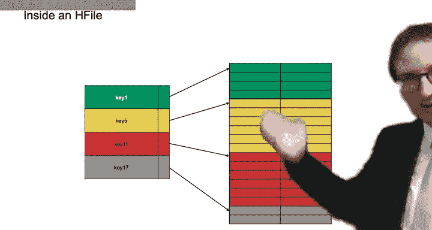

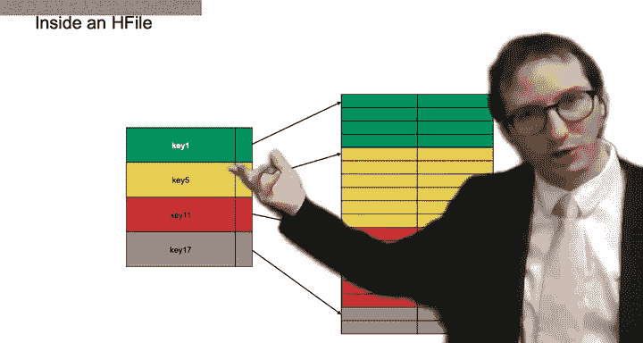

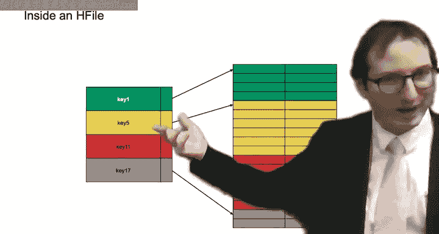

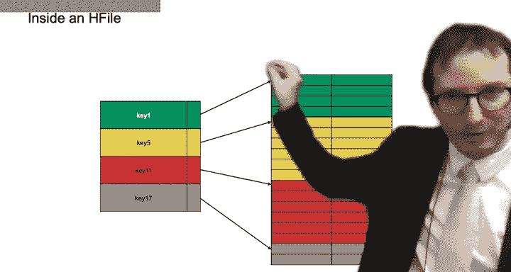

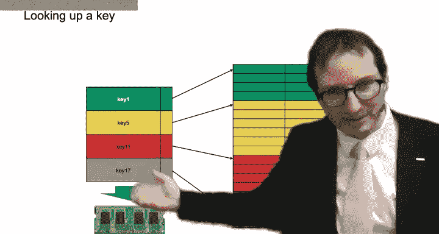

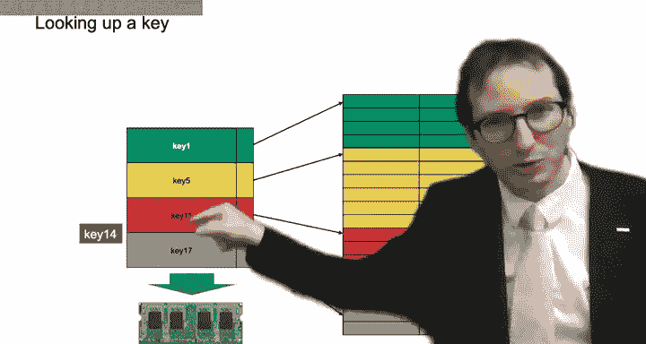

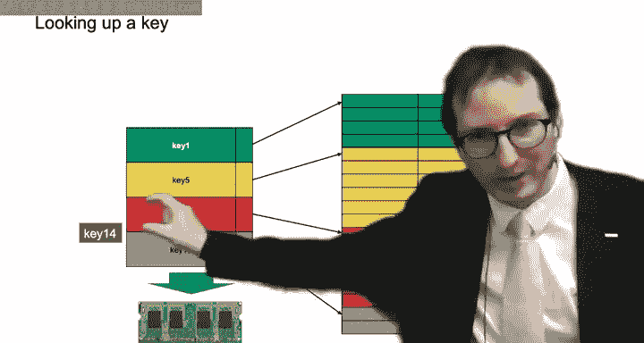

in order to open it， but whom does that make sense？

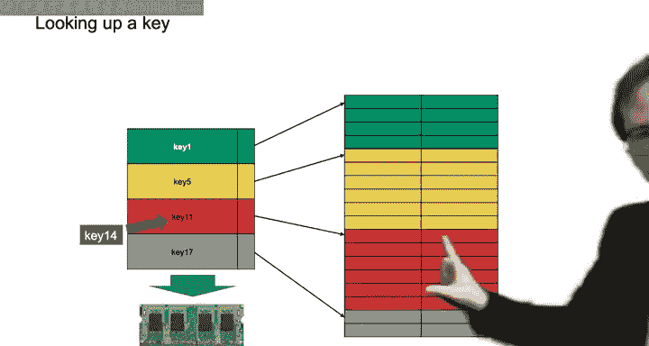

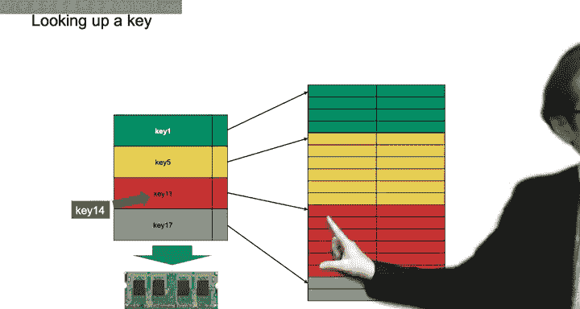

All right。Now。All of this。

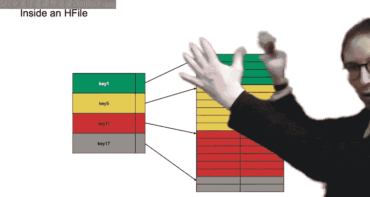

Is an H5 start in HFS？As a five start in HGFS， it will be cut physically on HGFS in 122 megabyte blocks。

 HDGFS blocks， what that means is that in an HGFS block，😊，You will have a lot of age blocks。

Right who agrees 64 kiloBs is much smaller right so you're going to have you can do the division in fact it's 200s right so you will roughly have 2000 H based blocks in an HDGFS block right。

But you need to be careful because the HDGFS blocks cut exactly at 128。

 so it might be that you even have an age block that is cut in half between two HGFS blocks because of that。

 right？😊，Does it make sense。Or who he's asking on Zoom？My answer is not done right。

 but I just taking， okay， checkpoint now something else。😊，That I want to say。

Because you might wonder if anyway you're reading HGFS blocks 128 mebytes at a time。

 how is it even possible to just read 64 kilobyte right can I read just 64 kilobytes of an HGFS block？

And the answer here。Lies in remembering that I told you that if a region serverr is responsible for a very long time for the same region at some point。

There will be replicas of all the DHEFS blocks on the same machine。 You remember this？Right。

 so that means that if， if the region server wants to read。The HDGFS blocks cor H find。

 where are they on the same machine？So it means that the region server might not even need to go to the name node or whatever to read anything。

 the region server is a process running on the same machine as the data node。

 it will directly read the blocks locally from the local hard drive one understand understand that。

Okay，s it's local， it's on the same machine， the H blocks are basically locally stored on the same machine and because they are stored on the same machine and you're just reading from a local drive。

 you know you have random access on a local drive。😊，So because it's sitting on the same machine。

 it has these extra powers that it's able to just very efficiently read all of that data from the same machine。

😊，who's with me I didn't see a lot of writing Okay very good so this is the secret so if you do have the data on the same machine is going to be fast if you don't then it's going to be a bit slower because then you need to fetch the AGFS blocks from somewhere else right so this there might be a performance penalty。

😊，Okay， does it help to know all that？😊，Yeah， all right。 And I'm not even done explaining you。

 There's plenty more explanations that I will give you。 Yes， we have another question over there。

So is this direct read from disk still using the HDFS interface or is the circumventing HDFS overall。

 it is so much here convertventing it that it's called shock ya hitting。

It's literally short secreting the whole AGFS infrastructure and directly reading from this。Right。

 thanks。So of course， the reason why it works is that the people who design AgeBase are part of the same team in Hadoop as those who design HGFS right because otherwise it would be difficult to achieve that sort of things。

 but because it's all in the Hadoop project， then you can do that sort of things。😊，Yes。😊，At this one。

So do we have multiple H files per store or just to one multiple， Okay。

 and I will explain how that that I have to explain Steve。

What's the criteria for choosing 64 kiloby as a block size。

 this is multi for the index data structure or。You mean the justification for that size so it has to do with the fact so it will be clearer after I explain what is coming next。

 but basically this size of HGFS。Corresponds to what you will cache in memory because these H blocks in fact will not every time be read from the local disk。

 they will also be kept in memory if they are used often and so this is really the unit at which you cache the the keyV and so the size of the H blocks so the H base blocks depends on your access patterns in HBase for example do you have a lot of queries that query just a few rows at a time then you would have you can use a smaller H based block size。

Or do you have very heavy queries that tend to read like 1 thousand row consecutive rows at the same time。

 If you have a lot of queries that read a lot of consecutive Pvalue。

 then you can increase the h based block size because that makes more sense right then you keep them together and it's more efficient So that really depends on the way you use H base the way you would configure the block size the default value 64 kilobytes。

 but you can change it depending on that right。Okay。All right， let me continue。

 I will give it a lot of things will become clearer once you have seen。Another question。😊。

What happens？ What happens if you w to change just one key value。

Does it immediately need to modify the whole HDFS data notebook block。

 that is a great question that brings me to where I'm going to say now， So this is awesome。

 So you're asking exactly the right questions。😊，Perfect。😊，嗯。😊，So in the next file。

 we have basically a list of key values sorted or by key plus an index that you can load in memory that allows you to find out which H block you need to look at if you're looking for a specific TV and so this is why it goes faster。

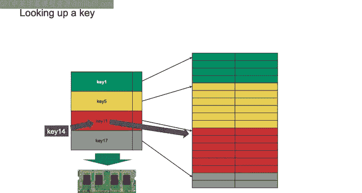

All right。Now， I'm going to dive into the details。 So let me have this overview of all the。

The building blocks of of the system physically。 So we have the table。

 The table is this huge big table with lots of rows and lots of comments。

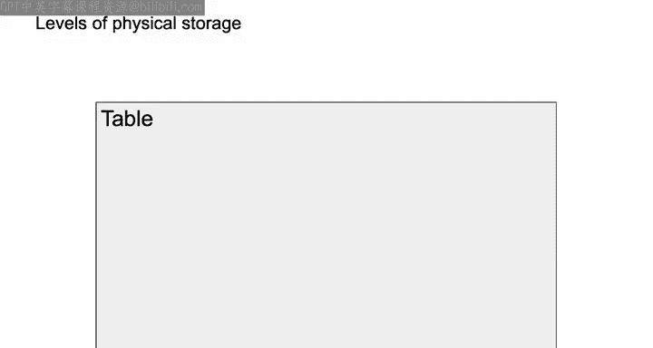

The tables are made of several regions， so that's the vertical partitioning where you have intervals of rawID。

 so you might have thousands of regions in the same table within a region you have the stars as many as cotton families so if you have 10 cotton families then you are going to have 10 stars per region。

So's that so good， so the story is this wedding cake partitioning where you cut it both horizontally and vertical tape inside a store。

 we have multiple age files。That holds the data for that store。

 and inside on each file we have the H blocks。So an H5 is made of plenty of age blocks。And。😊。

The H blockss are just lists of keys with me on this。

Right all right so this is from the perspective of H base right because if you look at it from the perspective of HGFS one level lower than that then the H file from the HDGFS perspective is made of HDgfS blocks of 128 mebytes right and so the H blocks and the key news you have to actually read the files who see them right they are inside the actual data as the H files okay so now here's the problem and that's actually the question that was asked on zoom more or less。

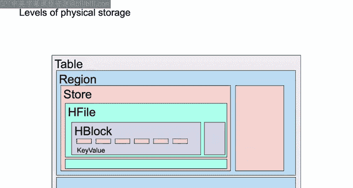

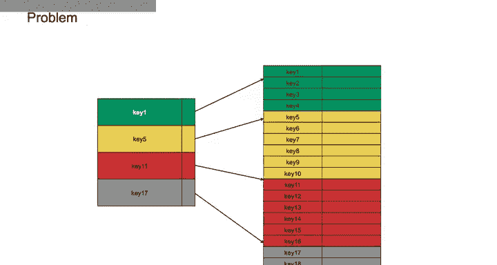

We can only write key values in softed order that has to do with the way GFS works if you write on H file。

 the only thing you can do is write it or append to it but you cannot modify an H5 in place and thus the question on zoom how do I modify a key value if I cannot modify an H5 in place was it the question you asked？

Reformte it。Yes， exactly， and that's what I'm about to answer now。

So we have the problem that we can only write like this and they always need to be sorted。

 so how do we insert new values？

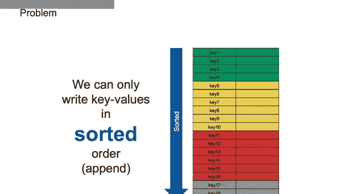

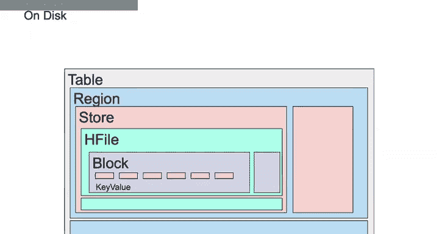

And here's the answer， the idea is that we have on HDGFS。

 all of these H filess for a given store made of H blocks made of key values。

And so the idea is that if you want to read age base and you want to know the data because of a scan or because of a get or something。

You， in fact， need to look。😡，At two places。You need to look。At DH fight。

And look for the key values in there。And you also need to look in memory。

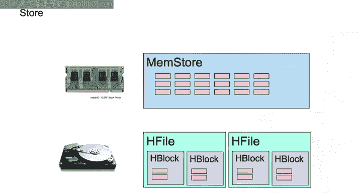

The reason is that the very fresh and recent key values that have just been added recently。

 they are stored in the memory that's called a me store。

 so they are stored in the memory and these are the older values so basically the idea is the edge file contain older values that have been by CC to HDGFS while the new and fresh values are still in memory。

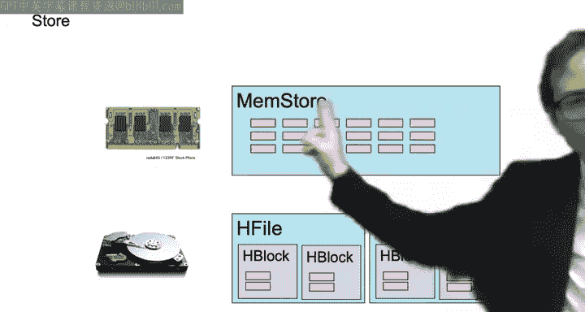

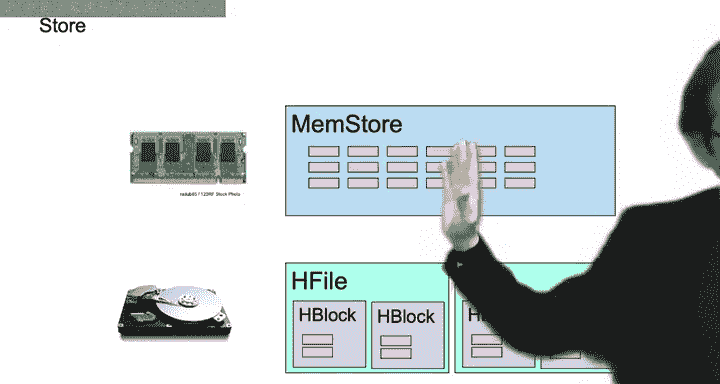

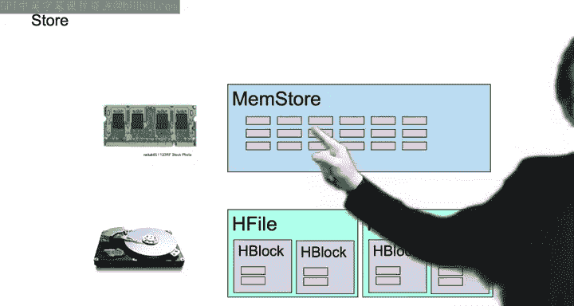

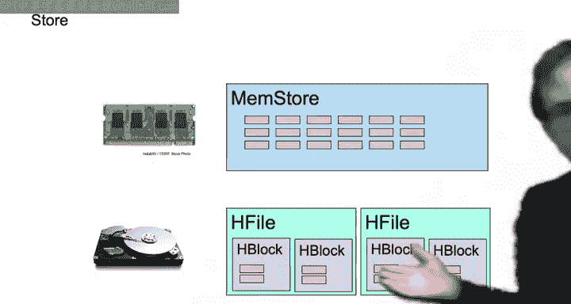

So the first element of answer to the question you ask is if you want to insert a key value or if somebody does a put with a key value。

 it just goes to memory， that's it， there's no h5 in the。

 it's just put in the main store and that's it。So this is the short answer to the question。

 but I would still need to answer how it makes it w all the way to the H5 later。Now。

 what I would add is that the me store。Needs to maintain。

A sorted order of the key values with what data structure can you achieve this。

 You learned it in data structures and algorithms， right。

 What can I use to maintain in memory the order of key values。Yes。

 exactly a binary tree or even more modern versionions with multiple nodes per multiple value spell node that's exactly so a tree structure you can use a tree structure in order to hold the key values in order right so it means that anytime you insert a new key value it takes a bit of algorithmithmic complexity we insert it into the into the tree but the benefit is that when you look them up then the lookup is logarithmic right so this is the benefit you get。

😊，All right。So。Every time you read key values， you need to check in the memory folder the if there's a fresh key video and。

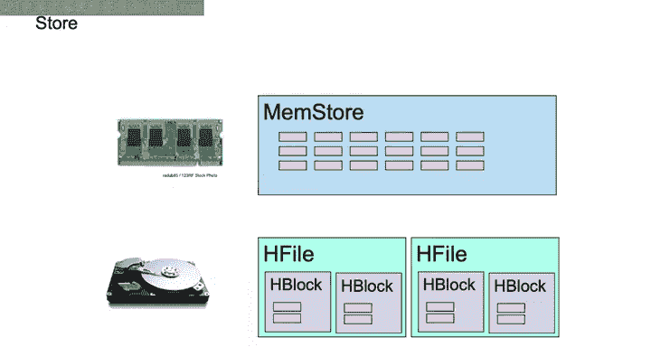

Indeed the on the disc for the older webs。What about writing so if you write？

You write in the main store， right？So here's a new QVU that just arrived because the user did a input。

Then another one， and then users keep writing。But at some point， the memory is going to be full。

 right， You have so many KV that it doesn't fit anymore。

 This is when you need to flush them with GFS。So what's going to happen？

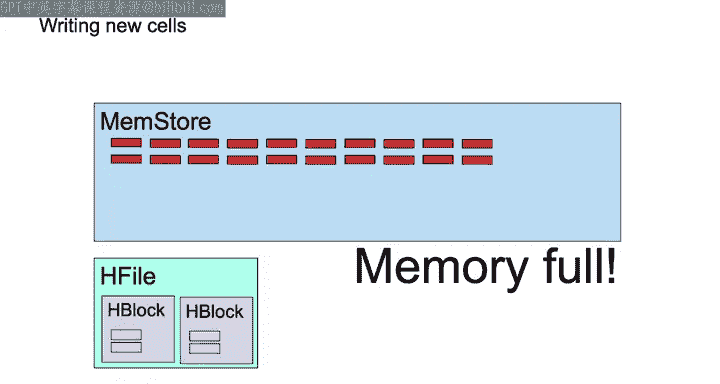

It's called flushing， you basically flush the memory down to N H5。Now。

 what's the algorithmic complexity of flushing these key values， knowing that they need to be sorted？

Who says n log n？Who says n linear？It is indeed linear。 Why is it linear。

It's already sorted exactly it's already sorted because I told you there is a tree structure like your colleague on there is a tree structure there and how do you traverse the tree structure just linearly you go one by one through the already sorted key values so you just need to flush them in the order in which you traverse the tree nicely grouping them in age blocks you know 64 kilobytes at a time building your index of the age blocks so that they are easier to find and so so now the memory is empty and I have flushed its content to a new H file so now you see why these are the older ones because now they are older than the new ones。

😊。

But there is zero problems。Because I told you， we need a system that has to be resilient against crashes。

So what if before we had a chance to flush it to HDFS？

That computer crashes and all the data that was in the memory is gone。What do we do about it。

 right We need to make sure that we don't lose that data Who agrees that we lose that if we just have the store right If the note crashes。

 this is over， we lost the recent videos。 So what we do is that we use what's called a writer ahead log。

A writer head log basically is a journal of all the transactions。

 it means that whenever somebody wants to insert a new key value or multiple new key values。

Into the map store。Before you do that。You put them in a file that's called an HL。

So the H log is also a list of key values and of transactions of key values。

 but the difference between the H log and the H file is that the H file is sorted by key。

Right sorted by key but the H log is sorted by the time of arrival it's really a journal and you keep app app a pending a pending in the order in which they arrive and we know that a pending in HDGFS is fine we can append without any problem so this is why the H log gets continuously append it with new transactions that that arrive and only after you have appended to the H log are you allot to write to the memory store so now if it crashes that's okay because we have the H log right。

😊，So of course， what happens if you want to recover from the crash is that you will need to go through the H log and apply the changes that might take a bit of time。

 but at least you didn't lose the data。Note that the H log here is very similar to the edit log in the name node of HDFS。

 where you have the order in which you modified the find name space。 Do you remember the edit log。

It's exactly the same logic， so it is just in case we crash。

 we kept a journal somewhere and if it crashes， we use that journal to recreate and recover all the data that we lost okay。

😊，There is one H log for each region server， right so everyone one has an H log and it is on HGFS。

Alright， and then once it's in the H log， we can put it in the memory。All right， so when do we flush。

 when the memory is full， what does it mean， it could be that in a given store you reach the maximum size。

😊，It could be that the total menstru of the entire cluster which is a critical size。

 so you basically start fearing that if it crashes that's going to take a long time to recover so you just trigger a flush as well so it's an overall flush then you flush everything。

Or you could also flush if the writer headlock is too full right if the size of the H log is too full。

 then then you also trigger a flash。 By the way， the writer head log and H log that's the same thing right the H log would be the name of the actual site structure on HGFS and writer head log or W AL you might see is the concept。

 The concept of the writer head log is not unique to Hb。 This is in many。

 many different system that have a similar issue and needs to to be resilience against against crashes。

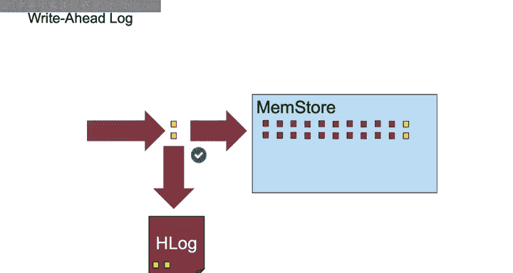

Okay。So now that we know that the fresh values are in the memory and when it's food we flush it to NH5。

 we can go into reading them。ItsAnother question。I have a question about writing。

 so when we flush the memory store in the age files。

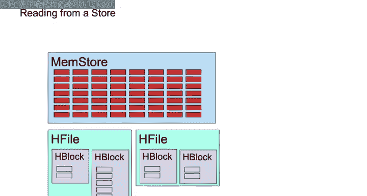

Do we create a new HDFS block for this H file or do we interact directly with the local memory and try it in a still known full HDFS block？

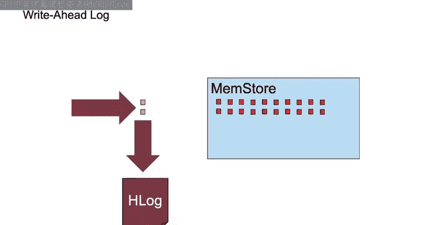

So。The first thing that I would say is that the H file。Might be very large， it might be a terabyte。

 you know hundreds of gigabytes or a terabyte so it means that the H5 that you see here might consist of many many HDGFS blocks right so not just one but many。

 many HDGFS blocks。

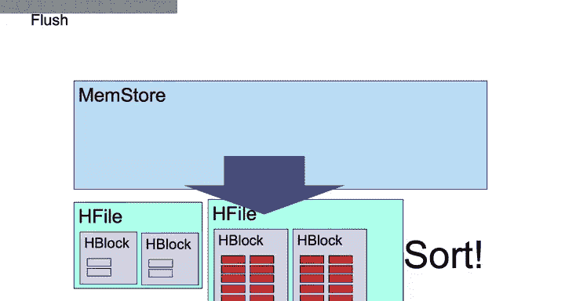

Now， when you write the H file with HFS。

It is written like anybody else would write a file to HDGFS you go to the name node you say I would like to write a file to HDGFS。

 the name node on with the locations for the first HDGFS block then you write then you ask for a second block and so on So the way you read the H file you write the H file has really nothing special you just write it the normal way you write to HDGFS and that does mean that as you go through the keyvalue and creates the H blocks at some point you will finish an HDGFS block then you just trigger a second AGFS block and so on and so on and you might end up writing hundreds of HDGFS blocks that each contain 2000 H blocks or something that's the idea。

Does it make sense？Yeah。Then we have a question on Zoom， I think。So it's another marathon， right？嗯可。

So BS he's running a marathon that's very impressive for the first time， right yeah？

When we talk about starting this in memory instead of an H file at first。

 do we mean it stored its still stored on a region server in memory or is it stored somewhere else？

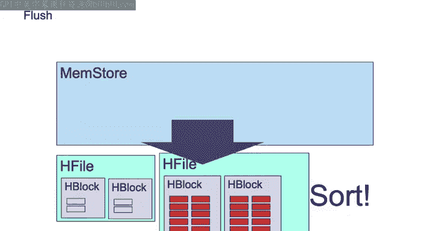

It is inserted in the memory， so it's really a tree structure in the memory of the machine on which the region server is ready。

Yep。Right， more questions。Okay。😊。

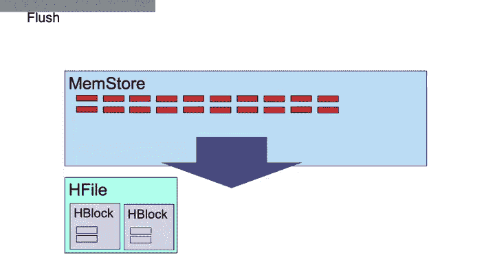

So now we know we flush。So let's think a little bit how we read the data now。

 if somebody would like to。

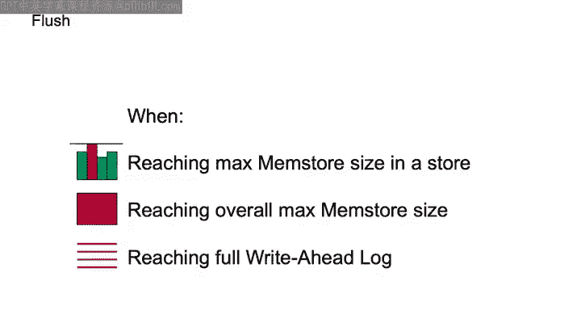

Look for specific key values。😮，They will need to check everywhere。

 so the region S more exactly we need to check everywhere。

 so the region S needs to look in its memory if perhaps there are some key values that are searched by the user and in every single H file。

Now of course， because of the index with phH blocks。

 it's going to be a bit easier to find the key values in every h file because it's all sorted。

 you know by key， but you still need to do it for every H file and for the memory so far so good。😊。

Everywhere。

No。Let's imagine that the memory is becoming full we flush then it's full again we flush and it's full again we flush well at some point we're gonna to have a lot of H5s right that start accumulating dangerously on HGFS so now I can imagine if I have a lot of h5s then it's going to become slower and slower and slower when I have to sell a request because then I have to check even more H5s now right so we can just let it go like this forever creating new Hs right。

😊。

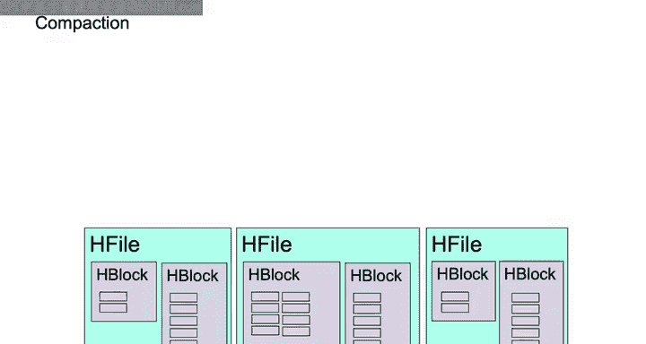

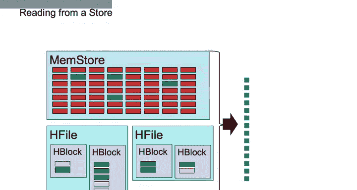

So what do we do？We compact。So what we do when we have too many H files is that we merge them into a single bigger H file that has everything sorted。

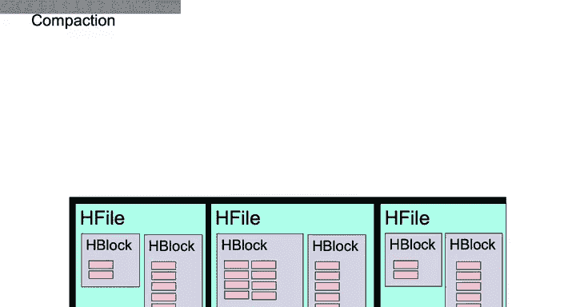

What is the algorithmic complexity of that？Yes。😊，Linear， exactly。 And why is it linear in not endgan。

Exactly is basically the second part of the merge salt remember the merge salt it's one of the algorithms for sorting this is the second part of the mech salt so basically you just need to traverse the h5his in PahalL and that is linear and as you traverse them in PahalL you write and always puts the smallest remaining QV in there so this is linear very highly efficient this is called the compaction right Fling means from the memory to the H5hi and compacting h5his is also linear this is taking multiple h5his and writing the the next h file。

😊。

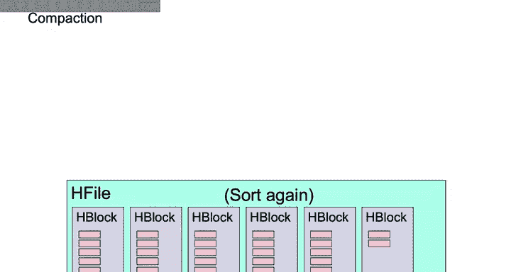

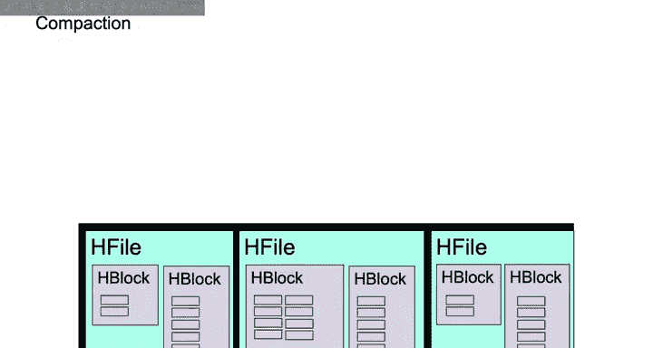

Notes that you can stream， you can do that in a streaming fashion。

 It means you don't need to put the entire data in memory to do that。

 you can really do it just with pointers on the next key values in each file and that's it and then you forget the key values you've already written so you can even do that if the size of the H file is larger than the memory that's not a problem at all who sees that。

😡，It's just like watching Netflix， but instead of a great series， you just go through key videos。

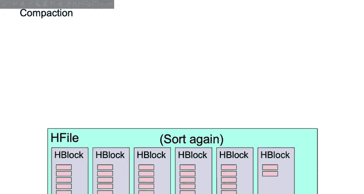

Yes。😊，嗯。Now。There is some way that we do the flashing and the compacting。

 It's not just a mess or random way of doing flushing and compacting。 There is actually a pattern。

And this pattern is， in fact called LSM trees， lock structured melch trees。嗯。

And the LSM trees are usually associated with the cases where you are throughput bounded。

 that's exactly the case with HFS I said that the bottleneck is the throughput we want to emphasize the very high throughput and we don't care about the latency。

 so this is the case where we will be using the structure that I'm about to show to you as opposed to B+3 that you might have heard in the context of relational databases who's already seen a B+ tree。

All right， I know that everybody in information retrieval has。

 And I think if you had a bachelor level relational database lecture， you probably saw them as well。

 The B plus trees are popular in relational database management systems because they are really great for low latency。

😊，RightIt's in DC， you can index your data in a database， so when you optimize for low latency。

 you can use B plus3 when you're optimized for high throughput。

 you can you can use LM trees that's just the intuition。 They have to tell you what's an NSM tree。

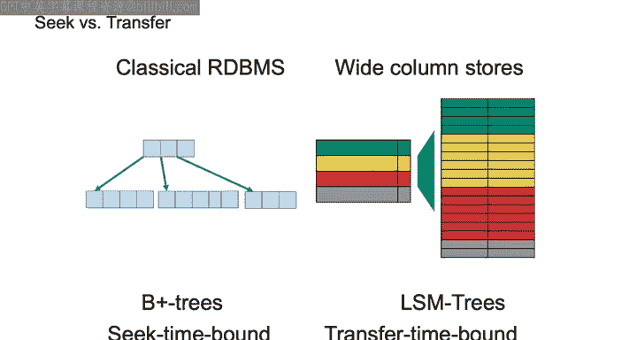

Lock structuress， me streets。So the idea of a log structurald merge tree。

Is that you have multiple level。

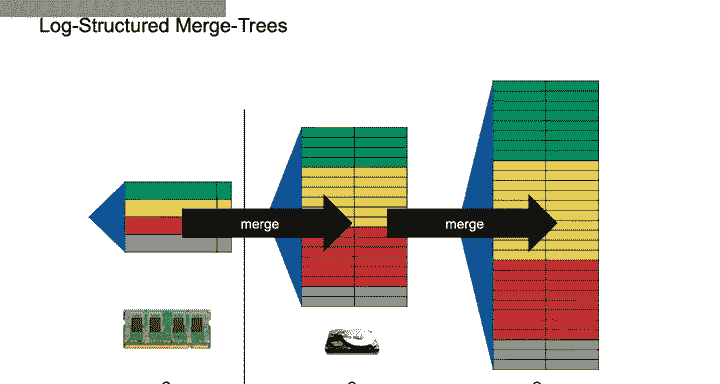

Of data storage。The top level is the actual working memory。 That's the meme store。

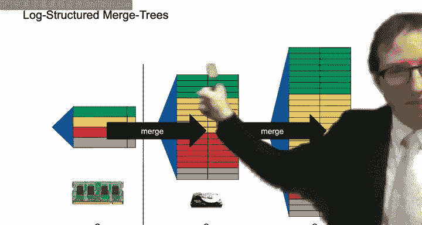

The next level is what you have flushed。To H GSS， right。

 So that's what got flushed from the memory level 1。

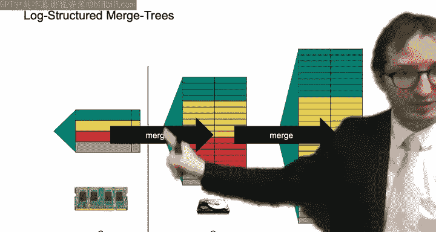

The next level is what has been compacted。

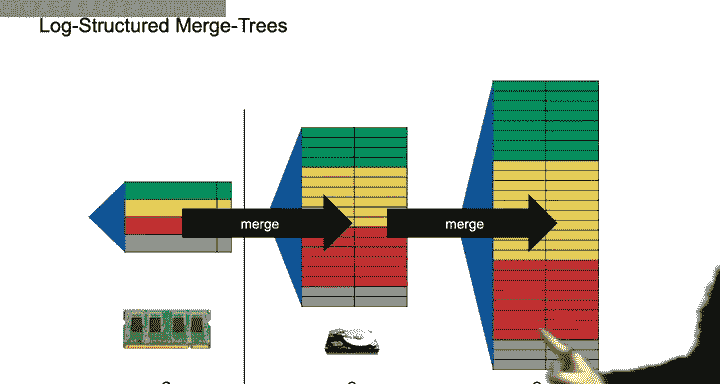

Out of this way， so you flush and you compact and there can be even more level because you might even compact and compact again。

 right and they grow even largerer and louder。😊。

So this is what the log structure battery is right and again， imagine this is the me store。

 this is when you flush and this is when you come back。

Now I have an animation for you。Who knows about the 2058 game？Already played it。Who already won it？

Oh wow， I never managed， I need to try more。All right。

 so what's about to happen is exactly like the 2048 game。

 so if you have this pattern in mind that should be easy to understand。Theres there a question？Yeah。

 no， right。 So let me continue。Let's see we fill the M store， what happens we flush to anH file。Now。

 the name story is fully again， so we。Flulash again。 Yeah， So now we get a second H flag。 Now。

200 2048， I have two H flags。So I merge them they have the same side。

 I merge them to a larger edge file。😊，Now the me story is full again。

I have another flash to an H file this is in the 2048 game where the two appears again and again and again and again at every turn so the two is basically this little H file here then I have again a flash。

Take on each line， I compact them。Get a four now have a four and a4 so I get an8 you see that that's the idea So I basically keep merging and merging and merging every time I have two h5s of the same size I merge them again and I flush again that's again or two I flush again that's another two then I compact them get a four I flush again I flush again and so on。

 In fact if you look closer you're basically counting in base two just it' it's a mirror of the base two So this is I'm rewinding this is one。

😊，This is 10， this is11。This is。Sorry， this is 1，1。 this is 1，0，0， This is 1，0，1。This is 1，1，0。

And this is 1，1，1。 Okay， so we are counting in base 2。 And that's exactly like the 2048 game。

 Who see it。Okay， so that's it， that is the log structure merge3。Now I did it in base two。

 but it doesn't need to be in base two， you can also do it in base three in base four。

 you know with more h files until you compact them right？

And so what's going to happen in the structure。I that the very very recent key values they are in the working memory of the computer。

 the slightly older values are in here， the even older values are in here and the even even older values are in here。

 so the older values， the larger the H5s。

Now it's good because those who had information retrieval also saw that because that actually is also used in information retrieval for forominD。

 so that's exactly the same atSM3 that you've seen in information retrieval。

I even joked that like to joke that if you go with a very， very large age slides。

 you might even fly dinosauur for sites because this is the oldest data。All right。Any questions？

On zoom。who's comfortable with the material has the feeling they understand what's going on？

Yeah very good I told you it's the toughest of all lectures so if you can follow that then you see now that's a question。

 is this similar to the memory cache structure。I'm not very familiar with memory catch do you mean in general the way caches are implemented I would say yes。

 I wouldn't know I'm really sorry I don't know about memory caches we could but that's homework for us I mean we could we could take a look maybe you can send us a message and with more details about the question and we'll investigate it。

😊，I war you I don't know everything， right， yes。あはいアデージ。

like updating keep here we saw like writing new H lives， so we haven't really seen any updates。

Yep， so let me un that。So。😊。

I'm going to rewrite。So the question is you didn't have a microphone right so the question is I showed you when you create new key values。

 what about updating a key value？

嗯。The idea is that in order to update a key value， you， in fact。

 insert a key value because we have a versioning system， just like Git。

So it means that if you want to update the value that is in a cell。Somewhere。All you need to do。

Is create a new key value with the version plus one。So basically。

 even modifying a value consists in adding key values to the to the memory store。

 and what's going to happen when you read。

From。

All of these places， where is it？Yeah， when you read from all of these places。

What happens is that you might you get all the key values that the user is looking for and you will get key values with multiple versions。

 you just take the latest， so all the key values that have the latest version。

 you give them to the user， all of those that do not have the latest version， you just skip them。

 you hide them。😊，If the user wants to see the older value then they can in the API。

 they can explicitly request an older version， but by default you just returned the latest version right and so this idea that updating really means inserting is very common to all the systems that are like this with consistency and a timeline of versions。

Does it answer your question？All right， in， so about the versions。

 do we get rid of them at some point？Yes， you can actually get rid of versions， in fact。

 you do get rid of versions。When can you do it， when you flush and when you contact。

So， if you。Look here， when you flash， you go through。

In order through the key videos that are in your M store。So since they are in order。

 all of those that are versions of the same cell will be together。

 that is the perfect moment to drop some of the older versions and to prune a little bit so that what you actually write on theHI can be a bit less。

The same goes when you compact。

So when you compact like here， you can also， because you travelverse in order by key。

 you can also prune the older off optionss， so every flush and every compaction is a great opportunity to get rid of older the options。

Right。Which brings us to the end of the lecture。 Thank you for participating in asking so many questions。

 We'll continue next week at 2 PMm the usual so enjoy the exercise session， Thank you very much。😊。

