# 苏黎世联邦理工《大数据｜Big Data - ETH Zurich - Fall 2024》中英字幕（deepseek - P1：-01-1. Introduction (1_2) -.zh_en - GPT中英字幕课程资源 - BV1sHPKeoEJU

Welcome everybody in the lecture hall， welcome everybody on Zoom。

 welcome everybody watching us from the future。😊，Today we are starting the semester it's the first day of the course's actually taking place。

 it's also a bit special because I'm not going to just dive into material and new things to teach you rather it's going to be some sort of appetizer I'm going to drive you through the beautiful history of databases。

 the motivation for big data and then I'm going to try to give you a taste of what we are about to do during this semester。

😊，So yes， and then the real material actually starts next week where we start studying the cloud storage。

 object storage， so appetizer and then this week what I do also is a SQL brush。

 many of you already know SQL relational database management systems from the Bchelors but to make sure that everybody is on the same page including those of you who might not have studied that。

 I'm going to brush up on this because as will see we will actually be using SQL during these course a lot。

😊，All right。Big data。What we're essentially going to do is two things， mainly。

The first one is that I teach how you can query gigantic amounts of data and that data might not even be fully structured or tabular so this is what we do。

 This is one of the screenshots of one of the engines that we are going to be using so two adjectives here。

 gigantic gigantic it can go all the way to petabytes。

 maybe exabytes and messy and we will actually give a mathematical definition and framework for messy。

 it's not just world in the air like that。So that's the first thing and the second thing is that I'm also going to explain to you how the magic of all the engines actually works because it looks like you just execute a query。

 if you go for example， to Google BigQury， you click here and the results magically appear appears。

 there is no magic， it's actually the efforts of many， many different people。

 engineers from various companies across decades。😊，That actually LED to this。

 And after all this costs， you will。now what's actually going on behind the scenes of all of these systems and some of you might even contribute to the next generations of these systems。

 right？Welcome， there should be still a few seats here and there that we should be able to find。

All right， so there's going to be a few keywords that you might have heard， for example。

 you might have heard of Hadoop already heard of Hadoop。

Many of you right the name of this little elephant teddy bear that was the teddy bear of the son of the creator of the technology then we have Apache Spk who heard of Apache Spk okay many of you the other two maybe not Ruble Ds actually was developed right here at TTH it's on top of Spk and it uses a language called Jasonsonic it's quite representative of many languages that you will have out there so if you learn this one you will be able to use many others in La very quickly。

So。I hope this one is not already on strike。Yes so。

In big data we look at the notion of the scale right it's fundamental India there so if we think of scale。

 you'll probably think of the meters right distance so the we characterizes up scale when we look around us is' basically around the meter right but if you start zooming out you will find should not be too far away probably from the computer to click you have the entire earth and here you're looking at kilometers even thousands of kilometers。

 40000 kilometers， the second of the Earth it's not a coincidence that it's actually around non-b was defined that way the meter was defined in this way。

Originally， of course， now it's no longer defined with the speed of light。

You can actually replace the kdo with mega so mega you probably know from megabytes。

 but you can actually use it with every unit you want so mega meters。

 then if you continue to zoom out you're going to be looking at the solar system。

 which has a few planets other than the Earth around the sun。

 the distance to the sun 150 million kilo， it's actually 150 gigmeter。

 then if you continue to go to Jupiter you already at a terrameter so this prefixes you probably already know right gigaterra that's probably p to you petameter is the entire solar system very roughly。

😊。

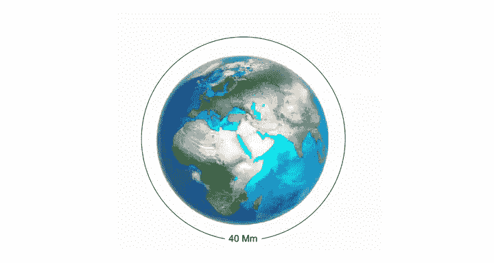

So 10 petameter is one light here， typically， if you continue to zoom out that the entire Mil Way that we are looking at10 exmeter or one zmeter。

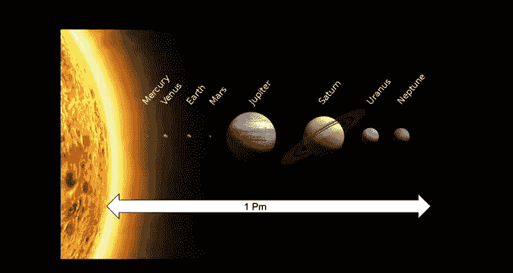

And if you continue to zoom out， there's actually billions of these at least that we can see because maybe there's even more out there and we are at 138 yota meters。

 I simplified here because that's actually if you consider the expansion of the universe it's actually more。

 but by simplifying we are already at the Yota meter。😊，Until two years ago。

 these are all the prefixes that we had now there's even two prefixes that were invented。

 we cannot use them because the universe is too small or actually these prefixes。

But an interesting lesson this exploration of the universe is that the same people who look at the big B and the entire universe also need to look at the small scales。

 they also need to look at individual particles like know the quarks。

 the electrons that make up the atoms and this is a lesson from chemistry or physics but in fact it's also a lesson for us because the same thing will happen with data we look at lab scales of data but will also zoom on what the data looks like at very small scales and you will see that it's very similar to actually chemistry when we manipulate data so I like to have this analogy between physics and data science I could talk for hours about that and I'm just going to give you an intuition behind that before that。

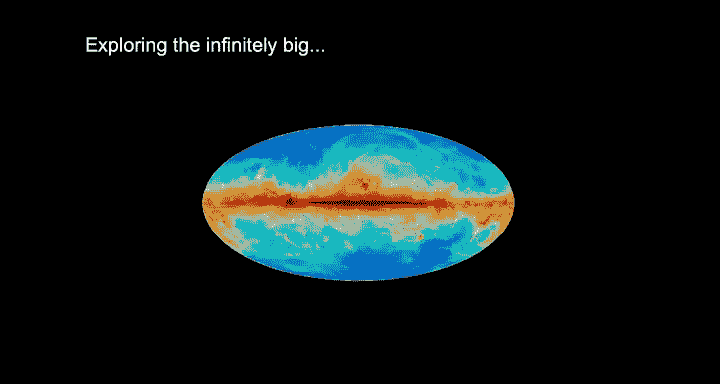

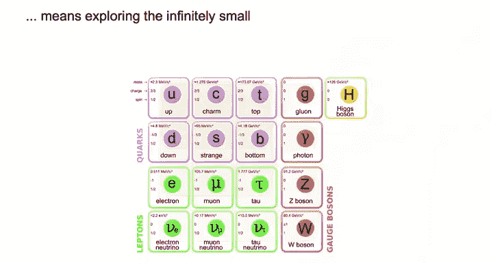

I would like to know a little bit about your backgrounds and it's an opportunity to test an application that is popular at TTH in CoI so you can go to this address right here in your browser right now or you can go to whatever app store or Google Play you have and install Eddu app 3 that's developed by ETH right then you can click and you can answer questions。

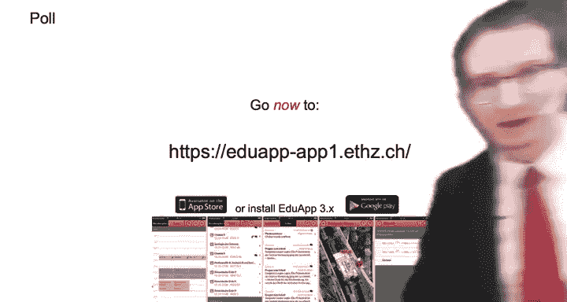

And now。

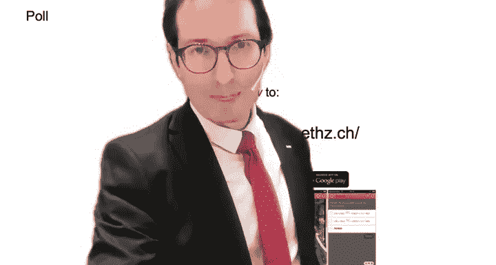

I have to move over。Right here in order to test one。 so here I will take the time to make sure that。

You can install it。 And actually， yeah。Answer is an exercise。So are you a computer science。

 Ma student， a data science， Ma student， a computational biology student with computer science skills or。

From another program。You can see again the address in the address bar here， yes。

Normally if you're registered in the system and logging with your ETH username in password。

 you should normally find it if there's any problem。

 we can debug it offline or we can contact the development team to figure it out。😊。

But normally need to just appear on your。On your foot。

So we have an overwhelming majority of computer science students。They outnumber us。

 we have a few data science students。My health students。

Giving you a bit more time than usual of course， the next times it's going to be a bit quicker when you already know how that works。

A nice thing about this is that you can do it from the lecture hall。

 but you can also do it from zoom， so we have a few people connecting on zoom and you can also answer the same questions in real time people watching us from the future that's not yet possible so you can。

You can only see the results。All right， I'm going to stop it here， so basically。

The reason I'm asking is that there is a plan for this。For this lecture。

 so let me go back to the slides。So normally， if I prepared it correctly， I'm supposed to land back。

Exactly where we were， that's the moment of truth。Have to let it do its thing。

Normally we are exactly where we were。So the reason I'm asking is that as you noticed there's a lot of people in this lecture hall and in general there's actually 450 people registered for the course。

 it' for this reason that we actually splits the course by category so this is the course for computer science and data science master students also computational biology we have an agreement。

People from other programs， they should attend big data for engineers in the spring or if you cannot wait。

 you can also attend information systems for engineers this semester which is essentially the early days of databases。

 which is just as important as big data that's a series of two lectures。

 basically the equivalent of the bachelor's lectures and relational databases that computer science students visit。

All right， so nowma， the system will not let you register if you're not in the category。

 so it's really a capacity thing we have to organize ourselves in this way。

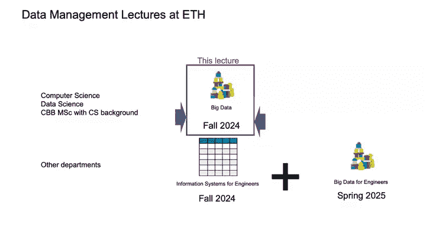

All。😊，But now getting back to why I said that physics is a little bit like data science。

 if you go back a long time ago we didn't have computers so that was completely ex。

 but we did have mathematics than physics at some point there were spinoffs from philosophy you could argue of course you can always make a counterarment of about against what I'm about to say but basically you could argue that in a sense mathematics are necessary in the sense of model logic meaning that an civilization would find the same math to some isomorphism but physics could have been different。

 the speed of like could have been different， the math of an electron could have been different。

 so the only access we have to physics is to experiments and see how it is mathematics you can just do it from an armch on a blackboard you can figure it out with your brain that's the beauty of it so this is essentially necessary and contingent would be contingent means it could have been different it's the weight it could have been different in a way。

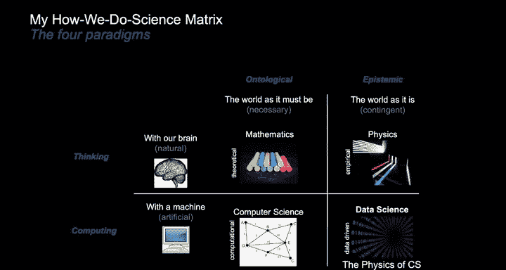

If you look at this at theoretical computer science。

 they are basically like mathematics in the sense that you can also do a lot of theoretical computer science on a blackboard。

 but data science is when you collect the data and then you analyze it to figure out things about the world that's essentially physics because you're again looking at the world and trying to figure out how it is opposed as opposed to how it could have been so this is in that sense that I like these two by two metrics visualization how this all fit so data science is kind of the physics of the computer science。

😊。

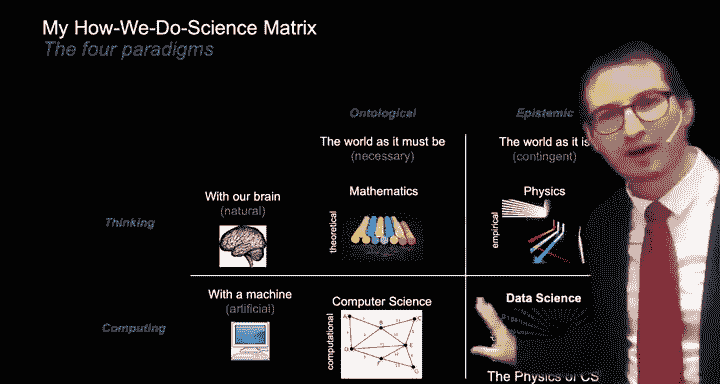

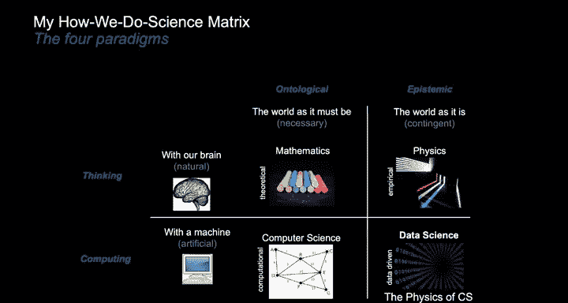

Of course， it didn't start just a few decades ago with computers already the engines had a lot of wisdom regarding the analysis of the data。

 which brings us to a short history of databases， who was in information retrieval。

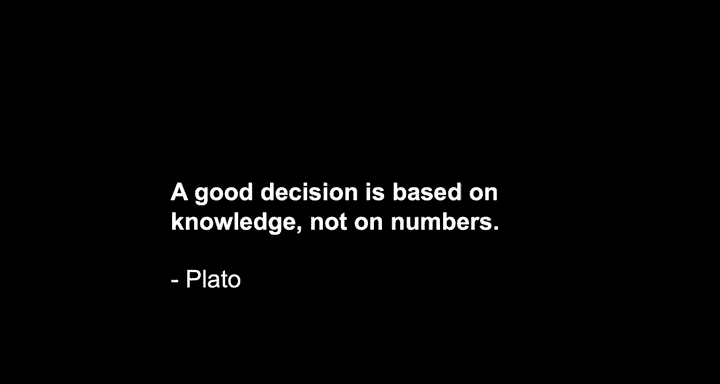

Okay， so some of you might have heard about this because I argued the information retrieval is also a database lecture。

So， the idea is that。Very long ago。 So even longer ago， the first data， you could argue that was DNA。

 right， So the four the four basis。 but as far as humans could control it。

 it's basically speaking and singing， right， You would tell stories。 You would remember things。

 and then you would tell it from generation to generation， problem。

 You can make errors that can be distorted and that can be forgotten， right。

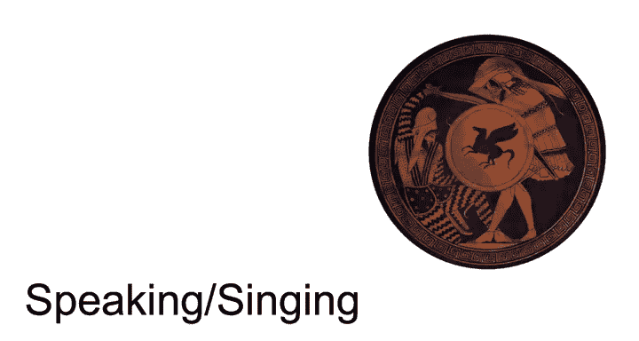

So that problem was actually solved a few thousands of years ago with the plate tablets because people figured out that you can actually engrave with some coding。

 of course you have to figure out some system to write it down but you can actually encodes the information into something that survives thousands of years which is precisely why we actually have access to this we decoded a lot of them and that has us much more information than before these existed so this was writing。

😊，But to me， the most beautiful slides of the entire course is this one。

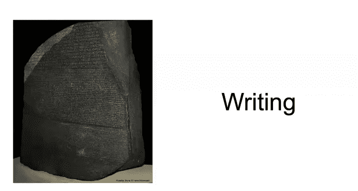

Because this is basically a 4，000 years old iPad。It's the first relational database that we are aware of it really has a popular structure so you can see that doesn't date back to the 1970s This is actually thousands of years old what we learn from this is that tables are incredibly natural for human beings in fact people understand tables much better than pie charts。

 skate plots and so on tables are the most universal。

Data representation there were a few service psychology surveys about that。 right。

 so it's absolutely beautiful。 So in there it was used for inventories， for trade and so on in there。

 it's actually the size of rectangular triangle， right triangles， right，3，4，5 and so on。

 It's actually not three for five， It's higher numbers。

 but this is basically a repository of those of them that they knew that well。

 when it was three integers。 All right， was's very important when they are flooding and you want to figure out on wetlands to recover it after the flooding。

 for example。😊，Okay， but then it didn't stop and we still had a problem。

 the problem of copying data when you wanted to copy data。

 you typically had monks that spent their time copying and copying and copying the books it was called cods back then and that problem was solved and scaled with printing with the printing press。

 suddenly you could print massive amounts of the same information and this is what led to newspapers for example。

 in who had their peak in the 19th century of course they see exist today。Then we had computers。

 so computers actually were more of an acceleration and even more power given to that and then with transistals than the silicon it only went faster what's amazing is if you consider that this kind of computer is way has way less power than the smartphone you have in your pocket but if you switch it on half of the city doesn't have electricity anymore。

 so this is to tell you how it looked back then in the 1940s 1950s in the early days of this right。

There were beautiful lectures of professors who were retired and who were here before the computer science department。

 back then it was all of that was was between the math department。

 the electrical engineering department and of course PhD students didn't have a laptop they had to prepare these punch cards with holes that they brought to some room and then overnight it would be executed and then they come on the day after that to figure out that it didn't work and so they have to do it again so you can imagine it was much more complex。

In the 197 1960s what we were working with basically were file systems。

 we had this idea of directories and files on the hard drive and this is typically how people handled their data。

 which is why when there was a turning points and this is when we can call it database history。

 there is a person called Edgarco。😊，We thought that this is way too complicated。

 having to look at directories and files and open them and pass them and write them and so on。

 so he figured what's the thing everybody understands a table so the data should be exposed as a table and manipulate it as a table to the people who access the database all the rest has to be hidden in engineers will figure it out but the people who use the database shouldn't have to worry about the complexity and that is the beginning of the relational error at the beginning of the 1970s。

😊，A little bit later， there were more technologies that appeared because that actually reached the limits we talk a lot about this in the lecture。

 you might have heard of the keyVU stores at some point that was as high as the blockchain keyVU stores everybody wanted to have a keyVU store。

Cton stall， tripleper stall， that's for also some sort of different way of doing artificial intelligence。

 there's other ways that machine learning so that's so very useful and document stores which we talk a lot about them。

 the notion of deormalizing the data。嗯。So the big data is a buzz world， it can be hard to define。

 so I'm going to attempt to define it some people might disagree。

 but essentially what characterizes it is first that a lot of that appeared in private companies。

The reason is that these are the companies that experienced problems that they had to solve because they were on a scale that merged beyond what we have in academia。

I'm not getting any money from them or you know， anything。 I'm just saying that， you know。

 you might see that kind of this kind of of names just because this is where it was invented by their engineers。

When we say big data， it's very common to talk about the threeVs。Varieity， velocity and volume。

 There's also veracity that sometimes is considered the fourth one。

 So let me quickly go through them because this is a good way of describing what big data is about。

 So let's start with the volume。

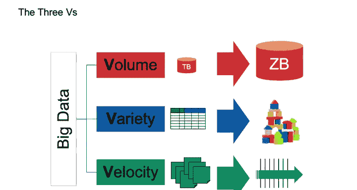

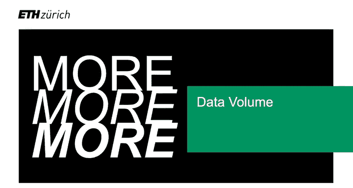

The volume of data。Increase the lot。 And the main reason is because we can。

 We have the capacity to store it。

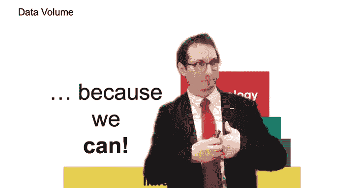

So we just store and it has become more complicated today actually for good reasons for privacy reasons。

 data protection， you can no longer do what you want， but this was driven by technology。

 the software， the hardware that there was the capacity and the whole infrastructure， for example。

 the clouds， right？

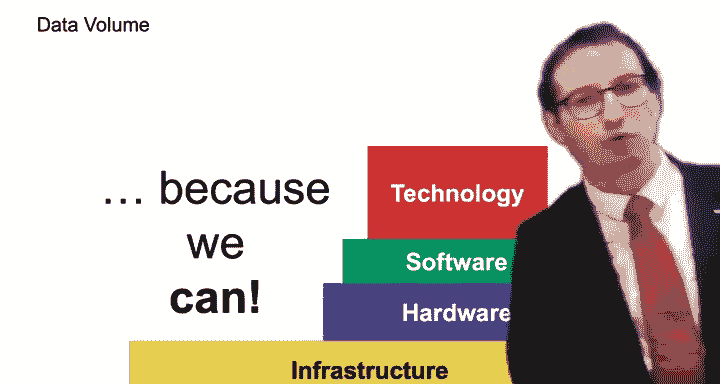

Another reason is that data carries value， a lot of value because out of the data， you can act。

 you can extract insights and information that can improve your productivity or your knowledge。

And another aspect of data is that if you have multiple data set and you look at them together。

 it's more than the sum because you can do what's called the join between the data sets。

 so this is extremely powerful can also come with a lot of responsibility of course。

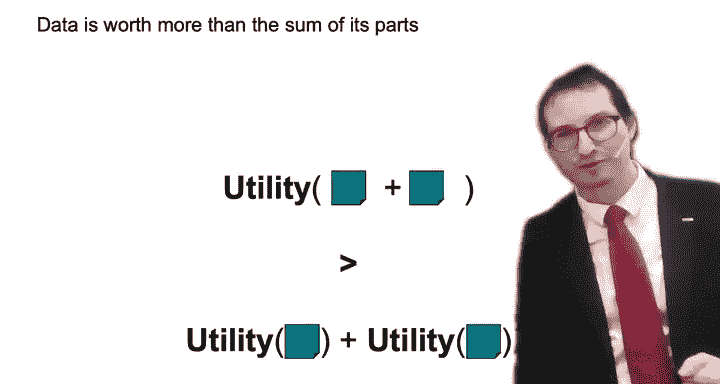

Another aspect is data totality， there's websites that only make sense if they have all the data like booking flights。

 booking hotels， shop reviews and so on。 so this is also a driver for the volume。

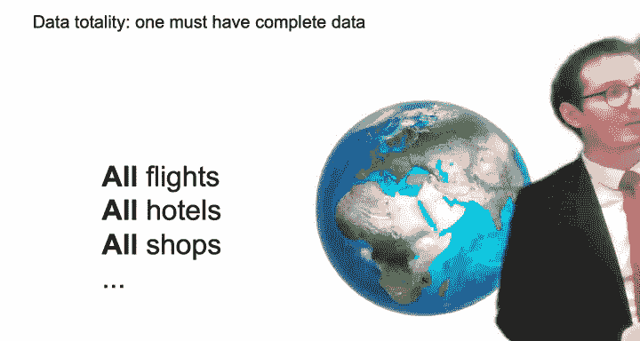

And here we come to your first assignments of the semester you have to learn these by heart you probably already know let's say these ones you already know them these ones maybe not necessarily so these are all the powers of 10 and it standardized there's an international body who actually standardizes all of this these two are quite recent it's one or two years old because they run out of prefixes I think it was for the mass of Jupiter that they needed this。

And so you have to know this by help goes all the way to 30 zeros。

 I have a trick if you speak a little bit of Greek or you know some ancient Greek。

Think of how do you say for Peka， Penta Hexa and so on So these are already if you if you think of Greek。

 this is actually probably where it was even coming from and they had it mind in fact。

 even that like Nna it was inable so by 10，9，8，7654 and so on Another way to think about it is four it has four groups of three zeros Penta five groups of three zeros so that's how I remember actually these these prefixes Okay so that you have to know by hats prefixes。

I have another question for you。It should be quicker this time。

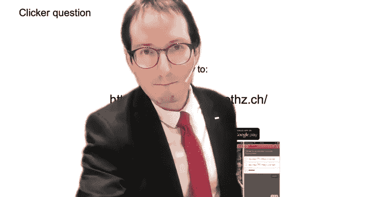

So what quantity of data do you consider to be big data？Mgabytes or gaytes is not there。

 you shouldn't exaggerate gigabytes， terabytes， petabytes， exabytes， theabytes probably also。😊。

So what do you think， what is the threshold from which you would start seeing that big data？

And start looking at the ourselves。Viabbyte has a majority votes and it's actually quite common and a lot of people see it that way。

😊，The main driver for this is basically that this is the first one that doesn't fit on a single machine。

 you don't have petabytes sized hub drives， but terabyte is fits on a laptop。嗯。

Tabytes is already interesting from a big data perspective。

 because that might already hit limits even though it fits on your laptop。

 it might still be too slow， but that I'll explain with mapR how it can be also useful on a single machine。

Exabbyte， there are many companies now that have reached the exabyte threshold in terms of the data。

 Zeabbyte， Yoabtes， we are getting there because humanity keeps producing more and more and more data。

 in fact the data we produce in just a few years is typically the same as what has been produced before that for the whole of humanity。

You take all the way to today， whatever's been produced in the next two or three years will produce the same amount。

 just to tell you the increase that we are looking at。Okay。I'm getting back。我谱里图。Where we left。

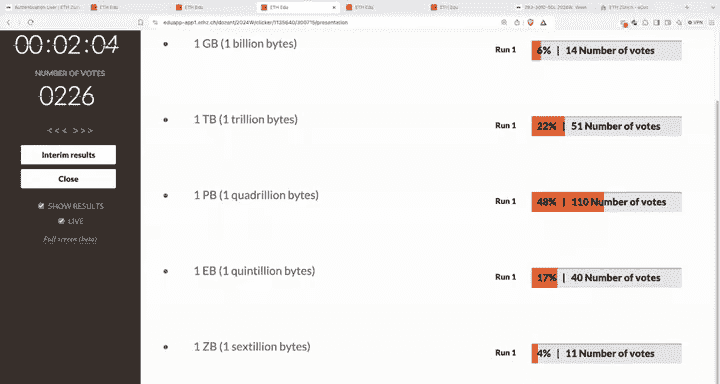

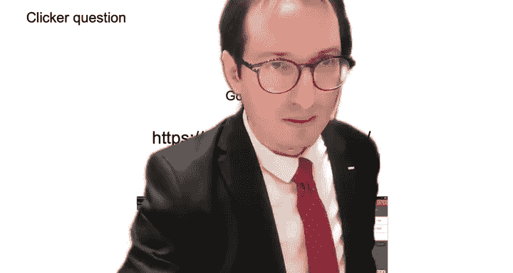

Okay。So you see in terms of the evolution for big data。

 we basically went to Jupiter in just a few decades。

 if you consider the comparison that I did help with the Uni。

 so this is saying the speed at which the computers evolve is extremely impressive。

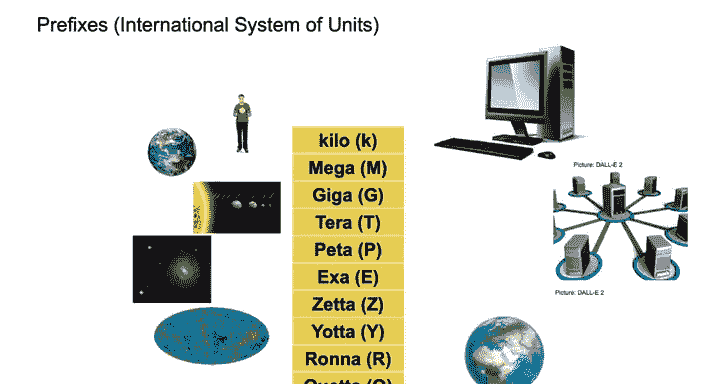

I have to reassure you that I'm not asking you to learn by heart。

Even though there are people who actually enjoy learning by half powers of two。

 but some people tend to use the prefixes we saw earlier for powers of two it actually have it has to do with the fact that two to the power of 10 is roughly thousands and because of the roughly people think of the kilobyte as 1024 bytes and so on but if you want to be rigorous now there is a st out set of prefixes for the powers of two。

 which approximates the powers of 10 maybe more here and a bit less here so these are these are the prefixes you might know that there exist just be aware。

 but be also aware that some people use the other prefixes with the powers of two so just be careful about these。

Okay。😊，They are not that common。 I mean， some people use them。

 but it's much less common than the others。 that takes care of the volume。 Let's take care。

 Let's look at variety。 What do I mean with variety。

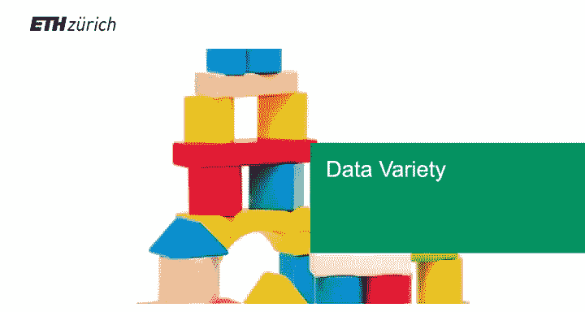

Data has shape has shapes， so the first shape is the one that I mentioned tables。

 but data can also look like a tree and I mean tree in the sense of computer science。

 theoretical computer science trees we see a lot of them in this lecture I tell you how they relate to tables。

We have data that looks like graphs， graph database at some point where we are quite high。

 Maybe they still are a bit today。

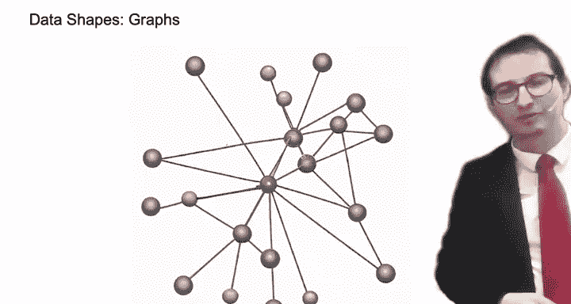

Then we have data that looks like cubes that actually dates back to the 1990s with business analytics that's still very popular today for companies to prepare their res。

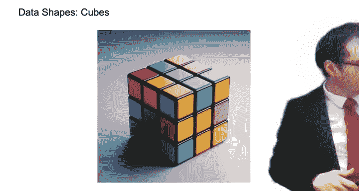

And finally， next， which now could be considered vector databases kind of do that job right in the context of large language models。

 So you originally we just dropped the text as characters on the drive and analyze it in plenty of ways。

 but now you can put that in a vector database and look at the data like vectors。

 We actually did that in information retrieval for those of you who attended it All right。

 so these are the fundamental shapes of data， there's really these five tables， trees， graphs。

 cubes and unstructure or text， I'm thinking in the long term whether I shouldn't spin off the vector databases from unstructured and make it six shapes that still hovering in in my mind。

 maybe you can tell me what you think about that， right。This is not a chat GT lecture。

 There is an an LLM lecture， actually in the in the department for those who are interested。

That is variety， and we will see variety in this lecture。

 We look at the other shapes of data and how they are characterized。Vocity is the third leap。

Velocity has to do with consuming the quantity of data that we produce because that's a lot。

Let me just show you。A quick story for that that is the best way to see what happens。

I'm going to oversimplify， of course， but I'm going to oversimplify with three wells that I'm giving a meaning to。

 some people might use them in a different way， but I'm going to talk about capacity outputputs。

And latency。With capacity， I mean。How much data can we store the capacity of the hub drive？It's加 a c。

The throughput is。😮，How fast can we read it or transmit it right So it's so this is in bytes。

 this is in bytes per second。And then the latency is how much do you need to wait until you start receiving data？

Some people use it differently， they call la C until you stop receiving data。

 right including the transmission， but in that context of the lecture。

 I use Latin C until you start receiving data and after the la C is gone。

 then you start transmitting the data Allright， so this is in seconds。

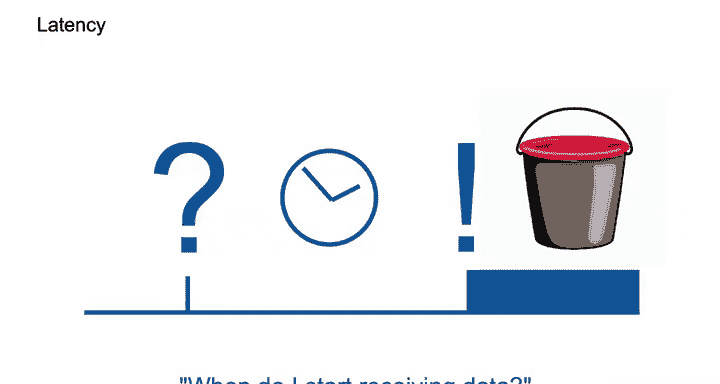

Now let's look at the history that rewinds the first commercially available hard drive that was part of an IBM computer dates back to 1956。

 I don't mean a disk， I really mean a hard drive。It has an incredible 5 mebytes of capacity。

 It could read 12000 characters per second。 The la C was600 milliseconds。

 which is a lot by today stand out The reason is's quite simple， It's actually that big。

 So it's really very big。 It's the1 me 70 times1 m times 70 centm。 So this is absolutely gigantic。

 And if you think that that actually stop just 5 mebys by two stand out。

 So let's compare it to today just to explain the la C where is the la C。

 because if you look inside therell disk The disks rotate and you have a head that reads。

 So if you want to read this you need to rotate it all the way to here。

 This is where the la C comes from you need to wait until it spins。😊。

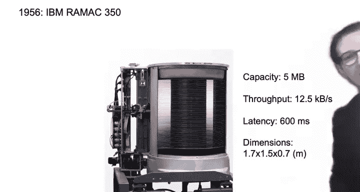

All the way to where you can reach the actual data。

Now this is what we have today if we go to 2024 it might be there's even better now。

 but that's the largest I found， I even have to zoom because it's so small。

 this is the Western digital Utra star it keeps switching between several brands。

 but right now they have the records。

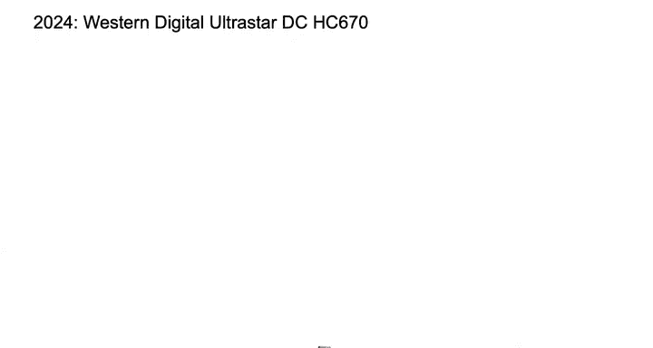

It has 26 ter on a single drive， right， It's not several drives。

 It's a single drive throughput 260 me per second， the Latin C 4 meiseconds and the dimension is like this。

 I can hold it in my hands， right， You probably have it in your laptop。😊。

This is a hard drive as opposed to flash drives now there's SSDs， we could do the same with SSDs。

 I just wanted to keep the comparison with the rotating disk right。

 but you could also take an SSD and do the same thing。

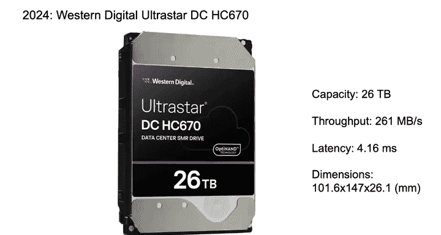

Okay， so。Maybe I ask that question a bit later， let me continue。Ting to be mindful of the time。Yes。

 so this is。The progress that we have made if I take the absolutely gigantic5 megabytes drive and 26 terabytes Western digital drive。

The capacity， and I normalized it by unit of volume， right it's a bytes perbic cubic centimeters。

 it increased by this much。Now you probably wait until I click and this appears。

 but I don't need to because it's already there。 This is by how much the throughput。

 the speed at which we read it has actually increased and the let and see you don't even see that by how much it decrease。

 so I can actually put the numbers， by the way， these numbers keep changing first because I'm actually bad at computing stuff。

 so I can make me6， but also because it keeps evolving。

 So currently this is what what I computed in terms of evolution。 So 23 billion times more capacity。

😊，But unit a volume， 20，000 more through boots and 100 times less latency。We are in big trouble。

 This is really， really very problematic。 and the way it's very problematic。

 this is just a logarithmic scale。I will explain like this。

 imagine that today we take a book by analogy and that book has a capacity of 600，000 wells。

 this book right here。The throughputs would be the speed at which a human being can read。

RightSo that might be， for example。1000 wordss per minutes， right。

 And the Latin see that's when you need to get up and go to the shelf and grab the book， right。

 as an analogy。 But let's focus on the first two。 If you consider the capacity and the throughput。

 a simple division tells you that you can read the book in 10 hours。 That's quite reasonable， right。

 if you take the latest than Brown， you can just read it in just a couple of hours。嗯。Okay。

 but now imagine that I'm going into the future， two centuries from now。

 that's much more than the time separating our two hard rice。

Imagine that things have evolved to their points。By the same factors。To the points that。No。

Two centuries from now in 2224。We have so many world that I have to think about how much that is that should be 14 Queensilian。

 no 14 quadrillians。Wors and we can only read 20 million words per minute。

 Now if you do the math that's  a thousand0 years to finish it。 this is why we are in big trouble。

 If you try to read a hard drive in its entirety today compared to reading a hard drive in its entirety 70 years ago that's a massive difference and that has to do with the discrepancy of the evolution of the factors。

 this is a huge problem and this is really the driver。

 if I have to explain big data in just a few seconds， this is what drives big data because。

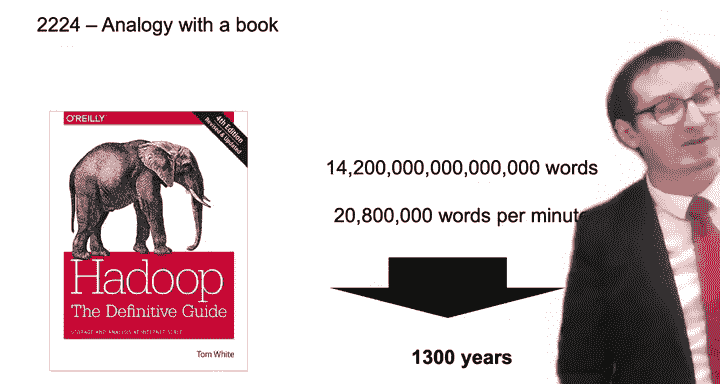

The fact that we have a discrepancy between the evolution of capacity and throughputs is exactly what causes us to paralyize。

And the。Other one let me tell you， just coming back。Computer， yes。So between throughput and latency。

 the other two， this has to do with batch processing what that means I'd explain during the lecture。

 but we can also do things that solve that but talking about Taism。

 parallelism means imagine that you take that huge book from the future。

And you just cut it into subsets the artitions of the book and then you spread it over the whole earth or the old members of a social network。

 let's say you spread it over 200 million people， then you're back to 10 hourss。

Thanks to parallelism， but now you need a lot of people who do it。

 but this is one of the very rare freeancees that we get also with the cloud is that with the same amount of money。

 we can do the same thing much much faster if we spread it and parallellyize。😊。

But I'll come back a lot to these during the lecture。All right。

 so parallelization we are back to 10 hours if we partition and spread over our many people。

 in fact that's the reason why in data centers we basically have many。

 many machines because we parallellyize across the machines that's one of the secrets of the big data。

The other one， as I said， is batch processing。

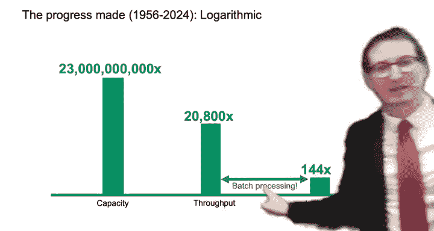

So big data， I think， can be defined as the set of solutions that we came up with over all the time。

To solve the discrepancy of the evolution of capacity throughput and latency。

 if evolved if it had evolved in the same way， we wouldn't even need big data， but because it didn't。

 we needed it to invent all of these new technologies。Big data is everywhere。 It's used in science。

 One of the main customers actually of big data is the C in Geneva who visited the C already。

 Probably you have an opportunity if you haven't yet。

So you can see this is the evolution of C and that's only the other the way to 2017 in terms of the data that they produce because in fact。

 discovering the Higgs bosom is a database problem。

 you just gather the data from the collisions and then you execute queries and oh we found the Higgs boom。

 but you found it on a computer screen executing a query。嗯。

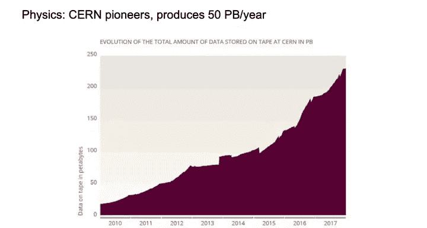

There is this paper if you're interested by the way。

 but how that explains it's an analysis of using query languages in order to analyze the sound data。

 so just if anybody's interested written here at by SET。

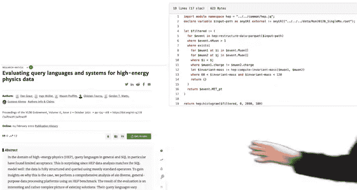

Another use of big data is astronomy。 There are people who are trying to systematically gather a catalog of everything that there is in the sky。

 everything we can see and there is a refinement every couple of years with a new version So the last time I checked there was a billion objects on the different spectra like visible light in red and so on。

 So this is also a very interesting Now it's the pursuit of exoplanets finding life。😊。

At other places， I'm not talking about intelligent life， just biological forms of life at that point。

Okay。😊，Another aspect of I actually mentioned that in the history of data is the genome。

 the DNA that we have and here it's very impressive the progress that we've made because now we have techniques that can actually edit and cut and replace DNA together in order to do what we want we also know how to synthesize proteins with the RNA you all heard about the RNA vaccines the way it works it's actually computer code and there's the blog post I can send an initial you're interested that explains how the RNA vaccine works but it's essentially the copies of the computer code on thequiillions of copy dose of vaccine that contains the code of how to build the protein。

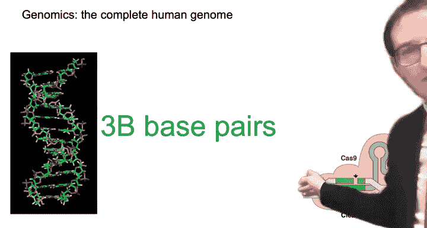

So this also has to do with data。In fact， people even use DNA as a storage layer。

 you can store relational data on DNA and execute SQL queries on top of that it one of my colleagues who now is in the UK who Thomas Heinis Corarhar a beautiful paper about this so DNA is also a very promising place to actually store the data in the future。

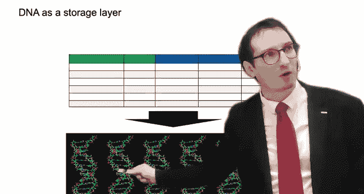

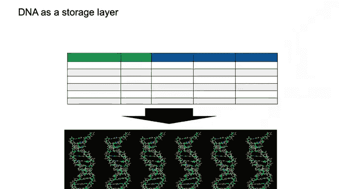

Allright， so now the course because we are looking at no big things like discovering live and so on。

 but let's get back to the lectures So what we will study is the database aspect of data science and big data machine learning AI that's on top of this you can extend this system with machine learning capabilities Sp for example as SpM and so on but it comes on top of what we are doing so it's a spark layer that is then complemented by other lectures。

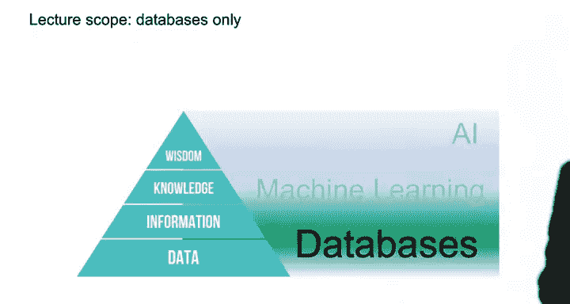

This is the dream team that we have。 We needed a lot of Ts because we have a lot of students。

 So here they are。 Some of them are in the room。 Can you maybe stand up so people can see you。

So these are all of the TAs who will organize the exercise sessions。

 they support you if something doesn't work， they'll help you some of them will design the exam for you at the end of the semester or grade it double check all right。

 so maybe let's give them a round of applause to incorporate that。All right， so thank you very much。

😊，嗯。You might have noticed one， at least one of them who is not sitting in the room right here because she's actually sitting somewhere else。

 That's Ether， who heard of Ether。Weho never heard of E。Wow。

 so Ehel is actually a large language model that is built on top of the open AI Ch GT model。

You can consider it as a student， you shouldn't consider how to be at TA just as students because you know that LLMs can hallucinate and make up things。

 but basically。Ethel was trained with the textbooks of several copies that EP and big data is one of them so she learns the textbook and now you can connect to Ehel。

 Eth doch if you want to do it now Ehel。 Eth。ch you need a switch ID I don't know if you already have one it's an academic thing in Switzerland that you can get with your EthH account and once you're logged in then you can just ask all the questions you want about the textbook of the lecture right we might need to bring her up to date with the latest content but it can be a powerful tool and if you have feedback on that I'm happy to hear this right。

😊，Okay。Now in this lecture， we are going to look at a lot of very interesting topics。

We are going to look at how to store data in many kinds of way， how to encode the data。

 the syntax and so on。You will hear of S3。Asia B storage， HD DFS， H is for Hadoop。

 Json Xme Yamer Paque Avro。 We look at models。 So the white color stuff like Hbase。

 Cassand drives and alternative if you want。 Who have about data frames。

 Everybody heard about data frames， pondas and so on。 So we look at data frames。

 but will rigorously define what a data frame is in terms of the model。😊。

We look at schema validation that has to do with data frames as well。

Then we look at how to process data， How does it flow in a data center right so we look at the first generation map produced then we look at the resource management aspects of this and then Sp Apache Sp which is the second generation of distributed processing and finally we look at the management level how we can store documents like who knows MongoDb that's one of the NosQL companies So we look a little bit into this and then at the top level of the level of abstraction。

 we look at query languages so SQL Jsoni and so on there's many of them So I'll explain to you in particular the difference between a query language and an API onnda is an API it's not a query language a query language allows you to very succinctly write queries and it's very popular even with noncomputer scientists X SQL。

 for example。

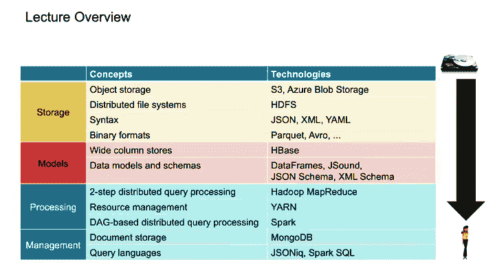

Okay。So。Now， here's the plan that I have updated that slide。

 but I correct that that should be three24， not one22。So if you attend the weekly lecture today。

224 every Tuesday， and on Wednesday nine to10， it's in the lecture hall right there behind E5。

If you attend the exercise session， not this week， there is none this week， starts's next week。

 it's on Wednesdays and Fridays for two hours。😊，By the way I know it full we will extend the capacity。

 you don't have to worry about that， we will provide more capacity。

 we'll have the TA meeting in order to plan all of that so that next week you will be all set for for the exercise group it might be that there is a support session to test Docker will inform you or so the TT will inform you if that actually takes place if it's not this week it's going to be next week right but the goal would just be to test that on your laptop Docker actually works and you can run our software。

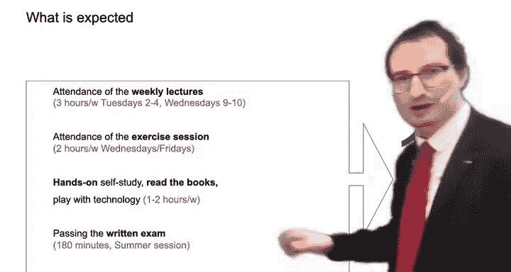

Then you're supposed to have the some hands on self study one or two hours is for big data for engineers for you it's three to four hours because you get 10 credits right that's the third of the full time on in a semester so it's expected that you read that you practice that you learn there is a little bit of learning by heart。

 but this is when you study history learning by heart basically。

Makes you learn all the mistakes that people have done so that you don't reproduce them so it's actually very useful and of course you can play with a lot of the technology that we have in the lecture and finally there will be a written exam at the end three hours is just because we want to give you time we don't want you to be too much under time pressure so we give you three hours but I always tell the TA team no more than 60 questions it's a computer exam you know multiple choice fit in the gaps that kind of things at most 60 questions will provide you with past exams as well。

If you pass the exam， you get 10 credit points to your transcript。Plus。

 we have bonusny spots that actually are quite popular at TthH。

If you study well during the semester and you solve the weekly decreasezzes。

 you might get up to a quarter point of boosts to your final rate that gets studied so the way it works is you'll have 25 quizzes Mole quizzes during the semester。

 if you pass one that's plus 0。0 well。We add these points before we round so when we convert from motor we get a row grade that is not rounded to the quarter of points then we add the bonus points and then we round so it means that you may or may not get an increase but the more points you have the higher the likelihood is that you're going to have an increase it's like stochastic in a way all right if you get on 25 it's guaranteed you have an extra quarter of points okay。

Maybe I can actually stop here， it's going to be the break， I think it's going to ring at any moment。

I know what's going to happen。 I'm going to start talking about this light。

 The minute I start talking about this light is going to ring。 and then we have to go to the break。

 see what I say。 So it's the right thing to do。 So I see you in 15 minutes after the break at a quarter past three。

 and I'll tell you about this。😊。

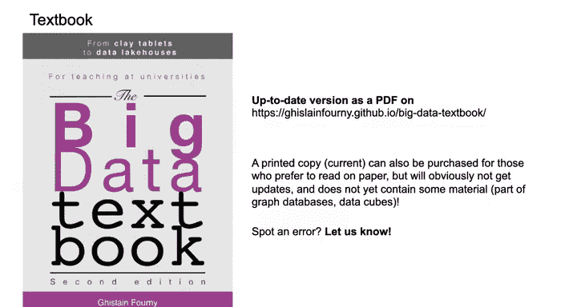