# 苏黎世联邦理工《大数据｜Big Data - ETH Zurich - Fall 2024》中英字幕（deepseek - P20：-20-6. Wide column stores (4_4) -.zh_en - GPT中英字幕课程资源 - BV1sHPKeoEJU

Welcome everybody in the lecture hall welcome everybody on zoom welcome everybody from the future。

 so today we are going to finish this lecture on white color stars which is basically age based or big table After that we will move over to data modeling and especially data frames and validation。

😊，So where were we so last time I told you about this mystery。

 how can it be that H base has a low latency， you can read and write it's almost immediate。

And yet it's on top of HgFS and the data is stored on HGfS。

 but you know that HgfS doesn't have a low latency right when you access something on HgfS it takes time。

 So how can it do that Hb is actually is actually a low latency And then I told you the secret。

 The secret is that the data is， in fact the recent data the fresh data is kept in memory in the me store And then it is flushed in a single go as a softed sequence of key value pairs to HgfS。

 but that doesn't happen all the time。 It's only when the memory is full。

 And then we saw that when you start having many files that were written then you start compacting them to larger and larger and larger files over time。

 So there's flushing and compaction right。So in fact。

 somebody asked the last time about caches and how it relates to the caches that you might have like L1N2 caches with the CPU。

 it's kind of related although on a higher level in a way you could consider that the MEM2 the MEM store is a right cache in the sense that it's data you put in the cache that is not yet propagated to or that hasn't been written back right so with the comparison considered that the meM store is a sort of cache in the direction of writing。

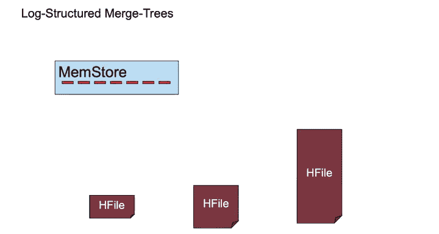

Now as it turns out we also have a cache in the other direction which is when you read so it's just not the same thing as the me store so you do have in memory a copy of some of the of some of the data that is actually on HDDFS because it's old。

 but you still maintain a copy of some of them in memory why because maybe it was used recently or maybe because you use it often right so it's a difficult criteria for inclusion in your cache so that means that the keyU pairs that that you access a lot or that you've accessed recently are also in memory。

Then you don't need to read them from HGFS， right？This is the point at which I should mention that when you cache this is done at the level of these age blocks right you don't do it with individual key values but you load it age block by age block right when you put it in the cache as a copy so I hope it don't solve the other question of last time how it relates to caches so again you can see this cache that is with very old data you can see it as the read side of the cache but you never write back to it and then the name store as the right side of the cache where you have the data that hasn't been persisted yet for whom is this clear。

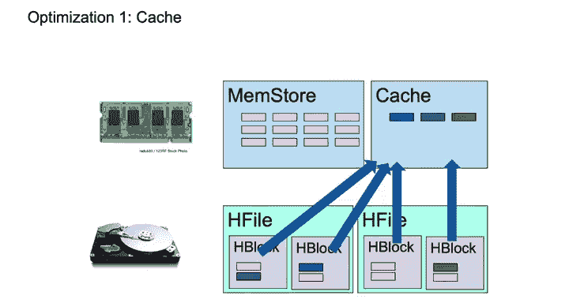

Right， okay， very good。Then there are cases where the cache is totally useless。

 at least the reading cache。😊，First， it's when you batch process。

 we will see with mapre send back that there are cases where you need to read all of the data。

 all of that you have a data set that is one datate and you need to read all of it here。

 the caching is totally useless because you anyway need to read all of the data and you only read it once So the cache then is totally useless we'll see how it's called the why it's called batch processing very soon。

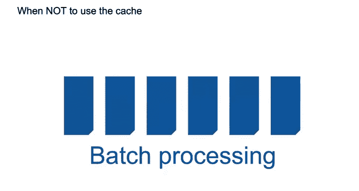

And the other reason might be totally useless less is when you have random access。

 you just access the data totally randomly and there's no pattern。

 there is no hotspot so a hotspot is what you call the regions that have a lot of reads or a lot of rights so if there's no hots spot and you really just access the data randomly the cache is totally useless less as well right so you or you always need to think depending on your use case depending on your access pattern and that depends on the project if it's actually helping to have to have a cache nevertheless the main story is always there and and this you need in any case when you write the data。

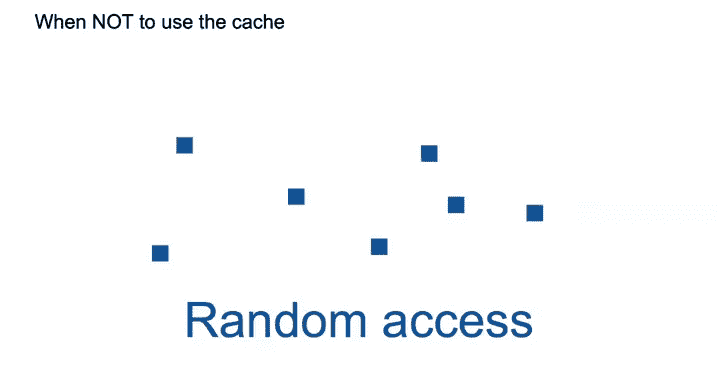

Then there are a few optimizations because as I told you。

 so flashing and compacting is obviously already an optimization because you have less fights to look at。

😊，But basically the difficulty here is that whenever somebody wants to read key values。

 you need to look everywhere。 they could be everywhere。 you need to look at the main store。

 you need to look at every single H file because you never know there could be key values that you're looking for absolutely everywhere so you have to read everywhere Can you do better than that Yes。

If you have extra information that you have the guarantee that an H file is not going to contain anything then you can skip it how can you have this guarantee where you have two ways basically there have many others but I'm going to explain these two the first one is that you might have in every H file some information about the key range that is in there like the minimum key and the maximum key that is in there And if you're looking for a key that's not in that range you can just keep reading the H file entirely because you know for sure that it doesn't contain anything you're looking for right so this is one weight's actually not just for Hbase but very common to many big data applications that you can optimize in that way。

嗯。And the other way is called the Blo filter。ABlo filter is what I think in in eastern Swiss Germany。

 you would call the pro。 It's something that maybe tells you the truth， but you're not quite sure。

 the idea is that its it's telling you that。Fox sure。The key is not going to be in that file。

 so in that direction you can be certain， so the bloom filter is going to tell you for sure nothing you're looking for is in there。

 then you skip it。But in the other direction， there's no guarantee basically tells you maybe a key value is in there。

 maybe yes， maybe no， it's not impossible， but I'm not saying all right。

 So it's really a maybe answer in the other way around right So it's asymmetric right if the answer is no。

 you're sure it's no， if the answer is yes， that's actually a maybe Okay so this is a bloom filter。

 you might have exercises actually on that because it's quite interesting the way it's done。

It basically uses a combination of hash functions， so you have some sort of beatmap with bits and then whenever a key is written。

 then you update the bitmap in such a way that because of the properties of the hash function。

 you have that guarantee that if it's forced then that's certainly a true a true negative and if it's and in the other way around。

 if it's true then that's a maybe。Okay。😊，So that's a gl filter。 Everybodys with me。

So the one thing here that is very important and that you have to remember is that this is not just these sort of things。

 it's not just for age basedase， that's a very general thing in big data when you have data that you have to read for a lot of files and you need to locate data in there。

 you want to optimize with extra information so you don't need to read all the files and you can skip some of them in order to improve performance。

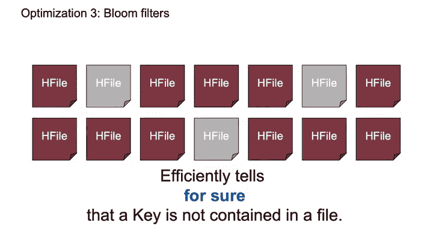

Okay。😊，All right。Now。I would like to say a few words about the bootstrap。

 because this is a question that some of you ask me offline， and I haven't really explained it。

 I might have mentioned it， but not really explained。

It's how do you know where the regions are solved， how do you know which region server serves what region？

So the first intuition if you think of HDGFS might be okay。

 maybe the Hmaster knows that and you need to ask the Hma every time just like you connect to the name node when you want to know where the blocks are in HGFS right so the first I might have been the Hma but in fact that's not the case the Hmaster is really not responsible for knowing or keeping track of where the regions are solve it's only responsible for creating tables。

 deleting tables you know these sort of tasks but the path about keeping track of the regions is actually delegated or outsourced somewhere else that somewhere else in fact is one of the regions server that holds what's called the meta table。

That meta table is actually a table like all the others， but not exactly like all the others。

 because the first difference between the meta table and the other table is that it's small actually maybe a few megabytes so it means the meta table fits on a single machine it's not shdi or separated like the other tables would be really fits on a single machine。

So that that's the first thing and the second thing is that everybody knows where it is。

 the meta table， so when you decide basically you can create delete and update tables through the H masterster。

 but when you want to query for a region and know who is responsible for region。

 you just connect to whichever machine holds the meta table。

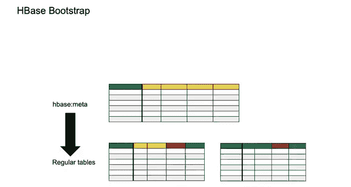

How do you know？Where that meta table is， how comes everybody knows it。

 this is with the magic of distributed system protocols that are outside of the scope of this lecture but it's basically the idea of having a Pito PR network of machines that is able to elect leader and that is able to synchronize and agree on some on some truth right and so this piece of software I mentioned it last Wednesday is called zookeeper zookeeper is a distributed systems technology that allows older machines。

😊，To kind of know where that meta table is right so this is done with some Qrum protocol that is a bit similar to what we saw in stars。

 but I don't want to talk to you about it because again that's outside of the scope of this lecture so that you can see in Professorvaofels lectures。

 for example， on distributed systems and Paxos and blockchains which is very interesting。

So for the purpose of that lecture we take it as a given it's magic that everybody knows where that meta table is on that server right there。

 so whenever anybody wants to query data they just ask the region server that has the meta table and based on the answer from the meta table then you know where you request the regions and that you do directly connecting to the region server there's no need to go through the H master for that right so it's really really decentralized okay if you look at the meta table in fact what there is in there is just a list of all the regions。

 all the tables and all their regions and for every region you have the interval of the keys so the minimum included and the maximum excluded you have the IP address of the region server that currently solves that region you have a flag that tells you if that region is actually in the middle of the split in which case you must be careful and and so on and so on right so this is。

What there is in that special table。 And that is what gives us the bootsstrrap of everything。

 And this is why everybody knows。Where is what is stored well。给。

Now I could also say a few words about the split because people asks， I don't have sites。

 but I can explain a little bit， you remember that if a region grows and grows and grows to the extent that it's actually becoming very difficult to manage for the region server。

Then the region server is going to split that region into two regions。So。

If you consider that the split happens immediately， it means what you need to do basically。

 you need to make sure that the meta table is updated。Because it needs to know about the split。

 So instead of one row， you're going to have two rows with each half。

And you need to make sure that the H files after other split will be split too right if the H files is contained the whole region and you split the region。

 then it means that every one of these H files also need to be split in two right who agrees who sees that。

Right， okay。But the thing is， in order to be efficient， that doesn't happen immediately。 in fact。

 when you decide on a split。What actually happens is that there is it's cheating it's basically pretending that it's already split so what happens is that in the in the meta table you add this flag saying carefully that region is split and these are the new regions and this is which machines are serving them。

And then the clients that connect will see that it's undergo splitting and they are going to connect。

Individually to the two hats， depending on what they are looking for。

 and when you connect to the region server handling one half of it。

 the region server at first will have to reach the old H filess。

 the H5s that contain the whole region， it just needs to ignore the other hat。

So it's a temporary measure that you're still using the old data， you're still using the old H files。

 but you're just ignoring the order half。And what happens is that with time。

 but this is asynchronous at some point， whenever you need to do flushing or compaction。

 then you split it， you will start splitting the H5s as well over time。

 either actively or as a reaction to compaction， for whom does that make sense？

Right so it means the split is efficient right you start with pretending that it has been split。

 but you still work with the old H5s and over time you start also splitting the H5s and and the me store Okay。

 so that's the high level on how it works again， so if I summarize you still connect to the Hma to create to deletes to update。

 meaning you add a new current family， you really remove a current family。😊。

But if you just want to read data， you directly connect to the meta table and you know where it is thanks to zookeeper and then you connect based on what the meta table told you you connect directly to the region server that solve your region okay。

 so now you should have this high level picture。Of how H base is actually working， okay？

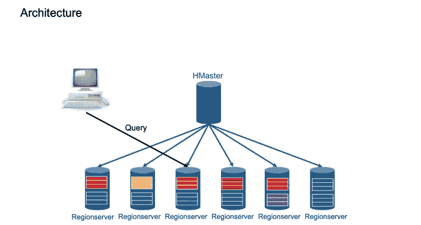

Agebase has multiple APIs， that's nothing really new， there is a rest API。

 you can also access it via Java， you also have a shell shell command to access it and we'll see that you can also access it via map produce and Sp。

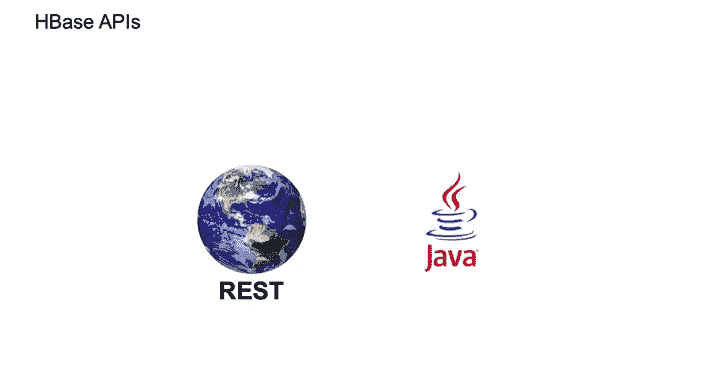

Also， later。So now we are approaching the end of age base。

 I wanted to say a few words about data locality， and in fact I'm going to end up repeating some things because since you ask questions。

I already mentioned it， little bit。So the idea is that Hbase and HGFS are running on the same machines。

 right， so it means the H master is on the same machine as the name node and the region cells are on the same machines as the data nodes。

😊，And because you might remember that when you flush or compact something on a region server。

 the first replica of older the blocks will go to the same machine because the region server either client of HDGFS and we saw that when you're a client of HDGFS。

 the first replicas of older the blocks you write go to the same machine so it means that this region server sitting on that machine is going to write the first replica of all its blocks on the same machine right here。

 so it means that you can short circuit the whole thing whenever you need to read the data。

 you don't even need to go to HDGFS to the name node or you can cheat basically so the region server might be aware that there's a copy of older the blocks and it will just read them locally on the hard drive it's the same machine it's the same operating system it just reads the file locally the blocks of HDGFS locally so it's very。

 very efficient because you have a copy of the blocks on the same machine。

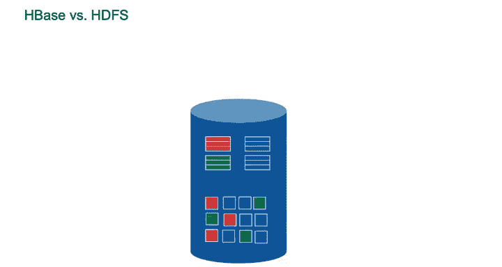

But over time， if you activate the load balancing mechanism of HDFS。

 the blocks might get spread or over cluster。 There was a question。

 by the way that you want to look at on the forum that this load balancing can be either manual or you can set it up as a service that runs constantly。

 but basically what happens with the load balancing。

Is that if at some point there are less blocks at some places and more blocks at other places。

 the blocks might start going somewhere else right so then you have to read them remotely and you can no longer shots your kit right。

 for example， if you're the region server and you need to read that block。

 you can need to go over the network because that's another machine， so it's less efficient。

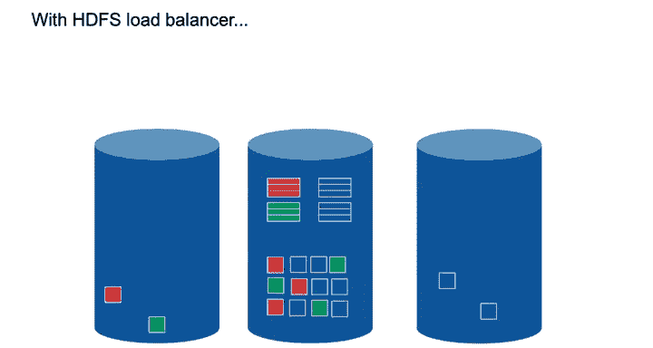

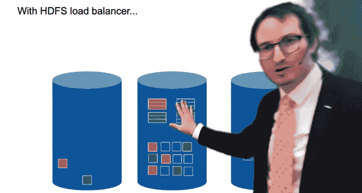

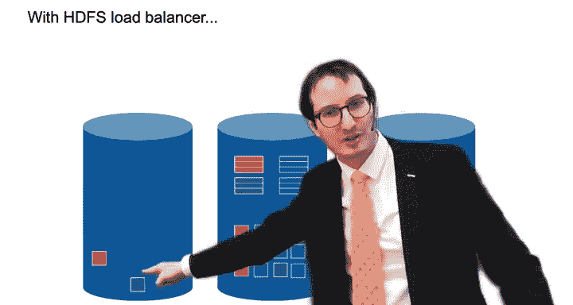

So you could deactivate of course the load balancer if you want the risk of having some imbalance。

 but anyway even if you have the load balancing， what happens is that the next time you do a compaction it will bring all the blocks back to the machine because when you compact you're writing a new file and when you write that new file all of the first replicas of each blocks will go again to the same machine right so every time you compact every time you flush you bring back a copy of every block to the same machine。

Okay， who understands this？whoho understands the concept of shots you are kiting？

It's the benefit of being two Hadoop teams， HGFS is Hadoop。

 HBase is Hadoop so they kind be cheated by basically directly going to the hard drive so it's a breach of data independence technically to do it because you're breaking the rules of HGFS doing that but that's kind of okay because it makes it faster and again it's the same Hadoop projects。

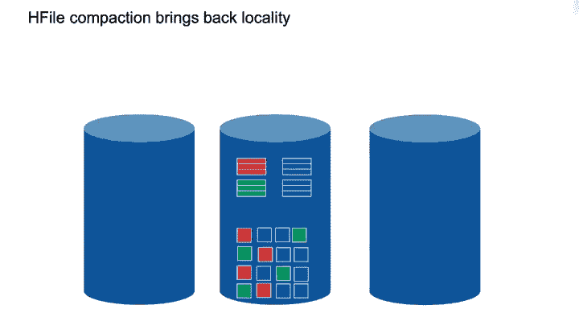

All right。So H basease is meant to be used on one cluster cluster where there's already HDFS。

 typically the machines are going to be in the same data center。

But there's been some work done since then。There's newer versions of AGFS thats span multiple data centers。

 it was called now that's probably something new that we don't know about but。It was called Colosus。

 the successor of GFS， and the successor of Big T is called Spanner。

And now I can just show you because this is really optional another bonus。

 but just to basically show you the direction that this is taking。

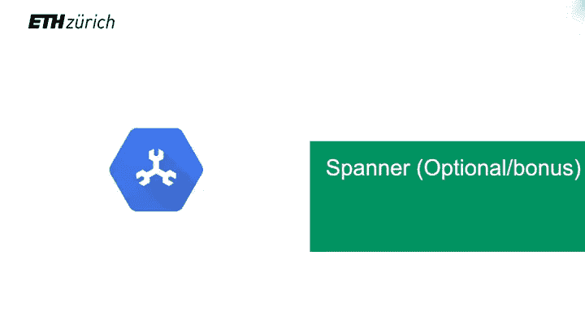

The idea of a span is it improves of over age base first because you can have multiple columns for the primary key。

 You remember that in each base， it's just one column is's the raw I and the raw I is the primary key。

Well in Spanner， you can have multi column primary key， right，'t you don't not just one。

 but multi of them。The other improvement is that instead of restricting the regions to single intervals in spanner。

 you allow for multiple intervals in the same region。 That's called the tablet。

 So you might have an interval here， plus an interval here and the two together give you a tablet。

 So there's a relaxation of the constraints that that the regions must be in a single as a single mean Max interval。

 okay。

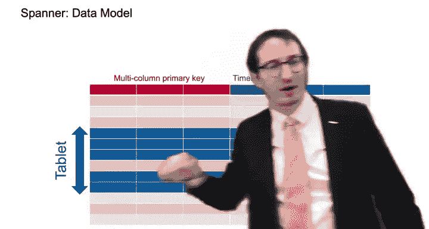

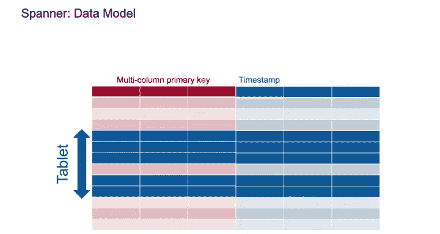

Now what actually is quite impressive is that you need to actually pause and count the zeros here right so if you look at it long enough。

 you will realize that you're looking at one trillion in here 12 zeros。

 trillions of rows this is absolutely gigantic and that grows very。

 very big and in fact because it grows so big you cannot just use one data center or one cluster you need multiple clusters so it basically means that everything we knew about the age base that corresponds to this basically where you had the H master in the region cell。

 but now you have multiple of these maybe a different locations around the world。

 and now you have what's called a universe master in here that is basically the emperor of the universe and basically handles all of these locations so this is how you achieve scalability to trillions of quadllions of the rows and absolutely enormous enormous scales。

😊。

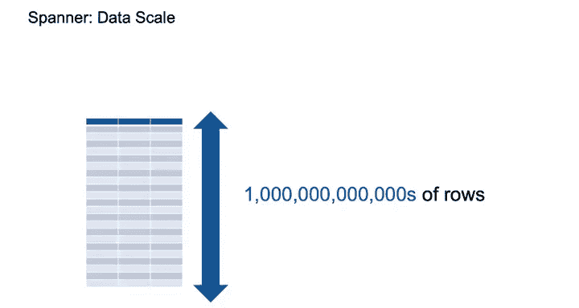

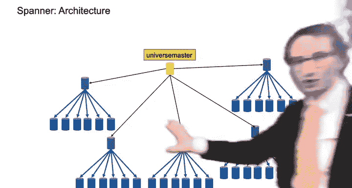

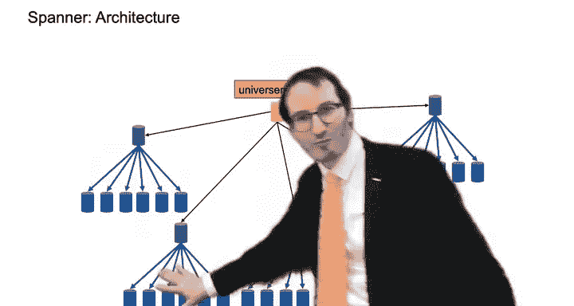

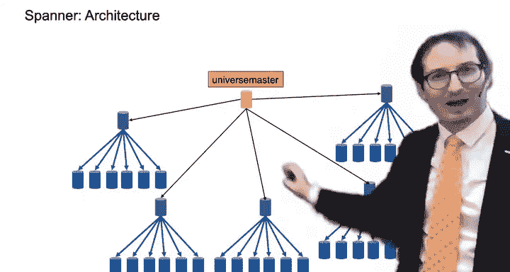

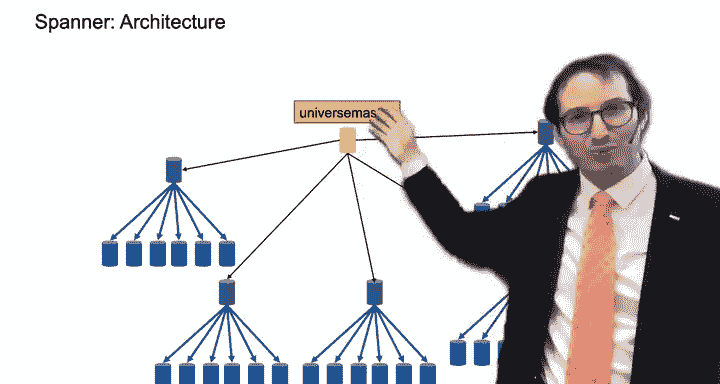

Now you can imagine as a university you don't get that you need to be a company large enough to be able to afford these things。

 but this is basically what is done by some of them and then you're really considering like what I showed here is just five of them but actually you have to consider hundreds of them。

 hundreds of data centers， all of other planets that contain that right so this is spanner and again I'm just showing you the high level the high level overview of that we are looking at millions of machines that story。

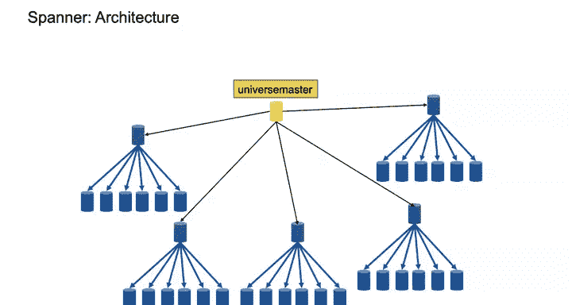

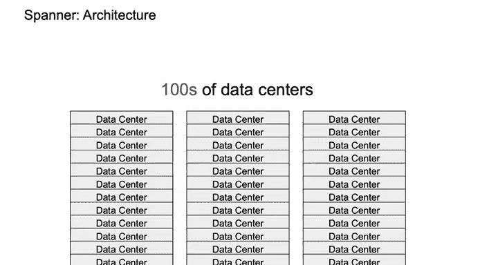

Right。U。Okay， so you， of course， you should not be afraid of very。

 very large numbers because this this this is really。

Impressive what we have what we managed to do today。Okay。

 so this is my last slide actually about Spner again that is bonus right but I'm telling you all of that。

 this is just for all the fun， but I'm telling you that you even have this way of going across a single cluster。

😊，Okay， do you have any questions， anything on age base？ Yes， maybe we can use the microphone。

Why would anyone need a table that is this big and not just store something in like object storage。嗯。

So， I think that。So we don't know everything first because these are companies that might have proprietary information and so they do not tell us everything。

嗯。I could imagine multiple reasons for that。So。The difference between object storage。

And white collar storage。Is basically the dimensionality of your indexing so basically if you're looking at object storage or key value storage。

 the keys are organized as a single dimension like a ring in the case of a key value store。

 but even for object storage you just have a bucket ID plus object ID to a single dimension right。

The difference between this and white color storage is that in white color storage。

 you see store objects。

Basically， if you look at these。All of these are objects， all of the sets here are objects。

 they can be big， they can be dozens of sorry to 10 megabytes。

 but the idea is that now these objects are organized in a grid。

 it's no longer just a one- dimensional thing they are in a grid because they are indexed both by these keys right there that is one half of of the way to identify them plus the columns。

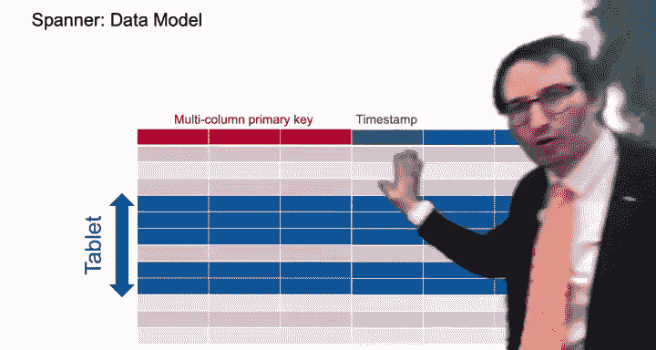

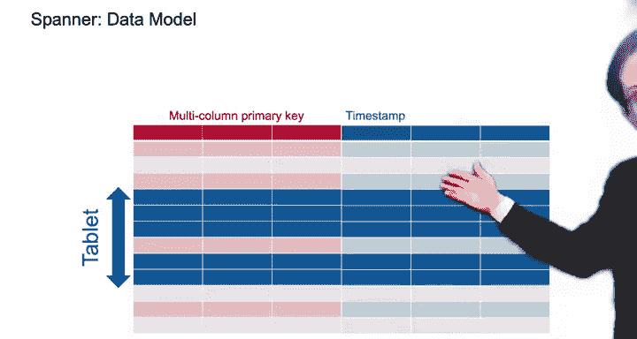

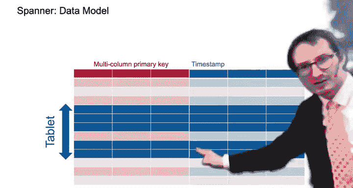

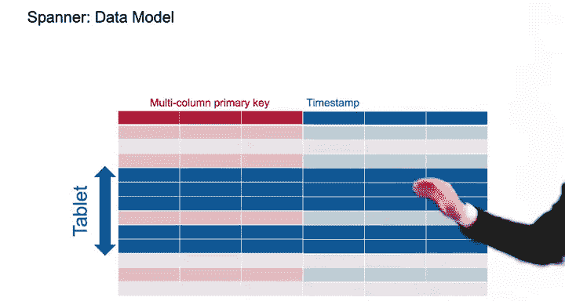

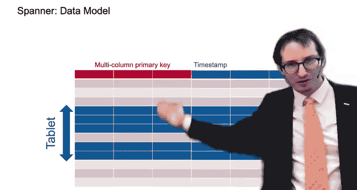

RightAnd you have a lot of sparsity because a lot of them are actually going to be empty。

 So this is the main difference so。

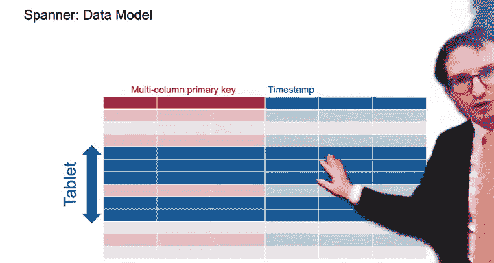

What you get is a system that will not store very large values of gigabytes level， for example。

 for that you should use the object storage， but if you want to store smaller values like HTML， XMl。

 JON documents and so on as blobs then you you could store them in there as the two dimensional reads。

Right， does it make sense。Okay。😊，Another question about that。

What is the advantage of having a region that is not like one un connected SQL connected components？

That I'm not really sure my intuition would be that it might give you a bit more flexibility。嗯。

For several reasons， I'm digging in theory， the first reason is that we saw that you can split regions。

 right？But imagine that at some point it's the opposite。

 regionsions become too small and you want to merge them together。

Do you see that if you have tablets like these that don't require contiguous intervals。

 it's easier to merge tablets than it would be to merge regions because the regions you could only merge if they touch each other if there's exactly the max exclusive is the same as the mean exclusives right So basically having tablets gives you more flexibility for splitting and merging because of the mathematical closure under all。

Does it make sense。RightBut that's only I guess because again。

'm not I'm not exactly sure of of the the maybe it's actually there's probably a paper that we we could look into。

嗯。Yes。Thank you， my question is like what is the reason for storing this metaA table on a Reg server and doesn't it again introduce one single point of failure for the whole system？

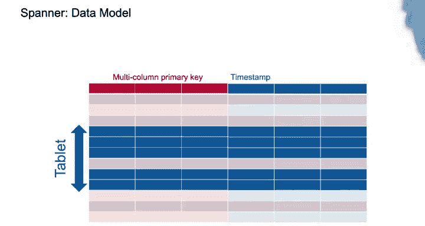

So I start with a single point of failure， the reason why it's not a single point of failure is that the so first the data is stopped on HGFS。

 so you will not lose it if there is any problem。😊。

And then what happens is that if that machine crashes。

All you need to do in zookeeper is just switch to another one that's basically called electing a leader in distributed systems so we just have the people response not the people the machines maybe soon we won't see the difference but anyway so the machine is responsible for the meta table well decide on a new location for the meta table and that's very quick that's the zookeeper protocol that basically takes care of that right why isn't it stored on the Hma what' the reason I think the reason is that when you serve the meta table you have to have all the code the computer code and the process that knows how to serve tables basically and the Hma doesn't have that in the Hma process there is no code that would allow you to serve the table so this is why it's more natural that this table is seated on the region server because the region server will serve the meta table with exactly the same code as any other region。

That's probably one of the one of the reasons。Yeah。And there might be， I mean。

 I don't know how HGFS is going to evolve， but basically， for example。

 we use zookeeper to elect the Hmaster in Hbase in HgFS as far as I know they don't do it yet。

 So in HgFS they don't use the zookeeper sorry I mean for the hardbeats for the hardbes the region server sends send the hardbeats via zookeeper and then the Hmaster knows which one our life through zookeeper in HgFS。

 that's not the case yet in HgFS the data node feed them the hardbes directly to the name node。

 but I suspect that at some point it would be a natural step that HGFS could take that they also switch or move over to zookeeper for doing this because that's the intent of zookeeper right So this is also why it's important you know I'm showing you actual systems that were designed。

But what I really want you to do is to think of it with a bit of distance。

 having in mind that this will change， it will evolve and you really need to focus to focus on the high level considerations。

 the high level considerations of the choices that were made。And the choices are not forever。

 It might be that people have a brilliant idea in one or two years and they figure out something with a change of design that actually turns how to work better。

Right， thank you， thank you。No more questions？On Zoom。No questions。Doesn't seem so。Okay。

So don't hesitate， of course， if you have questions after the lecture。

 you can ask them on the Moodle forum and we will do our best to answer them。

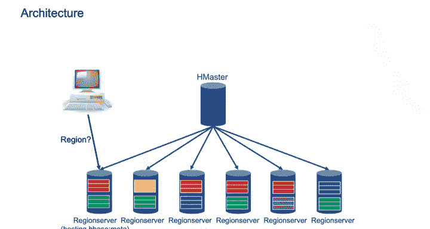

So I'm going to stop the recording here。

