# 苏黎世联邦理工《大数据｜Big Data - ETH Zurich - Fall 2024》中英字幕（deepseek - P21：-21-7. Data models (1_4) -.zh_en - GPT中英字幕课程资源 - BV1sHPKeoEJU

So welcome back， we are now going to look at data Bolink。😊，So。Before I move over to this。

 I would like to have some sort of summary。Of what we have learned so far， but on a very high level。

From basically both HDGFS and HB。 So we have this technology stack that we've discovered。

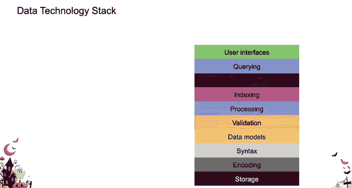

I have 10 lessons on the high level that I would like to share。

 The first lesson is learning from the past in the case of the。HGFS， HB， so big data。

 what we've learned is that even though we are trying to rebuild something that is an alternative to relational database management systems like PostgsQL。

 we still keep the idea of data independence， the idea that we still have tables， for example。

 in agebase， we will see that we also will have programming languages and so on。

 so the same kind of stack。So learning from the past is absolutely fundamental。

And an example of when this fate that we didn't use the opportunities of what the ancestors learned is between XML and Jason。

So。What happened is that for reasons probably due to matters of taste or preferences that are not technical at the beginning of Jason。

 there was this idea of we don't want XMM its too complex。

And so Jason was developed a little bit independently the ecosystem and what happened over time is that in the end we noticed that after all we need a schema from Jason we will see that shortly。

 we discovered that we also need pointers in Jason。

 we discovered that we also need a way to navigate Jason we discovered that we also need a way to query Jason so all these things that we thought we needed to throw away together with XML。

In the end， it was noticed that there were also needed in Jason and so what happened if I look back is that because of that。

 we probably lost 10 years of development of Jason that Jason now is in a state。

With 10 years of delay compared to what it would have been from the beginning。

 we would have gotten all the lessons for XML and directly taught them into Jason。

 so this is one example where it's really important to learn from the past because people did mistakes people made design decisions and by looking at what they did and trying to take over you can actually gain a lot of time and speed up and accelerate the development。

The second lesson is to keep the design simple so the idea here， if you look at object storage。

 keep a new model， we have bucket I and object I that identifies an object， you can get it， put it。

 delete it very simple So this is actually very useful to do that it's also the spirit of data independence right that the API that you expose is very very simple and then you focus on the physical implementation。

 but in a way that's completely hidden from the rest but keeping the design simple is really something that becomes increasingly important when you start having very large scale。

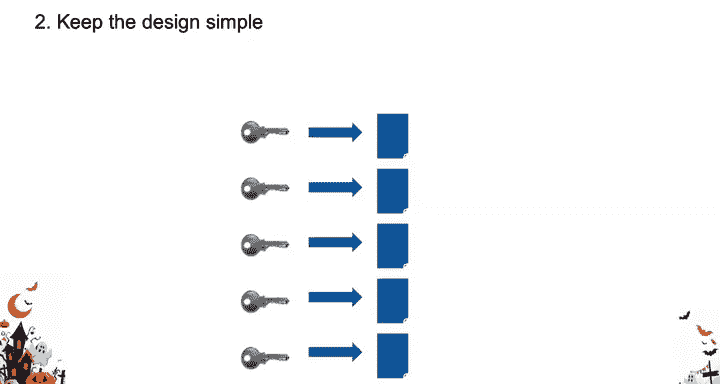

The third lesson is to modize the architecture so as a computer of scientist it's not very surprising because we all know。

 especially for example， in object oriented orientation。

 we know that that all these elegant code makes programs better and so with modularity we can reuse things we can also have an overview of things in a way that our little human brains actually understand because if we try to build everything as a single block a human would not be able to understand it anymore。

 so this is also why we have to modize so this is why we have the storage。

 the syntax the validation the query languages and so on all at different levels and we build on top of each other。

As an example， we have。The hard drives connected to computers with an operating system。

 let's say Linux connected with network cables to each other in a data center on top of which you have HDFS。

 on top of which you have Hbase and on top of which you can even have further layers imagine how simpler it is to have designed it in this way with implementing Linux independently of H basease and HDFS as opposed to trying to directly build as a single blocks the whole thing as a single code base that would be a nightmare for any human so this is why Moizing is very important。

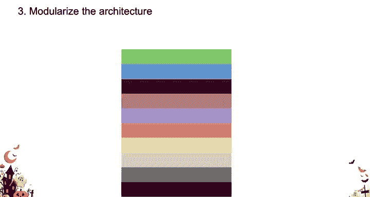

AF aspect is in order to scale to have something homogeneous at very， very large scale。

 meaning that if you look at AGFS from very， very， very far away。You just see fights and directories。

Organizing blocks， if you look at object storage or S3 from very far away。

 you just see objects associated with key。If you look at agebase from very far away。

 you just see raw IDs and colon families and column names with values in there so it's all homogeneous。

 but what happens is that if you zoom in and look at one particular object or one particular cell in an agebase table it will be different from its neighbors and this is heterogeneity in the small。

 it's the idea that when you have in agebase plenty of XmL documents or plenty of JON documents in the same column they don't even have to have the same schema or lookerlike。

 you can have a whole diversity of patterns in there and that is supported by these systems the same in S3 you can put whatever you want in objects you can put data sets。

 files， pictures it doesn't matter this is absolutely anything and so you have this contrast on the very highleve homogeneity in terms of the design like a key value model and so on and or blocks in HGFS just plenty。

 plenty of blocks。

And at the low level， in the details， the diversity of what you're actually storing。

 and it is the contrast between the two that gives flexibility to the very large scales。

Then you have lesson number six。Whi is that data independence。

 we need to abstract a logical model independently of the physical implementation。

 it means that when you look at relational tables you shouldn't care about how the bits are stored on the disk。

 you just have rows and columns。When you look at HGFS。

 you shouldn't have to care about how the blocks are actually stored on the disk you just have blocks right on the physical disk。

 you just have logical blocks HdFS blocks you have a logical logical hierarchy of directories and files and this is abstracted away from the details with which the data nodes are handling that all because the data nodes are just doing it behind the scenes in a hidden way the same growth with with Hbase right you expose Hbase with the current families and the raw ideas independently of HGFS so when you actually deal with H base you don't care about HGFS anymore and here it's interesting because HgfS that we looked at as a logical layer the week before suddenly becomes a physical layer compared to Hb right so it's all relative to each other and maybe on top of H base H basease can be the physical layer of something else on top of H base。

So is absolutely fundamental to keep your aanity to have clean APIs in between the layers。

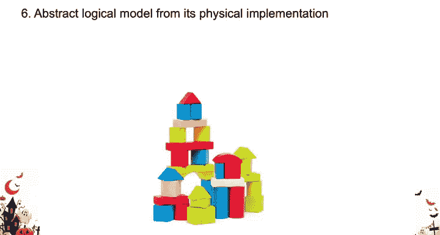

Something else that we saw that is absolutely everywhere is the idea of building partitions of the data。

 sharding the data， we did it。With HDFS， because we have these 128 megabyte blocks。

We did it with age base。Because we parted by regions and we parted by current families。

So this is called sharding， sharding is going to be really all over the place。

 it's all over the place that we have plenty of names for the sh so shard blocks split partition。

 there's many， many of them。😊，We don't on shaft， so this is basically the partitioning。

 We also replicate the shafts that are here， so not only do do we cut it into these chunks but we store each chunk multiple times so in H GFS。

 the d43 even though you can adjust that and then you spread all of these chunks all over our machines so the way that it fill on a very high level imagine that now you have all these data sets that are sharped like this into these smaller chunks that are like100 megabytes and then you can store these chunks multiple times then imagine。

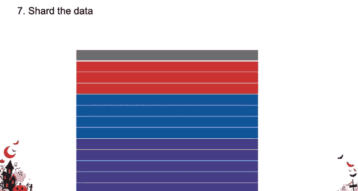

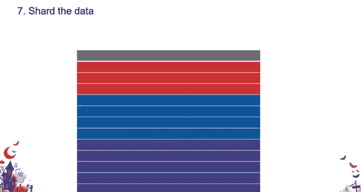

that just like you pour water into a glass and you have all the molecules of water that just spread in space。

 then imagine that on a cluster， you have millions of these blocks。

 millions of the HDGFS blocks that are just spread all over other cluster and having a granularity such that there have several thousands of these on every machine allows you to nicely and smoothly spread it all over a cluster right so we'll come back to that when we talk about performance。

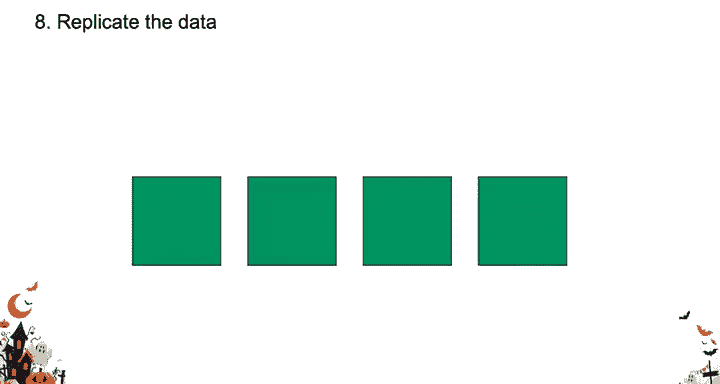

Lessson number 9。Is that we don't want bigger machines or not actually enormous machines。

 We just want a lot of machines， So now you have the order of magnitude in one data center you're looking at 10000 machines maybe all the way to several dozens of thousands of machines。

 maybe to 100 thousands and then if you have multiple data center then millions tens of millions or hundreds of millions of machines right so a lot of cheap hardware that is the key to do it all and basically all of these shelves that you replicate you spread them all over these cheap hardware that you've got right on the very high level this is what's happening。

And finally we batch process and that's actually what we've seen with the flashing and the compaction in Hbase。

 the idea of batch processing is that instead of every time that a user creates a new cell in Hbase writing it to disk that would be very inefficient because every time we do that we'd have a latency that would be very slow instead we accumulate the key values in memory until there is enough we call that a batch and then we write down that batch when we flush to HGFS that is batch processing when we do that。

All right。So this is called batch processing and we'll also see that in mapreduce and in stock。

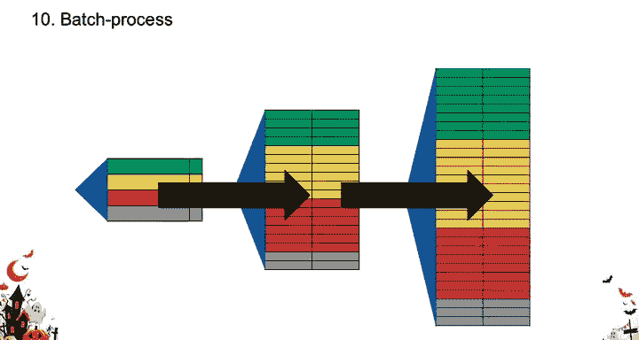

Okay， so why are we？So you see we are making progress in this stack so in the past few weeks we've looked at storage with AGFS and S3 and KVU stores。

 we've looked at encoding tiny little bits then we've looked at syntax with XML， Jason， Yamel。

 also a little bit， so this is when we have the data as text， human readable。

And today we are going to look at data models， more precisely we will focus on three data models like the data models for XM and Jason。

 knowing that the data models for tables， you've seen them before in the relation database classes right。

 but of course I will connect these things together。

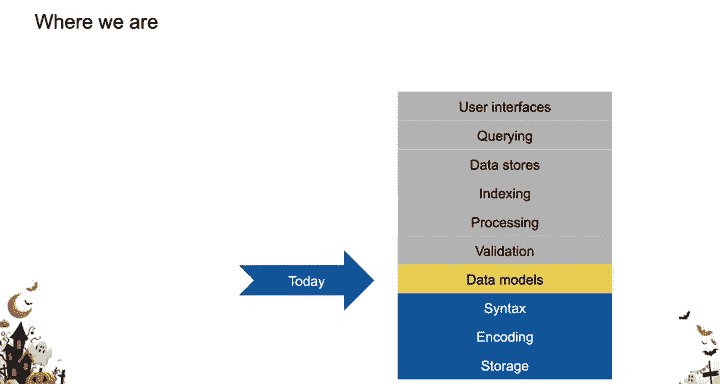

All right。So what is the connection between a syntax and a data model when I take the example of CSV because this is the one that's very intuitive。

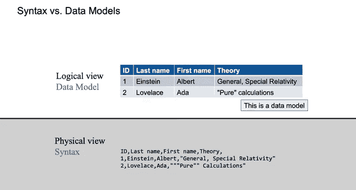

When you have a CSV file， it's text。

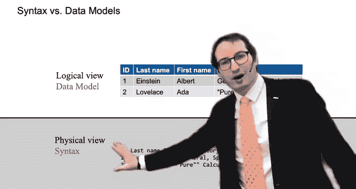

normally。

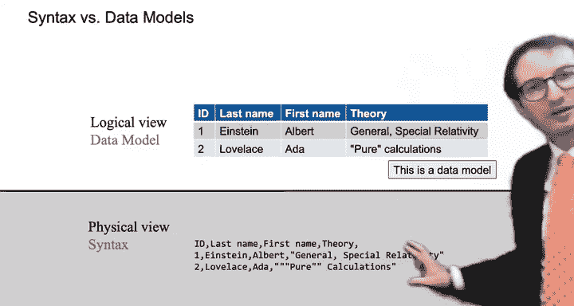

If you look at this as a human with a bit of obstruction efforts， you should see this。

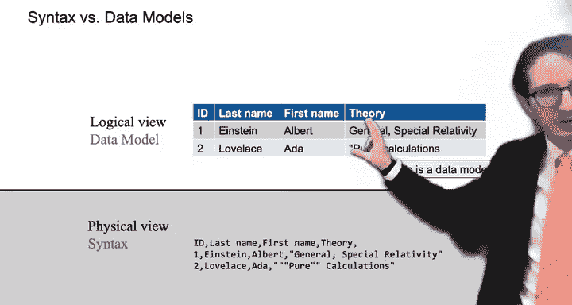

RightThis is just some text using the coas to separate the cells and the new lines to separate the rules。

 but what I would like you to see is that if you look at a CSV file。

 you should see a table and in your mind you should actually see that because that's exactly what happens when you open a file like that in a spreadsheet software。

 then you should get something that is actually abstracted away as a table in this way。

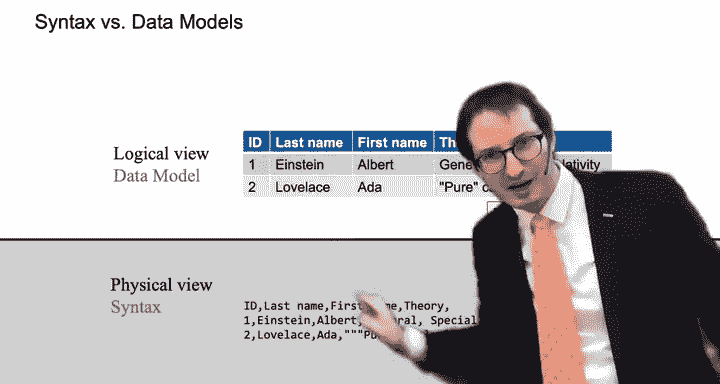

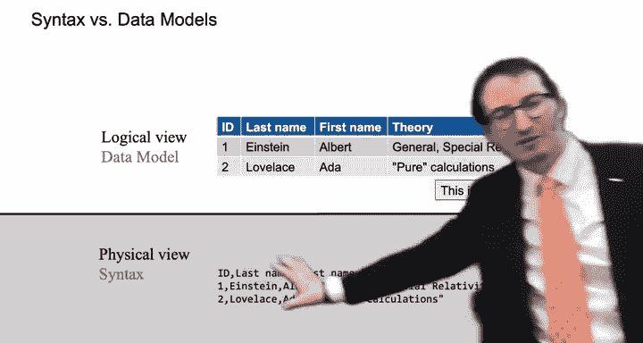

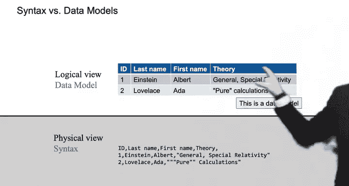

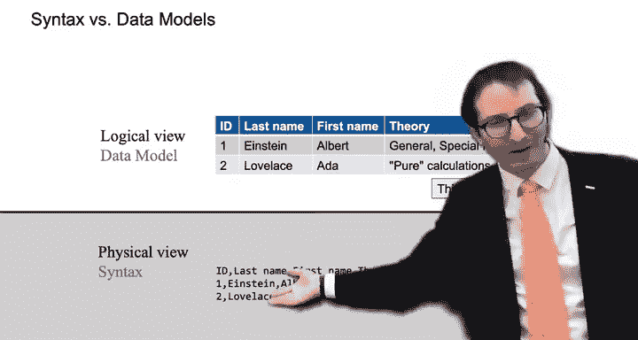

And basically， what I would like for you after the lecture to be able to do is that when you look at XMl or Jason。

 you will also see。

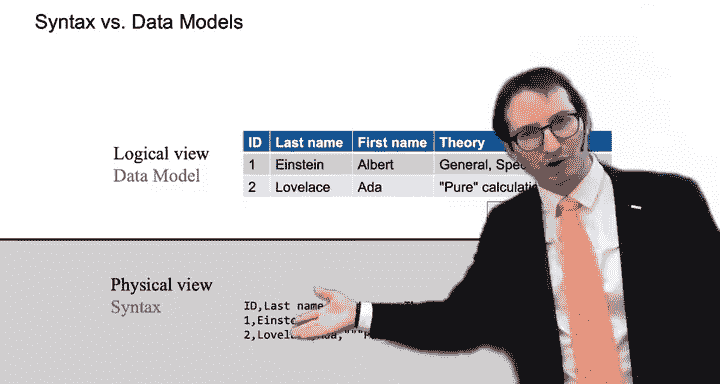

Trees， just like you see tables for CSV， this is my goal。Okay。

 so we have a physical view that is the syntax， so basically the text and the logical view that is the abstraction of that physical view where we have a relational table。

So now let's do it for Jason first because it's the easiest。

So if you remember what I told you about Jason and this syntax， there are six building blocks。

strings， bulloles， numbers， nerves， objects， and arrays， just these six。

So these are I presented them as syntactic building blocks two weeks ago。

 I showed you what they look like and how objects use these curly bracelets and arrays。

Use the square bracket。But what I would like。For you to be able to do is to see a tree here。

 So my first question to you just to get an impression in the room and also of zoom。

Who here sees a tree？Okay， on Zoom。Who sees a tree。See quite a few people， right。Okay。

 who doesn't see a tree yet？Okay you will see it so in the second hour I will show you how how you actually actually can build a tree out of that my goal is that this becomes an instinct for you that as soon as you look at this you cannot un see it basically you will always see a tree spontaneously because this is in the end what it is x7 and Json are trees and we'll see that it's a denormalized form of relational table which brings us to the break I was just making sure that it doesn't ring in the leader of a sentence so I'll see you in 15 minutes and I'll continue to drive you to seeing X7 and JN as trees。

Thank you。😊。