# 苏黎世联邦理工《大数据｜Big Data - ETH Zurich - Fall 2024》中英字幕（deepseek - P23：-23-7. Data models (3_5) -.zh_en - GPT中英字幕课程资源 - BV1sHPKeoEJU

Welcome， everybody in the lecture hall， welcome everybody on Zoom。

 welcome everybody from the futureture。So now the sound is working in the lecture hall I open on Zoom Z before we start or at least continue in the data modeling section。

 I would like to ask you a question to check that you've been following。😊，接育果。You should know that。

 right， So H base。Can run on top of its GFS。However， I explaineds that HDFS is throughput bound。

 So it's the the latency might not be。Might not be very low。And yet， in spite of this。

 age base is fast。How can it be on so1 it base is not actually faster。

 it has a high latency just like a GFS。Onor number two。

 because Agebase has keyU in the mes store as well as caches。Or until number three。

 because it charts your kids data nodes or until number4。

 because it uses smallerFS block sizes of 64 kiloB。B T2， stop here。

Let's look at the intermediate results。We have two very popular answers。And both are， in fact。

 correct。The first thing is that there is this batch processing way of writing the data。

 you don't write it to HGFS every time instead you accumulate in memory and when it's full when the memory story is full you flush so this is one way and there's also caches meaning that some of the values that are in AGFS are also in memory if they are used often。

There's also indices inside theH files and shock circuit hittinging data nodes yes absolutely。

 this is one of the reasons whites faster as well because since I told you that the client of HDGFS by default writes the first replica of every block to the same machine where it is and now we know that the region server is a client of HDGFS so the region server is writing the first replica of all of the blocks all of the HDFS blocks of theH files for these regions that it's responsible for on the same machine。

That was a long sentence so。Now I'm going to switch back to the sites。And we continue。

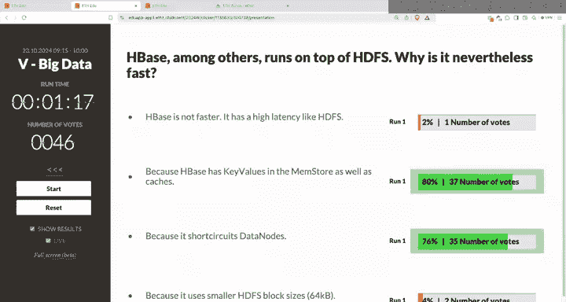

All right。So first， we have any questions on what we did yesterday。

 anything that he pending that your're。Wondering。Okay， so I'll assume you can ask on you。

 you would ask on the Moodle forum if， if there is anything。 And， of course。

 the exercises should help a little bit。So where were we？So we discussed data modeling。

 the most important lesson of yesterday is that syntax is in fact only a physical layer when you store data as JSON or XM。

 that's just the text you use in the file when you put it on HGFS or S3 or HBase。But in fact。

 when you want to process JSON or XM， the first thing you do is you pass it into an inmemory representation based on trees and in fact everything else will be done on that memory representation not directly on the JSON or XM text so that was the most important one and serialization is the opposite when you take the memory representation and write it back to JSON or XM and then we saw that one of the things you can do once it's all loaded into memory is validated。

So we saw that you can define constraints or some expected structure on your data in Xml and JSO。

 and then you can answer a second question after a well formed nest。

 you can also answer a validation question， is my well formed XMl or JSO document valid？

Okay so this is what we discussed last time and then we saw that you can validate typically millions of objects or XML documents at the same time that are stored somewhere and then you can enforce that any future documents that get added to the collection will also be valid against the schema then we saw that when you do that and if your schema has enough constraints。

 your collection becomes homogeneous because all of the documents there will have the same structure and we will see and discuss that in that case you can make the processing much more efficient because you can compress the way it looks like in memory you can take less space and you can even write it back to files in a binary formats that also take less space so that's the benefit of having valid data。

Now there are many different validation technologies out there there's not just ones。

 so there are several ones for JO， there's also several ones for XmL and there's actually many others that even go beyond JON and XML So it looks daunting right all these technologies。

 how can you learn them and so on， I it challenging is it complicated。

Well I have good news for you and the good news is that the type systems of all these technologies。

 they pretty much look the same， so if you learn a few of them， we look into three of them。

 in fact it's as if you've learned them all because the principles are the same。

So after learning these， the ones that I'm going to show you。

 you can learn any other technology in just a few minutes because then you can just look at the documentation。

 see how it maps and very quickly you will be able to use it right so I really intend this lecture to be generic。

And so because of that， what I'm going to show you here， the type system。

Is technically agnostic of the technology。 It's generic and common to。Almost all of them。

Maybe I'm too far away。Or it's on strike you。There you go， So the first。

Traits that they all have in common is the distinction between two kinds of types。

 The types are basically what you validate your data guess。

 right it must be like something must be an integer。

 something must be an object with these and these keys like a class in Java。

And there' are two kinds of types， the atomic types and the structure types now is it really a surprise to you。

 I think not right we've seen that before we've seen that first when I talked about the first normal form that in the first normal form you want all of the types to be atomic and nothing nested so the nested stuff would be structured。

😊，We also saw it when we looked at Jason， when we looked at Jason I told you there are six building blocks。

 four of them are atomic and two of them are structured right atomic these string number boole and null and structure out these object and array so you see it's true in Jason it's so true in Xl so you can distinguish between atomic types and structure types and that is true of I cannot think of any technology that doesn't basically so there's always these clean separation you can think of the atomic types as the leaves in the tree representation and the structure types as the intermediate nodes the non-termins you would call them in the grammar that are node the leaves。

Okay， who has an intuition of that？

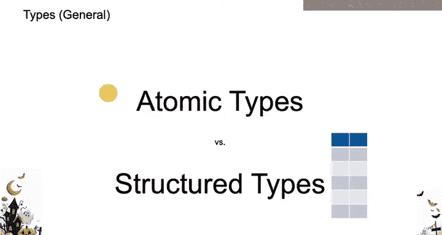

Okay， very good。Now I'm going to go through the restaurant menu where I love restaurant menus。

 so the restaurant menus of the atomic types in a generic way。

 because what I'm going to show you the kind of types you have， they might not have the same name。

 but they are still the same everywhere。So the first are going to go quickly because you're computer scientist。

 most of you， So I think that you know sufficiently programming to not really be your but what's going by what's going to come。

 So the first type that is absolutely everywhere is strings right so the strings are technically sequences of characters technically when they are in memory theyre already in Unicode code points right UTF8 and the search would only be an encoding But then when you load them in memory you have you can have more efficient representations。

So there' are just sequences of of characters。 Now if you want to sound fancy in front of your mathematics friends。

 you could say that strings， maybe you heard it in ater informmatic。

 they basically form a monoid structure， you can concatenate strings。

 the empty string is a neutral element and so on and so on。😊，So， all right。So these are the strings。

 this is one of the type， the most generic one。😊，Don't know what's going on。 Maybe it's the battery。

 but not I' supposed to vibrate when there's no more battery。So at least it works here。All right。

 so the next kind of types is numbers now numbers is a zoo by itself there are so many different types of numbers that I'm going to just give you the general classification of the soft types you can have from a database perspective。

So first， you have the types that correspond to a physical limitation on storage。

But on the logical level， it just means you have an interval that's what it really means logically So for example。

 you can have8 bit numbers what that really means is that it's the numbers between 0 and 255。

Or the number between minus 10 and 28 and plus 127， depending if you want it signed or unsigned。

 but basically it's an interval， then you have the same with 16 bits with 32 bits that brings you all the way to 4 billion or between minus-2 billion and plus 2 billion。

And this one was broken on YouTube with Gongnam style。

 It actually brought back the counter to negative。 So this is why YouTube switched it to 64 bits。

 And in 64 bits that goes all the way to 16quintilians。

 I don't think anybody is going to make a YouTube video with 16quiillllion views anytime soon。

 So that should suffice。 So 64 B now is the common standard today for many things。 Okay。

 so these are the ones that correspond to integer intervals。 And physically。

 they are very efficient because they they they have a fixed number of bits。Then， you have。

Something that we love in databases，'s not it's a bit less common in older languages like C Javava that typically restrict the precision。

 but basically in databases you like to have arbitrary precision decimals。

 So first you can have the decims where you say okay。

 I have that many digits in total of precision among which that many digits after the decimal period。

 So basically this is called fixed point decims because the point is always here。

 you basically store all the bit corresponding to all these digits。

 but you always put the point at the same place in these digits。

 So this is also a possible way to store to store the numbers and so there are types for this。

 but most importantly you have types that give you arbitrary precision and scale。

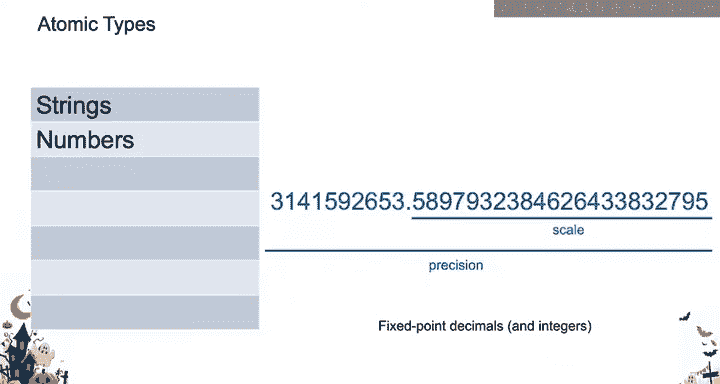

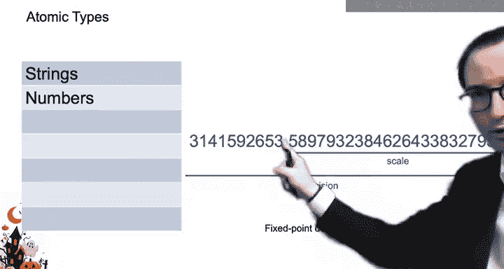

It means that it's basically any integer without any constraint。

 any decimal number without any constraint。Remember that's。

Deimal number just means any real number that you can write in base 10 with a finite number of digits。

 This is what it means decimal number。 So it's just a sequence of digits with with a dot in the middle。

 And so in database systems， especially with XM and Jason， you can have that。

 you can have this theoretically unbounded type for search numbers。 Then you have。

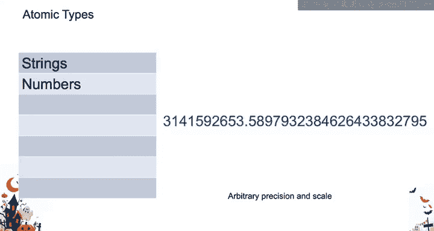

，Double and floats that you have in many languages So it's a standard that's called ie 754。

 I have no idea why you know that by hat ie 754 and that any CPU can process it very efficiently it's basically about putting a number in scientific notation right It has a Monteat times 10 to the power of something or times two to the power of something depending the one you use and basically you store in the 32 bits of 64 bits the sign on one bits then you have power of 10 or two and then you have the Montea that is right there right and so basically that would be called float in many languages gives you  seven digits of precision and this one is called double in many languages give you 15 digits of precision that also exists in Xml and Jason Do not be confused in Python they call float the one on the right So it's the same as double in other languages okay。

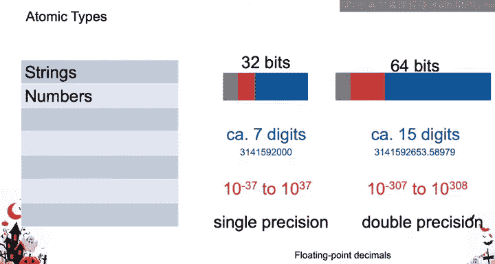

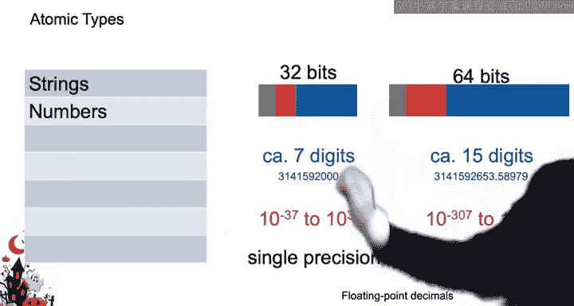

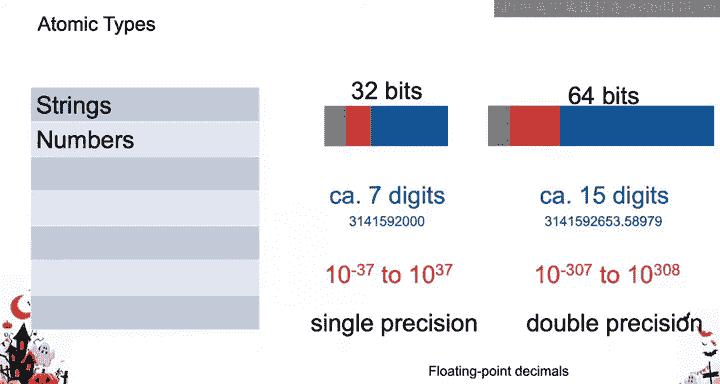

Then we have Guuls。 I think I'm going to stop right here。 You know whether Guan is true false。

 there's only need these two videos， right， there can just be multiple literals。

 I come back to the literals， but it's still true and false。

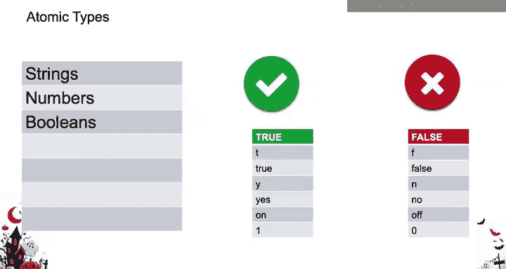

Then we have date and times， date send times are actually super important as soon as you have customers because they need dates and they need times。

😊，And sadly， they are often neglected by software developers。 Like when you invent a new system。

 the dates and times are the least， the last thing you are going to think about。

 even though it's actually very important。 That's the reason why。

It's often added as NAF thoughts like in Java for example。

 you had multiple versions of external libraries until it was finally taken over I think in Java 8 so dates are very important so there's many calendars of course so here I'm showing the Gregoryarian calendar where you have a year you have a month and you have a day then you have the times where you have the hours the minutes and the and0 seconds and you can even go all the way typically to milliseseconds or microseconds。

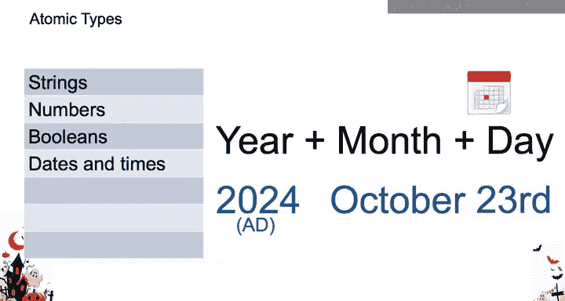

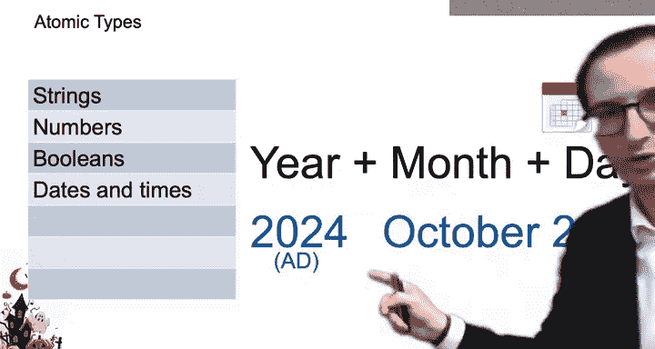

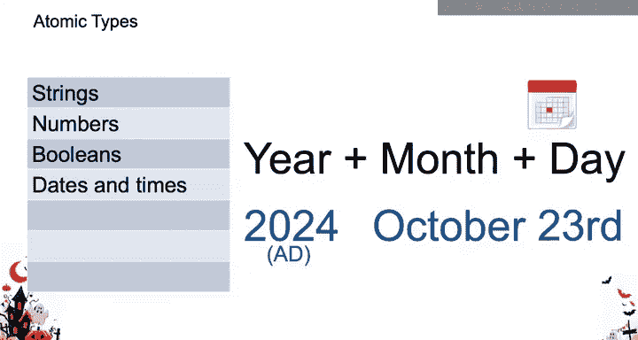

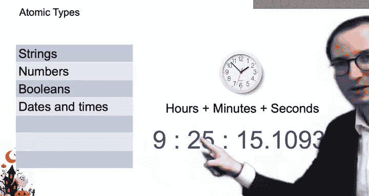

I'm off by five minutes try to to target， but not exactly and then you have the combination of both that is called also a timest where you have the exact the exact year month day hours。

 minute seconds all the way。2 milliseconds。Now， what I'm showing to you is the logical value of it。

 right that's how a human would interpret it。 But as you might know when it's in the computer。

 a timestamp is just thought as as an integer。 That's the number of millise2 since January 1。

1970 right but that's just an efficient internal representation。

 A human being would think of it in this way。All right， so that's timet， then we have durations。

 I think is's coming next。😊。

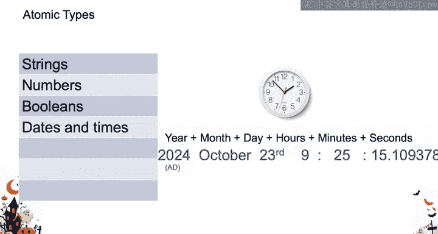

Time intervals yes， so time intervals basically are durations it's the difference between two times or two dates or two times stamps if you want。

 so what I want to warn you about here you can express them in years， months， days， hours and so on。

What you need to be careful about is this very scary world here between the months and the days。

Because as soon as you say something in like four months and three days。And I ask you。

 how many days is that when it depends， is it February， iss it March， you know。

 it depends on the number of days in a month。 So this is why I put this vertical back here。

 It's not necessarily going to be forbidden to give a duration like this。

 but you need to be careful because then it's ambiguous。So ideally。

 you should try to not cross that limit， either you talk about years and months or you talk about days well minutes and seconds。

 okay？Ws with me？All right。I'm showing to you， of course， the human representation of that。

 that's how we human think of it， I will show you later sort of the ways it appears in XMM Jason。

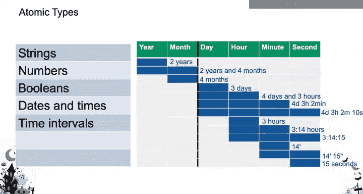

Then we have binary types， binary types are basically just the sequences of bytes， that's it。

 It's just like we discussed in S3 or HDFS what objects are it's just sequences of bytes can be pictures。

 videos， anything， just a sequence of bytes。Again that's the logical representation as a sequence of so here I even put you bits right bytes are just eight bits。

 but there's also alternate representation who heard of base 64 for example。

 so this is one way to represent them as text and there's also a heza deimmo in base 16 you can do it as well。

 but once you put it in memory you just have zeros and1s once you pass it from base 64 for example。

And finally。The next one we have to work a lot today。No， yes， the least interesting one so no。😊。

In Jason and XMl is kind of considered in a special way。 in SQL， you could say， okay。

 now is just the absence of value or something。😊，But in X M M and Json。

 there's a distinction between the absence of value and the value null， right， in many systems。

 not all of them， but many systems。 So basically， you can consider that there is a type null that has only one value that is null。

 right This is one way to think about it。嗯。Allright。

 so this is these are the most used families of atobic types。 you can look at any schema technology。

 it will more or less have this。 It might have more exotic types and so on but this is more or less it right。

😊。

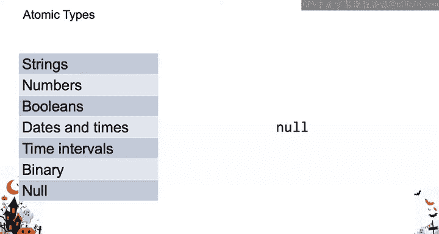

Now， the next thing I want to tell you。About the atomic types。Is putting it back in context。

 what are we doing， we try to validate data， we use these types to validate data。

 we want to say I expect this value in that object with that key to be an integer。

 or I expect this element to contain a date in XMM for example。But the thing is， Jasonson and XM L。

 these are text files。So when you look at them it's just it's just a text right and if you remember the JO syntax there is no such thing as a date or or a binary or anything like that we just have strings numbers bos and nerds right that's all there is so how can we possibly expect to find the date in JO or to find the date in XML right well this is with the superpower of literals or lexical values the idea is that。

The types the type systems are a mathematical abstraction， for example。

 dates the date type has the set of all possible dates right the integer type has the set of all possible integers but we are talking when you we say that about the value space when you talk about integers and you consider2 and 42 and all these numbers。

 you mean it mathematically this is the mathematical concept of two this is the mathematical concept of 42 when you say 23rd of October 2024。

 it's the mathematical logical concept of October 23， 2024 right？😊。

But the thing is when you put it or store it in text。

 you will in fact put what is called the literal or a lexical value。 It is basically a string。

 It is a string but the string that can be decoded back to the actual value or encode it back and again you can say you pass and you serialize when you can use these same well right So for example。

 all of these are lexical values that all are associated with the concept of four the number of four that's just four this is the scientific notation if you that all load in JSson to except the plus some of you asked about it some except the plus some don't and then this in base2 right the B says base two in some languages you can add a B to basically say this is a base2 literal and this also passes24。

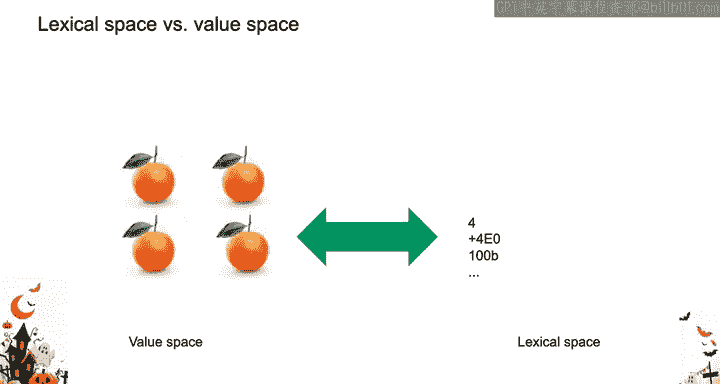

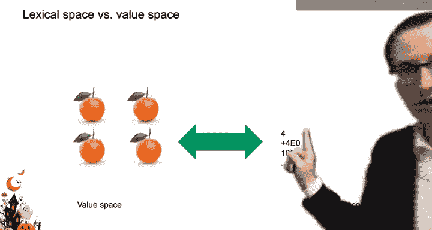

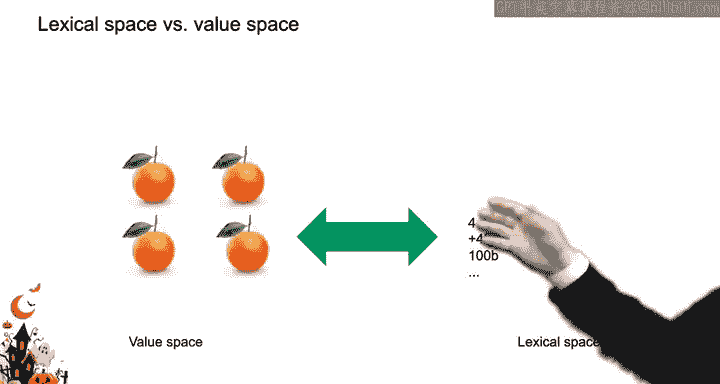

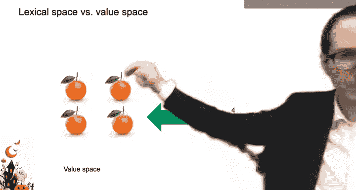

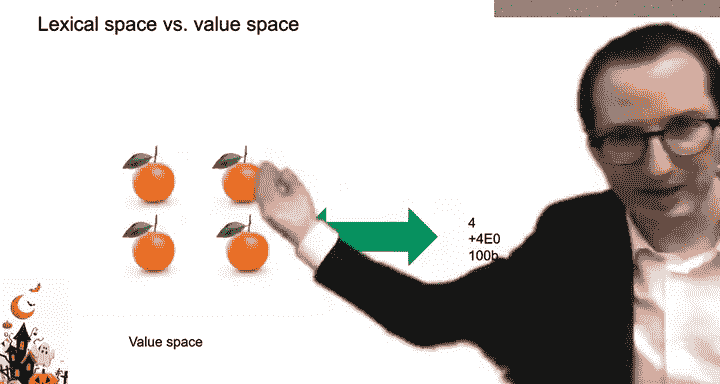

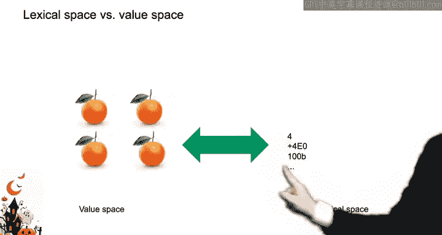

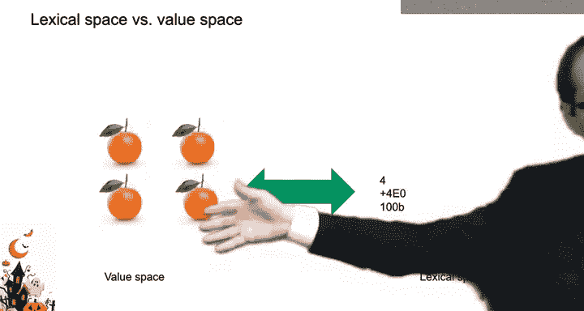

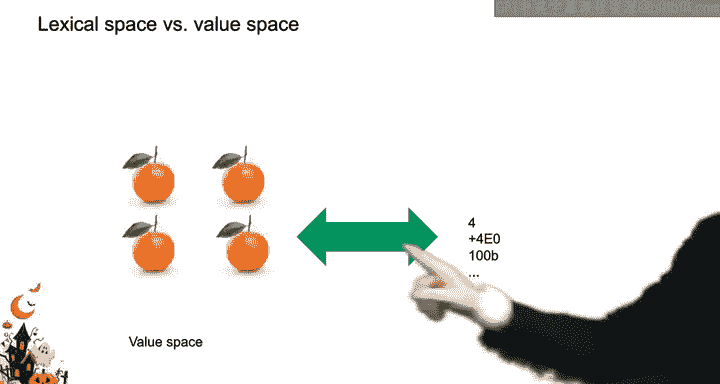

Who is that here？So we call it a literal or we call it lexical value these things and here we call it the typed value and obviously this is what you have in the JSON or XML when you read it fresh from HDDFS or S3 but as soon as you validate and use your schema then you basically think of it that way when you look at the data and then in the memory you're going to have some representation of the validated typed value that doesn't need to be the literal anymore。

 you might even have forgotten about the literal and just called this in your memory。

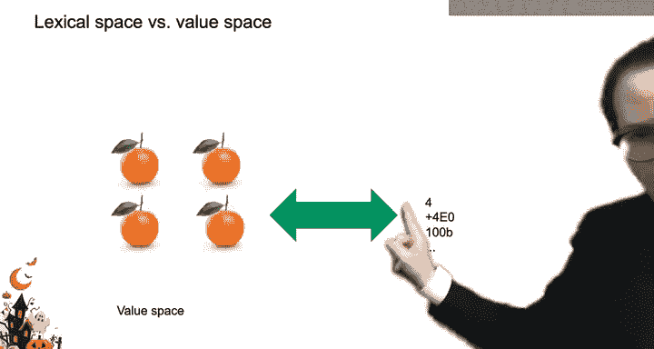

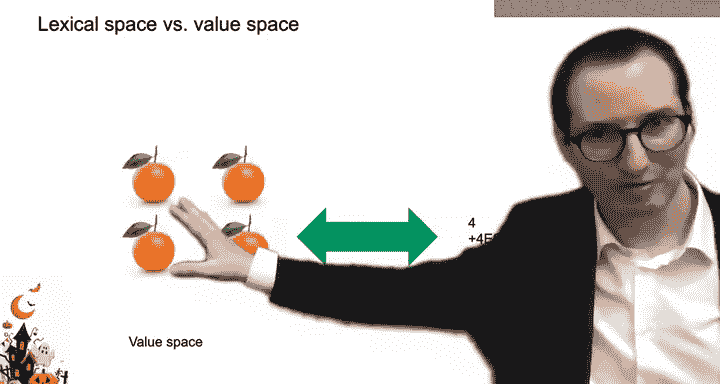

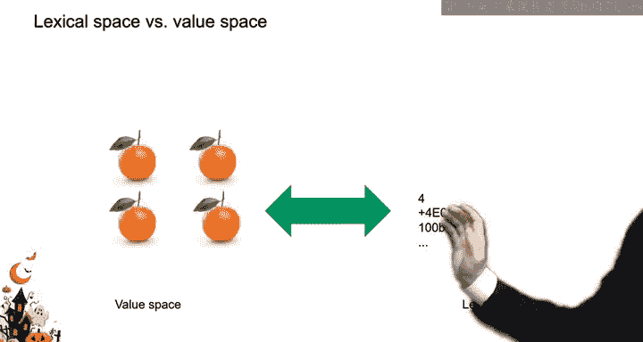

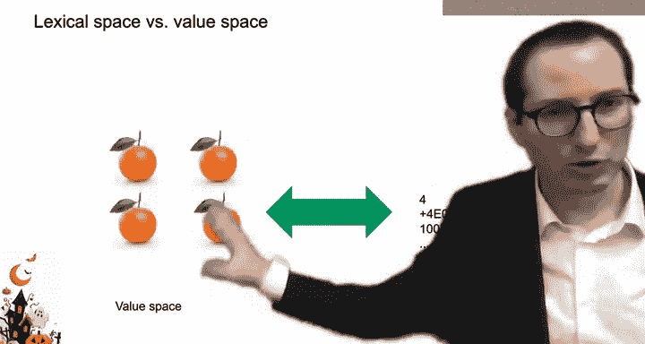

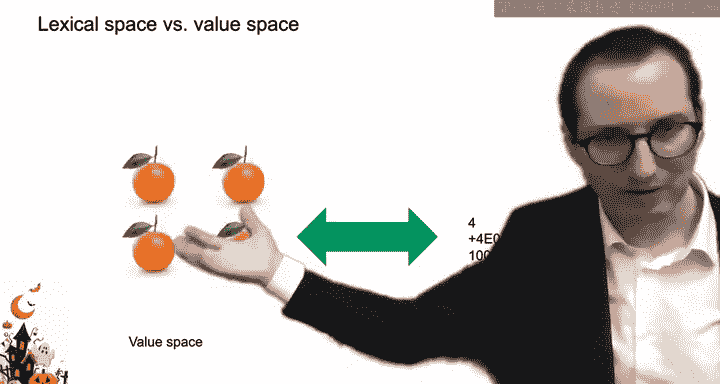

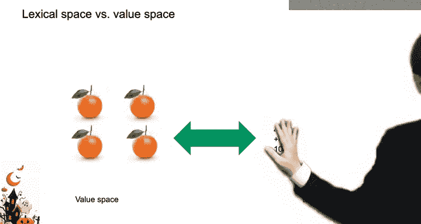

This is another example with dates， it turns out that there is also a standout for the LexQal values or lit4 dates。

 this one is called I think IO 8601 that's the date specification and it basically says4 digits for the year or depending it might be4000 then less than you have a dash2 digit for the month a dash2 digit for the day。

If you ever have projects and you need to encode dates。Do not make up your own formats。

 try to take the standout these standout right here It's a mistake that many people make。

 they just invent some representation of dates and so on。

 then it is a nightmare to make it interoperable with other libraries and other tools and to pass feedback if you do it that way this is a standout right so you have many tools that are going to be able to read it。

 especially Excel schema addresses schema and so on。All right， so this is far dateates。

 we have the same。For timestamps， so here you basically it's also a standard out that's the same Izo 8601。

 so you have the T in the middle and still the dashes for the month。

 the columns right here and then a time zone Z is basically the GMT and you can also put the explicit like plus two our wells。

 minus seven hour like of these kind of things。Alright， so that would be the lexal value。

 one of the lexical values associated with this date。

 and then of course inside the memory then you can just put the number of milliseconds since January 1s 1970 right but in JO or XML you would just have this liter。

😊。

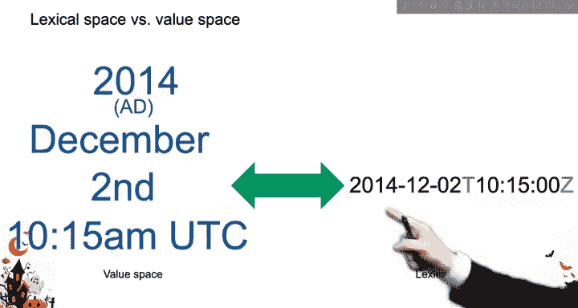

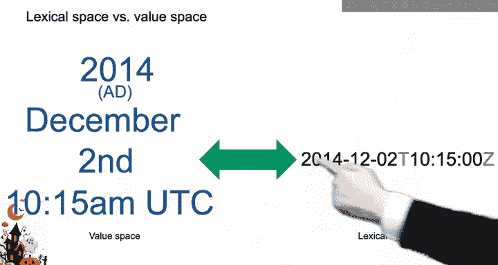

Then you have durations which also have a standard and the standard basically has a capital P。

 the uppercaseP， then one year， two months， the same key as between dates and times， three hours。

So here that's a breach， of course of that scary world that I told you about。

 but I just wanted you to see。How it looks like， this is also a standout to basically include the durations in that way。

 And then you can pass them。

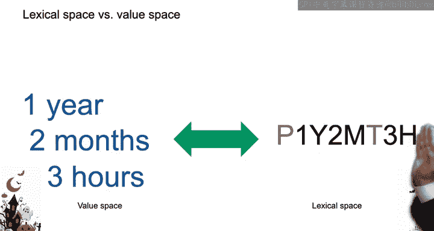

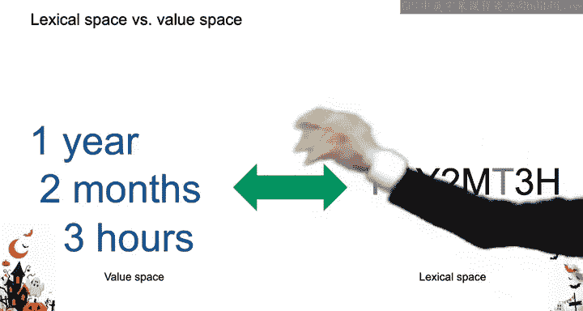

In memory to this logical value。Whos with me？Allright。

 so this is true for every atomic type has three things。

 it has a value space with all the logical values， a set of logical values。

 it has a lexical space which is the set of all literal representations。

 all of the strings that can represent one of the typed values and the third one is a mapping between the it's a function or mapping might not be injective。

 it might not even be subjective it should be subjective just not injective。

 but basically you can map back and forth any literal can be mapped to the value space and then you can map it back but technically when you map it back you could have ambiguities you can have several ways of writing a literal then you have what's called the canonyal literal value that is the default one that is the preferred representation when you say feedback back。

😊。

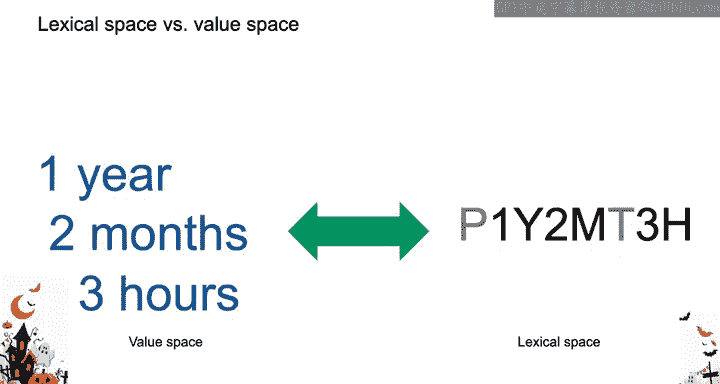

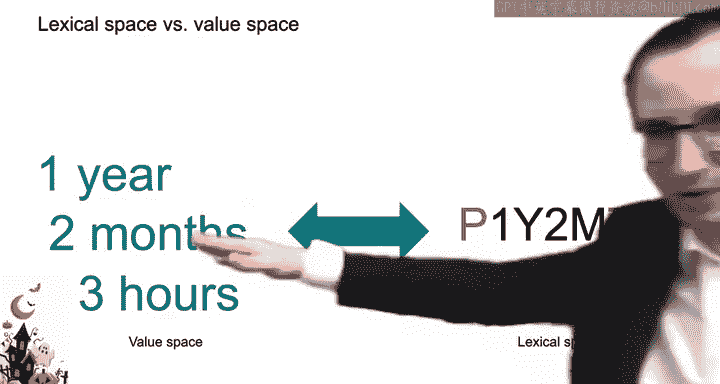

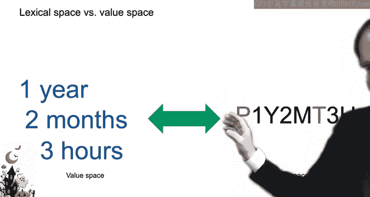

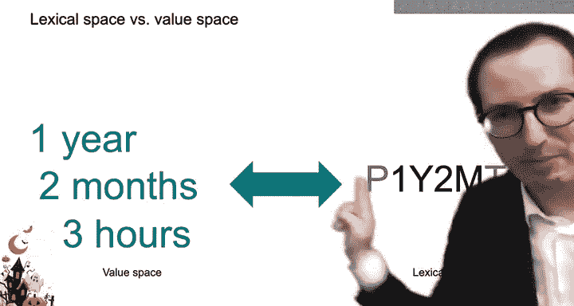

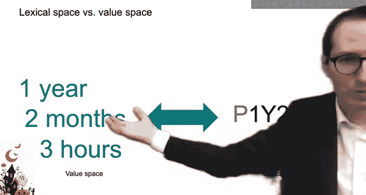

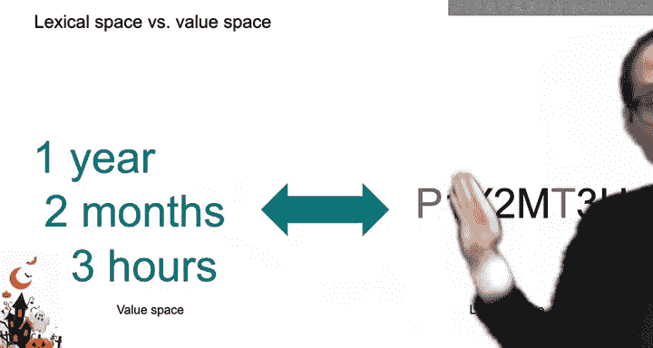

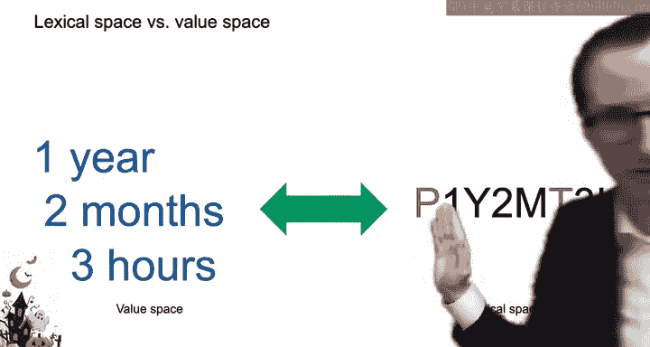

Okay， so value space， lexior space and a mapping between the two。

 this is what you need when you define an atomic type。

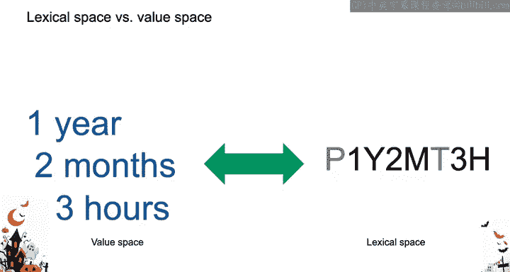

Something also interesting in many systems is the notion of supertype and subtype。😊，Now。

 if you do it cleanly and unfortunately， not everybody does it cleanly。Normally。

 when you have a subtype， it means that the value space is a subset of the value space of the supertype normally。

So this is what it's supposed to be if you go into object oriented programming that might not be exactly true or in some cases it can be a bit broken。

 but normally on the very high level， this is the idea you have a subtype if the value space is a subset of the value space of the supertype。

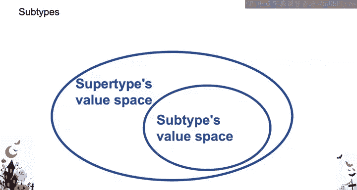

Okay， so that's Seattlettle League types， then we have the structure types， this is actually easier。

😊，Because typically there are only two of them。From an abstract perspective。

 it basically lists and maps， they might be quite differently， but its lists and maps。

 Now in J lists are arrays and maps are objects。But this is this is the idea。

 So you also find some maps in Xml， as somebody correctly said yesterday that the set of XmL attributes in one element can be seen as a map we see they are alsostructs in data frames if you know a bit of ponds or you've seen data frames before at list they correspond to JasonO array also to elements an element basically the children of an element is an other list of children that can be text or other elements。

 So this is why we would say it'ss technically a list and also when you look at data frames that corresponds to the array So basically think of it as lists。

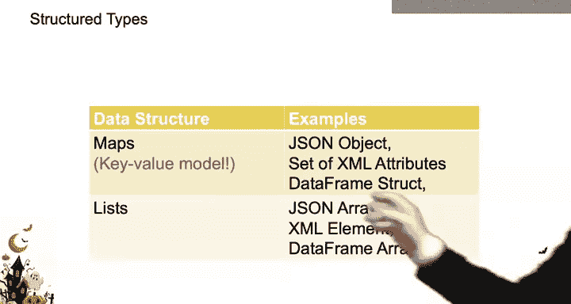

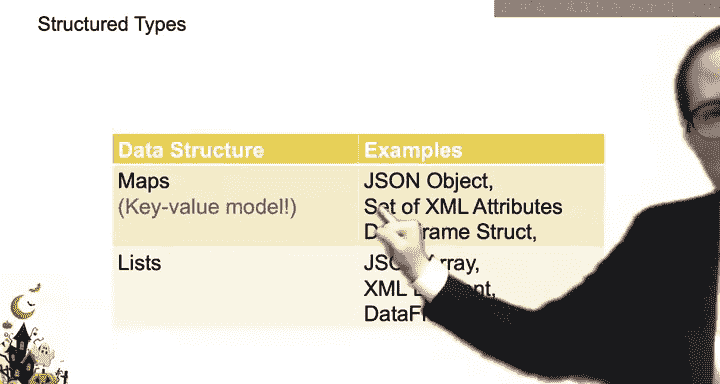

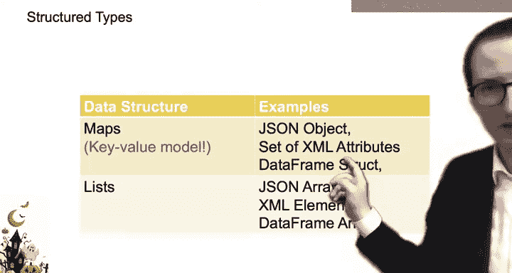

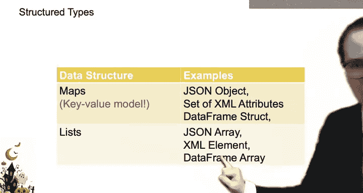

And maps， these are the main two structured types that you can have in most systems Now these are the most generic ones。

 but many systems allow you to define your user defined types by basically saying I want specifically a map that has three keys and each key is mapped to a value of that type then you define your own user defined map right and then you can even give it a name and so on。

 but basically the structures can either be maps or least you might have more than that in some systems you also have sets so you do have validation engines that allow you to have sets and so you might have a bit more at least1 maps are really the ones that you need to have almost everywhere。

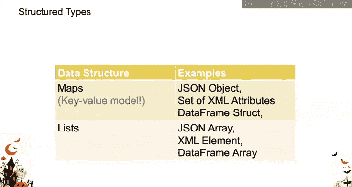

Then呢。We have the concept of cardinity that is also present in many systems。What do I mean here。

 I mean in J， for example， the capT of an array。1 elements， zero elements， any number of elements。

 at least1 elements， you know， you can specify that。In XML。

 that would be the cardity when you defined an elements and the children it can have。

 you can basically say that can have zero or more child elements with that name。

 or it can have one or more child elements with that name。

Or it can have0 when child elementss with that name， or it can have exactly when。

Chide element with that name so these are the four right， so one zero or more zero or one。

 one or more who knows regular expressions。

Great news。 You don't have anything too long。 So this is the stuff for0 or more。

 This is the question mark for0 or1。 This is the plus for1 or more。

 So it's used we've seen Jsononic X query later。 these are the symbols that you use to denote these ones some instead use ajective so I'm thinking of protocol buffers by Google they say required when it's exactly when repeated when it's zero more optional when it's0 or1。

 but you see it doesn't really matter what it's called There's really fundamentally these four main cardinities that you can have。

😊。

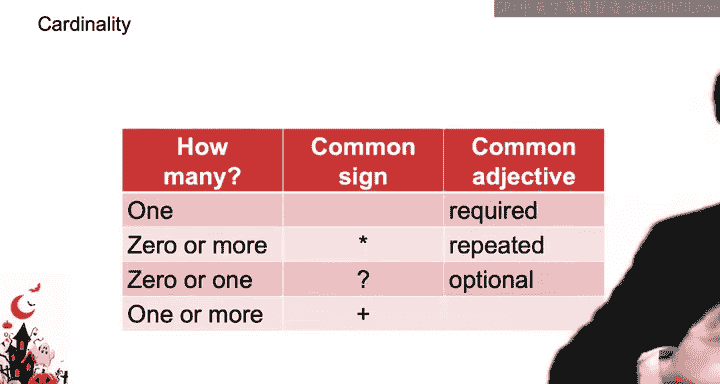

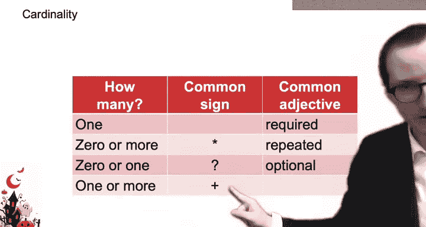

Ws with me。All right， so again， that's agnostic of the technology。

 It's really generic what I'm telling you here。😊。

Now this is a slide don't be scared， it's a slide that I created a few years ago because my students were asking for it because I kept saying you know。

 there's this generic way of looking at types， but then there's a lot of different type systems。😊。

And so I was asked like can you have a correspondent table between all the names of the types across multiple systems and I said okay I'm going to do that right so this is what you get So let me explain so Python you know right so you have a few Python types on the right PostgqL you might know that's a relational database This would be the SQL types that you have for your schema SpSQL will see it in a few weeks so that you can wait but basically these are the data frame types that you can have in Sp SQL。

😊，Jason schema XM schema that's what we are going to look at now and and next week and Jasonsonique you can see it's actually the same ones pretty much as Jason schema XMM schema and JSo。

 which is I would call it a pedagogical schema language to teach。苏北西。

You can see here that the restaurant menu is more or less the same。

But the one thing that varies is the names right they all mean the same here。

 but they are called differently depending on the system how do you know when you just look up the documentation and you see how every system is calling it and again you have some sometimes the things that are a bit unusual like I told you float in Python actually means double in many other systems what is interesting is the hand of int。

 for example int in Python is limited and that would be called integer in J schema or XM schema but int is the 32 representation in XMM schemas the 32 bits just like Java or many other languages All right I know you will not know that by half but what I want to show you is really there is this general idea that the types are more or less the same some might be missing here and there and the names might be different but in the end you know they're all the same this is really the idea。

So that should scare you less normally that you know that because now I could after the course I could throw at you plenty of other schema technologies。

 you will notice you could fill that table with one more column and you will be able to map also the types to these ones。

Okay。So this is the end of the generic type system that is common to all the technologies。

 and I am going to go into the details of three of them JSON's， JSON Schema and XML schema。

So let's start with JSo， so JSo was actually it's not something that he's really used。

I designed it with a few colleagues。Having teaching and simplicity in mind the goal is really to give you the intuition of schema because this has a syntax that is very close to it。

 then we look at JO schema， this one is used lot in practice an XMM schema which is also used a lot also by governments。

All right。Soji salt。So。The I D on every screen that I'm going to show you。

I'm going to have the actual Json or X Ml right here on the other side。

And I'm going to have the schema that basically give me the constraints below。

Now a bit of terminology， so this is called a schema， this one is called an instance。

So when you have a document or an XM document that you have validated against the schema or that you want to validate against the schema。

 this is called an instance。

Just in the same way that in Java you would have the notion of class and the notion of objects and you would say that an object is an instance of the class right you can have many different objects that are instances of the same class。

 just like you can have many different J objects that are instances of the same schema。嗯。

So I call the file5。t Jason， you can actually also do it in reality， I mean with Jason schema。

And then the schema file is schema do Jason。 but now you should notice something。

 You should have noticed that the schema at the bottom is also Jason。

It's not something that we should take for granted right could have been something else in fact。

 if you take protocol buffers， for example， this is a different different kind of syntax in fact this is going to be true of Jason schema2 and also XML schema an XMl schema is also an XML file so this is the first thing it looks just like Jason even though it's a schema。

So if I look at that schema， what does it tell me when it tells me that I want to validate objects and if they have a key called last。

 I want it to be a string。

Right， this string that you see here。

You need to take it from the restaurant menu， so you need to take it from you know。

 in that list right here， you need you notice it's the same list as here that's exactly the same names。

 but basically you take it from the restaurant menu and you say okay last。

Should be a string。

And then you look at the instance， you say， okay。

I'm trying to validate it as a string。The answer is yes， I have a string there。

 right If it had been an object or an array， that would have been refused， right。

 that would have been rejected because an array rail or an object is not a string。Now。

 if it had been an integer or a boolean owner that would have been okay too because what he does is that it foxes it into a string。

 so if you had had the number 42 without an equal in Jason that would just create in the memory a string with the characters 4 n2 right so you would fox it into a string all right with with me？

All right， so this is the schema now if I give you other examples。Oh， before I do that。

You can go to that page， even now， if you want on your laptops。

 this is a sendbox and you can actually play with it。 So even the example I'm giving to you。

 you can basically go to that page， you can put an instance on the left and there no。

 an instance on the right and a schema on the left and and you can play with that。

 It's called the J soundund compact that you need to select。😊。

This here is running on AWS it's actually between four and eight machines automatically scale depending on the number of people connecting very small machines。

 one GB or two gig of memory just one course so do not expect much from them if you all connect at the same time。

 but it's just for convenience something we have in the cloud that everybody can use they restart every 24 hours so if they crash you don't just need to wait a bit it will restart at some point。

This is in fact the same server that runs in the Docker that you have so if you're using the Docker。

 you can also say local host 1990 and do the same thing with your own Docker。

All right。So having said that。😊，Here's another example where I'm saying that I expect the key called last to be associated with a string and the key called first to be associated with a string。

 and so I can say that the instance on the do is valid against my schema。Right。

Now by default when I say that it's optional so I'm basically saying if first is there then it must be a string but it's okay if it's not there right so it's optional so this is fine too this is also valid against that schema first is just absent。

U。If you want to require fields， you just add a little exclamation mark here and that basically says it's required so now this requires the two so here it's valid。

 but if if you would be missing one of these that would not be valid。

 that would be rejected right so in the compact syntax for convenience you can just put an exclamation mark。

Then you can specify numbers， but again I told you you can put anything from the menu right so here if you just use Integer。

 it's just taking the value here。

Json looks at thelexical value。 So it just takes any atomic that is in there。

 doesn't care if it's inside quotes or not inside quotes or whatever。

 It just looks is this thelexical value of sub integer。 It is one for two。 Yes。

 that's the lexical value of an integer and then。

It says， yes， that's valid。 And then in memory， it might use an integralteger representation。

That's an example with Boolean where here too， it looks easy to lexical value of a Boolean yes。

 TRU E， that's fine that's a Boolean right it would have been fine if it were quoted as well it's only interested in the lexical value。

Nll here would be also valid because I told you null is a type that has only one value in its value space that's the value null with the lexical value and ULL。

Now。Do we have a question？Y。Can we also parse a number that is quoted to be an integer？ Yes。

 absolutely。 then why do we use quotes。

Oh， so the quas are basically。In the adjacent syntax， if you just look at the adjacent syntax。

It's basically， I would call it a primitive type system， right just as default types， string number。

 Boolean and null。Now， in XM， it's even more primitive because you just have text that that's all you have。

 Now， the reason why we don't care about the quotes is that。

What we are doing here is adding a layer on top of the syntax。

 it's even a layer on top of the inmeory representation。

And so when you introduce the notion of a schema validation。

You do not want to restrict you to just four types string number， boolean and。

 you want all these types here， I'm showing you the full list here。

All of these that's a huge list。 all of these have a typed value space。

 They have a lexal value space and a mapping between the two。

 So basically now you can have anything that is a literal of any of these types in Jason usually between quotes because the only reason you would omit the quotes if it's a number or two4 but basically from a design perspective it's cleaner to just say we just look at the lexial value independently of the quotes and we ask the question is the lexial value that I see in Jason in the literal space。

 the lexxial value space of the type that I'm expecting So this is the reason it's cleaner you could have imagined the design where you actually。

😊。

Make a difference and you say， okay， I want my integer to be unqued or I want。

 But the problem is that let me give you an example if you want to to enforceout in Jason strictly speaking。

 if I'm correct， you're not allowed to have a plus in front your of your number。

 It's accepted by some engines that are linear， but normally you're not supposed to have it。

In the standout here that I'm following， it's a W3C standout all of these types， URL allow for ala。

Now， if you want to validate J， according to that standout。

 then you need a way for users to be able to add a plus。

 but if they want to be able to add a plus in front of the number in a way that any engine would accept it。

 you should quote it。Right to be to be sure that he's going to pass once he's passed in memory。

 you look at the lexal value and you just you just doesn't right and in some sense。

 this means that the validation would expect not well formed Json P as well it we expect sorry not well formed Json P as well So like for example。

 if I don't quote a string this would still look at it as a string。

So it will only so this is working on the memory on the in memory representation。

 the schema validation。Let me give you an example。 Imagine that you want a date。

So you put them the literal of the dates in your J， but you need the quotes around it。

Because if you don't have the quotes that would be not wellform at the adjacent level so here you only you always need the quotes in there and then you look at the lexal value and if you validate it as a date for example。

 then that will succeed and give you a date， but you never breach。

 you never break wellformness right syntactically it's always going to be wellform and the steps are really in that order you take the text the document。

You check for wellformness， if it's well formed， you pass it and beat the tree representation in memory。

 and then you work on the tree， so at that point you're no longer in the syntax。Right。

 does it make sense？All right。

So this is the whole list of types， there's a lot of them of course。

 but probably just looking at the names you kind of guess what what they are doing right you see there's a huge number of even specialized types these are all W3C standouts these types。

Durations， day and times， and so on。Okay。Now。Do you remember that yesterday。

I told you that even when a document is not really struck job， like， for example。

 there was an array that was heterogeneous， there was a string， there was a boyan。

 there was an object。And I told you technically in a schema， you could still say。

 I want an array of whatever。When the way you do that。

 the whatever is called item in the JSo and Jsonic Uni so if you say location item it will just accept anything it's basically absolutely anything in there so here turns out to be an array of strings。

 but item just means anything it's whatever。Okay。So an example of use of item。

 if you want to say an array of items， this is how it is， looks very intuitive in this syntax。

 an array of items。

Basically means an array of whatever so here that would be valid。

 it would be valid against this schema because you basically accept anything any item。

Item is just a generic name。You could also。And frost。Something more specific， like saying。

 I really want an array of individualss。 And that would be valid。Against， against the Sa。

Right you can also have。😊。

An array of objects that have an optional key fo that must be associated with a boan。

Here， that's the case。 All of the objects in there are full with a bullard。

 So this is all valid against here。 It's the array of objects。 Who is with me。

RightWho sees that it's intuitive that this really looks very much like the instance here。

So technically， you can take an instance and turn it into a schema very easily because it's really just replacing it with these generic layouts right here。

Okay。😊。

I should stop because yeah we're seeing that it's going to to ring so I will continue next week。

 Thank you very much enjoy the exercises that the TA team has prepared for you and I see you next Tuesday at 2 PMm。

 Thank you。😊。

