# 苏黎世联邦理工《大数据｜Big Data - ETH Zurich - Fall 2024》中英字幕（deepseek - P24：-24-7. Data models (4_5) -.zh_en - GPT中英字幕课程资源 - BV1sHPKeoEJU

Welcome everybody in the lecture hall， welcome everybody on Zoom。

 welcome everybody from the futureture。Today we will finish discussing data models。要 you。

few seconds to get ready。We started looking into data models in particular trees。

 because tables you already know from the bachelor's level and graphs and cubes we worry about later。

And we basically noticed that XML and Jason and actually many other models like Yael are in fact trees are more exactly collections of trees and so when you deormalize the table。

 you get a collection of trees and collection of trees are going to be of interest to us in the coming weeks will go all the way document stores。

 MongodB and so on， but we are just building things step by step right so we thought that you can actually literally draw a tree computer science tree of course when you have an XML or Jason document and they are several data model like the XML info set for drawing XML trees。

 Jason has an implicit data model but it's also typically extended by validation languages that typically also provide an extension of the data model。

So we basically left with the schema validation， which allows you in addition to wellformness so once you have noticed that a document is well formed and you past it into a tree representation in memory。

 you can ask the question， does it fulfill my structure that the schema specified？

So you remember that you have here a schema that I put at the bottom and then the documents called the instance on the on the top and you ask is it valid is it valid against this So here that language was designed for pedagogical purposes because it's very visual so you see immediately that here you have an object that has are that is a key associated with an array of objects that have a key fo associated with a Buan and you can see that this here is valid against this So this is the compact syntax of j sound and it is made in such a way that the schema looks very close to the instance So if you look at the schema you should immediately understand the structure that the instances have okay。

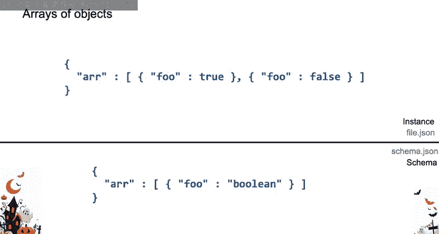

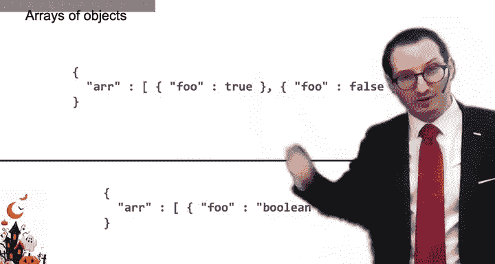

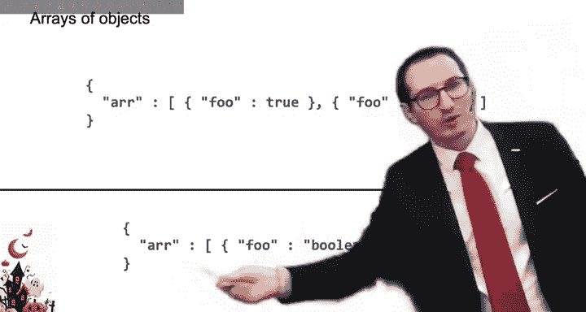

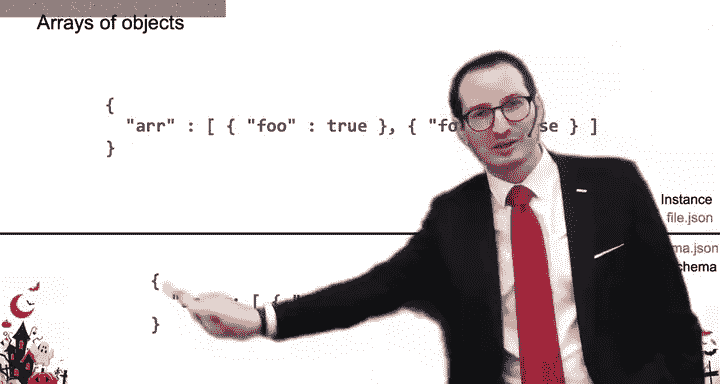

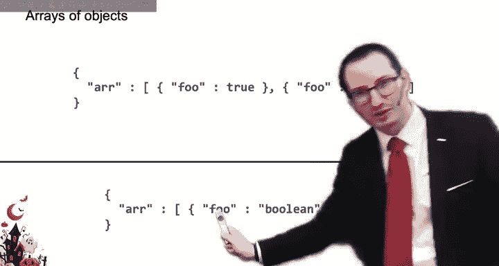

So。Now I left here with the fact that by default。Extra fields are forbidden in JSO so for example。

 if you have here last 1 first and you have last 1 first in the incident。

You cannot add another field here that wouldn't be already in the schema right。

 but the nice thing about making schema validation optional and having more flexible schema languages is that you can add in your schema that you're totally fine with extra fields that you don't know in advance。

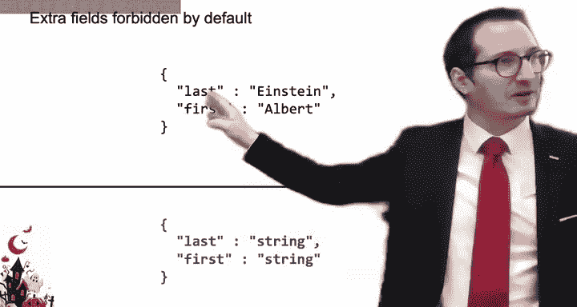

However， since it's an advanced feature that requires another flavor of JS but you don't need to worry too much about it I'm just telling you it exists so there is the small vers syntax that says that basically we expect an object。

 base type is object and the content has basically pairs that have the key is last and the type is string the key is first the type is string and with that syntax you can actually add some property here that say closed is pos so the difference between the twoth syntax is is that in this syntax is it actually good to be aware of this kind of design when you design your own data。

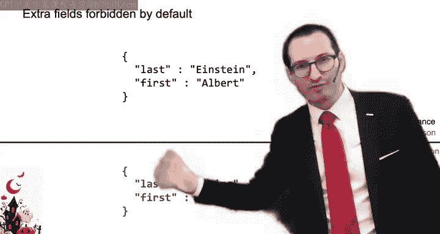

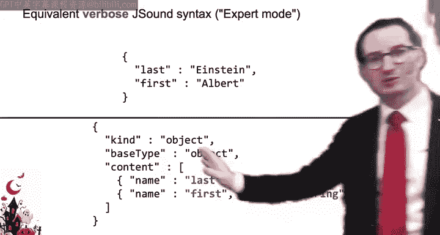

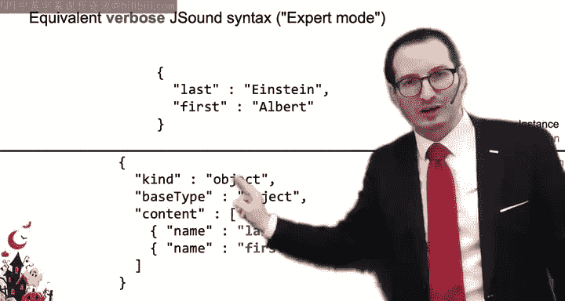

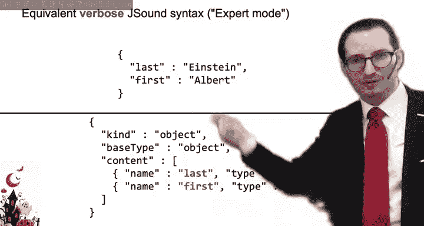

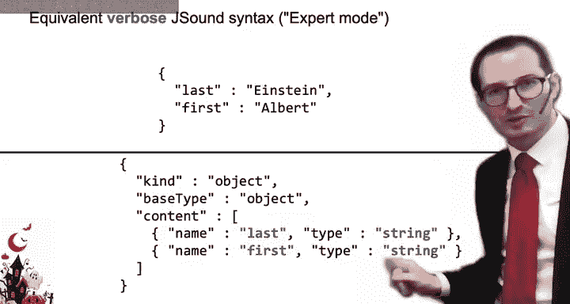

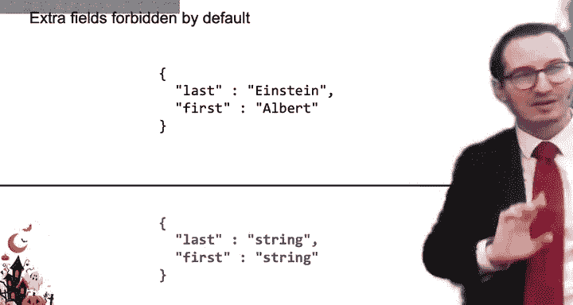

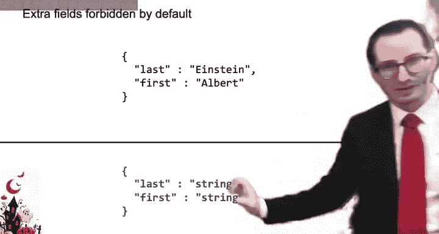

We call this dynamic so the schema language is dynamic because the keys that we put in the schema and the absolutely anything。

 These are basically the names of the keys that you want to give here right this here is a more static schema language in the sense that the keys in the schema right I'm really talking about the keys in the schema are actually defined in advance there's a key called kinds that says if it's an object and array and atomic a key that is the base type we can define subtypes a key that's called contents and for the pair the key is always called name associated with the key of the instance and it's always called type So it's static because here it foxes you in every schema that uses these robot syntax to have exactly these properties here。

😊。

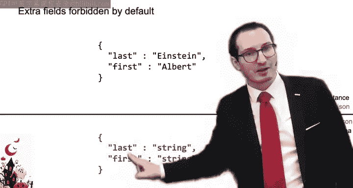

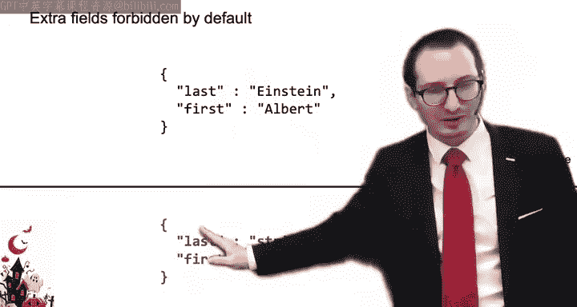

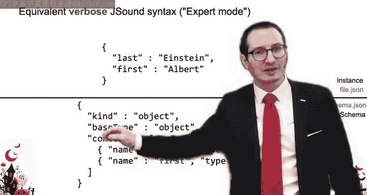

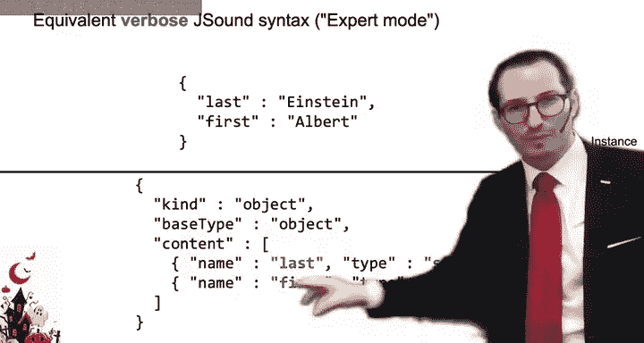

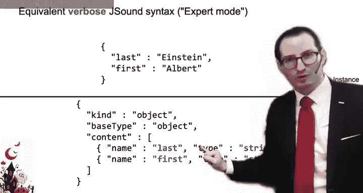

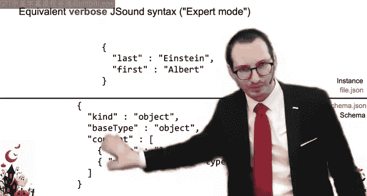

Okay as opposed to this web where you can really put anything in there so there's two kinds of ways to design such a schema language。

 but the benefit of using a static syntax like this is that it's fully extensible it's more variables but then you can do many mock things so the goal was that this contact syntax here covers the 80% of easy use cases like the exclamation mark for required and so on just easy and visual and for the 20% of advanced feature。

 you would just move over to the ver syntax but you don't need to learn it right the ver syntax really don't need to worry about I just wanted to tell you that you can do mock things and in particular in the ver syntax you can add close which if you set it to force then it's open and then you allow in the instance for any additional is even though they are not listed it in here right who is with me。

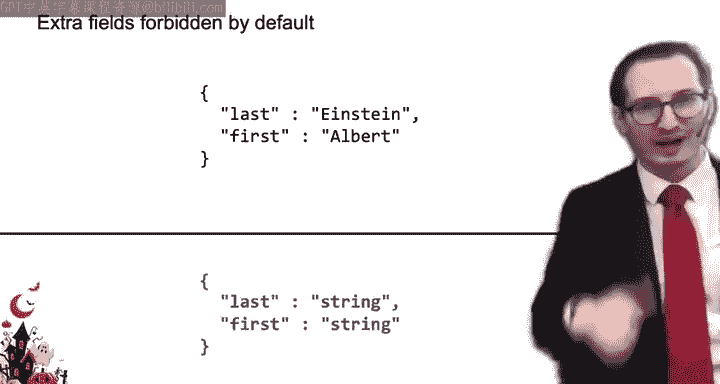

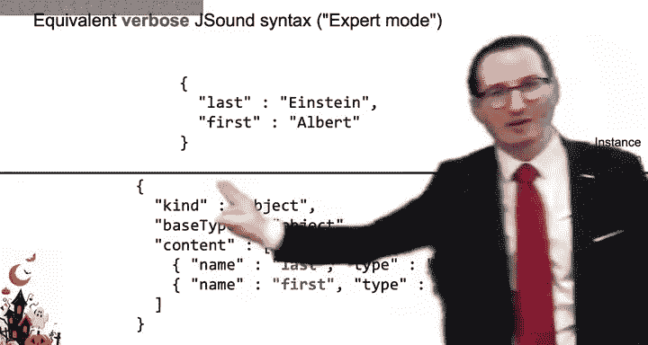

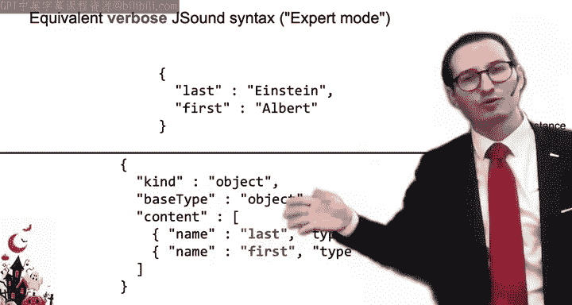

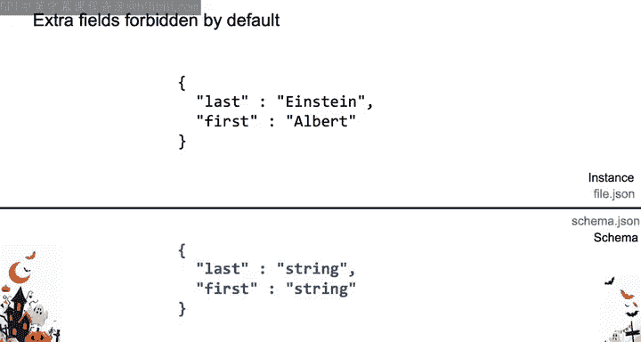

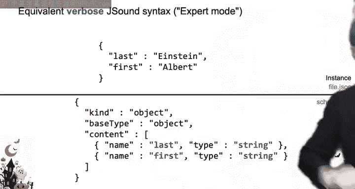

Okay。

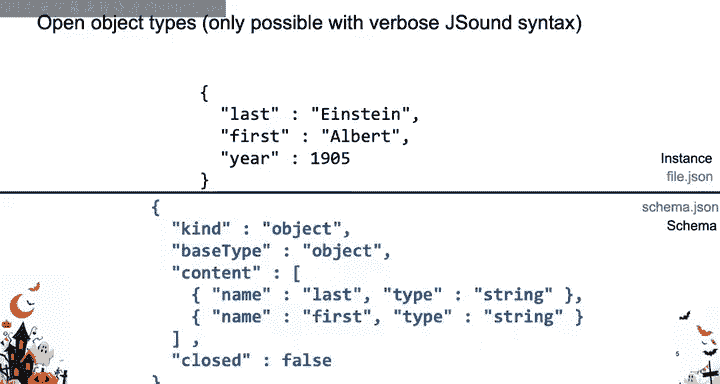

So now if we recap what we've seen on JSs， so what is general about many of these schema languages is what we can do。

 for example。In a schema language we can restrict they used to have a specific type， for example。

 is there a question let's go to your question I just wanted to ask if it's possible to intermingle the advanced syntax and the normal syntax for schemas like can you have an advanced object within a normal object。

嗯。In theory， yes， you could。It's just the design when you do that becomes very difficult to learn basically when when you mix so I'm taking your question as a meta question right it's not just about JSO it's about like any language that you want to define in JON schema language it's usually a good idea to either say okay that static or that dynamic but if you go for static then try to make everything static right having said that not everybody does that and in fact if you look at J schema that we are going to study later。

 Jason schema mix is it has a path that is static but then some other path that are dynamic it's okay I mean you can do it but you just have to take into account that it can be confusing for users does it answer a question Yes so this is since you ask this question I can talk a little bit about that this is really the design if we want it we could have made that path dynamic right instead of having an array and really explicitly having。

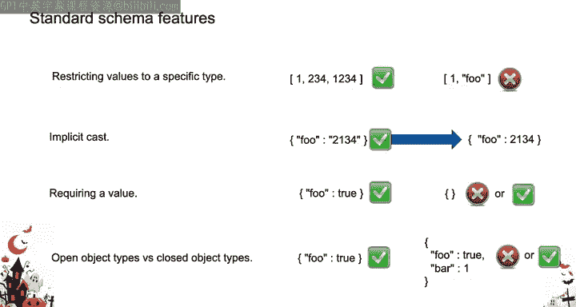

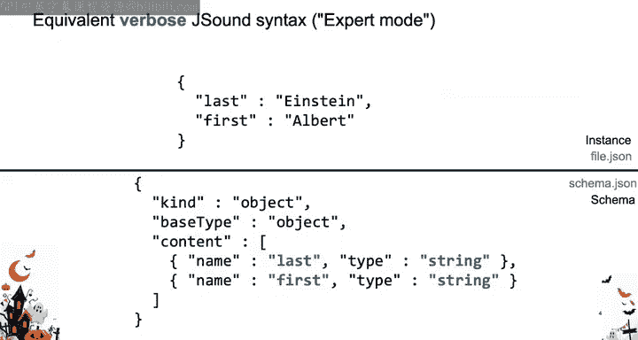

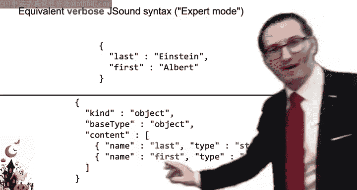

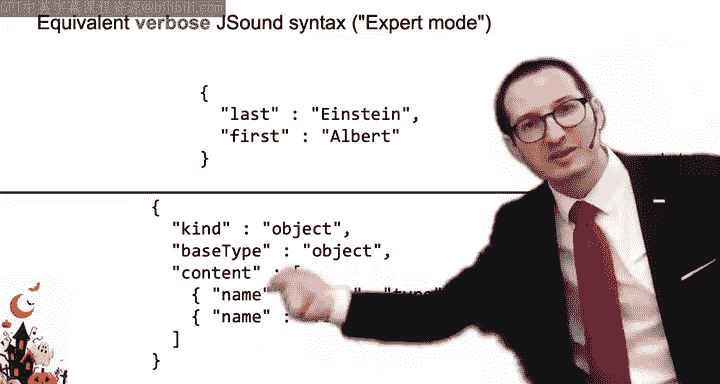

Name and type we could have made that that part dynamic saying instead of that array。

 we would have an object， that last column string and first column string right， But again。

 that would have been confusing because then that would be intermingling with what would be the compact syntax。

 So this is why we consciously kept it static in this way。 Okay。

 but that's already an advanced question， right， That's yeah， over。

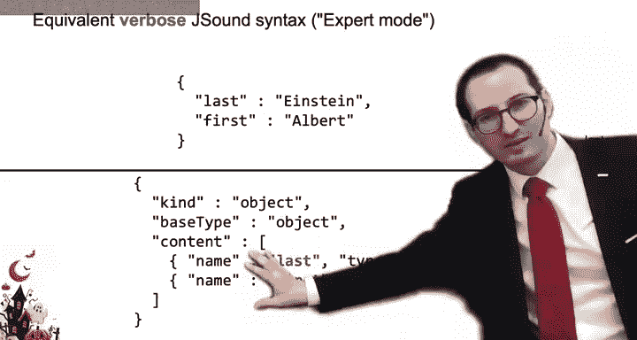

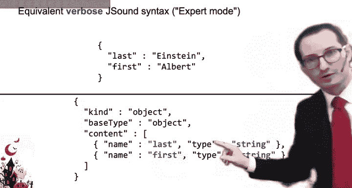

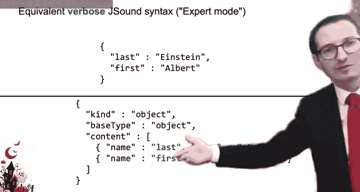

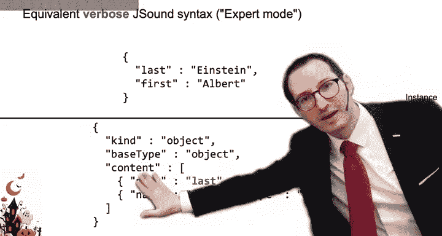

I would like to ask why do you make a default that fields are optional and also that there cannot be extra fields because I would seem more natural to do it the other way around that I want this field to be present and if there is something extra I don't care。

This is a very good question and in fact this is indeed a design question so when you design a schema language that's a question that you answer in every schema language and there is no right or wrong answer for example you would see in JO schema that I think it's open by default in JSO schema and then you close it meaning you don't accept extra fields explicitly right but the default in JSO schema is that extra fields are fine in JSON it's the opposite again there's no right or wrong it's it's really a design a design decision the same for required whether or not you require a fit by default or you make it optional by default is a design decision and there is no right or wrong right and so that's the sort of things that if you have to remember something you know I teach you with all these examples and so on but what I want you to learn is really the highlel considerations of schema validation so even though here it happens to be optional by default and。

By default， just remember that it's a switch that in any schema language can be the one can be the other。

 you just look up the documentation right and you see what the documentation says。Now。

 I can say a few words about why we did it in this way that will actually become clear later when I show you the data frames。

 the fact that you can actually draw these as data frames。

Because if this is what the compact syntax does that it doesn't allow extra fields that basically allows you to transform a JSON schema to a data frame schema like the ones you can have in Spar and in pans so that is the motivation for noting extra fields because in a data frame schema you do not allow extra fields you have to specify all of your columns in the data frame so this is something you will see a bit later and normally that should add up and that will make it clear why we made this decision。

Okay。Thank you。 All right。 But again， there's no right all wrong。 just it's a switch。

 and either decision is totally fine。

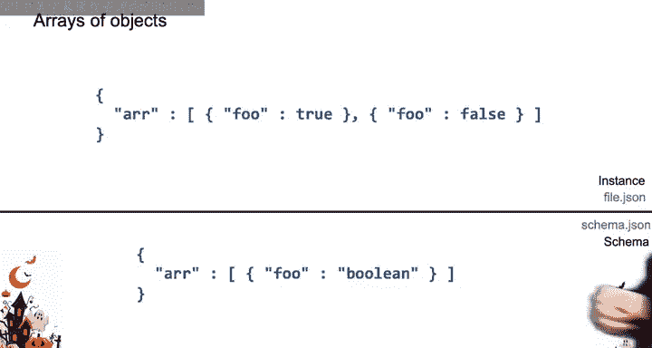

Okay。So I was here， so this would be the dynamic Com index。

 it would be the static variables index that's more powerful。

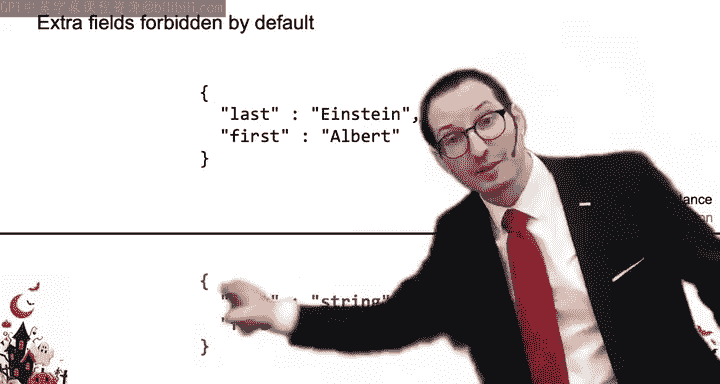

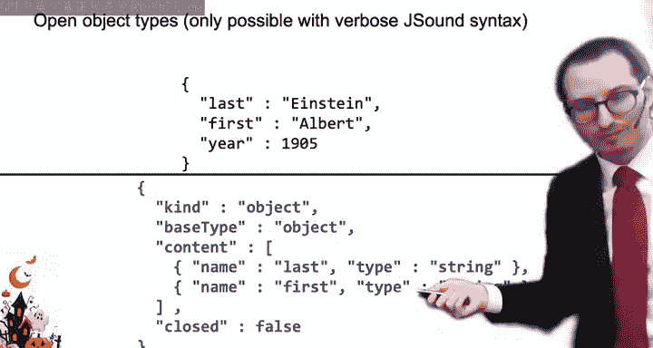

So what can we do in a schema language， any schema language？

You can restrict values to a specific type。 You can say the value associated with the key must be a string。

 or it must be a boan， or it must be an array of integers。

So that's the feature number one that schema validation language is0 U2。

So another feature that is very common to schema languages is an implicit cast。

That is technically not part of the validation but of the annotation because the cast actually is about what you have in memory after the validation because you might have before the validation you might have a string that contains a date but after you have validated as a date in the memory you will have replaced it with an actual date with an actual instance of a date class if you do it for example in Java so this is called annotating and it means yet that you cast so I took the example of a date。

 but this is also true with integraltegers with basically any types that in the memory once you have validated with a specific type you cast the value to this type and this is the reason I told you for whatever we have in memory before the validation we don't care if it's quoted or not quoted we just look at lexical values。

 the literal value so we don't care if that's quote or not quotes we take it as a lexical value we see okay does that lexical value belong to that type if yes。

 then you pass the lexxiical。valueue and convert it to an actual value of that type right so this is why here you basically look at it from a lexical value perspective。

 This is the lexical value 21，3，4 doesn't matter if it has quotes or not you could also do it without quotes but you look at the lexal value and after that if you validate it as an integer then you have an actual integer。

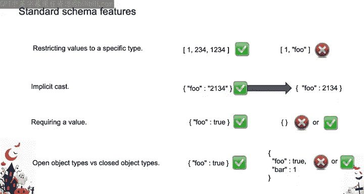

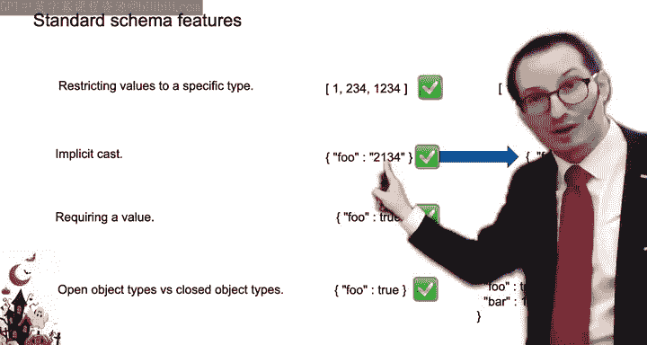

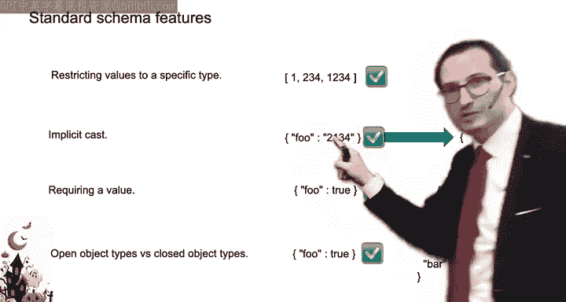

In the memory。All right， feature number three is you can require a value or make a video optional so you can say this key is mandatory or this key is not mandatory right and whether what is the default that's yet another design question but you have control over all that when you build a schema。

Then you have control over allowing or not extra fields。

That schema language TPQ gives you control of that。And again。

 what the default is is an open decision， you just need to look it up in the documentation of the language right so basically what you see here was the answer to the question you've just asked right that the schema language might make one or the other the defaults。

Okay， what else do we have Oh default values so that I haven't shown you。 But in fact。

 what you can also say in a schema。Is that if a keys is not present， in the instance。

 you can just add it with a default value。This shouldn't surprise you you can do it in SQL right in SQL you can also specify the default value of the column you can also do that so that you can do in a schema again that would be part of the annotation and after the validation and the annotation in the memory you will have the default value that has been added to the object。

😊，And finally and that I didn't show you， but you can also specify primary keys， for example。

 if you have an array of objects， then TT or schema language could allow you to say that you want。😊。

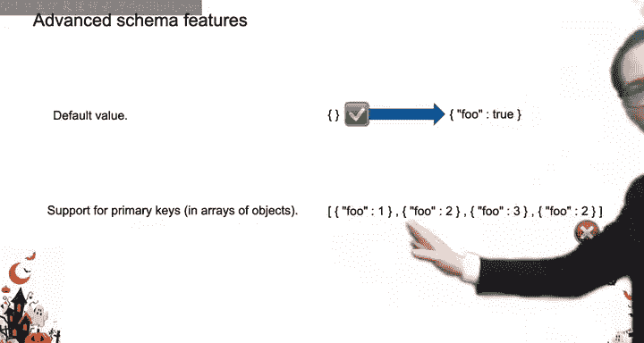

In that array of objects because remember an array of objects is an S table right so you could say who is my primary key and then it would also check that you don't have twice the same primary key within that array of objects but who is that clear？

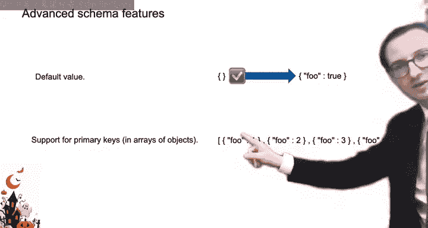

RightSo of course I'm not showing you how to do it。

 I'm just saying you it's possible right in many scheme languages you can do these sort of things。😊。

So you see these are all the sort of things you can do with schema languages。 any of them。

 then you can learn plenty of them look at the documentation。 they are really all the same。

 So just for the sake of showing to you， I will show you Jason schema you receive the same features But before we do that I wanted to show you for the great language game which is a data I told you about with 16 million objects that look like this。

 This would be the schema you see how visual it is It looks the same right guess is a string target is a string sample is a hex binary that's basically a base 16 representation of a sequence of bits choices is an array of strings。

 you see an array of strings and you see all these exclamation marks here that basically require the。

😊，The the key to be present， right， So who agrees and sees that the the instance on the top is valid against the schema at the bottom。

Allright， very good so this is the idea and basically it's very straightforward if you take an instance document to turn it into a JSON schema in the Comp syntax because you really just replace the values with the names of the types that's pretty much all you need to do then you put your examination marks where you want to en requiring a key。

😊。

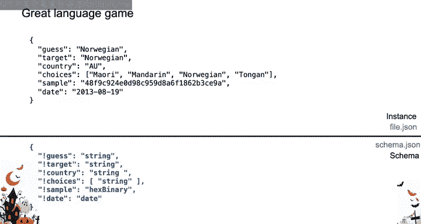

Heres another example， I told you this one is pretty easy to turn into a Sba right。

 so imagine you have the billions of documents that look like this with variations on that。😊。

If we did the schema， again， I told you you just replaced the videos with the types。

 do you see that this would be the schema？😡，Who sees that？Allright， it looks very much like it。

 right， You see just exclamation back to require it。 A is an integer。 B is a boolean。

 C is an array of objects。 and inside these objects， we have full and bar。😊，Fuo is a string。

 bar is an array of strings， and you see here fo is required， it's everywhere。😊。

Bar is absent from the felt。

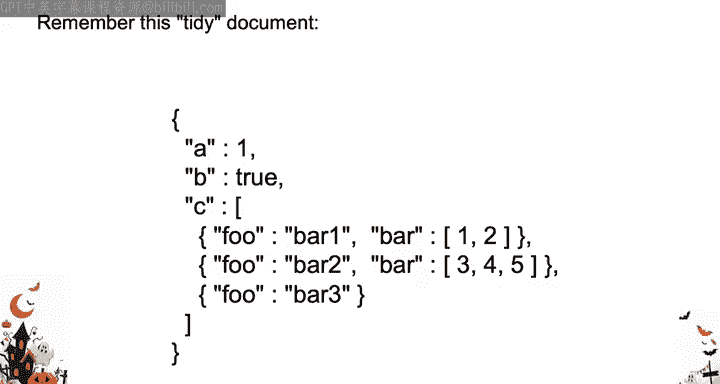

Object here so in the skima if we want this to pass the validation we have to make bar optional So this is here I didn't put an exclamation back to not to not require it Okay。

 so it means that now you can take this ski I validate similar objects We have another question。

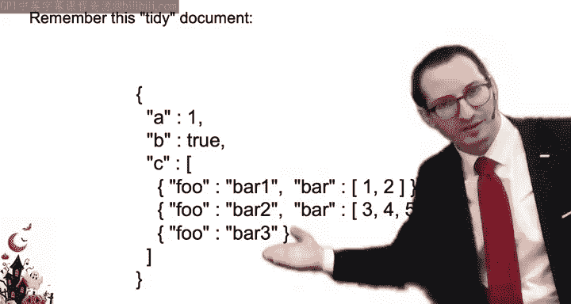

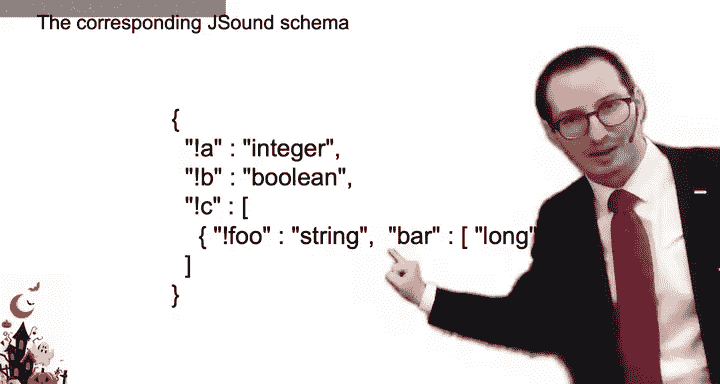

So if you asked us to provide a schema for a given object， we by default。

 assume that it's required unless we have an instance where it's not。嗯。😊。

It's really based on reality right when you do it， typically you have a use case in reality。

 if you see that you have billions of objects and they all have the key。

 then it's a good idea to make it required because you can assume if you have billions of that。

 it's going to be required。 if you see that it's not always there， then you make it optional。

 but it's a good idea to make it required Now again， in reality， it might not be that simple。

 maybe in reality or designing the schema before you see the data So here you have to ask yourself okay what about the people who are going to create the data。

 will it be will it be on there in their way if I make it required。

 you know how it is with the administration right you have to feel a form and if you don't feel it entirely then it bounces back to you。

 This is the sort of things that arrive basically if you make a field required This is a real life thing。

But at the exam， of course， if we ask for validity。

 it can be required or optional in both cases it's going to be valid right if the field is there。

Okay， thank you。All right， okay。So now that I've shown you the features of a schema language。

Let's move on to Jason Schema， which is another one that you see has the same features。

 Just looks different。 So here we go。So as always， the instance is on the top。 the schema is below。

 except that now it's not longer about JO。 It's Json schema， right。

 And this one is actually used at a lot of places。 So you will probably see it。 Now。

 how do we say we that we make that valid， We want a key or less associated with a string。

 and that's how we do it。 Now， coming back to your question about static versuss dynamic。

 Let's look closely at what they did here in Json schema。

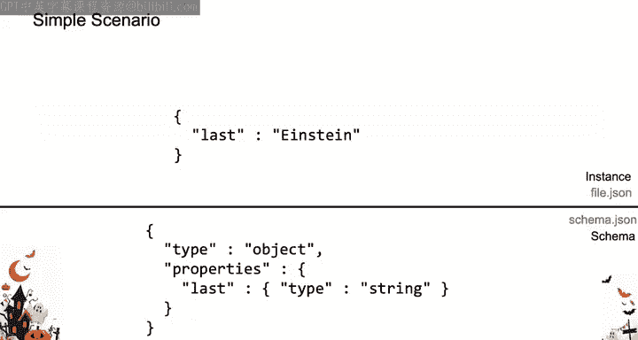

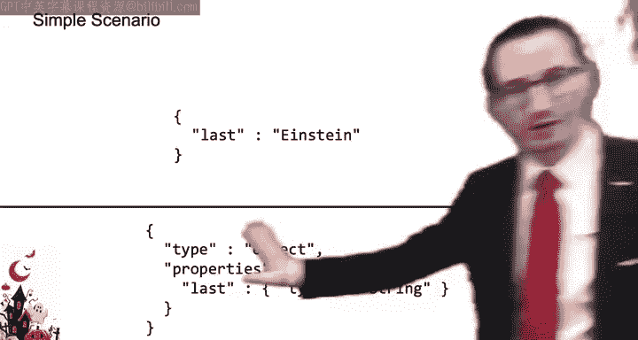

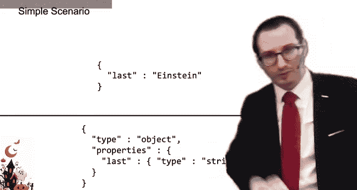

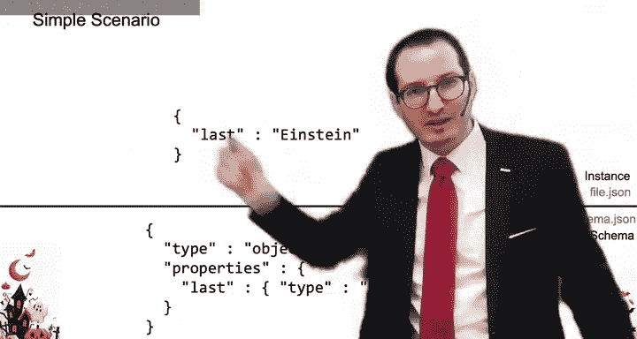

You see that that part type properties is static right typey and properties there will be always be here in all the schemas that will be type and properties and you just changed the type that you want and the properties that you want Now do you see that that part is dynamic that part is dynamic because here what you put in here when you when you create your schema will depend on what you want here right so who see that is static and that is dynamic。

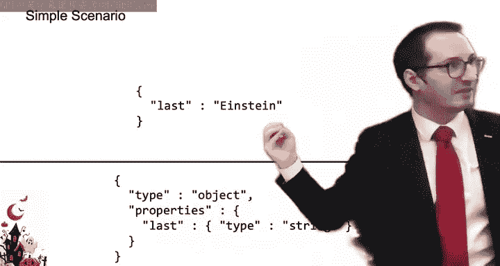

Right okay， fabulous that is static that's always type and then you put the string in there。

 So really the difference between static and dynamic is that when it's static the keys are kind of hardwired in the schema language and you would just change the values when it's dynamic then when you design a schema you also allowed to make up the keys that you want okay。

So that basically says that you have something that is an object and the properties its properties is just a synonym for key in JON so the properties are last which is a type string now you see the re just the same kind of recursion we have in JSON so we have here this object here that's the outer level and yeah that's an inner level always with the type the type property yes。

😊。

Why is there top level type， isnn't that always an object？诶。

It doesn't have to be because for example， here it's a string right type string。

 so it can be type object， type string， type array， type anything you want。

 but here in that case we validate an object right but you could also maybe validate an array instead then you would have type array。

But isn't the top level Jason element always an object That is also one of the things that gets you a tro on Internet forums。

 So let me add this one as the third way to tro an Internet forum。 you ask exactly that。

 So in practice， if you look at many document stuff， then yes。

 the top level is going to be an object。 I mean， this is common practice。

 Now if you look at many of the specifications。 it doesn't actually enforce that。 So technically。

 you could have any J value at the top level。 So you can imagine a Jason lines documents。

Where you have a mixture of arrays and objects and even strings or numbers just by themselves on the top level right so it really depends on the system you're looking at JasonO is generic enough to allow that but for example。

 if you look at MongoDb then in MongoDb that has to be an object at the top level right and we'll see that the reason why we like to have objects at the top level in many technologies is that this maps very well to data frames and that I will come back to again right and then you'll see why it makes sense to require objects at the top level right does it answer a question。

Awesome。So now okay so let me add a fit so here you see in the dynamic part you can just add a second key that has the intended the intended name and then it is of type string as well。

😊。

By default， it's optional。 So that's like J sound。 So here they decided that it's allowed to not have。

Okay， so the way that you read the schema is basically， if there is a key called first。

 then it should have the time string。 But if there is no key called first， then that's fine too。

 right This is what it means。 So this， in sense， would be valid against that schema because first is optional。

If you want to make some of them require art， you do so with a static property of the schema again it's static because it's always called the required art。

 it's always called that way。

Containing the list of the keys here that you want to require and here you say less than first would be required in J down that would be the exclamation back in France in JO schema that's basically in the required fee so you see Jason schema uses a bit of a mix of compact ands and a mix of dynamic and and。

Okay。Then what about extra fields， when it turns out that in JSON schema they made the opposite decision than we did in JSON so in JSO schema it's the opposite if you can absolutely have any extra fields you want if the schema doesn't explicitly forbid them so this is fine totally fine and if you want to forbid it。

 you just have this static property because it always called the additional properties。

Wwhichhich is false and then it means it deters additional properties so here that would be valid。

 that would no longer be valid if you add additional properties for， who is with me。

All right， there is no right or wrong just read the documentation of the schema language and you will see whatever is the default do we have a question Yes。

 how do we define required fields if they were nested in other objects do all the keys need to be unique。

Then you would do it in the nested object， so basically this is a recursive structure what you have here that is basically specifying the schema of an object works recursively too you could for example。

 copy paste that inside this and have a nested object here， then you would put the require inside。

The， the in object type。Does he take sense？Awesome， de。All right。Okay。

 so they really see it as a regression。All right， now in Jason Schema， you can also change the types。

 but the list of the menu on the menu is not that long compared to Json。

 So Json has this huge list of types in Jason schema it's a bit limited。

 So you basically have string number Boan。

No array object， but nothing much beyond that。

It might have also an extra type， I think maybe for some kinds of numbers。

 it might have integer I'm not sure， but basically it's a very short list of types。

 if you want more specific kinds of types， you have to do it with what is called the format like a date is basically a formatted string that looks like a date So it's a a bit less flexible in terms of the type system but the way that it works right you have string number of Boolean so you can see that it means that J schema was designed very closely to the adjacent syntax because in the adjacent syntax you have string number of Boolean null as that twoomic So this closely matches the adjacent syntax N nu right so you have the four string number Boolean null。

Okay。Now and here this is the part where you cannot guess it， you have to look at the documentation。

 how do you allow any value what we called item so there is a special type called item in JSSoONs and in JSonic actually but in JSO schema there isn't any search type so what you do is that you use the Boolean true。

So it looks a little bit like it fell from the sky。

 but this is how it is right if you put true instead of the what's called the type descriptor instead of that you put true that means anything it allows for absolutely anything so here you can put whatever you want inside of location because it said true al right and force would forbid it so force would basically mean you are not allowed to even has a key to have a key that is called location force means it will always fail the validation yes。

Could you go back to the null slide？When we say it's type no， every value has to be no there。

 exactly because that's a type that only has one value and that value is known。

So it's basically checking whether the whole， let's say， column is nu。

Yes exactly so that I will come back when I describe the data frames but basically Ns there are several ways to handle them you can consider that N is the same thing as an absence of value which MongoDb is doing or you can consider that N is a specific value that belongs to a type a single tone type actually just like Boan has two values N has only one so there's the two ways of doing that in JasonO schema they make a distinction between the value nu and the absence of value and because they make that distinction they have to define a type called null and the only value that is permissible in that system is nu。

😊，Okay。This方面。Any other question？ Yes， we are here。So JavaScript has this value undefined。

 which in many cases is like if you access into an object with a field that it hasn't defined。

 it'll give you undefined， is this a valid value that you can have in JSO is it treated in that same way undefins。

So。There is no concept of undefined。In JON or in JN's validation languages。

 there is no concept of undefined， there is just null or absent that's the only two things you have Now the concept of undefined if you think of it what it means it basically is in programming languages for example in Java or in C++ you can basically create a variable but without initializing it right you declare variable in some languages it means the value would be whatever happen to be in memory at that location that can actually be a cybersecurity risk or it could it could just say it's undefined if you haven't yet initialized it right that is really something that has to with programming languages more than with data modeling now if you want to capture the semantics of something that you don't know the value of then whether data modeler would say is they use null for that purpose so for example in a PostreqA or in relational database system you could say。

I'm putting a null in there if the value is unknown or undefined。

 but this here is not something that would be inside the database system。

That would be something that the users of the database system decides。

 So whoever makes the schema would write in the documentation of the schema that they intend for to have this and that meaning。

 Does it make sense。I also wanted to ask JavaScript doesn't distinguish between integers and floating point numbers。

 is it is there ever a case where say if you're transferring from data to a relational database where you actually do care about that kind of thing。

 is there kind of a gap there where JasonS doesn't have a required feature？

So here I can also say a few words about that about the number types eat them soup。

I would like for you to understand it from a formal perspective。

 there is basically the formal perspective， and then there is the implementation perspective。

So what happens with if you want to do it rigorously with with types and the way it's done in XMM Sche mind in。

Jsonique is you basically have a value space that contains all theim numbers。

That can be written in Bay then as a finite。Sequence of digits。

And then many of the types of subtypes of that， for example。

 integer with any precision is a subtype of deimole in is a subtype of integer byte is a subtype of int and so on and so on。

 you can have non negative integer， positive integer and so on， so you have a whole type system。

But everything resides on the mapping between the lexical values and the mathematical values。

 the actual typed values， for example， the thought2 which is lexical value and the number 42 in base 10。

 so this is how formally it is done。😊，There are a few exceptions with doubles double are typically in XM schema a type of their own which which is it's called a type double。

 but it's not in any relationship with deimor and in the lexical value space of double you would accept the scientific notations which you typically do not do for deimors so whenever you have an exponent it's basically going to be in the lexical space of double。

嗯。Now。What happens when you open adjacent file and you validate it。

Involves a mapping to the host language that you are using。

Because you might be using JSON Schema or JSound or XM Schema whatever language inside a programming language。

 that programming language could be Python， could be Java， could be C++ could be R。

 it could be Haskell， could be any programming language。

And you can do that with any schema validation language。

 so there's really it's completelyocgonal the programming language you use and the validation language you use in particular JavaScript happens to have given birth to Jason but Jason is really completely detached from JavaScript。

The consequence of that。Is that every programming language has a different type system I told about the type system last week。

 right， from a general perspective， but Python doesn't have the same type system as Java。

 which doesn't have the same type system as C plus and so on and so on and which doesn't have the same type system as Java。

So what happens？😮，Is that when you model things and if you do it rigorously and sadly not everybody does that。

 but you're supposed to do that， the moment you use schema validation with a host language。

 you should do a formal mapping between the type systems that means that typically a table with two columns that says these are my types in Python or Java or Java split。

 these are my types in the schema validation language and this is how they map。

If you look online I we show you later but Spk does that Spk tells you these are my data frame types and this is what they would be like in Java if you use Java。

 this is what they would be like in Python， if you use Python。

 this is what they would be like in Java if you use Java， right？😊。

But you really need to understand that this mapping is never one to one and that's what we call an impedance mismatch right it's like for sound engineers when you connect the wrong wire to some loudspeakers and you basically break the loudspeaker database people also call that an impedance mismatch。

Basically you have to take care of that carefully if you encounter such a thing you have to carefully map your types。

 but you need to accept that there will be a mismatch so you need to basically explain how it's done now coming back to our example with numbers in the J syntax so in the J syntax all that instead is lexical values that's all Jason says Jason says a number is basically a sequence of digits maybe a decimal period then a sequence of digits an optionally an E authentic notation followed by a plus or minus or a thing and then digits and so on。

But if you think of it that only like equal value doesn't tell you anything about the type。

 the type will be figured out by the schema language and the programming language。

What is sometimes done actually by quite a few systems。

Is to convert or put in the memory representation when you pass Jason。

If there is no decimal periods and no E， you're going to make it an integer。

If you don't support the integer with arbitrary precision， then make it along， for example。

If you see a decimal periods。But there is no scientific notation。And if you support a decimal type。

 then make it a decimal。If there is the letter E with a scientific notation， then make it a double。

That is something that is commonly done by systems， but it's not universal。

 you might have systems that make everything a double for example。

 or you can have systems that only make it a double if it has a decimal do or and E and otherwise alone right but there is no fundamental truth to that this is really part of the mapping that you're going to have and you're not going to have the same mapping in Python in Java in Java it's going to be different。

😊，So is like NAN， like not a number literal value value Json value then NAN is an acceptable le equald value。

In the lexical space of double and floats。 So if you have double and float as you're ty in in I'm talking about Jsononic XMM schema and so on。

 not JO schema。But in then， you can have NAN and that will be accepted as valid against double of float。

 and the annotation in memory will be Donan， but the Nan will be in the Ie754 protein point stormdown。

Right， great， thank you。Right besides you yeah。so is it possible for like a given key to or a property to say it could be this type or this type like like for last。

 could we say like oh， it could be string or it could be yep， that's called the union。

So I think in J schema you can use an or Boolean logic， it's based on Boolean logic。

 you can use on or in JS sound in the variable syntax， you can also define unions。

And I guess in Jsonic， we could like do it as like a full expression or something and write it as。

In JsonI you could， so basically the way to go would be to define the user defined type in JON and then you could use it to annotate a variable in JSI right。

 but that's already advanced doing that sort of thing but you can absolutely do this。Yes。

 with unions， couldn't you create a situation where it's unsure which type actually to match to。

 So let's say you have a union of string and float and you have the string N A N。

What's the type of then？So typically what happens this is already a programming language question right so we will only get to that in a couple of weeks here you need to distinguish between the type andnotations for variables that are basically the expected type of a variable at one time。

😊，And the actual type of the value that you have in there。

 and technically in the type system and in the data model of this language。

 which is Do3 C standard out the type system。What happens is that anatomic value。There's its type。

 it has a value and type right so you would basically have unambiguuously NAN either as a float or as a string。

But now comes the next question in a natural way which is what is when you validate meaning that in your instance you have the string NAN and then the expected type is an union。

 then you have an obbiguity you have a obbiguity and so what has to happen is that the schema language has to document what happens What could be done for example is to take whatever first type matches the value for example。

 if you say float union string then float would have priority and you make it a float nu if string comes first in the union then you make it a string nu right。

But then string would always win， of course， if you do it in this way because anything would be a string。

Okay， thank you。But these are very good questions because it means you're already in the design of that and really I want you to think not at the level of just learning a schema language。

 but really learning to understand the design of the schema language itself。

 because the sort of questions you ask are exactly the sort of questions that the designers of these languages actually consider when they design the schema language。

😊，哎。All right， so it's a very good sign that you're asking this kind of question。Okay， so true。

 first。So here is how in J schema， you could specify some more constraints on the numbers。

 for example， you can have latitudes and longitudes specifying a minimum minimum maximum right that would be the product coordinate。

So that's the subtle of things you can do in J sound， you can also do it in the various syntax。

 you can basically add constraints。On user defined text， but I didn't want to overloadload you with。

Material。Then I told you type can also be array， right can be object string number null Boolean can also be array。

So that's an example that would be an array of whatever and if you want to specify what you want in the array。

 then you have to that's a static property， it's always called items。

And then type again， a static property and this is where you plug in the type that you want right so as I told you。

 there's not just a string number Bo and and null， they also added integer。

 which which would correspond to to the case where you don't have any disimil disimal point right。

 So this is here an example of array of integers。

Okay。So that's J schema hopefully you realize that JSOM and J schema are kind of the same if you want。

 except for the Cosmeique and the documentation and so on， but it's doing the same thing really。

 this is the one thing that I want you to see and to be prepared to learn other schema languages later if they come and you will see it's always same the same kind of features。

😊，Okay。😊，Who understood that so far， Jason Jason Schema， okay？So now I'm moving to Xml schema。

 but that's only for you to see that it follows the same logic。

 like a lot of the things you saw on Jason schema and Json also apply to Xml schema。

 It's just Xmn instead of Jason。 So let's quickly go through it。

 Of course it's very powerful and complex and I'm not going through everything。

 I just want to show you the basic things that that help you to understand an Xml schema。

 So the first thing you notice I still use the instance on the top the schema at the bottom。

 The first thing you notice is that Xml schema is also Xml。

 just like Jason schema is Jason and Jason is Jason。

 So that's a common thing to do with schema languages。 a Yamer schema。

 it would be a perfectly natural thing to define it in Yamer right So it's the same logic。

 So now what do we have What you can see that。

XM schema。

Is entirely static now that you know the static dynamic thing because all of the elements that you're going to have in your schema they are predefined just like those that work static in the case of JOson schema like type additional properties these are all static the same thing goes in an XMM schema all of these elements and attributes are static predefined in advance always the same So the only thing you can change is the structure and the values that you put in there So here we have a schema it's always called schema and then we define an elements that is the name of which is P and the type of which is a string don't worry too much about that name space that is just the name space in which all of the types are stored but basically the types that you put in there are exactly the same types as you have in Jsos and exactly the same types as you have in JOonic so there's no surprise there it's the same list of atomic types you can just help yourself from that list right So that's it and you can see who as a string in there that。

Do successfully？Map two a string so far so good。So that's the next M schema now I can change it to integer for example。

 that's also one in the list that I give you so we have an integer is it valid， yes。

 absolutely it is absolutely valid because you can pass that。😊。

Syntactically it's just text right it's a text node。

 but you ask yourself when you validate does that thing here belong to the lexal space of my type and the answer is yes。

 you can absolutely pass that as an integer absolutely and then when you annotate that's going to be an integer in your memory right。

😊。

So this is what happens， so this is also valid。How about complex structure Because here we just saw an element with text inside How about elements with nesting elements。

 So here it's a little bit similar to JSON objects not just that it's Xml。

 meaning that here we have last ten first and we want strings So what we say is we define them here element last ten first type string here that resembles a bit the variable syntax of jsons right I told you it' all static in there So this is why you can only have you can only change the what you put as the values here of the attributes and this tool you nest into a sequence that's also a static thing so sequence inside a complex type element also static inside the element person。

 So the element called person that is a complex type containing two elements。

 last ten first that are strings okay so that is how you define a more complex nesting structure。

What you can also do is repeat and control the repetition of elements。

It means that you can say， for example， that you want multiple so three of them you want it between two and four right so you have these two static attributes。

 Minocs and max occurss that are you to control zero or one that's basically optional right so you make this one optional These names are made up the names that I give here of course I totally made up but minocs and max occurss these are the static properties that you need to have in your schema to control the number of repetitions for whom is that here。

All right。Then you can also say it's empty， just leave sequence empty。 That's fine。

 you just don't put anything inside sequence。Alright， Oh， by the way。

 I dropped the schema element in here， but that's just not to weund the slide， right。

 you obviously always need the schema around it and the element。

 But I just wanted to stick to the part that changes。 That's the reason。It's going to ring very soon。

 let's see if I managed to answer your question before it rings。

Does the sequence imply the order of the elements Yes。

 it implies the order yeah absolutely it is all up and it has to be in exactly that order you have a way another way。

 but it's not part of the material to make the order optional it's called all。Okay。

 it hasn't ringy run yet。Very strange。I'm sure it's going to bring the minuteute I try to show you the next slide is going to ring。

So what you can do is also if you want to allow for what whole mixed content。

I he's going to， I told you。 So after our break。 So let's take 15 minutes and then I will finish on the the little。

😊。

On next they made schema， thank you。