# 苏黎世联邦理工《大数据｜Big Data - ETH Zurich - Fall 2024》中英字幕（deepseek - P26：-26-8. MapReduce (1_3) -.zh_en - GPT中英字幕课程资源 - BV1sHPKeoEJU

So welcome back， so now we are moving to the really exciting part of the lecture because so far we've been storing data。

 we've been validating data but we haven'tqueried data and querying data is the most beautiful part and that starts today with mapre AKA massive parallel processing。

😊，So。We already here right， Wow， we've done half of it。 It's halfway through the semesters。

 we've done all of that。 and now we start looking at that level。 Now I was busy during the weekend。

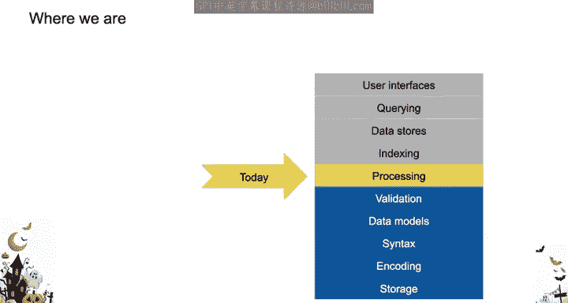

Hunnting Pokemons。

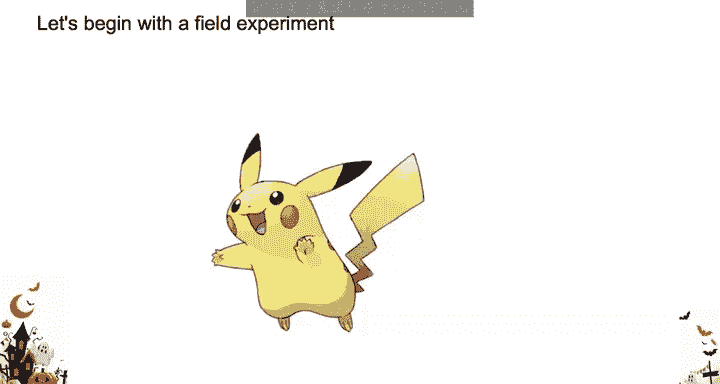

The problem is that I caught really a lot of Pokemons， I had hundreds of them。

I actually tried to count them， but it took a long time with one by one。 and then I thought， okay。

 there must be a better way than counting them one by one。 and then I thought。

 but wait I have 500 students I can use。This infrastructure， right。

 So I'm going to do exactly that today。 And you can see if you can do better than me。

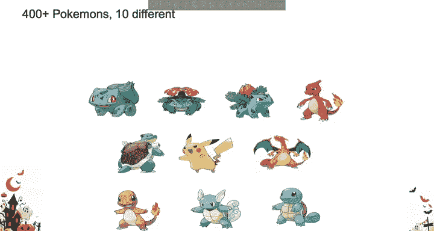

So we need to count these Pomons。I need to know how many of each I have codes right so they are called I don't know them byhaad Bubao Ivio Vennuo Charmano Cammeon Car out and so on right who knows their names？

Some of you right okay， so here's what I would like you to do， I need eight volunteers。

 you need a pen。

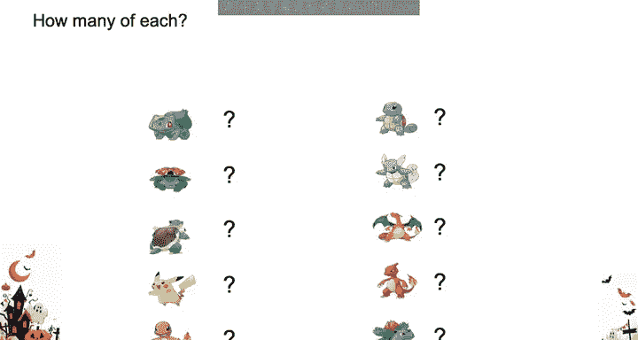

E volunteers who have a pen。Okay， you can come to the front。 I need eight people。

I will explain what you will do。8 people。Yeah。You will then go back to your signal。

 you can stay in the front over here， you don't need to come here so you can take this。

That's why you can go back to your seats， read this。Yes。😊，有一个。There you go。There you go。

 do we have H and I have five more。Yeah， here you go。There you go。Three more perfect。

 You' are exactly the right number。7even。And8， oh oh oh， that's9。 can you can do the reducing path。

 so stay stay where you can go back to seat， but come back for the reducing path to go back to it we need more volunteers。

So here's the thing。

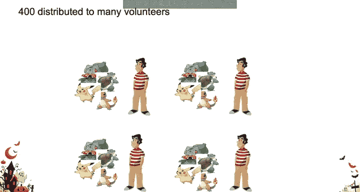

You have many Pokemons that I basically spread to eight people， so you don't have all of them。

 you each have a shout or a part or a chunk or a block， see here they are again。

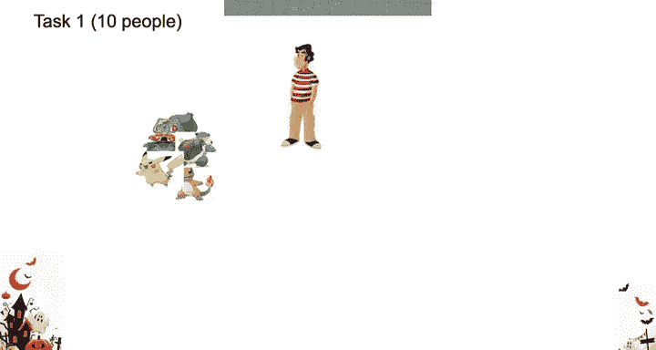

And what I need you to do is count the Pokemons that you have of each kind and to come them and to write on the piece of paper that I give to you。

 which basically looks like this for each Pokemon I need you to write the number right and you see it's ready to be separated but that I'll come back to so you need to basically。

Count them so you can do that while I continue to explain what's going to happen。So now。

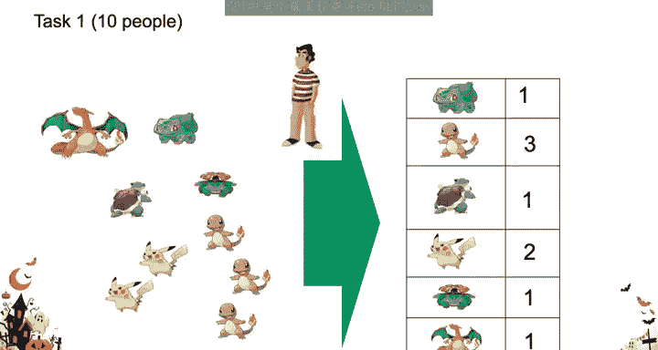

What happens is that I need other volunteers。 And here， this is where you can come， yes。好。No。

 the nerves are not， you can throw。Oh， no， you can。 you can just throw it away。

 That's when I when I cut the paper。 al right。Okay。

 so then we need other volunteers and I actually could use eight people again。

You will all be assigned the Pokemon one of them and what you'll have to do is gather from the other people who are now counting the Pokemon。

 you have to gather all of these pieces of paper， but just for your Pokemon kinds that you're responsible for since there are 10 kinds eight of you no sorry。

S of you will get one Pokemon and two of you will get two Pokemons，4 plus6 that's 10， yes。All right。

 so now do we have eight volunteers so you can come back？

So I'm giving you two Pokemons since you were very eager to head these other the two， thank you。

All right。One or two， tell me somebody gets two。So by default Im getting one。There you go。就一个。

There you go。对。There you go。 and here you go。 these two， All right。So here's what you're going to do。

 the people who were in the second round of helping。Pa attention。

Have to sum up the number that you would get from the other people and write it back on your paper as the song right then at the end I should get all of my numbers hopefully faster than what I did alone right so now people are mapping right so this is the face that people are count Pokemons。

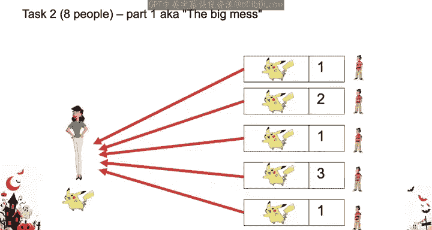

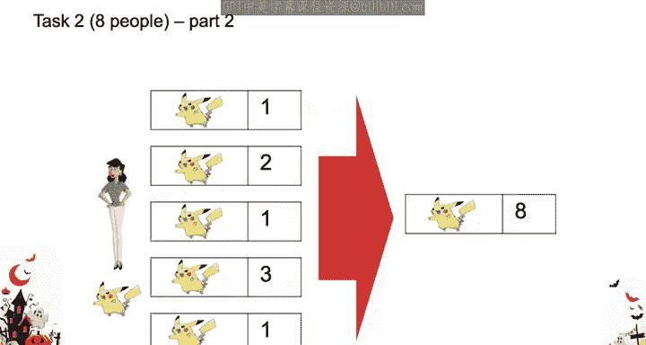

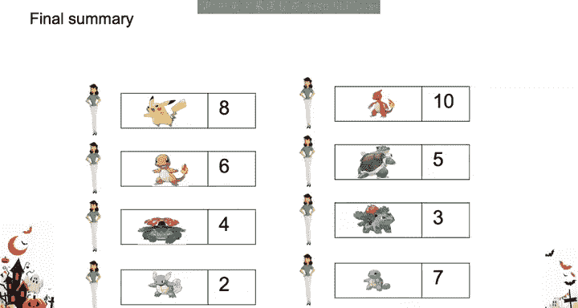

So what I would like is for you to raise your hand and stream or whatever to basically make me understand that you're done。

 mapping your batchachelor of Pokeements， is anybody done so far？Nobodys done yet。

So we'll wait until。People map。And the first mapper is done。

Even if you're not counting Pokemons observe what's going on look for the bottleneck of what's going to to happen it's going to take a while but it's interesting to observe the structure so now what you observe is that everything is in parallel so far right so people are counting Pokemons in parallel do we have a question。

Yes。😊，Why do some reduced people have one strip of paper and another have two it's just because it's a decoupling I don't want the number of volunteers to be necessarily the same as the number of Pokes in fact in practice we often have less volunteers than than the number of keys the Pokemons are basically keys right but that can come back to when we talk about optimizing the computation but that's already a good question right that observing that the number of volunteers who reduce is not the same as the number of Pokes。

对个。

Finish somebody finished。 Oh wow， we make progress。 I have a progress bar here。 Some else finished。

 You finished too。😮，W， wonderful， we are making progress so the people on Zoom can basically follow the progress on the screen。

 right？😊，So one two so now you can come back to the front to the front， everybody who is a reducer。

 the second batchlor of volunteers， please come to the front and show your Pokemon like a flag like this is what you're responsible for and the map who are done you can come to the front too you need to shred your piece of paper to separate the Pokemons and give them to the responsible people right so you need to come to the front。

😊，And shred Pokemon by Pokemon， and you just need to give it to the responsible reduce cells。Okay。😊。

Thinkk of the algorithmic complexity of what is going on right now。 That's called shuffling。

Do we have the third map， wellow， some progress， you see the progress bar on Zoom。房呢边。

Some people have to so they need to check。对啊，今天要给他0。So now we wait patiently。

So now we have more people who complete it， so we are making progress again。开始打开。Pixs people Al done。

7。 I see a seventh mapper。On their way to the front， beautiful。这个。

So what's going on right now in the lecture hall is also what I call the spaghetti part。

 the Chele part it's the spaghetti part。Because every mapper needs to speak with every reducer。😡，はい。

好的。Is there any matter who is not done yet？Any map who is not done， see counting。

Here that well where。In the center， yes， so this is also observed that not everybody done at the same time。

 some people need longer， maybe because they have mock Pokemons can be many explanations。

Are you done with this I？'s the second person。A you得。awesome， so you can come and give in the phone。

IYou already done。 You already gave it。 Okay， so all okay， so now we are shuffling， right。

 So this is the progress bar is changing colors。😊。

So the shuffling is going on。没那就说。Suffling， shuffling in progress。对对。Stin a thing。我 sorry。不。

It's a thing。Yeah， wonderful。😮，mask matching zero confusing them。だ。You can't hear your map。

Now you can count them if you have them all。😊，No， you need to add the numbers，That exactly。

 you need to make sure is anybody left。Everybody has given everything。 Yeah。

 we are done with the shuffling。 So now you can reduce。 So now the progress bar is continuing。😊。

This is my final， yes， you can bring it here。 So once you're done。

 you can bring me the final numbers and you can throw away the intermediate。Vos。好的。

So now they're reducing。Is taking place One more reduced Okaymon， yes。So I have 52 cha under。

 57 cha results。31 or 35， 35 Ja Leons， yes。Awesome。A fourth， when， thank you。

 I have 81 word total total。😮，I have。So the In media1， you can throw away47， need to write it back。

 Oh， I need I need the Indian media keys。You can take this one if you want to take it from here。

Thank you and we are making progress。Thank you。 I have6。yeah， oh you can do it， yeah。All right。

Or I have a rollback here， one of the radio cells is ro back。😮，Thank you。 Thank you。 So now have 7。

I would of1。😮，H。

N or I have eight two missing。We're almost done。I sore。Sander Shaidon。啊，不是。

I have blast toys and Pikachsu missing， oh， blast toys and Pikachu， wow， we are done complete。

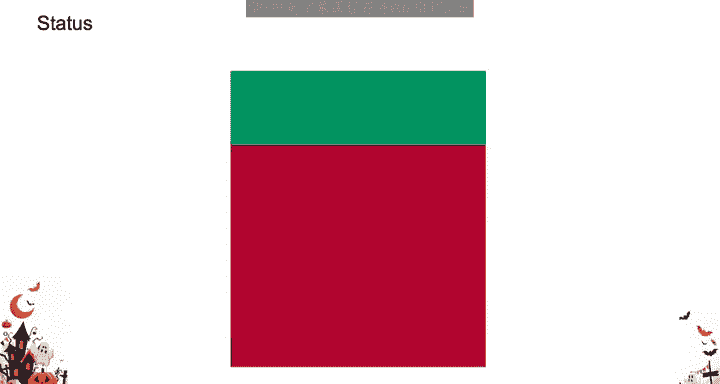

And we need it 12 minutes。 That's better than I did。That's better than I did。 So you're great。

 Thank you very much。 Now I I have all my Pokemons counted。😊，Thank you， I'm glad you appreciated it。

Alright， so what you've seen is basically a human map reproduce。

 so technically I'm done with the mapre lecture， you can go home so I'm still going to give you a bit of theory behind this and we'll continue tomorrow。

 but there's a number of things that you should have observed so maybe we can circ the microphone can you make any comments on what you saw。

😊，Knowing that it's humans， but we can derive a lot of things that would be going on in a cluster。

Maybe can you tell me the bottleneck， Yes， over there。 Some wants to over there at at the back。

Very big。We have five minutes left。Okay， it's good。 yeah， I mean。

 there was some bottlenecks like some Pokemons were already counted， but other ones were not。

 So you had to wait on that one。 So there was some stallling there。 Yeah。

 and also maybe some overhead to wait for the other person to arrive to you and give you the right batch Yes absolutely So this is the idea What you saw in the middle the big shuffling so that I refer to a spaghetti is indeed the bottleneck。

 What is the algorithmic complexity of that。Imagine n is the number of both metal and reduce cells。

 Anybody arguing with me complexity。And squared， yes， it's quitedraatic。

In big data we are very scared of quadratic we love LnaR we love O of one and log n of course we love that but quadratic it's not just exponential。

 even quadratic we're afraid of because this is where the cluster stopped parallelzizinging well but apart from the quadratic path you saw that we had a gain of time because the matters so the first volunteers counted in parallel each their batch and then the reducers did their accounts in parallel now as you also correctly observe not everybody was done at the same time right so some of the matters were done very quickly some others were done with more time I will also come back to this and how this is addressed。

You also might have noticed that the reducers only started counting when they had all of their key value repairs。

 more exactly they should have started counting when they had all of them because if they didn't they have to update right is it you want what you wanted to say？

😮，Exactly， you added once you got a new one。 So this is basically what we have learn from because you didn't wait for all of them。

You had this extra work at the end that you needed to update this you were lucky because the counting function is associative and commutative so this is why you could do what you did if the reducing algorithm wasn't associative or commutative then you would have had to stop all of from scratch with all of of your batchsh。

 but it's great that basically happened because we learned from this and this is the insight that we get。

😊，Any other comments？也许。We had the progress bar this plate。

 but I think it's not that accurate because we take a lot of time until the first person reports the results and then there's only a little difference until the last person does。

So the progress bar kind of jumps from zero to 100 Yes that's because I'm a human being so the progress bar basically on a cluster of machines you would get something more accurate you could make it dependent on the basically on the number of map divided by the total number of map basically everyone the map completes you can update the progress bar but what I did was inaccurate the in the way that I did it was just an approximation of reality right does it does it address what you say Yeah awesome yes。

How do we choose the number of mappers， How do we choose the number of mappers？

I just picked eight because I wanted to have8 and8 so that you could say quadratic instead of n times m。

 but basically you in practice there are rules that basically help you choose the number of reduce cells I will come back to that in the optimization paths so basically just so that you already know the number of maps should be less than the number of shafts that you have here。

 I had one on one but that you saw the problem with one per person that some take longer in practice you might have like three times or five times as many shs as mappers now for the reduce cells。

 the thing is it depends on your algorithm because it depends on the number of intermediate keys that you're going to have in my case I had10 intermediate keys because that was the Pokemonons so basically what that told me is that I didn't need more than 10 people for the second path。

And then the thinking why eight and not exactly10 is that in case somebody takes longer for counting。

 they can have a second one， but that I didn't do because I gave in advance the two Pokemons to the people you can optimize by giving only one and keeping the two in reserve and then giving the other two after theyre done。

 then is dynamic。So this is the inside reality of question， all right。😊，We are almost。

Done with this hour， any other observation？All right so I think today we can leave it at that so think about what you've just seen either the progress bar on zoom or the actual Pokemon hunting in the lecture hall and tomorrow I'll give you all the theory behind this and what it means to do it with machines in a cluster so thank you very much see you tomorrow at 9 a。

😊。

