# 苏黎世联邦理工《大数据｜Big Data - ETH Zurich - Fall 2024》中英字幕（deepseek - P27：-27-8. MapReduce (2_3) -.zh_en - GPT中英字幕课程资源 - BV1sHPKeoEJU

Welcome everybody in the lecture hall， welcome everybody on Zoom， We everybody from the future。😊，So。

 where。I think it's on mute here now you can hear me， right？So， where。Welcome。

 so today I'm going to explain how we get from the Pokemons counted by humans。

 I assume you're all humans right and then we' move to machines who actually can do much faster in a data center in a cluster。

And I will show you the formalism， the logical workthrough and the physical implementation and all the all the details。

Before I do that， I want to do a bit of a rapid of what we have been doing so far because you know that we started with the first few weeks to look into the storage layer because everything starts with storing data。

When I give you the Pokemons， the storage was the pieces of paper that were on my desk and you all came into the front desk in order to get them right。

 But when you do it in a cluster， it's not like that the data is actually already all over cluster。

 It's already there and you directly read it from the machines。 So in fact。

 the Pokemons aka data set。Would be on H GFS or S 3 or H base or your local file system。

 if you want to do it on your laptop。 But basically， there is a file system。 Now。

 the good thing is that it can be any of those that we studied right， can be H GFS S3 H base。

 It It all works。 This is fully agonal。😊，So now if we look closer， what do we have in here。

 well when I explain HGFS or S3， I just told you these are objects of sides that are just sequences of bits。

 right？😊，Then we saw a couple of weeks ago that these bits can be text。 It could be， in fact。

 an X ML file or Json line file。 So， you know， the data represented as text。

So now if you want to train LNs that might be literally text， right no particular syntax。

 but just for example here， the complete works of Aconend Do， So A Conend Do。

 which actually turns out to be public domain so I can actually we can query that without any problem and basically you would have possibly text with billions of lines。

 so I don't think that Aconano wrote billions of lines。

 but if you download the entire Wikipedia or the entire internet to the extent that you get of course。

 the authorization， then you could have easily billions or trillions of lines of text like that right so this is something we could have。

😊，Or it could be text。 That is a bit organized。 So you recognize here the CV syntax。

 right Comas separated values。 You could also have billions or trillions of lines like this。

 You might recognize the ox measurements。 So this would be Cv right You recognize the syntax。

 But it could also be some syntax that is specific to what you are doing。 In fact。

 I have in mind the meteorology。 So all the weather forecast and the weather data TT。

 they don't use Cv。 they don't even put the coas in there。

 but that has to do with the fact that the number of characters for every piece of data is fixed。

 They are always for digits for the year。 The data is always on these many digits and so on。

 So then you don't even need the coas。 You can just put it like this。

 But then it's on you to reconstruct the data， of course。 But if it's fixed length。

 then you can do it without any problem。 Sas a bit of space。😊，Then you could have a keyV approach。

 meaning that it's like CSV but with only two columns and you can use a space， for example。

 as the separation， so here that would be mapping gear to measures， right？

You could also have J lines， as I told you， you have one adjacent object per line。Technically。

 you could also have arrays and atomic values on the line。 but generally， it's really just object。

 I mean， as we discussed yesterday， right， So you see in that case。

 you even see that it's heterogeneous。So Jason can do this。

It could be binary because if you listen to the lecture on the fact that if you validate Jason and the schema fields some properties。

 like not using whatever slots， but every type is correctly non abstracttract。

 like integer string data and so on， and you don't have any open object types。

 meaning that extra fields are forbidden。Then if you have a collection of valid adjacent objects you can actually see it as a data frame right so I showed that to you yesterday and I assume that now you have the visual of that and the beautiful thing if you have the data as a data frame in memory is that suddenly it becomes massively faster because it takes less footprint print in memory it's faster to compute and it's organized nicely organized by row and and columns so we love data frames and we love them all the more that we like to store it back as a data frame on disk and PAque is one of these formats so then on HDFS we have a binary file that is actually parkque and that has a data frame inside but the benefit of doing that is when you have less to read because it's more compact and second it's organized by columns so you only need to read the columns that you actually need to look at so that can be binary。

😊。

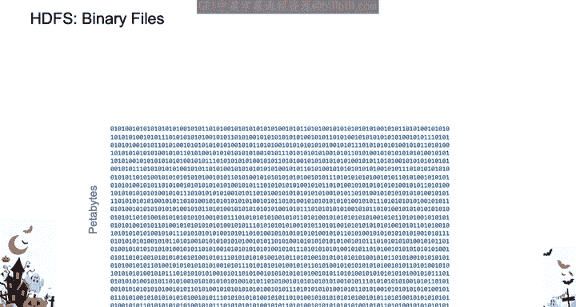

Now another aspects of the data set， if you look at HDFS or if you look at S3。

 that's something I mentioned already a couple of weeks ago。😊。

Is that typically a data set is not going to be in a single file you could right but typically a data is rather going to look more like a directory with plenty of files and the data is the basically the sum of older the files typicallyy the files that you have in that directory have numbers like part one part two part three and these are called shs right typically we say that the data is sharded and every shs corresponds to one HDFS file。

 This is not to be confused with HFS blocks right all of these files are HDfS files so they are made of blocks but these files could be a few gigabytes inside right let's say 10 gigabytes。

100 gigabyte per file So they would also be cut in two blocks in HGFS。

But the filess are called shelves， right？By the way。

 if you have a data set that is not shaardy and that actually sometimes happens that you download。

 let's say a gigantic terabyte file from the internet， there is a command line utility。

 I just forgot the name of it but there is a command line utility that nicely shards it for you so it takes the input and it outputs that' say 100 files 100 times smaller so it splits it into files and then you can upload this to AGFS or S3。

Why do we do this because you could ask， why don't we have just a single file with all the data？

These are practical reasons， Two reasons。The first reason is that I don't know if you ever try to upload a  five terabyte data set to S3 or AgfS。

 but what's going to happen is that you have， let's say one chance in two or two chances in three。

 that's right in the middle of it because it's going to take maybe one hour the network breaks and it interrupts the whole thing and you have to start over again and again and again and again until it maybe succeeds。

 It is very unpleasant right and you have to retry and retry and retry So instead if you use that utility to sha your file into plenty of smaller files and then you upload the files individually to S3 then maybe if you upload 198 will succeed and two will not then you just try again with the two that didn't work and that is quick and that's much faster one understand that right So this is really a practical reason It's much easier to upload plenty of smaller files than a gigantic files to S3 or even AGFS The second reason as we will see is that。

These data sets that you have。They can come from multiple sources。

 They could come directly freshly from the C LHC device， right。

 the the where you just collided the protons freshly， the Hadrons and。Then you connected the data。

 So that is more like your log。But some other data sets are actually the outputs of mapreduce of Spark。

 meaning that these are derived data sets that you obtained with a query and if you look at the output of mapreduce or the output of Spk。

 it will typically be output in files like this in many。

 many different files why because of parallelhaleism because PARC and mapreduce are going to produce the output in parallelhalen and so it's more convenient that they write it as separate files in parallelhaette so this is the second reason why many data sets are sharedarded like this right for whom does that make sense。

😊。

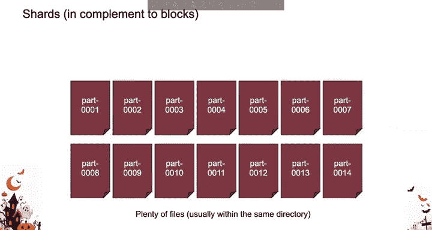

All right， so if you look at the data set， very likely it's going to look like this。😊。

Now we saw that we have an alternative way of storing data which is H basease。

 H basease can be seen as a two dimensional index on data， and here you can put whatever you want。

 including XmL， J， but even binary filess it would even stop packet5s in H base if you want it right but XML and Jason would be maybe more common or HTML。

So it could also be on H base， right， that's also a possibility。

 And then we would just read H base instead of HDFS。

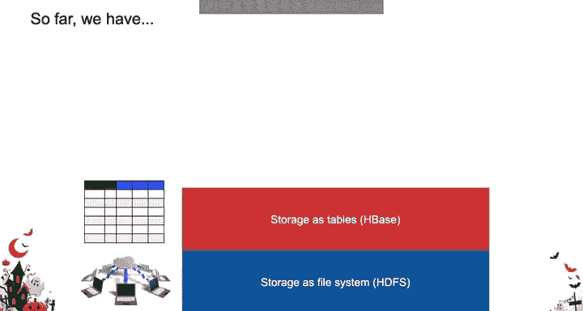

So for example， we could have tables like this that might be in age base， that we have this data。

Billions of rows because that has been going over for 3013 billion billion years。

 It could be like this where we have H base rows where every row has an XML file， right。

 I didn't put the raw I。 that would be obviously the row I on the left。

 but basically I assume that there is an X ML document in every cell in here。 I told you in H base。

 you can go all the way to 10 mete right plus cell if to be safe。 you can go higher。

 but then it slows down。

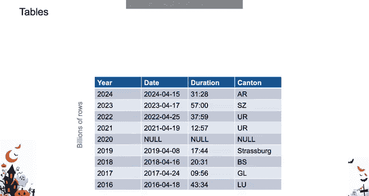

All right， and you see as a nice recap of what we did yesterday。

 I even put the schema here that could correspond to all the XML elements that you put on H base。

 so this is one way of using schema validation and XM and H base jointly with one documents per cell and the schema against which they are all values。

😊，Okay。And then comes the parts to read querying that we are going to take care of today。

 right that is the most interesting part and what's going to happen is that we are going to do it in parallel。

 but this is a very natural thing to do because that data is already spread all over thousands of machines in a cluster。

 so doing it in parallel。

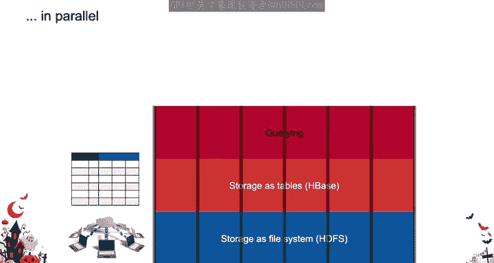

Is actually a very natural thing to do。So one way to see it is these data is in the shelvess。

 you know， we just shred the data into these sh or even in HFS blocks。

 and we nicely process everything in Bahalette。So now let's go to the querying side of things then。

Mapre was invented 20 years ago。Roughly。The idea is that we wanted to kind of parallellyze things。

 but we really before didn't really know how to do it， right， we just， you know how it is right。

 you might have a piece of software that runs on your laptop and you have multiple calls and you would like to parallellyze it。

 It's not really automatic right There is a bit of effort。

 Sometimes the compiler can figure a few things out。

 but it's not easy to parallellyze especially if you have an imperative language right that is a sequence of instructions So you cannot really parallellyze it so easily。

But if you look at the algorithm from a declarative perspective and just imagine that this is my inputs。

 This is the output I would like to get。How can we come up with something in parallel？Well。

 you could do it on a case by case basis， meaning that use case by use case。

 you sit it in a classroom in front of a blackboard and you just brainstorm on how to execute it in parallel but what if we could have a generic way of doing that something very generic that you can apply to many。

 many different problems and at the same time simple that is exactly wema reduce these so the idea is that this is if you zoom out completely you have some input data。

 you want to apply some query and you want to get output data right you cannot do more generic than that。

嗯。Now we want some parallelism， so we assume I added these dash lines in here that basically says my input is partitions like this。

 in fact， that would correspond as we will see to HDFS blocks in here， typically 100 megabytes。

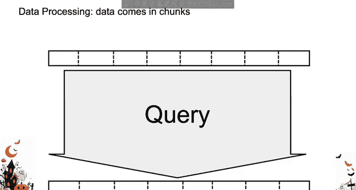

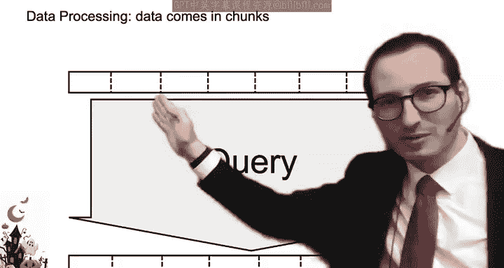

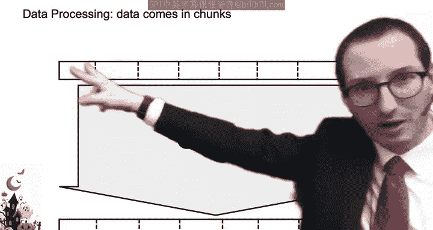

And we want to output also in partitions like that。

 when we output typically every part gives you an AGFS file。

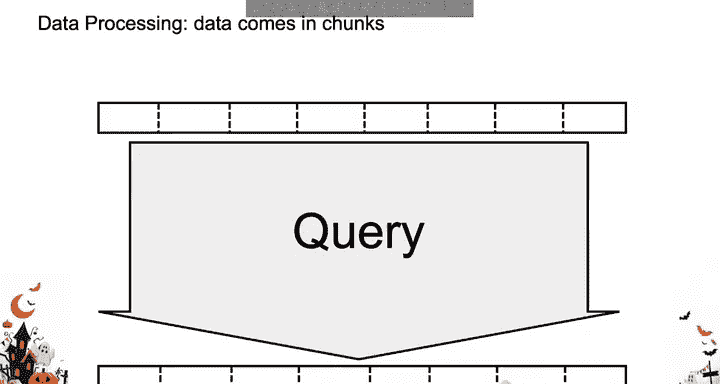

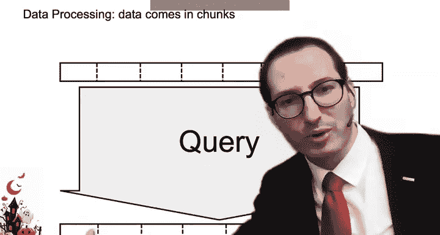

If you use HDFS， but I'll come back to that。 but basically we want。Some parts here， some parts here。

 and it would be nice if somehow。

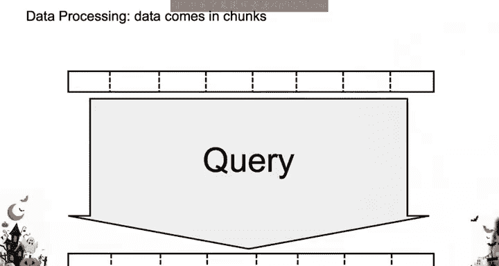

In there， there can be some stuff in parallel that uses older the cluster。

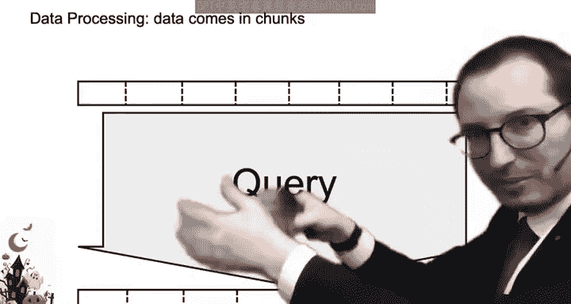

Now if I make a wish list of what I would like to have。

 this would be perfect right if I manage to actually convert my query to just mapping every input partition to one output partition。

 this is perfect I have basically 100% parallelzed everything and then you even get perfect improvement because if you have 100 machines then it's 100 times faster who agrees with that。

😊，All right， but this is ideal， this is in the ideal case that you can do that。😊，That exists。

 you could think for example， of a projection you have a data set with JSN objects and you want to remove a key in all the objects and project it that you can do in Bahalen。

 you might have a filter inquiry query， you want to select a subset of the JSON objects that fill back figure predicate that you can also do in Bahalay right so I will come back to this there are queries like that that work。

But sometimes it doesn't and you can think of， for example， sorting the data or grouping the data。

 aggregating the data， then it doesn't work like this anymore。

 doesn't work like something you can do in parallelel and the reason it doesn't。

Is that you have this spaghetti。Because every output partition here might depend on many of the input partitions。

 so this is where you have this spaghetti here。😡，And so。

The reality is somehow in between that you have a bit of parallellyism in there and sometimes not。

 sometimes yes。But this is not very pleasant。 So can we make it simpler and marginal。And in fact。

 when map produceuce was invented， it was noticed that some parts。

Could be run in parallelel while some other parts might be spaghetti。 And if you simplify that。

 this is what you get。 You basically get this parallelel followed by shuffle， followed by Pahalel。

 right， So the first parallelel part is called mapping。

And the second parallelhalel path is called reducing。It is simple and it is surprisingly generic。

 you wouldn't imagine the number of problems that you can solve with this pattern of parallelidism In fact。

 you can index the internet and index the web and build the Google like this This is one of the ways you can you can do it。

嗯。Allright so that's basically what we did with the Pokemons right so the map path was the first eight volunteers that each had their batch of Pokemons that they counted。

 they produced K value pairs where the Pokemon was the key the integer was the value and then they shredded them and then the shuffling was at the front where every mapper tried to communicate with every reducer to basically exchange the key value pairs。

And the goal is that every reducer so the eight volunteers that reduced the data had to gather all the Pokemon keyvalue pairs that they were responsible for and then the reducing was the sum of the accounts and then the output data was the 10 final key value pairs of Pokemon with with me right so this is the this is the overall ID Now what is in there is called intermediate data。

 there is the input data， there is the intermediate data。

 all of these keyvalue pairs that we threw away at the end that had the individual counts per map and then there is the output data If you look closer。

 this are all key value pairs。So for the Pokemon， it was very clear that the intermediate data was keyvalue pairs and the output data was keyvalue pairs that you saw for the input it wasn't clear right because these were just Pokemons on a piece of paper but if you hit it with a hammer hard enough without hurting the Pokemon you realize that you can also consider that the Pokemons are keyvalue pairs you just make keys that aredermy keys that can be anything and then the Pokemon as the value and you just ignore the key or the opposite you can put the Pokemon as the key and an empty value so you can turn it into a keyvalue pairs So basically this is the mapre paradigm that everything that you process is a keyvalue pair and so the input is a collection of keyvalue pairs the intermediate input is a collection of keyvalue pairs and the output is a collection of key value pairs everything is a collection of key value pairs。

Okay， now the types can be different。 You can have a type for the key and a type for the value for the value for the input。

 you can have a type for the key and a type for the value for the intermediate output。

 and you can have a type for the key and a type for the value for the end output， right。

 they don't need to be the same。 They can be different in our case yesterday。These were Pokemons。

And these were integers because we were count them。

 And then you could imagine that this is whatever and these were the Pokemon here。All right。

 very often， I would say in 80% of the cases， but not always you use the same key and value types for the intermediate values as for the output values。

The reason is that the reduce function is typically just aggregating the values corresponding to a key。

 For example， it's computing the sum or the count or the mean or the max or the average of all the values that are associated with the type。

 So then it's convenience to just preserve the types because the key remains the same in the output。

 and the value type is the same because if you sum of our numbers， you get a number。

 if you take the mean of numbers， you get a numbers。

 So this is why you also get the same value types at the end Okay， it doesn't have to be though。

 that can also exist don't need to be。 but in 80% of the cases， these are the same type。

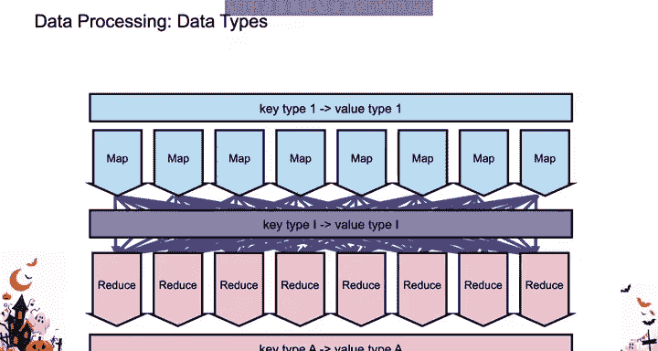

So now I'm going to drive you through the logical walkthrough of map Red query。I insist on logical。

 this is data independence， right？😊，As in every week。

 I'm first showing you the logical level and then we'll get to the implementation， right。

 So on the logical level。😊，What you do is you basically have this collection of input key videos and you have a map function。

😊，That takes a key value an input key value and produces zero1 or more out intermediates key values right so you have this map function you're going to apply this map function to every single input key value every one of them gets through the map function and might outputs01 or more key values so the first key value output3 intermediategate key values the second one output zero here you output just one and here you output two right can be any number So this is the mapping phase。

Then what happens is that you have all of these intermediatemedia key values that were produced by the mappinging face。

 you just put them together， get a huge collection of intermediatemedia key value but just a huge mess So what you do is you sort them logically right so you sort them so that all the key ones are together all the key twos are together all the key threes are together and so on right so now it's nicely all sorted and grouped by Inmedia key。

😊，And then you separated by group， so all the key values。

 the intermediate key values with key1 go together。

 all the intermediate key values with key2 go together。

 and all the intermediate key values with key3 go together that millions of times pro。

So it's not so good。And then you called the reuse function。😊。

That takes a group of intermediate key value keys with all the same key right。

 you only put all of those。 It's basically both sound and complete。

They must have the same key and they must be everything that has the same key， they must all be here。

 That is the reason you can only do that when the mapping phase is fully finished otherwise you saw what happened yesterday。

 the reduce result had to do it all over again or to basically update the results。So you need all。

 there is a question on Zoom yes。😊，Oh maybe I can check if it's oh it's not switched on。

 now it's switched on。Yeah， to be clear， does this assume that the map transforms the values but keeps the keys the same？

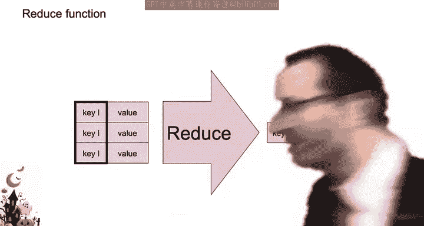

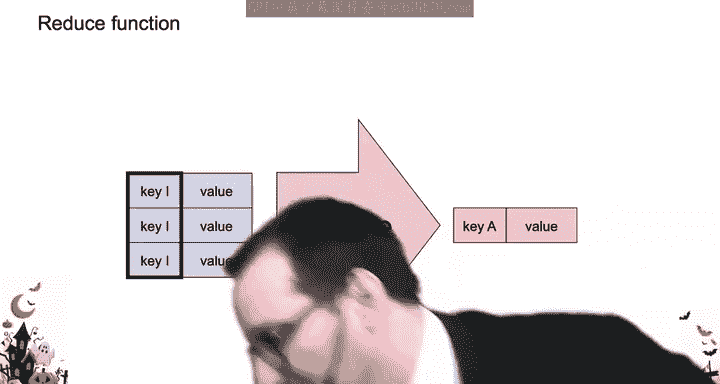

嗯。So because of the incident with the sound let me just read。That the network transform the values。

No， that's not implied。 as you can see on the slide here， the keys can be completely different。

 right， You see， I'm， I'm using the indoor Arabic numbers on the left。

 and I'm using the Roman numbers on the rights。 This need not be the same case。

 This is fully generic。

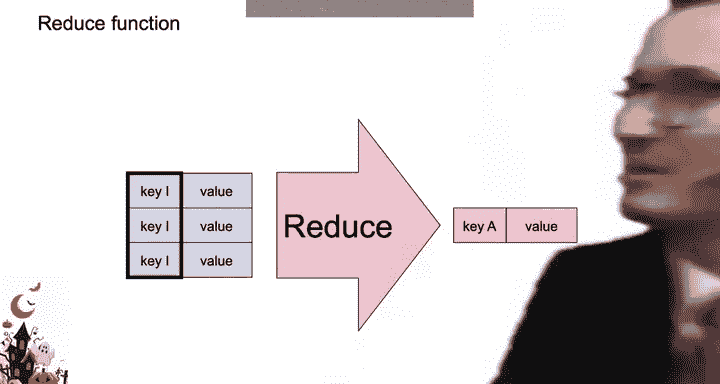

Does he answer answer your question？The first one。Yes， yep， awesome in the second one question。

 So do all methods reducers have to run the same function。

 or could there be a scenario where where it would be beneficial for each to do something different。

😊。

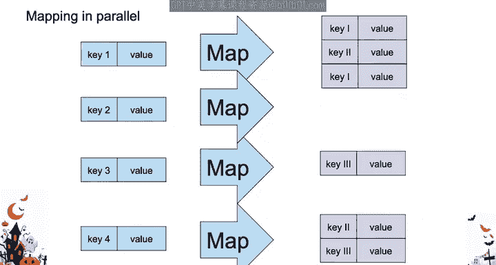

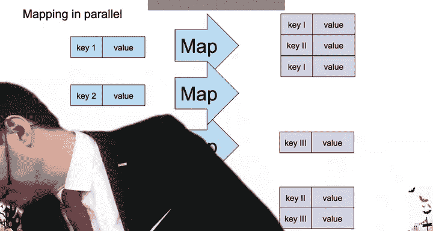

No there's just one map function and one reduced function， so in a mapre job， one map function。

 one reduced function everywhere the same， but of course if you take a different job then you can change the functions but within one job it must be the same map function in the same reduce function。

Okay。But of course， in the function， you can make it dependent on the key because that's any code。

 right， So it's duringcomplete。 You can do whatever you want in the function。

Did that answer the questions？Its so yes， yeah， awesome。Okay， so we have。And then in the room。Yes。😊。

啊。so before we saw using HBase on top of HDFS， why was it preferable to have X model content in HB？

And tables。Oh， I'm not saying it's preferable you could also have XML in HGFS what I'm saying is that I don't think people do it in the sense that when people use XML。

 they typically have wide XML document per。And not one XM document per line。

 so I'm not aware of when XML lines stand out， for example。

 and the thing is when you have a lot of XML files with one XML document per file you will have the problem that you have a huge number of files that are rather small so if you have a huge number of files of 10 mete。

 that's not the sweet spot of using AGFS so if you use AGFS。

 you like to have files that have a few blocks right for example， one gigte，10 gigte files。

But in a base 10 megabytes is a good sweet spot right you can really easily process smaller value。

 so this is the reason， but you could also imagine introducing an XmL lines format and working with XML lines it's just that I don't think you would find data sets that give you XML lines on the in down net as opposed to JO lines does it make sense yes。

So I'm basically saying is this possible， but that's just in practice what people actually do。Okay。呃。

All right。And so here you see that going to the question on Zoom， the reduse function。

Need not output keys that are the same， so here you have an example of a reduce function that has a group processing key one。

And you you have an output key A right so it's generic enough to be able to do that it can also output nothing or it could output several keys right it's zero1 or more output keys per group of intermediate key values or whom is that here。

😊，How do they relate it or you forget that then you just have the output given use and you basically don't remember where they come from。

That was your question， yes， but there is a whole area of research called data provenance that actually worries about this that tries to trace back every piece of data you get in the output to trace it back to the input。

 but that is ocgonal to this。😊，嗯。Now in the particular case that the intermediate key values have the same types as the output key values then the reduce function looks like this and then it's usual it's not an obligation but it's very typical that then the key is the same right you have key A on the left and you also keep keyA on the right doesn't have to be but very often that's what you're going to have to be and basically the value that you get on the right very often is obtained through an aggregation of the values here could be the sum could be the count could be the average the mean the max the variance or even something more complex right but you typically keep the key and aggregate these 80% of the cases that again doesn't have to be this is the most generic one。

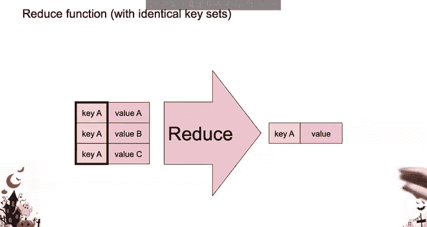

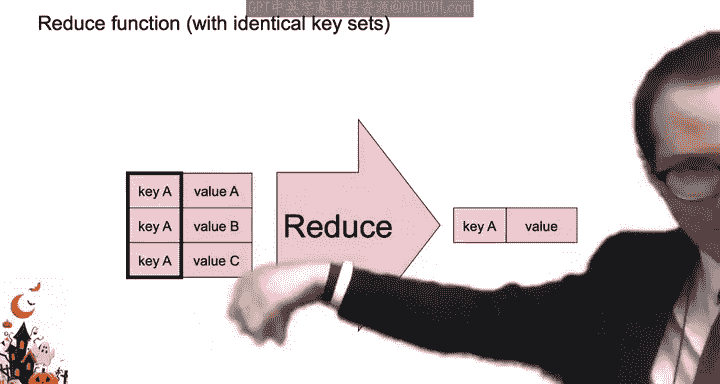

All right。And again， I insist zero， one or more， you can have zero， you can have one。

 you can have more than one， this is totally fine too it's generic。

So you execute the reduceuse function in Paaleius， you have a question。As far as I understood it。

 we map。One key to one reduce process。Exactly， and if the map functions， for some reason。

 only output the set of。A few keys， much less than we would have machines to execute。

 reduce functions。 Could we still somehow。Layer this or distributed over different reduce processes So you're already referring to the physical implementation right so these heres logical workthrough your question is already about the physical implementation So just to make clear that it is the physical thing now to answer it what happens but we will see it what happens is that if you have more reduce processes will actually call them reduce slots that processes is just fine also to describe that So if you have more keys intermediate keys then reduce processes then they are useless reduced processes it means that some of the reduced processes would just do nothing and then you will have one key or reduced process that was lucky enough to get a key that's what happens and it doesn't matter how large the groups are you could absolutely have a mediumn of key values in one of the reduced processes and you could have just two key values in another reduced processes then what you get is basically an ni。

Right you're going to have a hotspot in one of the machines that really processes a lot and then in another machine is going to be a bit id right that depends on your job and your map function and your reduce function and this is part of the user's duty if you want to come up with a mapre job and a map function and a reduced function you have to think of these things you have to think of how many intermediate key values would exist is it too little is it too much is it just the sweet spot if it's too little or too much then typically you try to rewrite your mapred algorithm in such a way that the number of Indianmedia key values is more suitable right。

So this is the idea， but this is highly dependent on the map function and the reduce function so that's the first thing the second thing is how physically you decide how many map slots you have and reduce slots or map processes and reduce processes so you have to make a decision also and there are also heuristics for that there is basically rules of thumbs that I will give to you to decide these things。

Okay， did it answer your question。 Yes， Yeah， All right。 But it's great， because you're already。

 you're always asking questions that are very relevant and that basically are already introducing the material that is to come。

 So this is perfect。 It means that you are following and you're asking yourself the right questions。

😊，Okay。So yes， so the code of the reduced function of cox areon in parallelhalL in that case with one output key value every time but as I said can be01 or more and then we get this so this is if I zoom out we had this input collection of key values。

😊，That output via the map function， intermediate key values， we sort them。 That's the shuffling。

 right， We sort them all and separate them again by identity called intermediate key。

 and then we call the reduce function on every one of these group for every unique intermediate key。

 and then we output speed output the output key values in that case， one per whoop。 But again。

 doesn't have to。😊，Okay， that's that's the logical workthrough， right any questions on that？😊。

Oh good， who is following F now？Okay。So now comes the best part。

 because that's the physical implementation。 How does that actually work in practice。

 How do you actually set it up。In a data center， so now we look at the physical architecture。

So first， as I said， it can work on HGFS on S3 on HBase on A B storage， all kinds of flight systems。

 it can even work on your laptop， you can run mapreduce on your laptop。

 it will still be useful because you remember that you might have calls on your laptop，8 calls。

10 calls， 16 calls and mapreuce will beautifully map it in parallelL all of other calls。

 reading from your localified systems。There is just one problem is that the bottleneck is going to be your drive because the drive can only read so and so many bits per second。

 so you will be hit if you do it on your laptop by the speed at which your drive is able to read the data right so just that as a warninging but on HDGFNS3 and LGFSNS3 you don't have that problem because it's many。

 many drives that can do it nicely in Ba so Hadoopap produce comes on top of that。

So you can imagine that you have now thousands of nodes。

 we have a data center somewhere with thousands of nodes and terabytes or even petabytes of data。

 even gigabytes can be fine that's already that can already be useful， gigabytes， terabytes。

 petabytes of data。Now what does the architecture look like where this is easy there would be no stockr because you already know the centralized architecture where we had the name node and the data node right as I said these are processes running on machines right so we have the name node process and the data node processes then we saw that we have the HM stock process running on the same machine as the name node process。

 the region server processes running on the same the same machine as the data node process。

And guess what the same goes with mapre at least version one of map Reduce there was a new generation that I introduced later。

 but version1 of map Redduce also had processes running on all of these machines。

 the one that runs on the coordination node is called a job tracker because it's for the entire mapre job orchestrates the whole thing and then you have the task tracker processes running on the same machines as the data node processes and possibly doesn't have to be but the region several processes or whom is that here。

Alright， so you see we have this primary layer of storage。

 this optional secondary layer with which gives you low latency and this third layer that is the processing layer。

 We typically people often say this is storage and this is compute right storage compute is the very short way of saying it right so Okay so this is version one of mapre for now we stick to that version。

And and that's it so the idea is that they are on the same machines。

 this is very important because that means we can we brought the query to the data the data is already on a GFS in blocks。

 the blocks are already all over the cluster already sitting on all the machines。😊。

And by running the map executing the map functions on the same machines as the data already is。

 we don't need to move the data。 that is the magic of it。 we bring the query to the data。

 we bring the map function to the data So typically what happens is that you might have your map function inside the Java jar。

 for example， the jar containing the code is uploaded to every one of the task tracker machines。

 and then they unpack that jar and take the map function inside and execute the map function directly on the same machine where the blocks are。

So。What we need to add to the logical part that's not a logical step， that's already a physical step。

 but what we actually do is that we split the input collection into subpartitions of key values。

 so we don't actually have individual key values but we have partitions of key values。

 we call them splits。😊，And so what happens is that the map function is called per split several times。

 so it means that on that split that contains two key values。

 of course in practice it's are going to be two it's going to be like thousands of key values right but you call the map function every time for every key value。

 then you produce all of these intermediate key values for every every split that's already a physical detail doing that。

All right， so what happens？Is that if the data。Is already on HGFS。

It is quite natural to say that a sp corresponds to an HGFS block。

So I'm going to look at split with a target size of 128 mebytes right and ideally I take an HGFS block。

 all the KV pairs that are in that block give me one split and then I call the map function on every one keyV that is in that split in that HGFS block for whom is that ti。

😊，All right， so here I'm showing just one replica of our block， but of course。

 you know there are three replicas of every HDF block。

So now what happens is that the task tracker actually has processes and more exactly threats that are running on the machines。

😊，And every slot corresponds to a thread in in the test track process。

 and we have map threads and reduce threads， map slots and reduce slots。

 And so what happens is that the map slots are going to be directly reading locally from the hard drive。

 You can shut your kit just like we did in AGFS。 You can shut your kit the whole thing and directly read from the local drive。

 the key values that are in the splits that you want to process。 might not always be possible。

 then you can read remotely， right it can happen， for example。

 that the yellow split would be processed by a map slot on a different machine。

 then you just transfer the data of other wire。 It can happen。

 you just want to not do it too often because if you do it too often， it just slows down the job。

 but you can might not always be possible。 It's only a goal。

So what happens is that in the first phase， all of the map slots so the threads are active and invoke the map function over and over and over again in memory。

 and then at some point the memory might peak on full。

 what do we do when it's full the same thing as in age base remember we。😊。

Fluush it exactly so that's what you do typically if the task tracker memory is full。

 you flush it to the local disk， not HDDFS， the local drive， you flush it to the local drive。

 you might even compact and so on but that you already saw in base so I don't need to repeat。

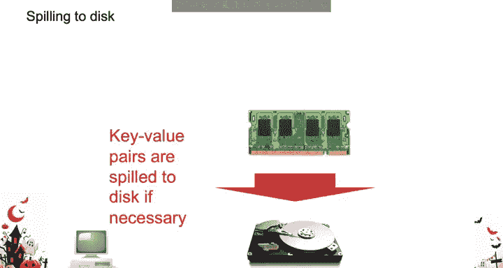

And so you might come back as it is。 So the same techniques weve seen in each base。

 except that then instead of H files， you basically have files that contain the key values nicely sorted。

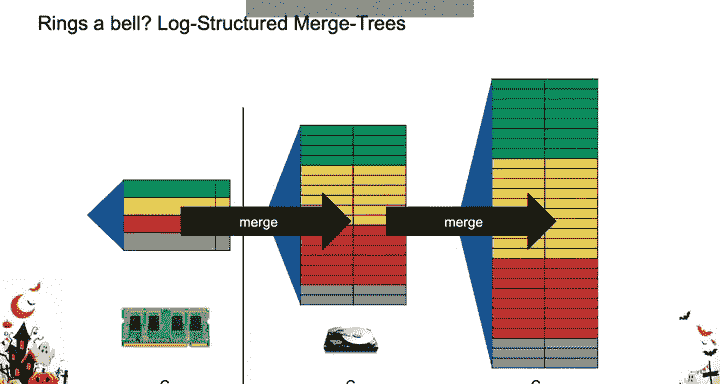

Is there a question， Yes， could you clarify again how map reduce deals with the HDF S replication。

 How is it decided on which replica map。

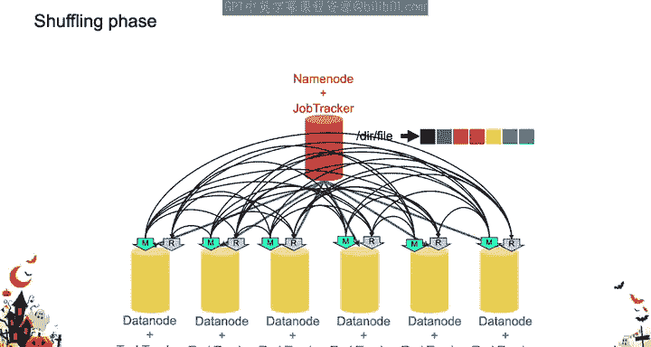

呃。

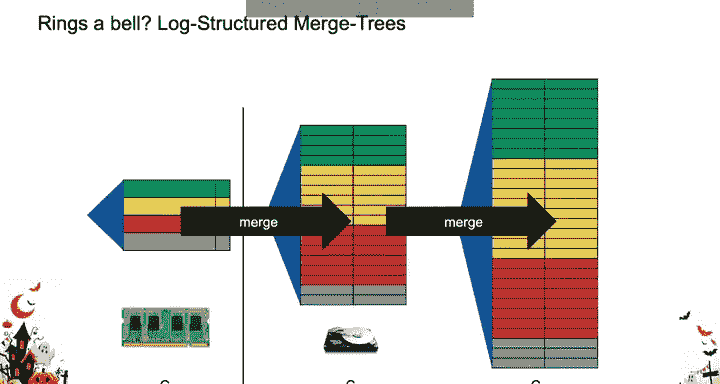

So the idea is that the job tracker is responsible for that the job tracker is basically assigning the splits to the map slots。

And the way it's done， I have， I will have plenty of animations that describe that in detail。

 So I'm already anticipating on what su come。 But the idea is that when you start， you pick a split。

😊，On on every machine and you give it to the to the map slot right and then you just keep in a queue the other splits and as soon as the map slot is done。

 you take another splits ideally on the same machine。

 give it to it and so on at some points towards the end it might be that they are no longer on the same machines and then you might need to read remotely right but this is something that happens dynamically and this is done by the job tracker that orchestrates the whole thing and that has the overview of the of the splits does it make sense。

To be clear， I come back to that， I have plenty of animations and slides to show you the details of that with go into all the details。

 Yeah， okay， awesome。Probably not two days though， but probably next week。

 but I will give you all the details of that。All right。

 so this is what happens if the memory is full of course if the memory is not full you don't need to do it then you just keep it in memory right but you want to keep them sorted so that it's ready for the shuffling right so you do want to preserve the sorting then comes the shuffling。

😊，So further shhouffling， you need to send over the network wires， the intermediate key values。

 but they have to be at that point grouped by key right but since all the map slots kept the key values。

 the intermediate key values sorted by key then it's straightforward while to do right so what happens is that the reduce the reduce slots。

Connect to every single map slots and request to download all the key value pairs that they need for which they have the responsibility this can be done using hashs using intervals I mean there are different ways you can do that but basically the radio slots are assigned the responsibility or specific keys by the job tracker and then they go and download from every map slots that was the path where the Pokemons changed hands in the break it would basically normally be the reduce people who request their Pokemons from the map people。

Alright。😊，Okay so we have that and this is over HTTP that the intermediate keyvalue pairs are shuffled all over other cluster that's a bottleneck that takes a bit of time to do that so you probably want to design algorithms that try to keep it minimal but you still need some amount of shuffling then comes the reducing path and the reducing path is processing it all in memory and then it writes back to HDGF typically you are going to write one file or reduce task and typically in one file you have multiple keys right do not have two small files but Ill come back to also but basically what you get at the end of that is that all the reduced slots routes down plenty of files to HgFS called the one23 typically they bear numbers in there inside a directory and then you get what I told you these shaarded data set with plenty of let's say one gigyte file10 of1。

Gab about fights， okay， who's with me？All right， we are just scratching the surface here。

 I'm going to go more and more and more into the details to explain really everything of how that works。

 that is just an overview of my pre。Okay。😊，It have three minutes。

 maybe I can say a few words on input output formats。

So the input can technically be a lot of things and the difficulty is that map reduce expects key value pairs。

And you know how the saying goes right if you have a hammer then everything in the well looks like a nail right and so the goal here is that we need to make any input into a collection of K valueU pairs but you know that not everything is a collection of K valueU pairs so we need to turn tables to K valueU pairs。

 fights to K valueU pairs and so on so that's the goal here。😊，For tables。

 it's quite easy because the primary key kinds of give you the key and the other columns give you the value right so here it's pretty straightforward world right but whom is that clear？

Right， okay， so the raw I D for H base would be the key。 The rest would be the value and so on。

 So okay， this is easy。

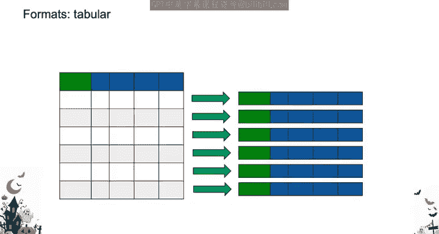

Then for the files you might have different formats， it might be text。

 you might have key value formats， for example， with a space between the key and the value on every line。

And there are even binary formats that talk key values， right， for example， sequence file， in fact。

 that's very similar， it's not exactly the same， but that's very similar to H5his because you already know that H5his also store key values。

 softy sequences of key values。So sequence filess also store key values and this is a format that is native to mapreuce to store the key values。

So I'm probably not going to be much farther， but just to give you an idea of how you would term text。

In two key values， you basically break it line by line。

 so you use the line separator to separate the key values， you put the line。

 the actual characters in the value here。That's the value。

 the line and what you put as the key would be the offset of the line。

 it means the number of characters from the beginning of the file so for example here there's 18 characters so you use 18 as the key for this then you continue you use 27 and so on so you use the offset or whom does that make sense。

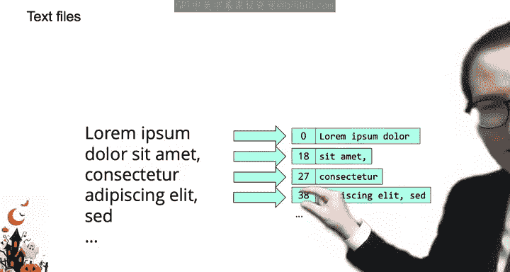

RightSo it's a bit made up because again we hit it with the hammer hard enough to basically get key value pairs out of this。

 that's not the only way you can do it， but this is one way one of the ways and then you have key value pairs so now you can invoke a map function and so on in the world of map produceduce。

Soう。

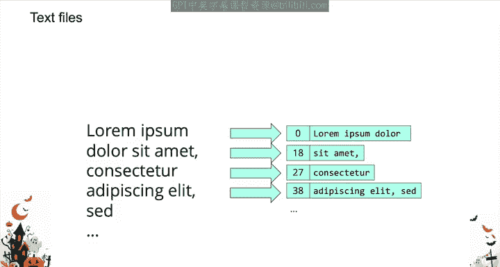

Before you go， I just want to make sure。Of course， I have to click again 29th。

Self just already。All right。That's your opportunity to let me slow down or accelerate。

I had the feeling you work for window though， right when I asked。

Everybody' is following what does it look like， and it's about right， we have a majority of over 80%。

So for those below 80% again， I recommend the first recommendation is read the textbook。

 I'm doing it with cats instead of Pokemons， but it works just nicely too ask questions to your friends and colleagues there's no better way by the way to learn than teaching so it's beneficial to both parties ask questions in the forum solve the exercises ask us the Ts also me and we be we be happy to help right so especially if less than half really ask around there are hundreds of people who can who can help you。

Alright， so thank you very much， everybody。 Enjoy the exercises and I'll see you next week in E7 at 2 PM。

 Thank you very much。😊。

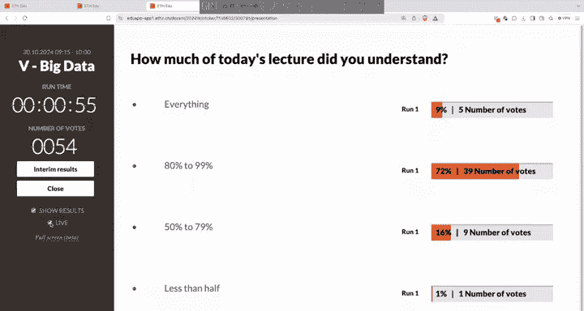