# 苏黎世联邦理工《大数据｜Big Data - ETH Zurich - Fall 2024》中英字幕（deepseek - P28：-28-8. MapReduce (3_3) -.zh_en - GPT中英字幕课程资源 - BV1sHPKeoEJU

Welcome， everybody in the lecture hall， welcome everybody on Zoom。

 welcome everybody watching us from the future。😊，So today we are going to continue and finish what we started on map Red。

 then we'll move on to Sp。 but before we start， I have three questions for you。

So this is the first one。 What is P1 DT 7 H2 M3 S。Is it a UTFed based encoding of the protocol buffer。

 is it a string in the lexxior space of the daytime duration as which is an XMSchema type。

 and also a JSOM type， or is it an instance of a bison instance in base 64。

 a binary encoding for Jason， or is it the name of a new robot featured in the next Tas movie？

We have a majority。And indeed， it is a lexical value or a literal you can call them that way。

 which is basically a string set of characters， but it can be passed to a daytime duration and you might remember that all atomic types work like this they have a value space with the actual mathematical values and then there is a mapping to strings which are lexical representations or literals and this is the IO 860 when soundouts that tells you that so it's one day 7 hours。

 two minutes and three seconds。😊，え？Then we have。This question， this document is well formed only。

 varied only， well formed and varied on neither of those。We have a majority。All right。

And the majority is correct。 Can anybody tell me why we cannot say that it is valid。Yes。😊。

We don't have a schema exactly so if you don't have a schema and you cannot say anything about validity because that only makes sense with a schema right but wellform that's fine。

 So remember that wellform means you can pass it and turn it into a tree representation in memory that's well formed Val is the next step with a schema you can then annotate with more specific atomic types and type names and you can also probably use a more efficient memory representation based on on the types。

😊，Alright， and question number three， you have just submitted a typical map reduced job into a large cluster of 1 thousand nodes。

 What do you do It's done before you ask you go check the results or you go for a cup of coffee。

 it will be there when you are back or you switch to something else and we'll check again in a few hours or tomorrow or you hide from the CFO。

Aha we have the majority。😊，Okay， so you like drinking coffee， right？Okay。

But the answer is actually this one。It's not really just a matter of minutes。 So typically。

 when you use a cluster of machines like 1 thousand nodes， we are really talking about several hours。

 even overnights， maybe even more。 They are even machine learning jobs that take weeks or even months。

So the intuition here is really a thousand node cluster if it were just a few nodes or just on your laptop。

 then yes， that can also take a few minutes， but you really have to imagine that if you use a thousand node in the cluster and then first it means you have a lot of data that you need to process if you went through the trouble of taking1 thousand nodes。

And the second consideration is that setting up all of these nodes and orchestrating the communication between them is not free。

 so it causes another hat that adds to the whole thing。

 so it's definitely not just a couple of minutes， all right。😊，But again。

 because I said the thousand notes， that's why。Okay， so。That brings us to the。

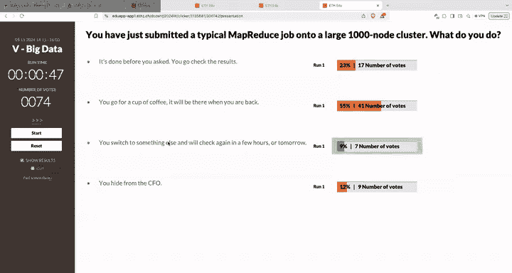

Slice。All right， so I left you。With the fact that we basically have the collections of key values。

 so basically you know when when you have a hammer then everything in the world looks like a nail right so to map reduce the input is a collection of key value pairs。

 the intermediate input is a collection of key value pairs and the output is guess what。

A collection of key valueU pairs。 So basically whatever we feed in there has to be a collection of key value U pair。

 but in the real world， it's not always a collection of keyva U pair。

 So we we have again an impedence mismatch。 we love this worldl in databases So we need to figure out how to turn them to key value U pairs and I left you with this with the idea that for example。

 if you have a text file then the lines of texts are the way you talk a nice So you basically at every new line you cut it here and get a separate key value and what you use here for the key is actually the offset So it's the number of characters since the beginning of the text documents that precede the line right or whom does that make sense。

😊。

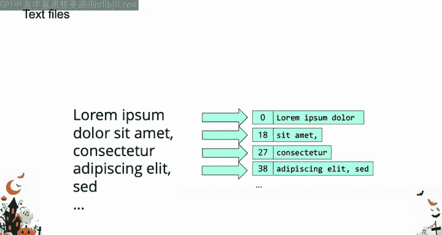

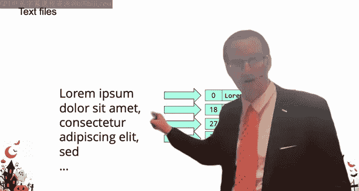

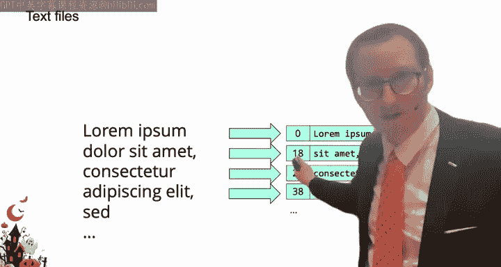

Or whom does that not make sense？Okay。Then we have other ways right so just to show you everything we have on the menu。

 you can also use the special characters of your choice， of course。

 to separate the key and the value and then whatever is on the left on every line on the left of that character gives you the key as a string and whatever is on the right gives you the value and then you basically turn these document into key value pairs right this is actually very popular for example。

 if you do meteorology then typically this is the sort of things that you're going to have but of course it depends on the data set that you're considering obviously。

This data set would just be text written by humans。

 This data set would have been prepared in such a way that it has this key value pair on on every line。

Something else that no， not something else actually。

 so these two I want to give you an example based on this on how we can use mapre to count the wells。

 what I mean is we want to know for every word how many times does it appear in the documents very much like the Pokemonons actually what we did with the Pokemon。

😊，So how do we do it actually， can you try to guess the map function and the reduce function that I can use for this what map function and reduce function would give me as the final outputs。

Key values where the keys would be the distinct words， and the values would be the count。 Any idea。

Yes， that string of words to。Every word。Yes。Yeah， so I'm repeating in the microphone so that everybody here so you basically suggested to have as a map function。

 basically a tokenizing function， right， you tokenize， for example。

 based on spaces of punctuation the world and then for every world you create a key value pair。

 the key is the world and you suggested what would be the value for every world。

Already the account per line right okay so that's very interesting because you already one step further we look at it later with the combined function in fact for for now we can keep it simple and just say that every word gives you a video of one and if you have multiplecurrencies on the same world on the same line you just repeat it with a value of one right for now but I'll come back to it because for the Pokemon you actually already also directly puts the local account。

😊。

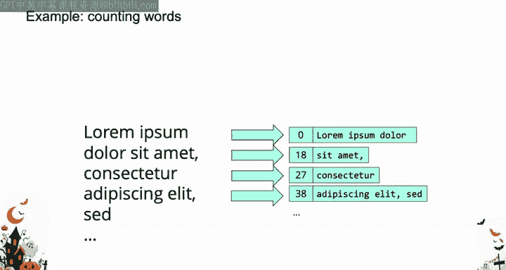

Alright， so this is my suggestion， right， So the the basically based on yours。

 but just changing value to one。 So log M1， Ipom 11 and so on， right， But by the way， you know。

 these words here。 These are the in the publishing industry。 You probably already saw them。

 it's just some standout thing you use when you want a placeholder。

 So it's it doesn't really means much， but this is this is commonly done。 All right， so。

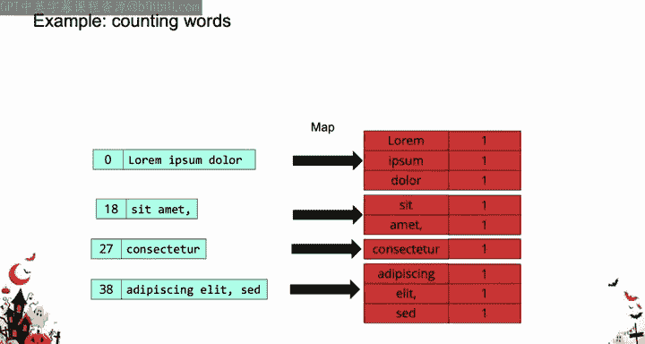

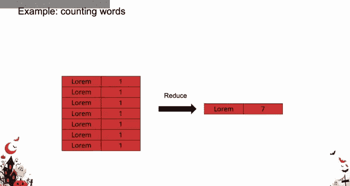

Then the reducing function， did you also specify it or just the mapping function。

Maapp much the exhibition。Yep so use sum exactly so that's the reducing function with sum over the all these ones and find seven technically because I have only ones here you could count or you could do the sum it's the same thing right so let's say the sum so we get seven。

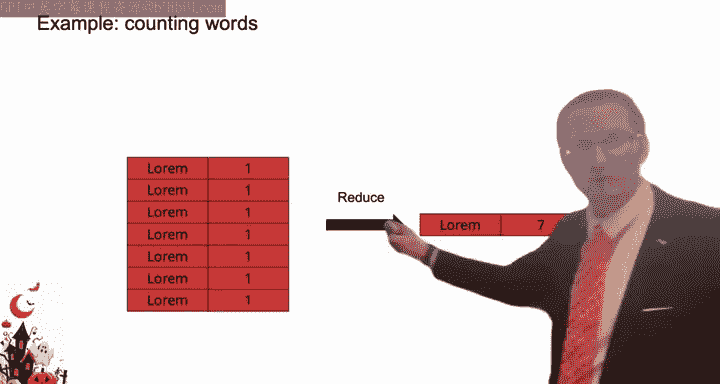

So，That's our first mapre job， actually。 So you see with mapre。

 you can count the number of distinct worlds and the number of occurrenceancies in the in the document。

 right， for those of you who are in information retrieval。

 you see how that fits right in the bag of worlds model。 That's how you could build the vectors。

 for example， of the term frequencies。 All right。

Another one， so now what I would like to do is take these lines of text and I would basically want to do a grab。

 you know grab right， this is how you test if a line contains something specific so a filter inquiry。

 what map and reduce functions would you use for this？

Asum I'm giving you a preddiiccate so the predicates takes the line and T US or no based on that predicate what would be the mat function and the reduced function。

Yes， maybe the the microphone so that then I don't need to repeat。

So the map function would just either return no line if the predicate is not true and would return the line if the predicate is true。

And then for the reduced， you could either use the identity or maybe you could combine it back into one document。

 for example， if you would， absolutely， so for for the map function。

 indeed either you pass over the line unchanged or you don't and for the reduce function。

 the identity is perfect So this is indeed it。 So this is the map function。

 So visually imagine that the predicate says yes for the first and fourth one and no for the second and third one So you basically in that case。

 the intermediate key values are a subset of the input key values right just filled out。

 But then we are pretty much done。 So the reduce function is just the identity right In fact。

 it's pretty common to have an identity reduce function。

 you can even have in map reduce some check that says there's no reduce like it's just directly the input of of the mapping。

 All right for whom is that clear that it works active。

All right。In fact， what we've just implemented is a selection in the relational algebra brain that's basically the wear close SQL right I'm just saying that for future reference。

 but this is in essence something we can do with my preview。

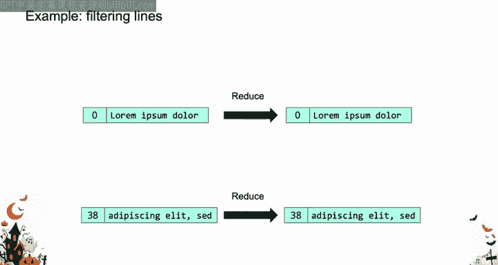

Since we added it and I said selection， the little sibling on selection is of selection is projection。

 how can we project， can you tell me the map function and the reduce function？

So I'm assuming here that my input is not just any text。

 let's say it's JSO right I have JSON lines and every value is going to be a JSON object right and technically it's a string so for mapre it' it's just a string。

 but what is your map function and your reduce function for projecting to less columns。Yes。

 so about that。In the map function， we first par the string to Jason because mapRuce does not understand Jason。

And then we just select the columns or the entries that we're interested in and。

Encoded it back into a string， download upload it and then as before we can just use the identity for the reduce functionep。

What is the ver for encoding back， do you have a more precise verb？The opposite of facts。

Starts with an S， anybody。See， yes， serialize exactly and you're exactly correct This is exactly it。

 So indeed mapre doesn't understand Jason so you the you pass the string into a JON object for example。

 if you're using Python that would be a then you use the API of the JON library that you're using would be anything and then you project to the columns you want and then you serialize it back to a string and that's your intermediate key values al right so you see here there's a bit of an overhead with dealing with Jason because it doesn't understand Jason but I come back to that right。

😊。

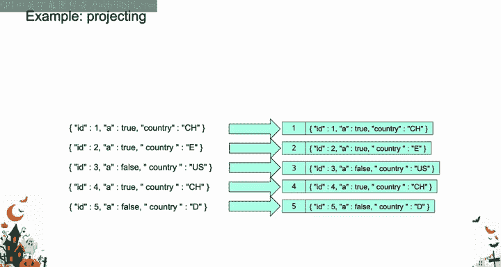

Okay， so that's basically what you've just said， the map function and the reduced function is just the identity。

 right？In fact， when the reduce function is the identity that's kind of nice right because there's no shuffling and so that basically means that projection and selection are not very costly right in terms of a cluster use right because we don't have to shuffle anything right that I'll come back to in the introductiondirect on span。

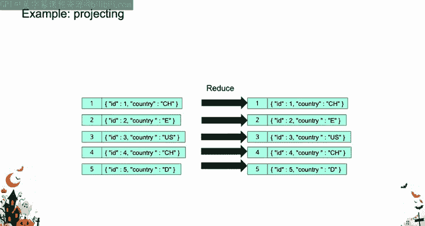

Very good。 So we had three examples， how to count occurrenceencies of wealth。

 how to select and how to project。 So we already have the select clause and the work clause of the of of SQL。

 right， So that's a pretty good start。😊，All right， now I would like to come back to what you said earlier about directly outputting the the number of worlds in the line rather than having a TVVU for every world with a one right in fact that is an optimization and you're absolutely right that it works as well。

So the idea that generally you would have these two faces or you basically have the map phase over there and then followed by the reduced phase。

 but in basically the problem is the shuffle right it's the quantity that you shuffle here and you want to keep that quantity to a minimum you would like to to not completely overheat the network cables right so。

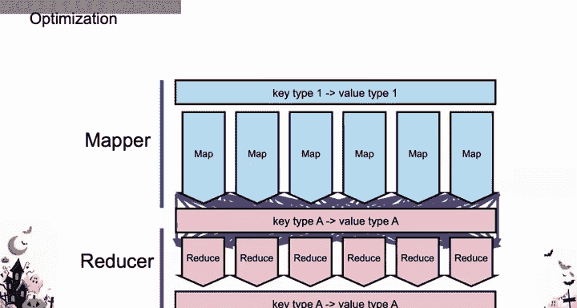

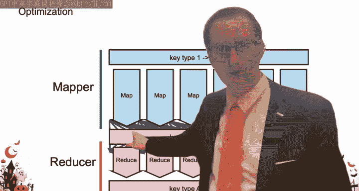

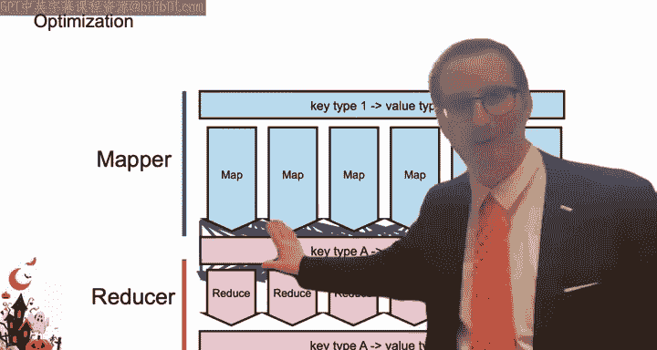

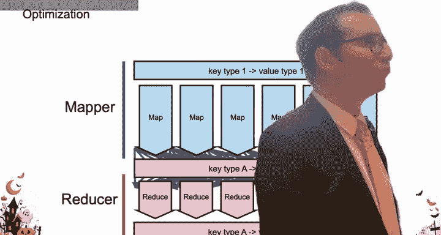

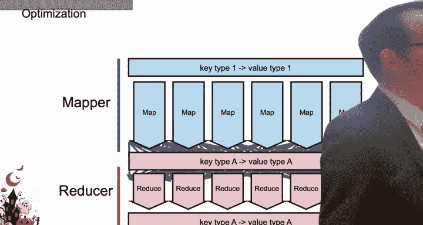

This is a common thing that we try to do in database systems when especially when we work with large amounts of data。

 we try to find all kinds of tricks and optimization to have less data， less data in memory。

 less data over the network cables， and so on， so less bits。

So there is indeed a way to have a lesser amount of data in the intermediate stage。

 sometimes not always。

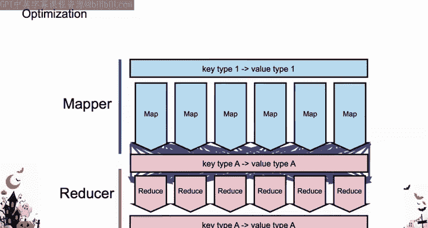

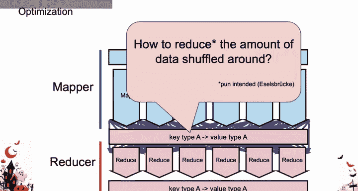

And in fact that is called combined a combined function right so the idea is that it's also the user who has to specify that so they have the map function。

 the reduce function and the combined function has to be supplied by the user and basically the user would just additionally specify a combined function and what it means with the combined function is that when the map slots processed and create these intermediate key values they can additionally use the combined function in order to have less key values so a combined function takes several intermediate key values and outputs less intermediate key values right and hopefully the combined function has to be carefully chosen in such a way that it doesn't change the results right。

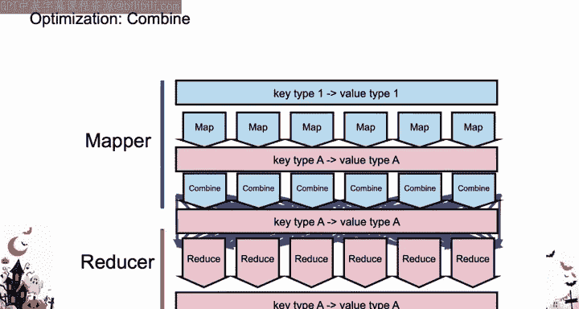

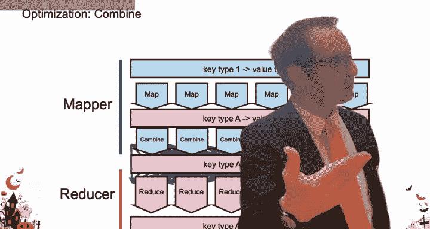

So when do you do the when do you use the combined function So I said the map slot can use the combined function。

 I didn't say it has to you have no guarantee you can specify a combined function then mapre whatever it was Maybe it would completely ignore it and not even use it maybe it will use it a little bit maybe it will use it a lot of times you have no control over all that This is exactly why you need to choose wisely this combined function so that it doesn't matter basically you remember that whenever the memory is full we flash to this or we compact and so on so these are good moments to use the combined function right so that would basically diminish the size of the files that you would create on disk or even when you compact right now。

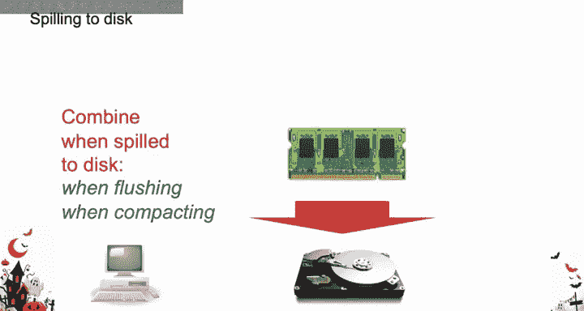

The combined function that might sound tricky like to find a good combined function， in fact。

 there are many cases in which it's not tricky at all because you can just use the reduce function also as the combined function under specific conditions。

And these conditions are and here I am taking my handway thing because mathematicians are going to complain。

 but basically it has to be it's sufficient for it to be commutative and associative right if you are using a reduced function that is commutative and associative then then you can use it as a combined function and an example of that I have an example here yes here so basically if I'm count the world and the number of occancies of unique world。

 then my reduce function is plus right it's the sum one plus one plus one plus one so it's plus plus is associative and commutative right so because of that I can use if my reduce function is a sum I can also use it as a combined function you agree that plus is associative and commutative right this is the reason why it's totally fine early on during the map phase I already start summing up the numbers in here and。

😊。

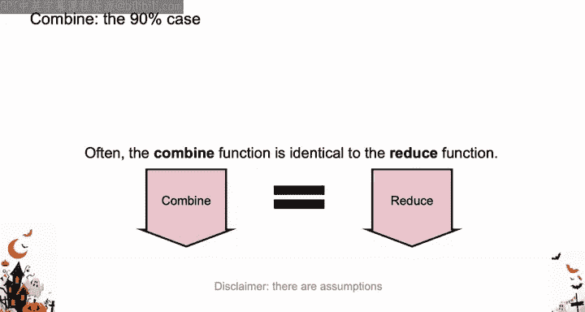

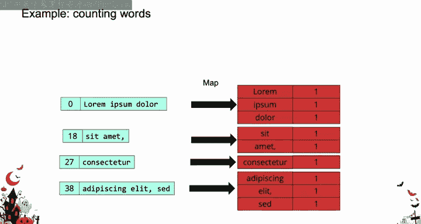

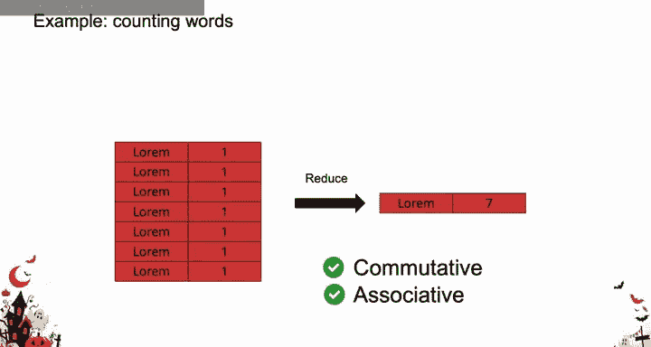

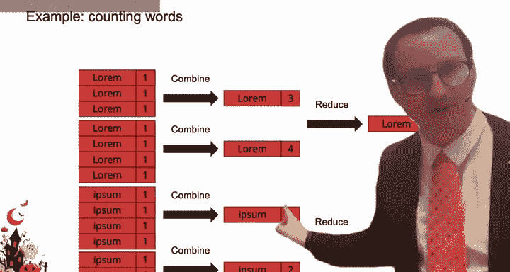

It will not change the final results right， So this is the this is the the trick。

 And now you understand that when I say sosociative and commutative， I really。

 I don't mean the reduce function itself。 I mean the plus like the operator inside the reduce function should be associative and commutative if you。

 if you use such a binary operator。Okay， for who is that clear？😊，All right， very good。

 so again I repeat。😊。

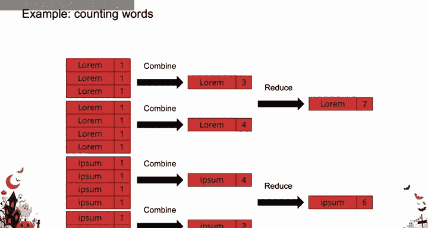

You can reuse the reduce function also as a combined function you need for that for the key types and the value types。

 the intermediate media wantss to be the same ones as the output key value types and of the output of the reducer because the combined function can be called any number of times you can call it even 10 times on the same data So it has to preserve the types of the keys and of of the value and then it should be commutative and associative again with that title if you literally look at the mathematical definition of the reduce function you will see you cannot say it's commutative and associative。

 but this is just the inition I'm giving you technically very often you define the reduce function as taking key value pairs keeping the key and just applying a binary operator to aggregate the values together if that operator that you apply sociative and commutative。

 then you can use。

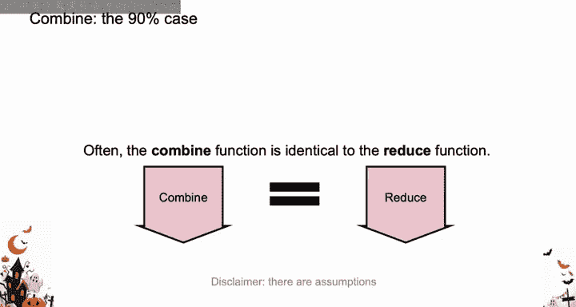

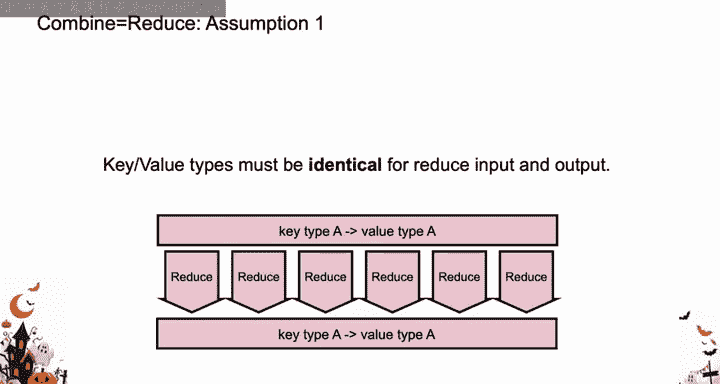

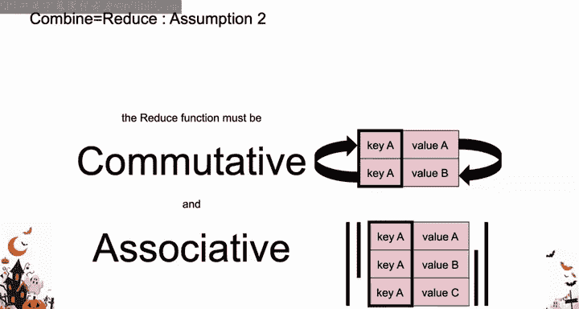

As a combined function。All right。And so the idea here。

 where it's brilliant is that this combining of early trying to apply the some very early as early as possible。

 is again this idea of bringing the query to the data。

 you want to do the computations as early as possible。

 especially if the computations diminish the amount of data。

 if computations diminish the amount of data， the earlier you do them。

 the less data you will have that has to flow over the network for whom is that clear。All right。

 there is a generic term for that that I'll come back to it's called pushushdown when you have some computations。

 you try to push them down so that they are executed as early as possible to use less network less bandwidth with less memory。

 less disk。

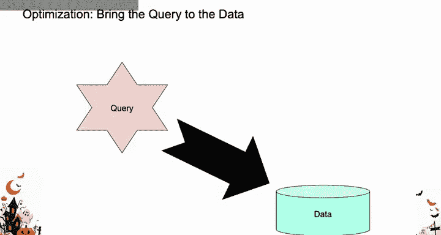

Okay， so that was my example。 plus is competitiveut in associative， so I can use that as combined。

 and again， I repeat。😊。

The way that this is done right here using the combined function， you have no control over this。

 absolutely no control mapre whatever it was， it could not use it at all。

 it could use it a little bit so you have absolutely no control over all that。

嗯。Alright， so now I will move over to the API， so it's implemented in Java。

 the native language of the mapreuse implementation。

 but you can also use it with Python and other languages it's called the map reuse streaming so that's basically it can be used in conjunction with the standard input and the standard output on the command line so basically your map function and reduce functions are batch scripts that basically take input and spit out something and then that can be used as a very convenient means of using map reuse but let me focus on Java just to show you you don't need to know Java right that's really not important just so that you feel how it works。

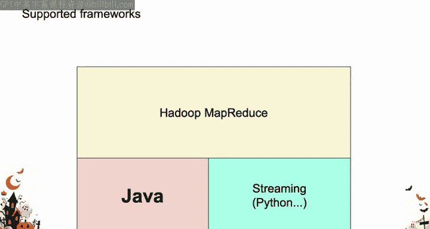

So basically you need to specify a map function， a reduce function an option that is a combined function。

 so that would be the map function right it takes a key takes a value and some context and then it basically generate keyVs in there and writes them back to the context right so that's my map function again it can generate zero one or more intermediate keyVs and that you can see with the number of callss to the right function every time you call the context right function。

You speedoo an intermediate key in that case， it's just one。Then you have the reduce function。

 Look at the signature， the reduce function takes。One key because it's a group of key values with the same key。

 So it takes one key。 and then it takes all the values that are that are associated with with this key。

 right， So this is this is the idea D。And what happens is that you do whatever you want to do right and at some point you can call again context right with keys and values exactly in the same way as in the map function。

 and again that can be zero1 or more times it doesn't matter。And again， very often。

 the new key that you have here。Is， in fact， going to be the same key as right here， right？

 And the value might be a plus or whatever operator you apply to aggregate the values。

 but it doesn't have to be because you have a programming language。 It's turning complete。

 You can write whatever code you want in there。给。😊，So this is then when you create your job。

 what it looks like， you basically give it a name， then you say this is my map function。

 this is my Red function， so you do that using classes in Java。

And and then you specify the input path and the output path of the job。 So where's the input data。

 Where's the output data， possibly the formats So in that case as as as a。

I think it's probably stand out in that case that its just text and then you wait until it completes or who is that here？

Allright again， you don't need to know Java that's just to give you a feeling of what it's going to look like so it works with Java with Python with many languages and finally if you want to add a combiner just say set combiner class and of course if reduce checks the reduce function checks the boxes for commutative associative and send you can just say set combiner class with the same class my own reducer right so you just reuse it。

But， of course， the most general way could be any reduced function， any combined function。

 You can also write it as a as a differentness。All right。Now I would like to draw your attention。

Two these。Mapper， combiner and set reducer reducer。

If you look up literature on the internet or in books。

 you will hear a lot of people that talk about mappers and reducers and combines like maps do this。

 maps do that and so on。

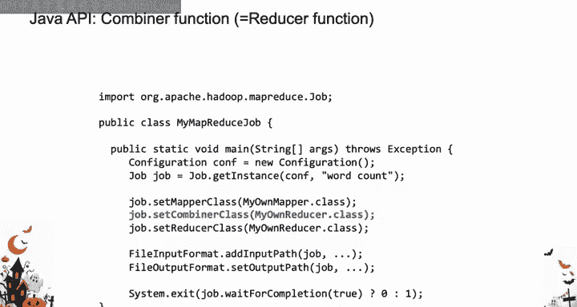

What I would like to tell you now is try to avoid using these terms。

 except for the names of Java classes。 That's pretty much the only thing you can do But avoid when you speak and explain mapre。

 do not use the worlds mapper reducer combiner， avoid that。 I'm going to give you better worlds。

 and you will see that using these better worlds。We also make it easier for you to understand what's going on because it fes you to think clearly and you will see then that mapper reduce and combiner are in fact ambiguous because you don't really you're not precise of what you are talking about so do not use these wealth when you find them in books。

 try to map them to the wealth I'm going to now give you and in order to explain that I'm going to use an analogy we have people who went together on a vacation and they are about to write the postcards to all of their friends so they have in that case 50 postcards to write but they are several of them so they are going to just sit around the table and start because they know about mapre so they are going to parallellyze the whole thing。

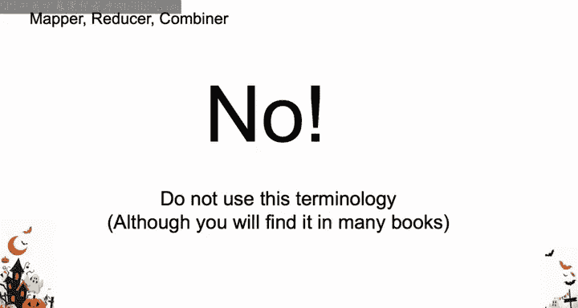

So， the idea D is that。D put Sc。Will be split into five heaps of each 10 per scale。

 I call them splits， right， a split is the pile of percals。

 So theres the first split with a pile of 10 per scale。

 the second split with a pile of 10 per scales and so on。 That's a split。Next。

 we have the notion of a task。A task。意嗯。呃兔tu。Its the task。

Number one is to write some text to your friends on postcards 1 to10。 This is a task。

 That's something you have to do as opposed to the splits。

 It is the physical postcard of the splits who understands the difference between task and split。

All right， so the task number one is to write some text and the addresses and so on on postcards one to then maybe put a stamp or so then you have task number two。

 the same thing on the second speed and so on， all right。Tusk， remember that world。

So they are sitting around the table。 and what they do， there's three。

Groups of people will call them map slots。So they take there's three of them。

 so they take the first three tests and test four and five can waits will be on later。

 and then they start writing the postcards。Now， there is a little bit of help in group group number two。

 So they are finished a bit earlier。 So task2 is done。

 What happens is that they grab the next task task number four and just continue while the other ones continue on tasks one in three right then group number three is done。

 So they take task number 5 and then complete， complete completes。 Now they are all done。

 Now you notice something the number of slots is not the same as the number of tasks。

 We have five tasks。 We have three slots。 You also notice that this is happening dynamically。

 it means that there is no static assignments of tasks to slots is just whoever finishes takes the next the next tasks。

 So you have not predict in advance what's going to happen。 So whom is that clear。Very good。

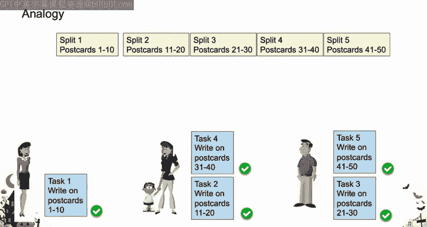

嗯。So what happens now if if I give you all the terminology。

 what we call map function is a mathematical function that takes one key value pair。

 one input K value pair and output0，1 or more intermediate keyVU pairs， that's the map function。

The Red function is a mathematical function， presumably implemented in Java or Python that takes a group of key values that all have the same key and that should be completed should be all of the intermediate key values that have the same key。

 and output zero，1 or more output key values。😊，The combined function is a mathematical function that takes as inputs one or more intermediate key values and spits out01 or more intermediate key values okay that's the combined function。

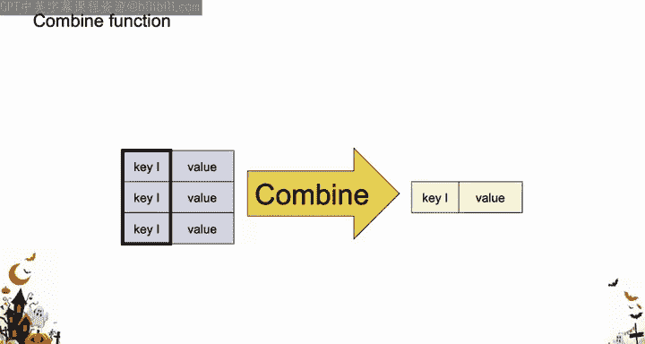

Then we have the notion of map pesque。A map task is basically。

 you can see it as the task of iteratively calling the map function over each key value。

 So it means you have。You basically have a sp that contains multiple keyU。

And you take each key value。 And on each one of them， you call the map function。

What is very important is that this is sequential。There is no parallelism in there， right。

 It's like the postcals。 You have a group。 You take the postcal， The 10 postcals on your pile。

 you do them one by one。 You don't write all of them at the same time， right， So so it's sequential。

 So first， the first key value。 We call the map function。 Then we call the map function。

 second key value and so on。 You can see it as a thread， right， It's a computer program thread。

 thats sequentially equals the map function。 that is the map task that does that。 Okay。

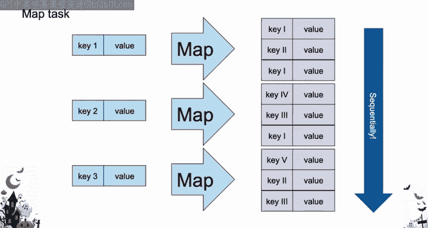

Then we have the reduce task， which is also an iterated and sequential sequence， of course。

 of the reduce function group by group right so each group of intermediate key values with the same key we call the reduce function This is again sequential There is no parallelism in there or whom is that clear。

😊。

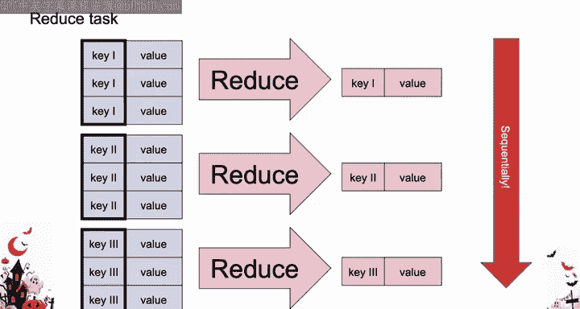

So again， it's a threat that does that。Combined task that doesn't exist。

 you will not find that anywhere because remember the combine is just a function that that can be used during the map phase to compress the data。

 so that's a function that you can use whenever you want to compress a little bit in memory or you flush or you compact you use the combined function to reduce the quantity of inmedia TV use there is no such thing as a combined task that just doesn't exist for whom is that clear。

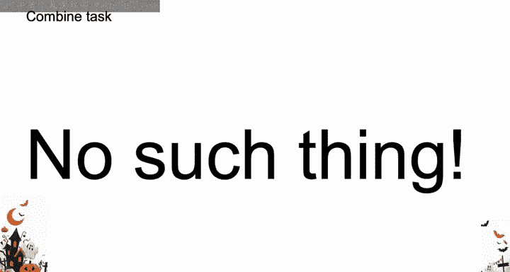

All right， very good。Now that's basically the visual。

 so the combined function is just used in order to have less intermediate key by compressing them into this。

Now， a map slots。You should think。Of a map slot。As a CPU core。

A CPU core is able to take on a sequential execution。

 of course with an operating system you can still have threads and you know with scheduling and so on but technically one CPU core can do only one thing at the same time right so one CPU core gives you one slot and what that CPU core is going to do is take one task which is a sequential core of the map function when it's done it takes a new task。

From the tasks that remain again sequentially equals the map function。

 then when it's done takes task number three and so on。

 so it means that it's sequential within a task， but it's also sequential across the tasks in the same slots for whom does that make sense。

We have a question on Zoom， I think do we view the combined function as part of the mathpa？

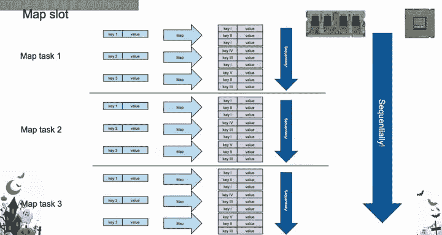

嗯。I would say that。It's really an implementation detail it's really the basically the map produce implementation of the map phase can just add arbitrary core of the combined function。

You could consider that it's part of the map task if you do it already while it's still not done right so if you call it the combined function and do it on the fly but I could also imagine that a combined function could be called after the map task or for example。

 if the memory is full because you have too many map tasks and then you flush the output of previous map tasks to disk then you could still use the combined function outside of the map task right thinking out loud does it make sense。

All right， so basically mapreuce is free to do whatever it wants。

 it's free to call the combined function any times it wants to aggregate intermediate key， all right。

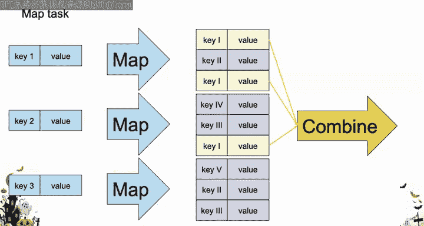

Now， one more thing about when I say CPU core， what I really mean is virtual core because you might who heard of hyperread。

RightIt's a way that you can squeeze even more reds on the course。

 So typically it multiplies the number of calls by two。

 so you really already have to think of of the virtual calls right so this is really the whatever is the smallest unit when you can not parallelize within it right。

Okay， but then it doesn't seem very interesting because there's no parallelism， right。

 I just said everything is absolutely sequential in there。 So for now， we don't have any parallelism。

 The same goes for a reduced slot， which is， again。

 actual CPU core that sequentially takes care of reduced tests when after the others。

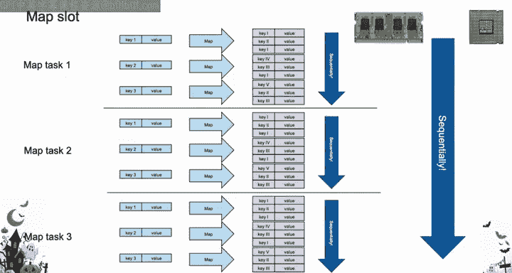

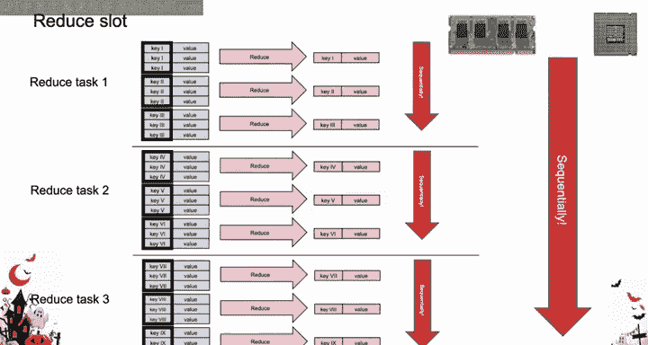

Everything sequential。There is no combined slot that doesn't exist。

 you will not find any CPU core that is used in order to call the combined function iterative that doesn't exist。

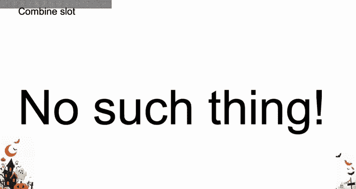

Then it starts to be interesting because if I talk about the map pace in its entirety， then I have。😊。

Several CPU cores， possibly even on several machines。 and each CPU core virtual core is basically。

 I don't know what's going on with the with the screen now done。 It's the light or something。

 I'm still trying to adjust。I'll find it out。With the progress of AI and the new Zoom update。

 it seems that we don't need the the green screen anymore。

 but I still need to figure out exactly how the lighting should work。 Al right， so。

For each virtual core here， we have a slot and every slot executes the sequence of tasks。

 for whom does that make sense？And this is where the parallelism is because the tasks gets spread over multiple slots and the slots are able to work in parallel。

Okay， and the same goes for the reduced slots。Now somebody asked last time about how many tasks should there be per map slots and how many reduce tasks should there be per reduced slot？

For map tasks， you basically need a multiple of the number of map slots， for example。

 I don't know and just waving my hands like five times more tasks than slots。

 10 times more tasks than slots。These are good numbers， right basically it spreads over the tasks。

Over the cluster， even if some slots are faster than other slots。

 then the faster slots will have more tests and the slower slots will have less tests for the reduced slots。

There are two numbers that circulate over the Internet， and these numbers are 0。95 and 1。75。

 So let me explain what why these two numbers。 So 0。95 basically means that。

If you have for every reduced slot， you have 0。95 reduced tests what that means is you need to think of it with many slots。

 imagine you have 100 reduced slots then you should have 95 reduced tasks right sos that's a way of not of having the cluster not fully busy in case something goes wrong somewhere so this is the 095 then every slot will have wet desk and that's it。

1。75。Means that you have 100 slots and you have 175 reduced tasks。

 It means that at first you take a bit more than half of of the available tasks than do them in parallel and then some of the slots that will be done faster will take on the remaining 75 and if there's a few that take longer then that's okay spread it balances the load the little bit So this is why you see the 095 and 1。

75 these are rules of in order to configure that all of that can be configured by the way in in the configuration of the map reduce。

All right， but I'll come back to this a bit later on optimization combined phase doesn't exist。

 there's just a map phase and a reduced phase with shuffling in the leader。

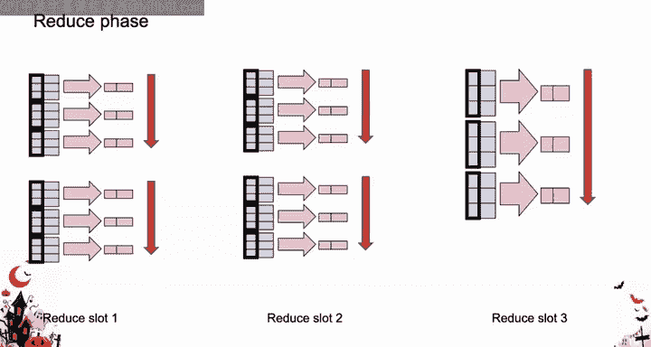

Right so this is how it fits， we have slots that process tasks sequentially and they pick them dynamically when they are done。

 they take another task and a task is a sequential series of function courses just like a slot sequentially executes tasks。

😊。

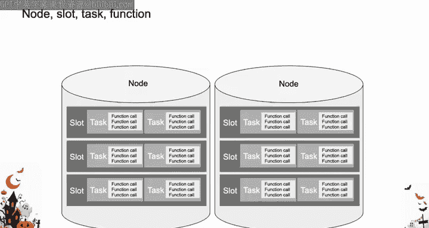

What's more in version web map reduce the allocation of the slots to map or reduce is static so you decide in advance every virtual actual core is either a map or reduce right we'll think that later because of course it means that during the map phase all the the the actual core that are supposed to reduce do nothing so you're not utilizing the resources of your cluster fully。

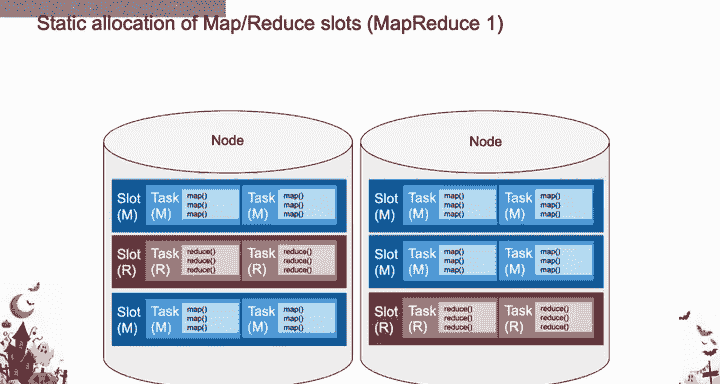

Okay。😊，And finally， I would like to finish with a tricky point， but in fact。

 some of you already realized that because I got that question。

 I think at the break last week and that's actually an excellent point that you actually were able to find it by yourself。

😊，We basically have the tasks that correspond to splits right so the idea is that the sequential core of the map function here corresponds to the splits so the splits are basically the AGFS blocks if you want to see this way so a split is a block。

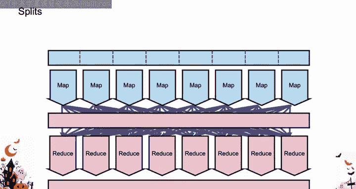

But the problem with that is that splits and blocks are not defined in the same way。

 because you might recollect that an HDFS block is defined as a number of bits， 128 mebyte。

 and then it stops。 You don't care what the data is， you just stop exactly after 128 megabytes。

But the speech。Is a set of key。So now you see the problem what's going to happen in reality is that when you have the split。

 so a record basically or keyva U in a split is somewhere in a block。

 but what's going to happen is that the very last record or the very first record of a split is actually going to be spread over two blocks。

 it's going to start at the end of the block and it's going to end at the start of the another HDGFS block who sees that。

😊。

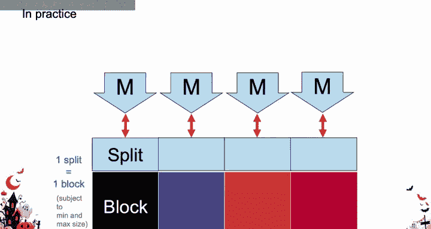

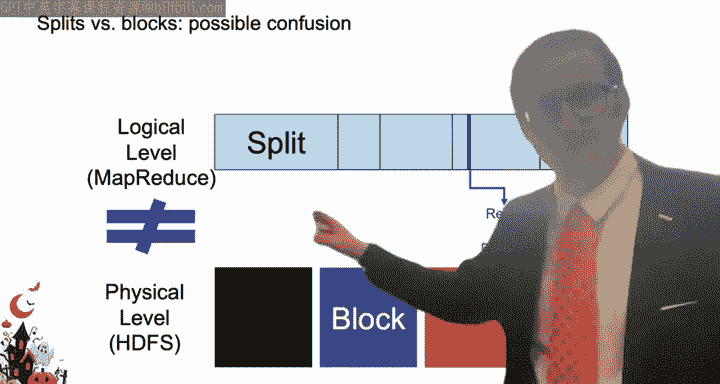

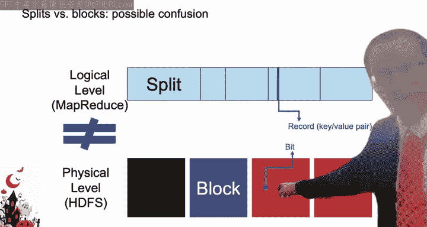

That's really because AGFs blocks on these CB bits， right？So that is a small impedance mismatch。

 it happens all the time， but that's no big deal， you just need to remember whenever mapre process is is split that whenever it's done with a block it has to also read the next few bits to finish the last key value from another right and that's totally that fine but this is handled this has to be done explicitly by the map re code。

 not by the user of course， if you're the user you don't need to care about that but the implement of a mapre needed to be careful about that right？

Okay， so you need to finish with a remote read right and that happens actually if you if you look at the probability that that happens you in fact when it does not happen。

 it's really rare like when you have a key value that exactly adds the end at the end of an AGFS block you really need to be lucky right perhaps not as lucky as winning the euro millions but still that doesn't happen very very often right so this is really something you need to consider。

And that is my last slide format if we use， we have a question。So you said the last。

 if so if you read the start of the next block， that's a remote read。

 I don't quite understand why that has to be a remote read。 Did you just elaborate on that。

 Yes youre absolutely right， it could also be on the same machine。 Okay， okay you don't know right。

 it could be on the same machine if it's on the same machine。

 you just can read it locally and if it's on another machine。

 then you can just you should have it without the network but wouldn't we expect it to probably be on the same machine。

That is a good question。

What is for shorter case is that when you know that oh it's getting even worse with the light the opposite。

Basically。嗯。When you assign the next task， when a search request。

 the next task is going to try to find the task that corresponds to data that there is on the same drive。

 that would be the most of the block。But。In order to also make sure that the next block would also be on the same machine that might not always be the case。

 I do not know to what extent they also try to anticipate when retrieving the task that also the next block would be on the same machine that I don't know it could be the case that they try to do a little bit something in that direction but I'm not sure Thank you thank you Any other questions。

So the next note， how does it know how many bits from the beginning it has to ignore？You don't。

 you don't know。So it's basically really down in the physical implementation details of mapreuce that theres Java classes that are basically responsible for taking care of this。

And that I don't know the exact details of how far it goes。

 but basically you basically cannot know in advance if if you haven't read the blog。

 you can not know what there is in there， but I could imagine that there could be some optimizations that give you extra information on the limits of on the limits of the split right but here it goes beyond my knowledge。

I would say。I mean， the data is split without caring much about。

Saying anything about how many of the first bits the next block is from the previous。P标语。

So if I think I would loud。I would imagine that。Typically， when you use map reuse。

 you have some knowledge on the。On the like there's some homogeneity in the key videos in some sense。

 but I'm really afraid of misleading you or giving you an answers that doesn't make sense。

 so maybe we could take this as something to investigate offline if we manage to find some some more things regarding this but you're bringing me outside of my limits my knowledge here。

几。😊，Which is good， I mean， it means that that the goal of any teacher is to bring the students all the way to the to the frontier。

 Yes， and is't it a problem that basically for every single block or almost every single block we have to do a net for grade。

Because the last key value pair is going to be mismatched。Yes。

 it it is a bit problematic of course our wish list if we could have wished for something that would be that it ends exactly at the end of a block right and then that would have been easier so it is really something nontrivial that was I would call it an engineering challenge and that engineering challenge was part of the design of mapre to getting this right what I want to show you here is it's not trivial basically。

😊，Right。Okay， actually， the break is perfect because now I we can have the break right in the middle of the two。

 And after the break， I will start on the on Sp， right， So see you in 15 minutes。😊。

