# 苏黎世联邦理工《大数据｜Big Data - ETH Zurich - Fall 2024》中英字幕（deepseek - P29：-29-9. Spark (1_4) -.zh_en - GPT中英字幕课程资源 - BV1sHPKeoEJU

Welcome back， everybody。😊，So the timing was perfect for singing the break with the start of a new module。

 So now we are going to be looking into Sp。Spak is the next generation of mapre。

 so I'm going to explain to you now what the developments have been。

 So the idea of having a job tracker and a task tracker is actually the f version of mapre probably 15 or 20 years ago but since then there have been engineering improvements that I would like to tell you about that you see what has been done to improve it so I start with that and that will bring us to Sp so you see we are here on the processing layer we've done everything that below we've already covered and now we are in the processing pack so you saw that in mapre it's basically a very simple model where you have a map phase and a reduce phase separated by the spaghetti in the middle the shuffle phase。

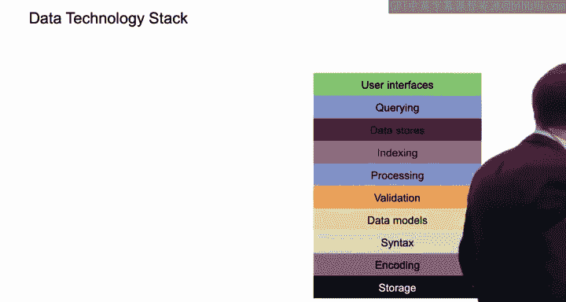

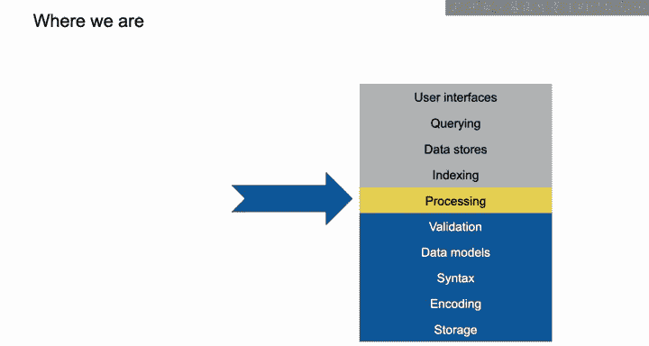

And we saw how it could be executed in parallel on a cluster on slots within each slot sequences of tasks。

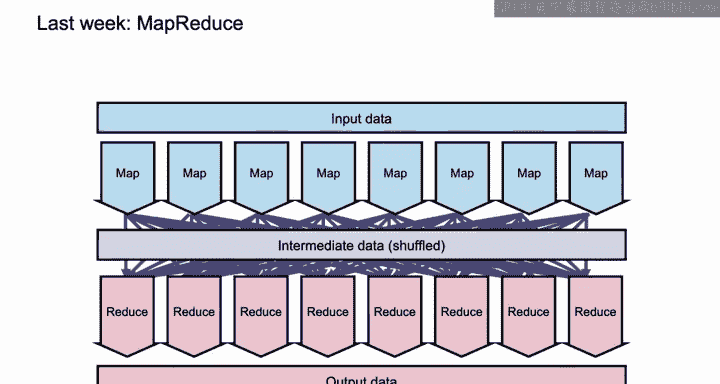

We saw that in version1 of Mareuse the early version。

 we had a process called the job tracker collocated with the name node process and a process called the task tracker collocated with the data node processes and the idea is that the execution on the task trackers of the map functions should be on the same machine as the blocks that they are reading from disk because then you can shot your kit the AGFS and directly read as a local read。

 this is what we call bring the query to the data。

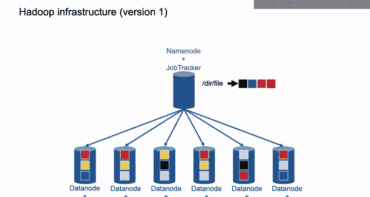

Now， there's a couple of problems with that design。

And one of the problems is that the job tracker is doing too much。

 it's taking care of the resource management， managing all of the available machines on the network and knowing which one are available。

 it's taking care of scheduling， so it has to figure out whenever slot is done。

 what tasks can they do next， depending on whether the task has data on the same machine。

It has to also schedule， you know when you shuffle to decide which KVUs get on what machine that can be done with hashs or with sorting intervals。

It has to monitor the machines because it has to detect if one of the task trackers might have crashed and then you the map the map task there will not be completed right Now if a map task is is crashed or not completed。

 that's not a big deal， then you ask another machine to take it over right but it has to take care of that。

 by the way， if a reduced task crashes that is not problematic because then you might need to recompute things。

 So in the worst case， you have to start the job all over again from the beginning。But anyway。

 the job tracker has to worry about all of that。 it also has to take care of the the life cycle of the jobs。

 the orchestration of map chauffeur reduce and so on and default tolerance。

 So that's a lot of things for a single process to do。

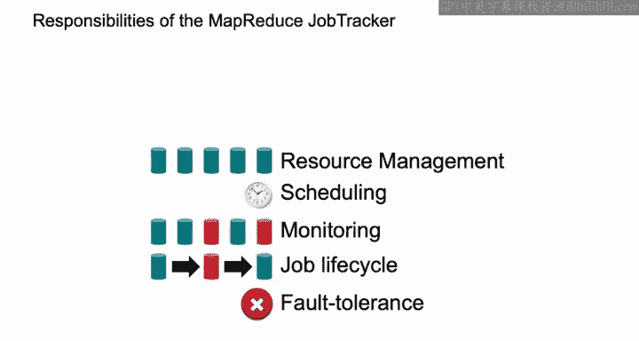

And because of that we have scalability issues， so with the first version of not use we are able to scale it to 4000 nodes already a lot。

 but thats still already meat and 40，000 tasks and you see here the ratio is roughly 10 right that's in9 in what I said that typically you have a multiple of the tasks are a multiple of the number of nodes that times 10 x。

😊。

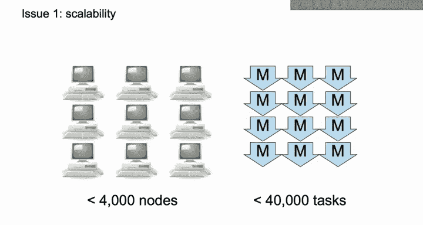

嗯。The other issue is that it's a bottleneck because there can be thousands of machines and of machines and then the job tracker is there all by itself taking care of all of that。

 so that's a bottleneck when you start adding more and more machines at some point that becomes too much。

😊。

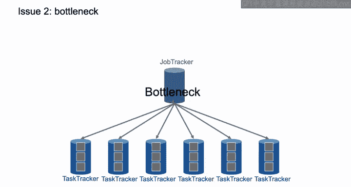

Another one is that as we say a Jacobcoal tradema of none right it does too many things so we cannot do any of them perfectly and in particular scheduling and monitoring are completely different tasks that is's doing the two at the same time it would be nice if we could separate them。

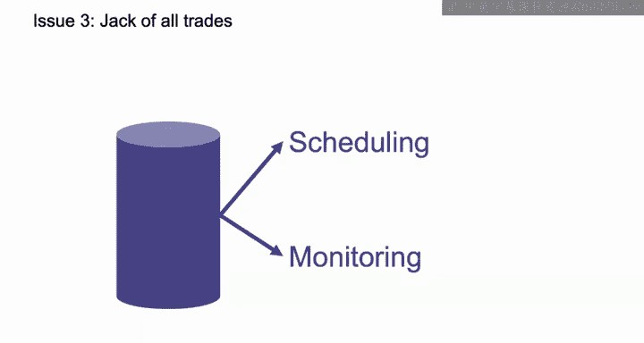

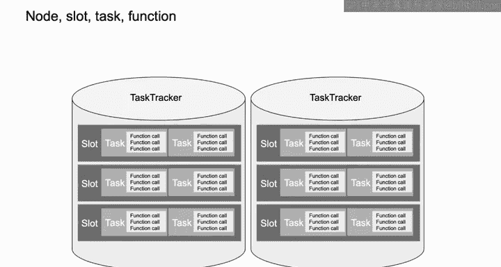

Another issue that I mentioned last time is that。Because in the version web map produce。

 you decide in advance which slots do mapping and which slots do reducing during the map phase。

 the reduced slots are either they have absolutely nothing to do except waiting until the reduce phase is going to start off until the shuffling starts and then in the reduce phase the map slots have nothing to do anymore except if something phased then they would have to recompute right but it's all static。

So that's a problem， it's a inefficient use of resources who agrees on the program who gets that this is problematic。

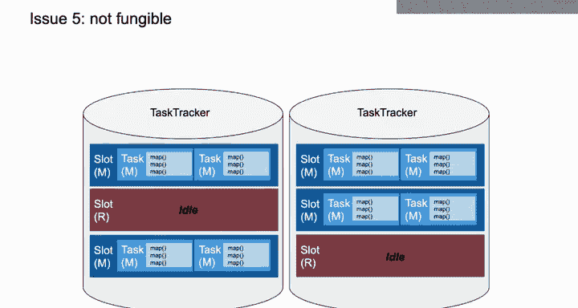

ok。And that comes the solution Ym， So you know that whenever something starts with Y A。

 it means yet another all right， So Yamel， yet another macro language and ya means yet another resource negotiator right。

 So this is this is what it means It's basically。A solution to these problems。

 but what's really nice is that it's a solution that is not specific to my produce it's actually a very general way of solving this problem and then wed see it can be used for spark for for HPC applications and so on so it's very useful so this is the architecture of Y。

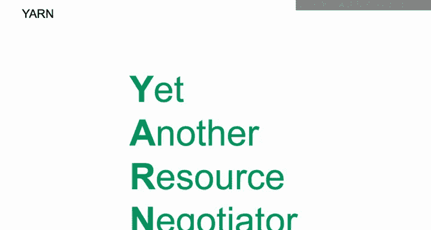

First the centralized architecture shouldn't surprise you it's exactly the same thing。

 you know with name node and data nodes Hmaster and region server job tracker and test trackers so here's a thought pair to learn resource manager node manager right that's the name of the processes so this is how young works but there is a third thing。

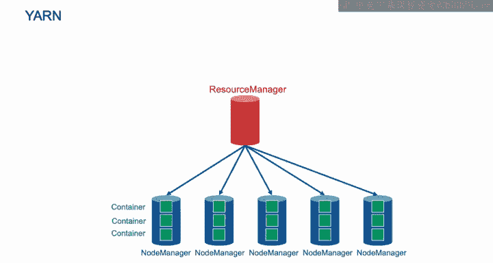

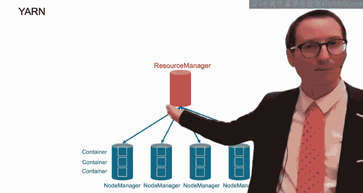

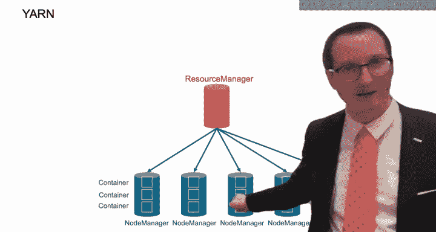

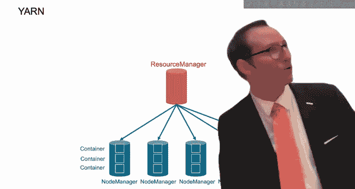

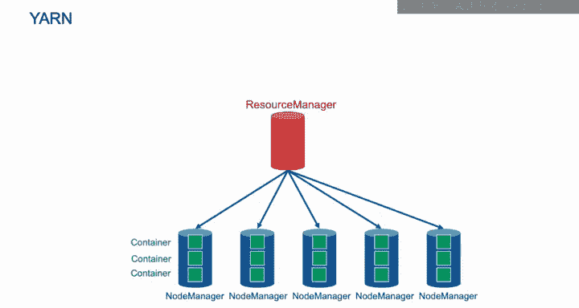

These are the containers that you see here on the machines so the containers can be seen as resource allocations each container has a number of CPU calls and some available memory and it's kind of a virtualization of the resources right so you basically can kind of allocate containers on every machine right so I'm going to explain very quickly how it works not in the details because I could otherwise spend the whole lecture but that's not my goal here I just want to explain on the high level how this is working right。

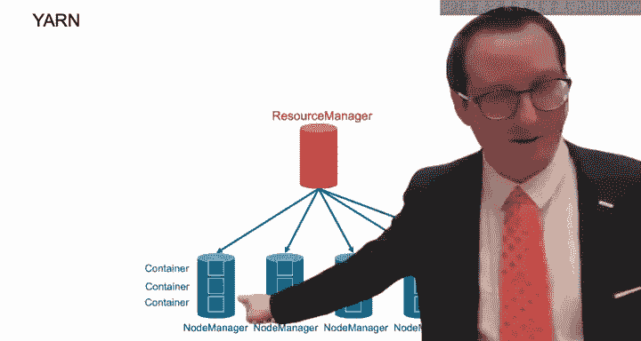

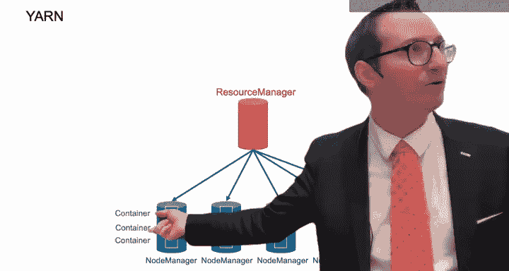

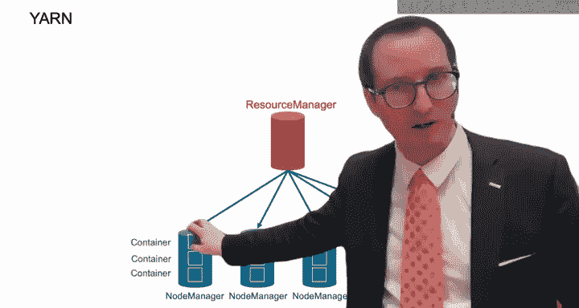

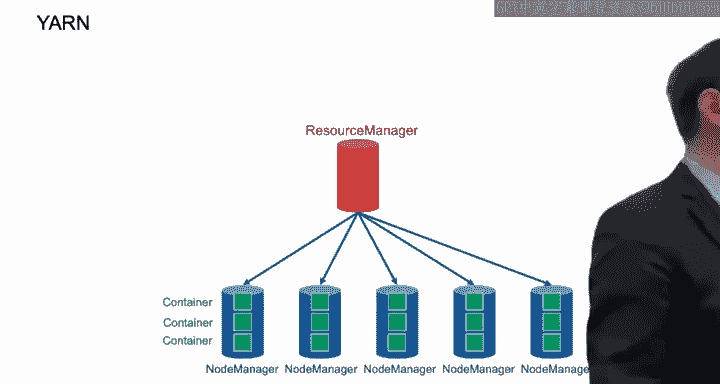

So that's young and what happens is that with the other。

 a client is going to connect to the cluster with a job that could be a map reduced job。

 but that could also be a spark job or whatever， just a job。

Resource manager is going to acknowledge the receipt of the job。

But it's not going to take care of running it instead it's going to delegate so it's going to delegate and ask your container to do it instead so it basically takes a container somewhere in the cluster and promote sit to an application master or that job and so that application master is going to take care of the whole job right so it's going to request mock container so the application master is going to say hey I cannot do it on my own I need other people to help me and so other containers to help so it's going to request some mock containers from the resource manager is going to grant them and then you can forget that so if you virtualize you basically have the same structure with a job tracker task tracker but now it's all in the containers you have the application master and then the containers that do the mapping and reducing or whom is that here。

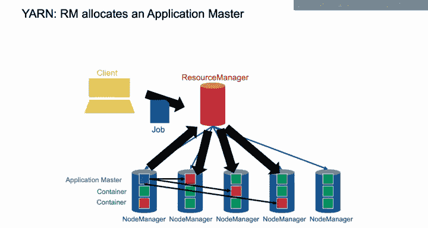

Very good。 So what happened is that we split the responsibilities。

 The node over there called resource manager is still responsible for allocating the machines。

 but it's no longer responsible for taking care of running the job。

 It's been delegated to a container。

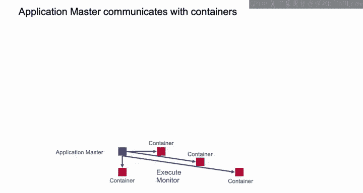

And now you have to imagine。That typically when you have a data center like that。

 it belongs to a company， you're not the only one in the cluster。

 There might be 10 other people who are using the same cluster。

 It might be that there are 10 jobs running at the same time in the cluster it means that there might be pen application masters So it means that it case right you can have multiple people having jobs at the same time and it's nicely going to be delegated to application master so we made the the coordinator or node little bit more more lightweight right。

Well it's very important to keep in mind because this is a common misconception。

 I mean you hear sometimes people that are blaming sparkk for being slow or map for being slow and so on。

But these frameworks here like Ym， they are not here to optimize the performance。

They are here to optimize the use of the resources in the cluster in a company with people competing for resources。

This is what it's for， so its goal is to allocate the resources across multiple teams and people in a way that the cluster is fully used so that that there is no waste of resources。

😊。

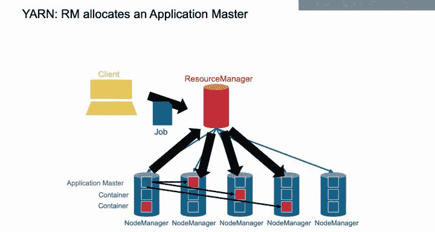

Okay， and so now we have this mini job tracker task tracker thing that now it's just done in containers and the application master is orchestrating the whole map reduce job。

 some of the containers we do mapping some of the containers we do reducing what's also nice is that during the map phase you don't need to prelocate reducing slots。

You can do it dynamically when the shuffle begins， so you don't need to put resources either waiting to reduce。

 how does that make sense？So that is an improvement。 That is an improvement。

 So it means that during the map phase。The machines you don't need can be used by other people in the company for doing other things right and then when you need them upon shuffling you can request them。

All right， then these containers what do they actually stand for So typically I'm not a hardware person there's plenty of people at TTH who are specialists in hardware as a database person I just know vague things about hardware I know that there's some memory somewhere where the data is kept in order to work on there are some CPU also called compute that does the job there is some disk that is storing the data in the long term and that have to read from and there is some network that is allowing me to send data across machines。

I can say that I want gigabytes of memory， I want a specific。Number of course。

 I want specific capacity on this or a specific bandwidth to read the data on the network and can have a specific bandwidth and all of that together gives you a container right a container is really the idea of specifying how much memory。

 how much compute， how much this， how much network and so on。

Now the disk and the network are a bit working progress。

 they probably made a lot of progress on that， but traditionally the resources focused on the use of memory and compute。

 so memory and CPU right。Okay。So you have to imagine all these containers here。

 think of them as an amount of memory and a number of calls。Yes。😊。

The difference between container and the previous， like。ski猫啊 how would you call it Russian one。Yeah。

 like is a container Additionallyly has like allocates also some resources。

 it's not only a process or something like that。That is the main difference indeed。

 So the difference with the previous version。

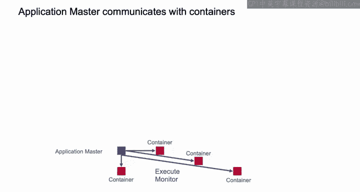

Is that you only need to reserve the containers that you actually use。😡。

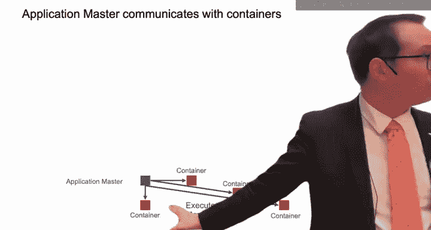

You don't have at the beginning to resolve all the resources you need and to keep the reduce path either before the shuffing begins now all you need to do is ask for the containers for mapping purposes。

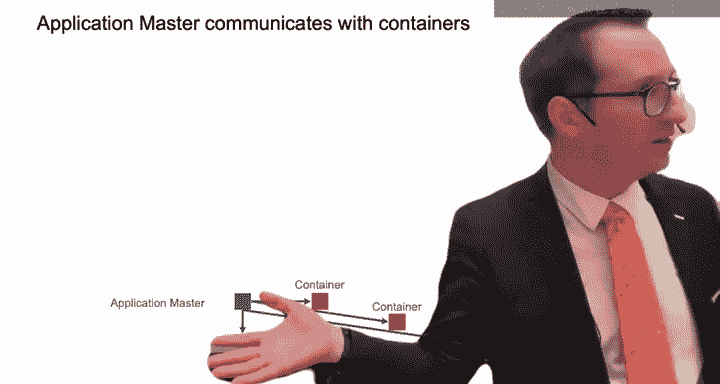

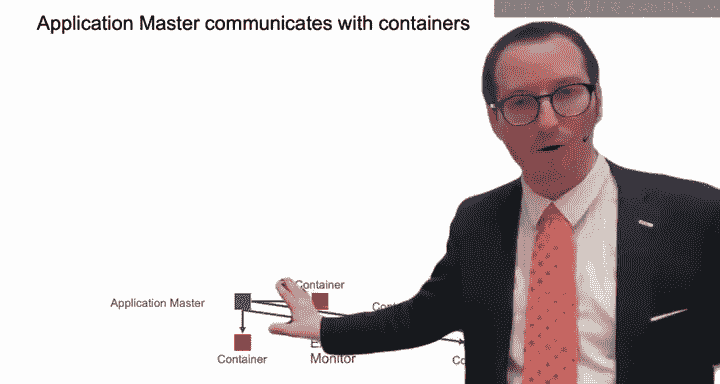

And when you're done you can request dynamically the containers for the reduced phase。

 but you're no longer wasting resources。 The other aspect is that you can also ask for more containers if you realize there are some who crashed you can ask more containers that intervene and take over that's something you could not do in version1 of mapre right but the idea that theres map slots and reduce slots is still the same is just that now the map slots and reduce slots are running on these kind of virtualralized environment。

 the containers instead of running directly as processes on the nodes right so this is the idea here you could see it as a form of virtualralization of the cool thing does it make sense。

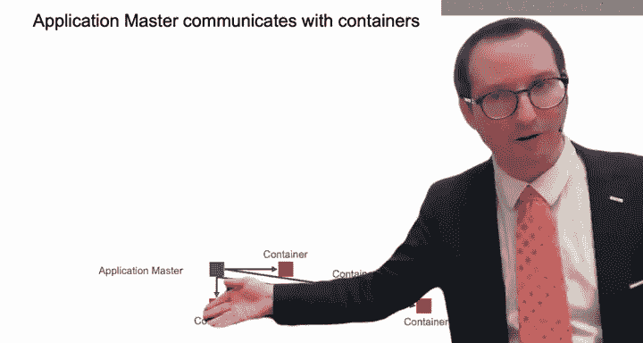

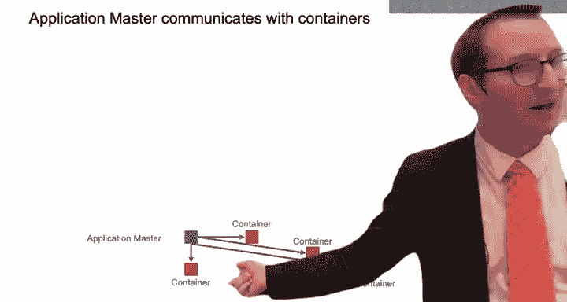

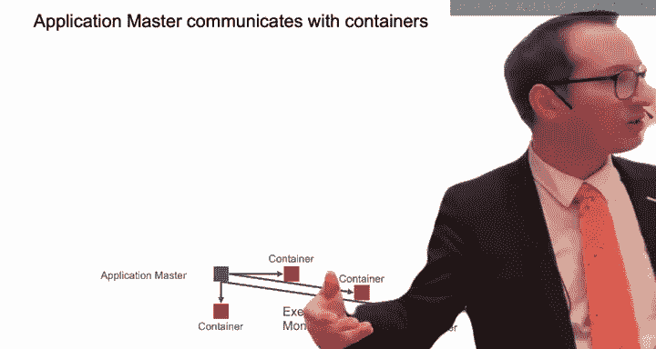

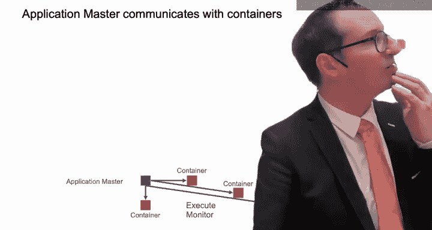

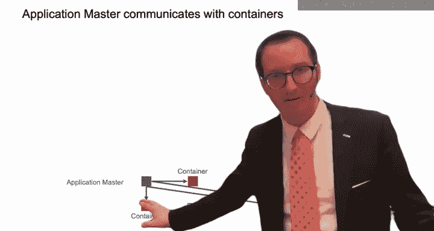

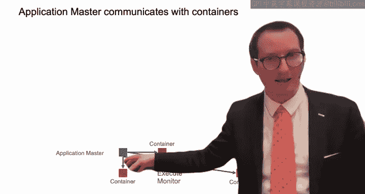

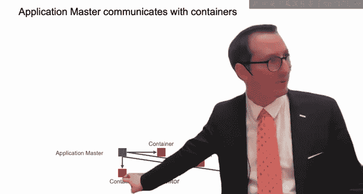

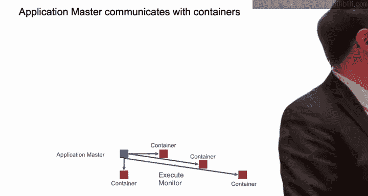

So the， the containers allow to， like。Change the job that the， the， the the real machine is running。

 It's we can't do that we have processed before。 just。 Okay， so， Okay。

 so let me define what your container is maybe for。For more clarity。呃。

The containers are basically like Santa cloud。 They don't exist。 or it's like Bitcoinco。 You know。

 it's there。 It only has value because we think it has value。

 So the containers are really just something that is agreed upon， right。

 So the containers are just here because the the， the nodes in the cluster agree that the containers exist。

 But really what the container means when you request the container from the from the the resource manager。

You are basically really just asking for the authorization to have the exclusive views of， let's say。

 10 gigabytes of memory and three CPU calls， let's say。

But you probably would agree that this exclusive use of this amount of memory and of this CPU。

I's only going to work if everybody else in the cluster respects that。

RightAnd so what happens is that the node manager is going to declare to the resource manager， okay。

 I have the 16 calls and I have 128 gigytes of memory。😊，And then。

What's going to happen is that the resource manager is going to say of these 16 calls。

 I'm going to put three calls for this job that requested three of them。

 five other calls for that other job and so on。 and basically when when the execution happens。

 then the application master connects to the container and runs the process in there。

And basically because of the way that this is programmed。

 what is going to run is going to actually respect the allocated CPU calls and the memory allocation。

 but the containers again do not exist。 It's really just something that people agree with like they have an agreement that I have received the right for exclusive use of this number of calls and that amount of memory right This is all done with tokens I might not say a lot about that。

 but basically when you make a request you get the token from the resource manager then you go to the node manager with a token saying I was authorized to use this and that many resources and then the node manager agrees to grant them to you。

So maybe before we didn't use containers， so the situation was like they were also running multiple processes on the machines。

 but it would be just multitasking managed by the operating system of the node So everybody would take like as much as the operating system grants and now the processes behave kind of like nicely that they use the agreed on amount Yes exactly so that's really the idea that in Russian one you just get the whole machine like the whole node the whole machine belongs to you and you just run run take a map slot or reduce not and the difference now is it's like between buying and renting right instead of buying the machine and just keeping it forever you rent it for the time that you need it and when you don't need it anymore。

 you just release it。You can see that's some sort of hotel right and these are hotel rooms as opposed to a home。

Okay， thank you。 right， another question will go there， I think。

I'm not sure to understand the advantage of putting the application master on one of the nodes as also hosting containers as opposed to having it in a centralized position like I understand that you're able to break away the responsibility for creating nodes away from the one that's actually controlling them but for instance you're thinking you about your network topology now you have a situation which a lot of these individual task nodes are going to be communicating with each other and that make that might increase the amount of bandwidth on the network so I guess is there what advantage does this give us Vi visa just like having the application master or all the application masters live in a centralized node。

I think this is the main advantage it's really again the idea that you're not the only one using the cluster and there might be 10 or 20 or 100 other people who are using the same cluster and so if all of the job trackers or for the jobs we are all on the main machine on the coordinator node that would be too much so now that basically allows you to share the cluster with other people。

 this is what it gives you like instead of having the whole cluster to yourself and so on you can share it with other people。

All right， thanks。Oh， sorry。I could maybe add that in a way， you know。

 you could consider that it's not that different in the sense that。In the old version。

 you could consider that you have a cluster of 1 thousand00 machines。

And then Alice uses 10 of the machines and install the name node on one of them。

 and Bob uses another 200 machines and installs another name node and Jo tracker on top of them。

 But this is not static。 This is like done in advance。

 I give you the machines and they are yours right Now what really is new here is the dynamic form of it。

 The fact that you just reserve and release these containers on the fly。

 you release them when you no longer need them and you book them only when you need them right This is this is the idea。

ok。😊，Let me move on。Not that I'm not getting too much in the details of that。

 so I used to cover it much more deeply in previous years， but we've focused a bit less on these now。

So yeah， so now we have the resource management on that one machine for the entire cluster。

 the thousands of nodes， and then we have the application masters that take care of the older people running their jobs on the cluster so one application master per job。

😊。

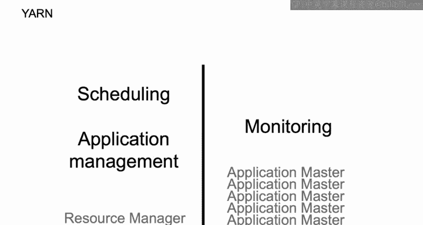

So these sort of things shouldn't surprise you that the node managers have these hardbes that report that they are still here to the resource manager so that it can keep track of all the resources available on the network So by now this shouldn't surprise you anymore right and the resource manager knows exactly what node manager are alive。

 how much memory they have， how big the CPU calls they have。

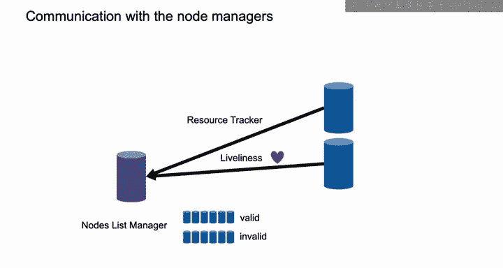

嗯。The resource manager couldn't care less about monitoring the tasks once it has delegated to the application master it's done right so it doesn't restart anything if it fails that is also the job of the application master to do that right？

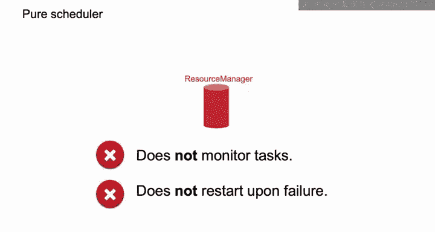

Okay， the application master is application specific， you could have two people running Mare job。

 three more running Sp jobs， maybe four more running HPC Me Roology tasks。

 you know it doesn't need to be it's not specific to anything it's totally general。

 like an application master can run whatever code you want in there。

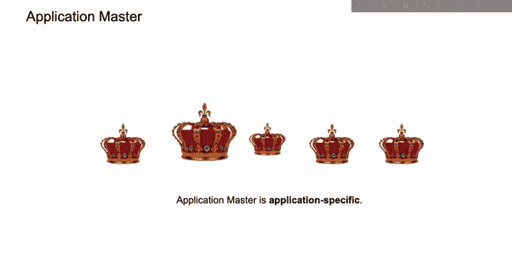

And the application master shoes， but of course， depends on the code you put in there。

 it is supposed to monitor the containers that it got and to relaunch the containers that fail and other containers。

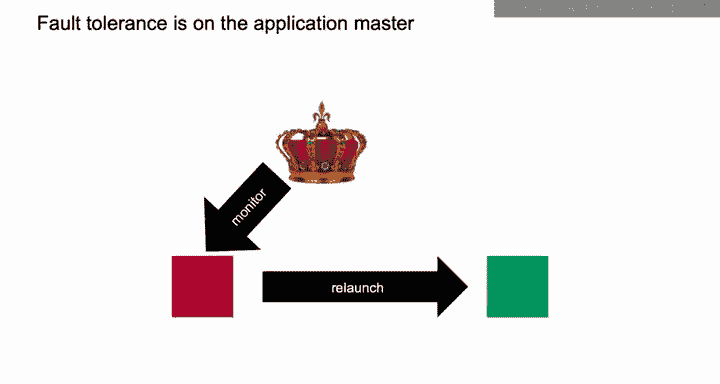

Now there's all kinds of queues again I'm just waving my hands here and going quickly over that when you allocate the resources in the cluster so when people request containers for running job。

 you have multiple strategies So when is FiI4 first in Fox so you could say I'm giving the whole cluster to Alice and when she's done I'm giving the whole cluster to Bob and so on that's called FiIO then you can have queuees so for example。

 if you have a company with a hierarchy you can have in in the executive meeting the decision on who gets we maybe because of financing and then you could agree for example。

 that the math department is getting 40% of the resources and so on so that's called a hierarchical queue and this is really something that is decided by humans like who gets what right and this is a target of the use of the cluster and then what you can do is allocate capacity based on that like if you have a cluster of 1000 machines and the math department is using I don't know 40% and they get 400 machines and the computer science department might get。

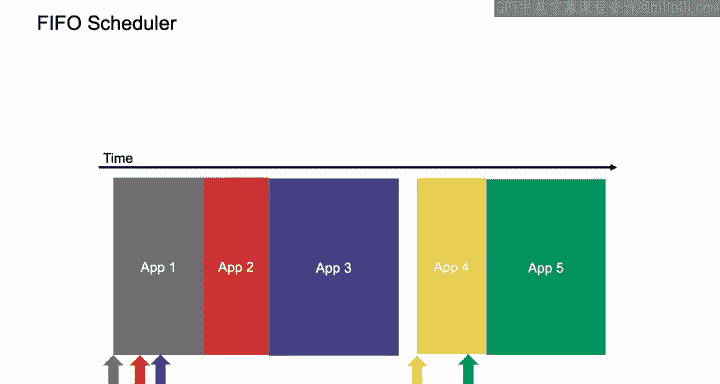

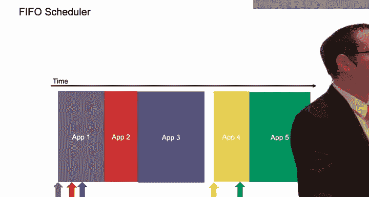

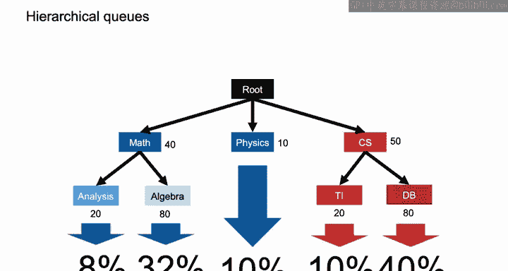

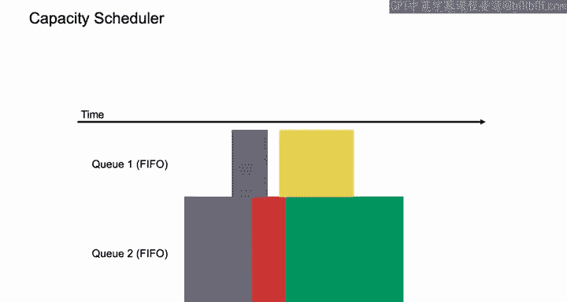

600 and then you have a separate queue， you have a queue for the math department and a queue for the CS department。

 for example， right so this is then called capacity scheduler and then you have what's called the first scheduler。

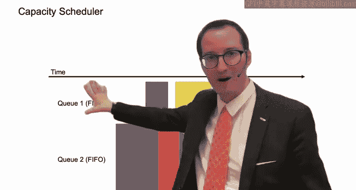

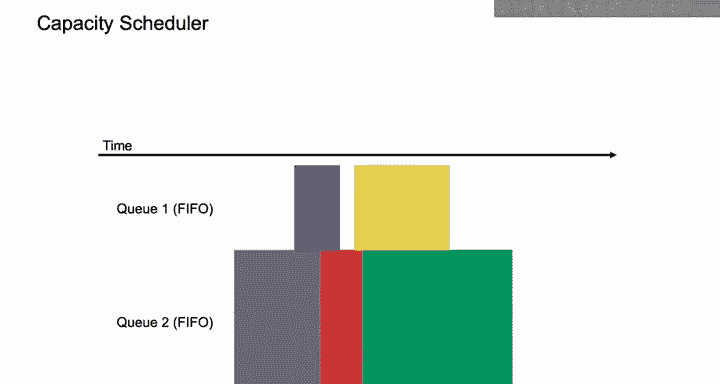

Which is even smarter。The first scheduler is able to notice that when the math department isn't using its machines because people are too busy writing on blackboards。

 then it can redistribute the machines to the computer science department。

 And if some mathematicians come back and want machines， it can preempt them and give them back。

 right， So this is then even more flexibly using the the resources。 Again。

 I'm not telling you any details。 Just the high level view。😊。

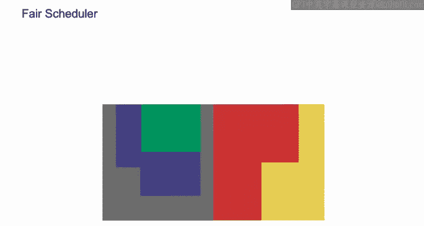

One other thing that is extremely clever。 And that was a paper written by by。

 I think between Stanford and Berkeley's。 they， they moved a little bit between universities。

 But this is basically the， the same people involved in Sp。When you allocate a cluster。

 when you compute a percentage， it's easy if you just look at memory or you'll just look at CPU calls or you look at number of machines you have only one dimension right so if you have a 10 car then I get 40% of that then I get four。

But the problem is when people have requirements both in terms of memory and in terms of course。

 so imagine that Alice is running a map produced job and she asks for plenty of containers and each container is supposed to have 30 gigabytes and two calls。

AliBob is running some meteorology predictions and he needs containers that have 10 gig and six calls so Bob wants more calls in the container and a bit less memory than Alice but then is the question how do you allocate that fairly how can you do that algorithmically and these people manage to use game theory in order to come up with a measure such a way that you have no incentive to cheat on on lying about the resources you need and the trick they use？

😊，Is that they look for the requested memory and cause。

 they basically look at the percentage of the cluster。

 so each container here needs 3% of the memory of the cluster， 3% of that， two cards 2% of that。

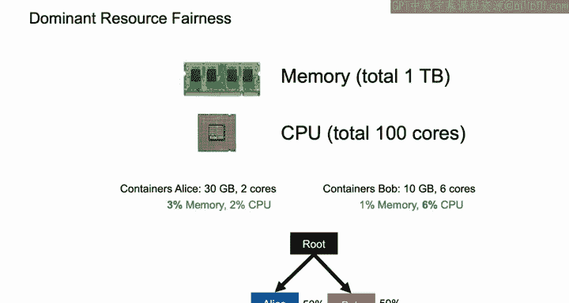

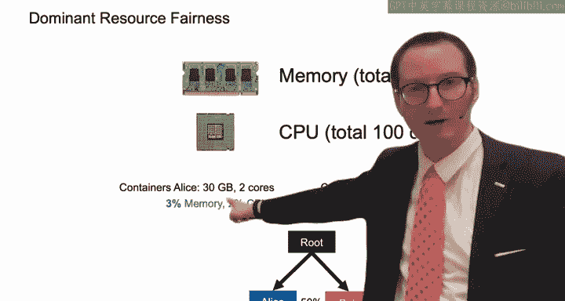

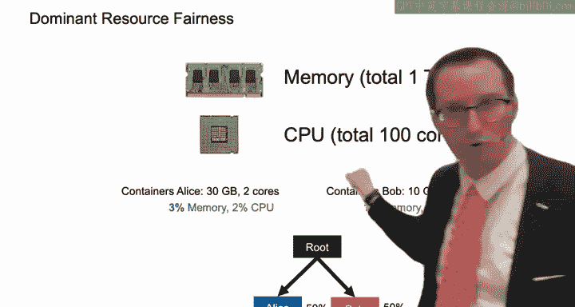

10 gigabs that's 1% of that and6 square is6% of that and then you look at what's called the dominant resource in the case of Add it's the memory that dominates she really she's heavy on memory。

 she needs 3% of the memory。

Bby saving on the CPUPU。ItThe memory is insignificant for him。 It's really a CPU。

So that's what happens is that based on that you see 6% here，3% here。

 it means that the containers of Bob based on that idea are twice as large as Add's containers because of six versus  three。

 and that means that when you allocate the machine。

 if for example they agree to have half have cluster then it would be fair to give Addis twice as many containers as to Bob because of this three versus 6 who agrees with that。

😊。

Just a high level thinking， but it's optimal game theoretically。

 And there is a paper called dominant resource fairness。 It's actually interesting to read。

 Yeah so that's the that's the idea。 So in that case， for example。

 we could give a 20 containers to Alice and 10 to Bob and you see here you have 60% oh。

 I'm operating and dis here somehow anyway， 60% CPU 60% ne switch kind of there。😊。

All right。嗯。So yeah that's concluding it basically you can use the ya for map Red。

 you can use it for Sp， which we will see is based on DG distributed processing directly exactly graphs。

 you have the message passing interface also that's quite popular graph processing and plenty of all uses so it's fully general and now you just run your mapre job in containers in yan rather than directly with drop trackers and test trackers。

So now we separate cleanly between scheduling and monitoring。

 we scale up now we can achieve more I think it's  10，000 nodes and 100，000 tasks。

 we can be more available also because we share the cluster with other people that's called multitenancy and plenty of people using the cluster at the same time。

So that is young and that was much， much shorter than what I did in previous years because that that's actually it gets quickly complex。

 In fact， we realize that there's not much publicly available in documentation on what it's done。

 So if as soon as you try to dig into it you realize it quickly gets very very very complex and so I decided instead to focus more on map reduce spark like go more into the details of these rather than spending time on the resource management right so you basically got less。

Yeah， just。25 minutes of yaing instead of three o four hours。All right， so that brings us to Spark。

 Apache Spark， any question on Janan？😊，Zoom。Okay。😊，Then let's go to stock。

So Sp is the next generation mapreuce in Mareduce， what we do is basically we do something in parallel。

 we shuffur and then we do something else in parallel right technically that's called Red。

 but if you think of it it's pretty much the same thing it's really just about being in parallel so it's parallel shuffling parallel shuffling。

 parallel shuffling。

So on the high level， this is mapre， but the problem of mapre is that you only shuffled once in the mapre job。

 your map you shuffle you reduce and you're done。If you need something more complex。

 then you need multiple mapre jobs。 and in fact， you end up having to have 10 mapre jobs to implement a specific algorithm。

 right so it can be become very inconvenient at some point。 So it would be nice if we could。

Generalize that in a little bit and not constrained to just oneshuffling。

On the high level， if you look at it now in terms of data or data flow。

 you have an input followed by a map which is applying a map function to the QVU pairs。

 then you have the intermediate data and then the reduce that we call a transformation and then the outputs。

 what if instead of just having this like this like input intermediate output。

 what if we have any directed graph known as DG right who heard of DAG。Very good。 all of you。

 All right， so directed exactly graphs。 So now we allow these these values or key value pair that in fact we will see they don't even need to be key values can be any values。

😊。

They can be derived from each other via map produced like all listings in a fully generic way。

 the only constraint I have is no directed cycles。

It sounds fair right you don't want directed cycles because otherwise you wouldn't be able to derive the data so it cannot have cycles。

 but we accept any directedcyclic graph that is the first thing that Sps reports as opposed to map produce。

嗯。So this is what I call DG query processing， right？

So we have a name for what is now no longer a collection of KAU pairs。

 but instead it's called a resilience distributed data set or RDD， RDD。

 I'm going to say a thousand times RDD， RDD RDD， so at the end you will know that by heart。

 but it really means resilient distributed data sets。

What is a resilient distributed data set is just a big collection of values or big collection of items if you want to call them items a big collection of whatever and it doesn't need to be key values it can be key values。

 but it doesn't need to be key values's just a big collection Furthermore that collection is partitions or shardids or you can use whatever world you want right shs partitions blocks splits whatever but basically it's partitions that's what the D for distributed actually means so it's partition all over。

😊。

And each's one of the partition might be on a different machine。

 so you might have a cluster and this is on one machine， this is on another machine。

 this is another machine and so on right so it's partitions all over the cluster。😊。

Which is by the way， also the case for the key use it not produce right。

 so so a partition that it's just now it's more general。So now。These RDDs。

 they have a life just like water， right it rains and then it evaporates again and so on。

 So here an RDD is brought to life with a creation creation means you read a file from HGFS。

 you take some lists that you a Python list， for example， that you turn into an RDD and so on。

 So you create an RDD。😊。

Once you have an RD or first RD， you can transform it。

A transformation takes an RD and returns another ID RDD right for example。

 we've seen transformations that could be a map that could be a reduced and so on these are kinds of transformations。

But if I want to general， to stay general， I don't need to specify what it does， it's just anything。

 any transformation that takes an RD and returns another ID logically。

And finally， we have what's called an action。😊，Which is when you're done transforming your RDs in your deck because then the transformations of course are organized like this right at the end when you so that was let's say the one you created。

 then you transform transform transform you can even take two as input in your transformation transform then you could take this and say okay that's my final output I'm done。

 this is the data I'm interested in what can you do with it。

You can write it down to HDFS if it's petabytes of data That's the first thing you can do just like mapre。

 you can also print it on your screen， maybe you know that it's actually very little。

 maybe it's just 10 lines because it's very compact so you can just download it and display it on your screen right So these are all the things that you can do here you can also write it to your local file system if you prefer if it's small enough on S3 is another possibility on HDGFS on A B storage like all of these layers that we've studied or just on screen and what I mean with on screen for example is on your Jupiter notebook that is connected to a cluster that too So creation transformation action。

Yes， we have a question。Said that the only constraint we have for the data flow is that it must be a DG。

 does it mean we could also have multiple RDDs as input， for example。

 because we have a kind of reverse tree structure or anything similar to that。

You can have absolutely multiple input R Ds。 And in fact， imagine that you have a Python program。

 I'm going to show you how it looks like。😊，When you have a Python program you can write whatever code you want right so nobody would prevent you from creating an RDD from here and then on the next line you create another RDD from there and then on the next line you transform that RDD into another one and then in the next line you combine this one with this one in fact it's very common when you do it in the tutorials that you store your RDD in variables and you call them RDD1 RDD to RDD3 RDD4 and basically these RDDs because of the way you beat them are in fact connecting through a deck。

😊，That's what it means， but indeed it doesn't have to be a single input here you could absolutely have multiple created Rs。

 you can also have multiple outputput IDDs and every time you have an action here and here。😊。

Okay， did it answer your question， Yes， thank you， awesome。

So creation， transformation， action， and so the creation that would be the Soxies of the dag。

 the actions could be the sinks。

But， in fact， you can have an action on anywhere， right， You could， you could even say。

I've taught creating all of these RDDs。

I could also ask to write that to HDGFS that's fine too right doesn't need to be this one。

 I could also choose to also have this one clicking on my screen or written to HGFS。

Okay。

So basically， what we get is a da of RDDs， that's basically what we get when we actually do that。😊。

Now， the next thing is that。When you create an RDD and you invoke a transformation to create other RDDs and you look at what's happening on your cluster。

 like the CPU usage， the memory usage， you will be disappointed because nothing is actually going to happen。

 Nothing is complicated。 It's lazy， its computed， It's lazy evaluation。

And the idea is that it's when you have an action， when you want to see it on your screen。

 then it's going to trigger all the computation in the cluster and create the RDs to print it on your screen so lazy evaluation。

 it's only when you have the action that it actually triggers an evaluation。

There are exceptions to this rule if you sort， for example。

 then when you create a transformation that sucked。

 it will actually also do a few computations so there's a few exceptions that as a rule of thumb it's when you have an action that you trigger an evaluation。

Okay， the implementation of Spk is actually done in Scala。

 You know that Scala and Java work on the same virtual machine， right。

 So it's so it's the same ecosystem。 But technically， it's Scala。 You can still use Java。

 You just have to live with a bit of a strand API。 look look from the Java perspective。

 or Python works as well。 You can use Python。 It's just a bit slower。 if you use Python。

 You have to be ready for that。😊，You can use it in the shell。

 you can use it in the Jupiter notebooks， so there are many ways or you can write an application that orchestrates a job。

Now， here's a concrete example。 It's so much easier to understand concrete examples。

I do it in Python， by spark。So I told you we like to start the RDD in variables and they don't have original names。

 you can call them whatever you want， of course， but you often see RDD1， RDD2， RDD3。

So this is a creation where I create locally a list of values here it's boring it's just two strings。

 but basically it's a local Python list on your clients right When you invoke parallels parallels。

 it's going to send that list to the cluster and distribute it which。

I give you iss totally ridiculous with just two values。

 but that's only an example I typically would have thousands or you know many more values than that。

 But basically once you call parallellyize， you create an RD and that's what the R would look like。

 I'm saying would look like and not looks like because I told you it's lazy evaluation When you do that actually nothing happens。

 So this is why I put the dash lines over here to basically say that it。

Virtually， this is what RDD1 corresponds to， but it's not evaluated yet。

Then what happens is that we use RDD2 now with a transformation， so transformation。

 let's say we use a flatm， I show you examples of transformations flatmap from RDD1 into RDD2 so RDD1 dot flatmap and here I need a function it's just like the map function or the reduce function right so the map function applies to the map supplied to the map phase the reduce function applied to the reduce phase and here you also need a function for the flatmap that function is supposed to associate a value each one of the values to01 or more values and here what we do is we tokenize。

We just say we got it in two here and we say this is the first value， the second value。

 and here this is the first value， the second value right so this is what my function does。

Who how about Lambs？RightLambda is just a way of creating a function as an object in a programming language。

 right so it just says that it is a function that takes value as an input。

 It's an arbitrary name and then it maps it to value dot split which creates multiple values And what happens is that you get that via again。

 because again， it's lazy So nothing happens yet。 But in our minds we can still anticipate that this is going to be split like this and this is going to be split like this。

😊。

It's a flat map meaning that everything is flattened at that point you forgot that this was where it was separated。

 you forget that you just see a flat list of four strings all videos with with me。All right。😊。

And then we can display it in our repeat notebooks。 And I say R TD2。Couns by value。 It's an action。

 It's documented as an action。What's going to happen then is that the moment you press enter in your Jupyter notebook。

 the whole cluster sets into motion and is going to compute this。

 this and this and magically shows that in your Jupyter notebook。Right。But who means that here？

Very good。So of course Flmap and count by value are just two of the dozens of I'm not going to say hundreds。

 I don't think it's hundreds， but at least dozens of examples of transformation it's a restaurant menu you have a huge menu to pick from and I'm going to show a few transformations probably tomorrow right？

I can just show you a few two days maybe that you have six minutes left so I still have time so again that's just a basic example。

 but any spark job looks like that you have creations。

 you have transformations and then you have actions in that case printed on the screen but you could also write it back to a GFS or wherever you。

So let's go through the menu now。So a transformation basically takes on RDD and outputs on RDD we also see transformations that are binary that can take multiple RDs。

 let's stick to one to one now so this is an RD， this is an RD now in order to make my examples a little bit visual。

I'm going to model the values with shapes， so blue rectangles that sort of thing So the way you have to interpret that is that this is a value。

 this is a value， this is a value， this is a value。

 this is a value instead of numbers and strings I could also have of course use numbers and strings and so on but I just thought it's more visual basically you have an LD which is just a collection of values。

Which is mapped by a transformation to another RD that is again， a collection of values。

At that point， this is logical。 We are not talking about the implementation yet， right。

 I'm just saying logically， this is the collection we get。

So here's a transformation that's called a filter。This transformation takes as input a function that says yes or no。

 so you feed the function with a value and it says yes or no。

So what that transformation does is that it takes each value on the input asks the function yes or no if it's no。

 it just drops the value and doesn't forward it and if it's yes。

 then it's forwarding it So basically you can see that the filter transformation I would put an RD that is in fact a subset I should even say a sub list because the order is actually important of this input right In fact that closely resembles this selection that we did with mapreuce right it's just that in mapreduce。

 we need it to explicitly implement the filter here there's already a ability in filter transformation that we can directly use so addD dot filter and then we pass a alongda that returns the Boolean given a value for whom is that here。

Right very good， so that's one more difference with map Red in map Red。

 we just have map and reduce in stock we have100 transformations to pick from a menu。

Here's another one， it's called mapp。A map transformation takes one value from the input and outputs one value to the output right so that's what it does。

The third one is Flsmap， Flsmap。Take。

It needs a function that takes one value， and it outputs 0，1 or more。

I would put values in here。 And because it's flat， you flatten again at the end。

 or whom is that here。Who sees and agrees。That's what corresponds to the map Red map。Is not this。

 but it is the flat map。Who sees that。A few of you do you remember that when I explained the map function in mapre I said the map function takes a key value pair and output would zero1 or more K value pairs。

 I didn't say it outputs one K value pair I said zero1 or more so in fact it's the flat map in stock that corresponds to the map in map pre so if you want to implement a mapre job in you would have to use the flatm for the map increase who sees it now。

Very goods。I should stop Robert here do you have any questions on the material， yes over here。

All of this stuff， including the signature for like mapreuce。

 seems a lot more natural to express in a functional language like Pascal or Ocal。

So why do it in Scala and Java and have to do dot class and other mess of stuff That is an excellent question。

 That's exactly why， as I would explain in this lecture。

 Sp is still a physical layer It's not the ultimate framework that you should use it's good for engineers。

 but we will see that there's even better layout built on functional languages like Jsononic that but it could be high scale or something else that that exactly provide a better user experience。

 So I fully agree with you That was almost an announcement for the rest of the lecture which you've just said。

Thank you， all right。All right， so thank you everybody for attending today's lecture。

 I'd see you tomorrow at 9 AM， even though we know that this is usually a lecture of people are not very focused。

 but I do my best to keep you focused on the big data lecture。

 Thank you very much and see you tomorrow。😊。

