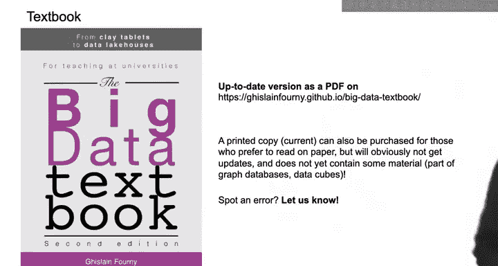
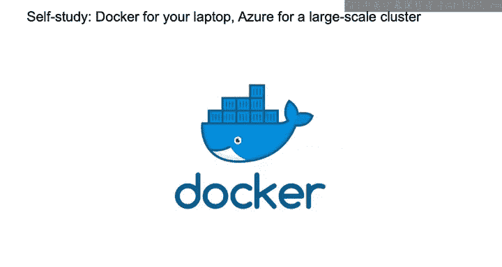
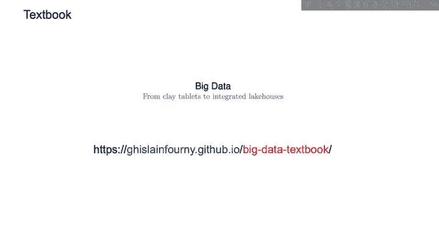
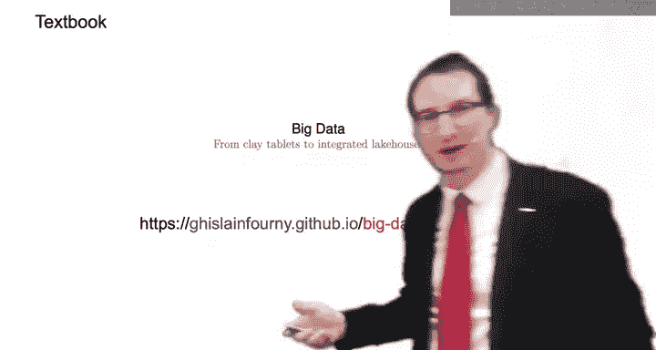
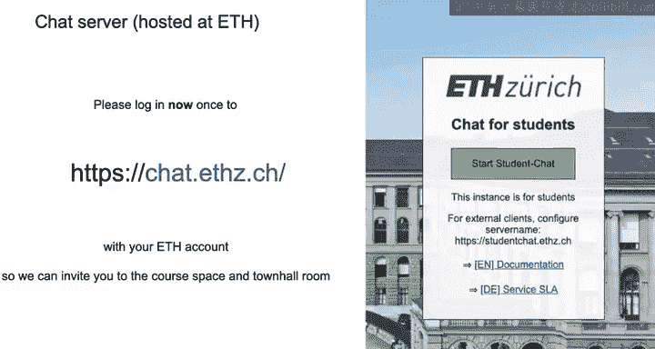
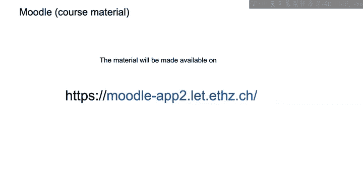
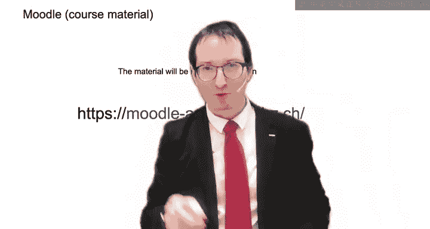
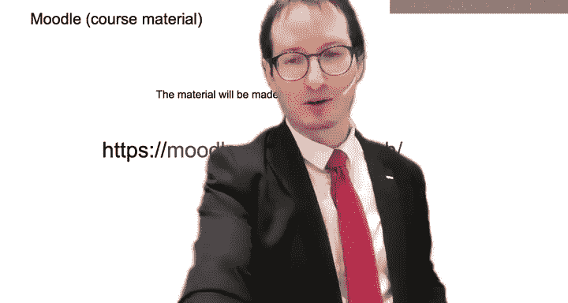

# 苏黎世联邦理工《大数据｜Big Data - ETH Zurich - Fall 2024》中英字幕（deepseek - P2：-02-1. Introduction (2_2) -.zh_en - GPT中英字幕课程资源 - BV1sHPKeoEJU

Welcome back。The people on Zoom did not actually hear what I was saying so what I was saying is that a couple of years ago when I started the course。

 I didn't find a suitable textbook in the internet that we could use so what I did is I took a few books。

 pointers to chapters of books and so on enormous number of books。😊，And at some points。

 one of the popular requests of the class was can we have a textbook please students like textbooks sits in I see I also love textbooks so what I did is that I went ahead and wrote a textbook for that lecture。

I put it online actually， if you go there， you just download the P and that's it doesn't cost you anything。

 but for the people who like to have it on paper because they prefer to print it and see it。

 I put it on Amazon So this is the second edition that is frozen as of end of August So if you can take it if you prefer the printed the printed copy it's a bit expensive because I put it with color ink so the price of actually printing the color ink is a bit more expensive But anyway you don't have to buy it。

 you can just go there and just download the P and that's it。

 Another good reason for the P is that when you tell me mistakes。

 I just keep updating the P I fixed the mistakes I add the name of the student who tell me a mistake at the end in the acknowledgeknowment section。

 So if you want your name in there then find mistakes and you will keep this version will always be up to date I don't know how to keep a book up to date。

 but I can keep an online book to date。All right， and there will be a few updates it's not complete yet so the graph database is there the first half of the chapter I still have to do the second half the data cubes chapter is not in there yet。

 so I hope I can add it to the online book this semester hopefully all right so this is this is just go to that URL and download the PDF its on the research gates where you put research papers so the research gates network but there's a link from there。

Okay。It has， I think，400， a bit more than 400 pages。 So it's like that thick， if you only。

Next in the exercises， practical exercises we' be using something called Docker。

 who knows what Docker is。Oh， wow， I'm very impressed。 Okay。

 so Docker is basically a way to solve the T A team headache of having to support the installation of the software on different operating systems。

😊，The way we do it is we package the whole software that we need into a Docker Docker file and then you can download the Docker desktop app desktop app on your laptop and just run a simple command and it will create the environment for you so this is what we'll be using。

One of the dockers is actually the exam dockers， the exam Docker。

 it contains all of the data sets of the past exams in a single docker。

 but there will be other dockers created for the exercises that you would use in the exercises If you have any issues now it's been a way since we've been using it so it should work for most of you if you have any issues just let us know we really want to understand the issues left with Docker right at some point I think the Apple Cqu Max had issues。

 but now I think the newer Docker versions they have figured it out so shouldn't be any problems anymore so don't hesitate to let us know well see it might be that we already give you something this week。

 you can already try it out and see if it works on your laptop that gives you a bit of time to get it fixed。

I think we have now this bring your own laptop thing， right？It's a bit。 I'm not a lawyer。

 I don't know these things。 I think technically， the ones who are in the first year of their master have an obligation to have this laptop。

 But I don't think the ones in the second year have it or not。 I not exactly sure。 but in any case。

Even if you the second year， it might be possible if you don't have a laptop to run in run it on EthH。

 there's EthH computer rooms as well， right， Who has a laptop。ho doesn't have a laptop。

OkayIt doesn't seem anybody doesn't have a laptop very good。 So let us know if there's any issue。

 but basically this is the main thing we'll use and everything will be packaged inside。

 It's called Docker as a reference to the containers that you put on the ships you know to transport things worldwide。

呃。I don't know why I did forgot to remove that one because that's I already mentioned so you can just download the textbook right there。

Oh， this。嗯。😊，Please go， you can do it now， go to this page， chat。tthg。ch。

It's an element chat and click on the right on student chat。

 you can log in with your ATH username and password。

 you should normally see at least most of you the room called town Square BDHS 2024。😊。

That's the chat room for the lecture so you can use it you can talk you can share memes I think in the previous years there was a lot of memes on big data shared there so it's fine to do this I know you also have some other server like theres their are Disc servers and so on that the students use that's perfectly fine but we are not on them right so if you want to interact also with the Ts and with us and this is the place to do there's also the Moodle forum so you can also ask questions on the Moodle and the T team will tell you on which channel they guarantee an answer it's going to be either on this chat or in the Mole but you can still use both right。

Okay， so let us know if it doesn't work， it might be that the I had to invite manually 440 people。

 so it might be that some of them didn't go through。

 so just check if it works for you and let us know if it doesn't。Okay by the way。

 since I see activity in the chat， I should tell you that you can always ask questions and interrupt me because it's a lecture right you're learning so you can ask questions there is no such thing as a stupid question and you can also do so on zoom so if you type a question in the zoom chat we have Zika here who is the headT and he will interrupt me on your behalf and read the question to me and then I can answer the question right so it's supposed to be interactive not just for the people who are in the lecture hall you can just raise your hand like this if you're shy you can also write on zoom but its fine to also raise your hand。

And on Zoom， you can ask you can ask questions if you're watching us on YouTube。

 then send an email to the TA team or write to the to the Moodle forum。

By the way I don't know if somebody is listening to us right now who's binge watching to the exam so maybe it's January a few weeks before the exam and you're watching the video at double speed through the lecture。

 we are here to help you so send us emails you know look at the Moodle forum but of course I hope most of you still follow the lecture right now during the semester it's so much better for the brain to keep the knowledge if you do it over a longer period。

😊。

U。Okay and finally the material that's nobody there's a link on the Cos catalog。

 all the material is on the Moodle of the course so we can go there。

 you will find the PowerPoint so the PDF of the slides， the exercises。

 the link to Ehel if it's not already there and that's the central point of interaction of the whole lecture。

All right。If click does nothing that's actually coming。

 so I think I'm done with the first stat is there any questions so far？😊，Yes， great。

 Oh we have here this microphone yeah。Okay， does the student chat work for anyone。

 it doesn't for me at least so it doesn't work for you now for whom does it work？

For whom does it not work？😮，Oh well， we'll figure it out So if a few of you could send me an email offline just that I investigate it might have to do with the way I generate the IDs send us email right I'm nowm going to get 200 emails in my mailbox but well try to figure it out right so that all of you can connect。

All right。Any other questions？Okay， on Zoom， course for that。So if there are no questions。

 I' just move on to。

The second part of the lecture。I just have to always stop the recording and then restart the recording on the other side because then it keeps you organized on YouTube so I'm stopping this recording。

