# 苏黎世联邦理工《大数据｜Big Data - ETH Zurich - Fall 2024》中英字幕（deepseek - P30：-30-9. Spark (2_4) -.zh_en - GPT中英字幕课程资源 - BV1sHPKeoEJU

Hello everybody in the lecture hall， hellello everybody on Zoom welcome everybody from the future today we are going to finish this path on back well maybe finish maybe not finish we'll see how far we go into the data frames。

And we were left with the restaurant menu right so I told you that unlike much produced where you just have a an enormous of possible transformation and so on and so on。

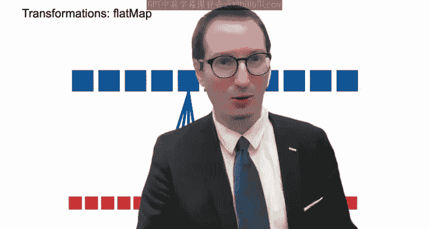

And so I left you with this one called the Fl mapap。

 which actually is the one that corresponds to map Red because this is just like map Reduce that every input value is mapped to zero one or more values in there。

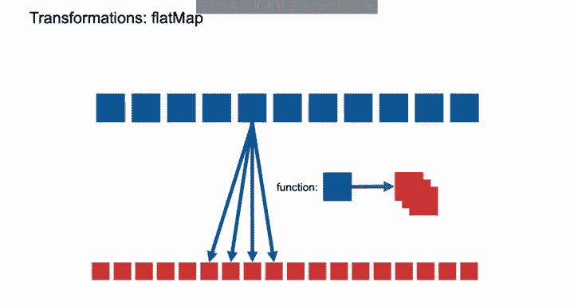

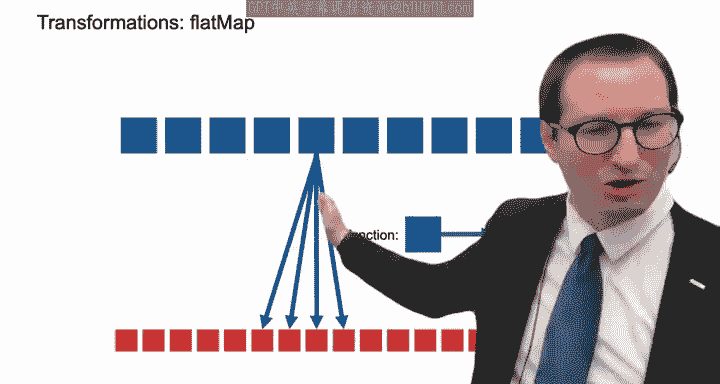

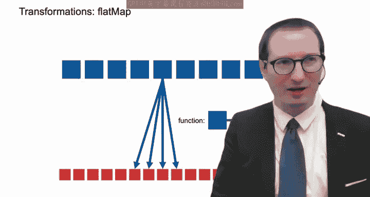

There is one difference though， is that it does need to be a key value in the case of Sp that can actually be just values。

 it doesn't matter what it is would be key values that could be actually whatever you want。

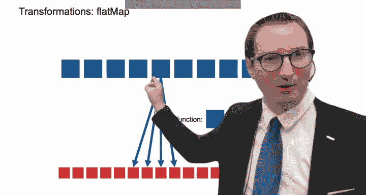

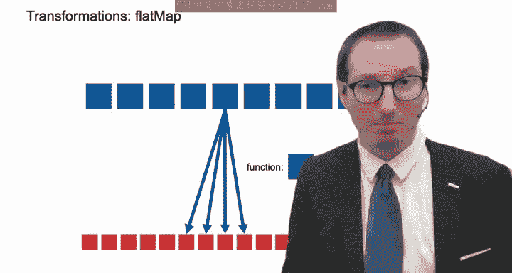

All right， so here's another one， this is a transformation that is called the distinct。

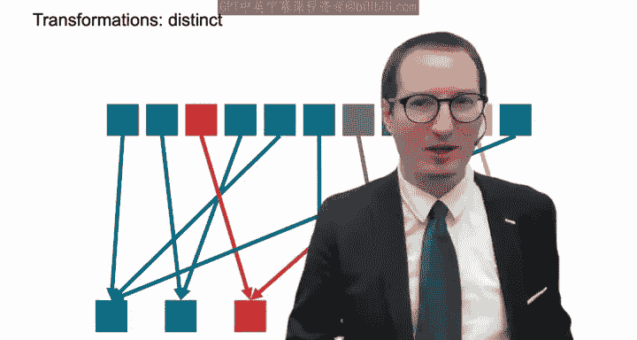

So it's basically comparing for equality all basically compar function that they are the same or not the same and for example here there's multiple blue ones and here you to just one the same for green and so on so this is how it works。

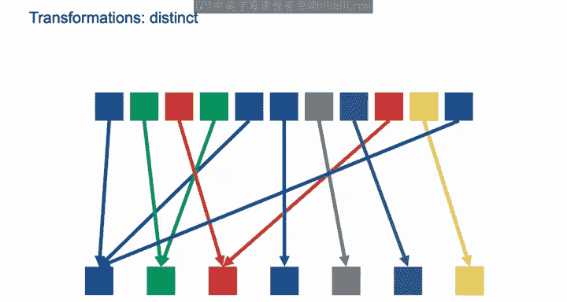

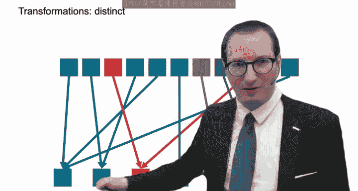

Notice as an observation。

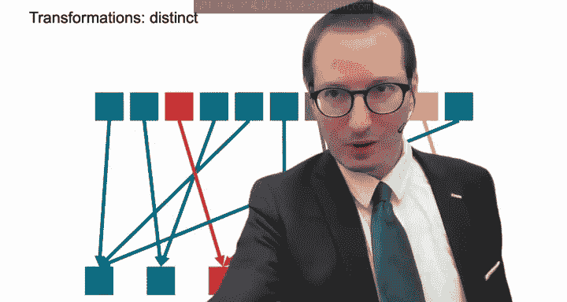

That this looks spaghetti E right so you might guess that there might be some shtling involved and that is actually what is happening。

 so I'll come back to this so notice the。

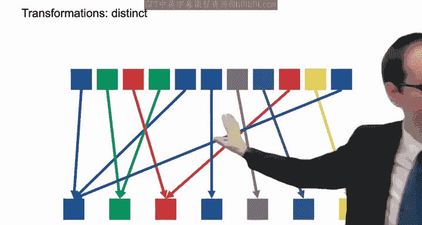

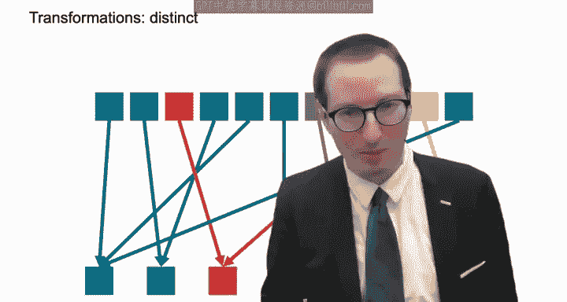

The overall structure here where you have something that will call a narrow dependency right because the values here only depend on very few values there。

 but here it's a wide dependency because you might have dependencies from all over the place right so just as an observation。

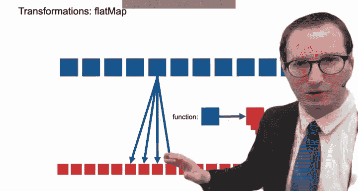

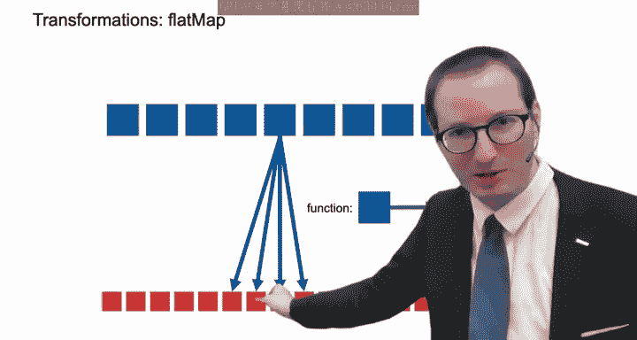

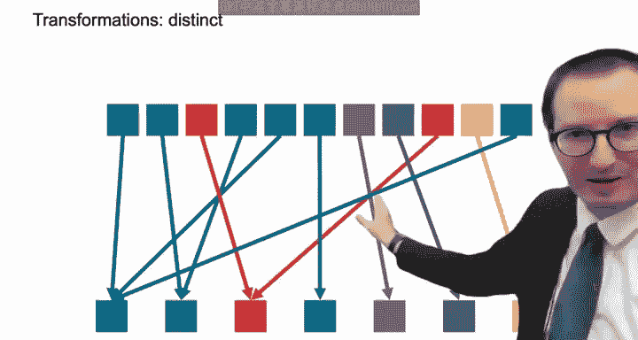

Here's another one that is the center。This one is basically testing economy and accepting or not accepting the link value。

 So it's basically taking your random success and what you can adjust as a parameter is the fraction that you there question when I go far away。

So apparently maybe it is not connected right there。

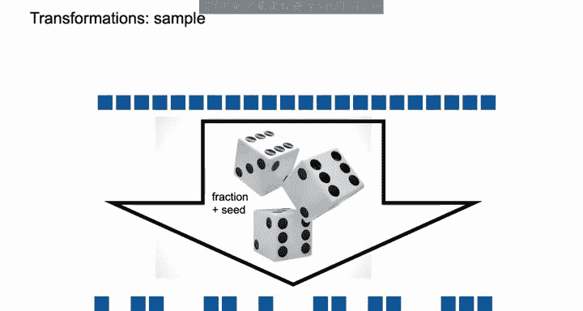

Oh， yes。😮。

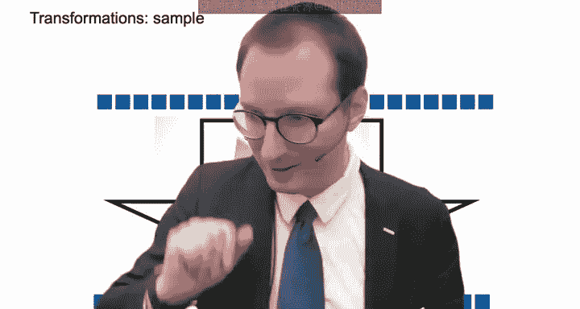

It least just unique。

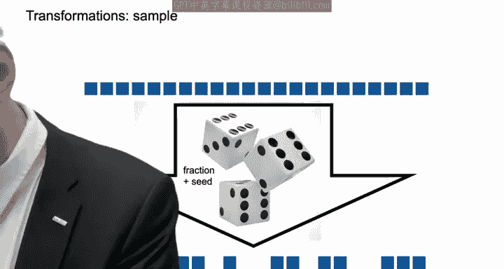

A few seconds。And it should be all sets， such as the audio of the rub that's going on the computer microphone。

So now we。

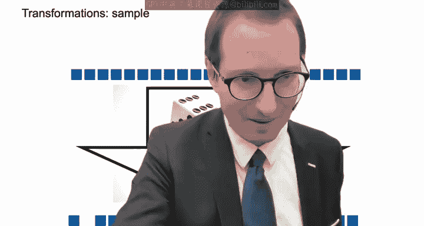

Okay， so now let me go far away from the computer。 Can you seeM on Zoom？I'm very far away。 Okay， yes。

 wonderful。 Thank you。😊，Yeah， let's try that。

I think it's the blackboard lights that shouldn't be activated。

 and maybe the speaker light can be diminished of it。 Is it better。

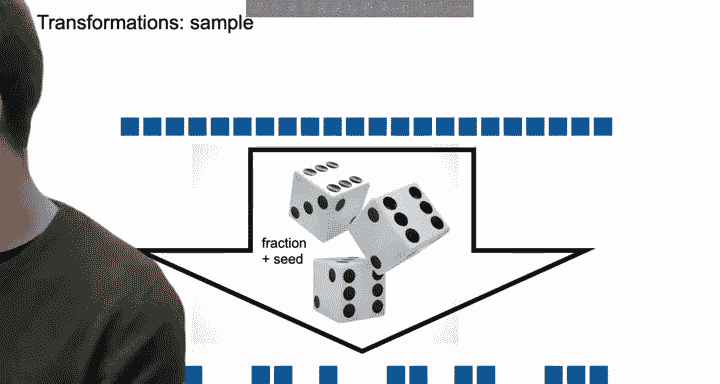

Yeah， all right。Yeah， we are still adjusting with without the green screen。

 So it might take one week or two until we figure it out。Alright， so， yes。

 so you specify the fraction， which is， for example， you keep， I don't know。

10% or 5% of the of the of the values in the input and your outputs that that subset， right。

 Who is left here。😊，Okay， so now you realize there's no spaghetti in there because you basically just toer coin you have a seed。

 by the way， this is how you do pseudo random mess。

 which is randomness that isn't actually random mess， but that looks like it's okay。😊。

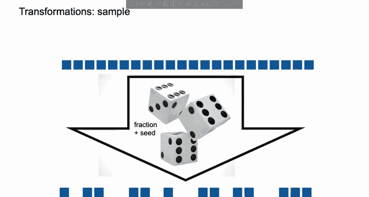

Then we have some transformations that take two Rs instead of just one。

 So now that shouldn't be really a surprise because you know that it's the same in the relational algebra。

 right， you can have pathogengen products of tables， joints of tables and so on。

 So we know that there are algebra operators that take two。

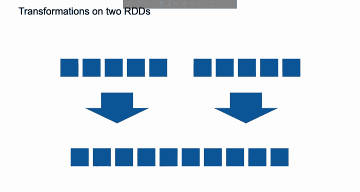

So here's one thats union also it shouldn't surprise you because I already showed you how a selection projection that can be implemented as a map or a flat map。

 the union also exists for taking the union of tables so it can obviously be used for that if the underlying data turns out to be tables basically it takes an RDD and another RDD and concatenates them right as a reminder these are a list of values so the order of the values in an RDD actually matters right it's not just in any order。

Here， then we have。第一。Intersection， except the clicker。

You always need to click here， I think， to activate。

Then we have the intersection that takes two RTDs and it gives you the values that are in both right and then you have the third one these going in three right union intersection and subtraction as are the TP called set operators and subtraction is going to output all the values from the left that are not on the right。

Okay， so this is the。This is the visual， we have a question。Yes。Or maybe I would switch it on。

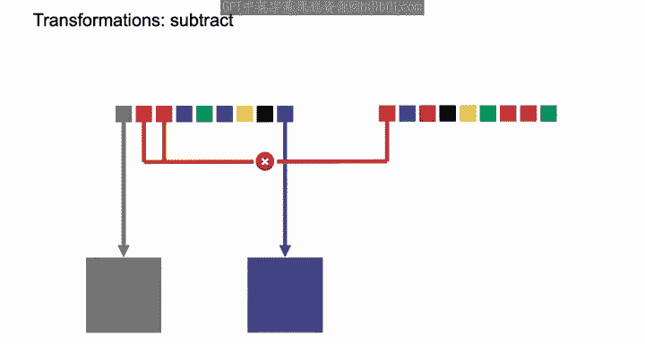

There you go， that should work Okay， yeah， so could you just clarify whether union has set semantics？

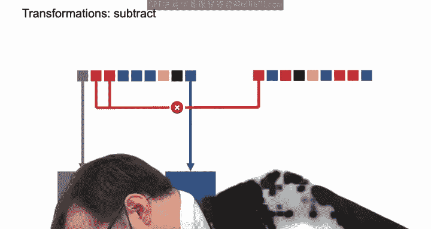

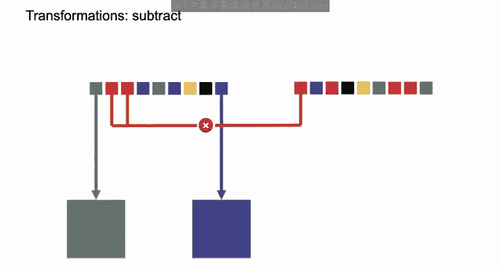

Yeah， set semantics or kind of list semantics。

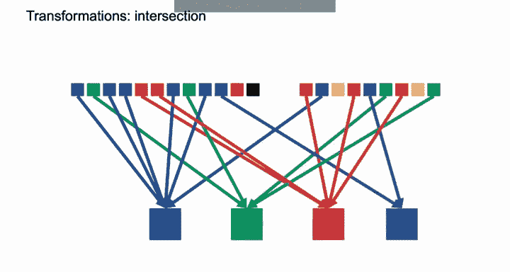

The union， yeah， if I correctly remember， it doesn't eliminate duplicates。 if that's your question。

 If there's the duplicates on both sides， it shouldn't eliminate them。

 that's also something we can mark for a check。 But I think if my memory is correct。

 the reason is that。If you， as an engineer， if I put myself in the shoes of an engineer。

Do you agree that if you don't need to worry about duplicates， you don't need to have any shuffling。

 Yeah， And if you would have on top of that duplicate elimination， you would introduce shuffling。

 So from an engineering perspective， it would be strange that they would introduce duplicates in there。

 knowing that you can anyway use the distinct transformation if you want to eliminate them so you can always。

 always do it。Okay， thanks。 Yeah。 I was just mainly wondering because the intersect diagram kind of。

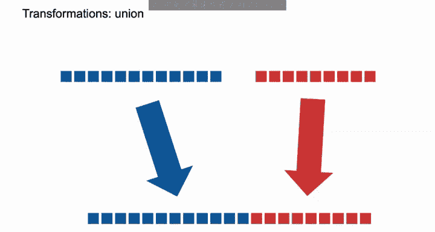

Let's try and avoid Yes， for the intersection。 It is the Yeah， absolutely yeah。

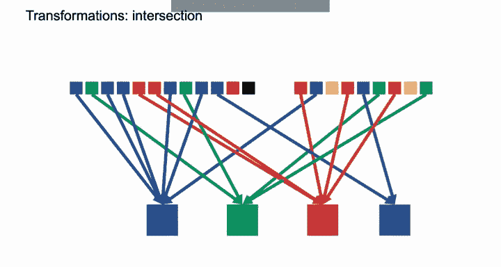

Okay。

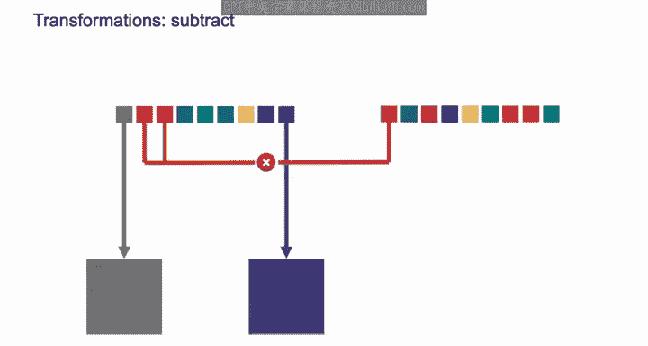

And then subtraction right so you see that you do need you might need shuffling for these two。

 but not for the union。

Then we have the catian product， so the catian product。😊。

Is the basically building all the pairs with one value of the left coming from here and one value from the right that actually put on top。

 But you understood me and you basically take all the combinations。

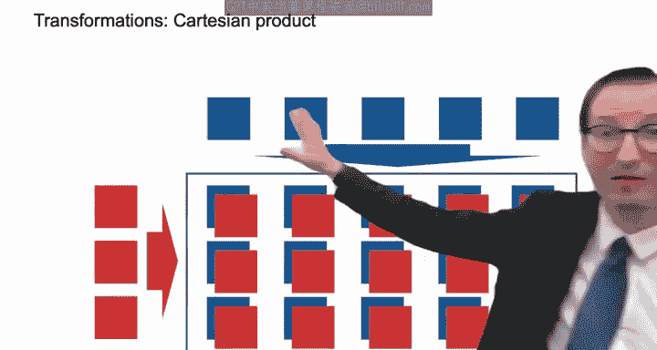

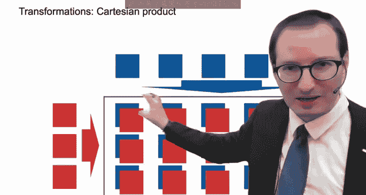

You know that this is dangerous， right， Imagine that the RDD on the left has a million values and the RDD on the right has a billion values。

 then you are basically left with a quadriion values in the end right so for this reason by default Sp is not allowing you to do that you have actually a parameter and the command line in the configuration that you need to explicitly activates to be allowed to do a captgen product right so for your own protection basically so just something to be aware of be extremely extremely careful with with this thing this is how you crash a cluster of of machines。

😊，All right。

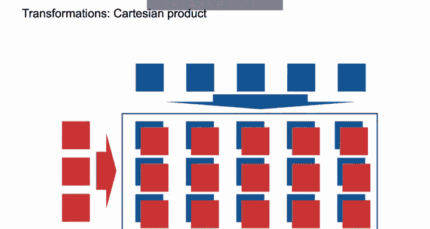

Okay， so these were a few transformations that act on videos。 And then we have actions。

 So remember that the actions do not transform an RD into another RD Instead。

 they take an RD and then do something with it。 that something can be printing on screen can be outputting to a GFS and so on and so on。

 But let's be a bit more specific。When I say printing on screen， what I really mean is。

You can collect an RDD， which is spread over a cluster。To a python list。Look at on your machine。

Right so then you would tell me that's the identity function right and indeed this is the identity function。

 it takes a collection of values， that outputs a collection of values what changes is where the values are before that they are in the data center all of other the machines and after you have called collect they are on your laptop on your clients as aython as a Python lease。

😊，The name for that that you should add to your collection of verbs like together with PA the and so on is materialization。

 materialization， when you take data that is all over a cluster and you put it all at the same place。

😊，On a single machine， it can be seen as a form of materialization。

 right There's other forms of materialization that I speak about， but this is basically it。Now。

 as a direct of salvation。That is obviously only going to work。

If the number of values that you have in your RDD is small enough that you can actually make it fit in the sorry in the local computer right that only works if the RDD is small enough。

 so you would only actually do this if you know because you are the one writing the query。

 you are the one writing the job， so if you do that if you have the knowledge that this is small enough based on the previous transformations that you've been doing right。

Okay， so again， the identity function， but it collects all the values as a local Python list or Java Java list。

 depending on your host language， you have another question， yes。😊，If it does not fit on a machine。

 is spark smart enough to say I will not allow it or will it just crash。I think it would crash。

 The reason is that you you。You could basically， if I think like an engineer。

 if you want to be careful and avoid a fresh， what you would do。Is do account。

 maybe to know how many values you have and based on the account， decide if you collect or not。

But I think that this， you should do explicitly if you want to do it。

 I don't think that Sp is going to do the accounts and then tell you no I can't do it if the account is too large。

Because it's the decision of the user basically to do that or not。

 also if you had to do accounts every time you collect that would make the collect slower because then if you know that it's not enough and you collect it it still counts before that you're losing resources right that's the idea。

Does he answer your question？All right。呃。Okay， speakingking of count， this is the count action。

 This one is totally harmless。 This one you can do absolutely without thinking too much。

 it's just counting the number of values all over other cluster stuff As you can imagine the way it does that is that it counts the number of values on every machine and then you only ship the numbers one number for every machine and then you add all of the numbers right that's how you that's how you do accounts。

😊，Okay。Okay， so if you want to be careful， you could use accounts。 and then if the else。

 and if the count is smaller than a specific value， then you can proceed with the collect。😊。

But I think that's the next one that is， oh， not， not immediately。

So here's another action which is counts by video。😊。

This one is going to outputs if you're using Python。Addict to a map。So it's basically going to。

Count the number of values of each sort right， So for example。

 it might see that there are 12 blue squares for yellow squares and six green squares。

 And then what you get is a map that associates blue with 12 yellow with four and green with6 right a Python di if you're in Python。

Okay， but whom is that here？Very good。 and that's also an action， right。

 What gets out of it is really a local d that's not an RD。😊。

Then that was the one that I was waiting earlier。Take is like collect， but it puts a cap。

 So if you take if you say take for， it doesn't matter how large the RD is。

 you just take the first four。 Okay， so so in that case。

 that would be the ones that are the the it there's an order right， So it's the first four。

 And then that's what you get again， as a local Python list or a Java a Java list， right。

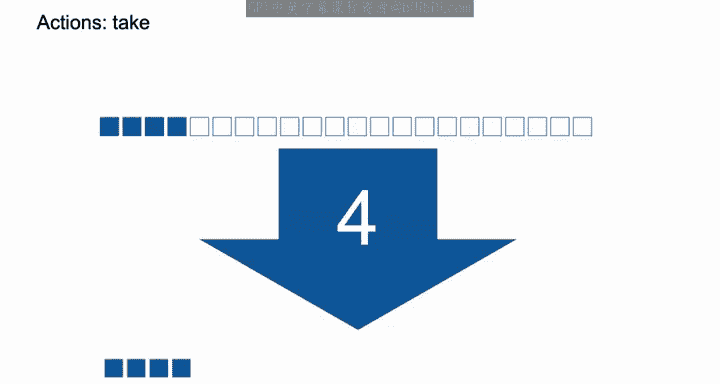

Then there's the opposite one， which is called top。😊。

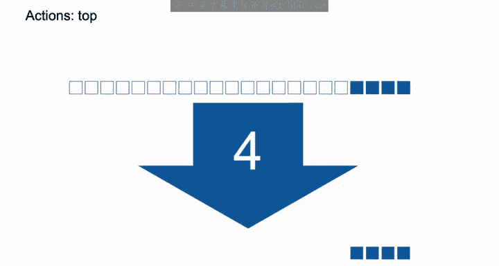

Wwhich takes the last ones why top because think of a stack if you think of it of a stack that's basically the top of the stack that's probably where it comes from and then you would also get as the local as a local list then the last of course if you don't like four you can use another number right so they go together so collect gives you everything take the first ones and top the last ones。

😊。

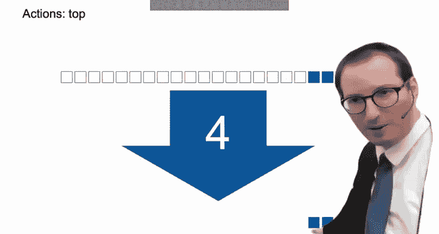

Then we have take sample， which is actually the same principle as sample。

 But the difference is that sample would give you the results as an RD。

 Take sample would give you the results as a local list。 That's again， the the difference， right。

 It materializes the list locally on your machine。

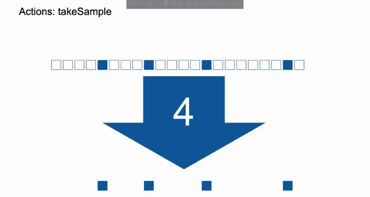

Here's another one called Reduce。 that starts to be interesting。

 Now we start connecting things with mapreduce。😊，Do we have a question？

Is for a default value that we can change。

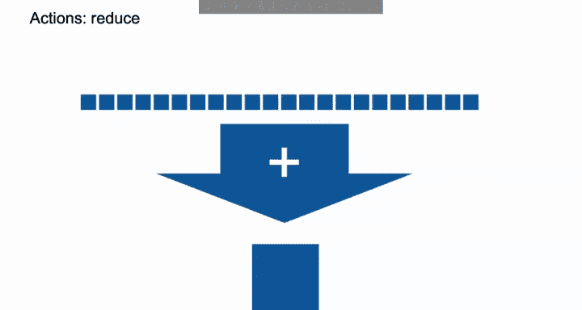

Yes， this number here is a parameter of of the methods right take temperance on so you can absolutely choose how many you want and control that。

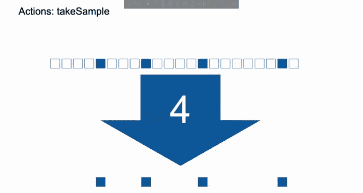

Then we have Red， which is basically taking a binary operator that IDD should be associative and commutative。

And I think it even lets you supply a neutral element。 So here you would say plus。

 and you would inform Sp that the neutral element is 0， right， If you use a multiply。

 then you would say the neutral element is one and so on。 if you use max。

 Do you know the neutral element or a max。Minus infinity right and forming it's plus infinity So basically what if it's as sosociative and commut plus you have the neutral elements。

 then that easily distributes on all the machines you basically aggregate the part that you have on every machine you aggregated using this operator then you ship over the intermediate results for example。

 to the client and then you again use the same operation between them to aggregate so you can see it very nicely Pahaizes。

😊，Why do we need the neutral element？ That is for the case that a part might be empty。

If you have on a machine， there's nothing， you still need to send the results in a way that is correct。

 and then you would send the neutral elements of this operator and the user has to supply it for this reason。

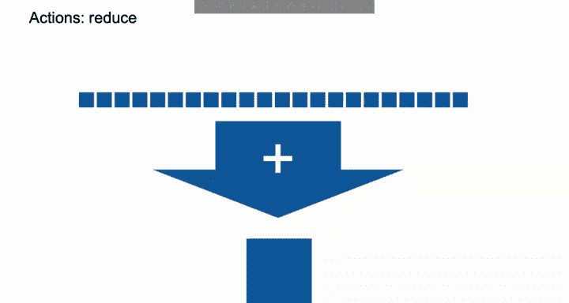

Okay， everybody with me So far。 Okay， so I'm just going through the menu right now， actually。

 technically。Now。Again， I told you， so RDD can be RDDs or anything。

 It doesn't need to be K value U pairs， but it can be K value U pairs。 And in fact。

 there are specific transformations that are made for pair RDD， so。Are the needs of key basises？

So here is an example if you have an input out idea of key values。

 it means that the values are in fact， key values。😊。

Then there is a transformation called key that is that outputting an RDD that just has the keys and the values are just no longer there right just the keys and the other one is values right you just output the values that came from the input RD okay so these are two more in your toolbox then we have reduce by key。

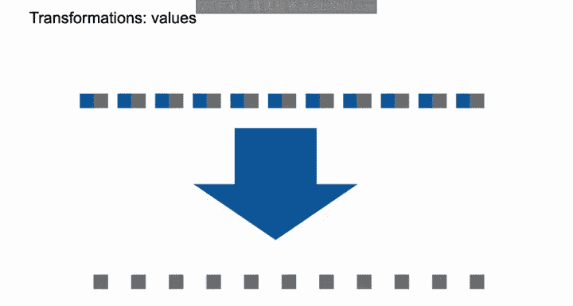

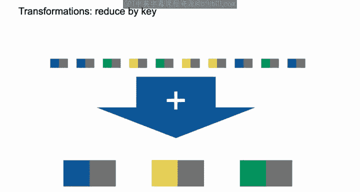

That is technically similar to this one here， except that this one uses it on the whole RDD thats the entire RD to just one value。

 but in that case you do it by key， meaning that you take all of the key values the key values that have a yellow key for example and then you do plus plus plus plus plus with all the values associated with that key right so this is you would get here there's three keys blue。

 yellow and green and the values associated with these three keys would be obtained via the binary operator for whom is that here。

😊。

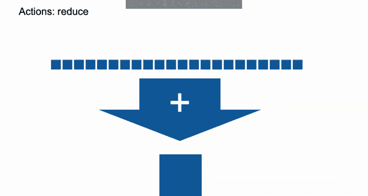

Who agrees that this is the real red coming from battery use？Okay， very good。

 So this is the one you would use it。 So you use a flat map and a reduce by key technically。Okay。

 here's another one， good by key。嗯。Group by key is basically the same thing as reduced by key。

 except that it doesn't aggregate anything。 Instead， it's just going to take all of the values。

 for example， this one， this one and this one， and it's going to put them in a list and the list of those would be the value associated with the key。

 So you nest， there's a nested structure in there， you nest the list inside or an array and associated with the key。

😊。

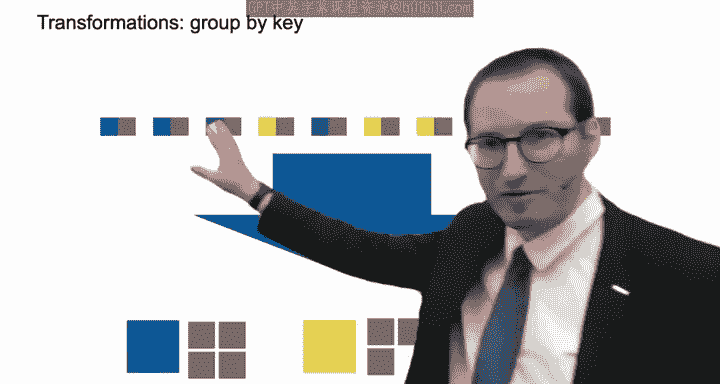

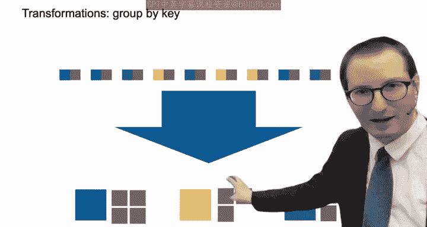

This is something that is typical of no SQL doing that sort of things。 right。

 If you are in SQL and you do a goodbye， you always have to aggregate。But in no SQL。

 since we have so many machines and so on， we actually have the possibility to do that sort of thing。

 and then we just group keep them together， and then you can decide to do mock things or more elaborate things with the arraysin there。

😊，Okay。

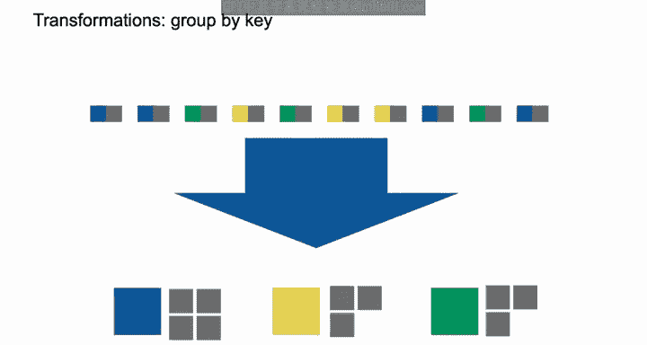

Then there is soft by key that also needs a comparator that tells you if something is larger or smaller than something else or equal and then that is just going to output the same key values。

 but it's going to order them so here。I didn't know where to order colors by。

 so I used the wavelength， so blue and then green and then yellow。

 but is this is idea right in practice it's going to be numbers string in the lexxiographic order。

All right。

By the way。Since I told you for previous transformations。

Do you agree that here you will require shuffling， obviously， I mean。

 this is the reduce the equivalent of reducing mapreuce that requires shuffling。

That also requires shuffling right， you need to bring all of the key values with the same key to the same machine。

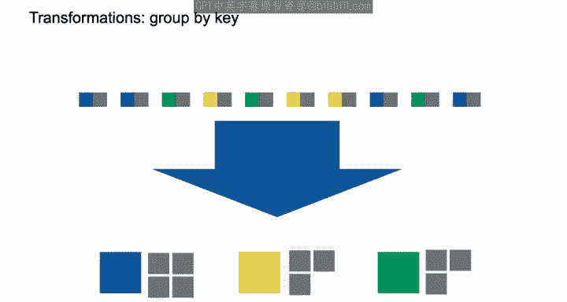

Do you agree that also requires shuffling？If you need to suck。

 you also need to move over the values right？

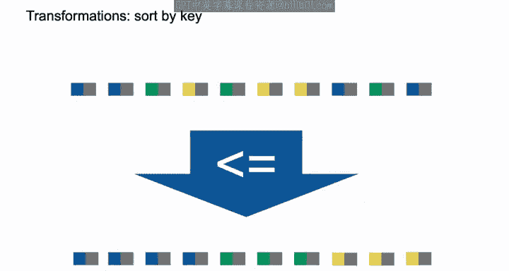

呃。Here's another one， map values。 So you have here a map function。

 But what is going to happen is that the keys is not changed。

 It's only applying the map function to the value。Do we have restrictions on the keys or could we。

 for example， also use an object as a key， I don't know why we would do that， but could we。

I think as far as I recollect from the Java API。IsThat a key and a value can be any object。

 any Java object， It's polymorphic， basically， it can even be polymorphic。

 So if it is any object and we would like to use the sort by key。

 We would just need to supply a sorting function or implement exactly interface for it Yeah。

 exactly in Java I oh I'm mixing the languages， it might be called Comp to。😊，You。

 you know that So basically in Java， you have methods like equals and so on that basically allow you to implement interfaces。

 comparable and so on。 And you just need to make sure that you implement it in such a way that that spark can use that in order to to do the sorting。

 It might be that there's another possibility， which is instead of supplying the comparator as as a method in the in in the class。

 What you can also do is supply a comparator function separately in soft by key。

 So you just add the specification of a function。

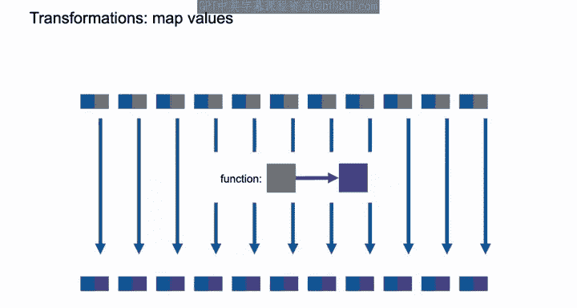

And what you see in practice， because that right really independent。 Sp is one of the products。

 There's many others than Sp。 But these are the two ways to do it， right。

 Either you put it as a method in your class or you supply。

 you supply it separately as an extra parameter。Does it make sense。Right。question my question is。

 the reduced function in map reduce outputs 0，1 or more de pair is the same thing for pair RDDs in reduced function reduced by key？

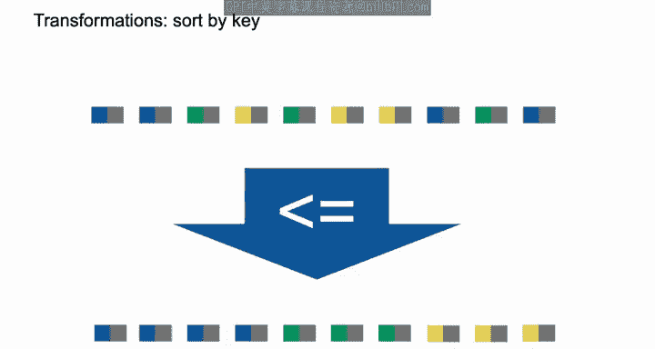

You are right。 Yeah， you are right。 Absutely。 This is correct。 Yes， yes， I didn't realize that。 Yes。

 absolutely。 This would be the case where I actually have only one only one Yeah。

 which is 80% of the cases right。 in general， This is what happens。 But you're absolutely correct。

 in that case indeed， indeed， you So what you would do if you want to emulate the the case of map produce where you can have 0。

1 or more。 what I would do thinking out of the box。😊，Is I would first use this？😊，The。

 the group I key in order to nicely have them group by key。 And then I would use a map。

That that maps each one of the value to whatever key value you want like a flatm function basically so I would use this plus or flatmap that it would be that we can have in the paird like in the final one multiple key value pairs with the same key right exactly you can do whatever value you want the moment you use flatsmap you can do whatever value you want you can output any they' reduced by key function creates a paird which has only unique keys or not yes the reduce by key is going to to do the distinct it's basically outputing exactly one key value for each possible key so the equivalent of the reduced function would be exactly what you said you do first the the group by and then you do the flattening group by key flat map but in the case which happens very often that the reduce function actually only outputs exactly one key value then。

Yeah， that's a very good point I actually didn't realize before， but you're absolutely correct。

 Yeah thank you， thank you。😊。

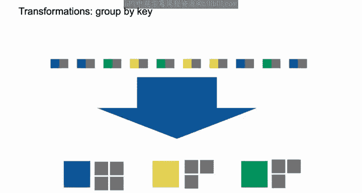

Right， so this is map values that basically is mapping。The， the， the values。You cannot use。

 by the way， that cannot be what you use to implement the reduce function because in that case there would be only one value。

 so it really needs to be the flat the flatmap one。

Then we have join， join is taking two Rs of key values。

 and it's putting together the keys that match。😊，And what it's outputting here is triplets。

 you basically have the key that they have in common。

 then you have the value that comes from the left and the value that comes from the right。

 and that is basically the join。😊，If you think of it。

And you imagine that this actually comes from a relational table and the key are all the primary key columns and the values are all the other columns what you get here when you join two tables would be the joining key or what you join on plus all the columns coming from the left plus all the columns coming from the right right so you basically would basically get the same thing。

But this one requires a bit of thinking， right to kind of make sense of that。

 but does it make sense to you， the giant？Right。So you see it's very low level， right。

 it requires some work in Java or in Python to actually program all of that we'll see in coming weeks that query languages are a better idea。

😊，But still， it's very useful for data engineering。Stractrack bakingkey is another one。

Oh， something I would like to say also， it might be that there's multiple occurrences of the keys here and there because duplicates are fine if you have an RD of key value pairs。

 you can absolutely have duplicate keys that's absolutely not forbidden and it's the same in mapreduce in Ma produceduce you can have collections of key value pairs there is absolutely no restriction that the keys must be different right for maximum flexibility and if there's multiple keys that are the same like I think this one and this one are the same key and they are match with this one then you just get two evalue as in the output。

Then we have subtract by key， so subtract by key is basically going to output everything except if the key is there。

 so for example， the orange one doesn't get output and the blue one also doesn't because it's there so you only output this one okay。

So the subtract by key， does it even look at the values because the way you just explain makes it seem to me like it only looks at the keys。

 it only looks at only looks at the keys。 Okay， I might not have paid attention to the currents。

 I put for the values， but that it really looks at the keys。 Okay， yeah， thanks。

Thank you。😊，Then there is count by key。呃。Wwhich is similar to the one we had before I think was's called come by value value so basically it is when ignores the values and just sorts as counts the number of times you have the blue key for example six times the green key just once and the yellow key is four times count by key look at or lookup is actually quite easy just it takes a key and it finds the value that is associated with the key right。

I could imagine that there can be multiple of them， of course， then you get all of them right。

 so lookup is also good。😊，Do you agree， This one doesn't require a shuffling， right。

 Just look on every machine。 If you don't find anything， you don't output anything。

 if you find something， then you output it。

Okay。That is not the entire least， there's a whole list of transformations and actions that you can use。

The good news。Is that it it's documented。The bad news is that it's documented as Java Do。

 so you don't really have a page that would have very nice stables。

 maybe in the already book you might have that in the Spbook。

But you really have to look at the Java dooc， you basically need to go to the RDD class or Java RDD in Java or the ScalA documentation and you see the methods so the transformations are just methods in the RDD class。

 so I think it would be nice at some point if they would actually write a more valuable documentation。

 but until now this is how it is。Okay， and that's probably1 hundreds。

 maybe even more than1 hundred of them。So yeah， that's basically the logical partss of sparks。

 so every week I'm basically explaining you the logic， the logical level of things。😊。

And then as I do every time， I'm now showing you the physical implementation Okay。

 so how it's actually implemented。😊，I also have good news is that since already how mapRuce is working。

 that should be easier to understand now because that's pretty much going to be reusing a lot of the things we did in mapRuce。

😊。

So now I'm going to repeat something I've already told you。

 which is that sometimes for some of the transformations。

 the dependencies to produce an output value are called narrow dependencies because the output value only depends on one input value。

 that's called the narrow dependency。Do you see that if this is the case。

 and I don't see any spaghetti in there， you can nicely paralyzeise。

That's exactly the same as the map function in map produce。

 We can parallelize the map function for exactly the same reason， right。

I'm going to reduce the same well task， so that gives a task one， task two， task three task four。

 which are basically the to do of calling the transformation locally so far the map transformation。

 you basically invoke the map function on every input item or the filter transformation you invoke the predicate if it's true you forward it if it's false you don't and so on。

 so the task is going to depend on the transformation you use， but if it's a narrow dependency。

 then you can implement this task by just iterating over the values in them。

嗯。Now that's also the same as not reduced the idea if we read from HGFS， of course。

 that could also be S3 other places， but if we read from AGFS。

We are going to try to do it in such a way that to task if it's the first time and you're reading from HGFS that it matches an HGFS block。

That means that the partitions of the initial RDD， when you create an RDD from a ph on HGFS。

 that's going to be an HGFS block， 128 mebytes， then you cut in another then you cut in another block。

 then you cut in another block。

With again， the same consideration that when you do the cut。

 you might need to do a bit of more reading more bits from the next blocks because it really has to stop between two values you can just just cut it a bit by bit that doesn't work。

All right， so you really have to think in the order of magnitude that you're basically processing 100 megabytes on every one of them。

嗯。No。When I showed you all of these transformations。Since it was the logical level。

 I didn't put any dashed lines or anything， we just looked at the entire billion of values in an L and visualized them right so on the logical layer that's how you would see it as is all shown on top but on the physical layer that's actually going to happen in parallelette on the machine so now I just read did the same thing I did here but now nicely displaying that this is on the machine here。

 not our machine here， not our machine here not our machine here。

 but you see that this here is the physical implementation of the transformation。😊。

We agree。😊，Very good。

So now。If we go an extra step， because here that was with one task per machine。

But you remember in mapre that the number of the map tasks was higher that than the number of map slots。

 right， and every map slots would actually， every map slot could take care of several tasks。

 This is the same thing here。 Imagine we have 11 partitions， So 11 tasks。

 And we have four machines that called the executors， the machines in stock。 So four executors。

For 11 tasks， what's going to happen is exactly the same thing as in map produce。 Basically。

 they all start with one test each， and the other tasks are in the queue。

And whenever an executor is done， then they take another task， if it's directly reading from HGFS。

 they are going to try to find the tasks so that the input is on the same machine right but just takes on the next task and then so this is dynamic it's not decided in advance。

 It's whoever finishes first is going to do more tasks and whoever is slower is going to get less tasks Who is that clear。

😊。

Very good。Now。When mock being here。

In fact， when I stay executor， it doesn't have to be a machine that can be multiple executors per machine。

 In fact， the executors are ya containers。😊，So you can now connect it with yeah。

 so every container gives you an executor。You might remember that the young containers can have multiple calls right。

 which let's say you have two core and 10 gigabytes of memory， what that means is you have a process。

 this is a process。

The process is allocated， let's say， 10 gigabytes of memory。

 but you know that the process can run on multiple cars。

And that means that this is a thread and this is another thread right but these two threads are in the same process and they use the same memory。

 so it means that there is some flexibility here， it might be this uses a lot of memory and this uses a bit less of memory right so because they are sharing the memory。

😊，And in fact， the parallellateism is basically happening across the course rather than the executors。

 or whom does that make sense？

は， okay。Now again I hear mean virtual course， we take highread into account so you actually get twice as many slots as the number of physical calls in practice yes is there a difference between slots and cores。

诶。Not really， so slot is basically just the generic term that I give to the logical model of Sp and map produceuce in the sense that a slot is execute task sequentially。

 but that's why I call it a slot。I would say that the core is the physical hardware that allows you to implement the slots basically that's what I would say。

 but yes they map one to1 right so one slot corresponds to when the actual call right okay。

When we have these multiple cores and for example， a container with two cores like in this example。

 then the executor is the container， not a slot with the core， right？Exactly。

 so the the ya container is the executor。 it's all of this is a ya container。

 all of this is a ya container right and it has multiple stretch。

 So it runs in Pahalel on that core and in Pahalel on that core， but this is in Pahalel here。

 So this is why this is a slot and this is a slot。😊。

You cannot say that this is a slot because a slot is sequential。

 but here it's not sequential because it has multiple threats， right， So that's that's the reason。

嗯。Any other questions？Over here， all right。Like it's becoming advanced here。

 We're really looking at the what what happens behind the scenes。

Now， let's then go to something more complicated。And that we don't have in my produce。嗯。In spa。

 you might have a general directed de graph， so you might have a lot of transformations chain one after the other。

 so imagine that I have these three transformations in here that's the logical level。

 there's RDD1 turn into RDD2 turn into RDD3 turn into RDD4。😊。

Now。How do you implement that？ Well， that's the naive way of implementing it。

 which is just to just iterate what we've seen before。

 meaning that the first RDD is going to to do it in Pahale like this。

Then there might be some shuffling， and then。The second transformation is again。

 implemented in Pahaleon some other machines， thus there might be other shuffling again。

Then it's again， implemented in Pali。 That would be the naive way of doing that。

But now， let's further assume that all these transformations here。😊。

Are narrow dependency transformations， meaning they don't have any spaghetti。

 And just like shown here， it's just straight lines that go from the top to the bottom， right so。

Who agrees that this is inefficient。Okay， how can I improve that？Yes。😊，baby。😔。

As long as you still have narrow dependencies， just execute all transformations sequentially on in one slot until it's done before you move to the next task。

Like this。😊，Yes， yeah exactly that's the solution so you basically don't sh anything stays on the same machine and and even in the same slot and that means so this is new because again we didn't have that in map is that in the same slot and in fact in the same task you can actually execute multiple transformations at the same time right so this is this is new。

But there is a subtlety in here， there is a subtlety because normally this is an LD。

This is another RDD。This is an other RDD and this is an other RDD right so naively you could think。

 okay， is there a synchronization here in the way that this is computed？😊。

And the answer is no， there is not even， there is not even a synchronization。 We actually don't care。

 The two things we care about is the input right here。

And the output right there， this， in fact。It's only a logical thing that we say that there's all these intermediate values and so on。

 that's only logical， but these RDD， in fact， never even exist in the clusterster。

At no point in time， do you have these values at the same time on all machines that doesn't exist。

You have to think of it physically what happens in the slot， in the virtual core， what happens？

Is that， let's say you have a map， a filter， and a flat map。

What's going to happen is that the CPU so the CPU core is taking a value a value。

 it's calling the map function on that value， getting some value and that's probably going to be in a CPU register somewhere maybe not even in memory I mean depending where you are then you call again the filter function on it。

 get another intermediate value and then you output because it's a flatm01 or more here。

What is important is that that is what you keep。

That you keep because you need to maybe shuffle somewhere else。 But this you immediately forget。

These here are just now intermediate results in your sequence of map Fi or flatmap。

 and then you drop them you only keep this one。

And then it's sequential， you go to the next one map， filter， flat map， drop this and then do it。

 So you see that when you do this， there is absolutely no synchronization。 In fact。

 even these three never exist at the same time because when you are here。

 you already forgot about this one because you only kept that fast for whom is that here。😊。

Allright， so another way of seeing this。

Is that this RDD。And these RD are never materialized。

They only exist in the beautiful world of mathematics on the logical level。

 but they have absolutely no physical existence right Only this RDD right here is actually materialized。

😊。

Okay， so this is the this is the trick and this is why it's fast because all of that happens。

 as you said on the on the same slots， same CPU core。

 and you directly go all the way to computes the outputs。😊。

Values。There is a name for that it's called a stage， we call it a stage。

 so a stage is basically made of multiple transformations。So you have to think of it in two ways。

The transformations go down， transformation to this to these to these。

 so you group them into a stage if they have narrow dependencies。

You have to stop as soon as it's shuffled。And then when you take a stage。

 then you cut it vertically to introduce the paraidism across the tasks。😊。

That get on the slides， for whom is that here？All right。

Very good， that was not trivial， right？

So logically， this is what the stage is and if it has a narrow independence。嗯。

Yeah， that's just a repetition of what I just explained。

 so I don't really have anything more to say we've call about that。

And now that means now if I redr my diagram with the slots and the tasks， if you have。

 let's say two transformations， then you have all of these tasks that again go across two transformations like the map in the field and then you have at the beginning。

 one task per slot and then whoever fitishes first test the next task and then those that are faster take more tasks。

Okay so this is how it generalizes to multiple narrow dependency transformations。

Still have still have maybe four minutes， so maybe I can say that quickly。嗯。Now。

 how do you use SP well you can use it from the convenience of your Jupiter notebook， of course。

 then you don't really to need to worry about these things， like on the example， for example。

 you just write in the Jupyter notebook。But when you do it in real life and you actually execute some more complex job。

 you typically build a Java in Java， which is just some codes that you wrote that contains all the transformations that you want to do your entire job。

 there is a command called Sp submit in the shell。😊。

And you just say Spock submit with the jar and it's going to use Sp in order to do it so that could be read on your laptop actually。

 it even works on your laptop from your local drive with all the calls on your laptop That's already very useful。

 but that could also be on the machine machine in the cluster。

 you SS yourself to the machine and then do it on the cluster。

And then you see this dash dash nu executors，42 that is the parameter that decides on the number of containers that you need and they called executors so in that case you say I would like 42 of these so 42 of these executors in that case then you can say and that think of ya I want every container to be allocated two calls to the actual calls and I want every container to be allocated5 gigyte of memory right if you want to know the total number of calls you need to book on Amazon or Asia iss just a multiplication right you say 42 times two gives you 84 calls you need to make sure you have 84 calls。

😊。

嗯。In total across the machines， and the memory is five times 42， which is 210。

 So you need to make sure I have at least 210。 So typically。

 when you are at that point that you're executing your job。😊。

And trying to find out how many machines do you need。

 how big should the machines be and how many executors and how many costs per executor and so on。

You really take a paper and a pencil and you just do some primary school math right trying to multiply how many cars do I have in my cluster how many do I need and so on so it's not trivial to do it it's also something that comes with experience there are a few tricks to find these numbers you can use the three together like this for example if you have 84 calls than in that case three times 42 which is 126 gigabytes in the cluster you need a bit of extra air by the way。

 if you need a few more calls and a bit more memory in the cluster because there's other processes that also need to run so it cannot saturate the number of calls and memory this is the the ID。

This is why I should let you go， because I think it's already approaching。😊，Then just checking the。

Speed。

In here。Of course， of course， of course， of course， just give me one more minute。诶。It one。Y。Okay。

So the first part today might have been boring because I just went to the menu。 The second one。

 maybe more to digest。 But let's see。You。looks about right， okay。So again， there's us。

 there's the TAs， there's me there's the forum and there's also each other right so don't hesitate to explain to each other it's a great exercise to be the teacher for your colleagues。

😊，So we are here for you if there's anything， enjoy the exercise session this afternoon and on Friday and I'll see you next week on Tuesday at 2 pm。

 thank you very much。😊。

