# 苏黎世联邦理工《大数据｜Big Data - ETH Zurich - Fall 2024》中英字幕（deepseek - P31：-31-9. Spark (3_4) -.zh_en - GPT中英字幕课程资源 - BV1sHPKeoEJU

Welcome everybody in the lecture hall， welcome everybody on Zoom， welcome everybody from the future。

😊，2024 and we don't need a green screen anymore so let's get started on Sp actually I will continue what I started last time which was the initial version of Sp with RDDs and then I will take you to data frames them again the same as ponds and the same as those that we've seen as value Jason have the feeling was a it loud but。

So this is where I left you right so we have these narrow dependency transformations。

 So you remember these are the transformations like map filter。

 all of those that don't have any spaghetti in there right that every item in the outputs depends on just one item in the inputs So what is really nice is that we can actually compose several of these transformations。

 but actually the way it happens is that it's a single s right it's done in parallel。

 So here I put two transformations but you see because of the narrow dependencies you can all nicely parallellyze it right So just so you remember what I told you we have these executors that correspond to young containers but they are called executor back And then we have the slots that each correspond to a virtual core might be double the number of calls if you use Iread so we usually imply the virtualral calls and that gives us here four slots and you see that the tasks。

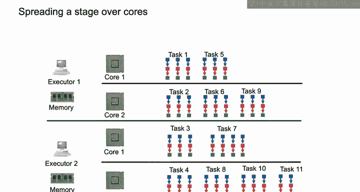

Dynaically assigned meaning that everybody starts with one and whoever is finished first takes the next task task and so on right so this is what what we saw last time then comes the spaghetti right so not all of the transformations are narrow have narrow dependencies。

 Some of the transformations。 a lot of them have these spaghetti in the middle you can think of I don't know。

😊，Interssect or a subtract or a group or reus by you know join and so on and so on so sort all of these transformations basically have this huge spaghetti and of course if this is the way it looks like that doesn't work anymore what need what we need to do then is called。

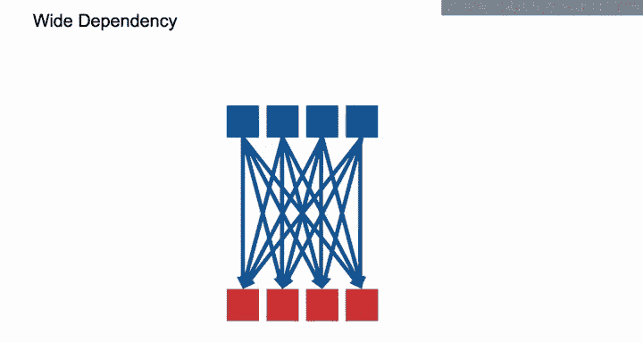

Starts with an S。

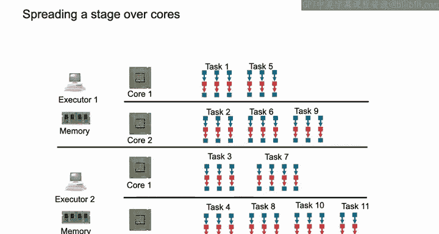

It's called。shhuffling yes exactly we need to shuffle that's exactly what happens。

 we need to shuffle because since we have these white dependencies in here。

 we have to send over the network everything that you need in order to make a calculation what happens is that we create a new stage。

😊。

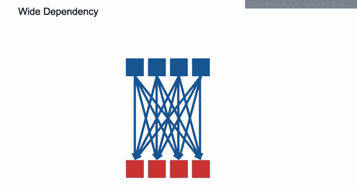

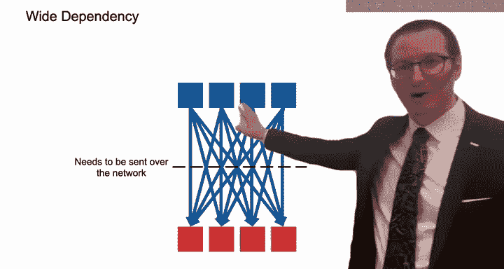

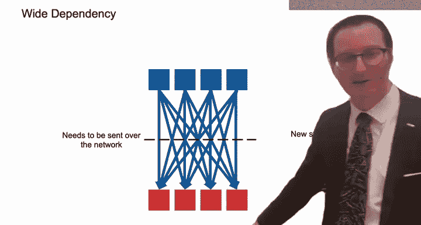

So graphically it means that you have a first stage which might have multiple transformations in there。

 then you shuffle around， then you have another stage in that case just one transformation then you shuffle around and so on what is new compared to mapre is that in mapre there was only one shuffle there was a map transformation you shuffle there is a reduced transformation。

But now we can get plenty of shuffling。 So this is what makes it more universal and more generic than mapre。

 So it used to be with mapreuce that you needed 10 different jobs to execute something like Ma mathification or something or page rank。

 And now with Sp， you can just directly go ahead and have a single job that have plenty of shuffling in there。

 Al right， So this is the general way that that job in Sp looks like。😊。

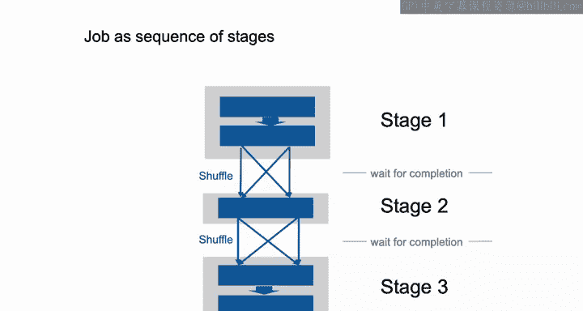

And again， you have to remember that the narrow dependency transformations get grouped together in the same stage。

 there's parallellism here， Shefel parlism， Sheel parlism， for whom is that here。😊。

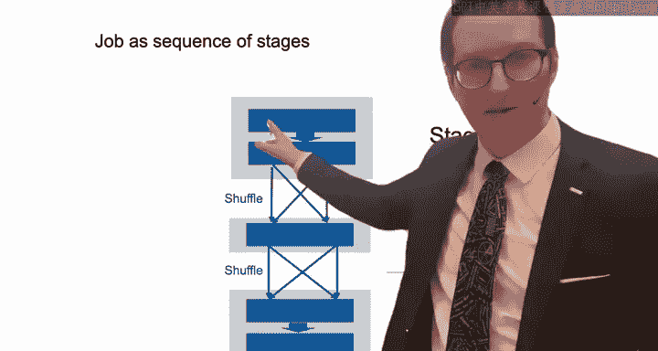

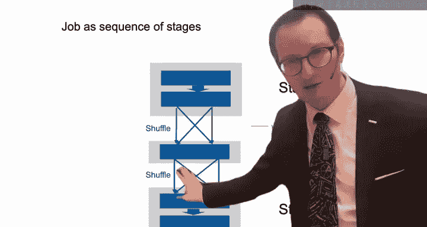

That is the aha of Spk， the way that it works and so typically time eappsses in this way。

 so typically the entire Spk cluster is going to be executing that in parallelel and then it shuffles and then it executes that in parallelette and then it shuffle then it executes that in parallelette right there is something called the Spk scheduler that takes care of orchestrating all of this。

😊。

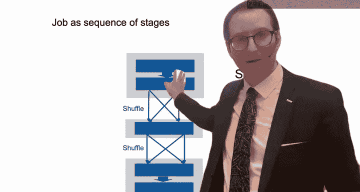

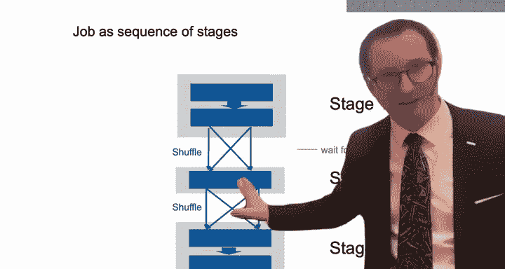

Alright， and then of course you might remember that some transformations might have multiple add as input like Carten products。

 the join， you know all of these， so in that case it means that we might have input coming from multiple places we might have a first stage a second stage and then we take the output of this and the output of this and join it right for example so it means they have the double shuff link here this gets shuffled this gets shuffled then we can compute the join。

😊。

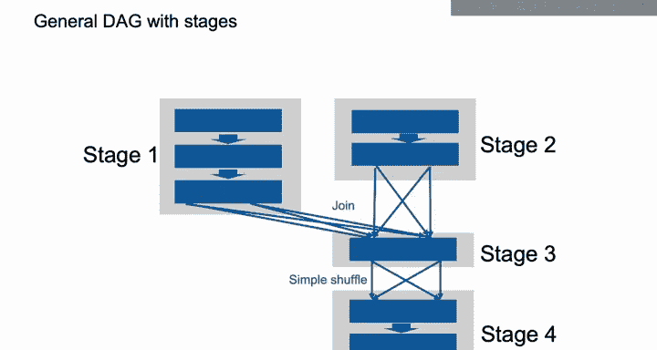

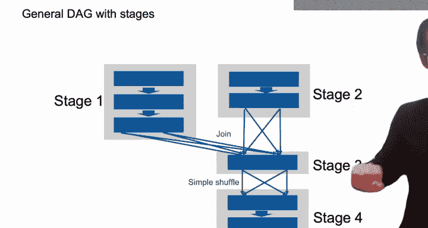

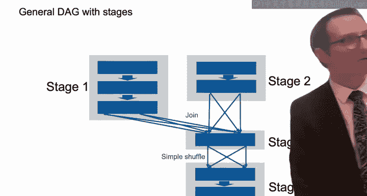

Nevertheless， you could still have a sequential execution in the sense that the whole cluster could do this and then the whole cluster could do that and then the whole cluster does that after the shuffling and so on and so on right you can still have some sequential orchestration in there。

 I could also imagine I actually don't know if SP does that。

 but you could also imagine dividing the cluster into and half of the cluster does that and half of the cluster does that right but I don't know this is actually done in practice because you also have to consider where the data comes from and it might be from all over the data node over other cluster。

😊。

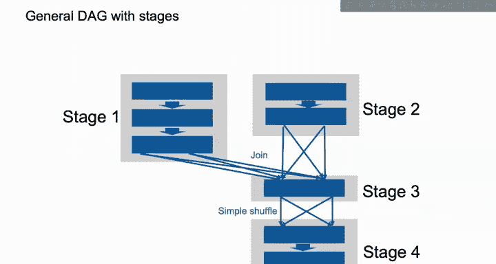

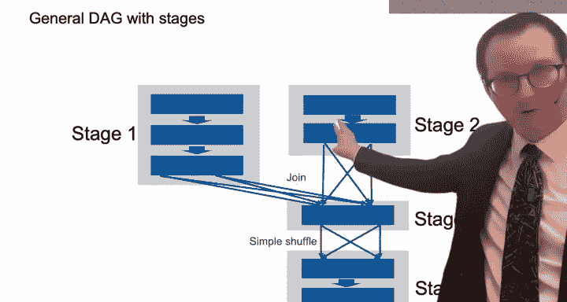

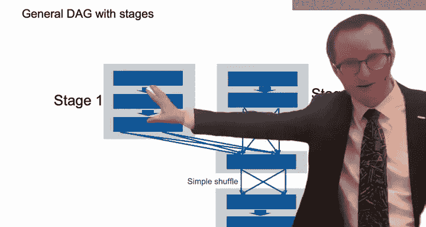

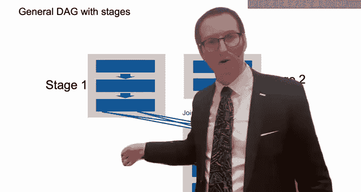

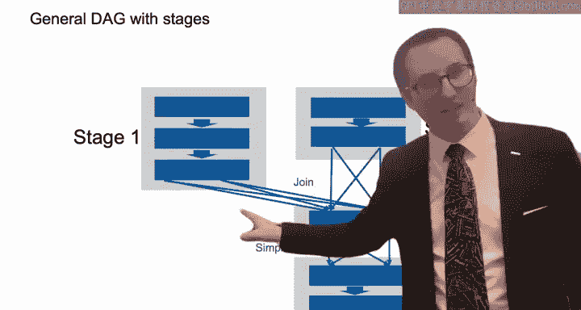

All right， so this is basically a very generic way。

 so this is a layer on top so you have these RDDs and transformations so the the directly directly thecyclic graph。

😊，And what I'm showing you here on that slide， you get by grouping the transformations into stages。

 So this is how you get this one。

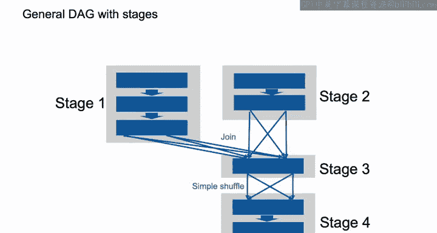

So now you have to， you know at first you get a headache with that because like how do these f things relate like a transformation。

 a stage， a task， a job， and so that that can easily give you a headache。

 especially when people try to understand how transformations and tasks relate。

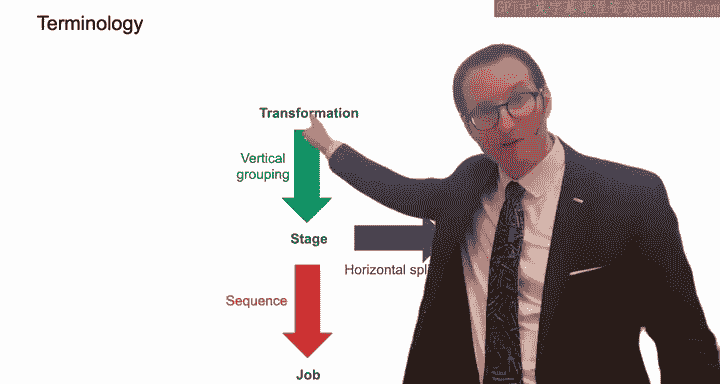

But they don't relate。 You really have to go through the stage to understand how they relate。

 So a stage is basically a vertical grouping of transformations， right， that narrow dependencies。

Then a task is when you take a stage and you split it across the node so like this right so you split the stage the stage but you realize that sinces the stage has multiple transformation there is absolutely no relationship between these two it's like cutting a wedding cake horizontally of vertically right so this is basically how that works and then of course when you have a sequence of stagess so the whole the whole da of RDs then that's the job。

😊。

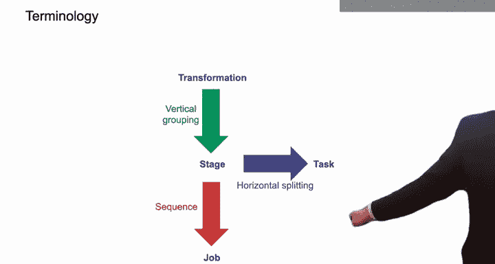

But whom is that fear？All right， very good。So what's very important to understand。

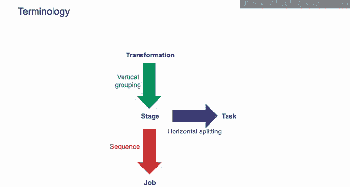

Is that。The two things that are logical。

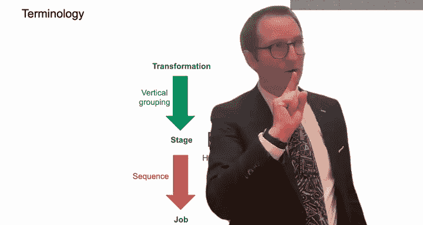

Are the transformations and the job。 That's what the user sees。

 right you you're sitting in front of your Jupyter notebook。

 You write the transformations and you execute your job。 This path here is physical。

 That is something that happens under cluster， but the user doesn't even notice that right the advanced users。

 of course， would know。 and they can adjust and fine tune， but the path in the middle is physical。

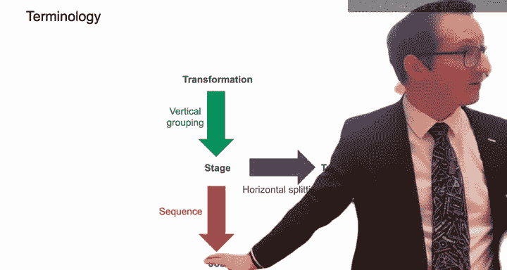

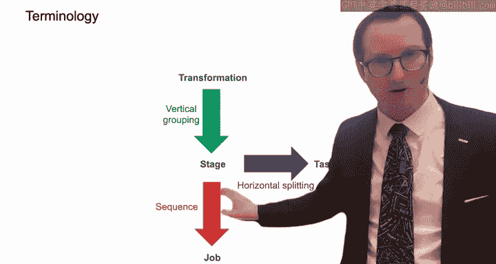

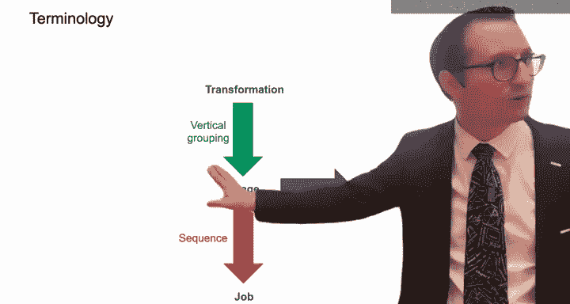

Right。So now I said that the advanced users understand a little bit what's going on because that way they can a little bit adapt their query and try to make it a bit faster。

 so I'm going to give you a few tricks。On this。So here's an example of Dg right so every rectangle in there is an RDD a collection of values that is spread over the cluster and every blue arrow in here is a transformation right and I'm assuming that the one on the top that created with some creation function like red from a GFS or uploaded from a list and then I assume that there's going to be some action in there that that is triggered remember that it's lazyly evaluated it So if I just do this meaning that in Python I would just define transformations。

 nothing happens in the cluster at the moment I called my action on RDD10 say it's the10 then thats trigger the whole computations on the cluster like the whole cluster gets into motion。

😊，And then finally， the results get， for example。Download it to your laptop or reading back to which GFS。

But now imagine that I keep that。 I'm still playing with my notebook and I'm done with that And now I decide to trigger an action over there。

 then it's going to re orchestrate the whole cluster computations and so on again。

 And then I have this third action again， it's going to retri the whole computations in there。

 Do you see anything inefficient in there。😊，second last the。Yes， absolutely。

 You can catch basically all the parts that is over here。 So all of that part is common to the three。

😊。

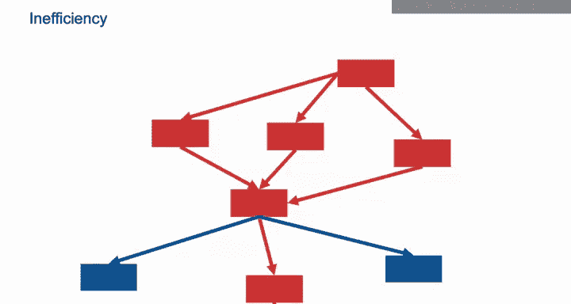

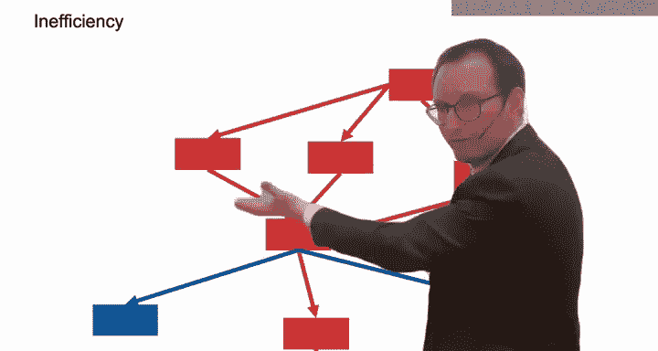

In fact。Pauck will spontaneously do that。 So as long as there's enough memory。

 it will try to hold it in memory unless something else replaces it。 So if there's enough memory。

 it is going to cache。😊，If there is not enough memory and you have more stages that execute more data and at some point the memory is full。

 then it's gonna flush the memory to the disk just like I showed you with Hbase and with mapre so that goes to the disk then it could be reloaded from the disk if you retri it takes a bit more time than from memory。

 but something even works could happen， There's not even enough disk space and then it even needs to be removed from the disk What happens if it's removed from the disk。

 then it gets reexecuted completely and takes a lot of time or whom is that here。😊，Okay。

 and so the idea is that you have a way in as a user。To require explicitly spark to cache something。

 meaning to give it a higher priority in the cache that's called pinning you pin the RDD in there like it's like what you do in U eyes right you press the button and this one is pinned。

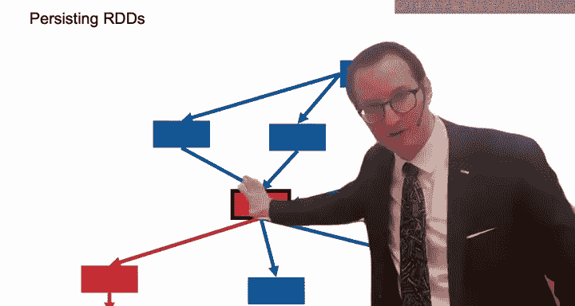

And so that means that it should be a higher priority to keep it in memory。

 you can say if you want to keep it in memory， if you're fine if it's uploaded to the disk。

 you can specify the level of caching that you want。

 that's called pinning and then in that case you have a higher guarantee in case there's computing jobs in the cluster a higher guarantee that it's not going to recompute the RDD This is why it's called resilient distributed data set resilient because even if you lose it from the memory even if you lose it from the disk you can just recompute it all over again so it's resilient。

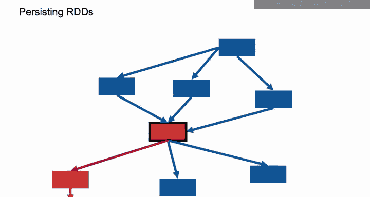

Alright， so this is one thing。 there is another thing that you can optimize a little bit。😊。

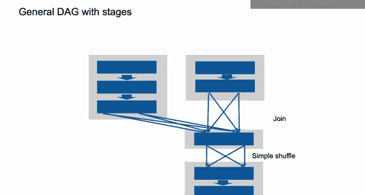

It's that when so of course， you want to keep the shuffling to a minimum So that means that you can look at your tag。

 you can look at the code that you wrote in Python to write all the transformations。

 then you can ask yourself， okay how many how many stages do I have how much shuffling in there can I remove some shuffling So sometimes just by thinking a little bit you can reorganize your codes to have less shuffling you can remove maybe some of the wide dependency transformations to have less of them。

There is another trick is that in some cases， you have a transformation that nobody would require shuffling。

But it doesn't actually require shuffling further data as it is on the cluster。

 can anybody imagine when that could be the case？Yes， maybe we can use the microphone。

Maybe if you want to sort the data and you know that the way that it is stored it is already sorted。

 absolutely， if you already don't know that it is sorted。And you want to sort the data。

 Then there is no shuffling needed， right， It's already sorted。 You don't even need to sort it。

 right， Something in term yet， imagine that the data is not sorted。

 but it is partially sorted in the sense that the the data is organized in partitions。

It's a mess within each partition， so it's not sorted within the partitions。

 but across the partitions it's soed imagine that you have， for example，s。

 English wells with 26 letters。And you group the world in 26 groups。

 depending on the first letter of the world， and then you have the first part with all the worlds with the letter A。

 a second partition with all the world with the letter B。

 and they are already partitioned in that way right so all the worlds with the letter A they are together on some machine。

 the world with the letter C they are together on some other machine。

 but within the machine it's not sorted So all the world started with A they are in any other。

Who sees that this is basically the me sort halfway through？

You see that so basically we have partially sort it what that means is that if that happens if you know the data is already partitioned by the key on which you want to sort。

 then you don't need to shuffle， you can just sort locally within each partition which is much more efficient but without shuffling on the cluster who agrees with that。

😊，Awesome， and the same goes with grouping if you want to do a group by。

 but it turns out that the data is already partitioned in some way compatible with the group by。

 you also don't need any initialling。😊，You just do some local grouping without within every partition the reason you can do that is that you never have a group that goes across parts。

 all of the groups are contained within a partition。And one way to achieve this。Is explicit。

 You can explicitly pre partition。 You have ways in Sp to say。

 I want to part the data in this and this way。 right and then Sp is smart enough to remember that you let it partition in that way and then it's going to detect that it doesn't need to shuffle。

Of course that only applies if the when you want to sort a goodbye。

 it corresponds to what it's partitioned by right if you partition in a way but sort on something different。

 of course， that doesn't work then you need to shuffle。So in that case it's explicit。

 sometimes it's implicit。 for example， if you try to do a group followed by your SA。😊。

Spark might be smart enough if it's the same key。 you group by the same thing that you saw。

 It's a common pattern， even in SQL， you have a group by and an order buy with the same。Yes。

 then that would only require one shuffling because after you have grouped。

 it's already prepartitions in this way and in that case you didn't say explicitly that you want to pre partition but it so happens that you've just done a group by and now you do another by who sees that in that case you don't need to shuffle。

😊，Okay， think about it Otherwise。 That's basically the idea。 So in that case， it would be implic。

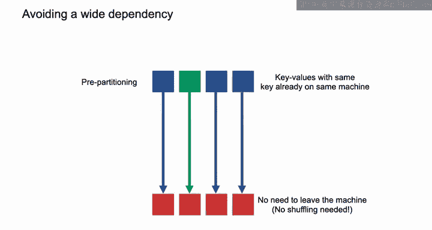

But sm is really a spark is really smartmed with these thing。

 so imagine for example you have a join here and the join key is search that that side is already three caps then that you shuffle and that you'd't need to shuffle it's already on the machines。

😊。

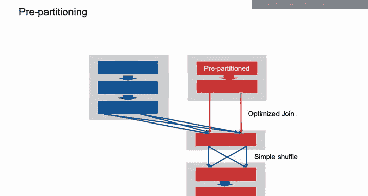

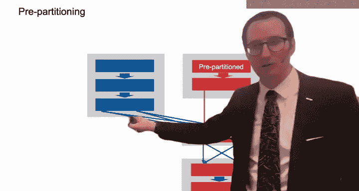

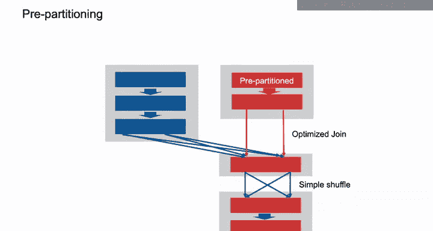

So far so good with the optimization。😊，That's already a bit advanced。

 Many people using Sp do not even understand these things or go that that deep。

 But if you do understand them， it allows you to do even better， even better queries， yes。

One question for the shuffling， is it always all data to every node or is it some kind of， okay。

 I'm going to need this data。It depends。 So let's take a few examples。嗯。😊，Let's take goodbye。

Do you agree that for groupby you don't need to send all the items to every node you just need to send them to V nodes that corresponds to the bucket right so for groupby you just the quantity of data that gets shed these linear it's still quitedra for the communication the machines connect to each other but it's linear in the amount of data now you have other transformations like intersect for example。

 or distinct right so in this case distinct would actually work but there are cases in which the computation is such that you really need to compute an item out of all the items in the input there might be more complex cases where this actually happens and having this in mind of course helps a lot。

Did I answer your question？Awesome， any other question？Before we proceed to the cool bath。

No other questions on Zoom any questions？Nobody seems to be raising the hand on Zoom。All right。

 let's have people on Zoom， all right。😊，So let's move to data frames。So a bit of history。

In the original version of Sp， that didn't exist， there was just Ls。

And then somehow Spark started to get a reputation that it's slow。 It's like XmL。 you know。

 it started to get the reputation that it's complex and Spark started to get a reputation that it's slow。

And so。The idea is that， in some cases。The data。Is such that you can store it in a more optimal way in memory？

And it is such that you can also shuffle less if the data takes less space， right。

 so you can optimize the lit bit。But now， if you think of that， we've already discussed that。

 We've already discussed that a couple of weeks ago in the data modeling lecture。

 where I told you that。There is a specific case in which we can compress the data in memory。

 Do you remember what it was， So， of course， there's a big world on the screen that indicates what I want to say。

 But in what context was that。Imagine I have a collection of Jason objects when。く題をきます。Yes。😊。

When they are homogeneous exactly and probably when they are valid against the same schema。

And the schema is not too exotic， meaning that there is no open object types No。诶。

All the types are concrete and so on right in that case you can indeed compress it and the key part is that we get a data frame so when you have a valid collection a collection of valid J documents against some schema it's not to exotic then you can actually represent it as a data frame what this means concrete is first you can save it as a packet file or some more optimal format it's less space on the disk also less to read from the disk。

But that also applies to Spark， it means that when you have this RDD of JON objects。

 then who sees that the RDD of JON object is going to also take much less space if that JON is valid and we can store it as a data frame。

 who sees that？😊，For example， the adjacent JO keys don't need to be repeated right if it's the same schema everywhere then you don't need to repeat the key you already save half of the space like this right then if everything is an integer then you can save it as a 32 bit or a 64 bit integer right instead of as a string and so on and so on so this is how later in the evolution of slackck they added the data frames to the system。

To account for that case and make it faster in the case that the data you're manipulating is highly structured。

They did not remove the RDs。 The RDDs are still necessary if the data is heterogeneous， right。

 so they are still des。But if the data is structured。

 then we can do better than that and so the way you see that where that comes from from the user's perspective。

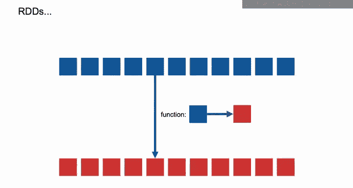

Is that。If you want to query a textile， then of course you get an LD of strings and then you can define your functions。

 remember the Lamda that's the feed transformation function， you deal with strings。

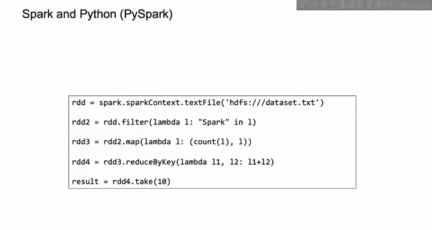

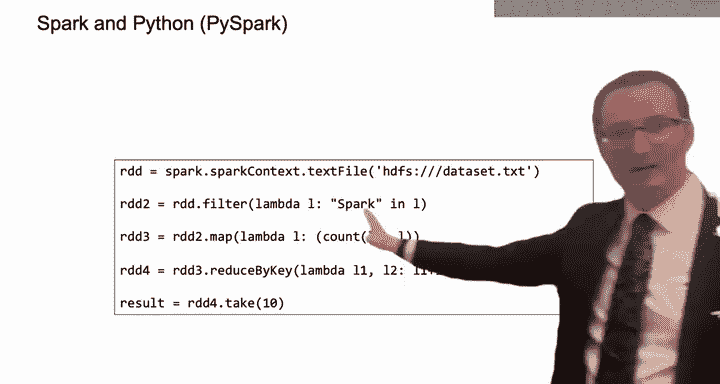

But if your file is not just text， but it's a Json Line file。

 So there's one JO object on every line here we have an impedance mismatch。

 It's that Sp doesn't understand that doesn't understand Jason Spk just sees strings in that case。

 So it's an R of strings。 So what happened is that when you're going to open that Jasonson Lines file that's red as an R of strings。

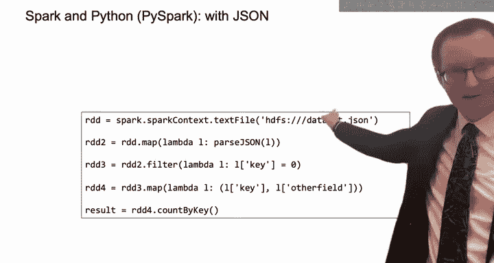

And then the user and I insist the user not Sp， the user has to explicitly write past J。

 which maps the R of strings to an RD of J objects。

 but now the J objects are really Python diics in that case if you use Python then you filter and again the user has to use the Python indexts on the dis to basically look up and so on so now you basically write Python in there。

 but you see that it's a bit complexsome because the user has to take care of these because PA doesn't understand Jason so it's up to the user to actually pass it and so on so it's actually not so nice。

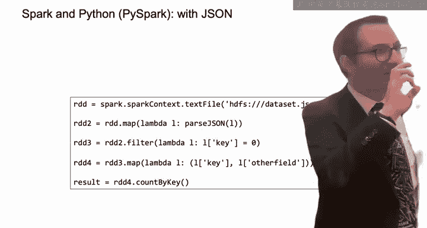

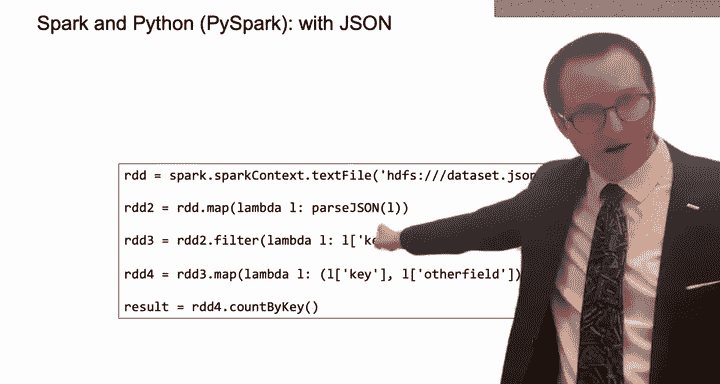

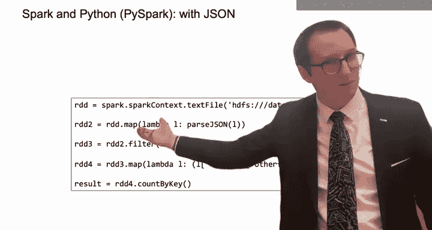

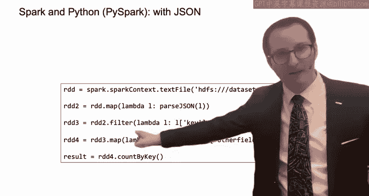

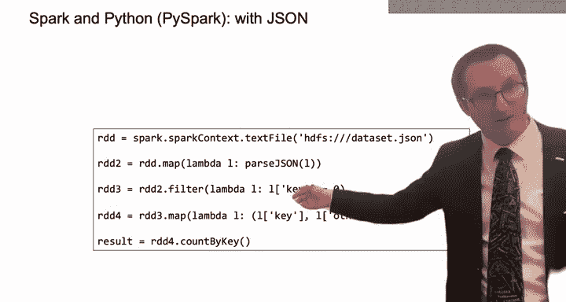

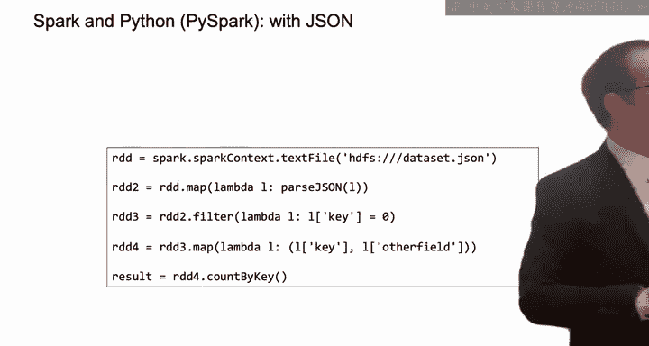

And so what data frames bring to you is something a bit more convenient that does it a bit more natively。

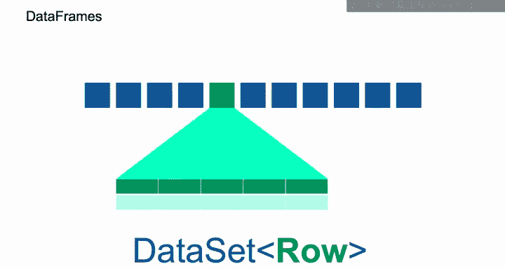

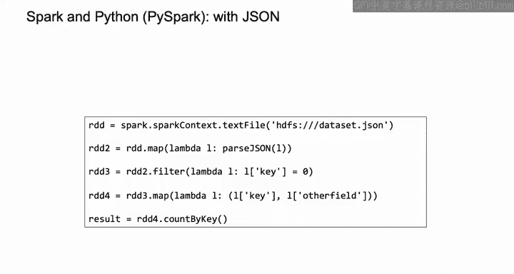

And the idea is that a data frame can be seen as an nowDD of rows。

Wive you a few seconds to digest that a data frame is an RDD of rows。

That's the same thing as saying that a table is a collection of rows right the collection of records so a data frame is an RDD of rows and these rows all have the same attributes that they could be nested that is not forbidden that's why we call it a data frame and not a relational table okay so it means that if I take one item in my RDD here that's a row one single record with attributes map values if I look at the whole RDD and I get the entire table or the entire data frame if it's nested。

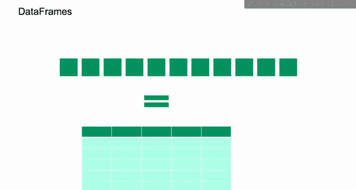

Okay。😊。

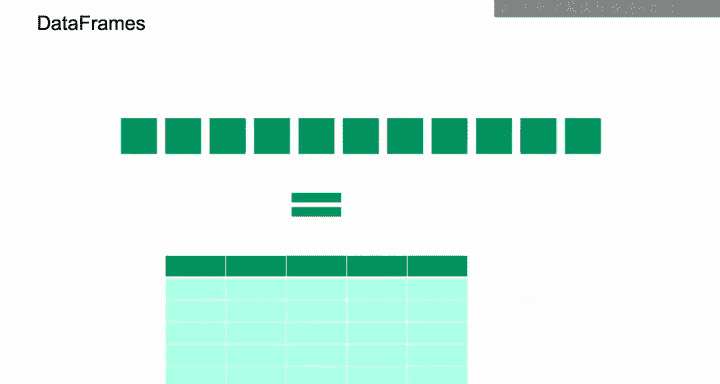

Something that shouldn't surprise you because I've already explained that is that when you have a data frame the way that it's stored in memory is by columns so if you have。

 let's say five columns in your data frame， then this column is stored together。

 this one is stored together this one is stored together in every partition of course if you have plenty of partitions then that's by partition in every partition。

 this is together， this is together this is together right the same goes with packet when you have a packetI。

 if you look at the way it starts it on this it's all grouped by column what is the benefit of that is that if they are columns that you do not use it's very easy to get rid of them。

If you read a packet file and some columns you don't need， then you don't even read them。

And if they are stuck together on this， it is very easy not to read them。For whom is that here？

whom is that not clear？We can more hands。That is called pushing down， we push down a projection。

 getting rid of currents that's called the projection。

 and if we don't even read the currents from the disk that's called pushing down the projection to the moment you read it from the disk。

That is the secret to make things fast in big data。 you push down， push down， push down。

 you try to get rid of all the data you don't need as early as possible。

 And if you if you can even read it in the first place even better， bigs it faster。

 So that's why colonar storage。

So another aspect as a consequence of that is that if you store RDDs of Python Ds， for example。

 it's going to take a lot of memory。 But if instead of an RDD of Python dictionaries you have an RDD of rows like data Oh I'm disating That is so cool。

 you know， you can fly in your dreams I can just operate and diss on the on the screen anyway。

 so the data frame here is going to take less space in the。😊。

In the in the memory， so this is something we appreciate because it's going to be faster。

 plus we can fit even more data with the same resources。

嗯。Alright， here's a concrete example。 So this is the data frame version of the。

That， but that now with data frames， so the first thing you see。

So it's not called RDD anymore it's called data frame， this is something different。

 but now you see it's native， you can directly say read that Jason and put it in a data frame。

 how I will tell you soon， but basically then what happens is that since you have a data frame you can use SQL。

😊。

And so it means that you can create a view give it a name and just drop your query in SQL you don't even need to bother with transformations or anything just write down SQL so this is a dialect of SQL called Sp SQL has a few features that are specific to it。

 but this looks very much like the SQL that we've seen at the beginning of the semester right。

And then， of course， once you have executed your SQL， then you can you can。

In that case， take the， the， the first 10 results， for example。

You could also do it in the SQL right I could also put limit 10 in the SQL they even supported offset set now it wasn't supported a couple of years ago offset set we were missing it but now they've added offset so you can use limit and offset in Spar SQL。

Alright， so now you see why SQL is useful， Well it's still useful at at large scale。

 So there was a long period of the of the。You know。

 where nobody liked SQL anymore and everybody loved the APIs and so on and so on。

 but now somehow in the past five or10 years， SQL made a huge comeback and now suddenly everybody love SQL。

All right。Now， how do we read from。A fight。 So the idea is that you can read Jason， CSV。

 there's plenty of formats that it can read packet also。But then comes the natural question。

 if you read CSV or Jason。How do you know the schema because if you have a data frame you need a schema so how do I know the schema when the answer is it guesses it。

 it tries to infer the schema from the data for example。

Imagine that you feed Sp with a CSsV file。 It means that you would have the Spk dot3 do CSsv here and you feed it with that CSsv file。

 Remember that the f line has the headers， then you have the values now Sp。

We'll notice that the first column seems to be an integer and the second column seems to be a boier。

There is a cost， there is a cost to it because in order to guess that Spk needs to actually look at the data。

 so it will have to scan over the data and look what it looks like right so it takes a bit more time than just opening an RD with text file that one is much faster but if you accept the small overhead of inferring the schema by scanning through the data you get back the benefits of a faster query so it's always there's no free lunch if you have a benefit on one side you need to pay it on the other side and this is where you pay yes。

Yes， you can absolutely so' repeating for the microphone if you already know the schema you can test Sp what the schema is and then Sp trusts you right you overwride the whole thing and then that's much faster because SPAC doesn't need to discover the schema it's just going to do it as it validates as it reads the data right？

😊，这全吃。I guess you get an error， but I think we have never checked that we should check。

 I think you probably get an error， it probably complains if you know it trusts you and then if you betrayray Spk and give it a schema that actually doesn't correspond to the data then Sp is going to complain。

哎。嗯。Alright。😊，And in fact， that is also a recommendation if you do know the schema。

 you should give it because it makes it faster so this is what you mentioned is yet another optimization to make it faster。

Note that with Sp， you do not need to give the schema away。😮，It's already in packet。

 the packetfi already has the sma， so this is also something to have in mind but in CSVL JO there is no schema so you need to do it to give it as an extra parameter to the function goal。

All right， and so you can basically squeeze this CSV over there in that data frame over here。

Same with Jason。You see how super inefficient it is。

 You're repeating that all over the place takes a lot of space。

So either it infers the schema noticing it's an integer so Boulan can also do it based on samples。

Or you can give it explicitly in J J sounds that would be full integer bar Boolean， for example。

 suppose it doesn't understand JSON probably JSO schema or maybe an API based way to specify your schema data frame schema。

 and then it turns it into this right there。

给。Now， there are people who don't like SQL who like SQL。😊，Who doesn't like Se？

It's fine not to like SQL and that's okay because then you have here data frame transformations。

 So if you love APIs， it's not a query language， it's an API， but if you love APIs。

 you can also write your query in this way fields are biseic but you need to know that this is not the same API as for RDD it's a different one there's RDD transformations and there's data frames transformations so you have to learn all of the methods and so on that are not the same as for RDDs even though it resembles it a little bit。

It's a little bit involved in the way the syntax。 I mean。

 takes a little bit of time to get in use to it。 But， of course， if you know a bit of pondas。

 maybe that makes it a bit easier。 So it's more involved。

 But if you prefer this and this is totallyterifying。 In fact， at the exam。

 we even give you the choice， right， if you can either use SQL or the data frame transformations。

All right， so everybody is happy， right， you basically can pick what you prefer。Alright。

 then we have yes the types so now you probably get bored with my type mappingings right I keep throwing you type mappingings but what I'm essentially telling you is that it's always the same and here again it's always the same because if you look at the available types in there it's going to look pretty much like what you have in Jsononic in ba like in the all the others so you see for example you have byho integer along float double deimal so that's how it's the numbers that you can have you can have strings you also have vchar and char if you like organ sQL types Boolean binary like blobs pipets date and so on so there's a few types like this so these are the atomic types right all the atomic type plus the structure types you know always the same at the very least there's going to be an object in an array type there might not be called this way but there's an object in an array。

😊。

The array， that's great， it's called the array。The object， in fact， isstruct。

struct correspond to adjacent object map it takes， I told you in some of the of the data frame or schema validation libraries or the formats。

 data formats。

You typically have a third kind of structure type， the difference betweenstruct and map is that in astruct。

 all the values must have the same type。And the keys can be something other than strings。

 for example， you could have a map from dates to individualstes。

RightIt's not Jason anymore because in Jason it has to be a string the key。 but in maps。

 the key can be an neoatomic value right so this is this is the difference。

 So you have to consider this one as a little bit of an extra an extra available type that doesn't map to Jason but some some of the formats have it but array in map to Jason So if you open a J file then that will map it to array andstruct the objects and the arrays in Jason and then there' are also a mapping in here and basically now if I take it to the next level。

 So this is just the list of the types I have in data frame and what I did。

 guess what I just couldn't resist， this is what I did， I had to do that。

 So now you have all of the data frame types that's basically a part of the data frame API this is how they map to Java it's official can find it in the documentation of data frame that's the corresponding Java types。

You have the Python equivalence。😊，I want you float double in Python or float in catches everything in Python it's allienttegers and so on and in Jsonic you have also these equivalents of all that right So these are all the all the correspondenceenciess but again you can see it's always always always the same boring list of types that you have everywhere So it's really just like I told you many times it's like the Swiss dialects right you just understand them all even though it's different in different worlds。

😊，So that was for the Ats and that's for the object right how it maps so the arrayser lists in Java and list in Python。

 the maps are maps in Java and di in Python struck maps to it maps in a strange way actually I never exactly got why they did the mapping in this way。

 but they actually mapped the maps。

To dis and thestructs to list autos it probably has to do with the fact that the dictionaries in Python are more flexible than JON objects and probably they would accept other kinds of keys So maybe this is why and the way we map it in Jsononic So here why don't I appear Yes So array map to arrays and the objects map tostructs。

 at least in remember Db， this is how it's implemented。

 So whenever you have an object it's running as astruct type。

Okay。So。Yet another restaurant menu you。 So you see you have Jason， you have Taer， you have CV。

 you have text。 you want just a colon of strings。 you have JDBC。 that's for connecting to Posg Sql。

 So that's what's called connectors and you can connect back to whatever you want。

 So this is to connect it to Pog SQl。 You can connect it to Mongo Db。 You can connect it to many。

 many different systems。Some of them are hard coded statically。

 You see what I mean with static statically， because that's a method called that's not that compile time。

 So these are all the known ones。 And there are some formats that you can do dynamically。 but then。

 of course， you cannot know them at compile time。 And in that case。

 you just supply them as dynamically in the in the format， right。Or who is that dear？Al right。

 so these are some of the formats and there's many， many， many a formats。

 but what's really great is that once you have done that。

 you get a data frame and then you can use backSQL or data frame transformations。😊。

What then happens is magic， you don't need to worry too much about it。😡。

What's going to happen is that the data frames are physically， in fact， RDDs of rows。

 so they are really handled similar to RDDs in the system physically except except that now it's hidden。

And your plan that you get out of your SQL query or out of your data frame transformations gets mapped to a physical plan on RDD transformations。

 these RDD right there， but again everything that's below here is automatic and you don't need to worry about it。

 the only thing in terms of data frames and spark S or data frame transformation。

And the benefit of that， this， you probably recognize data independence in here， in fact。We have no。

 we don't have any。

Don't have any here so basically if you draw a line in here like you draw a line here。

 this is data independence right that's the data independence line and once you have the data independence line。

 you can start throwing optimizers and all kinds of architectures that are known from relational databases and so what you send with your SQL query or your data frame transformations goes through a very complex pipeline that is worth several scientific publications in various conferences and it goes all the way to RDs and it figures it out basically it will find out the optimal way to put the transformations。

Did we have questions？No questions？All right。呃。And a few minutes until the break。

Now let's look at Sp SQL。 So first Sp SQL looks like SQL right If you look at this。

 there is nothing surprising select from there select from where goodbye having order by limit n offset。

 this one I was able to add because now it exists。 So this is basically Class SQL SQL there's absolutely no surprise in there。

😊，I made a few annotations here。Is that they're shuffling。

 as you can imagine now you can already imagine the RDDs that are behind that。

We have to shuffle when we goodbye。And we have to shuffle when we order by。

Except if the key is the same， if that's the same key here and here。

 then you only need to shuffle once and here there's no shuffling anymore because it's already there。

Now， think a bit of the transformations， because we've already seen that in the previous weeks。

 this year， do you agree it's narrow dependency， That's a projection that you can do in parallelero neural machines。

The reading is also in parallelette that's the HDFS blockss or you know it's already spread over where is a selection that's also a parallelette。

 it's a filter transformation。

Who agrees。

So this is also interhallen。Groupby， we need to shuffle because we need to bring together the values that have the same key there。

😊，Having is without shuffling because you just w in place。

 you have the groups spread over on the machines， then you keep them or you don't keep them。

 So that's again， narrow dependency other requires the shuffling if that's a difference a key and you cannot optimize but in some cases it's no extra shuffling if it's the same key or a subset of the key right and here you can also have the same changes in here desk nerves first and so on。

U。😊，And limit and offset。 So limit and offset， they look like uninteresting and trivial。

 but it is incredibly difficult to implement on top of a cluster。There is， in fact， transformation。

On RDD。That you basically kind of need to do these things。

 it's a transformation that's called zip with index。

What zip width index does is that out of an RDD of values。

 it associates every value in a pair with an integer， so if you have the RDD full bar and so on。

 it will do full one， bar2 and so on， so a pair with the value and its position one to three and so on。

Once you have used zip with index。Then do you see that you can implement limited offset with a selection on the position。

You basically select such that the position is here between 10 and 110 plus minus-1 right between 10 and 110。

 who sees that？Imagine zip with index， you add the position， and then you filter with limit offset。

 selecting on the position。 Now you have it。 But zip with index is hard to implement。

But it's so hard to implement that it doesn't even exist in Spsql。 You have it on the RDDs。

 but you don't have any zip width index in in。Sacequl transformations。

But there is a trick because we needed it for Ruble DB， so what we did， of course。

 is we went to stack Overflowlow and there was a stack Overflow page in which somebody came up with an implementation of zip with index in Sp equalQs so we kind of made it work。

呃。Alright。😊，The break， I still have a few minutes。

书。This here SQel。😮。

Was made for tables， plus tables， right？But in practice， in data frames。

You might not have flat data an example of this is that a column here might be an array of strings。

 so here I put the J way I could also have drawn it as a data frame in the way that I did it two weeks ago。

 I just wanted to keep it compact right but I basically have these arrays of strings right here and what I can do is use the explode function that is going to basically normalize put it in first normal form you remember the first normal form every atomic。

And in order to normalize it， the costs that you need to pay is you duplicate the values here。

 So what Albert Einstein was only once now you have Einstein and Einstein。

 you duplicate it with each one of the values that came from the array， or who is that here。

RightSo this is called that's a normalization algorithm that's how you normalize into the first normal form and it turns out that here it's implemented with export it doesn't exist in SQL you don't have it at least not in the early versions of it。

 but this is really a spark extension that does this thing on the right。😊。

Now from a language design perspective， you have to be very careful because normally in a functional language。

 when you have a function like that， it should only act locally so normally that should return something out of countries but somehow this explode function has a non-local effect on this one here that has nothing to do with this function called it's outside and yet it has this effect so this is why I like to call a spooky action at a distance as a reference to quantum physics but basically what happens here it it's not really a function it's a function that kind of modifies the tables around it who is that here。

😊。

All right。Now， if you want to do things more complex。

 you can do the same thing with what's called a lateral view。

 so a lateral view is something that comes in the from clause。

 you basically say that you have the table。

Here。And you kind of join it with itself。 It means that you take that table and you join it to some virtual table obtained from flattening that。

 So it's like a join， but。😊。

With itself and this is what you get here and the beauty of doing it in this way is that you know that when you join you can join again and again and again so you can chain the joint so here too you can chain the lateral views in there so if you have nested and nested and nested so like a dream in a dream in a dream in a dream so here you have again objects in a array and so on then you can just have two levels of un nesting here with two lateral views。

Okay， who understands that？Who doesn't？That's great news if you doesn't， if you don't。

 because in fact， this is the limitation of data frames and S SQL because SQL was not designed for nestedness and this is the reason why now that we are trying to push SQL to its limit to handle nested nest。

 we start seeing that it's hitting its limits。Right。

So that was a race for object you use dots right so you just extend equalQL with dots in here so name dot first and that extracts the value in here that shouldn't really surprise anybody that does object oriented programming rights kind of the same way you would do it in many in many languages Okay who understands this query。

Very good。 So it extracts first and last put them in colons India there。

And I'm just waiting for it to ring because I'm pretty sure it's going to ring again in the middle。

 I'm almost done with the slides， and I'm pretty sure yeah， you so。

 So I finish this in after the break。 so I see you at quarter past three for the continuation。😊。

