# 苏黎世联邦理工《大数据｜Big Data - ETH Zurich - Fall 2024》中英字幕（deepseek - P32：-32-9. Spark (4_4) -.zh_en - GPT中英字幕课程资源 - BV1sHPKeoEJU

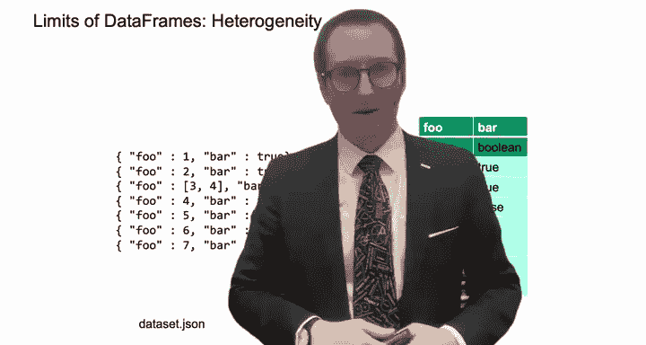

Welcome back， everybody。So let me continue from where we left。

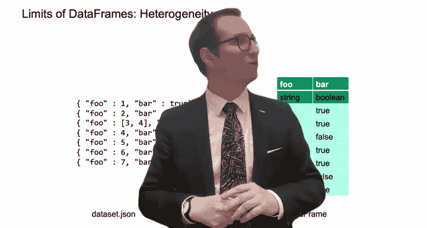

Just need to。Say if you use these things just for the time for the silence to come Yes。

 awesome so this is where we will， but now something changed， something changed because。😊。

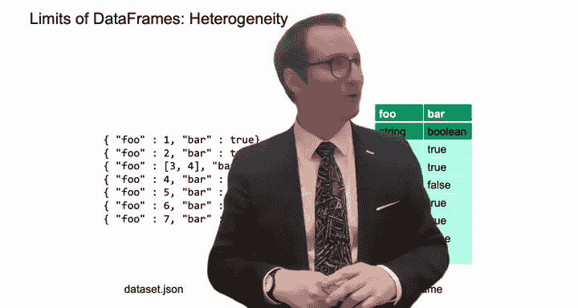

You notice here that something is heterogeneous， basically you don't have a schema。

 you cannot put a schema。

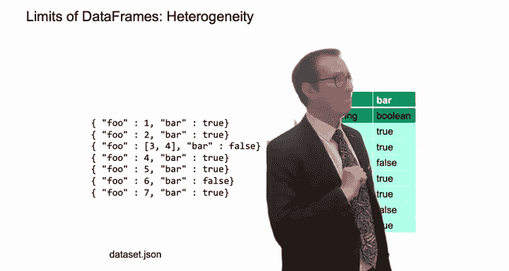

That is not exotic。 It would have to be exotic because what you would have to do is hear a union between integer or or an array。

 or you would have to say just item like anything。 But this is not a schema that would allow you to be the data frame。

 right。

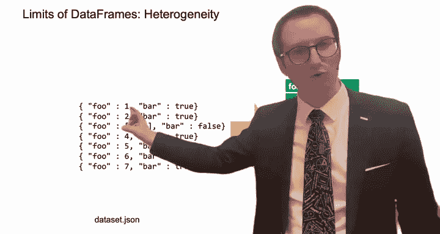

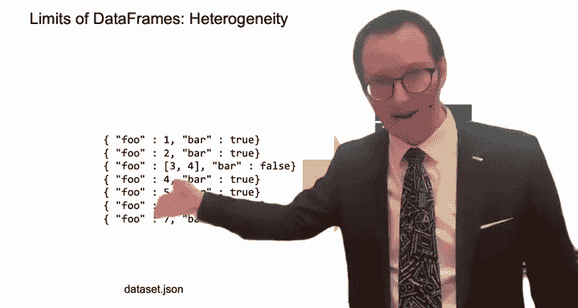

It's no problem to spark， takes a hammer， hits it hard enough， and this is what you get data free。

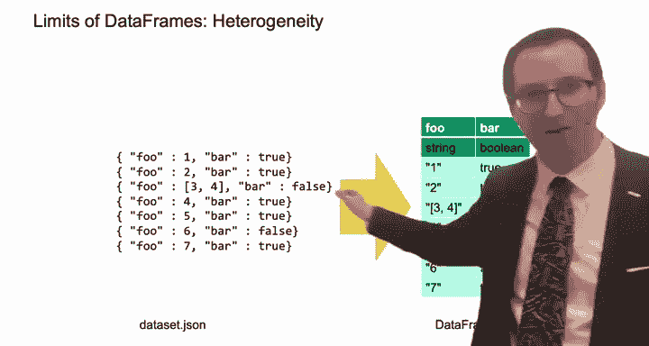

But if you look closer， what's happening here is that the color is a string。

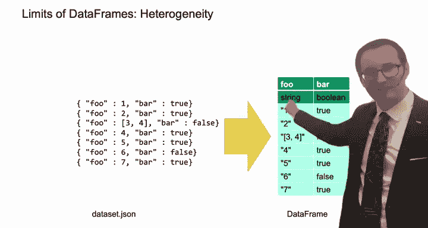

And everything here is a string， this is a string， this is a string， it is also a string。

 this is all a string。😊。

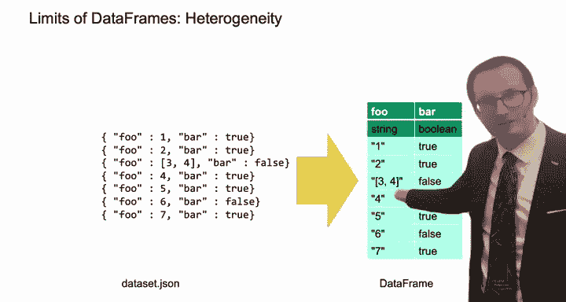

I put the quotes to make it clear because the quotes are not part of the string。

 but I just wanted to show you that even the array is a string What is in that string we know the words to describe that it's a serialization of the array as adjacent literal right we've seen that you box you serialized so what happens is that this array here it gets reized to a string and then everything is is。

Is a string。 Now at first sight， it looks great， right。

 because we actually took that and we put it in a data frame。 Sees like we can always do that。😊。

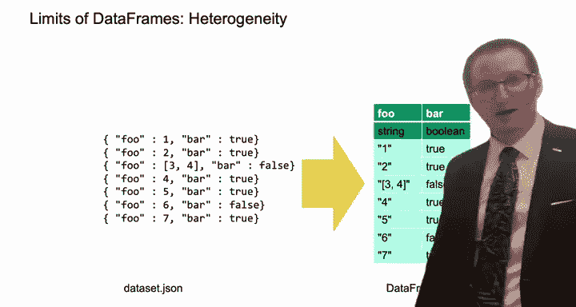

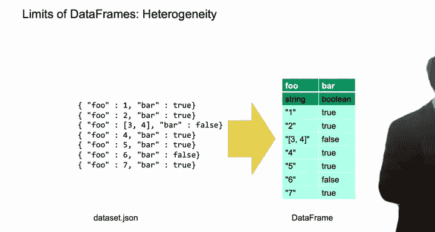

The problem is that you've basically just told the user that's not my problem that's yours。

 that's what you're telling the user here because you're basically saying now good luck with that like the user now has to repas that probably write a Python script that has some if you can pass it as a string then do this if you can pass it as an array and do that but that you can no longer do with SQL you have to actually write Python。

 maybe 10 lines of code that is going to make the distinction who sees that it's combussome。

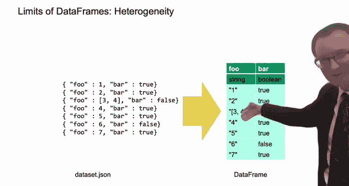

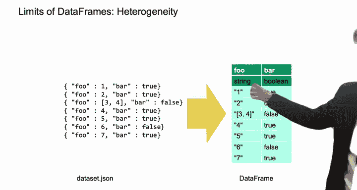

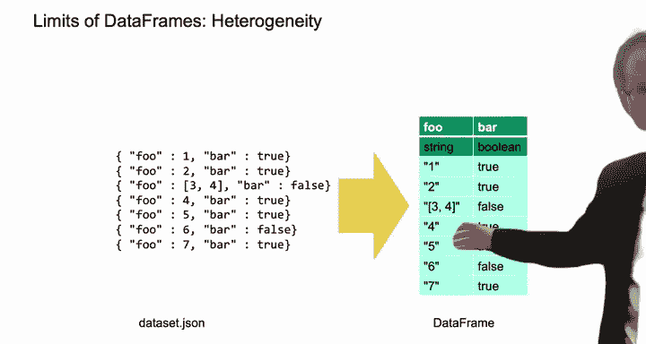

Right， awesome， so do see。Sorry。

Well， the problem is that you cannot explode anything because these are old strings here。

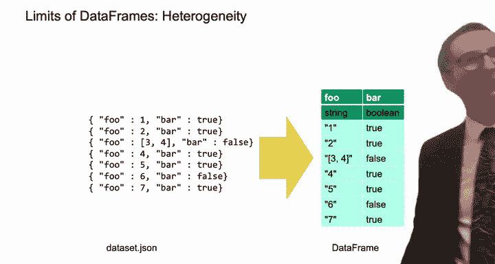

There's no array， right， The explosion you look at the way it worked。

 That was because we had a arrays。 So when you have an array type， then you can explode it like this。

😊，Because back sequence is the， the problem here is that there is no array， it's in here。

 it's a serialized array， but it's a string now， so we cannot do this。😊。

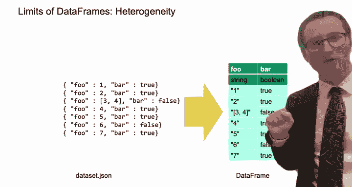

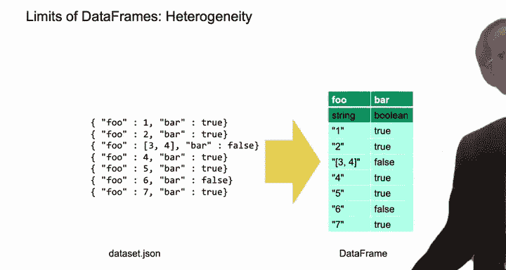

But we'll see later with Jsononic， you can do that with Jasonsononic， you can do it。

 but I will explain why that is that is the case。 but here this is really a string。

 So you have to treat it as a string and you would have to to do some additional work in in Python So this is one example of where we are basically meeting the limits of what data frames and SQL can do。

 We are basically trying to。

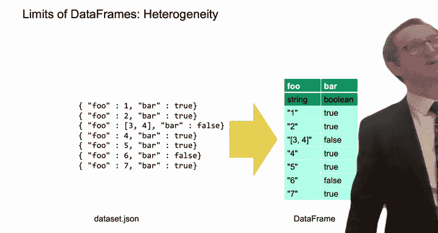

Use data frames for something that they shouldn't be used for， right。

 because this on the left clearly doesn't fit in the data frames。All right。

 but that will keep us busy in the coming weeks。Maybe this week。

 if we start tomorrow and a bit next week， I will explain to you what other solutions we have for these cases。

 right？So this is a general hintt in general in databases， but also computer science in general。

Whenever you learn something can be a technology， can be an algorithm， a paradigm and so on。

You always need to understand。It's domain of I'm going to say domain of usefulness。

There is always some use cases for which it's absolutely great and some other use cases where you could make it work if you hit it with a hammer。

 but it's actually not working very well and so in that case what you need to understand is that data frames are fantastic if the data is homogeneous enough nesting is fine it's great at nesting if you accept this thing here but if it's heterogeneous then that's even more complicated so this is the one thing to understand right and。

😊，The solution in the end， is really use case dependent。 If you work in a company later。

 there is no universal answer。 It's not true that SQL is good for everything。

 It's not true that Jasonsononic is good for everything。

 It's not true that Sp is good for everything。 You really need to look at every single use cases you have。

 look What is the size of the data。 What does it look like， What is it stored as and so on and so on。

 right And then you can decide on the the technologies that make it that make it both productive and。

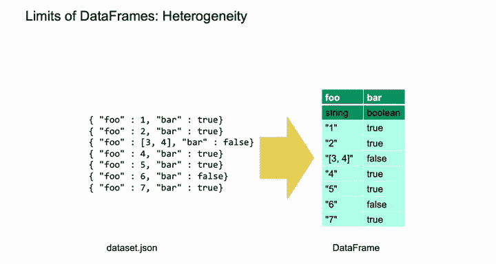

The performance。Okay and now this final slide is just to say that if you want you can turn data frames into RDDs and RDDs into data frames now turning a data frame into an RDD is easy because it's just an RDD of rows that path is easy but the other way around is not easy if you have items here and you want to push them into a data frame that requires a bit more efforts。

 you need to make sure the items are structured in the way you want plus you supply a schema。

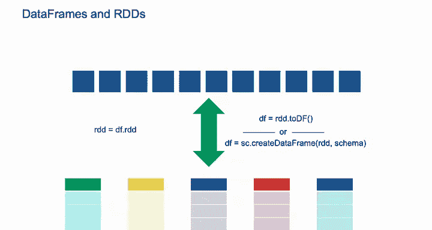

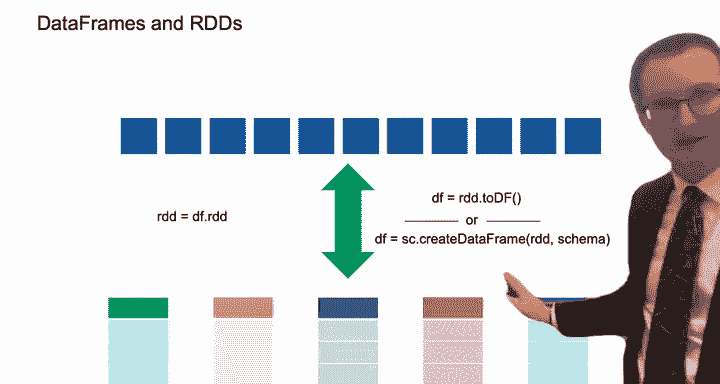

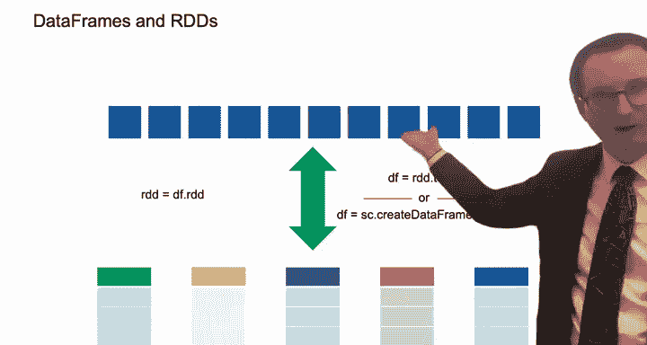

And then you can turn it into a data frame， right， so it's a little bit more more involved。

 It doesn't happen automatically。 So it's not like loading Json and it takes care of it here。

 you really have to do some work and put the scheme up。All right， this， I think， concludes。

The chapter on Spark， are there any questions？嗯zom。嗯。U on Oxford？😮，Okay， I see， okay， very good。

 so that makes me happy。😊，Very good。 So I'm going to interrupt the recording。

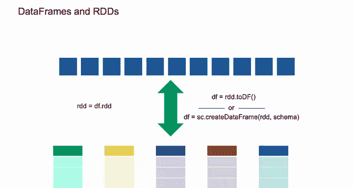

Here。