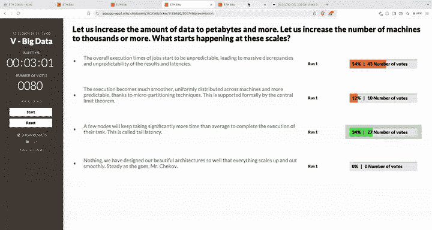
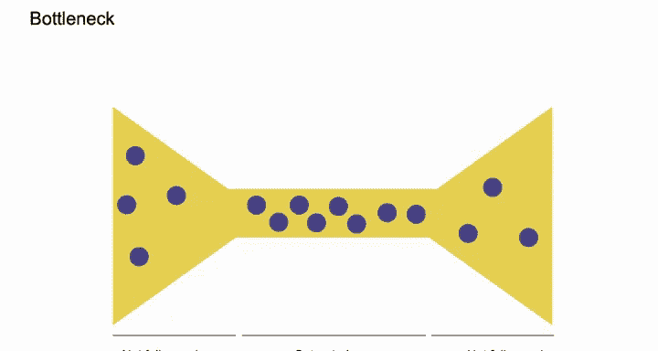
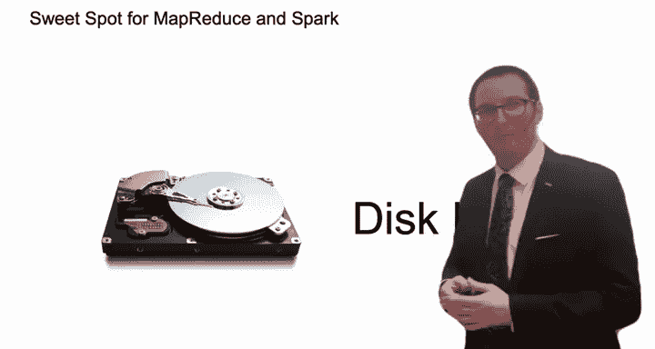
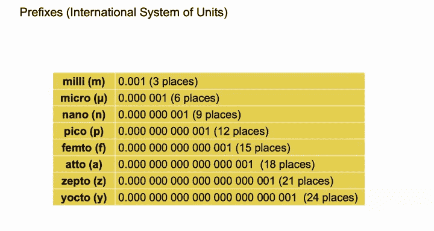
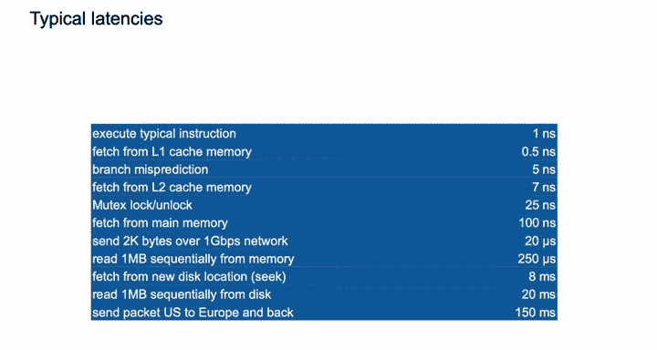
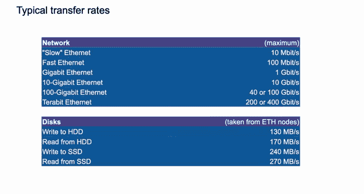
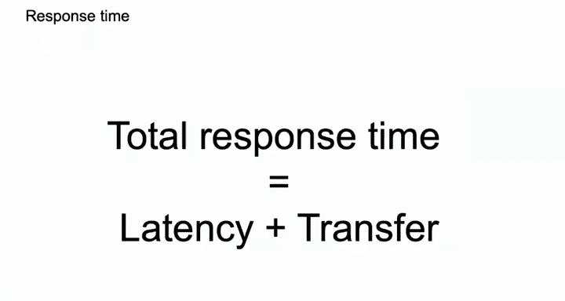
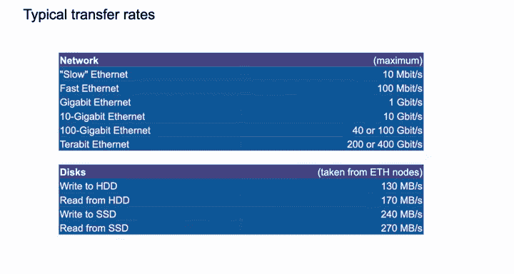
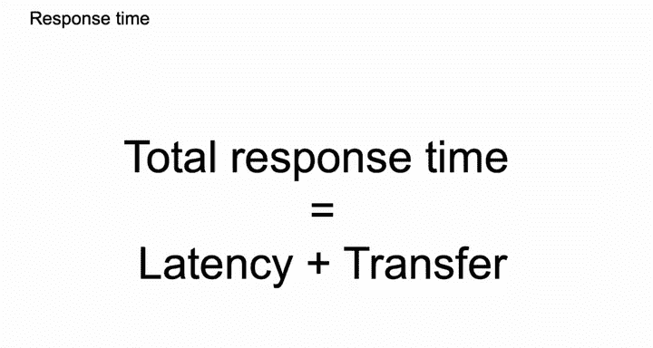
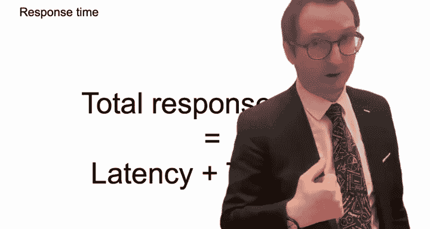

# 苏黎世联邦理工《大数据｜Big Data - ETH Zurich - Fall 2024》中英字幕（deepseek - P33：-33-10. Performance at large scales (1_2) -.zh_en - GPT中英字幕课程资源 - BV1sHPKeoEJU

Wecome back now we are moving on to a new path that is on it's a bit special。

 it's not really like a new technology or something。

 it's just like taking a step back and thinking about performance when you have to build programs like that that manipulates sterys or petabytes of data and you want to use spark map preuse and so on。

 how do you make it fast so I'm going to focus on performance and productivity with combulator with GSNny。

😊，But before I do that， I have a question for you。Of course， Of course。 So let me。And where it was。

 it's probably hidden。Somewhere here， yes。So， you know that。When you go to the very small。

 the world becomes quantized。When you move at very large speeds。

 some things get distorted and so I'm basically asking you the same question with large quantity of data of data。

 what happens if you have enormous quantity of data is it still behaving the same or do things start to happen in a strange way？

So the first possible answer is that the overall execution times of jobs start to be unpredictable and that leads to massive discrepancies and unpredictability of the results and of the las。

The second answer is that the execution on the contrary becomes much smoother。

 uniformly distributed across machines and not predictable thanks to micro partitioning techniques。

 and that works because of the central limit theorM。

Unso number three is that a few nodes are going to keep taking significantly more time than average to complete the execution of their tasks。

It is called T Latin C， careful。 I'm good at making up stuff。

Or nothing we have designed our beautiful architecture so well that everything skates up and out smoothly。

 steady as she goes， we start check off of the Star。😊，All right。So did I start it， don't see any。

 I didn't oh no， I didn't start it。There you go。What do we have， yes？We have not a majority。

 so the majority in predictability of the results， the results are fine， correctness。

 that's totally fine， it's in fact a latency issue。😊。

And that I will explain in the coming lectures why I will explain。

 but basically you might have observed it happens when we do the live map reviews that some students take longer to do the mapping this year it wasn't really noticeable but in previous years there was usually one or two that took forever which was great because that's exactly the points that I wanted to make。

🎼Alright， so this is good。 So now I'm going to。To to， to reload the。Slides。

Okay。So nobody told was。So now let's get started performance at large scale， so we are here。

 we covered all of this so storage including syntax XM and JON CSV data models， the XM in set。

 the JSO data model data frames validation JON schema JSON XM schema and the genericuwa that the type systems work processing with mapre with Sp so we are approaching the end of the semester right we've done some querying with SQL。

 but only for tables and data frames and will continue with JOonic。

At night's a moment to it's a good moment to take a bit of a break。嗯。So。Where typically happens。

When you decide to launch a job to to a cluster and here it doesn't matter if it's back if it's map re。

 it could even be just a local Java program or whatever you want。

 like any computer program of any complexity。What is for sure is that there is a bottleneck somewhere always。

ABut next， so we call it that way because it basically is this visual that you can have in mind。

 is that some part of the computer of the resources。

Let me reactivate youjo。Alright， so something happens。

 We just suddenly got disconnected from from the network and but it seems that it didn't happen to you。

 So it's only in the lecture hall。 So I just need to load my slides again and then we'll。Continue。

Yeah。Okay。

Buter next， so some parts of the system are going to not be fully used。

And some other parts of the system are completely fully used， and they are the reason why it's。嗯。

Understanding this。 So now it's abstract， but I explain in more details。

Is the basic of debugging but not debugging for correctness but for performance。

 you have a computer program， you want to make it faster。

 the first thing you need to do is find the bottleneck。

If you work on something else and the bottleneck that's totally useless。

 you have to find the bottleneck and focus your efforts on fixing the bottleneck。嗯。Now。

 you know that thousands of years ago， people could do math and physics and pretty much know everything that was the knowledge at the time。

 But now even in computer science， nobody can understand everything。

 And there are plenty of people in the department that deal with hardware。

 I don't know the first thing about hardware。 I mean。

 I just know on the abstract perspective that theres some memory， there's some CPU。

 there's some disk and that's there's some network。 In fact。

 that's all I need to know for the purpose of data management。 But basically。

 this is the level of abstraction at which we look at things in in performance， for big data。

 We just focus on this core abstractions。 memory CPU disk network。

What I can tell you is that you can take any job going to be too slow for some reason。

One of these four is going to be the bottleneck。One of these four。

 and you have to find out with which one of the four is the bottleneck。So maybe it's the CPU。

 how do you notice well， for example， you can SS yourself to the machines and so on and look at the CPU usage and you see it's all the way to 100 per sets。

And if you look at the memory usage，' it's used， but not fully。 the disk doesn't seem to be full。

 And also the the bandwidth reading from the disk is okay。 And the network is basically either。

 That's the case where we have a bottleneck with the CPU。The term that we use is CPUU bound。

Right your your program， the execution of your program is CPU bounds。

 That means that you need to do something about your code right， It's a compute problem or。

You log into the machine， you notice notice it's like 80% CPU， 60% CPU， it's not fully used。

 the memory is also not fully used， the network is transmitting some data。

 but it's not at the bandwidth of the network， but you notice that the disk is reading like crazy or writing like crazy and it's actually reading and writing at the maximum speed that you could possibly read or write from。

This is IU but more precisely disk IU。😡，IO for input output， right， input output， we just say IO。

So this is disk bound。Or it's memory bounds。 So you connect to the machine。 The CPU is at 60%。

 The disk is not reading at full speed。The network cables are not overloaded。

But your memory is completely full and it's so full that it's starting to swap and you know try to do what it can in order to execute your job this is some of the worst because that actually or kills your execution when it start to touch the memory right so for example what could happen with a mapre of or Sp is that it starts flashing things you know and it doesn't fit in memory anymore。

Or its network IO bounce， it means that neither the CPU is fully used nor the memory is full nor the disk is reading or writing at maximum speed。

 but the data is shuffling like crazy of network right it's clearly a problem with with the shuffle and the communication。

What I can tell you for sure， when I will not call it a fewM because it's more a practical thing is that it's one of the four。

 there's no way。It's one other four of the four and there is not two bottlenecks。

 the odds of two bottlenecks are very slim， there's always one bottleneck right。

It might be a bottleneck by far or a bottleneck by not so far， but there's always one bottleneck。

Your job， when you try to make it faster is so just identify the bottlene。

 and then you know what to fix。 And again， how do you identify it。

 you really have to to log into the machines and look at the CPU。

 the memory and so on and see if that's the that's the problem。 There's other tricks， like。

 for example。When you try to execute a query of all the data。A complex query。

What you want to do is measure the time that it takes you to execute your query on the one hand。

And then what you want to measure is another query that only reads the data。That only reads the data。

 maybe write back of something， but just that。 And then you look at the difference。

And if you notice that there is a considerable difference， then it means it's not a diskO problem。

 it's probably a CPU or memory problem if however the speed of your query the time that it takes for your query is more or less the same that it takes to read it from disk it means that this is a disk IO bottleneck so these are some of the clues that you can get right for whom does that make sense。

Right so it's a little bit like shallow cons right you have to do your investigation and find out where that bottleneck is and that really just requires a bit of thinking and out of the box and yeah there's also profiles by the way。

😊，That can， that can be helpfulful。Now。I'm going to say something extremely important。

 It's so important that that might be the lesson number one when you use map Red。

 and this is what many people do not get。

The reason number one， why you should be using mappre or Spark is if your problem is with the disk IO。

 this is the main reason why you use mappre or Spk， why。

 Because once you hit the limits of one dry one disk on your laptop。

And you're reading it at maximum speed。Anything you you will do is useless。

 you can improve your code。 you can do whatever you want。

 It's totally useless right so you're stuck with the diskio then it makes sense to move to the cluster because then you read inhalL and then the theIO of the disk is going to add its additive right all the data that you can ingest to the data center。

 So this is very important。Because there are people who use spark or map reduce when this is not the problem。

 It's not actually this bound。 I have in mind。Like meteorology， for example。

 or climateimat when you try to do CPU intensive work that shouldn't be with Spark or mapre because when you try to predict the whether your problem is not predict from this right it's using the CPU to compute the models and then it's HPC right high performance computing but you really have to have this in mind if you're using Spark or mapre but your problem wasn't the disk IO then maybe there are other solutions you can reduce the number of machines probably and save yourself some money in order to improve it so I just wanted to make sure that that this is really clear。

Now， in order to measure stuff， when you do your investigation to find the bottleneck and understand if and how you can actually fix it。

 you need to think with these things that I told you earlier lat C throughput capacity。

 so these are all the things that you need to have in mind， so the la C when you start receiving。

 for example the data。I give you this whole scale， you remember all the prefixes who knows them by half now？

If you don't then you should still learn them， but you have to know them by half。

 there's two more that I should also add them here。

 there's also 27 and 13 now and these are the equivalents on the micro level right so Mili micro nanopicofemto ato Zpto yok2 right？

嗯。So it's a good idea to know them too even though Zpto yoto you will probably not see yet in big data。

 femMto and Atto， you start seeing them in so femto， for example， femto cells。

 you might have heard and ato in physics is also the sort of scales that with time we somehow manage to reach。

But anyway， for the sake of big data， you at least need to know these these four that are relevant to a computer system。

Now I'm going to give you a few orders of magnitudes but you really should take them as orders of magnitudes because this is really depends on the computer。

 intervals of time and so on， but basically you have to have in mind that if you are looking at the CPU and the registers of the CPU and the assembly code and so on。

 then you're basically looking at nanoseconds in terms of typical times。

As soon as you start going to the cache， you might add a digit or go higher。

 then when you go to the memory， it's in dozens or hundreds of nanoseconds。

Then when you go to the network， it's microseconds。

 you see you're looking at larger scales now the network is already in meters rather than just inside a CPU。

Reading like one megabyte for memory。Hundreds of microseconds， the disk。

So the disk is going to be even slower than that so when you read from the disk then now you're in milliseconds right if you're interacting with the disk and then if you think in thousands of kilometersters and send data to North America and back then's hundreds of milliseconds or hundreds plus milliseconds。

 by the way， it's not the speed of light， the internet that's actually there was a professor who was looking into this at TTH the internet is slower than the speed of light because it doesn't propagate in straight lines。

All right， but you have to keep it in mind and this is the reason why when you use data centers you want to try to have the data like in Ffur or in Zurich whether rather than in the US if you're dealing with it from here Okay so these are just the objects of magnitudeg I'm not asking you to learn that by hat。

But at least if I tell you that know you just measured that you shipped something to the US back in a nanosecond。

 somethings wrong with a load of physics right so you really just should not the orders of magnitudes why because when you think about the bottlenecks you can do quick calculations on an napkin right you can look at the size of the data。

 a few divisions like just primary school math and you can just quickly estimate some very qua orders of magnitudes and then compare it with what is actually happening that is very useful for the bottlene then you have the transmission of the data again。

 these are just just a few examples like the typical speeds of the network now we are at gigabit you have likenet search they are and that kind of motor right so in a data center now we are typically at 110 gigabit100 gigabit and I think even terabitnet is arriving。

For HDs and SDDs now it's probably even higher than that。

 but when I measured it at some point it was like in the hundreds of megabytes per seconds with SSDs。

 you can probably go a bit faster than that now reading and writing to drive of course also depends on whether it's sequential or it's all random access right so typically that also plays a role when you when you read from this for an HD above all because there's a rotating head and so on for an SDs less's of a problem。

All right， so just to give you the orders of magnitudes。

 the disk is very useful that's probably the most useful in the case of map preuse and Sp because knowing rapidi speed。

 if you have a data set like of one gig or 10 gigs of data it's just a simple division to have a very rough estimate of the time it takes to read it all and that gives you a baseline for the measurement of your query right because if you're already at the baseline。

 then you know you will not do better than that。😊。

Except if you apologizeize more。

嗯。Now there is something that you have to have in mind in terms of the vocabulary is that la C can be used in different ways I use la C in the context of the lecture it's just a matter of definition as the time it takes to receive the first bit of data right it's the waiting time until you start downloading some other people use la C for until the end from when you send your request to receiving the last bit it's just a matter of convention but you have to have it in mind but here we've got a total response time rather than la C right so it's the time you wait until the first bit and then the time of the transfer。

Okay。Now， when you want to look at your bottlene， you are interested in the total response type right this is what you want to measure typically when you put the fancy shaft in the paperss。

So now the sort of things that you want to measure。

 if you finally found the bottleneck and you finally find found out how to fix it and then you go ahead and fix it。

 then you will want to measure the difference so you're going to measure the total response time before and the total response time afterwards。

And then you do a division， it's the old time that he took divided by the new time that he took for some reason I wrote Latin C in here because somehow I was I had in mind the people that use it maybe I should have written total response time instead right I should maybe redo that one。

 but here I really mean the total response time divided by the total response time。嗯。

So then here's an example， imagine that in total， before the improvements。

 your query took three seconds， the total response time from the beginning to the end。

And after you have implemented a fix or done something， it only takes two seconds。

Then you can estimate a speed up by dividing。 And here you would say it's 50%， right，1。5。

 So plus 50% in in speed up。Okay， for whom does that make sense？You just do the division。All right。

 now if I use that in a special case thats I am applying it to a special case that you have a query。

😊，That is not optimal。And you try to modify your code。By parallellyzing。

 imagine that 30% of the query is parallelizable。70% is not could be the shuffling， for example。

 and 30% is the the the nonshuffling。 So imagine that on the path that is paralyizable。

 you double the number of machines or something， so you manage to to be twice as fast for the parallelizable path。

Then that's going to be the 30 percent that gets shorterened。 So now you see the formula。

Before it was one as a basis， right renmalized now after my fix。

 I have one minus p that's basically the part that was not parallelizable。

Now plus p but p is divided by S because now I I might have increased the speed of execution so instead of taking 1 minus p plus p it's1 minus p plus p over S that's the part that I parallellyze more right and so an example of that if 30% I got the speed up of2 is one divided by 1 minus-0。

3 so that's the 70% that are not parallellyzizable and then I have the 0。

3 that was huffed now it's 0。15 and I get 1。18。Now you see that it's less impressive because at first I told you I multiplied by two。

 I made it twice as fast on the path that is parallelizable， so sounds very impressive。But now。

 if you look overall， it only improved by 18%。😊，So that's much less than the doubling basically means plus 100% right now it's just plus 18。

And the reason is not everything is parallellyzizable。 So when you fix a bottlene。

 always remember that it's if you parallellyize， not everything will be affected， just a part of it。

 so that puts it in relative terms。W who understands that formula？Okay， one fourth。

Now there is somebody else。 So this is what Mr。 Amal says and there is another person Mr。

 Huafavson who says， no， that's the way to compute the speed up right So instead of doing this one over1 minus p plus P over S。

 it's1 minus P plus S right。So let's compute it again with this formula in what Mr。

 Gustavson is telling us that gives us 1 minus 0。3 that's the part that is non parallelizable plus 2 times 0。

3 because now I doubled that speed here and now I have plus 30% right so now it's a completely different formula and they are not saying the same thing so here I get plus 18% and here I get plus 30%。

😊，So now question is。W is right， they have two formulas。😮，And they give you different results。

 And in fact， the answer is。That in one case， so that's on Amal's law。You have one problem。

 I don't know matrix diagonalization or something for specific metrics。

And you found a way to make it faster， then it's going to take maybe 50 seconds instead of one hour or something。

 right you just made it faster。If that's the case， then Amal law is the one to use。

 it means you have a specific problem and you just make that very specific problem faster。

 you get the odd sooner。No。Gustav Sermon's law has a different perspective， and in fact。

 this is something you observe in real life。When you make something faster， people will use it more。

And so what happens is that if you manage to improve let's take， for example。

 I don't know just out of nowhere meteorology， like you manage to divide by two the time that it takes for a simulation for doing the weather the first thing that meteorologists are going to want to do is just increase the precision to basically compute more in the original amount of time。

 so now instead of getting an answer in half an hour instead of one hour the same answer instead of that they will still take one hour like the original time but they will have something better more workload more work so if you take that perspective instead that its the computing power that is the same you keep using the entire cluster for an hour but you manage to do more things。

Then this is the formula to use。Does it make sense？So this is the difference。

 do you have one problem that now is faster or do you manage to do mock things with the same resources。

 constant problem size on the left， constant computing power on the right。Now。

 if you want to tune to fix the performance improvements。

You already know scaling out works quite well to parallelies right scaling up can also work。

 you know in some cases if you run out of options and the memory is a problem。

 but you need a bit more， sometimes it's just easier to especially if you're using Amazon to just take a bigger machine。

😊，But you have to be careful not to abuse that because you should always try to improve the code first right。

 but these are the easy V。 you just need to press a button， you have more machines。

 you press a button， you have a bigger machine， right。Last result。

 this is really the thing you should do at the end right especially because that costs more money。

 so if you are a startup and you're getting some money from from your investors。

 you really have to be careful because that's going to consume more money。

But what you can do in cell is try to improve the code first and very often in a lot of。Places。

 people realized that what they thought was requiring a cluster， in fact， works on your laptop。

And that's a considerable difference in terms of resources。嗯。So basically。

 you want to scale up if you have， for example， that basically is based on the bottleneck right so you can increase the results that you're missing。

But if you want to avoid， let's say a scale up pin memory。

 what can you do when you already know one way you use data frames instead of Rds。

 you have value Jason， use data frames， and then you immediately see that the memory consumption is going to diminish。

 So this is one way。Another way is projecting a away。Unused fields。

 your query doesn't use half of the columns in your data frame， like you have 10 columns。

 but you only read five of them then get rid of them。

 don't even read them from the disk right so you project them that's what data frames are able to do right So get rid of unused fields that's also applying in object oriented programming you have to spot in objectoriented programming。

 those classes that gets instantiated billions of times。 for example， in rumble DB。

 we have an implementation in Java So we spend a lot of time scrutinizing the item class。

 What is the footprints of the class that stored the atomics and the objects and the array because there's billions of copies of that So this one we need to spend a lot of time on because every bit that we managed to take away from that class is multiplied by a billion in terms of memory consumption。

So you can， for example， spend time and that requires a bit of investigation， but for example。

 if you want to do maps in Java， then you have several implementations， tree maps。

 hash map and so on and so on。So you can try to spend some time and figure out which one uses the list bits right and that might depend on your use case too。

Then maybe you have redundant things， redundancy can make things faster up， but it takes up memory。

 so if you remove redundancy， it might be slower， but at least you're reducing the amount of memory that you consume。

And then and here I know that many of you took a software engineering best practice lecture and here it's usually a big disappointment when you start working in systems and we have to tell you that but。

Of course it's beautiful right you do software engineering it's beautiful。

 it has a lot of benefit in terms of reusability， modularity and so on。

 but the thing is when you are working with a data center with classes that get replicated billions of times and you care about performance。

 you do not have this luxury。😊，And then you are going to do things that probably would make some people scream。

 but you have to try to refrain from using inheritance too much， you have to refra from using。

 for example， polymorphism and then there are things that you will see in some implementation like in systems codes like in C++ or in Java instead of using polymorphism and derived classes you're going to see a big switch right that makes people scream in object orientation right but in systems。

 this is how you do it because this is how you make it faster。

 this is how you reduce the size in the memory and so on so it requires of course a deep understanding of the language that you're looking at so it's really worth spending time to understand the structure in memory exactly by bit what it takes but again it's very counterintuitive compared to。

Some of the best practices in software engineering。What about CPU， there's plenty of tricks here。

 For example， you might have too many method calls right So there is this saying that you should have 25 lines per method in systems。

 not necessarily every method call has a cost because it doesn't always get in line by the compiler So you have to make sure that you don't get too much too deep a stack right in execution。

 So especially if you stop having plenty of one line functions that look beautiful in terms of engineering。

 but then you have this absolutely enormous call stack that makes it slow in in the execution。

 if you're calling overridden method that has a cost right yes。

I think you like you're not mentioning that very often compilers actually do all of these very way better than any programmers Yes。

 absolutely so that that is absolutely a fair things to say a lot of compilers are able to optimize but they are not necessarily able to optimize all the way so at some point where you you even sweeping in the corners to get that last bit of memory or that that last microseconds of execution time then you have to do some things manually and you can fully blindly trust the compiler。

😊，But I agree that the compilers get better over time。

 but you know that the problem of optimizing execution is never solved。

 you can always do better and better and better and better and when you have a specific use case。

 the compiler is designed in general right for a general broad range of use cases when you want to work on a very specific system that you want to tune to the last bit or to the last microseconds then it's worth starting to look at these things。

😊，Right。And there are in some style guides like for example， that Google。

 I think their C++ style guide is not， but for example。

 it's diesel loads to use inheritance like in Java you can use interfaces but not inheritance you cannot use exceptions for example you cannot raise exceptions except if they are really an exception or an error but you cannot abuse exceptions right you have to be careful with class hierarchies from what I heard a common things that happen in the labs at TTH when some of you start writing code systems is that things are going to be slow and then we look at at the stack like the hierarchy of classes and there' are 18 levels and so you really have to keep it lean like the class hierarchies should really not be too deep。

Inst of hazard costs。 So this is here where we do these ugly switches。

 sometimes just to avoid the instance of casting hazard cost as well， exceptions and so on。

 So really， it looks like you're splitting hairs， but。

When you come to executing billions of times or trillions of time the same thing。

 you really try to extract that less bit less in memory or that microsecond or nanosecond of difference right does it make sense？

Of course， that's not universal， what I'm telling you here is for big data and you know when you have trillions of times。

😊，I'm not saying that software engineering shouldn't be done the way it is of course it should right there's many applications in which it's very important to have clean object oriented programming all I'm saying is that in the specific case of data center then code like you're a big tech company with billions of visitors to your website。

 then this is the sort of things that you need to pay attention to right？Two minutesute。

 maybe I can still say that because I already told you that。

How to improve the disk Io reading from the disk use parque instead of Json lines， for example。

 because PAque is going to store it as a as a data frame column by column so it's much more compact you even have the ability。

To do some additional compression using compression algorithms。

 the same sort of things that you have in zipP， there's all sorts of encodings that compress the data more。

And so the less bits you have to read from disk， the more data you can store in a single disk and the less computers you need in the data center in order to reach that data。

All right， I'm probably going to stop on that slide。All right。

So I'm going to continue tomorrow with this so hopefully we'll finish that part then I'll go into the effects on very large case and then probably next week we'll continue with MongoDB and Docu stars and Den Jasonic。

Thank you very much。 have a nice evening and see you tomorrow at night。😊。

