# 苏黎世联邦理工《大数据｜Big Data - ETH Zurich - Fall 2024》中英字幕（deepseek - P34：-34-10. Performance at large scales (2_2) -.zh_en - GPT中英字幕课程资源 - BV1sHPKeoEJU

Welcome， everybody in the lecture hall， welcome with you on Zoom， welcome everybody from the future。

 Today I'm going to continue discussing performance at large scales。

 hopefully we'll finish maybe we even' finish early I can I can start with document does but we'll see where the discussion drives us maybe the light can be slightly I think that was how it was less time。

😊，There you go。So can you see the size well？No。Too much light。Oh the microphone， is it not working？😊。

Like this。Maybe the volume。Like this better。Yeah， very strange。seeSo let's test。 So on Zoom。

 can you hear me。Yes， so Zoom works。 So it's really with the lecture hood。 And if I click here。

 you can still not hear me。Strange。 So I try to speak louds。

 Then can you hear me if I speak a bit louder， then I hope it's not too。

To bothering for people on Zoom。 So I tried to speak a bit louder。

 It seems that in the lecture hold the the loudspeakers are not， oh， now it's working。 Yeah， awesome。

 we just need to be patient。 Allright， so this is why I left you。 I told you about But next。

 I told you it's one of the four CPU memory thisio or network I O。😊。

And youll have to investigate and find out which one it is。 once you have found outs。

 then you can improve。Then I told you the theory versus says real life in theory。

 you can build beautiful software architectures， but in real life when you try to squeeze every single bit that you can out of the memory and every single microsecond you can out of the run time。

 then that's what people really do at the end is that they end up implementing with very few features of the language that give them understanding on the very low level。

 So there was a remark yesterday， I completely agree that you would expect the compiler to optimize a lot of things。

 In fact this is where you should start。 You should first rely and the compiler to optimize。

 But what happens in real life， you can speak with PhD students or people who really have to implement very fast system。

 at some point， the compiler optimize this， but you no longer understand what it does or you cannot rely on what it does。

 And this is why at some point you end up doing things yourself to have this fine understanding of the execution。

 All right。

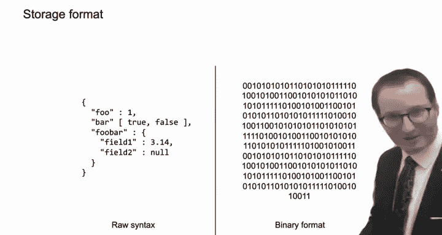

So now I told you that this takes space， if you store it as Jason or Jason lines。

 you know you have billions of that， the keys are stored redundantly。

 this is why we can switch to binary formats so I have in mind the Google's protocol buffers。

 parkque Avro and so on because then this is going to be stored on less space and again we love less space。

 it's faster to read， it's faster to process and so on。

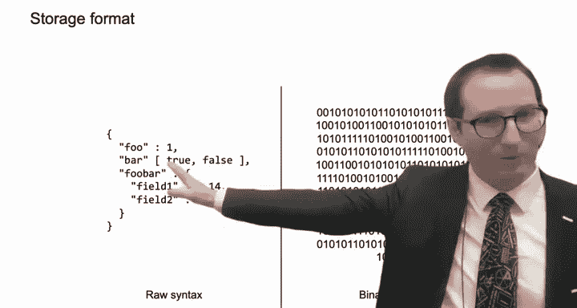

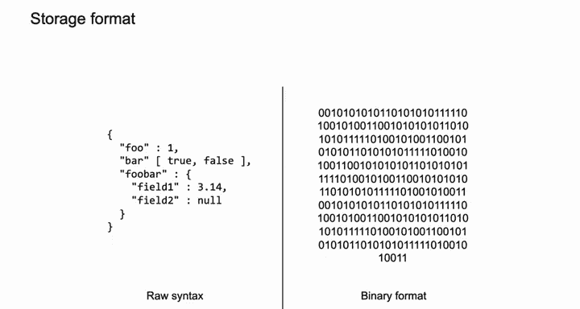

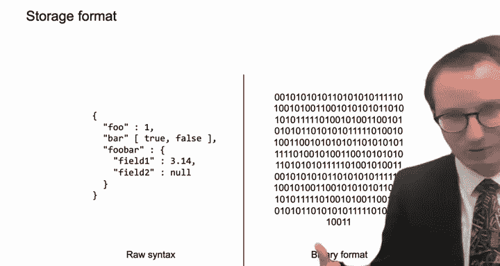

Then in order to。Avoid network I O。 It's things I already told you。

 you push down the earlier you can get rid of the data you don't need。

 the less you have to transmit over the network， right。

 And if you can even not even read it at all from the list， then it's even better。

 This is called pushing down So you pre filter， you pre projectject you pre aggregategregate or everything you can do before you do it。

 We've seen plenty plenty of examples of that。The prefiltering is that I think I might not have shown you。

 but it's the ID that you drop the records that you can already know you will not use pre projects this is the colon oriented storage I told you about if you have your data stored column by column then you can just ignore the columns you don't need so it's very easy to do preaggregate we've already seen with mapreduce that the combined function。

 the combined function is basically preaggregating so that when you shuffle over the network because the shuffling is over the network wires then you have less data that is sent over here right？

Does this work， you have the intuition。All right， so it's really， it makes sense， it's intuitive。

 but these are the techniques that we use to reduce。

And we batch process so batch processing is more about the latency。

 the idea of batch processing is that instead of sending a lot of small packets。

 you send larger larger packets， I don't mean network packets because obviously you do have small network packets。

 but I really mean in terms of the AGFS blocks， you know whenever you send something you want to send hundreds of megabytes at the same time if possible to avoid latency。

😊。

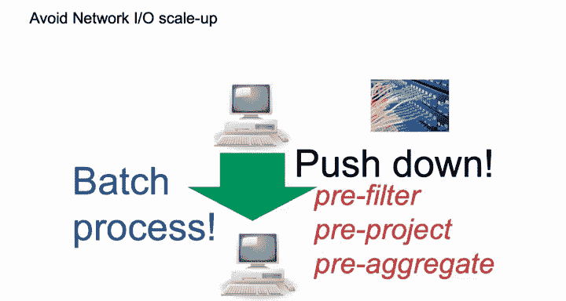

All right。And of course， if you can keep shuffling to a minimum。

 then that's even better so if you can redesign your job and the chain the da of transformations to have less shuffling so you can use prepartitioning you can try to to have less stages and less shuffling but you cannot bring it down to zero right because if if you manage to bring it down to zero probably something is wrong in most cases because you do need some shuffling because the queries do need some wide dependency transformations。

 so you can get rid of it completely， but at least you can try to keep it to a minimum。

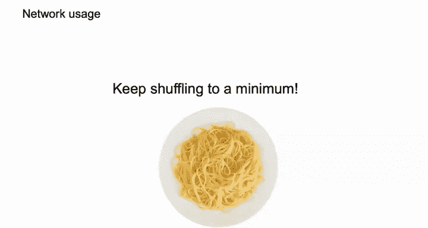

Now I would like to discuss the configuration of when you launch your Sp job。

 you know that I told you about the comment line， these Sp submit comments。

 I told you you can specify the number of executors， the number of course per executor。

 the amount of memory per executor。

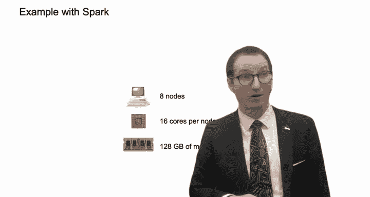

And concretely what happens a lot when you actually want to go ahead and book your resources for Sp。

 you're sitting in front of your machine， you have your query。

 you kind of know how many tasks you have， you look at the ADFS blocks and so on。

 and then you're wondering okay， how many machines should I book from let's say EMR so Amazon elastic Ma use would be the Amazon way of clicking buttons to get a cluster how many machines do you need。

 how much memory and how many calls So let me give you an intuition of that。

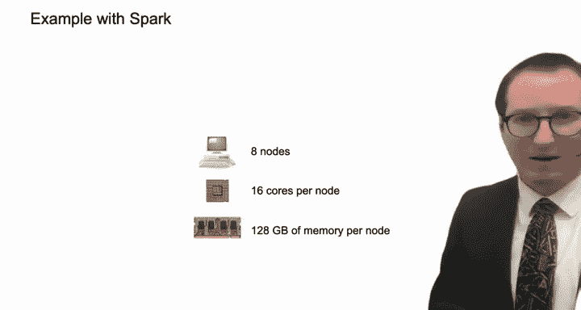

So imagine that with the example I have， we have eight machines right，8 machines，8 nodes。

16 core per node and 128 gig of memory per node， by the way，8 machines。

 I mean the worker nodes right there is in addition the resource manager and so on and the application master I really mean here the machines that have the executors So8 machines。

16 core per node， right So that brings you a total of 128 course in total8 times 16 and then 128 gig of memory per node。

 So times 8 that should give you one terabyte of memory in total right So you have to do this kind of estimations。

😊，And then。What happens is visually so you have these eight machines what you could do I'm thinking I would loud here。

 you could have one executor on each machine right this executor could have。

 let's say 15 costs Why not 16 typically you try to leave a bit of air to the machine so that they can breathe it's just an illustration it's the idea that there's other things running on the machine so you want to be careful do not use everything so intuitively let's say 15 everywhere and then you use 100 gigabytes of memory again。

 there's other stuff running on the machine so it's not a good idea to take everything but now we have eight executors。

 each executor has 15 costs so each executor has 15 slots so 15 tasksed in parallelel and then the 100 gigabytes is shared across the 15 slots for whom is that here。

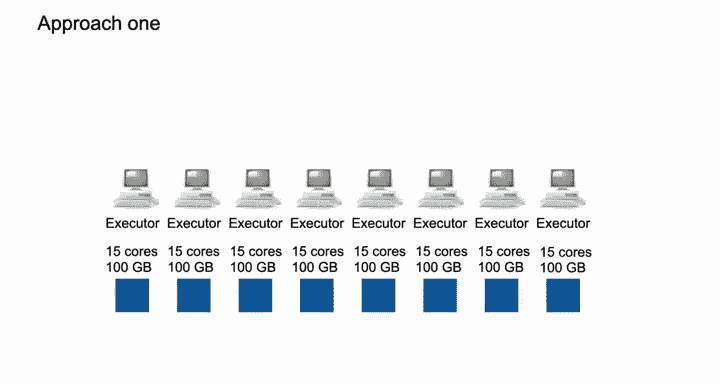

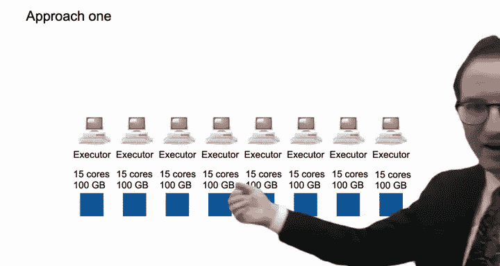

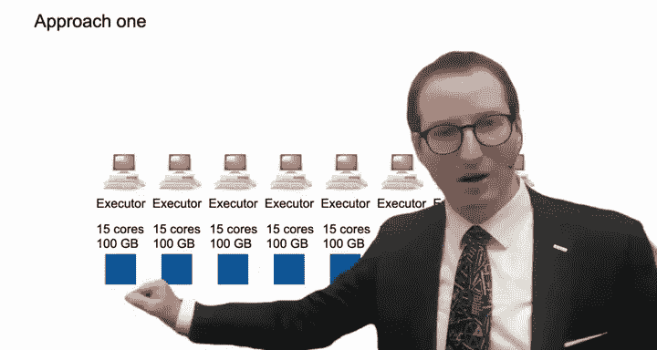

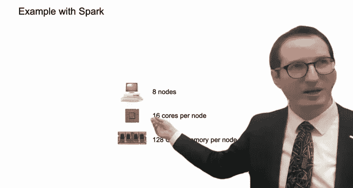

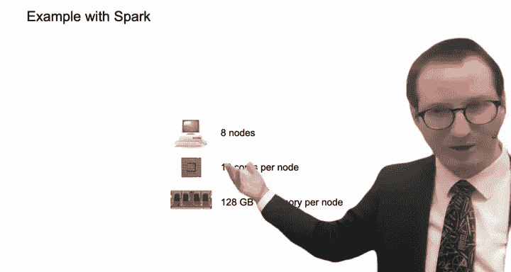

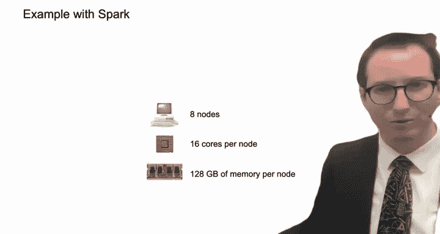

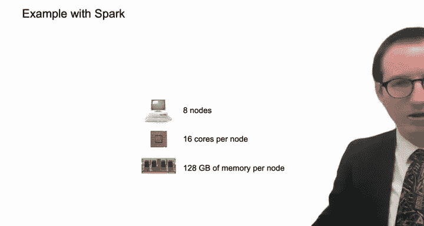

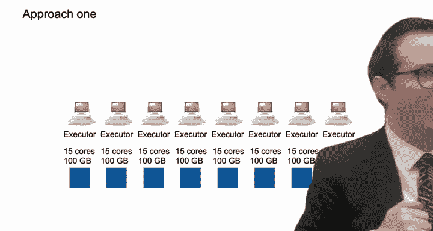

So that would be one extreme， one way of doing that， one executor per machine。

 the other extreme is this one。 the other extreme would be you have 15 executors per machine。😊。

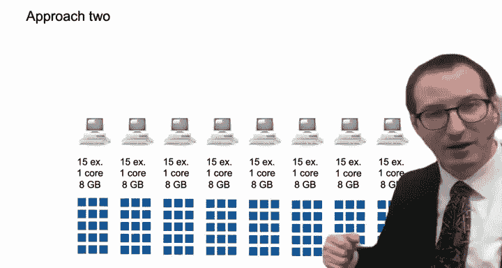

So it means in total you have 120 executors， right，8 times 15。 Each executor has one core。

 So if you do one times 15， then that's good。 That's still below the 16 per machine。

8 GB per executor gives you120。 So maybe I pushed it a little bit。

 but 120 is still below 128 right So basically what I have here is。😊。

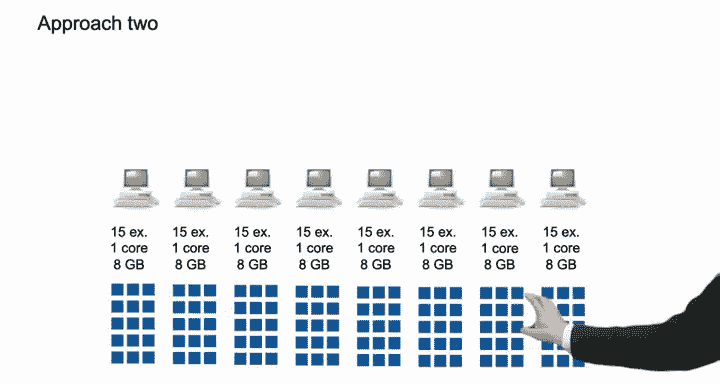

Many more but smaller executors。 And here I have less but larger executors right So these are the two the two extremes。

 if you stretch it on both sides in practice， neither is you don't want to be like this or like that in practice my root of thumb it's not already the case。

 but my root of thumb is you try to take the square root of the number of calls of the machine more like this approximately the square root。

 So that would be4 by4 if you want to a bit of breadth and let's say three times5 So here I have three executors。

5 calls。 So that's 15 still in total and 30 gigtes per executor。 that's 90 gig。

 this can be adjusted right， I'm just very costly showing you how that works。

 but you want three times 30 to be below 128 right and in practice this is the soccer of things you do right you have executors approximately the square root of the number of calls and the number of co per executor approximately the square root。

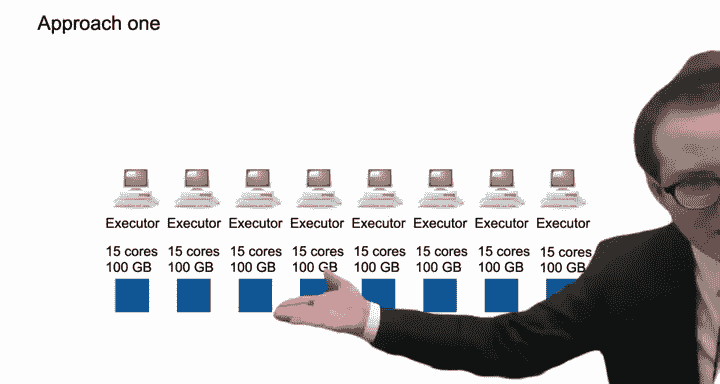

As well， right， does heat make sense？Okay， now you might ask why right。

 and that's really a practical thing because in theory， of course it doesn't matter。😊。

But in practice， what happens with this one， for example。

 is that the usage of memory by the tasks might not always be the same。

 And so if you have really the memory part per executor。

 then when you have a task that doesn't use so much memory。

 the memory is wasted then you have another task that might need more memory。

 but it cannot so it's limited to8 that if you do it like this。Like this。

 then it's okay if a task uses less memory because then another task can then use more right because they are in the same executor so they can exchange a bit of memory right it's a dynamic world between the executors。

🤧嗯。And that went basically the other extreme。嗯。Oh。It was delayed， sorry。The clicker is acting up。

So this s tends to。Also not be good from a performance perspective， because you。

 you have too much in the same。In the same process。 So so it's it's also not a good idea。 but again。

 in theory， you couldn't know this is really just in practice。 you notice that it it's not efficient。

 right so this is the way to go three times5，5 times3 that's basically the same。

 and you can configure all of that using you know the executor executor course executor memory and so on And then it's magic because you can set up a cluster in five minutes。

 you can go to Asia or Amazon or whatever。 you go to the website。

 you say I want that many machine machines with that configuration and so on。 you click a button。

 wait for five minutes， then you SS yourself to the machine with the key the primary key authenticate that you defined and then you can just go ahead and use and that's it。

 You upload the jar or your job or you just open a shell and use it and then you have an entire cluster machine that actually works。

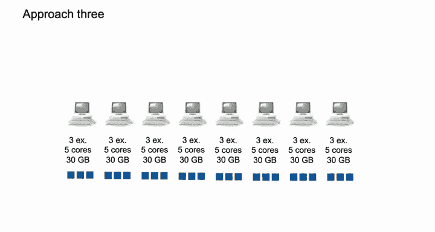

All right。Now I would like to rediscus because this is something I've already told you。

The size of the chunks or splits or blocks or partitions or whatever you call them right so basically the data that fits in a task。

In relationship with the number of slots。嗯。In an ideal old world that doesn't actually exist。

 you have one partition per slot。And they all take the same time， right， It's beautiful， isn't it。

 right， So here you have five slots。 You have five tasks。

 and all slots finish processing their task at the same time。 But you know that this doesn't exist。

 This isn't the real world in the real world。 If you would do it like this。

 where you would have one task plus slots， This is what would happen。😊。

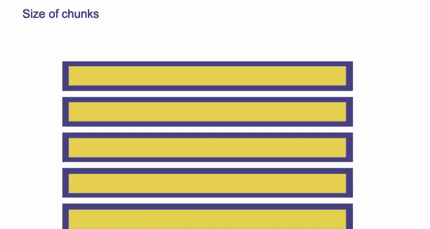

You would have a lot of slots that finish earlier and then one of the slots takes forever with the task and basically you're wasting time and space。

 you're wasting resources because four of the slots become id and one of the slot takes forever right so this is why we do not want the number of tasks to be equal to the number of slots or whom is that here。

喂。

Yeah so this is why in practice， this is what we do we have a multiple number of the slots So we we have like。

 let's say three times or five times the number of slots or 10 times you know just to give you an intuition and what happens is and I said it many times that I repeat it。

 it's dynamic all of the slots take one task and then it's dynamic once the slot is finished。

 they take the next task and so on。 And what happens is that the faster slots or the ones that get the easy tasks。

 they will process more and then you have these very slow slot or maybe it's a complicated task but now nobody's waiting for it because while it's doing its thing with that task then the others can actually process more tasks so this is why we do it in that way so that the task nicely spread over the slots like this。

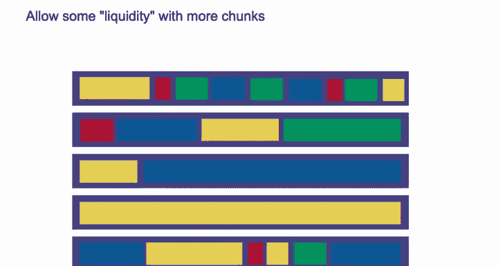

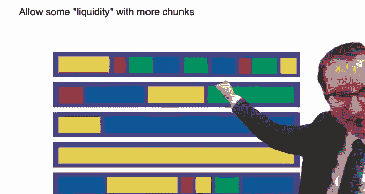

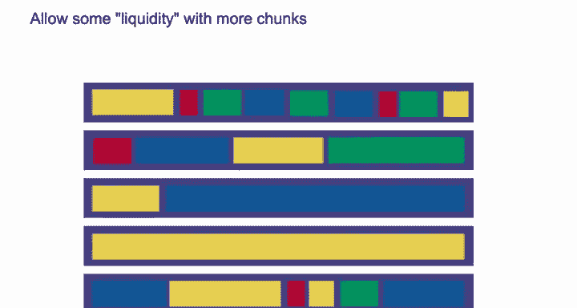

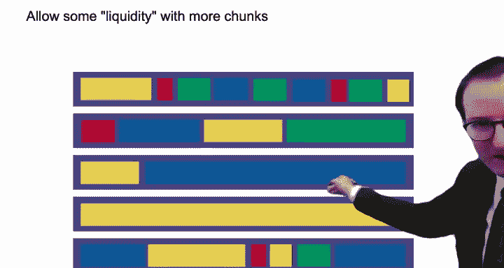

You might think， why don't we push it even more and just have really， really tiny little tasks。

 many of them， and then we let them spread。But then you know what happens， right。

 What is the problem then？Starts within L。La10 C， right， exactly。 that's the Latin C。

 because then every time you really have to imagine that there is an overhead。

 every time you start a new task， things happen in the， in the spark processes。

 And so that is not efficient。 So we also don't want this。 So it's other， again。

 a matter of balance between this， which would be when extreme and。😊。

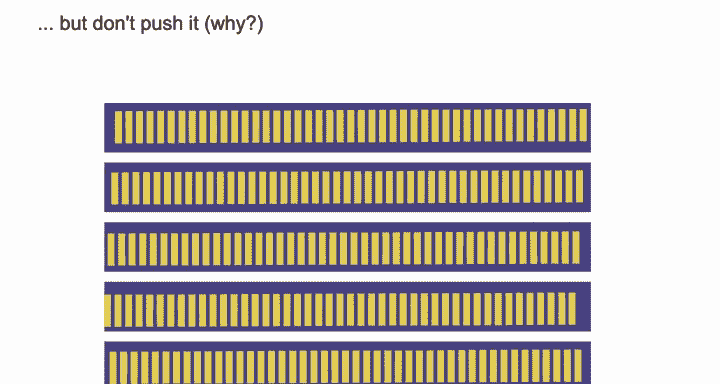

This， which would be the other extreme。 And we'd just take something in the middle， which is this。

 okay。

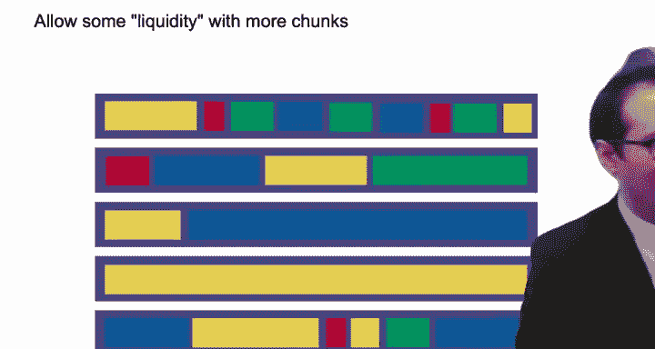

All right。嗯。So I don't know I don't know anymore why I have this slide because I already told you about the network usage so basically you want to push down and all these things to avoid using the network the network too much right so you don't want to have too much data over the network。

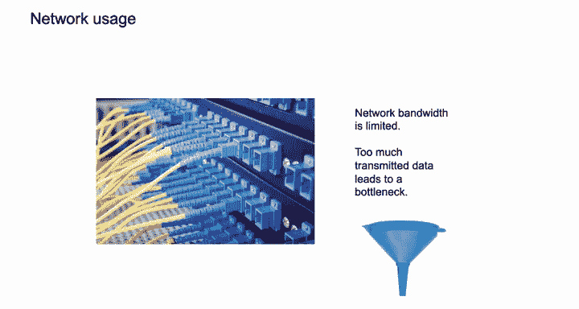

All right。And， of course， if you're not happy anymore。 if you， you read on everything， right， you。

 you've found the about leg， you've implemented better using full control of the performance。

 you've compressed everything。 You're using backque you you。

 you have a multi small multiple of tasks for slots and so on and so on。 and you're still not happy。

Your computer scientists I'm pretty sure some of you might be contributors to the next generation of Sp or maybe a completely different architecture and then go ahead and build it。

 you know it's at the end it's just the one chain in the technology history right but if you build a new spark you have to know spark first so that you learn from all the lessons that have been learned from the successes and failures。

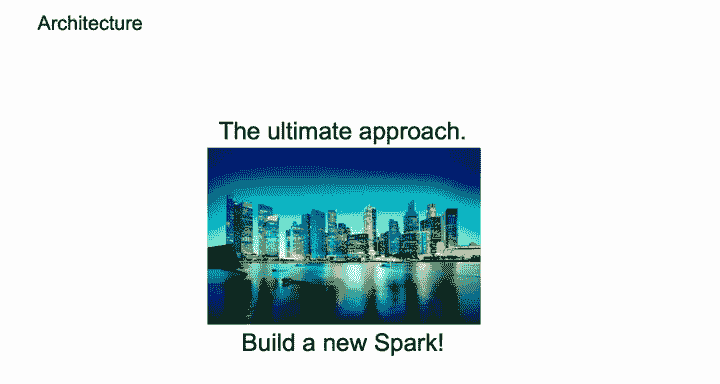

All right。I would be so happy if some of you would build the next stock。Okay。😊，呃。

Which brings me to the last bit of the performance at large scales。

 This is the clicker question that I asked you last time。😊，What about a very large scale。

 you have thousands or tens of thousands of nodes， you have an absolutely gigantic job with petabytes of data and many。

 many tasks and many， many slots。

So here's what happens。So let's say I'm taking an example with five， but of course。

 I cannot draw millions of the of the。OfOf slots in there， right， but basically。I the idea， again。

 even if you spread dynamically， right， imagine you have five times five times as many tasks as slots。

So you would think and actually with five it's going to happen like this。

 This is going to to be like this。 imagine there's multiple tasks in every slot。

 This is the total duration of every slot。 They more or less kind of finish at the same time。

I'm too far away I walk too much and then I'm too far away and then the clicker doesn't click anymore and then so you increase the number of slots and then you would hope that it stays like this right you increase the number of slots and then it more or less ends at the same time because of the way the tasks dynamically spread over all the slots the problem is that in reality there is a point that you reach for a very large number of machines that in which this happens。

😊。

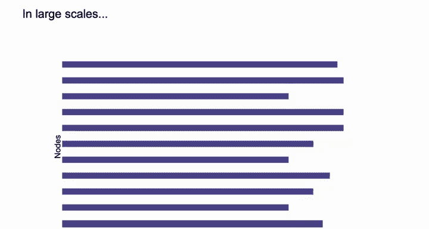

Baically have all the machines that finish in a reasonable amount of time and one of the machines。

 maybe two or three， but one of the machines just takes forever。Forever， forever， forever。

 just everybody is waiting for the machine and so on。And this is called tail latency。

 And this is something that people， for example， like Google told me that they hire on new people。

 you know， and and， and they start working on the on the infrastructure。And then when you see that。

 you might be tempted。 Okay， let's apply my knowledge， let's improve the codes。

 Let's make the code better and so on。 As I told you， it would not change anything。

 This is still going to happen。😊，This is really a phenomenon that happens。

 It's provable mathematically。 I'm going to show you the math of it。

 but there is nothing you can do about it as the user programming。

 configuring and and programming spark。 This is really something that goes beyond it。😊。

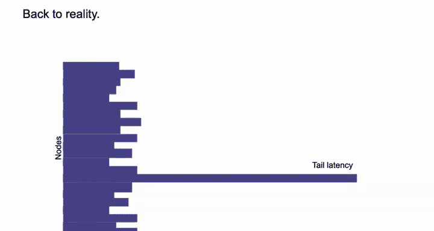

And the reason'm going to give you an intuition。😊，Is that when you have the machine。

 the machines that you're using。Sak is not the only thing that is running on it。

 There's a whole operating system。 There's background tasks。

 There might be garbage collection in Java and so on。 So there's many， many。

 many different things that happen on these， on these machines。

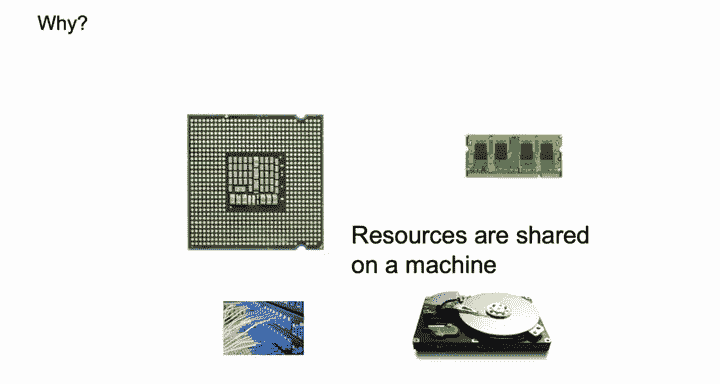

And these machines also share resources like the network。

 the disks might also be attached to a rack or whatever， I mean there's many， many different ways。

 but basically it introduces a lot of unpredictability and things can actually go wrong you know sometimes it can take forever there might be some background demons that are working on the machine totally and related to Sp。

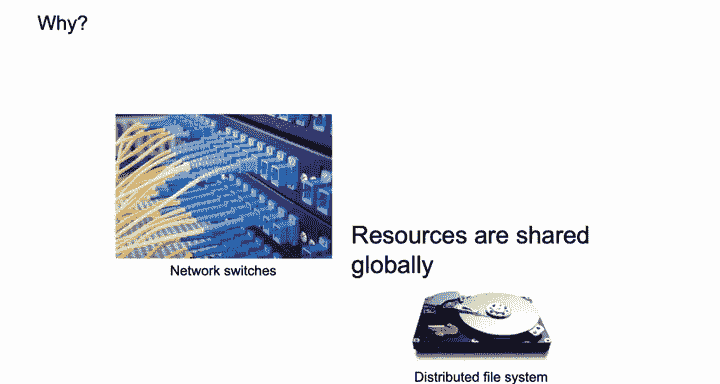

And there' are some hiccups， or they start randomly running in the background or something。

And then it causes a delay on the machine or basically things make things go bad。Um。

It has to do also with power limits， you know， hyper threading garbage collection。

 I told you energy management queuees。 So a lot of things that I don't really understand。

 but that are enough to basically cause this。

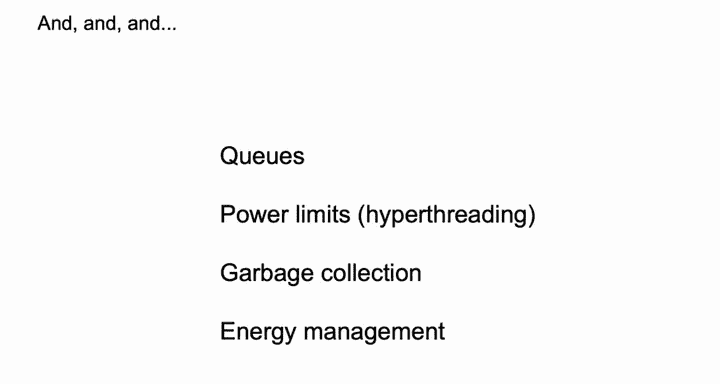

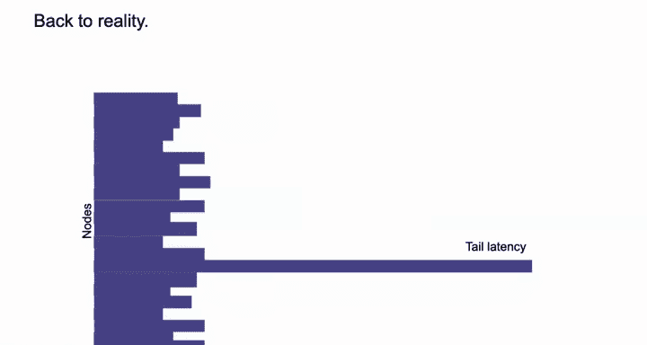

Right so。What I understand， however， is the last。So let me explain you the math。

Imagine that we are reason with these service level agreements， so the lawyer way。

 imagine that the time it's going to take for a task to be completed。Is going to be10 me。

10 milliseconds， typically。But in 99% of the cases。It's less than 1 seconds， right。

 in 99% of the cases。 my my my I'm going to be done in in less than one seconds。

 I'm going to simplify a little bit and not reason in terms of tasks。

 but in terms of slots right So just in terms of slots。 So imagine that in 99% of the cases。

 a slot is going to be done in less than one seconds and in 1% of the cases。

 it might take more than one second， but could be actually any any duration。

Now you have to think a little bit in probabilities， so if you have a single node。

 you have a probability P that it's going to fail， so let's call it P so P is basically 1% so with probability P you are in 1% of the cases。

😊。

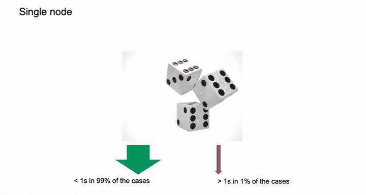

This is going to fail。 Take forever。 You just wait forever。 You might have to run it again。

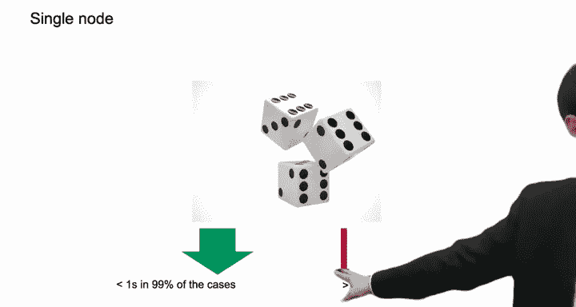

And then in 99% of the cases， it's less than 1 seconds。 Now， this is not a big deal， right， you。

 you just do it。 Most in the most of the cases is going to work。 The worst that can happen。

 but it's rare is that this is it。 And then you rerun it。 And then it's most likely you will be here。

 So one node is really not a big deal。

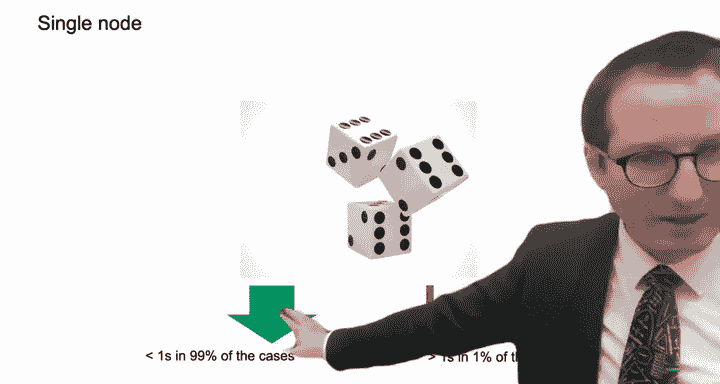

Now with 10 nodes。😮，You remember your probability theory， right when you have independent events。

 you multiply the probabilities， right， probability of A and B is probability of a times probability of B。

 right。But here it's not the probability， if I call P， the probability that is going to fail。

 which is 1%， then 1 minus p is the probability that one node takes less than one second。

Now I basically have to consider the probability1 minus1 minus P to the power of n。Right。

 so1 minus p is the sixth probability of less than one second for a machine。

1 minus P to the power of n is the probability that all n machines take less than one second with with me。

Right1 minus p times 1 minus P and so on， and then you do one minus to take the probability that at least one of the machines is going to take more than one seconds。

So the probability， if you compute it with n equals 10， that's 1 minus 1 minus 0。

01 to the power of 10， that's how it's computed and this is what you get in 90% of the cases it takes less than a second and in 10% of the cases at least one machine。

Will take more than a second。 Now， this is still manageable， right， happens1 in 10。

 You just do it again if it happens。 So it seems manageable。 Let's take 100 notes。

 So now I'm basically looking at 1-1-1% to the power of10s， right。

 So now it's the probability that all the 100 machines will be done in less than 1 seconds that only happens in 30%。

37% of the cases。There is two thirds of probability。

 two thirds that at least one of the 100 machines is going to have a problem like that。

 Now you start realizing this becomes a problem， right？And with1 thousand， it's absolutely dramatic。

The odds。If I assume this 1%， right， 1% that a single machine is going to take more than one seconds。

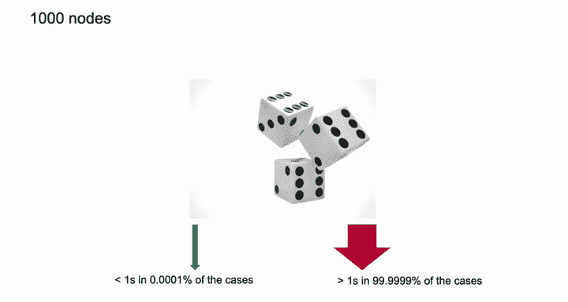

Then the probability that all the thousand machines are going to be in less than a second now it's 0。

0001% of the cases you basically are winning the lottery if all thousand nodes finish in less than a second in most cases is going to be more more than one seconds right Who gets it。

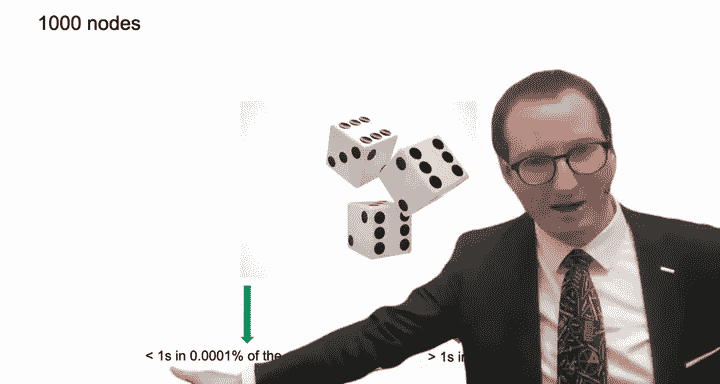

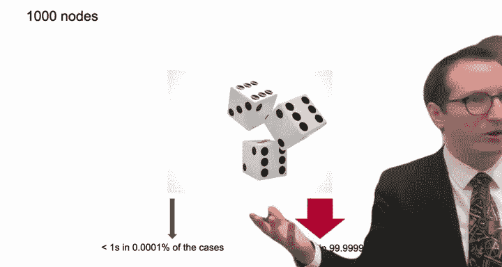

Very good。 It's really this one minus1 minus p to the power of n and you plug in P and you plug in n right so here I varied n and I took a fixed p of the 0。

01。😊，So， you might think。You might think that we can fix the issue by modifying P， right。

 What's the big deal 0。01 that might have been pessimistic。 Maybe I can。

 I can try to improve things the least bits so that let's say now。It's in 99。

99% of the cases that it's less than a second。 and now it's a probability of 0。0001。

 that one machine takes more than a second。 right， So let's do it。 then let's do it in this way。

Then you can compute it with n equals 2000。 So again， it's 1 minus1 minus 0。

0001 to the power of 2000 right you compute that and you realize that already with 2000 server。

 you're back to having a problem here you have 20% of the cases， this is going to go wrong again。

 even though E now is very， very small， but here it is with us again。

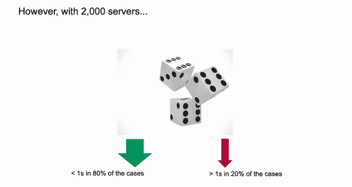

And I think see the graph coming in the next slide。 Yes， absolutely， you can plot the graph。

 There is a paper that I put in the modelle that that you should read because it's very instructive。

😊。

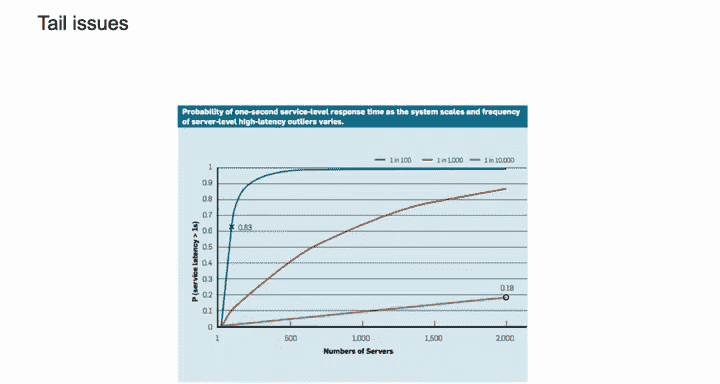

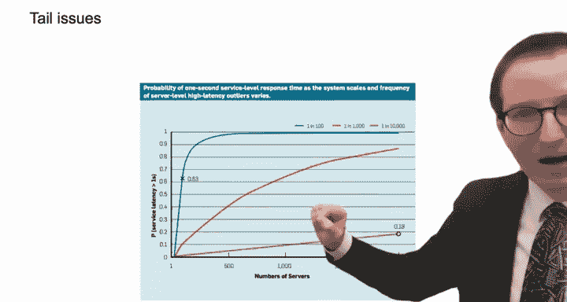

So this is basically the color is the probability right so that was the first one I showed you probability is 0。

01 that was the when I varied n the first time and then the 0。

0010001 was this one right and basically I when I give the first example I did it with one with 10 with a with 100 and then with  a thousand00 right and you see the thousand0 is already at the probability of always one that that the whole thing。

😊。

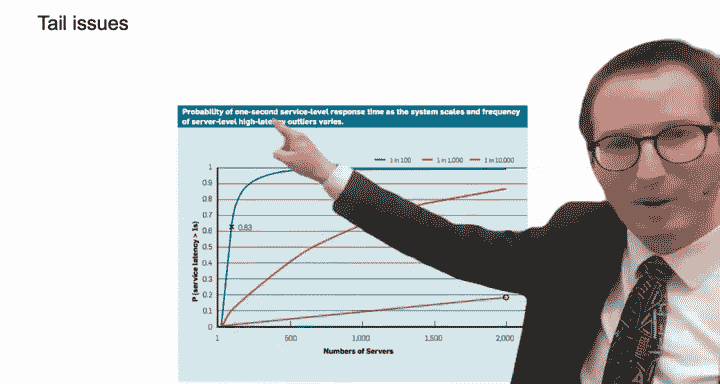

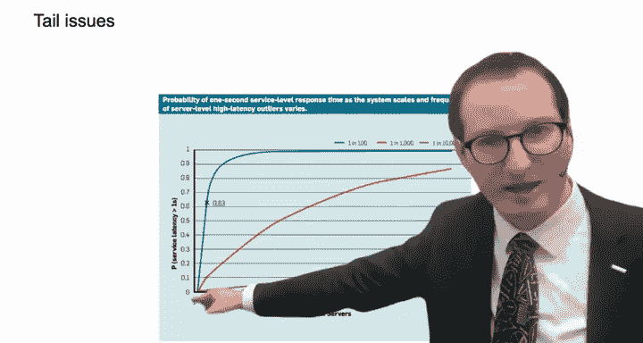

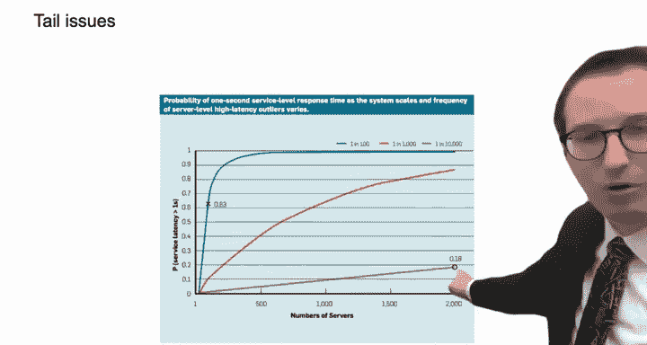

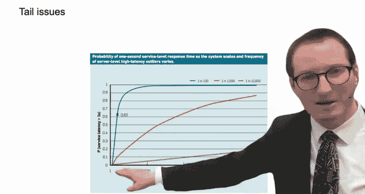

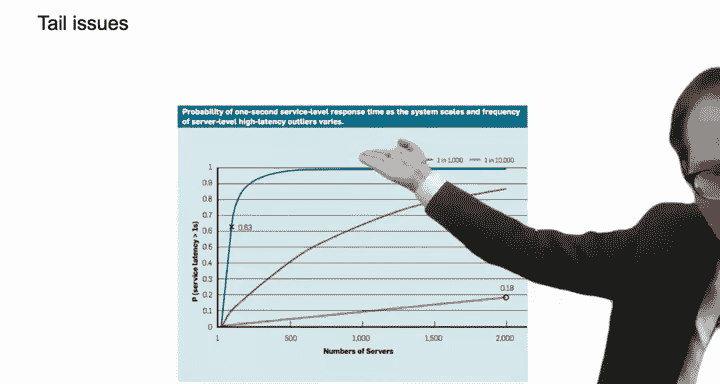

Doesn't work。 Then the last example I showed you with a reduced P and 2000 as an example is here。

 Basically， this is approximately 20%，18%。

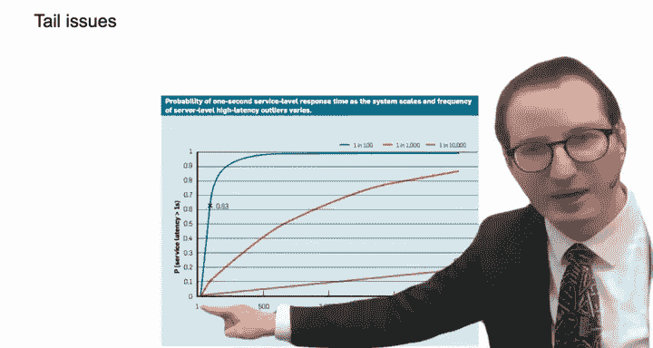

Here that in between， if the probability is once in thousands。 But what you notice。

It doesn't matter what value of P you take at some point。

 you basically increase the number of machines。

This basically， again， goes up like that。 It's basically mathematical because the problem is that the n is in a power。

 it's to the power of N。 So this is what actually brings the problems。😊，So it means that。

You can try to decrease P。 You can try to to improve your code to reduce the duration of the task。

 but that will not change anything。 So we need other solutions to deal with this。

And。So this is all the things that don't work。 So I'm passing on that。

 you can basically try nothing of that is going to work。

So one thing you could do。For example is to duplicate all the tasks you basically execute every task twice and whoever executes its first wins and then you can cancel the second one right the first done wins so this is one way of avoiding it it has a cost you basically multiply the costs by two in terms of what you pay but but solves the problem so it's had request。

 at least it solves the problem up to a satisfactory point。

There is another one because this one is costly right you still multiply the cost by two you need twice the size of the cluster or you can do half of what you would do with the normal cluster。

Okay。😊，And another approach that is a bit less costly。Is to not duplicate the tasks。

 you basically start everything， start all the tasks。

 and then you just monitor of something that takes forever。

And what happens is that when you notice it starts taking forever， you wait。😊。

Until that forever is the 95th percententile， it means that you， you basically assume， imagine you。

 you took the time to do measurements of the cluster and to basically plot the whole。

Probabilityity density of the time it takes， Right， So we， we until now， I only told you the。

 the 99th percentile is that 0。01 or 0。0001。Let's say now you look at the 95th percentile。

 it means you reach a time that is the worst 5% right there is a threshold at that point you are in the worst 5% when that threshold is rich you just cancel it and relaunch the task somewhere else。

But the difference with the previous approach is that in the previous approach。

 you proactively launch everything twice。Right so this is here proactive here you only do it if you have a slot that ends up in the in the least 5%。

 so of course it means that 5% of the slots are going to be like that and for that 5% you just launch duplicate tasks somewhere else and then it's likely that this time it's going to work right。

Or whom does that make sense？So it's very interesting because these things have absolutely nothing to do with writing good code or trying to improve the operating system or whatever。

 it's just mathematics， the power of exponentials， and that forces us to come up with these solutions。

Okay， and then you cancel it。 And now you're， you're basically back to normal。 So they did。

 there's the， there's this in this paper。 They tried it。 Is there a question。Yep。

But there might be a lot of tasks that we submit and if we need to monitor the execution time for all of these tasks we submitted。

 doesn't this come quite a large overhead just for bookkeeping you do it anyway So for example。

 if you use SP there is something called the SP history server thats I think it's the is it 444 or 4040 might be 4040 So if you launch Sp you connect to local host 4040。

And here you monitor the tasks， it's done actually。

 so it is taking care of it because when you launch a spark job。

 the application master if it's young has to monitor all the tasks anyway。

 so you will know if one of them is going to reach this danger basically。😊，Does it make sense， Yes。

 thank you And by the way， it's a very good opportunity to tell you use that history server go for it。

 it has a lot of very visuals and graphs you can see in real time your Sp query getting executed。

 you can see beautiful graphs of the query plan and the D of transformations and so on。

 it's very very nicely done and that's a great way to understand the internals of how Spk Spk is。😊。

So there's a precalculated threshold， a time threshold， and if a task goes beyond it。

 it's canceled and run again。Okay， exactly that's exactly what we do because now when you run it again。

 you reset everything， you're back to a probability of the of the 1% that it fits。

 but now you're doing it only with50 cents of the tasks so every time you just you just restart from scratch。

And the cost here is a bit less because instead of doing it for 100% of the tasks， as we do here。

 it's on 100% of the task or those slots， here you only do it on 5%。

Because that's the 95th% diet right， if you had taken the 99th% diet。

 then that would have been just 1%， but then you would have to wait for more time。Does it make sense？

有。So where this management system implemented or we implemented it ourselves or it's like some extensible art of Srk。

 It's going to be the engineers thats do it。 so typically this sort of things So first。

 it's only going to happen in a big company like Google or Amazon or like you really need to be to have a lot of machines。

 right， if you' only using a couple of machines， you don't need to worry。

 So this is the reason why this is the sort of things that it's the Google engineers and the engineers in these companies that take care of that。

 It might be at some point that it comes also to the public versionions。

 But then it's really a matter of how many people have this issue， right。

 But I guess a lot of you are going to work in these company。 So you might actually see see them。

It's really an infrastructure， an infrastructure I think。

It might be actually that by now it made it to we， we could check if， if now it's part of Sp。

 if they they made it， they made it public， it could be。没。Okay。

So that's the last slide so just to tell you that they tried it out， for example。

 with a thousand requests， I think they did it with Dynamo or something don't remember exactly the context。

 but this is without hedging so this is where one of the slots takes forever and then you have basically takes one second which is forever in the context in which they did it。

😊。

And then they I think they took here a lower a lower half centile and then kept running it again。

 And then they brought the overall time down to 74 milliseconds。

 So you see that it actually fixes the problem。 It really addresses it。

 And they took the threshold at。10 millise secondsconds to do it right so it works。

 This is basically an experimental validation。 You have to do it experimentally because if you just still or read doesn't happen。

 it only happens in practice。 So the only way you show it solves the problem is to actually try it in practice and see that it works。

😊，给。So that was this section here with a little parentheesis on path performance that we took a step aside。

 I just wanted to make you aware of all these things and now I'm going to go back to the normal to the normal material where we study technologies stillll have a bit of time to start to start MongoDb so。

😊。

What I will do is stop the recording now。

