# 苏黎世联邦理工《大数据｜Big Data - ETH Zurich - Fall 2024》中英字幕（deepseek - P36：-36-11. Document stores (2_4) -.zh_en - GPT中英字幕课程资源 - BV1sHPKeoEJU

Welcome everybody in the lecture hall， welcome everybody on Zoom， welcome everybody from the future。

😊，So today we will continue our exploration of documents does I actually started a little bit last week telling you about them in particular we ended the lecture of spark on leaf hanger。

 it's that in the case that your data is nested and or heterogeneous then that hits the limits of Sp sQL。

 it's still kind of works but it's not ideal and so now we are exploring some some other paradigm I see a raised handover there。

Can I increase the volume of the microphone， let me see？Is it better like this。

Can you hear me better？Kind of， you're not completely convinced， kind of。Even more。Like this。Yeah。

 better， okay。All right。So we are exploring another paradigm， so I explained the hood imp mismatch。

 right。😊，It's a common thing in the field of databases that there is a new idea or new shapes and then you have to implement a database system that specializes in these shapes and so what I explained is that people try before they invent something completely new。

 they try to store it on some existing system like a relational database and so on。

 but of course that existing system would be a physical layer right you would have to hide it and still expose the desired data shape to the user。

So what I hope you now understand is that if you try to use a radiational database management system to store your documents。

 it's very much like trying to put a square peg into a round hole right because trees just did not fit in tables right so this is the idea and so this is the justification for yet another paradigm which was the document stores right？

And so I will tell you about this， there's actually plenty of products out there Mongodbi will be our focus。

 but there are so many so many out there， but they all work in the same way so that's the good news once you have learned how one works then you will be capable of learning very easily how the others work。

So the idea is that in a document store， you can have collections that have enormous numbers of documents。

 you can have millions of documents， billions of documents， perhaps even trillions of documents。

 just to give you an impression millions of documents that's actually not very impressive in big data。

 millions of documents that actually fits on a machine billions of documents you can actually still fit1 billion documents on a machine in some cases。

 but billions of them this is where you start needing some multiple machines and then trillions then here you really need to do to go to large clusters。

 but most of the case， most of the cases in documents， all these millions or billions。Ohel cus。

And the size of the data we are talking about is gigabytes terabytes， metaabytes inside。

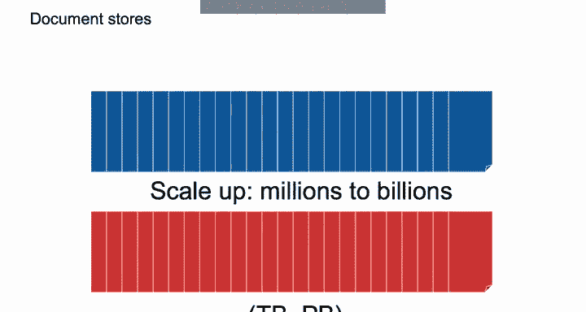

Now。We have two kinds of document stores on the markets。

 there are XML document stores and there are JON document stores but that shouldn't surprise you because I told you Jason and XML is's the same things it's just truth so it's quite natural that you have the two kinds of document stores MongoDb is a J document store exist DB or Maclogic are XML document stores they work in exactly the same way right？

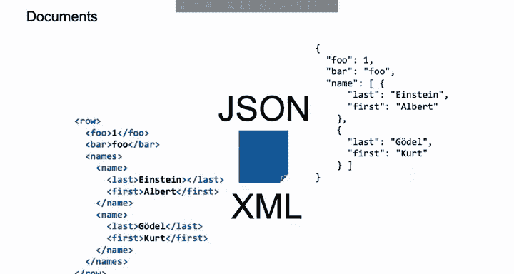

So everything in a document store is a collection of trees that look like this so here it's a collection of three trees right that in that case happened to be Jason trees in fact。

 if you remember the Jason lines files where you have one Jason object per document。

This is quite a good input for a document store， right。

 you can take a Jason lines slide and that gives you a collection of the adjacent objects Okay。

 collections of trees。Now， there is something that sounds trivial to say。

 but it is something absolutely fundamental to understand。Even though we have a lot of documents。

 millions， billions， trillions， the size of the documents is actually not that big。

 so typically many documents cells restrict to 10 megabytes a bit more than 10 megabytes MongoDB。

 I think it's 16 megabytes。That order of magnitude shouldn't actually surprise you because that's the same order of magnitude I told you for H base who remembers I told you for H base up to 10 megabytes roughly or a cell that's the same order of magnitude right so we are looking at billions of J documents but they shouldn't go too much over 10 megaytes and there's a hard limit in some of them at that level so if you try to store I don't know a collection of1 thousand documents of a gigabyte each that doesn't work you shouldn't be doing that what would you use if if you have thousand objects of1 gigabyte each why would you put that。

S3， yes， exactly。 Then you would go for S3， absolutely， al right so。This is what we have here。

A huge number of small to medium documents， few megabytes。

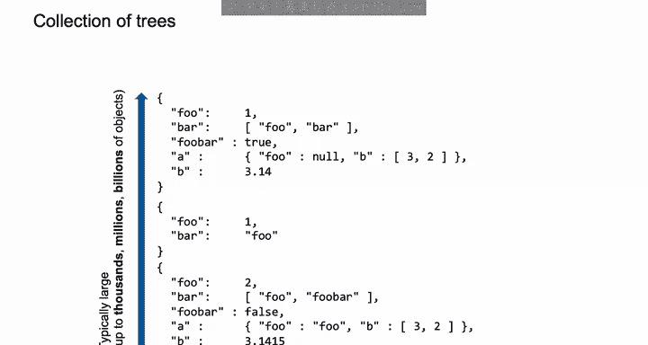

Okay， in practice， of course， it's very often you don't even reach megabytes。

 particularly it's like I don't know a few tens or hundreds of kilotobytes very often。

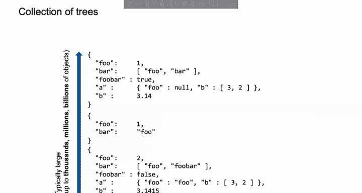

All right， and so now I emphasize something that I kept studying you this is all about flat versus nested and about heterogeneous versus homogeneous and again what you really need to remember here is that the flat homogeneous case which means relational tables is a special case so if you take a relational table it's very straightforwards to convert it to a collection of homogeneous flat Jason objects who is that。

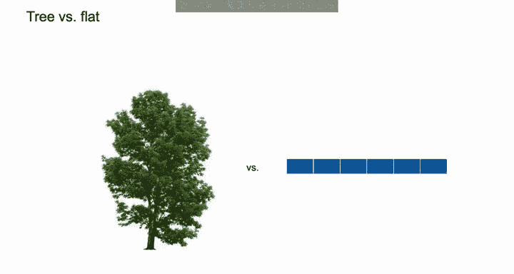

I told you several times already， very good。Now， what are some of the differences with the relational database management system。

 well the first thing is that we have projections， we have selections， we have aggregations， right？

But we don't have joints， or at least not natively in most systems。The reason is that aggregations。

Seelection projections， we can do them quite efficiently we so inspect that you can use RDDs and transformations to do projections and selections。

 we even did that in mappreduce so it's quite a natural thing to do by joints are very costly I even warned you that when you want to join RDDs and so on you really have to be careful about the size of the RDs and you also have to be careful about the joint predicates it's not an E predicates then you might crash the cluster stuff so it's kind of the reason why some document stuff in particular MongoDb do not support joints because it would be a performance penalty but what happens in practice people reimple the join in C++ or Java based on the MongoDb API right so what you did is you just push the burden of implementing the joints to the users in the host language。

All right。

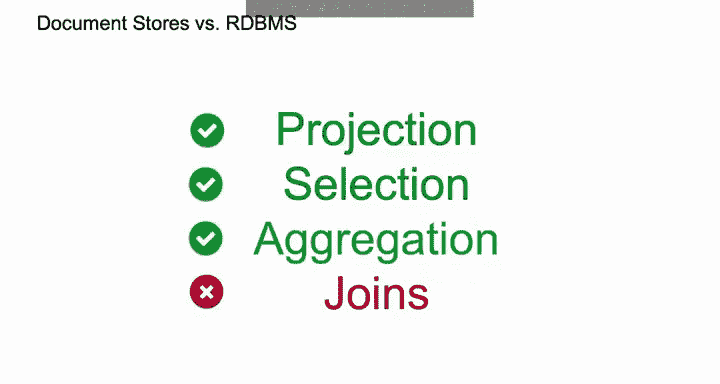

U。Something else that is a bit different between Mongodibe and Pogs UL generally document of and the relational database managementvent systems is that in a relational database management system。

 you have to validate the data。 In fact， you cannot even put data into any table if you haven't first specified the table in a schema。

 right That's the create table statement in SQL。In the document story is actually different。

 you can actually go ahead and put objects in a collection and you don't need a schema for all that。

 you can even be a huge mess， you can put a thousand or a million totalion related JON objects in a document stock collection that's totally fine it's going to work right。

But optional， you can bring a schema。 You can bring a schema at the beginning if you want。

 so you create the collection and you specify the schema that you want to have。

 And then the document store will check whenever you insert something。

 it will check that hits that is right， Otherwise it throws an error。

Or you can worry about the schema later， meaning that you first drop your objects without validating them and at a later point in time。

 you add a schema saying from now on I'd like to work with that schema。

 you can retroactively tried to validate the previous documents。

 it will validate any new documents that you insert。

And complain if they are not valid whenever you perform an update。

 it will also check whether the updated document is still valid and so on and so on。

 but it has a bit of this flexibility， something you don't have， for example。

 in a relational database management systems is that you can make it in such a way that if you attempt to validate a collection。

 but some of the documents are invalid，And you have to deal with it it's just that they are considered invalid。

 you can have some sort of lax mode in which if you try to update an invalid document。

 it's not going to complain even if it's still invalid after all that so you can use it a bit in a relaxed fashion compared to to the relational world for whom does that make sense。

So we have schema mass， but you're not forced to use schema and you can usechema with a little bit more flexibility。

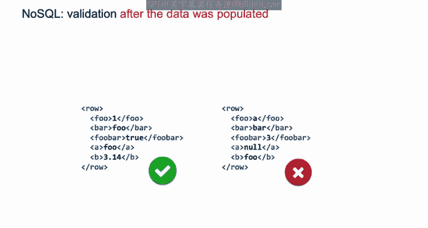

This here， what you see is the names of some of the document stores available out there。

 Mongodb is the one that we are going to consider， but there's also elastic search。

 very useful especially for indexing data， especially based on text characterDb that's also Jason Xs Db that's an XL So whenever there's an X in the name you can be sure it's an XML document store So X Db Cloudant is Jason MongoDb is Jason Maclogic doesn't have an X。

 but it's XmL， but they still added Jason as well later。Microsoft Asia also has。

 I think it's a cos D so they have all kinds of of there's also DogDB I think that is a document store base X。

 there's an X so it's an XML document store and so on and so on and so on， many， many。

 many of them right but the most famous one is a MongoDB I still remember when they announced that it reached the startup reached a billion dollars of market capitalization a while ago and then they became very popular。

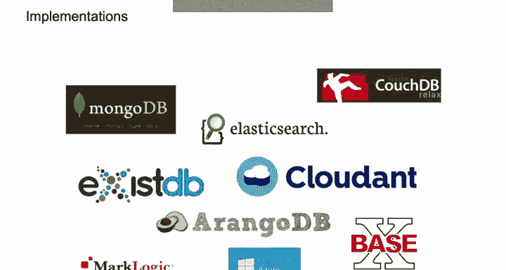

So MonggoD， I'm going to introduce you to MongolDb。

 but again keep in mind that this is actually general。

 a lot of the things are actually also working similarly for other systems and you just need to look at the documentation。

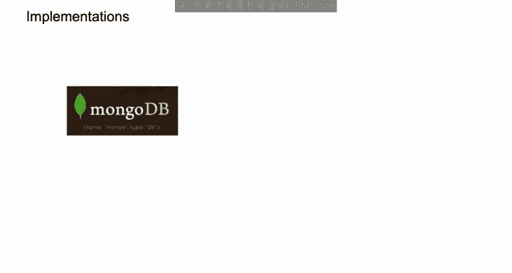

Okay， who is ready to query Mongodbi？😊，All right， so let's go ahead。

The first thing that I want to make you aware of is that we are not looking at HDFS with Spk map Red or anything like that。

 or even S3。Because we are reentering the light side of the f here with the Google databases just like PostsQL where you insert your data and you ETL your data in other words we are not looking at data lakes anymore unlike in the previous few weeks。

 so it's not stuck it's not my produce， it's not Hadoop it's nothing like that it's not onnda。

 this is a good old database management system where you cannot just drop file。

 you have to insert ETL the data into the system。

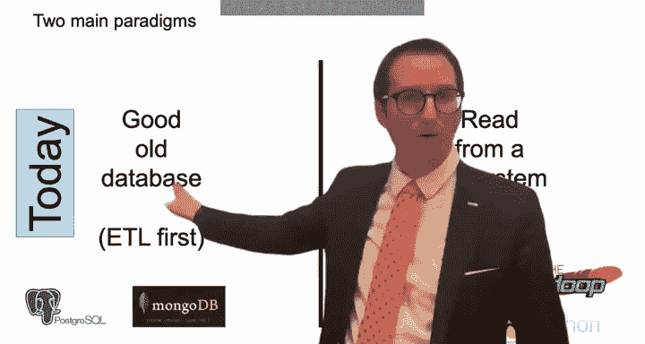

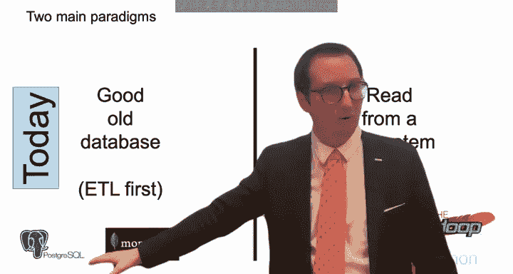

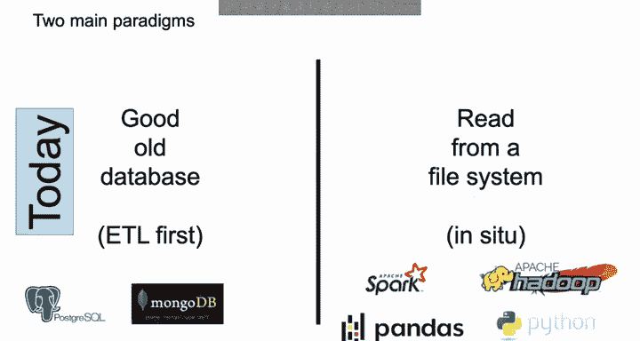

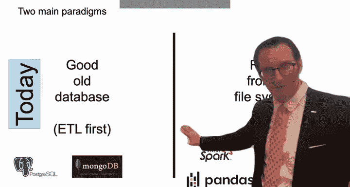

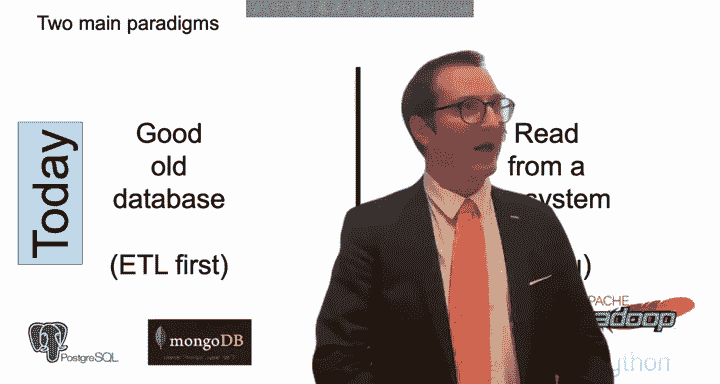

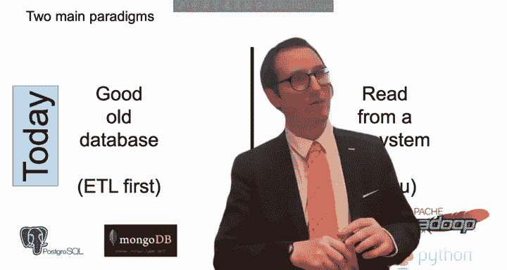

So you really have to compare it with PoreQl in spirit。

 it's just like PoreQL except that it stores documents instead of papers。

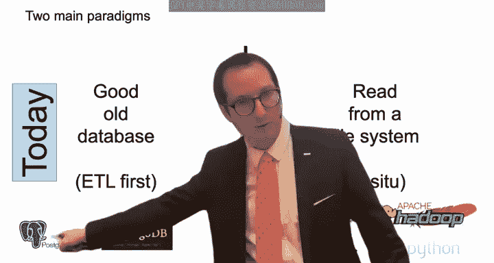

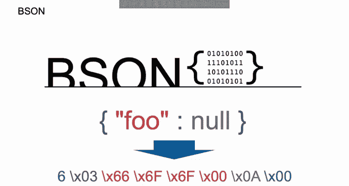

Now， one of the corollaries of having this Google database that is not a data lake is that once you have inserted a document into a MongoDb collection。

 it is not going to store it as a JON file。

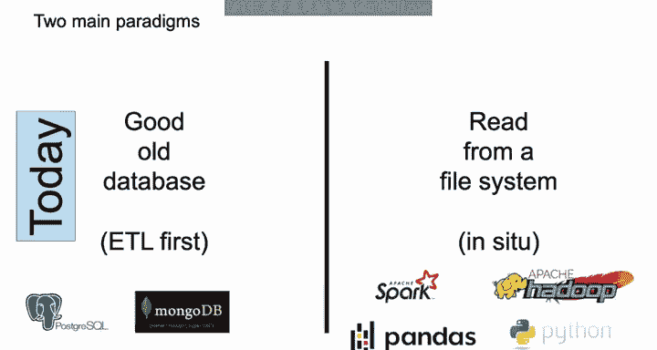

Instead， it's going to store it in some optimized format， binary formats。

 just like PostSsQL does for relational tables， it doesn't obviously store them as CSV。

 it stores them in some optimized format for tables。And in the case of Mongodb。

 that optimized format is called Bson binary JO right so I think you can see the spec on9 it's bison dash spec do org or something。

 you don't have to worry too much about the details but what you need to understand is basically that it takes the JN model So this is really the JN model as a tree we have an object we have a keyfo and null right even though I show you here the serialized text but you really need to see the object and what happens is that under this iss going to use some special codes to basically say this is an object。

 this is the length， this is the key， this is the encoding of null。

 this is the end and so on and so on so it's really an optimized binary format is's going to take a little bit less space than if you actually start it as a J as a full JO in a text format right。

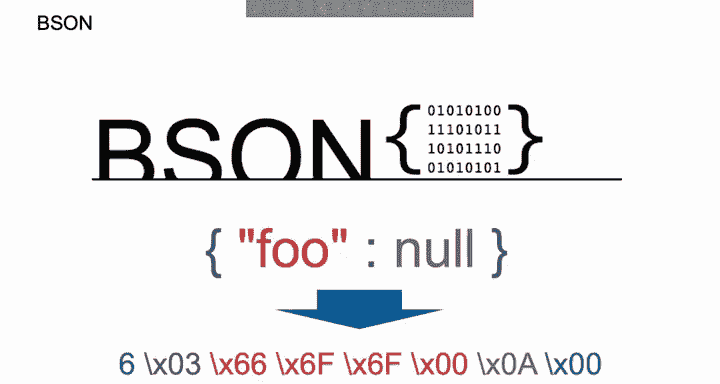

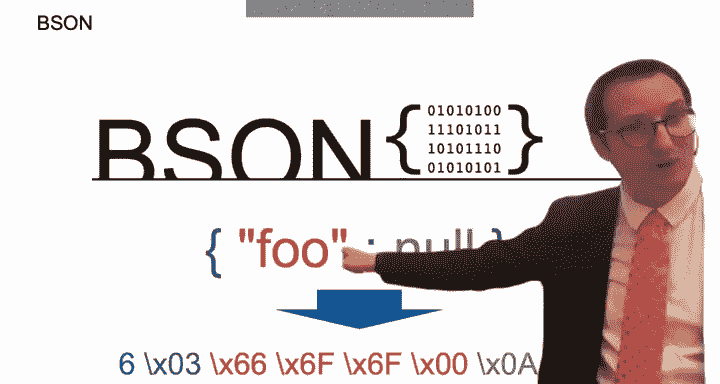

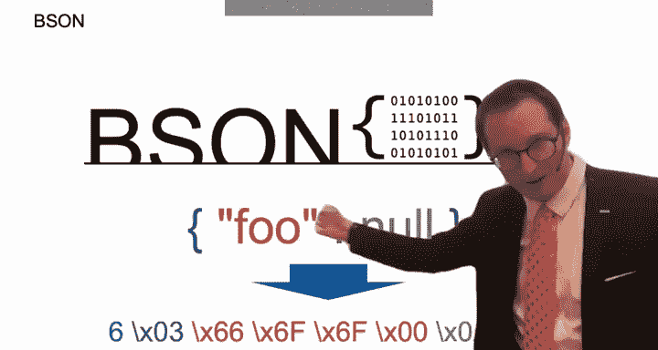

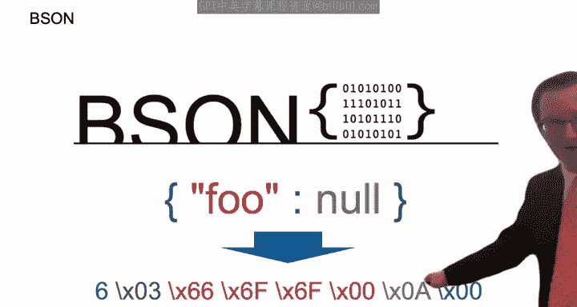

It also comes with a bit of improved features compared to Jason because in Jason you only have strings numbers。

 Booleyans and nerves right but in Bi it supports additional types。

 it's also capable of storing dates and a few more types than in conventional Jason right。Okay。

 so this is Bi， but the good news is that if you use MongoDb you actually don't care about that because this is just happening behind the scenes only hidden when you interact with the MongoDb。

 you actually interact with the adjacent thatammod right so this you don't even you don't even you would really have to go to the drive and look for the physical location of the storage to actually see that。

Okay。😊，And we'll see that some of the benefits of having to insert explicitly documents and then start like that is that we'll get much faster lookup times thanks to indices。

 that's something we do not have with datas， but I'll come back to that。😊。

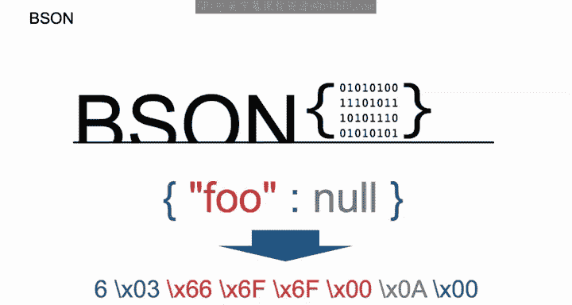

So now that we have that， what can we do when we interact with the document store？

It's a lower level than relational database management system。

 so we don't have in MongoDb a query language like SQL or Jsonic as we will see MongoDb uses APIs so you have a ja API。

 a Python API so you have an API in many languages that all look the same and this API allows you to create documents so read documents update documents delete documents these four words create read update delete it's actually very commonly refer to as CUD Sos right so this is the the paradigm that is the basics of a system。

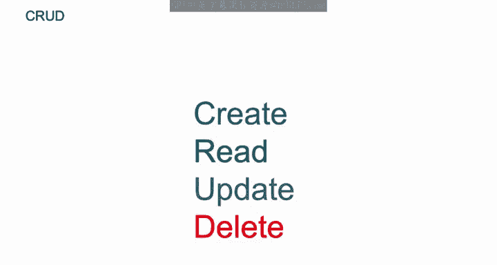

In fact， we have seen that before because if you look at these getputs deleted primitives that we saw before。

 this shouldn't surprise you too much， right？Okay。So， this is。BR UD。

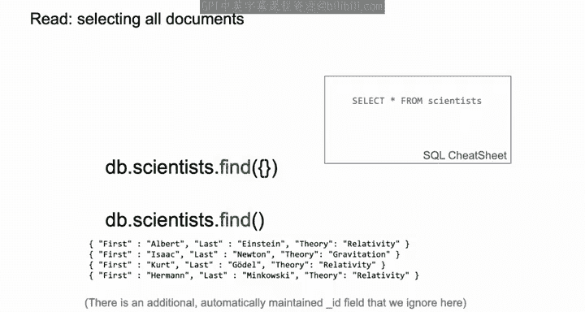

And now here's the query。So。If you want to。

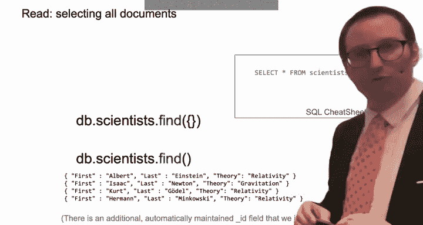

Qury a collection and see the contents of the collection。

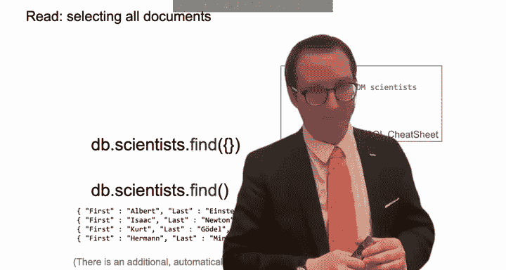

You have to specify names like this after DB， so Db dot scientist。

 scientist is the name of my collection。

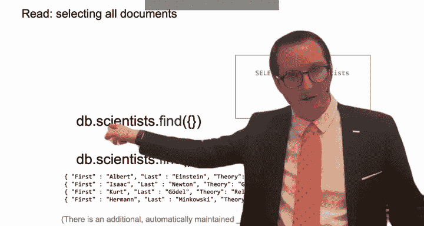

And then there is a find function， the find function is at the heart of all my reading queries。

 and then you can either supply an empty object or no parameter at all it's equivalent we see that then we can put stuff in that object and that gives you the contents of the collection right。

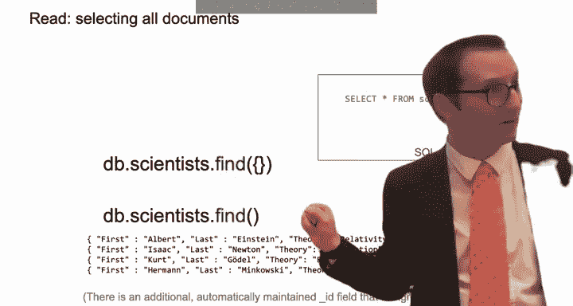

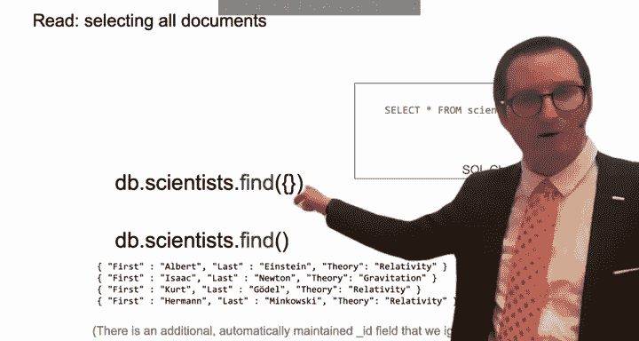

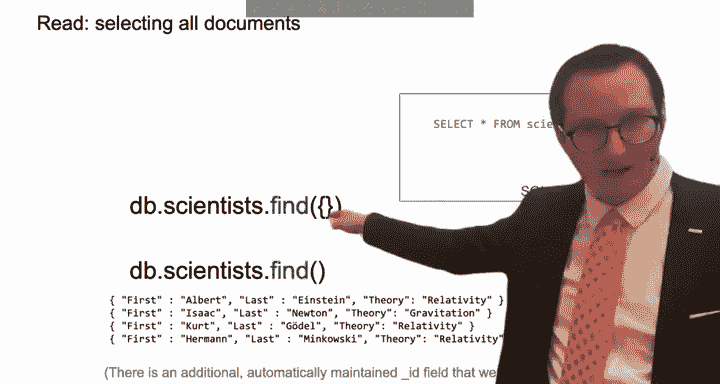

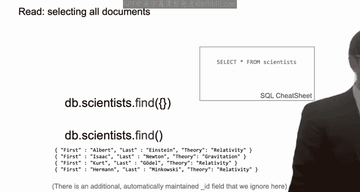

Now few words about this first I insist this is not a query language， this is an API。

 what you see here is just JavaScript， this is JavaScript and we have an API in JavaScript that allows you to interact with Mongodibi。

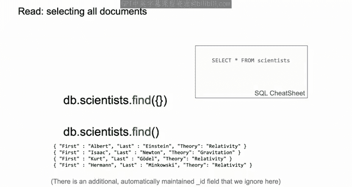

嗯。Beickens。Because JavaScript is an imperative language when you actually do find that doesn't actually return the collection itself because that wouldn't be supported by an object oriented language instead what you get is called the cursor and then you can iterate over the documents with your imperative language go through them one by one and so on that's called the cursor if you are on the shell you will automatically see by default you will see the documents nicely shown but if that's too many of them it's only going to show the first few documents and then stop so that's called the cursor。

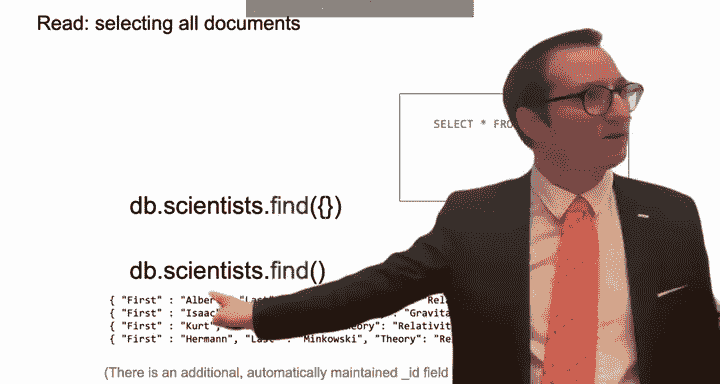

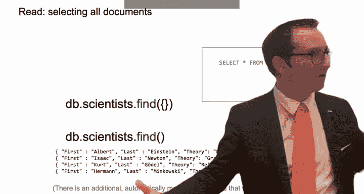

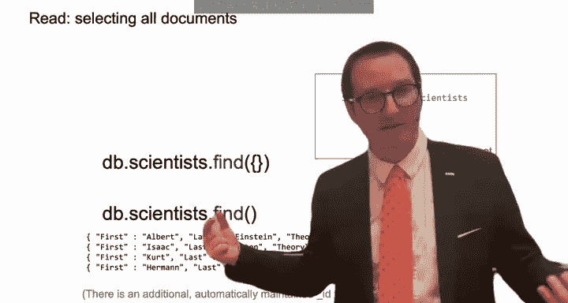

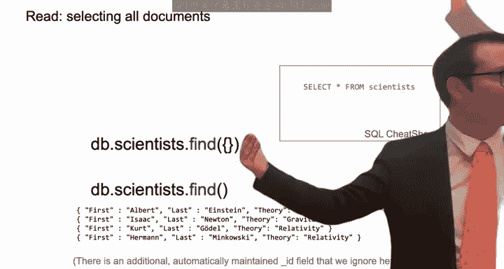

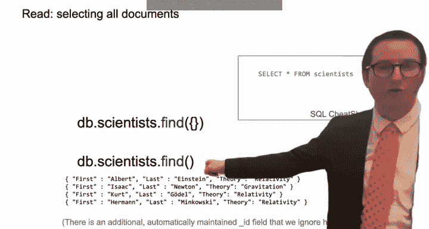

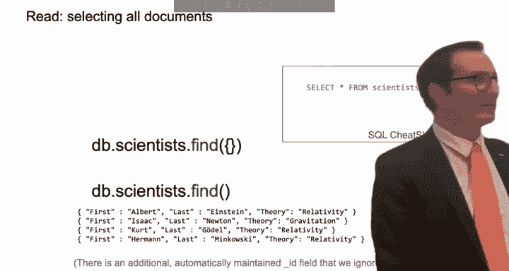

on zoom for be so even if a collection is validated against the schema it will still be stored in bees seems like you could save some space with a ard like format。

Because you， for example， don't need to repeat colons。That is a very interesting question。嗯。

If you don't validate you use BN Bson doesn't require validation right now I like this question because this is it means you listen when I explain you can use PAque and data frames when you actually have valid JN so it could be and we could actually look at if we find anything it could be that if you validate the data Mongo Bfi that would better ways than Bes to store it that I could totally imagine so we should investigate this and find out if they have some as Dnate representation on this if you validate the data right？

嗯。😊，You do have to consider， however， that you might be in a situation that you added a schema to a collection later。

And that not all of the objects of the collection are valid against the schema right so when you add the schema。

 it's going to check future inserts right but it doesn't retroactively force all documents to be valid so you might have a collection let's say with1 thousand0 documents and maybe 10 of them are not valid in that case you still need be because you still have a few objects that would be valid against the schema so if they would use a data frame like storage format when it's valid that would only apply if you know that the entire collection is valid with a strict setics but that's an excellent question and some homework for us to see if if would be started also introducing alternate storage formats I could totally imagine that that's what an engineer would basically think like。

诶。I like this question。Any other questions？All right， let's continue with this one。Yes。

 what did I put in here， I put some SQL。This is for a comparison。

 I just want to give you an intuition of the equivalent SQL query。

 of course that's only going to work for the cases that are close to SQL so when the data is a bit close to a table but that's not always possible and I will explain to you how it's actually marked like SQL than SQL right。

嗯。😊，Yes。😊，If we later add a schema， does it retractly check the whole collection for validity？

I think。耶稣。I think at a mini map it's going to check when you change something when you insert a new document is's going to check if that document is valid。

 if you update a document， it's going to check if it's valid or not and this is where we can tweak that if it was not valid before then it doesn't f it to be valid afterward or if it's trick the inso fes to be valid so this is more something future oriented when you add a schema now what I would imagine if I think like an engineer in terms of workflow if I add a schema to a collection I would try to figure out how much of the data was not valid in the collection and fix it I would try to have some updating and editing query to try to make it valid but that you have to do yourself as a user Mongodb is not going to magically fix it for you the details of when you modify your collection to add a schema。

What it exactly does in particular， if it does a full scan of the collection。

 that's also something we could look at。But in any case。

 it's going to apply the schema to any modification and future itself。喂。诶。

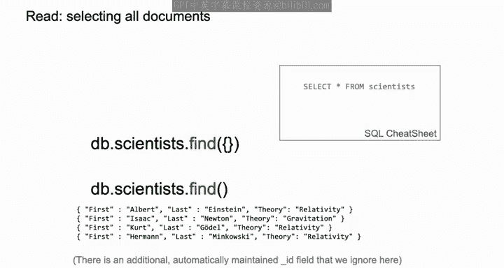

All right。So this is a case here， you're welcome so this is a case where the data is flat and homogeneous because I really need to start somewhere so in fact this would also fit in a relational table right and then you have the equivalent query something I did not put in there is that in every object in MongoDb there is an additional key that is special that is underscore ID。

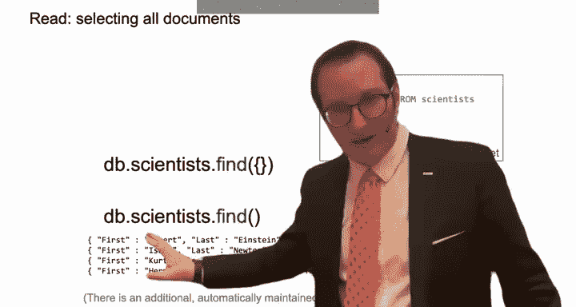

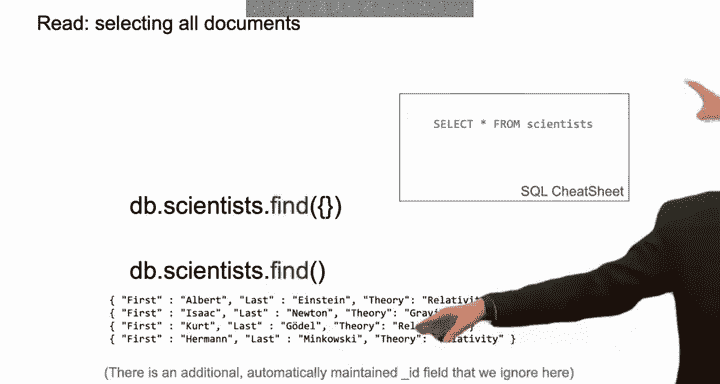

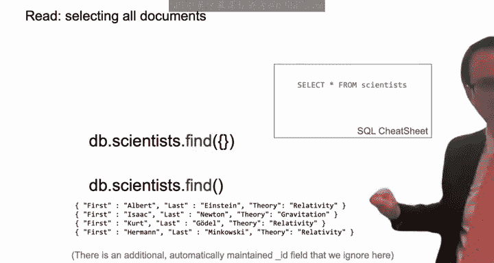

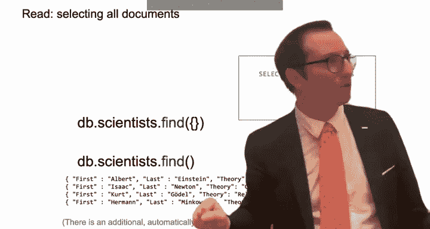

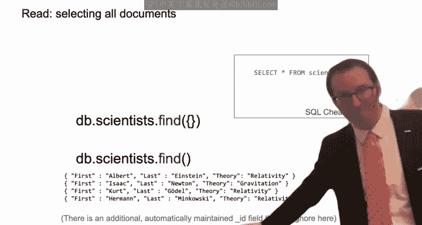

An underscore score ID contains something that is called an object I It's automatically。

Aed by Mongo D B。I'm not showing them on my slides， but you should know that they are there。

 It's as if we had an extra column in PosQl that assigned some some record ID right so just know that it's actually there。

Okay， now what if we want to select so that's a selection a selection in SQd is select from where and you have this predicate here that's how you do a selection right if you want to do with a JavaScript API or MongoDB a selection you have to pass here a criteria。

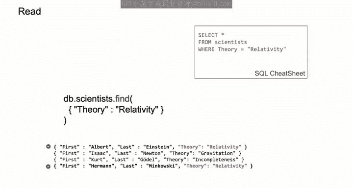

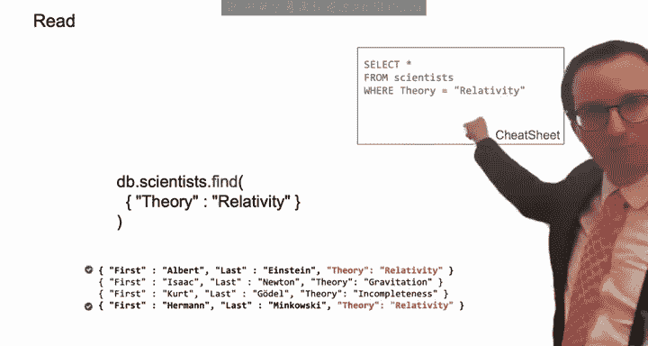

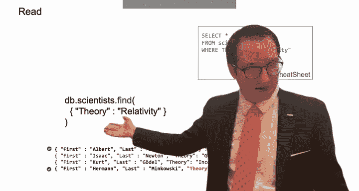

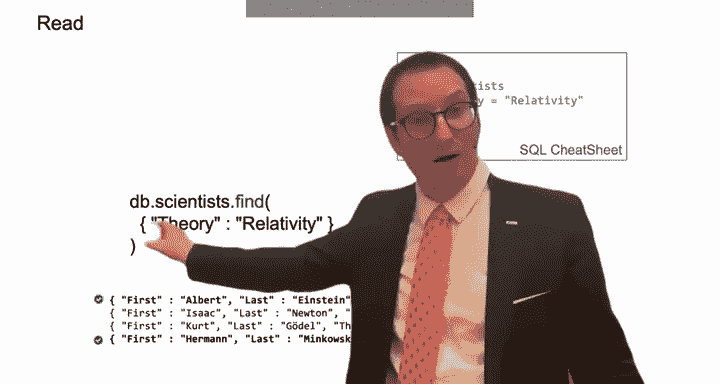

What is very interesting is that this is done in the form of an object right so here it's a ja object but you know that this is where Jason comes from something native we have an object that says theory is relativity and what we have here the way that these predicates objects look like it's very close to the original document it's very visual right so you're looking for the cases where theory is relativity that's going to give you this document and this document but not the two in the window so the first and for document。

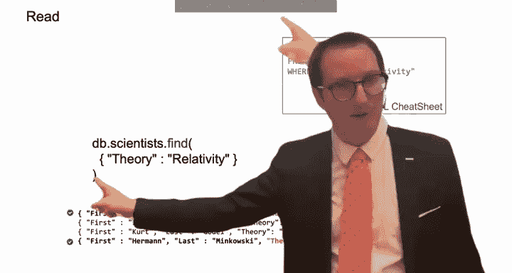

All right， whos with me？Very good， so this is a selection。

Now this is a projection a projection is newly using a project function。

 it used to be a second parameter of fines， but now they have modified it a bit。

 I suspect under the influence of the Sp APIs and you know a lot of the modern APIs so now it's separated as an additional function so that project and what you do here is that you specify your is that you want to project two so first and last with a one one means you include it in the projection0 means you exclude it from the projection so in that case we include first and last and you have first and last in here that would be in the select clause if you if we were using SQL I still kept you know the selection criterion that is here this is the idea and so basically if you add this project here is going to return these two documents but projected onto first and last。

We you still with me？Very good。 Something more。 I told you when or zero in here。

When in SQL we only know how to project onto something so in the equivalent of SQL would only use once everywhere。

 what does it mean when you use a zero， it means you project a away。

 you're basically saying I want all of the keys except this one and this one and this one that's what it would do with a zero everything except。

You cannot mix the ones and the zeros， either you have just ones everywhere and then that's the semantics of the select closing SQL。

 or you can zeros everywhere， you have zeros everywhere。

 and then that's projecting everything except the keys you specify。Yes。😊。

This seems sort of like a clunky syntax for this like couldn't instead of like having like a generalized project thing that both like you can either like give a J on that will admit something or like do everything except this couldn't you have like like something that does the opposite of project and project would just taken like a list of。

The fields that you would want and this other thing would take a list of the things that you want to exclude or so that would be the Jsononic query right the project function in Jsononic that does that So this is this is really a matter of API and this is why I war you this is not a query language this is an API and because it's an API it's kind of thrust into the javascript model In fact if you look at the Python API is going to be different it's not going to use the same conventions in Python So this is my warning to you this is really not a query language and you really have to look at the documentation In fact the fact that it seems a bit arbitrary I mean why one for example could have been two could have been a list of fields and so on I absolutely agree with you and this is why it's an API and this is why from a query language perspective this is not the end of it this is not the final products that you want and in fact some of the document stall do have query languages similar to Jsononic right I think of anchor。

AQL and so on so they are query languages and then it's more natural to use right so if you if you have some if you feel a bit uneasy seeing this。

 you are not the only one I am too right and again warning this is an API。😊。

Did that answer your question？

Yeah， okay。嗯。

But of course I need to specify it an API is not a bad thing。

 an API is an intermediate building block for building a query language。

 so then you can have some query language on top of that and the query language will be implemented on top of the API the end user would speak the query language。

 but then inside you would still use the API to compile the query language to the API。😊。

诶。All right。So projection， projecting away， so this is what I told you with the zero so it removes everything。

And why does it make sense in PostsgresQl and not in Postsgresql or in Mongodb and not in Postsgresql？

Because in Postgres Ql， you know all of your columns。So if you say I want everything but's that。

 then just look at the schema and just put the other column directly in the select clause。

But in MongoDb， because you don't have a schema， you don't know which keys you could have。

 so it makes sense that you want to project away keys and you cannot express it with what you really have to put a zero in here because you don't know all the keys that they are in there。

So this is why we have this projecting away。 and that's something you don't have in。嗯。😊。

What about end or you know in the query so if you want to have some conjunction of predates。

 just put all of them in the same object like this is a conjunction of the two it must have both last equal to Einstein and theory relativity in SQL or a full fledged query language。

 you would have some end and logical connector。

Or。Is a bit more involved and again I'm coming back to the question this is basically what you commented on here it is a bit unpleasant right。

 but again this is an API and the goal the design of the API was to try to have everything as adjacent objects。

😊。

So in order to have an ore， you use these special objects that have a dollar key and whenever you have a dollar in MongoDb。

 it means that it's a key world， it's special so it means it's not the key dollar or it is handled specially in a special way by MongoDB and what MongoDb would do is that when it see the dollar or it's going to take what's in the array here and check for either that。

All that。So either you have less that is Newton or you have less that is Einstein。

 and then it's going to return these two documents right here。

So you see here there's some ACymmetry because of the API between the end that is a bit more pleasant and the or that is a bit more convoluted。

 but this is how it's done right and of course in SQL you would just put an or and again if you have a higher level query language like Jsonique on top of this then you would have also a more symmetry between the end and the or。

Then you have other keywords than just Dola or you have many， many others you have for comparisons。

 for example， you have these Do GTE and theres LTE and so on。

 and that means the publications is greater than or equal to 100 right so that would be what you would write in a high levelvel query language or inQ so that would select this one this one。

Excuse me， but not this one or this one。Excuse me。I'm speaking too much and that's pretty well。

Greater than or equal to 100， who agrees with that？😊，Okay。And now if you feel。

 if you feel uneasy seeing this， seeing this， you know， But again， it means you understood。

How important it is to have the high level query language on top。 And again， this is really an API。

What about heterogeneity， Well， is there a question？行。I'm wondering about the or clause。

 if we could go back a couple。 Oh yeah， thank you。 iss it possible to like like do this with different fields here。

 like like we could do last Newton or first Albert okay Yes。

 and then can we also like factor out like the last thing here where like we could do like last colon or or dollar sign or and then Newton Einstein or would that be on kosher you can factor it but I think there's a few constraints on the way you can factor it and it's the kind of factoring that gives you headaches when you start to try to figure it out。

 but again， that this is making the point that highde query language is better right。

The only people who should ever do that should be the data engineers who implements the query language。

ThatAll right。Yeah， so when we're doing comparison， since we don't have a schema。

 does it mean that it's going be automatically less geographic graphic order instead of regular。

So this is a very good question and the way that this is handled in Mongodib is that any two values can always be compelled。

Always， you can compare an object with a number， you can compare an array with a string。

 you can compare a number with a Buyan and so on。The way that Mongodib handlenders the order。Is that。

It first orders by type。And then all by video。Right。

 so I don't have the exact order of the type in my mind。 but you have to consider that。

You first have all thebuoleans， then all the numbers， then all the strings。

 then all the the arrays then all the objects and so on so there is like this another and so it will never give you an error。

 it will always be able to tell you it's larger or smaller so this is how they sort this right。Yeah。

 so this is， again， an example of heterogeneity because it's not going to throw an error。

 it's just going to stilller still work if the type is different that you have to be careful because again。

 if you have strings。Then the strings are not going to compare。

 it's not going to cast them to numbers， so the strings will always be either greater or smaller。

 but it's not going to compare anything either the content of the string。All right。Yep。

OhSorry just one last question so for like an's is it possible to do like like sort of a dependent thing where like let's say like the the field of like if we have numbers the field of one thing is some number and then the field of some other member of the JSON is like n plus one or something is it possible to express something like that？

And you mean to nest and then or within fields like like if we have like like I don't know sorry like one field is like the number of people or something and then like something else is like I don't know the number of people plus something else so you would like your predicate to check that one is the other plus one Yeah。

 like like a dependent product or something like that So I don't know if find would be powerful enough to do that but I think that you would still have a way to do a food scan with your predicate written in ja and then you just iterate manually over it it could be that there's also in the API a way to supply your java function that just that just those does these check but that would already be advanced to do something like this。

There was another question to go there。You said that the types of some kind of defined order。

 so for example， let's say booleions are always greater than ins and then I search for field with greater or equal to 100 does that mean that all fields that then would contain booles are also returned because that is kind of not the behavior that I would expect。

It depends on the order of the types， I just don't have it by heart。

 but if it is the case that all Booleans are smaller than integers and your query is greater than or equal to 100。

 then the Booleans will never be returned ever。But just hypothetically。

 if it were the other way around。They all of them。If it was smaller than the 0s。

 then all of them would be retail， is there some way to say just compare with numerical values and ignore all the rest。

You probably could use an end predicate that I think if my recollection is correct。

 you have some minimum in and maximum in and you can or maximum number。

 minimum number and then you can use these as bound in order to control that you want things to be numbers。

Thank you。 yep， you're welcome on。

Right， so on this slide you see that even if the data is heterogeneous。

 that query still works so right you can have additional fields， missing fields and so on。

 and in that case， if theory doesn't even exist， then it's just not including the document right it's checking that theory exists that it has the value you want。

😊。

For this purpose， null is considered by MongoDb to be the same as absence， so if you say theory null。

 then it's going to return both when it's null and when it's absence right it's the convention taken by MongoDb that's like you have here if you say theory null that's returning the rest objects。

嗯。😊，Then something to be careful about， and again， I warned you。

 it's an AKI so you're going to get headaches。

Is that not just the dollar， but also the point is special。 So if you say name point first in here。

 it's not going to look for a key that look like this。

 but it's going to look for a key first that is nested in an object under other key name。 So in fact。

 this is the soccer thing is going to return。 So name do first it's really navigation the dots right so this is something to be aware of。

 And what does not work because some keyboard are tempted to write something like this when they want to look up first equals to inside name。

 but when you do that， that's an exact match it's going to exactly find this object。

 So this is not going to be returned， because that's not exact this one is written。

 That's the exact same object and here it's not returned。 so that's a bit of overwhelminging。

 you really need to use a point if what you want is to filter based on a nested field。

Then something else that the weight behaves， if you have here a specific value or a specific field。

 it's also going to include documents where that value here is in an array of that name。

So you really have to read the documentation， there's a lot of small things like this that it makes it basically very flexible to use。

But you have to go through a lot of totally arbitrary design decisions right you just have to be prepared for that。

 the only way you can know that is to read the documentation to be aware of this behavior。

 but this is how it deals with nestness inside a race。

There is also an operator called Dola in that checks whether a value is inside a specific set of values it also exists in SQL by the way you also have the in key word in SQL so here it's in ETHZ or EL notes that it would be equivalent to a Dola or with university THG University PFL right so Dola or or Dola in you can use one or the other so here is's going to return this one and not this one。

And in is the opposite， that's yet another one and there's tons and tons and tons of other keywells。

All right， so this is the overview for the find and the project methods then we have others we have count for example。

 so count is going to tell you how many results are returned in here。

In fact， at that point， since we've studied SP two weeks ago that shouldn't really surprise you。

 right you chain these methods a little bit like you chain the SP transformations when you work on the RDDs or data phrase。

So these dot counts would look the same in stock。

You also have a dot sort again similar to the spark transformations that would sort。

Yeah， it is， except that here you sort documents。

And now again， an arbitrary convention， one means ascending。

M-1 means descending， right？Something else that you need to be careful about is that when you specify the sorting criteria。

The order is important and this is something I feel very uneasy with because normally in adjacent object the order is not important。

 but in fact Mongodb is order sensitive in the way that it processes the object that you put in here right so it's a breach of data independence because normally in the model you're not supposed to see any order but in fact it does specify the order of the sorting criteria this is equivalent to in SQL order by founded desk and so on and so on。

Ws with me。Alright， who also feels uneasy that suddenly the other of the key matters in stock？

You don't feel uneasy about that。 I feel very uneasy about that。Normally。

 objects don't have any other。 Okay， but I saw some raised hands。 So some people agree with me。

 Then there is skip and limit。 This is like the limit and the offset of a sQL。 So again。

 there's nothing new in here。 So here we skip the first 30。 It's like offset 30。

 and then limit limit 10。

Right so you can chain them The order doesn't have any meaning。

 you can also put the sleep in front of the sort or the limit in front of the sort。

 So it's not like the spec transformation where the order is important it's not like this here you are just。

Spacifying your instructions to MongoDB， but it doesn't matter in which order you're actually giving your instructions to to MongoDB。

 so this is also one of the smaller things that can be confusing about the API。

Then you can use distinct in order to find all the distinct values of some field。What we have。

 we have the super powerful aggregate function。

And I'm not even going to explain that because in fact， if you look at this。

 you will recognize basically a spa series of transformations right it's like you have the creation that is the collection。

 the transformation filter group sort and so on and the action the stages so in fact what you have here in this function is a mini spa it's a mini map preuse or a mini spa and you can define these aggregation pipelines where you can have a chain of transformations。

😊。

All right， so I'm not going into that because since your nose spark。

 if you would take a look at the MongoDb documentation。

 it would be a walk in the back for you to learn it's all the same concepts that you've seen before。

Then we have insert division and so on， so here you have insert one。

 insert many delete one delete many and update one。

 update many depending on the number on which you have an effect in that case you insert one document so that adds the document to the collection。

This is where validation kicks in if you define the schema for the collection。

 this is where it's going to check if that document is actually valid against the schema。嗯。😊。

Then we have。Update many is another example just' update one update many update many here is going to basically look for all the documents that match this predicate。

 what you would get if you use find with that predicate and for all of these documents it's peing ten to 20。

So it's modifying the value and because it's update many， it's going to do it for all the documents。

 if you say update one that is going to only do it for the first document it finds and not for the others。

Again that that I don't like， there's no quotes around here and again it's kind of lenient。

 it's not going to force you to have quotes everywhere in here。

All right， update many then we have delete many again they all exist delete one delete many update many update one。

 they all exist， delete many is going to delete all the documents that match century equals to the string 5。

诶。Now， this year。

Again it' very complex and you will see this is why we have query languages on top of that the query languages are here precisely so we don't have to deal with these things and only the implementers of the query languages should ever have to deal with these things。

😊。

All right。Now I would like to say something about what happens。

If it doesn't ring when you modify a collection， if you try to update something。

 if you try to there you go the ring， so I'm going to tell that to you right after the break in 1515 past three。

