# 苏黎世联邦理工《大数据｜Big Data - ETH Zurich - Fall 2024》中英字幕（deepseek - P37：-37-11. Document stores (3_4) -.zh_en - GPT中英字幕课程资源 - BV1sHPKeoEJU

Welcome back， everybody。

So during the break， apart from McCfi， we also investigated the open questions that you asked。

 so I have a few more answers to the questions that have been asked。

The first was about the order of the of the types and we found it in the Mongodib documentation。

 maybe I can just。

Share my screen so that you were。

Speed， so you see nerves， then numbers then strings， then objects and arrays。

 then binary data that's one of the additional types that thison has object ID also so an additional type Booleans date an additional type timestamp and additional type regular expressions that's also an additional type that can be useful and then there's mean key and max key that are the guardians so basically the elephant you put in the desert to make sure that you find the elephant in the desert in these mathematics jokes so this iss that's the salt and so now to come back to the concrete example if you have the numbers and the booleans that if you say something must be greater or equal to 100 then any boolean will be in in the return results because booleans are considered greater than any numbers so this is this is the answer here to this question。

Then I'm go back to。My light and at the same time answer the other questions while I make my way through them。

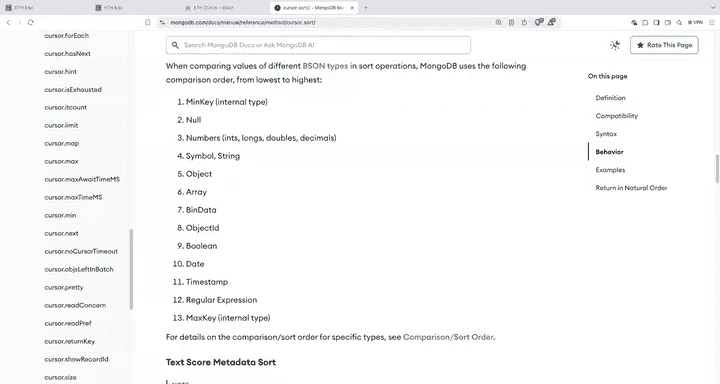

So the other question。

Where does MongoDb retroactively validate the collection， the answer is no。

 so it confirmed what I said it's future oriented right so it only applies the schema to future updates when you insert a new document。

 when you update a document， then it' going to it's going to check for validity。

 but it's not going to retroactively scan the collection or do anything at least based on our findings。

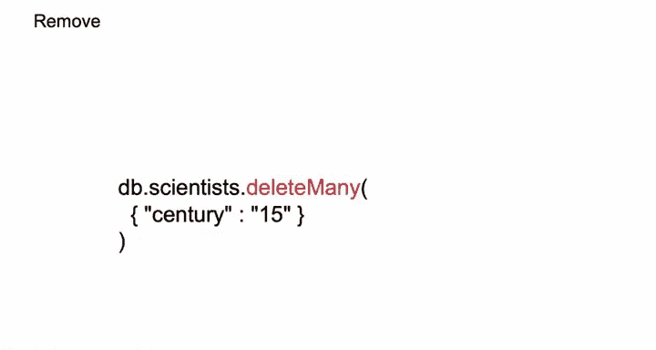

Also based on that findings， if you do want to check for validity for the pests so for the existing collection。

What you have to do is to use find so this selection。

And it turns out that you can pass to find a J schema And the way you do is you you use the dollar J schema schema。

 Doja schema and insides that you put literally adjacent schema that works。

 And if you do a find with that it's going to return all the documents that are valid against that schema And now if you use it with a dollar or not。

 So dollar or not and then dollarja schema， then it's going to return to you all the invalid documents。

 what you do then is you look at the underscore ID and you use the underscore I to edit the documents to fix them in such a way that they are valid So that could be a workflow right So it's a combination of using find with the schema and then adding a schema to a collection for the future checks that's the real life usage whom does that make sense。

All right。Whether as we have， we looked whether or not MongoDB， if the data is valid。

 is able to store in a physically better format similar to Bque， you saving a lot of space。

Surprisingly we couldn't find anything， so it does seem and maybe you can also check and see if you find something but it does seem that MongoDb is always using Ba no matter what。

 even if the data is valid against the schema we found some blog posts that told you how to optimize your layout to save on storage but that's not based on the actual existence of a schema it's based on the length of the fields so they basically tell you you need to shorten the fields in order to save some space and obviously if you use the data frame approach and you don't care about the length of the fields because that would be in the met datata right。

U。😊，Here's my suggestion。That's a startup idea build a better MongoDb that is able to start the data as a data frame format if your data is invalid or write a letter to MongoDB and get yourself hired as an ETH graduate for improving that and see if you get a year from them that would be。

My suggestion， I mean after all， you are the future engineers so you are going to improve all the things that you see can be improved right so these are excellent questions and that will be up to you to make these improvements。

Anything else that we looked at during the break， I think that was pretty much。U。Okay。

 any other questions before I continue？All right， so let me continue。The granularity of the updates。

 it's exactly like H base where it's per row， if you update on H base remember you lock a row you cannot have two people writing on the same row。

In the document store it's the same the granularity is a document。

 you cannot have two people updating the same document at the same time。

 but you can have multiple people updating the same collection at the same time that is possible right just not the same documents。

嗯。😊，All right， so this is an important aspect。It's vibrating what is he trying to tell me be again complaining about battery all right so now this is a remark that I did you noticed and some of you had questions about how it's an API again and in an API you have to make arbitrary choices like the dollar keywords the use of the points。

 the order in the the sorting order of the types what was there the use of one0 minus1 and so on。

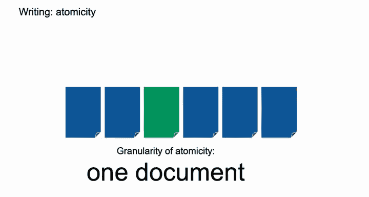

For this reason。What you need to add on top to have a complete product is then a query language and many of the document stars。

 not all of them， but many of the document stars do have a higher level language on top。

The one I'm teaching you is JOonic， it's one of the earliest ones that we started already in 2011 developing but there's also uncle there's GraphQl that you might have heard of and many。

 many， many other language in fact there's 30 of them now and encounter counting but again they all they all look the same or use more or less the the same ideas so the good news is there's 30 of them the bad news is there's 30 of them I mean hopefully one day it will consolidate like SQL is undisputed for tables for graphs GraphQl by the way is not a Gra language tree language despite the name but Graph querying has been consolidated it seems that all the vendors have agreed on some standard based on a graph extension of SQL for the trees we still haven't consolidated anything and maybe I hope one day it will happen maybe we see that in our lifetimes that we also consolidate these。

But right now you have to live with all of these languages。

 but that we take care of next week and the week after that when we when we go into Jasonique as an example of such language that is a higher level than an API。

All right， so that's how to use Mongodib and now I'm going to tell you a little bit about the architecture。

😊，You might have guessed that if you have petabytes of data， we are going to。

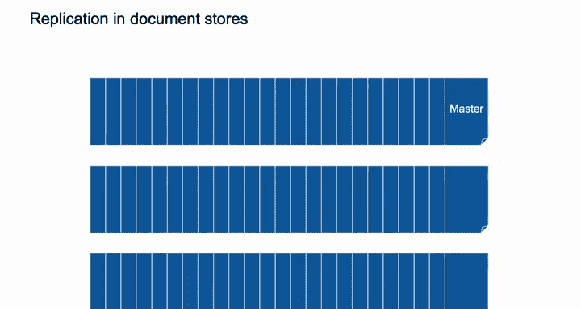

Partition needs right and this is exactly what we do in the case of LonggoDb and what happens is that we have some keys that happens to be the same keys that we index on that give you the bounce of the partitions a little bit like the regions in age base if you want and so every partition is also replicated。

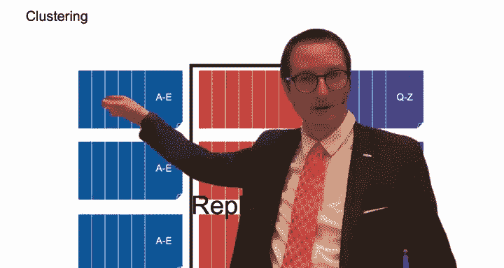

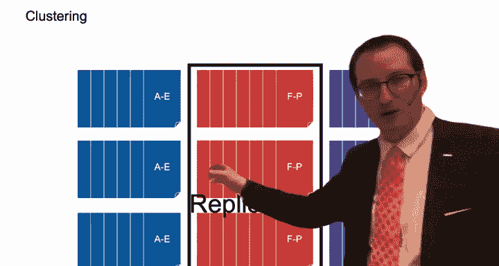

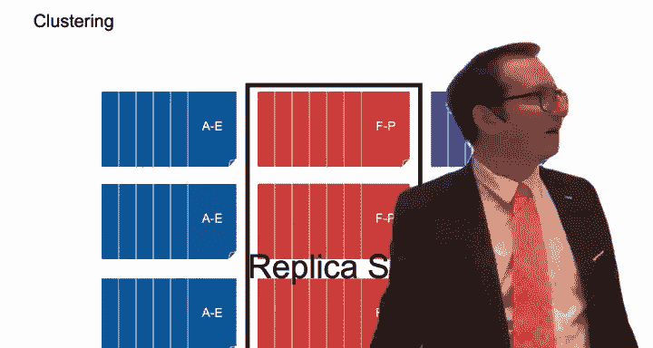

So now that should remind you of HGFS right in HGFS， we both have these blocks。

 we part the data and every block has replicas， so that's the same thing in MongoDb。

 we part and we replicate。

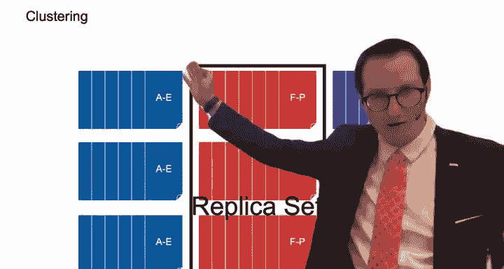

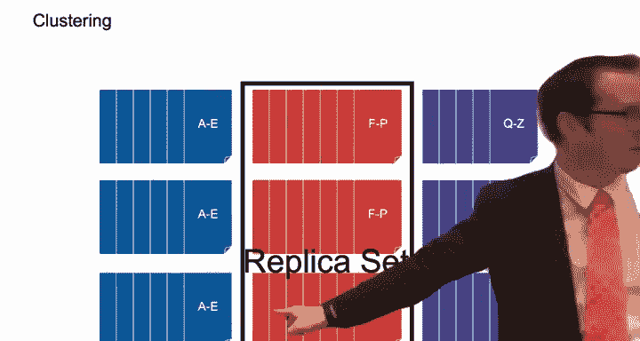

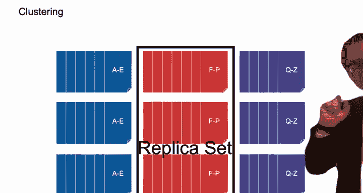

Every partition like this。Is going to be handled by a few machines。

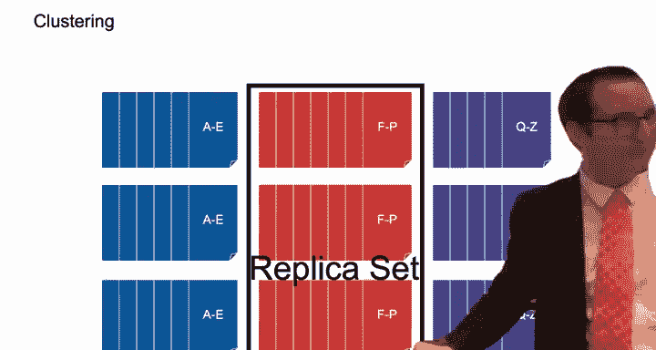

That we call a relic acid。Instead of replicas， replicas sets。

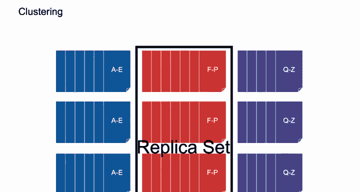

And here， the architecture is a bit different。😊，From what we've seen before right we don't have a single coordinator node and all these work on node In fact we have for each replica set we have a few machines like this right so it looks different for one repa set we have a primary server the Mongodb server and then other Mongodb server that are considered secondary they store the same data replicates thereof but this one is the one that is the preferred the preferred machine to communicate right so if you want to read all right you should go to that machine right here and then the machine propagates to the others right and you have that for every rep set so it means if you have a three sharp for example。

 then you have the first repa set， the second repa set the third replica set right。

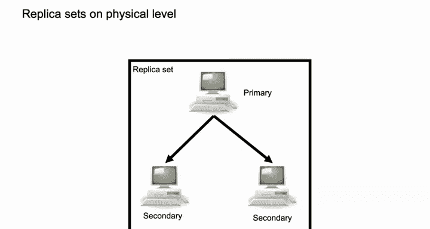

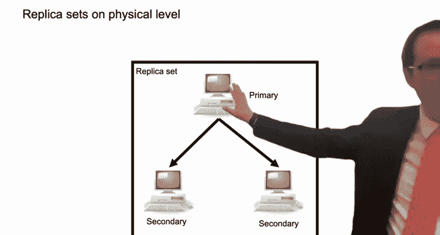

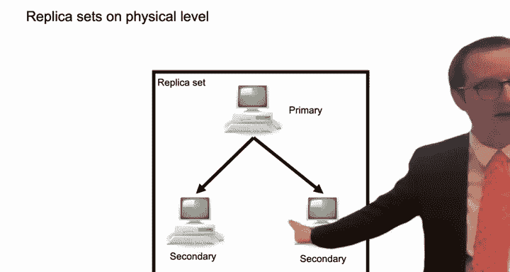

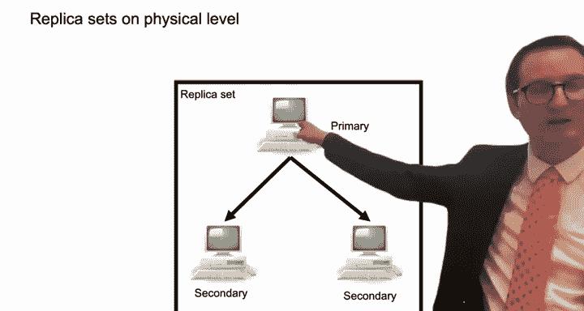

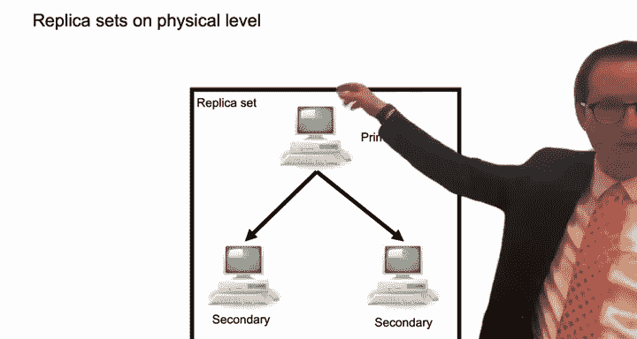

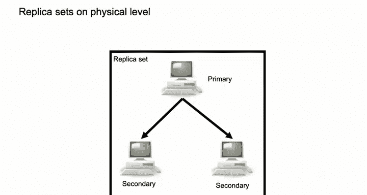

The number of machines in MongoDb in practice a lot in a lot of places you count them in your fingers right you don't have1000 machines。

 it's more like you have three machines， five machines10 machines I think I saw some people trying to push the performance of MongoDb until a few years ago it was difficult to scale it could be that it improved so maybe now people managed to use MongoDb with more machines but compared to Spark or map Red or HDGFS we are not looking at that high a number of machines as high as in HFS or Spark at least last time I checked。

Okay， so this is how it looks like it's different again from the centralized architecture that I've shown you in the previous week。

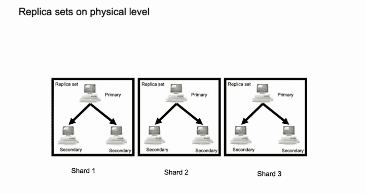

Now what happens when you write something so first you go to the primary node of the Sha that you want to write to。

 that's one of the replica sets you connect to the primary node right here。

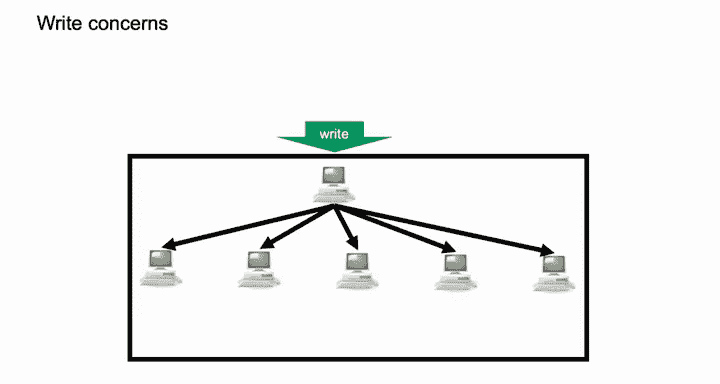

What's going to happen is that that node will store the data， apply the update。

 and then propagate the update to the other machines， the secondary machines of the same replica。

 and then they are going to acknowledge， acknowledge， acknowledge。

 acknowledge and once you reach a certain point， a minimum number specified by the user。

 you consider that it's successful， so you don't wait until all of them are done。

 maybe you consider that three is z enough and then you return to the user so maybe that's good enough that three。

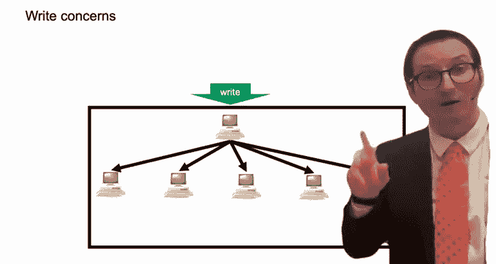

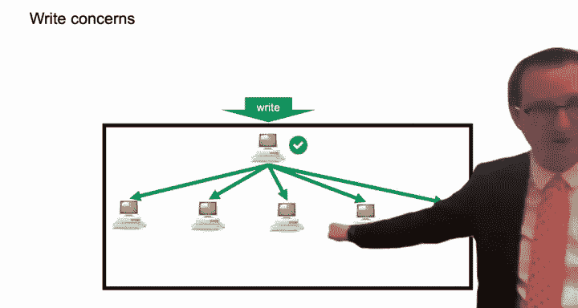

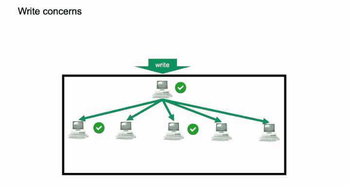

And then you continue the replication asynchronously in the background。

 so after you return to the user with an acknowledgement of success。

 you still continue to replicate until all machines have a replica right so again two steps cost a synchronous part until the specified number is rich that is synchronous the user has to wait and after that you return to the user and then asynchronously you continue to replicate whom does that make sense？

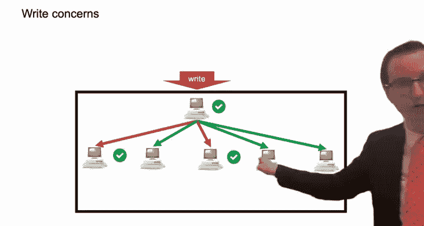

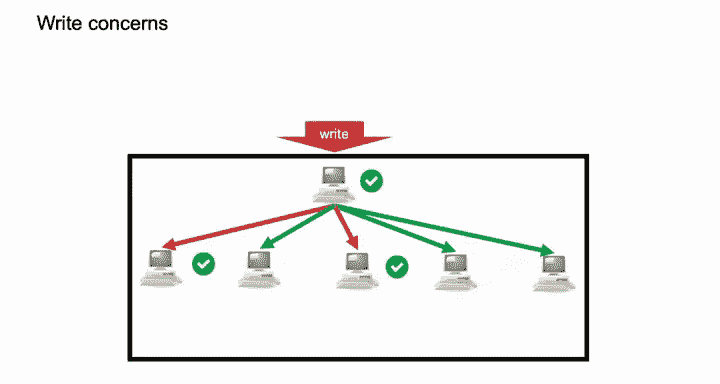

It's not new， we saw it in a GFS， remember when you write through the name node。

 there is a minimum number of replication that is one by default。

 and then you continue replicating all the way to three asynchronously in the backgrounds。

 the same ID。

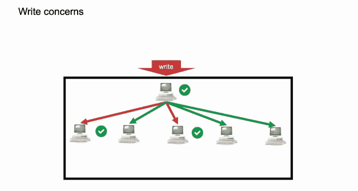

Okay。Any questions？Okay， no questions。So now we are getting to a super interesting spark do。U。

In fact， I told you it's not a data leak， so it's not like HGSS or S3 where you just drop your JO line slides in there and then start querying them。

It is。嗯。A database management system where you explicitly insert documents into collections and then the storage is done is handled by the document store directly there is a huge advantage that comes to that that you do not have in data lakes。

 that is that you can build indices on top of the data that make your queries returned very fast。

If you want to look up something in a data lake， maybe I have a few examples in there。

 imagine you have a let's say that's a Jason Lines collection。

 but that could also be a MongoDb collection stored in Bies， imagine you have billions of them。

What kind ofqueries do we want to do against this sort of data perhaps we are looking for one very specific object maybe we know the primary key and then we use for example if this is a list of a scientist then we look for Euler that is just one object right that is called a point query a point query is a selection that is highly selective so highly selective that typically you just have one document one records so this is a point query。

If you have to implement that in a data lake or with Spk， how would you do it？

You have this on a GFS as the adjacent Line file， you need to use Spark in order to find the oiluler。

Yes。You can still or continue explaining。I mean， just specify that the name is oer with the filter transformation I guess exactly。

 so you use indeed a filter transformation with the prediccate so that would mean Python with fact that the name is O。

呃。Now you have to realize that if you do that。The Sp is going to read through the whole collection。

 it's going to look at all the data in order to do that it's going to be in parallelel so it's not going to be as slow as if you did it on a signal machine but nevertheless you might need1 thousand machines in the cluster that are going to read all the data in parallelel and then one of the machine will say oh I found it and then you get with a collect the results do you agree。

But it's very slow and it's not very efficient， right So can we do better than that？

In document stars and in general， in any systems that are E based。

 you can do it almost instantly that kind of thing I'm going to show you why thanks to an index。

Now there's other queries that are not so highly filtering because you're not using a primary key but for example。

 if you filter by profession you will find a lot of mathematicians so now you have larger results but perhaps you still want to optimize that as well right this is also something you can do with a filter in Sp。

And then you have queries that are called Rach queries in a rangech query you don't look for specific values。

 but you look for something that is within a rangech， for example。

 all the years that are after 1900s。😊，You can also have an nepel bound， right。

 it can be between 1900 and 1950， for example， right？So this is called a range query。

 this is a whole different category of queries， we can also optimize them within thiss。😊。

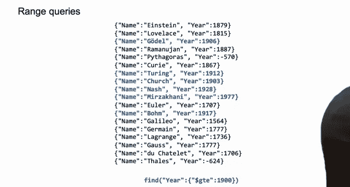

嗯。😊，But now this is the question， how can we make it super fast and with super fast。

 I mean much faster than using Spock and feed。

And the answer。To how it's done， you probably。Already saw whoever saw in a book at the end of the book。

 there is an index with an alphabetticical list of wells pointing to the pages， whoever saw that。

Many of you this is called an index， this is a real life index for humans。

 the human person who then looks it up， but in fact if you understand how that works you understood how these indices work the only difference is that here it's the computer that's going to look it up in a book it's a human but the principle is the same。

So imagine that this， what you see here is the collection of records， this is the book itself。😊。

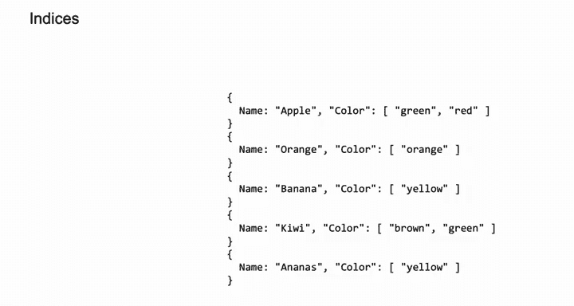

And you want to specifically query the fruits by color what you can do is build an index here it's an additional structure。

 this is the collection， this is an additional structure that has all the colors here。

 and then you have yellow points to the yellow fruits， orange red green。

 these two and brown and so on and so on now。

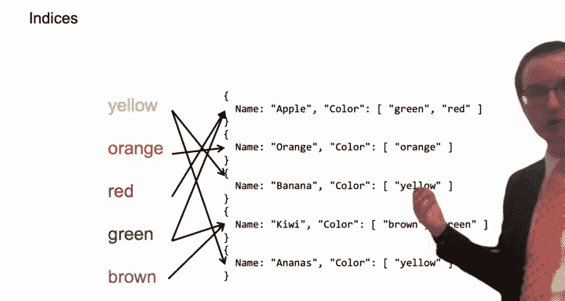

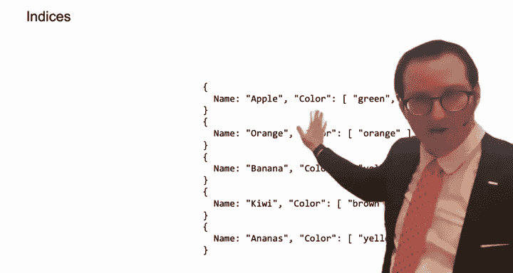

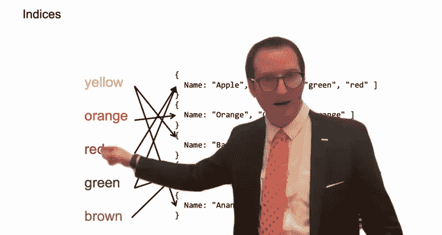

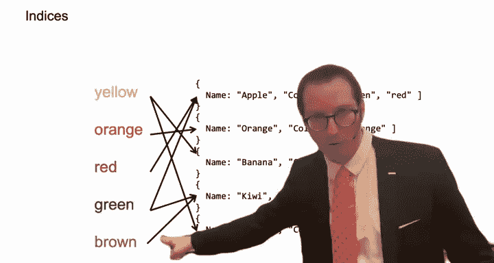

What happens is that the way that this is organized is similar to these alphabetical lists of well at the end of the book it's organized in a way that you can very efficiently locate one of the the what you're looking for。

 right？

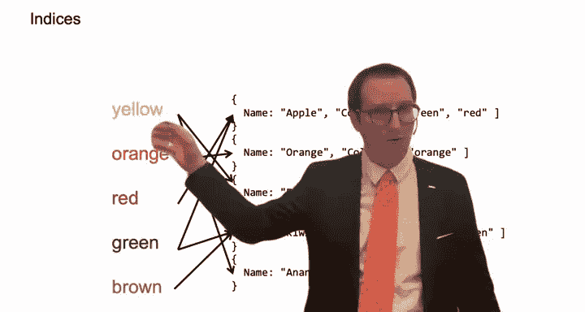

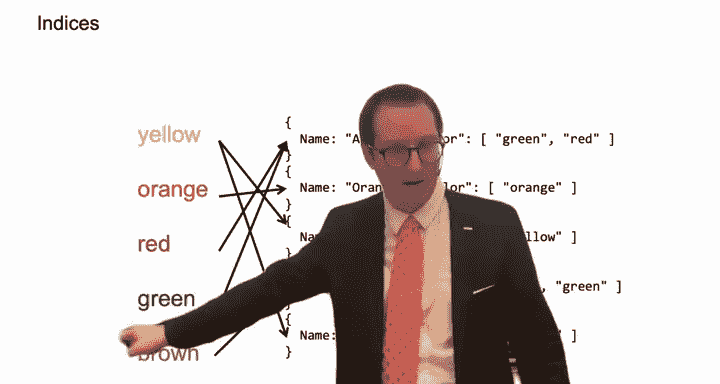

Think alphabetically softed， for example。What is the complexity of looking up a world in an alphabetticed list。

That should be an instant answer from computer scientists。Yes。😊，Look and exactly。

 it's a lookarriithmic， look aiththmic lookup。All right， in fact。

 maybe some of you know that we can even do it in o of one in what I'm going to show you。

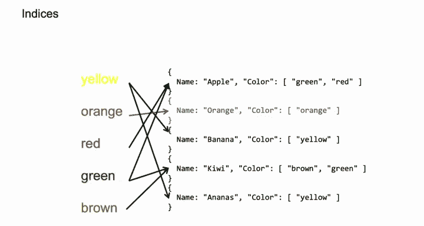

All right， so what i'm going to show you now is how we build these things how Mongodb is going to build these things so as to accelerate the results so I have a collection here obviously you see i'm not going to put a billion objects on my slides so I only put six in order to show you how that works。

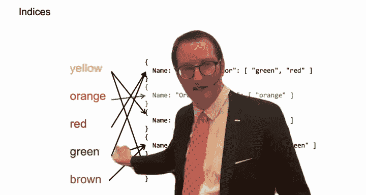

So the idea is that。In order to get all of one instant lookup 2bd seconds。

 typically in MongoDB to get a result like that， even from a billion different values。

 Spk is never going to do that in 2bd seconds。

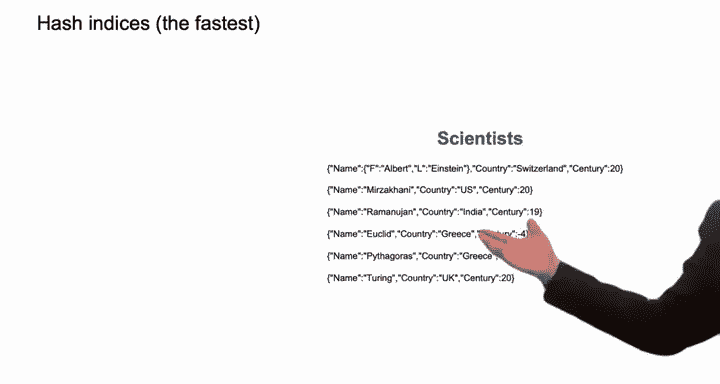

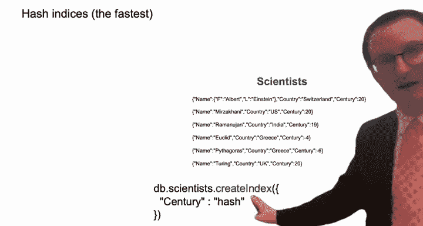

So imagine that I want to accelerate， so what I'm saying in JavaScript is DB scientist that's my collection create index on Cy a hash index and I'm going to show you what the hash index is。

 but on century it means that what I want to accelerate is people who look for a specific century have very fast on cells。

😊。

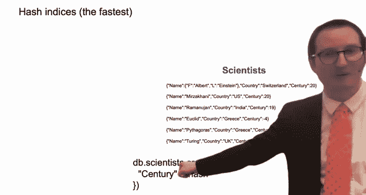

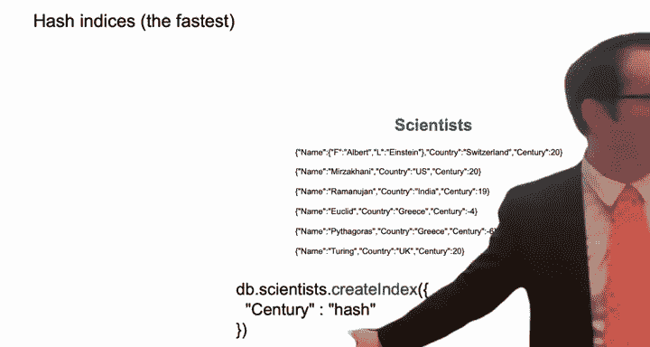

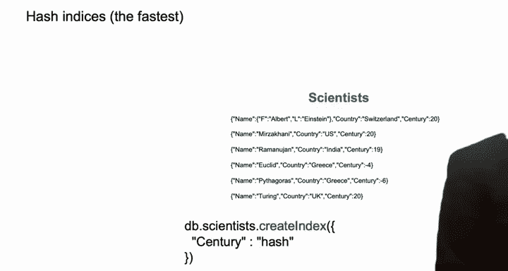

MogoDb takes care of it for you you just need to ask MongoDb to do it right so you say create index century hash and then it's going to create the index structure but what actually happens when you ask MongoDb to do that is that it's going to take the time to go through the collection so it's going to take a while right if the collection is large maybe takes a few hours to do that。

😊。

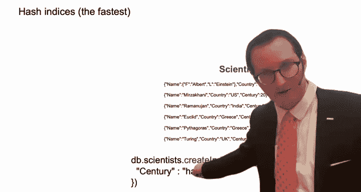

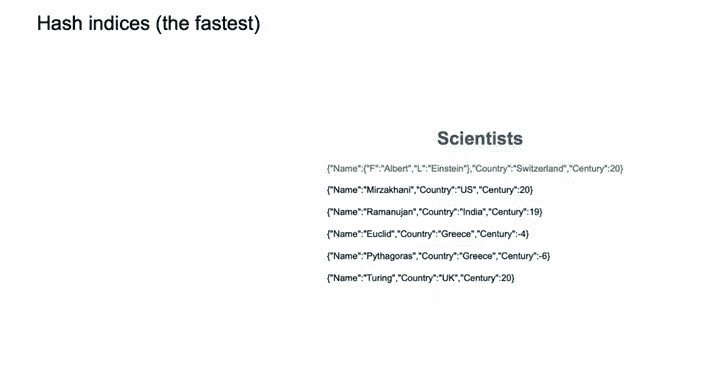

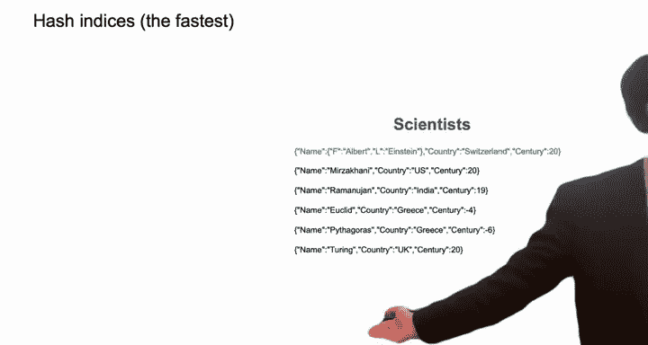

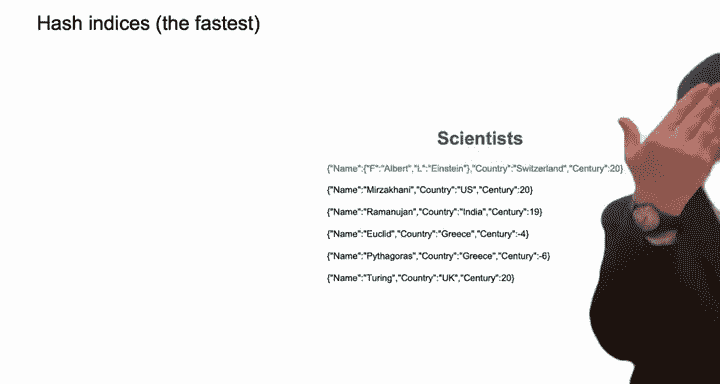

And then you can continue to use Mongodb， but it's just going to be slower during a couple of hours and then what it does is that it goes document by document that's okay now we have century 20。

😊。

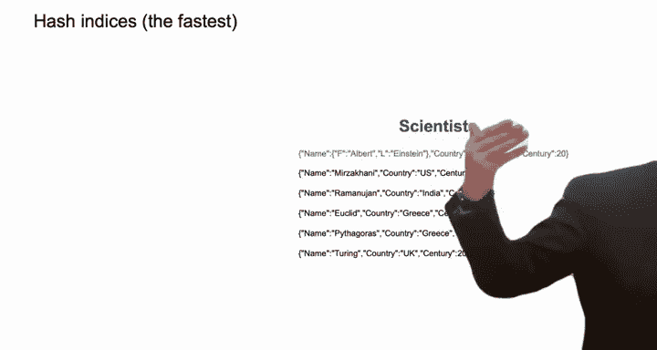

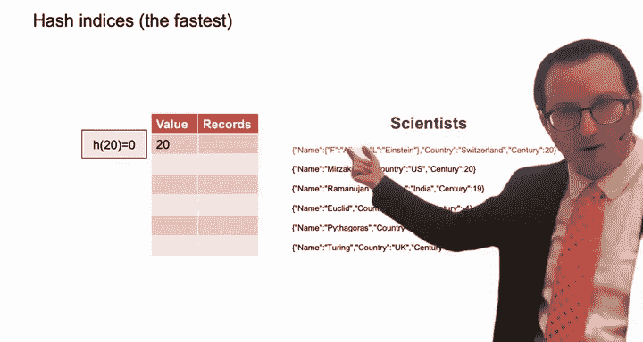

The way that a hasush index works is that there is a magic function that we call H that's called the hash function。

 it's a magic function that eats anything and it speeds out with an integer。

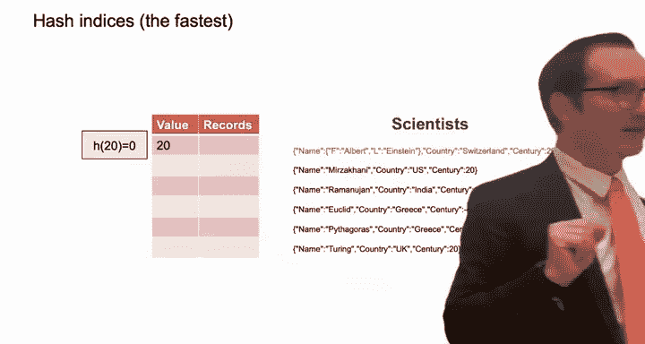

That's a magic function comes from cryptography。It has a few desirable properties。

 one of the properties is that collisions should be rare should be very hard to put different things that give you the same integer。

 it's called the collision。And it in cryptography， we also want it to be difficult to invert。

 meaning that if I give you the integer， it's very difficult to find something that will give you the integer right so we already knows these things from cryptography。

 many of you right so here we use these hash functions not for cryptography， but for ind indexing。

What are we interested in in that function， We are interested in the fact that it's dataministic。

 It's always going to give you the same integer or the same input。And second， it's very fast。😊。

In fact， when you implement a hash function， it's a couple of additions and multis and mods。

 typically in the way you do them， so very， very fast to do。Imagine you have a string。

 you want to compute hash， imagine a PACman that eats a string using plus multiplication and so on and then speeds out to an integer。

 so that's very efficient。So for 20， if I put 20 in H， imagine that I'm getting0 very quickly， so0。

 I'm going to use position zero， it starts count at0 in let's say in C。

 So I put the value 20 in there where the hash function told me and then I add a pointer to my document。

😊，The second one is also 20， so that's also giving its dataministic， sos still zero。

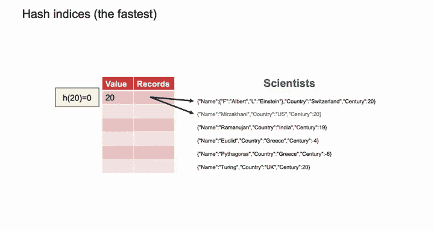

I had a pointer then 19 so H tells me4 right it's unpredictable right it's deterministic but it's spreading a all out place so here it it's four so I'm putting zero。

1，23，419 pointing to the document then I have minus-4 speeds out three for whatever reasons then three is there you point to the document then we have minus-6 gives me what。

😊。

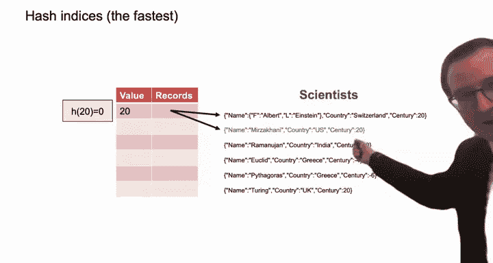

W it in there。 and then you have 20。 that's again here。

Here we were lucky， we don't have any collisions if you want to avoid collisions。

 you can try to have a very larger array， right the larger of the array， the rare other collisions。

In practice you could have collisions but then that's okay it's like you make them roommates right if you have two values that land in the same position you would just add a list structure and you have an extra lookup through the local list right so even if there's a collision that's nothing we can't handle right we can deal with collisions as well。

But still， the less collisions you have， the better， so you need a large table。But now。

 how does it work to query this collection So now？

I did my creative index。 Mongodibi did that in the background。 And now somebody says， okay。

 now finds the scientists in the 19th century who sees that that's all of one。

It's instant。And the reason is， it doesn't matter if there's a media， a billion。

 and a trillion documents in there。

The reason is you take this 19， you put it through H， that's o of1。

H gives you four， you're lucky to up。Also all of one， because that's random access memory， right。

 you can directly look it up where it is。 It's very common for the index to be loaded in memory。

 by the way， it's an ideal case。 So typically this is in the memory of the machine， not on the disc。

😊。

And then you follow the pointer that's also all of one。

 even if it's on disk it would tell you where to read from the disk so you just get the block from the disk where this document is located。

 then you read it all of one， who see it now。

All right， so this is extremely efficient， extremely efficient instead。😊，But there's a few drawbacks。

The first drawback of any index is that when you build the index that takes time。

 so the index doesn't appear out of nowhere instantly it takes a couple of hours to build the index right so you need to figure out which ind you build and build them。

But there is a problem is that the H function spreads the numbers all over other place in something that looks a little bit random。

 It's not true randomness that's called it pseudo randomness。

 but it it's still a bit random So you have no guarantee on a wrench if you have a few consecutive values like  one。

 two，34 there will not be together in the hash table there will be spread all over other place So who sees that a rangech query you cannot use a hash index for a range query。

 if you ask for all the centuries between 15 and 20。 There is no easy way。

 The only thing you can do is look for 15 then 16 and 17 and 18 and so on so you have to iterate through your range So hash Nbc do not help with rangech queries then in real life hash functions are not perfect there will be collisions that we need to handle and then if you want to avoid the collisions then you need a lot of space right so they have a lot of wasted space in memory because of that。

This is a general principle in computer science， there is no prelu if you want to save time。

 you need to spend space instead right it's faster but it uses more memory right so it's a general general rule。

嗯。So for this reason we have other kinds of indices that are called tree indices or B trees。

 B plus trees， some of you I assume so that during your bachelors who saw B trees， B plus trees。

 many of you， but I know not all of you， many of you， especially those that study in Germany。

 Austria， Switzerland here， there's most of the time database lectures on the bachelors， all right。

So， please。So in a tree structure， what we do is that we organize the data in such a way that it is softed。

 but let's say here you have possess right and everything that is smaller is on the left。

 everything that is greater is on the right what's more we don't have just two to like left and our right but we also have multiple videos on each node right？

😊。

So for example， everything that comes beforecom is on the left between common is is here。

 between is and merely is here and after merely and before possess is here。

This is called a B3 or B plus3， depending on the。And the exact structure Why are we doing that。

 We are doing that because when you read and write to and from a disk， a drive， you do it in blocks。

 you never read just one bit right you read a whole block that's something I've already explained。

 So the goal of the design of these these trees here is that when you have something here that contains the leaves and you read them from this。

 you ideally want that to be a full block that matches the the size of a block on a disk right to optimize So this is the way you design them。

So now。The problem with bee trees and beers trees。Is that it's not a standardout definition there is not a unique way of doing that and if you look at plenty of places like textbooks or Wikipedia or implementations。

 you will see that there is no standard uniform definition in terms of how you build them or parameterize them the principles are the same。

 but the conventions can be different but I'm going to take a few conventions in this to explain them。

Basically。The idea is that older leaves。Have to be at the same depth， so here it's exactly one， two。

 two level three levels in total， so the depth of two here older leaves must be at the same depth。

And then there is a con on the number of children for except of the leaves。

 of course the leaves have no children， but here for example we have four children， one， two， three。

 or and we have a constraint， for example， that is between three and five so you can have three children。

 four children of five children and then your good。

 the only exception is the goods that can have less than that。

Who was need information retrieval？For you it's easy because you've already seen that right so it's a data so that's great news for you。

All right now。These two values here， three and5， in fact， it's not three and5。

 it's d plus1 and 2 d plus1 for some D， and we choose it in such a way that this corresponds to a disk block very roughly。

呃。And so what happens？

Is that the values of your index， So if you index a specific field in your collection and you look at all the values。

They end up on the leaves of the tree these are， for example。

 all the possible values that we found for the field we want to index。

On the leaves。And these values here are only for the lookup these are like shields that tell you go left or go right right this is the only use of this value in here this one tells you everything on the left comes before possess everything on the right comes after possess and so on So now you have to imagine that to find your way through it you start at the top and you ask okay should I go left or right depending on what I'm looking for and then you go down the tree you find your way to the leaf what is the complexity of that its。

Logarithmic exactly in the number of videos in there is logarithmic。

对。

One thing to be careful about is that。If I tell you， it has to be between three and five children。

What does that tell us about the number of them？

Values that we put in there well you have to be careful because there's an offset of one。

If you have n trees。Do you agree that there are only N minus one in their roots between the trees？

It's the same for the children if you have four children。Do you agree， You have only three videos。

In between there's one less that's exactly the same consideration of the tree so saying that I have between three and five children is the same as saying that I have between two and four values use right thats the that's the equivalentvalence okay。

That's what I'm saying here right so you have here three children。

 so that means two keys and here you have five children， so that means four keys。

Now I have an animation for you it's when MongoDb actually starts building this thing how it actually looks like。

 so what I'm going to do is imagine that we are indexing a specific field of the collection it turns out but this is totally luck that it's increasing integers in practice that's not going to be that but it's just to give you an example imagine that I have one and two then three and I just keep adding them my to my to my B plus3 so one two three。

😊，I just keep adding them 4。 And then at some point， I'm going to break my interval rule。 right。

 I'm not allowed to have more than four values。4 is the maximum。 Now I have five。 What do I do。

 I splitit it。Now， I get one more level。 You see， I have 1，2，3 on the left。

4 and5 on the right and here I have these four that tells me that everything on the left is less than four everything on the right is four or more。

Then six， seven， eight， again， I have too many here， I need to split it。😊。

So that basically just lifted it here now you have four and seven at the roots。

I continue to add like 9，10 oh no I again break that rule I split it no problem and so on so now let me fast forward a little bit so now with just four in here I managed to fit 16 numbers then comes 17 so I have to splitit it but now I have the problem here that there are too many then I split it again and you see this is how we keep adding layers and layers and layers and it just grows and grows and grows as you add the values in there and this is what Mogod is going to do right。

So what I'm showing you here is called the b plus3 b plus3 means that the values are all at the。

 this is what b plus3 with a B3 they could also be here。

 but in a B plus3 these values here are only for comparison， it's only for finding them。

 but the values of the collection are actually at the leaves。

Or whom is that here？All right。😊，So now let's apply it here to this collection right so now I have my four six documents。

 sorry。😊。

So I'm going to build for the exampleemp of two，3 b plus3。

 it means that I want between two and three children per。

Her note。Just because I need a small example， so now let me start with 20。There's only one node， 21。

19， that's too much because between two and three children means between one and two values。

look at the Viral children here， there would be one， two。

 three poor children virtually that they don't exist， but there would be four。

 so that's too much so I split it like this。

Now I'm good again， I have a B plus3， then minus4， that's too much， so I need to split。

 that's fine then minus six too much so I need to split。Yeah。

 I can just reorganize by just moving over the 19 to the middle。 and I again have on two and then 20。

This is a tree index over a century。The formula one was an ash index now it's a tree index now it's no longer all of one。

 it's logarriithic right so it's a bit slower。But what happens is that now so I can do of course a lookup on a specific value。

 but not only here I can even do a lookup on an interval。

 I can even specify like century between these value and that value for example those that are greater than or equal to 19 then I just look up 19 I just start at the top and find my way through it right so you will very quickly arrive here everything greater than or equal to that that's very easy you just take that and you follow the pointers and then you return the documents that correspondesscent to pointers coming from there。

Who agrees with that？Very good。So it's logarithmic not lookup。

 of course you need to be careful because it's logarithmic but think about what you're doing right imagine that here your interval is so large that you're returning almost the entire collection。

 of course then it's not logarithmic but it's not because of the tree it's because of the size of the results that you would have more than logarariithmic。

😊。

诶。Okay。Who is with me？So we've seen hing disease。Instant， but they only work on specific values。

 you cannot have intervals。Three indices， B plus trees， they are a bit slower。

 logariththmic instead of instance， but they work on intervals right。Now。

 what happens with Mongodibi？MonggoDb is giving you one index out of the box pot， you always have it。

 this index is based on the only field that always exists and that the underscore ID field。

This one always exist。

So Mongodib will always build a tree index on nonoxcuride。

What does it mean is that if you ever want to look up a document with its ID， it's very fast。

 it's a logarithmic。Okay。This is called the primary index because this one always exists。

The other indices are called secondary。

But this you need to ask for them， it's not going to do it automatically。

 you need to explicitly use the create index that I've showed you on a slide before and request the creation of indices on other fees right and they are called secondary。

When you start creating an index like that， it gives you a few benefits。

 the obvious one is performance improvements when you execute a query and specifically look up the fields that you have index。

 it's going to be faster。A second thing that you can do when you have created a tree index is that you can ask MongoDB to partition the data based on that field that you've just indexed。

 so the partitioning of the collection is aligned with the indices that you have。

So if you don't have any index， the practitionering is going to be done based on the underscore ID if you create other indices。

 you can ask MongoDb to part the data based on that other field。

All right。So now let me give you an intuition of what happens when you use D and D field。

The idea is that if you don't have any index， then you just have to read all the data right so you have to go through all the data if you have multiple replica sets then of course you can look at the replica sets in Pahalel but still it takes a lot of time。

 So what happens is that you really tall from the disk and then you apply the predicate in memory and then you filter。

 but this takes some time。

If you have an index。Then what you are going to do is look up the index。

 the index is typically in memory。

So your index is directly going to tell you this is where you need to read on the disc。

 This is what the index gives you so it's going to tell you don't bother reading that or that or that this is not what you're looking for。

 but the index specifics you with this this this this and then you can。

You can load into memory only the documents that the index told you to load。

In simple cases， you're done。 This is exactly the results of your query。

 If the index is exactly matching the query predicate in real life， it's not that simple。

 In real life， the index。😊。

Actually filters the documents， but you still need to apply more filtering in memory。

 I will show you concrete examples of that。So what is the benefit you read less from disk。

 this is the benefit of the index， the index directly tells you this is what you need to read from the disk and the rest you can risk。

Who is that here？

Very good。So now concretely imagine that I created an index on name dot last so again the dot means that it's nested so I'm indexing the value associated with last within name and I'm creating a hash index。

 but I can only do a quality lookups， I can not do Ries。😊。

And now I have a query。😊，That turns out to be exactly the same。

This is the easy case， this is where the index directly gives you the results。

 so you don't even need to do extra work， who sees that that this is super fast， this is all of one。

whoho sees it？All right， again， because it's the same here in my index and in my query。

Now。

I have another query。That is more complex。 It's a conjunction。

 remember that if I have several things here， it's an end。

 so professional physicists end there relativity。

Do you see that what MogoDb will do， it will figure out that this part here it can use the index。

 so it's going to use the index。

Who specifically read the documents that are physicists。

But do you see that this here needs to be done additionally？

So after you have used your index to process that path。

 you additionally need to do some more filtering with with an index， who see that。

So this is what I meant here when I said there's more work requiring in here。

 it means that for maybe one of the keys。

That is indexed we can use it to read from this just what we did。

 but then if we also have another key that is not indexed then we need to do it in memory and that takes a bit more time so this is an example where the index gives you a direct result very fast and this is an example where it's a bit slower than if it had been a direct lookup but it's still going to be much faster than if you didn't have any index at all you didn't have any index at all it would have taken forever。

Here's another example。 We have a this time a B plus tree index so a tree index。

 how do we see it I'm sorry for the arbitrary decision。

 but in order to get a tree index you need ones then minus one So hash is for a hash index ones then minus one is for a for a tree index ones mean ascending ascending right so it's by birth ascending and then by death ascending。

Now if I have a tree index on this two key， you can see there's a compound key right its sucked lexxiographically first by birth date and then by death state。

 and then this is going to take log n or log n who agrees with that。😊。

It's a lookup， log aiththic time because I have a tree。But now。嗯。Oh。

 just to show you an example of -1。 So minus-1 would just mean that for the same birth。

 the deaths would be just ordered the the other way， minus-1。

 It's the same one and minus-1 as in the sort function， you' remember。Yeah， I just click too much。

 so fasts yes。Now， you know that if I use a three index， a V plus3， which I do with a one here。

 both asenting。

This query is also going to be able to use the index。

 It's a ranch query I'm looking for all the birth after 1946。

So it's going to only read from disk what is in that part， so here you can skip。

 it's a bit faster because you don't even bother to read what is bid for 1946。

Okay。😊，嗯。So in that case， we are faster with the index and without the index。And in that case。

 if I only index on the birth date。😊。

And I have two criteria here it's exactly as before for this one here。

 the index accelerates it a little bit， so you would first read from this like this and then that path you do in the memory you have to you cannot use an index for that whom is that here。

😊。

All right， so what MongoDb does is that whenever you give a query to MongoDb。

It first analyzes the query and comes up with plans。

 maybe it's going to make 10 different plants that use the index in different ways。

 then it's going to calculate the costs of every plan and then it will select the plan that is the least costly right so it really tries all kinds of strategies and then finds out what strategy it thinks is going to be the fastest。

And so in that case， we would expect that the strategy would be to use the index for birth and then post filter with test in memory。

Okay。😊，诶。Now， it becomes a deep。It requiresqui a bit of thinking maybe I can finish on that。

Imagine I have a compound key in my tree index， the first key is birth。

 so all ordered by birth and then for the same birth here ordered by the fear of my scientists。

Do you agree？That this query can use the index， even though it only uses both， Who sees that。

Who sees that this is because it's a wrench？It's the range of all the birth fierce combinationations between the birth and the earliest possible death date and the same birth and the latest possible death date。

 it's actually a rangerench who sees that this is a rangerench。

Compared to this。

Okay， so this is the reason why this here actually also is faster with this index。

But this wouldn't work if I would only query death alone， that only works if it's the first one。

Because if you did it based on death， it's all spread all over the place。

 if you look at all the possible births， its spread all over the index。

 so that only works with the first。

With the first。Okay， so I'm going to stop on that I'm actually almost done with document stars。

 I don't have so many sites， but I will finish I will finish tomorrow。

Just before I。Let you go， you want to check。

Oh you are。That basically decides on the length of the FAQ session tomorrow。So tell me。

 should I exceed the rate， should I slow down？All right， very good， so the speed is good。😊。

Before you go just one thing， I heard one of you said great TA to Luca， so congratulations Luca。

 if you love your TA， send them an email and tell them that you love them。

That's always something that they like。So it encourages them。

 So thank you very much and see you tomorrow for the continuation。😊。

