# 苏黎世联邦理工《大数据｜Big Data - ETH Zurich - Fall 2024》中英字幕（deepseek - P38：-38-11. Document stores (4_4) -.zh_en - GPT中英字幕课程资源 - BV1sHPKeoEJU

Welcome everybody in the lecture hall， welcome everybody on Zoom welcome everybody from the future。

 I just have a few slides left with document stars and then we'll move over to query languages for Jasononic cha cooler than APIs。

😊，嗯。I have a question for you before that。And the question is。

 how does a document store like Mgodibe store documents？Physically。If it has text slide。

 these J line slide because that's collections of JN objects right。

 text filess and MongoDbe queries are automatically converted to map reduce or spark queries against the data lake on which this starts。

Or an optimized binary format called BON on the local hard drive。

 JasonSON types or array objects are efficiently stored and basic atomic types are。

 or is it that text filess JasonON on the local disk。

 they are passed on the fly with a very efficient technique called just in time passing or using crowd sources。

 there is a document center under the Antarctic where little else stored and retrieve documents on paper。

 nicely sorted on shelves organized racks。

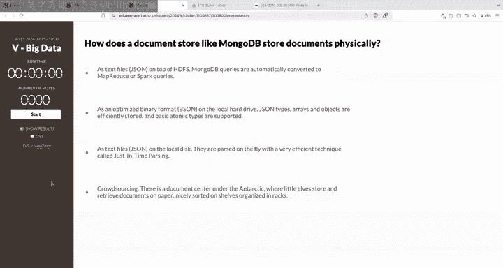

And I should suck。Of course。

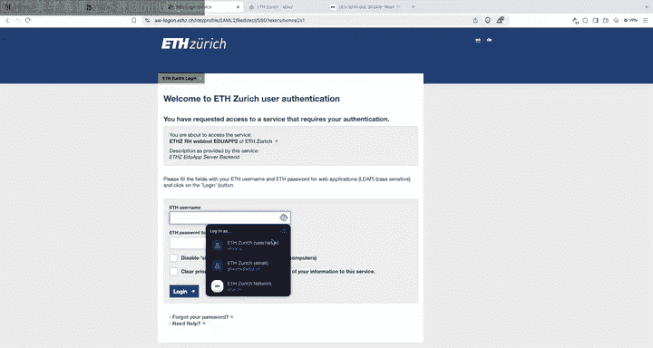

That is the deway effect。

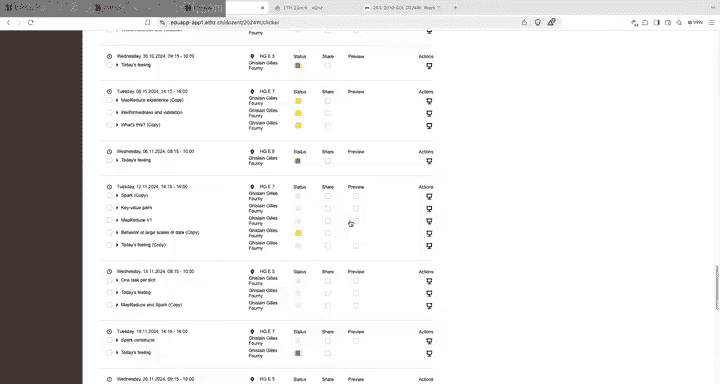

呃，你算了。😔，So indeed， the majority says this on the binary format， so indeed this is how it's done。

What I would like to emphasize is that all four answers are actually perfectly fine in terms of data independence right as long as you have you expose collections of documents。

 query languages， so the four are fine and if you visited the information retrieval。

 then you know that I have a lot of Ls in Antarctica that are very useful for probability。😊，Sory。

Now I'm going to move over to the sites。Yeah呢。

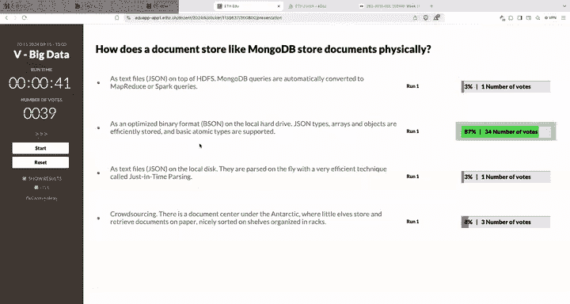

These wins。There you go。So I'm almost done actually here。

 so this is where I left you where we have this index。 Do you remember if it's a has or a tree index。

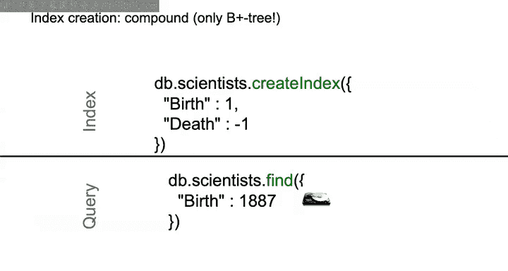

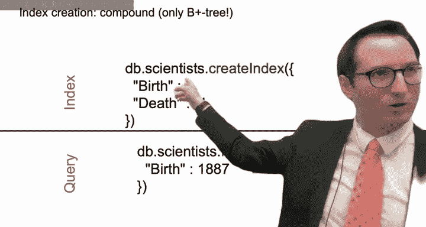

If I do it in this way， anybody。

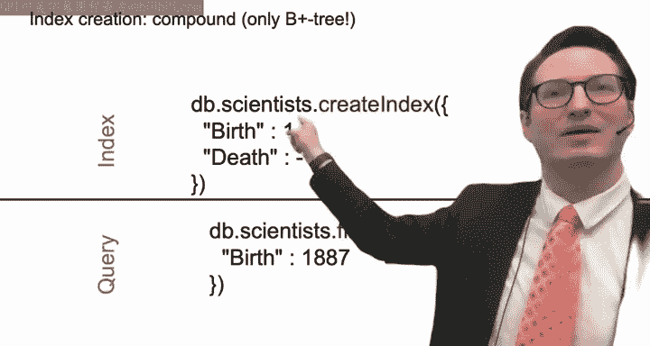

T index， exactly。 This is like ascing， descending。 And otherwise that would be the string hash instead of the one and -1。

 So indeed， this is a tree index。

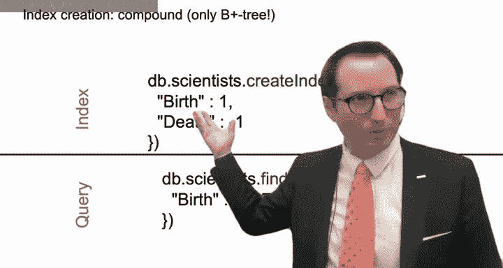

More precisely， it's a tree index on a compound key that is made of several adjacent fieldss。

 birth and death， and then we use the lexxiographic order。Again。

 that kind of hurts a little bit in terms of the J model because normally this is supposed to be no order between birth and death。

 these are two keys in an object。However， as I told you it's kind of a leak in the model。

 so from MongoDB there is actually an order there in the API right so in the API it does look at the first one and the second one。

And so maybe it was a bit of a mystery to some of you why the query below still works。

 even though it's not exactly the same keys as the index， and I made a new slide for you。

 this is why。

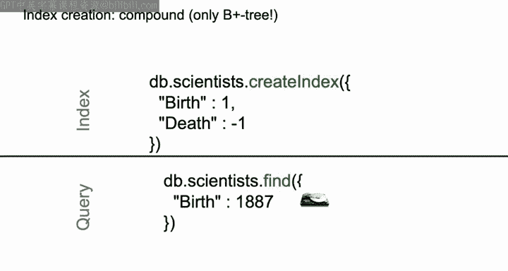

Because when you do， when you create an index on a compound key， several of them。

 let's say A and B in this order， first A， then B。And imagine that these are all the compound keys like I have a collection with 10 different compound keys that I all put in there when you create an index like that it basically means first sorted by a then sorted by B so you have a1 the first older a1s and then sorted by B then all the a2 then sorted by B then all the a3 then sorted by B right so it's called the lexxiographic order wh with me on that okay another key to C。

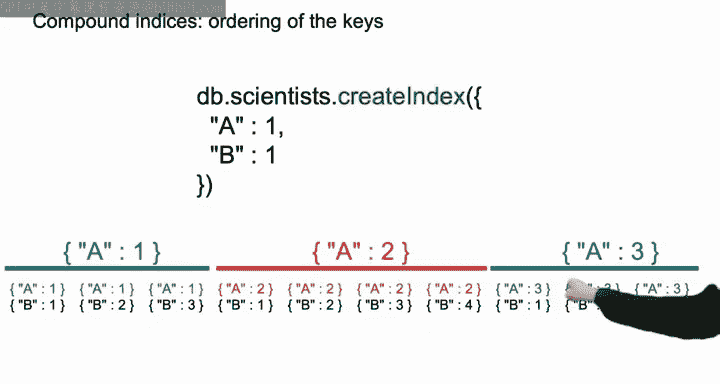

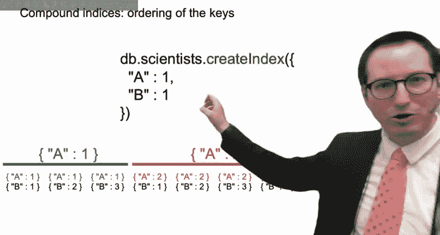

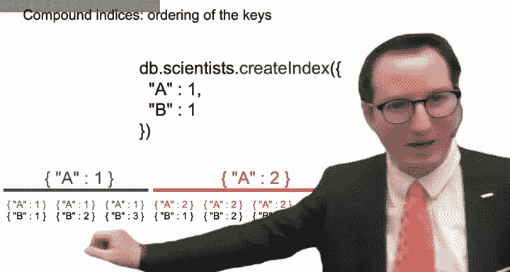

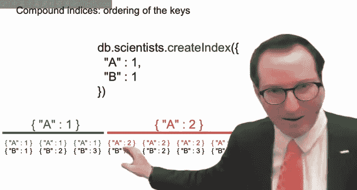

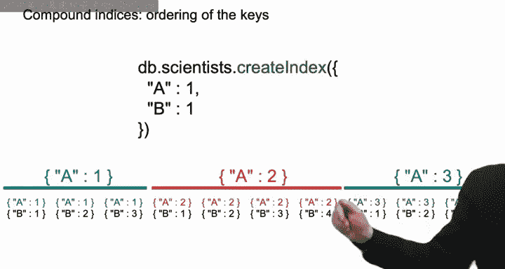

Is that because we have an order and because even though it helps there is an order here and a comes first。

 all the a1s are together all the A2s have together and all the A's3s are together。

 This is why if you use that index and you specifically look for for example a2 theyre all in here So this is a range this is what I meant yesterday saying a2 is actually a range between A2 B1 and A2 B4 who sees that now。

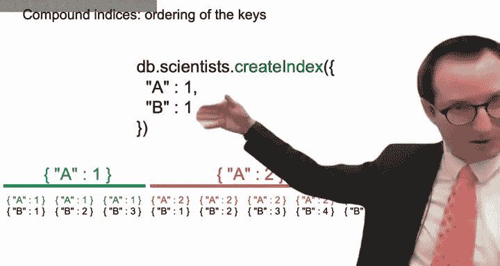

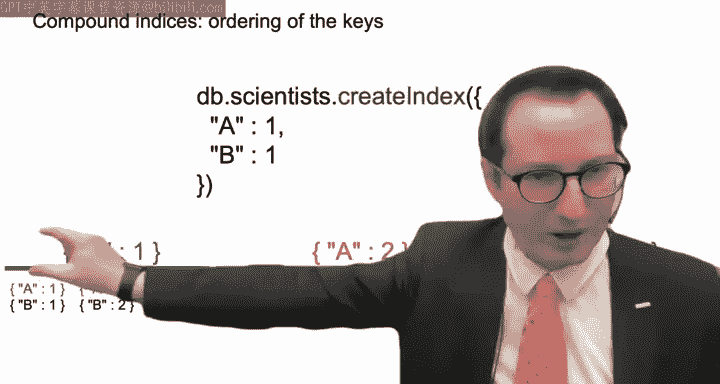

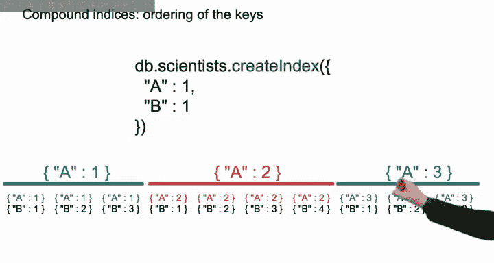

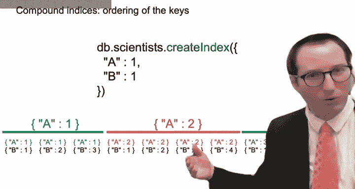

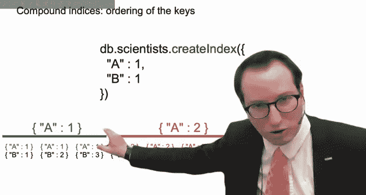

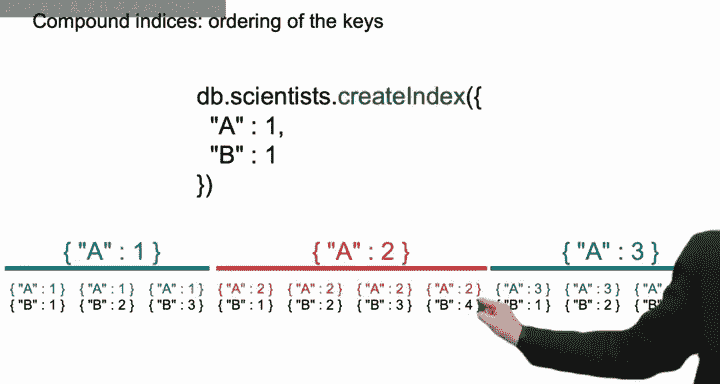

Alright， so this is why if I do a query on just that's called a prefix of the index just a then it's going to work right So this is why this also works because here it's basically a range so that would be a range on a。

 for example， a between2 and three would be like this。😊。

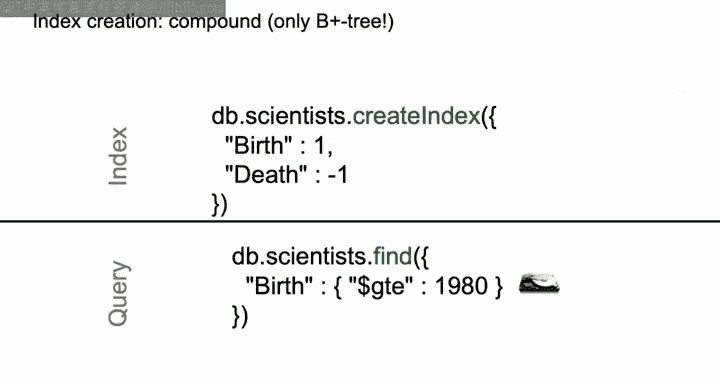

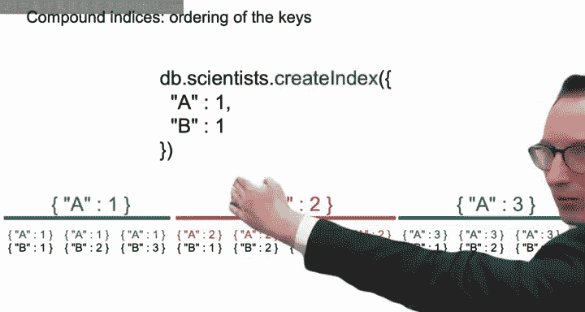

But this， so this works， this doesn't work。And to see why this doesn't work。

 you have to see that here I'm querying on the second key of the index。Look what that means。

The second key， they are not together If you look for B1。

 they are spread all over with all the values of a， so this is not efficient at all。

 you cannot use the index， so it really only works if you query on a right so this is the reason and more generally what you should as a take home message member。

😊，Is that whenever you bid an index on a compound key or tree index？

It is as if you also had these indices here on prefixes， So if you have an index on ABC。

 it's as if you had an index on a and it's as if you had an index on N D。

 just be careful with the one and minus1 that you cannot change。

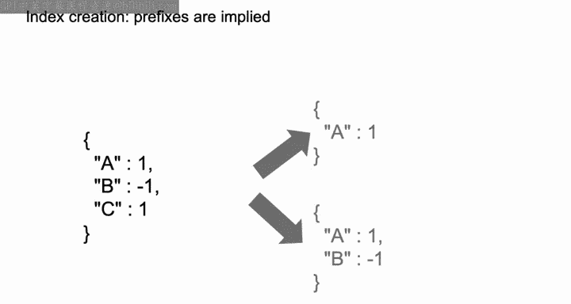

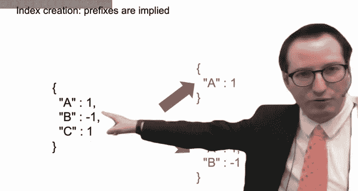

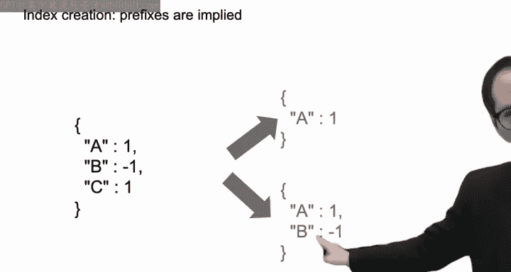

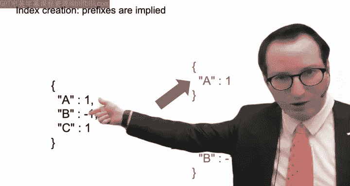

Basily between the two in terms in terms of of ordering。 But basically， this is the idea D。

 It's as if。And this is something in practice。That people make a mistake about because to give you some context。

 what happens in real life when you use Mongodib？You're going to store data in there。

 maybe terabytes of data， maybe even more。Typically the people are not going to just query their data connecting to a ja shell and issuing queries right so first you saw how the API is complex and so on。

 so in fact what happens is that the API is invoked in a computer program。

 for example you have a website that user access via the internet。

And it is in these websites that you might have node JS or Python or whatever language you use。

 and all the requests to Mongo DV are in fact by programs。

 it's all automated with computer programs right to deal with that API。

What that means is that given the websites that you have programmed。

 the queries that will reach MongoDb are usually following a specific pattern that depends on your website。

 for example， if you have a website then the query pattern might be that a lot of people are searching for products and paginating like 10 by 10 right if you're digteg galaxies for example。

 so they are specific patterns。And so what happens is that when you set up your database system。

 you installed MongoDb。The engineers， you in the future will have to sit together and think， okay。

 what are the indices that we need to create for the website to function properly？

And that means you have to figure out what are the queries that are commonly run by the computer program that you wrote for the website and set up the indices appropriately。

This is a science and an art to do it， you need to understand the patterns。

 you need to have a reasonable number of indices， you cannot just go ahead and beat the 100 indices that's not how it works first because that takes space you don't have unlimited space on the drive。

And second， because ideally you would like the indices to fit in the main memory of the machine。

 it's more efficient if the index is in the main memory because then you can directly follow memory pointers to look up in the index so for this reason you cannot be so many indices。

A mistake that a lot of people make。Is that they will create an index on ABC。

 and they will also create an index on AB。That is a mistake because it's a waste of resources if you understand that if you create an index on ABC。

 you get the one on AB for free just because of this that I showed you here。Then you can save memory。

 save resources and just not even build an index on A A And B。 or who is that here。😊。

So this is how it works。😊，This is on a case by case basis， it depends on your website。

 it depends on node JS or Python codes that you're going to write to issue the queries and you have to just figure out the queries the indices that make it fast okay。

So to summarize。What did we get with a document store like Mongodib？

We got that now if you have terabytes or petabytes of data。APo query。

 a lookup is done in 2 mill secondsconds， just 2 mill secondsconds。

 you look it up in the index or of when if it's a hash index by 2 millise secondsconds。

 this is the magic， this is something we did not have with mapreense back because we were before in the data lake paradigm with map Redense back you have to do a full scan in parallel yes but steel scan and that takes much more time than 2 milliseconds to do that so this is the benefit of having a document store like that that uses ETL to put the data in there。

And the drawback in MongoDB is that you have an API but you don't have a query language and so this is why the next lecture is on query languages and then you don't have these weird API arbitrary conventions that you saw you saw yesterday right so you don't have to worry about these things anymore and you can think on a higher level with a query language that actually is much like SQL except that it's not for tables it's for trees。

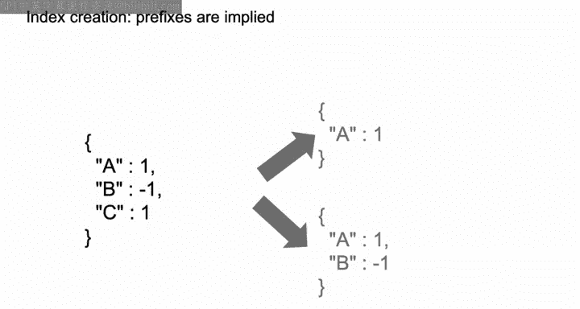

Are there any questions on yes， I see yours are there？😊。

Yes， so if we if we did index creation with like ABC D， would we also get。

 I assume we'd also get ABC for free， if we then also get like A C or how would that would we。

 how would that work only prefixes。 So if you do it on ABC D， you get A， you get A B and you get ABC。

The reason why you don't get A and C is because of this， if you look at A and C。

 you will have the same problem as is depict Tt just a bit more complex right because then if you look for A and C。

 it's going to be spread out over other place because that might be for different values of B and then you're back to the same problem does it make sense？

OkaySo this is why I use the word prefix。 It needs to be a prefix in the sense of a prefix of ABC。

 meaning just A or A And B。All right。Okay， then let's move on。😊。

To the next part。