# 苏黎世联邦理工《大数据｜Big Data - ETH Zurich - Fall 2024》中英字幕（deepseek - P39：-39-12. Querying trees (1_4) -.zh_en - GPT中英字幕课程资源 - BV1sHPKeoEJU

Re come back。Now we are going to do some wrap up， it means that we are going to use a lot of the things that we've seen during the semester because now we are on the top level you see we've done all of this during the semester we are reaching the end now and today we are going to be that high up in the stack。

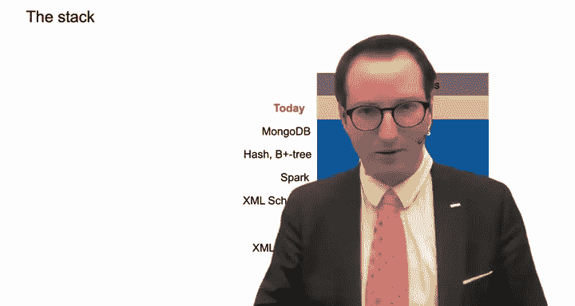

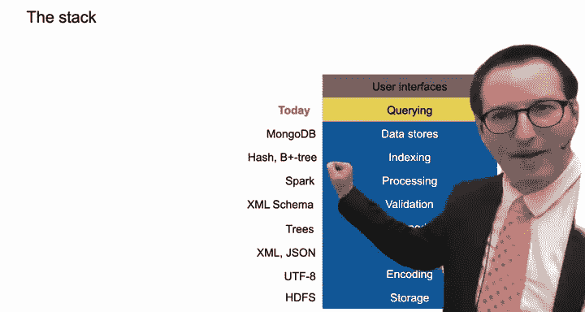

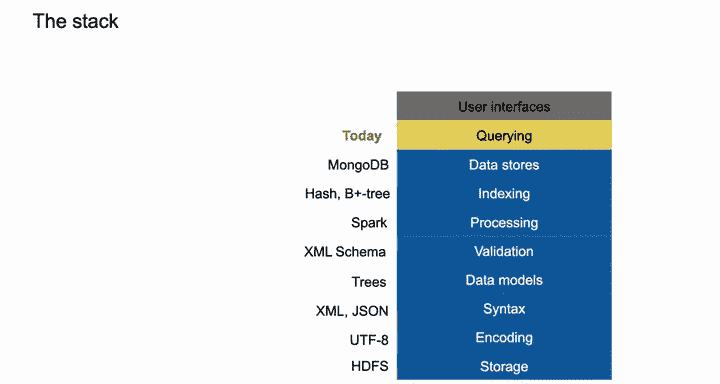

And the way to look at what we are doing now is to go back to data independence。

 Data independence is this principle that dates back to 1970 by Ed Gaquad。

 which is the idea that the users should just deal with。

Easy to understand models like tables that have rows and columns， collections of trees。

And then they should use some query language that is designed for that data model and then it doesn't matter how it's executed physically。

 for example you could have this SQL query that a user is writing and here the elephant is PostreQN could be on a PostreQl database or it could be maybe on H base with a hive hive visa we didn't cover it but it's a data warehousing layer on top of age base that exposes SQL so that could be on top of this it could be on top of Sp we saw SpSQL remember SpSQL but you see it to's the same language that's the beauty of data independence that you can just switch the layer or the implementation or you could have I don't know a DNA some people did it on top of DNA。

Or else in the Antarctica， right， it it all works。 We have a question on Zoo。 Yes。

 is there a scenario where you would prefer to do only an index for say A instead of a。

And something else。Or should you always choose a maximum number of names to sort on？

So yes there are scenarios for that again it's because of the resources you have a limited amount of memory you have a limited amount of disk and an index on a and B takes more space than just an index on a and so that means that if you want to have more in D you have constraints on the memory and on the disk if all you need is a and you don't have a need for A and B then you should go for just a does that make sense。

Yes， awesome。 So it's really an optimization under the constraint。

Memory is not free and so it's limited so you cannot just put all the indices that you want There is another reason it's just not that memory is limited it's also that maintaining the index has a cost when you have an index every time you make a change to the collection you insert a new document。

 you update a document it's going to be a bit slower because every time you make a change it also needs to update the index so every additional index slows down more the queries when you write back。

I somehow mistakenly， it's interesting the rem。It says。

 I somehow mistakenly thought that there would be a root node per document， not per value。

 and it makes sense。A root note for？A for in the index。I， I don't really understand it。

 Maybe we can talk otherwise otherwise offline if there's， if there are more question。 Yeah。

 I'll come back here。 I come back to you。Okay。So was Gcu and it always matters when students have questions or remarks。

 Apache Sp RDDs could also be on top of the RDDs right that you could compile SQL to RDDs。

Or if the data is highly structured even to Sp SQL or to the data frame transformations， right。

 remember that these are two different APIs right there's the RDD API， RDD transformations。

 and there is the data frames API， which is different right。

And that is mapped like you see here to Sp SQL， so you see that's a lot of ways we can implement that。

 but the language is always the same。😊。

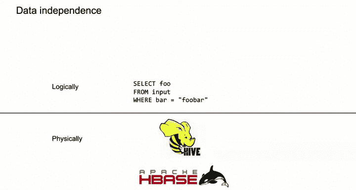

Now。We saw that for big data for many different reasons amongst some of the reasons are that you aggregate data over decades sometimes and the pattern of the data changes and the schema changes and so we are not in the beautiful world of flat and homogeneous radiational tables in the real world you might have extra values in some objects missing values in some others。

 you might have nested nest tables in tables in tables。

 you might have what would be invalid values if you had a type for columns or in the same columns you can have different types so in general this is real life and so here you're hitting the limits of SQL I already showed you that you can kind of deal with nested nest if you add a few dots and explode than the lateral views and so on。

 but it's complicated but if on top of that the data is heterogeneous that's even more complicated and you introduce variance types and so on like in many systems。

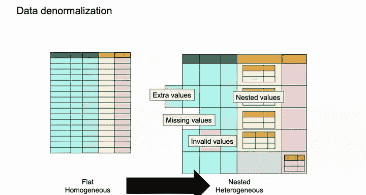

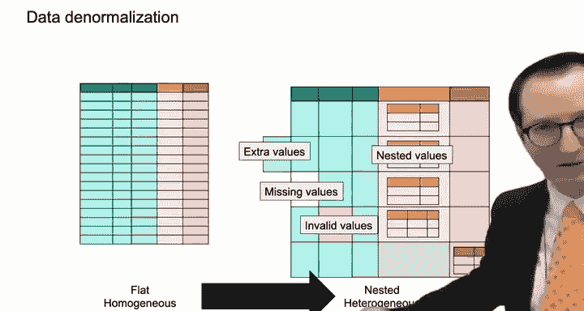

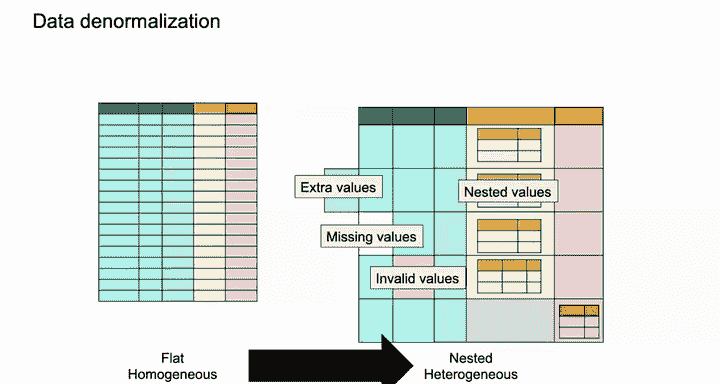

So that doesn't work anymore， we need something else。

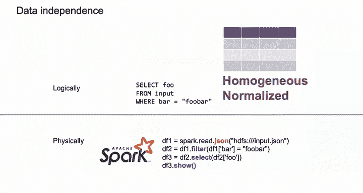

U。

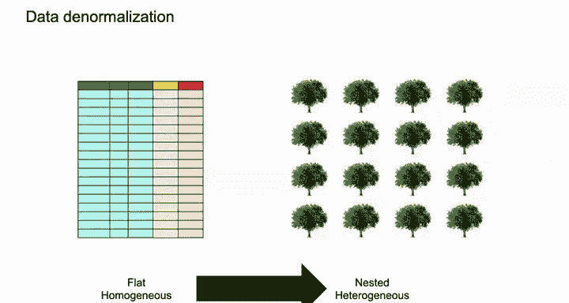

And as a reminder， this is why when you have data that is like this。

 so that has all of these heterogeneity and nasty nests。And you try to open it in in Sp。

 using using the the data frame API， you will see that because you have， for example， here。

 you have objects and and so for example， here， you have objects and here you have a string。

 That's an example of this here in values is。As a reminder。

 I explained to you that what Sp is going to do is that it's going to create a column of type string and it's going to serialize everything to a string。

 These are all strings， They look like objects but it's really a serialized object to a string every time so this is a string and that is going to be a lot of burden for the user to deal with it because now you have to write Python codes that attempts to pass as an object and if it passes it converts it to a di if it doesn't pass it converts a string and so on so it's a lot of additional burden to the developer。

😊，So we don't want that and then in terms of nested nest， you need to introduce these lateral views。

 it's very difficult to process for a human being right so actually read the code that somebody else wrote。

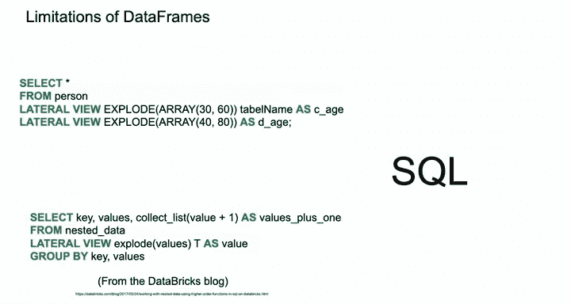

And what's more， if you use SQL， you have cases in which for very simple things like for example the email of I cannot even tell what that does right but basically this is a very long SQL query that in Jsonic that we're studying now is much softer that query is just looking for the top commter right so for every event in Gitthub we wants the top commter in SQL you need to write that long of a query just because it doesn't fit the data model doesn't fit it's an impedance mismatch and so here is one of the obvious example it was one by Ingomer who has the headTA back then now at Google and he had this very very convincing example of the benefit of a language that is tail out for nestedness。

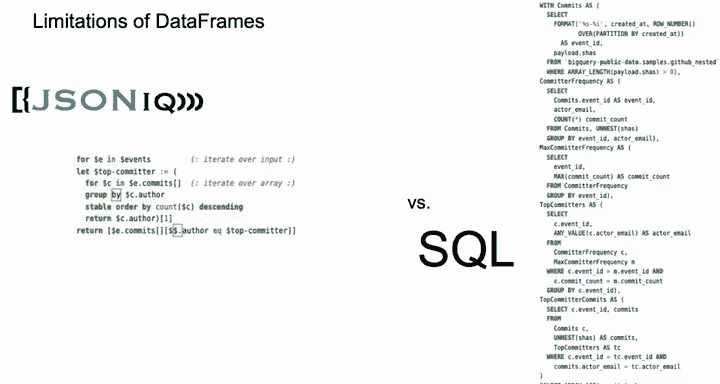

Okay， so this is what we are going to pull on。The data set that we use also for the exam。

 we've used it a lot in the past exams comes from GitHub。

 and it's basically a huge collection of events like Pes， comes and so on。

 everything that happens on GitHub。It's an enormous collection。

 in fact it keeps getting generated every month， so every hour， in fact you have a new TGD， right？😊。

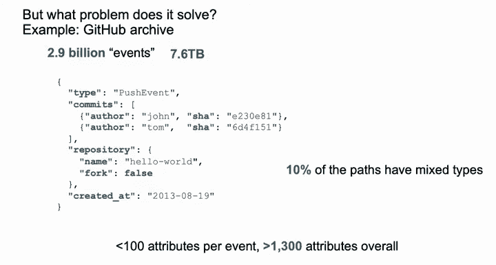

And so they look like this。 So the first thing you see is that it's nested。

 That's the first thing you observed here。 It's also heterogeneous。

 because even though every event has roughly。

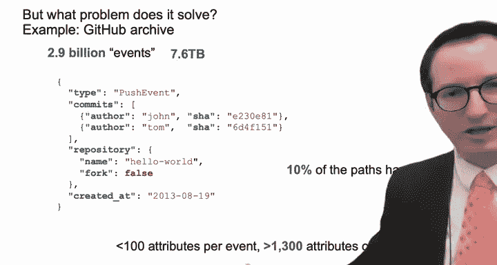

100 attributes。

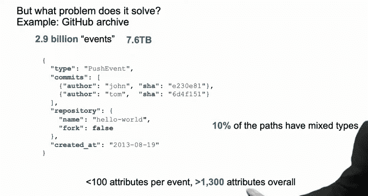

In total， there' are 10 300 attributes。 So this is very spaed and very heterogeneous， right。

 They don't always have the， the same attributes。

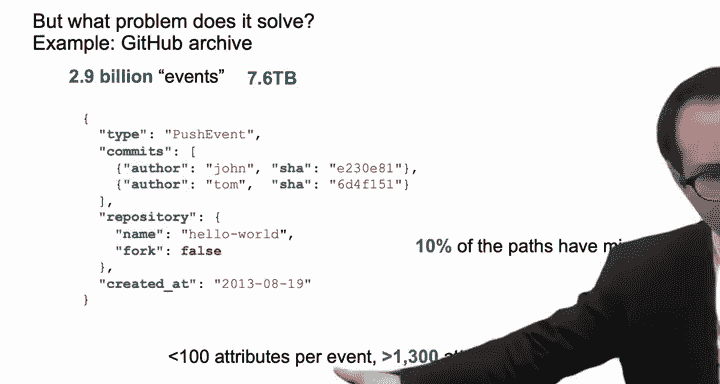

And if you look at the path， what do I mean with the path， I mean。

 type is a path commits dot author is a path repository dot name is a path。

 So all all of these values here， 10% of the path have mixed types So in 90% of the casess is going to be all inte or it's going to be all objects。

 but in 10% of the cases is going to be a mixed。 So at the same position in the objects at the same position。

 same path you will have values of different types that you cannot deal with so easily with with SQL。

 alright。So this is why we like to use these data sets for these reasons， nested and heterogeneous。

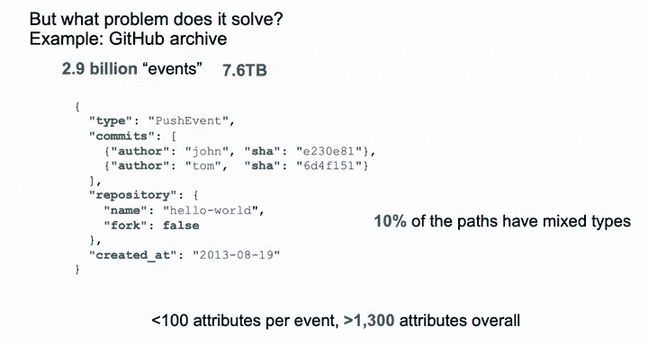

And so the idea of Jsononic is exactly the same as SQL。

 it's a query language on the high level that is supposed to be easy to learn and to use with a clean data model and a clean design that can run on Spark on Hbase on Hadoop。

 even on MoggoDV， you could make it run on MonggoDb。

 you could make it run on PostgresQL like on anything that you want thanks to data independence。😊。

Right and so what we are going to use in the course is an en called the Ruble DB。

 it's been developed right here at TthH by many of your predecessorors students that will show the names shortly and。

So it there's a lot of masterta and some master projects that that are ongoing。

 and it was built for teaching。 So the purpose of the engine was that we can we can use it as to showcase exactly this。

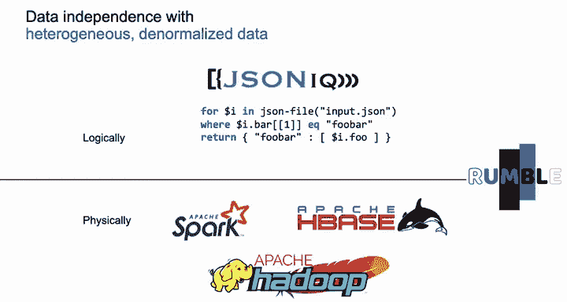

So now JOic just like SQL is a declarative language。

 it means it's not like Java or Python or R or you know like a language where you have while loopbes。

 variable assignments and so on so it's not an imperative language， so's a declarative language。

It's also a functional language what does it mean to have a functional language it basically means that you have building blocks you have expressions and every expression consumes something and spits out something but you can model that purely mathematically right in many cases without any side effect it's like a generalized mathematics not just addition and multiplication but many other operations that you can do right so the reason it's called functional is that you could consider them to all be mathematical functions but if the language is well designed you do not see that these are functions so it's not like in an API where you have the function calls and the parenthesesis here if you have a query language it's all hidden for the user but we still call it functional。

And finally， it is set based， it means that what we manipulate in the language is not just one value at a time。

 like in Java or Python， it's one value at a time， even a dit is one pointer， one value。😊。

But in that case， we can manipulate billions of records or billions of documents at the same time。

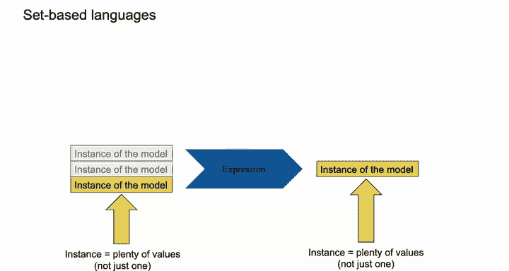

Note that this applies to SQL 2， right it applies to both SQL and Jsononic declarative。

 functional and set based with with me。

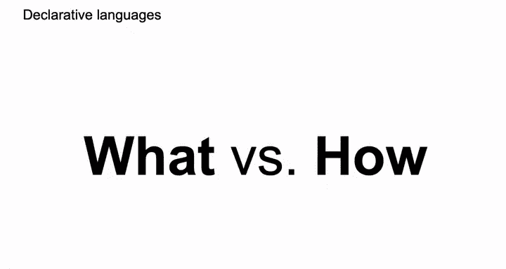

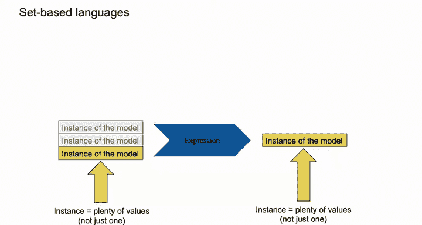

喂。And it feels like a Lego game， this is how we should view it I'm going to give you the building blocks there's I think in Doto there's  37 expressions and it's just like Legos。

 it's the elementdiary Lego particles and then you can combine them together in any way you want。😊。

RmbleDB allows you to read data from S3， from HDGFS， from HTTP or the web， course if it's from HTTP。

 you cannot paraize from the local flight system on your machine， from Asia， B storage and so on。

So for many places， second， many formats， you can read text filess， then you will just see strings。

 you can read Jason Jason lines， you can read CSV Avro PAque。

 it's going to be faster you for the reasons we discussed in the previous weeks with PAque root is something used by high energy physicists working at CN for storing the collision data。

 LibSVM for machine learning purposes and so on and so on so many different formats。

 many different storage systems。😊，And the vision is that it's an ideal lake House language。

 So Lake House， I don't know if many of you heard it was a term that was coined three years ago in the cider conference by databs。

And see， the idea of a lake house is that。It's a little bit like a combination of a warehouse in the Ndata lake right where you have highleve languages that allow you to work on top of the data。

 but it also works if you just drop your size in there and at the same time you have a highleve query language so it's a bit of a mix between the two approaches that I've told you earlier。

And one of the benefits of lake houses is that you can update the data on the data lake and how I will tell you a little bit later。

 it's actually absolutely not trivial to edit data on a data lake because normally you're just supposed to read it。

 there's no random access， but I'd say a few words about that。So all in all。

 you can see Ruble Libbi as a Swiss army knife， right it reads from many places。

 reads from many different formats， you can convert between the formats， just writing small queries。

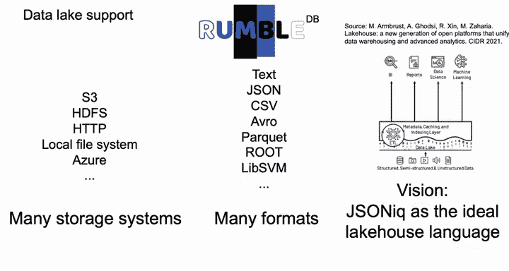

This is the list that I mentioned， so all the students that have been working on this maybe you know some of them the most recent students。

 Macco is actually a TA， are you here Maco， you not today？

So he's a T in the class right now and writing his masterstass on a Rumble Db。Okay， so you see。

 maybe I don't know some of you in the future will also work on it。And the way you should see it。

Is it's a data calculator。 So just like a calculator， you can do plus multiplication， division。

 powers， square roots and so on。Generalize that to objects a arrays and so on。 So for example。

 one plus1 is Jsonic returns23 plus two times 4 is also Jsonic returns 11 right that's trivial your computer s So two smaller than five returns true right So like in many languages。

You have like in many functional languages these let clauses who already saw let clauses in functional languages。

 some of you write， it's not an assignment that doesn't mean you assign2 to I and then you see and and compute i+ one this is not like in Java or in Python this is really declarative。

 you should read that as give me Do I plus one knowing that Do I is2 this is how to read it right it's a mathematical way that returns three。

That's called the flower expression， come back to them。And it doesn't just manipulate numbers。

 you can also copy paste Jason， any Jason well formed Jason。

 you can copy paste it and that's a Jason E query it will just return itself。So anything， an object。

 an array， anything even complex， it just returns itself， any adjacent value， also a string。

 a number， a Boolean analysis， this also returns itself。 and then you have many。

 many more operations that you can do， for example。

 with dots you can navigate and this is also a query that you see on the top left so41 dot4 returns one right for whom is that obvious？

😊，Okay， that should be in Ty right it's really just like a calculator dot is just like plus except that instead of adding what it's doing is that it's navigating right that it's the same logic if you do object oriented programming the dot be should be normally quite iny。

😊，This here。Is an array lookup， it means that you look up the first position in this array。

 why the double square brackets， I would explain if it's a simple square bracket。

 it means something else sequence lookup。

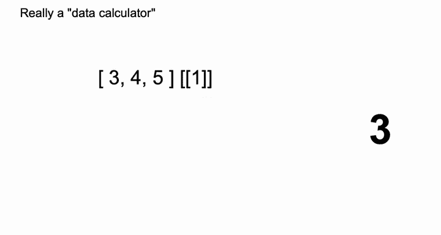

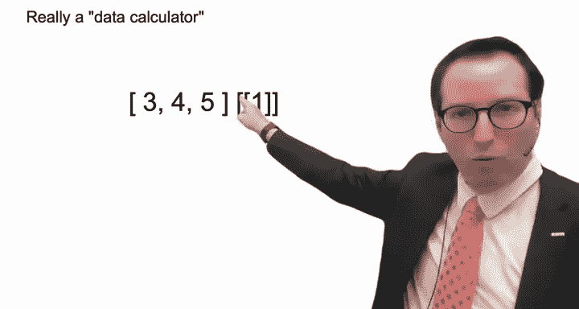

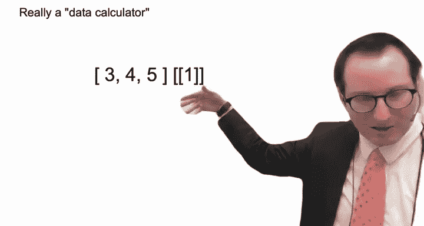

But I'll come back to this。 If you do an array hook curve。

 you just need to double the square brackets。 So this takes。

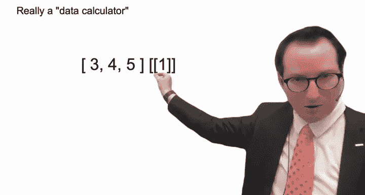

The first position in here。We start counting at one。

 many users of Jsonic will not be necessarily computer scientists。

 so as computer scientists it's obvious that we start counting at zero right in like languages like C++。

The reason has to do with pointer arithmetics when you take a variable and add it to the offset of the pointer the first should be zero because then it's the position plus zero it's where you are。

 but in fact if you go beyond computer science and talk to people in other departments。

 it's not obvious at all that you start counting at zero right so this is where it starts counting at when okay。

This is a more complex query where you have this object with a nest array that is also aonic query do4 that would basically extract the array。

 and then the first position in the array 1，3 plus three，6 who understands this query。Right。Okay。

 wonderful。This is another one where you still have this object food， blah blah。

 blah dot food that takes the array。 And if you have this。

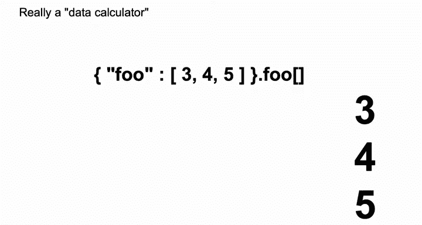

Empty square brackets here it's basically opening the array it's taking the array so the array is a single itemic so it's adjacent adjacentson array。

 you just open it and when you open it three values come out of it a three or4 and a5 but that's not an array here thats 3D a sequence of values right it's not the first time you see sequences of values an RDD is a sequence of values a data frame is a sequence of records right so that shouldn't surprise you to see sequences like that。

😊。

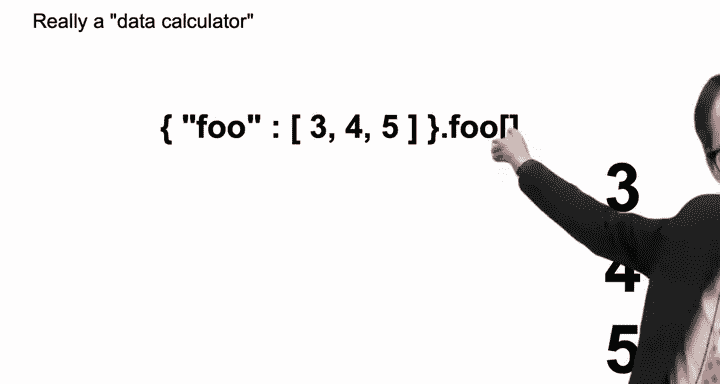

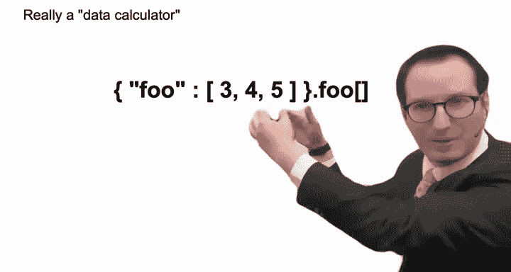

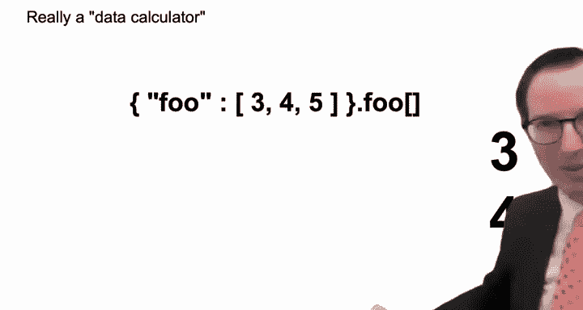

Okay， so this is the sort of things。That you can do you can also output ranges like this so one24 is generating a sequence of four numbers  one234 this is also a flower expression but instead of a let it's a four and that's going to generate one object for each value of I between three and five so these outputs three frog five and then that binds I in turn to three and then4 and then5 then you generate this three object。

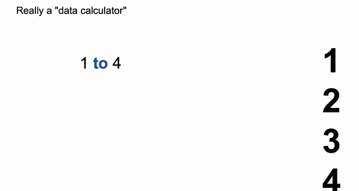

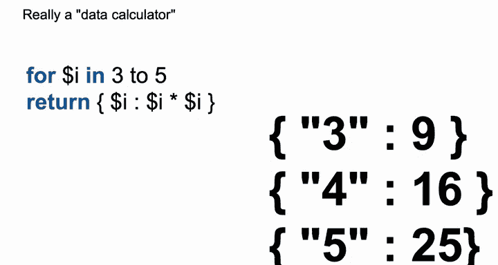

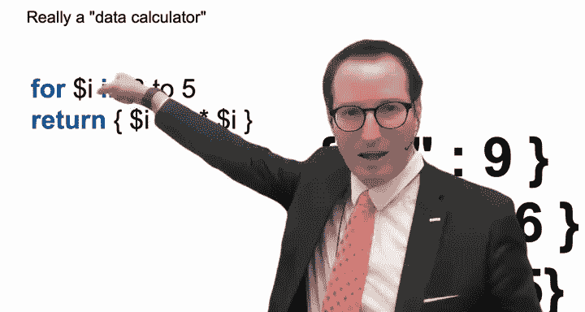

Wand have sends that query。Right， very good。

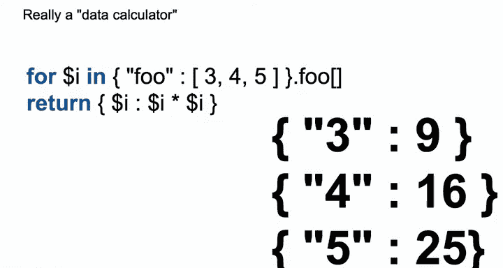

This is a more complex one。 You see it it's a Lego game。 You can just put anything anywhere。

 And here I have this query。 Dot Fu gets the array， pops the array open。 So 3，4 and 5。

 and then it hit the array and does that。 Worldsonov send that query。😊。

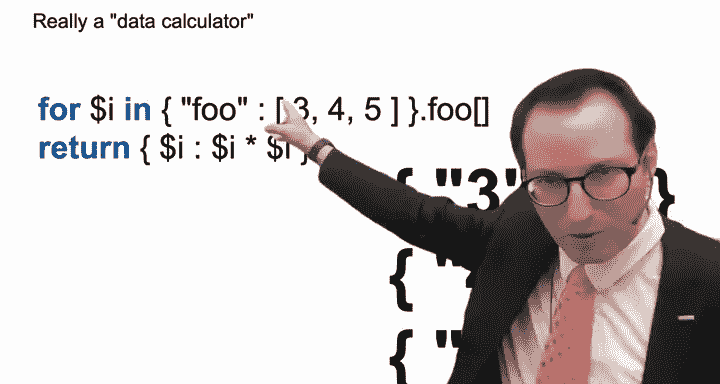

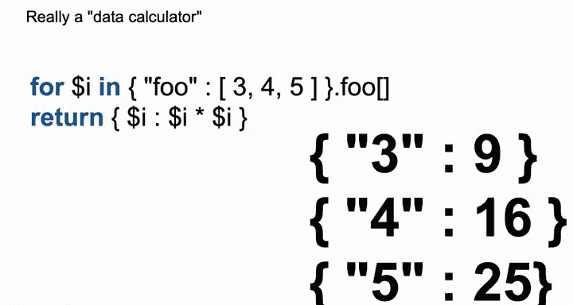

Very good are your goods very good So then you again it's a Lego game so you can take a fork loop of not a fork loop of foreclo like this a flower and put it inside a function call this function returns the keys of all the objects that are in there you can have a sequence of objects that there might be billions of objects in there。

😊。

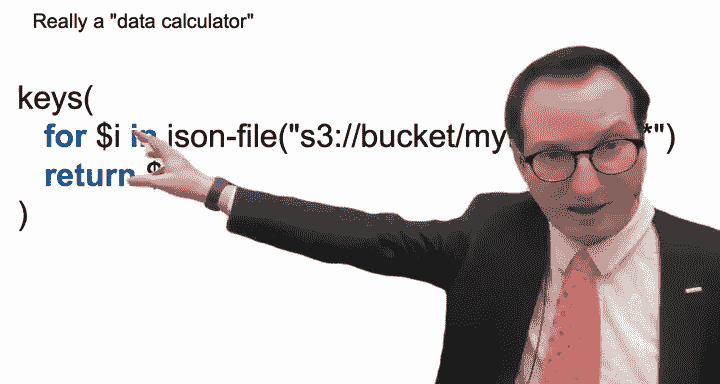

So there's billions of times you would execute that。

And that returns the sequence of billions of objects。

Keys is going to give you all the distinct keys in these objects and maybe just who and bar， okay？

So the important thing is there is that it nests， you can really put any query inside any other query in general。

This is another one oh yes here we a packet file so in that case that would be opening a JO lines file right that would be a J lines file。

 even many of them you could have an entire directory with thousands of them with the star and here you open a packet files so imagine on S3 I have somewhere some packet directory with plenty of packet files I can open them and it' is going to iterate through the records of these packet files you saw that a packet file in fact contains data frames and data frames are just valid J right so it's basically a sequence of valid J objects and then we extract the keys。

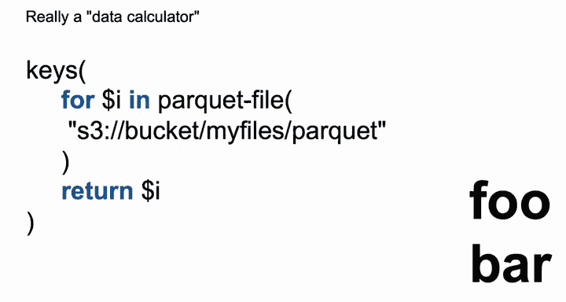

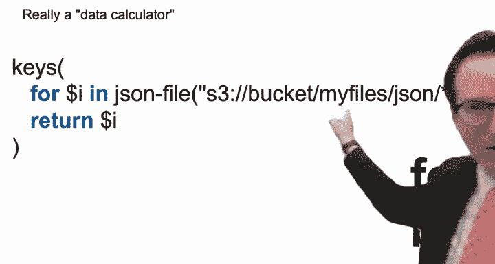

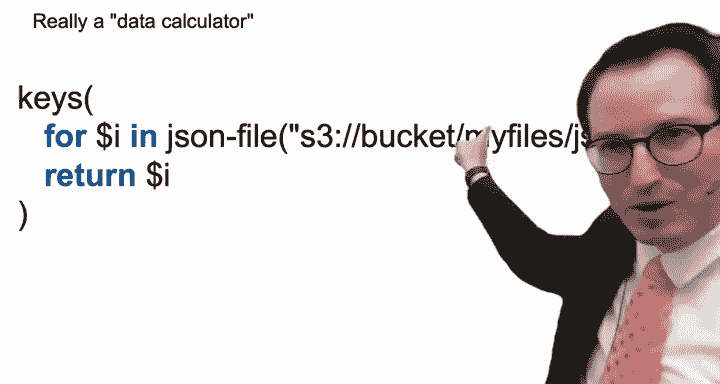

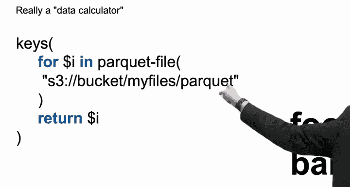

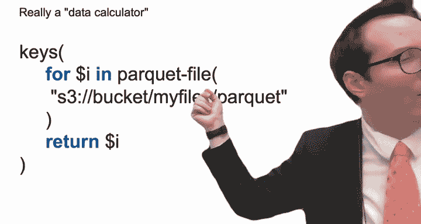

What is magic is that these queries look the same。 The only difference is Jason versus Sper。

But there is a difference in performance with these queries when you use them。

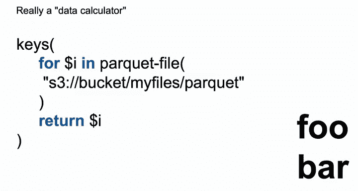

Is that in the case of reading Jason， that would be a bit slower because that query。

 as you imagine will have to read the entire data， maybe petabytes of data。

Can anybody tell me why this query will happen to be almost instance？😡。

Why can I almost immediately tell you the keys in there？Yes。😊，Exactly。

 we have the schema in the packet file， so in that case you don't even need to look at the data to evaluate this query。

 you just open the packet file， peek into the beginning of the packet file at the schema and the schema will tell you the key for whom is that here。

😊。

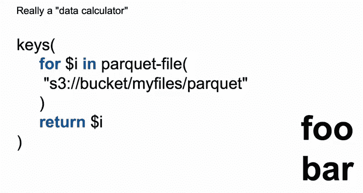

RightSo this is the benefit of data independence。 It's the same query。😊。

But the engine can figure out ways to make it super fast just by optimizing so this is what happens here。

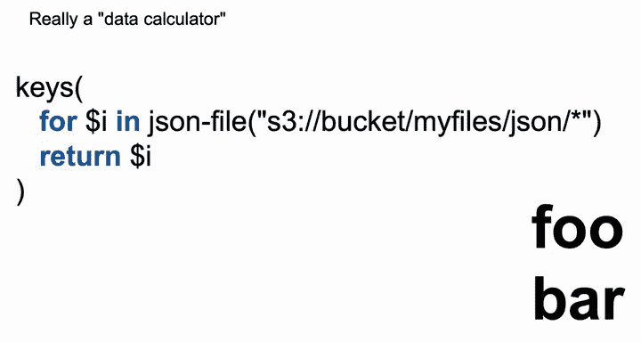

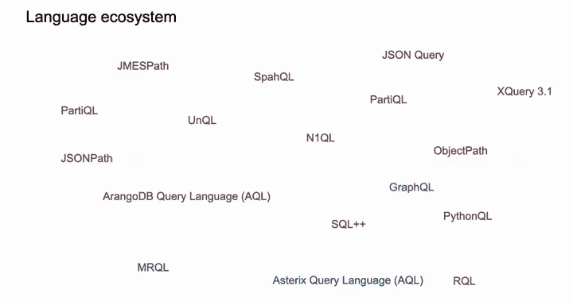

Now， before we dive into exploring probably most of it next week。

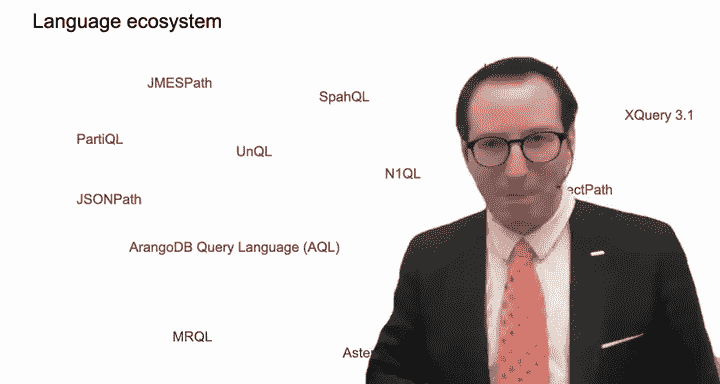

I would like to say that this is ongoing right it's actually been ongoing for 20 years and I hope it will not be ongoing for too much more time but there's all these languages I tried to keep track of them everybody keeps inventing languages so Jason Nick was one of the very first ones the first one I think was Xqueries so Xquery was invented to navigate XML and there was a working group in the A3C so the same consortium that standardizes HM HTTP。

😊。

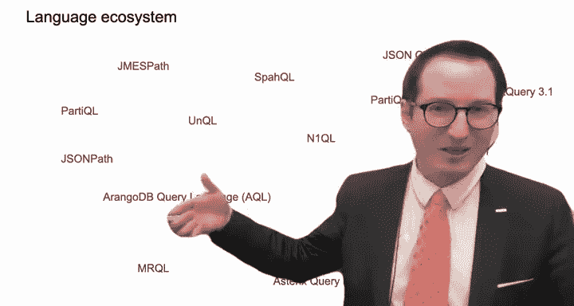

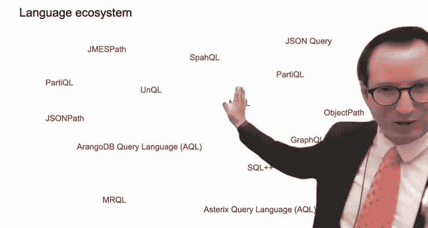

And so it's a query language for XI。😊，Lots of smart people from IBM from Oracle。

 from Microsoft from Maclogs， so that sat for years and years and years every week for two hourss discussing you know trying to standardize and they came up with with the Xquery X queryry language and then I was in the working group and at some point we Jason was becoming more popular and then the discussion started about how do we extend Xquery to also superal Jason and Jason Nick was bound then it was roughly 2010。

 2011 and so as to feed the discussion， we fucked we made a proposal called JasonOI where we added Jason objects and Jason array to the data model of X query and we removed the XML completely right we really replaced XML with Jason and so then there was the discussion。

 the useK。For objects over arrays we're actually。Not restricted to Jason there's many other use cases that people had and so what happened in the end is we decided to keep Jasonsononic out there for the people who are specifically interested in Jason because the language is very natural but that's the story of it the first reaction when we published it was why do we need a query language for JasonN we already have ja but you know that jascript is not a query language it's an imperative language so it's very important to understand that neurons So the good news is that then a lot of people realized that we actually do need a query language for Jason So the invented query languages for Jason and now we are in the opposite situation that everybody keeps inventing query languages for Jason and so what we need now the next step is really a consolidation we really need people to sit together and try to agree on a common language just like SQL for tables that everybody would use and then it would。

Fully interoperable so we are not there yet， I hope it will happen we have to make compromises and you know people talking to each other。

But maybe I don't know in five years in 10 years， Maybe it happens。 Maybe one of the languages。

Establishes itself。 And then all of the document stars and and and the architecture start adopting a language。

 yes。So if I missed it earlier， but what was the reason for making Jonic one indexed？

No one index yeah， that the indexes start with one and not with zero。

 like in most other programming languages。Yes， so。Here， the thinking is this。 let me try to。

 to take a step back in explaining this。The purpose of a stand in general。

It's not just true for languages。 It's also true， let's say for USB， USD is a standout， right。

 Bluetooth is a standouts。 HM is a standout。Some doubt。

Is made in such a way that the technologies can interoperate with each other that if you learn it。

 you can use it absolutely everywhere。A st is never going to be perfect， it's a compromise。

 it's people from different companies speaking with each other and reaching a compromise right and you make it in such a way that nobody vets or has a formal objection。

So， it means that。What is even more important than the best possible design or the design that the people will like the most is the fact that the people agree on it。

 right， So this is the most important thing。So what I want to say with this is that starting counting at one or at zero。

In fact， is not the most important， right， It could have been also starting at  zero。

 That would have been just fine。What's important is that people agree。

 and so in the case of x square， the agreement came to be1。And when we invented Jasonsonique。

 when we fought Jasonsonique。We did not want to reconsider discussions that had already taken place。

 we tried to really keep the changes minimal and take over exactly what was designed on the expir level and just add J remove XML。

嗯。The reason I'm telling you that is that its it's a general lesson for you generally when you work in companies and you have to design。

Architecture， also you have to design languages。Whenever you design an API or a language。

As a general principle， you should try。To avoid inventing new things or reinventing the we。

 So whenever you can reuse something that already exists， then you should reuse what already exists。

 Let me give you an example。 Imagine that you want to were to run a subset of Java。

Maybe on some mobile devices。Then the decision of what subset of Java you want to run is an arbitrary decision。

 right， it could be done in many different ways。If you want to do it in a good way。

 you should take a standout subset of Java and that exists that's called J2ME mobile。

 the mobile edition of Java and this is one example of when you really need to find something that is st up that is already designed so that you basically keep the arbitrary decisions as many more as possible and so to answer your question the reason why when was taken as the basis for JsonE is simply that that was what applied to the X standardouts right it's a really high levelve principle that I'm telling you here there's a lot of lessons that can be learned from this does it make sense Did I answer your question Yes thank you awesome。

By the way the way that the working group in WCC work is also really nice in terms of communication because the culture in the working group was that when somebody was speaking。

Everybody would just listen and let them finish until they are done speaking and people would take terms and everybody would speak like for five minutes uninterrupted。

 then you basically listen to each other it's really a very organized and great way of moving forward。

 but of course it takes years in order to reach a recommendation。😊，All right。

 so that was a bit of a prime the for five minutes on a meta level。

 but there's a lot of lessons here that you can maybe use later in employment。😊，All right。

So I'm totally unable to tell you which language is going to win。

 maybe it's going to mixture to be a mixture， it doesn't really matter which one wins right they all follow more or less the same principles if I fit you one so Jason Nickick then you will see that you can learn any other quite easily and so if one day there is a standout that everybody adopts then it will be easy for you to learn it。

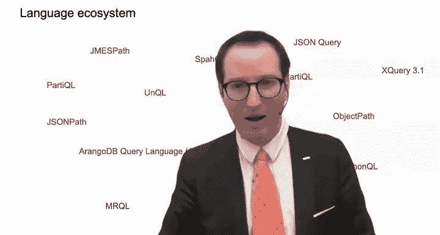

In fact， I have an example of that， who saw the Google SQL pipes。😊。

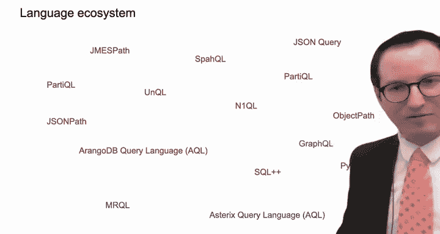

Announcement on social media， so they extended SQL using pipes。

 in fact that exactly corresponds to the flower expressions that are in JsonNonic so the students who learned Jsononic in previous lectures when Google SQL pipepes were released that was very easy for them to learn it。

All right。You'll have maybe not much time left， but。

Maybe can I still have time to tell you about the data model in Jsonic。嗯。

So you already know that Jason has six building blocks， right， there's objects。There's a rays。

 there are strings， there's numbersmb， there's booleans， and there's no sixs of them。So。In JOic。

 the data model says that everything is a sequence of items。

Everything that comes into an expression or comes out of an expression， that's a sequence of items。

Sequences of items are completely flat。And they are heterogeneous。

 meaning that you can have a sequence that contains plenty of things you could have a string an integer and array。

 you can completely mix them that's absolutely not a problem， so it's heterogeneous。

It's deormalized in the sense that you can also have objects in array arrays in there so you can have structure structurald items。

嗯。Also， a sequence of one item is the same thing as that item。 So for the purpose of thinking。

 if you say I have a string， it's the same thing as saying I have one string。

 Its the same thing as saying that I have a sequence of one string。 or who is that dear。

So a sequence of item is the same thing as one singular item and it's flat if you attempt to nest them they will never nest if you take a sequence of two。

 then comma an nodox sequence is' just a sequence of three right that doesn't nest we see that if you want two nest you should use a race but sequences they are flat。

And this is the empty sequence， it's the sequence that has nothing in it。

 right just the empty sequence。😊，If you want to map it to things you've already seen。

 then just think of an RDD， right an RDD of whatever。

 then that's what it's corresponding to in terms of a sequence。

You can even have heterogeneous Rs right if you have an RDD with a polymorphtic type。

 then you can also actually have heterogeneous RDDs okay so I'm going to stop here so remember because I'm going to repeat this many times everything everything everything in Jsononic is a sequence of items。

And by the way that also comes from x query in x query， everything is a sequence of items。

 the only difference is that in x query you would have xMd elementss xM attributes as items in JOonic instead you have JSO objects。

 JON array array and anatomics as items right so atomic values， objects， array array can be items。

 functions not in these course I'm just giving them aside atomics objects and a race。😊。

So I'm going to stop here it's exactly the right time because it's ringing so we'll continue next week I see you and then we'll explore the whole language Jonic to ours Thank you very much and see you。

😊。

