# 苏黎世联邦理工《大数据｜Big Data - ETH Zurich - Fall 2024》中英字幕（deepseek - P40：-40-12. Querying trees (2_4) -.zh_en - GPT中英字幕课程资源 - BV1sHPKeoEJU

对。Welcome everybody in the lecture hall， welcome everybody on Zoom。

 welcome everybody from the future。😊，So what's the menu for today。

 we are going to finish query increase well finish。

 we'll see if we finish maybe I'll finish tomorrow， but we'll get deeper in Jonic。And y。

 so that's mostly going to keep us busy for the whole2 wells。

 I have a few comments before that about the Docker and everything So right now the TA team is hardworking preparing the the exam so the exam questions and so on and also the exam environment because actually it would be computer based。

And we hoped by popular requests of previous semesters to upgrade to Jupyter La because a lot of students had asked for it。

 Unfortunately， the digital exams team said that they do not super yet because they need to run tests for security and so on first。

 So I'm afraid we'll have to to still use Jupyter notebooks。

 So here's the current status with the Docker。 So the Dockers are basically an emulation of exam environment。

 right the exam environment is not going to be Docker。

 It's going to be an actual Windows machine in something that's called the safe exam browser。

 but the Docker is a simulation of that。So。The docker that we release V 3 is very useful for you for the exercises。

 because it has repeated lab。 It's more convenient， and it also has Jsononic syntax highlighting。

 Let me show you what it's。😊，What it looks like。This this one。呃。No， that's not the one。

 this is the one。This one has JOonic syntax highlighting。

 it was actually a semester project by David May and Buzatu who graduated a few months ago。

 and so he implemented this for you and now you can see the results and this is available only on Jupyter La so for the exercises you could use this one if that works for you and then we will release V4 that is the actual versions of the exam environment。

 but basically it provides you with an antenna if one of them doesn't work and you can use the other I heard of a few students who had trouble with the older Do curve V2 and Jupyter lab fixed the problems on their machines so basically well have the choice between V3 that has Jupiter lab and syntax highlighting or V4 that is the same as would be at the exam。

If one doesn't work， then just try the other and you will see。Okay。

So this is what it looks like with Jupy lab， you basically have this additional navigation on the left。

 and this is what the syntax highlighting looks like in here。

Something else that I would like to say is that we have here。嗯。

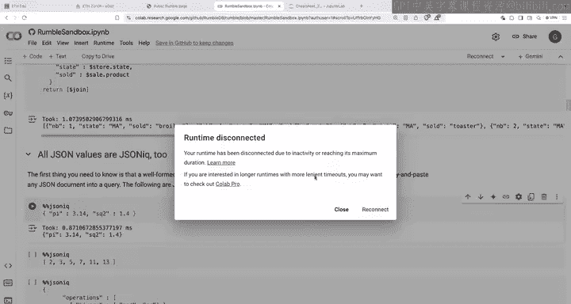

We have here Rubledb sandbox。 So there is this server that you might have seen at some places this public do Rumbledb do org。

 What is this， It's basically a bunch of machines that are on the Amazon cloud very small machines like one gig of memory。

 just one core and so on super super small but we put them out there for free and people can just run rumbledb queries against them right so if you don't manage to connect locally to local host。

 your own machine， then you can just replace it with public do Rumbledb do org and then it it will send it to the public server but for obvious reason then you cannot read local files right you can only read files from HttP and so you need to use an Http URL whenever you open a file。

嗯。Alright， so I think this is pretty much it。 Maybe I could also mention that page that is either with local host or publicrombledb doorg。

 but if you do slashp do html， that's kind of a debug mode that allows you to type a query here。

 click the button and get announced all right， so it's just a test thats the server actually actually works。

All right， so just to get a feeling who is successfully using the Docker。Okay。

Most of you who is still having problems with the doctorcker。Okay so it seems to be very few of you。

 if you still have problems with the docker then keep reaching out to the TA team until we find a solution or we really want to figure out even the tiniest problems with the Docker。

All right， so let me now get back to the slides。

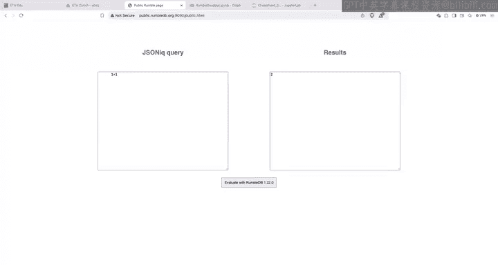

Thank you for asking Zoom to be always a good idea to check that everybody can hear。All right。

 so where were we？

嗯。Well， the most important piece of information you need to remember for today is that every expression in JOonic returns a or at the same time。

 A， C sequence of items that's the one thing you need to know once you get that you will understand everything。

Who actually run the tutorials that I've been doing at the beginning of the semester very good so that was a request by your predecessors some of the students would have liked to have JSOonic spread a little bit over multiple weeks to make the learning smoother if you haven't tried the tutorials that's okay then now is the time to learn JOonic。

So everything is a sequence of items and the items can be even heterogeneous nest seat so it doesn't have to be it doesn't have to be flat and homogeneous right sequences of items now。

😊，If you have a sequence of one item， we consider that it's the same thing as the item itself。It's。

It's called the canononicical identification in mathematics it basically means we consider them the same thing so if you say a sequence of one string。

 then it's the same as the string right we just flatten everything and the flatten is also true for larger sequences if you ever tried it in Jsonic to nest sequences like for example here you would put a sequence of two items inside a bigger sequence。

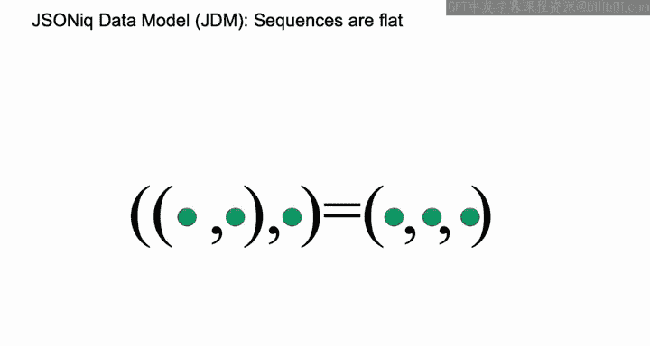

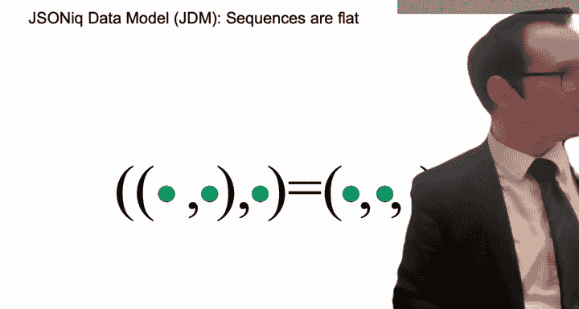

That's not going to work。 It's just going to flatten everything every time right so sequence do not nest they always flat。

And one particular sequence is the empty sequence， right， so you can have an empty sequence。

 You can have just when item sequence of when item or you can have multiple items。😊，Now。

 what are the items you can have， where that should come as something natural to you because you've launched Jason and we've been through all the older types。

We have atomic items， so an item can be a string an integer dates just atomic values。

 or it can be an object or an object item， the same thing， or it can be an array or an array item。

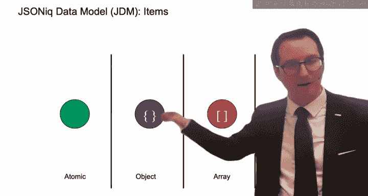

Or it can be a function， but I'm not going to bother you with that。

 It's called higher order functions。 geeks love that it's basically languages that can also take strings as values and return strings we call that higher order functions。

😊。

I'm not including them in the material You don't need to worry about function items。

 but just know that there's been a super cool machine learning master stasis a few years ago where we actually figure outs that function items are perfect post sting machine learning models because then you can just call the model on a specific record and get a prediction so the function items turned out to be really。

 really， really cool when you want to bring machine learning into into into Jsonic right。😊。

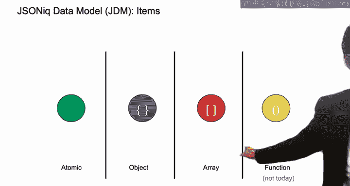

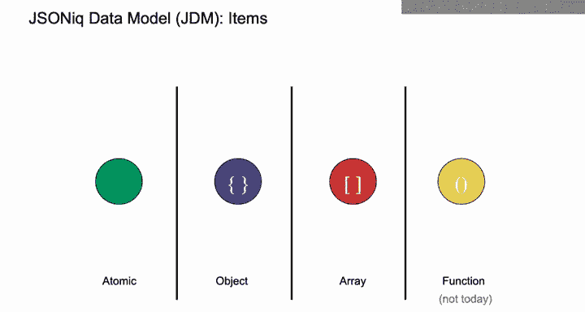

Okay， so as I said， any expression。

In JOonic takes sequences of items， returns sequences of items。

 right so everything is a sequence of at if you should。

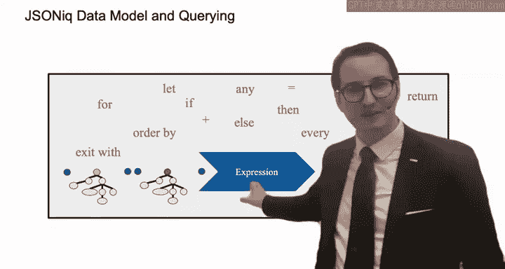

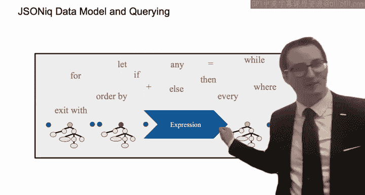

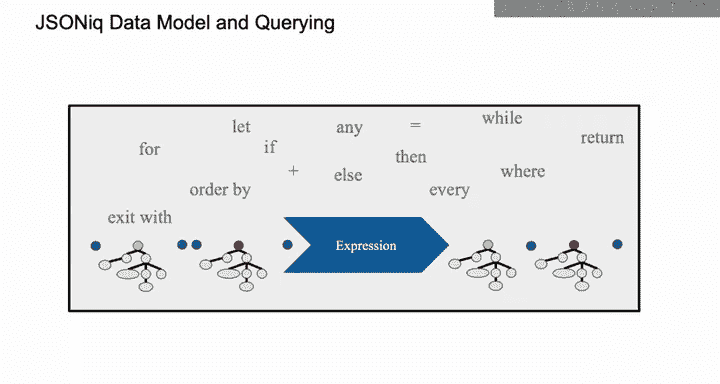

this door here。So everything takes a sequence of items and reaches on the sequence of items。

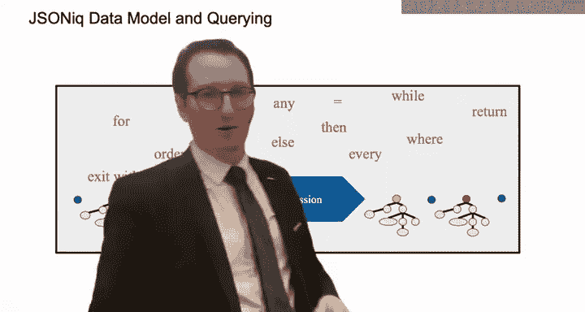

Now to give you the intuition of why sequences of items， why is it actually so powerful。

 it's so powerful because that covers the whole spectrum of heterogeneity right you can have sequences of items that are totally heterogeneous like this is a sequence of four items displaying them vertically but there is an integer a boan and object in an array。

😊。

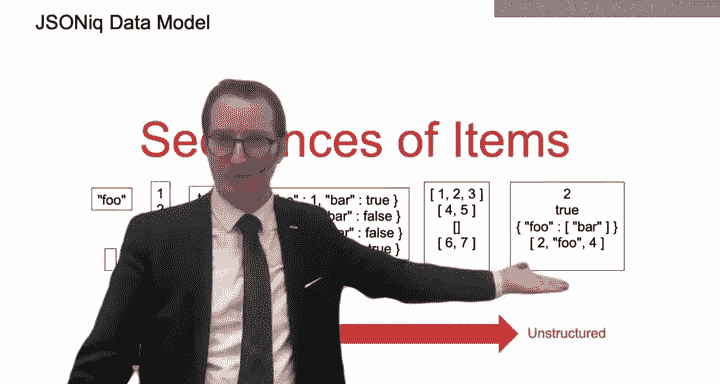

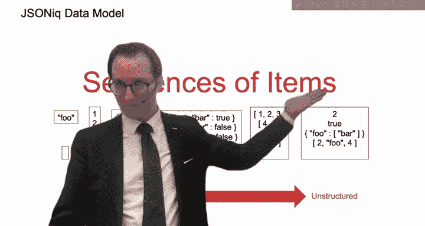

That's a sequence of four items。 It's both nested and heterogeneous， right。

 So that's let's call it the maximum entropy you can get in the language。

 right fully nested and heterogeneous。 Then if you go a little bit to the left。

 it becomes a bit more structured。 So here， for example。

 it's a bit more homogeneous because it's a sequence of arrays。

 and it's even a sequence of arrays of integers。 So sequence of four arrays of integers here。

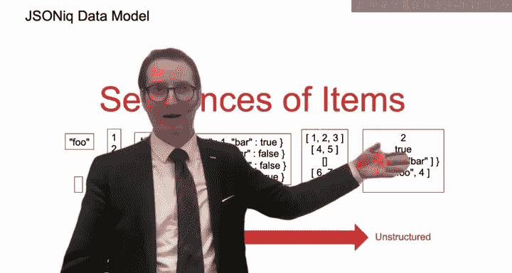

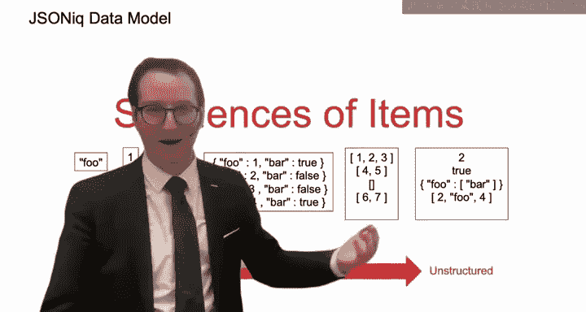

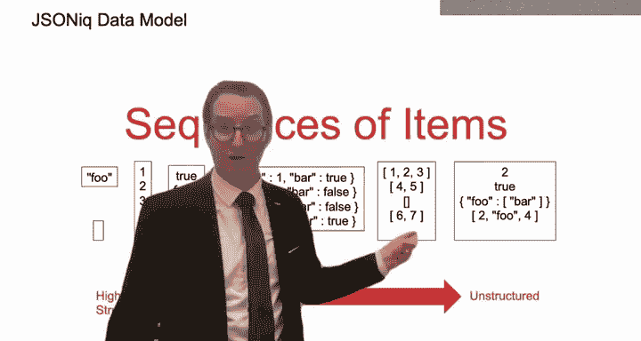

Then here you have a sequence of four objects and these objects even have the same schema right so this is like not even nested because it's all flat and it's homogeneous。

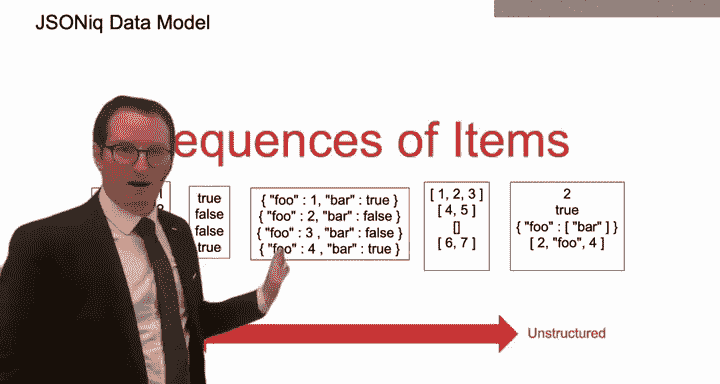

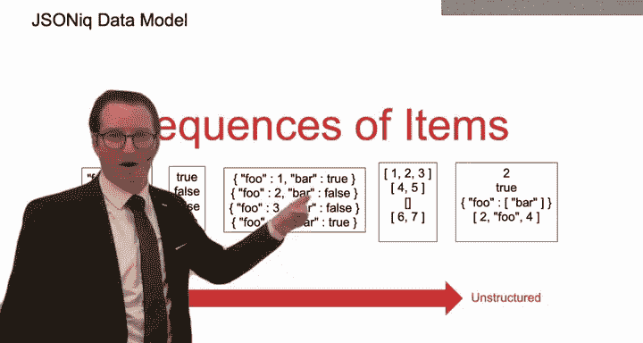

U here。Is that this is actually a relational table。Awesome， how many colors。

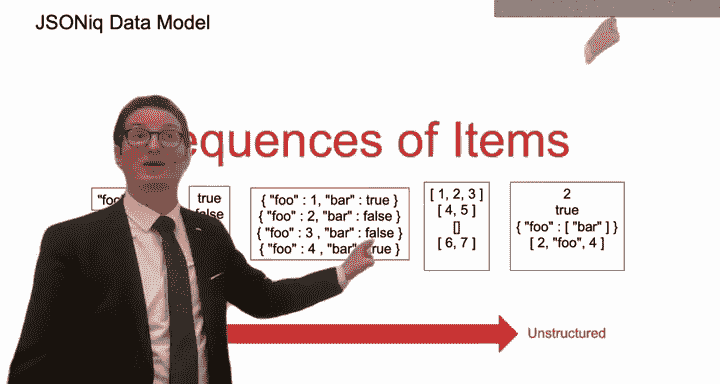

Two， yes， how many rows？Or exactly。 So this is perfect。 So you see。

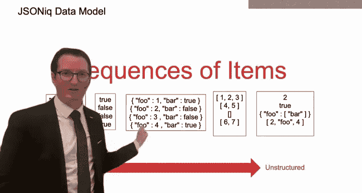

What is the take home message here is a sequence of items is more general than a relational table。

 any relational table can be understood as a sequence of object items。

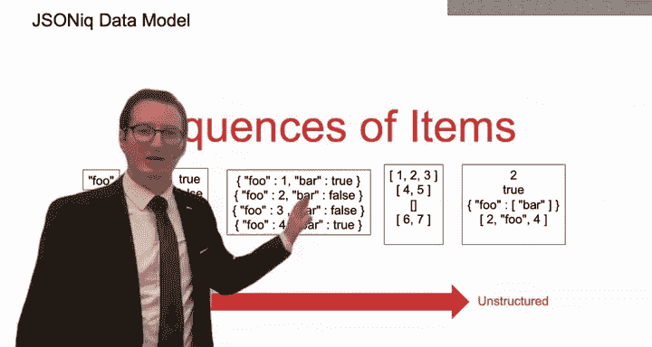

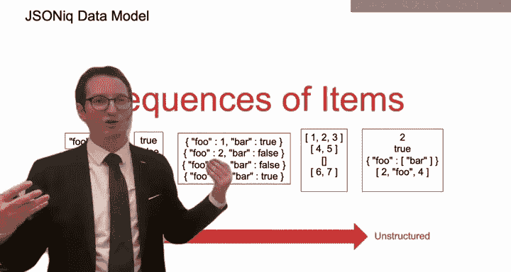

But a sequence of item can be more general than that， it can be fully heterogeneous。

 it can even be a sequence of guuls， it doesn't have to be structured so this is a sequence of gus。

 this is a sequence of integergels， this is a sequence of just one string which is the same as one string and this is the empty sequence right。

😊。

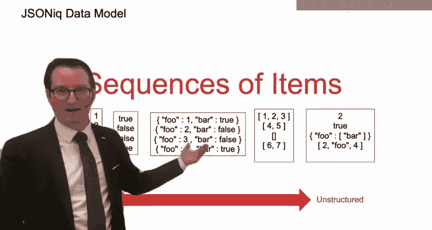

So this is the whole spectrum and this is why sequences of items are so incredibly powerful。

 they cover relational tables， they cover single items， the emptiness。

 and they cover a huge mess of plenty nonrelated items。😊，But who is that here？😊，All right。

 and every expression is going to manipulate this very important Okay so let's get started with with Jsononic I think the the best way to start with a language like this is where it also historically all started in fact it started with Xml with something called X path but I'm not going to show you X path I'm going to show you how it works on Jason X path was basically to navigate Xml to go into the children of the children of the elements and so on but let's do it with JasonO instead So in Jonic。

😊。

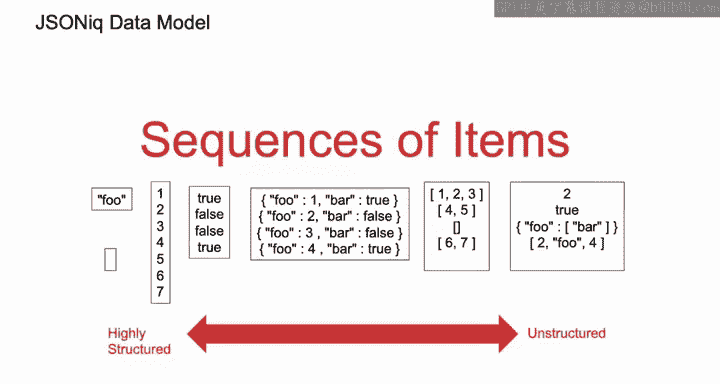

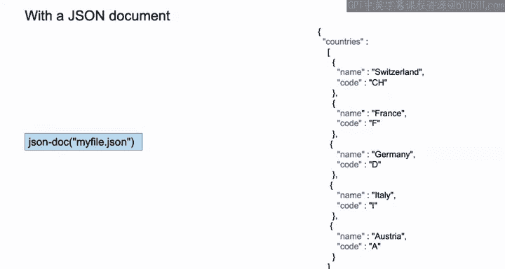

You can open a file that contains one single JON value here a JO object。

 it's a file can be on multiple lines， it's not a JON lines file。

 it's really just a JON file right and you can just open it with JO Dog J dog with the path in here that path can be relative like here the file is just in the same directory it can also be an absolute URL stuffing with HttP can also start with HGFS with S3 depending on where you want to read it can be absolutely anything right then you can open it and you get what when you open that file or sequence of how many items。

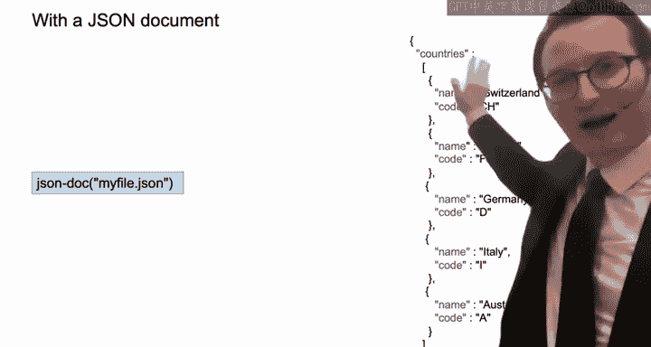

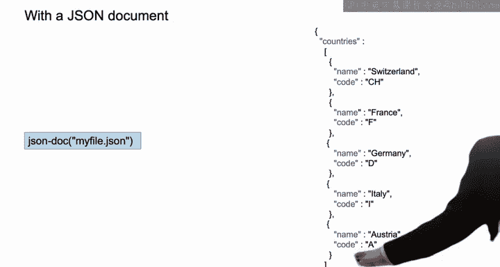

Just one one object that's it because it's a JSson file contains one Json value， one object item。

 so it's a sequence of one object， which is the same thing as one object and you see it here right This is this is the one object This is just one now。

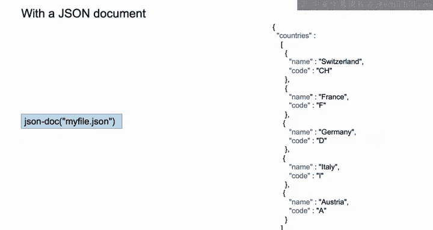

I'm going to add here dot countries。

That shouldn't really surprise you because in Java。

 in Java in Python in many languages we navigate in objects with a dot right。

 so if I say dot countries that's going to navigate inside that object， the key countries。

 what's the value associated with it？😊，That's this array。 So how many items does that query return？

One array item， just one。Now you probably each is and you want to extract what's inside right you want to basically open that array and get the five items that are inside you can just use this syntax here that unboxes the array and now it gives you a sequence of how many items。

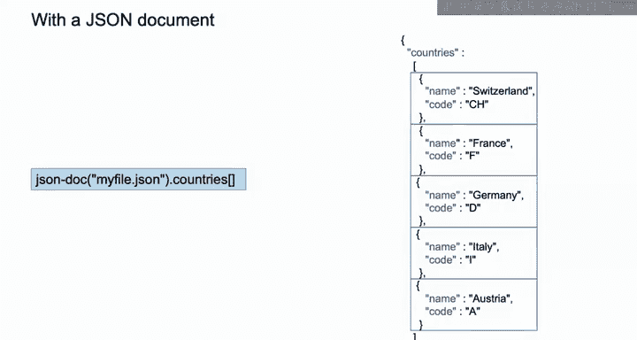

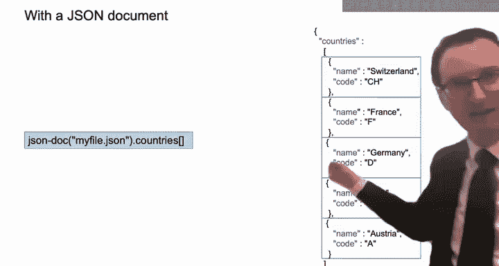

5 items。 And now you have a sequence of five objects to be more precise。 Okay。

 and then the syntax is powerful enough that you can continue navigating。

 even though it's multiple items now。 So if you say dot name。

 it's going to do it for every item for every item that is an object is going to further further navigate down。

 So now you get a sequence of five strings。😊，But who is that all clear？

RightSo it's magic it just navigates in parallelL X path was doing exactly that for XML。

 that is how it works for Jason， I could also do it with dot code instead of dot name you see it just nicely goes inside every object。

😊，And one more thing you can do is filtering， think of the filter transformation in stock or think of the where clause in SQL if you want to just filter some of the items that satisfy a predicate。

 then you just state what your predicate is here you want codes to BCCH and that's only going to filter this one here。

 so that outputs a sequence of one object that is just this one which is the same as the object itself。

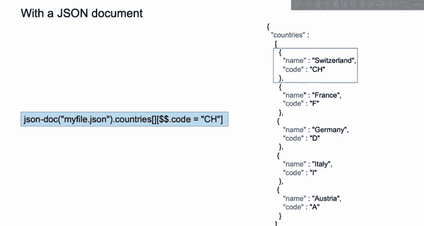

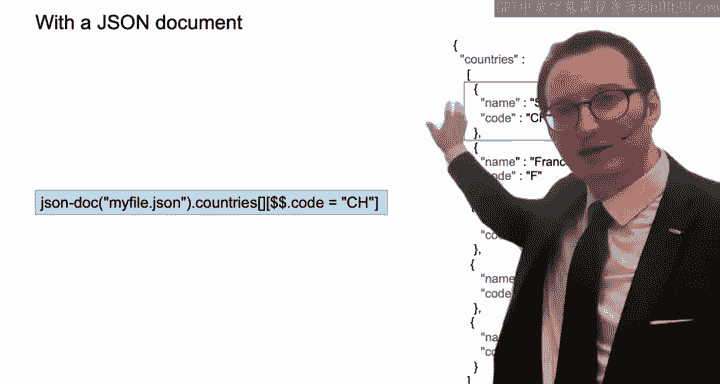

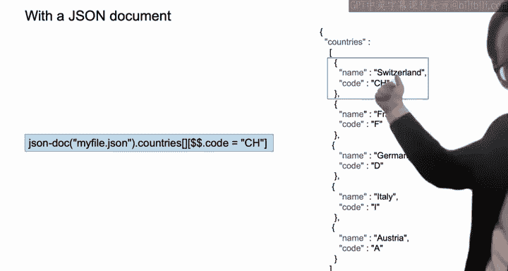

Now a little comment here in SQL you would just write code equals C right you know in the W loss and that's it。

 but here is dollar dollar its basically just a placeholder for the current item that you're looking at it's also called the context item so this is a predicate that's going to be evaluated five times five times。

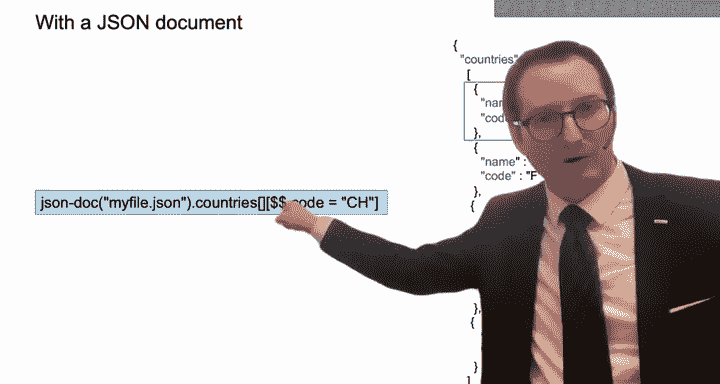

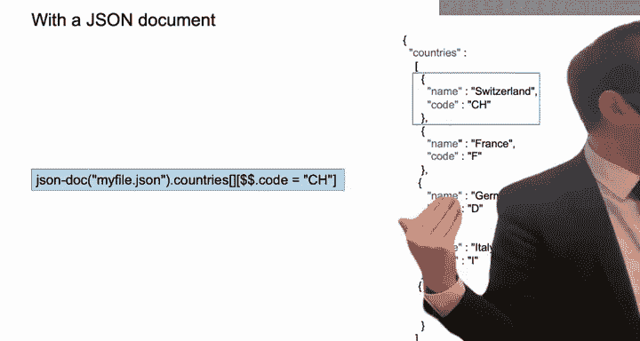

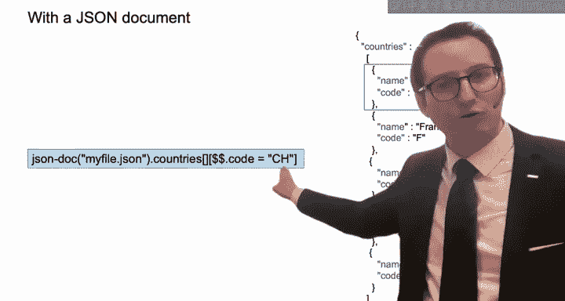

Once， so let me go back so we evaluate it on the it stops here， right。

 so this is the array countries that we unboxed getting five items。 so this is basically this。

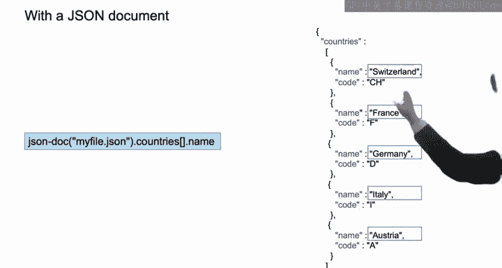

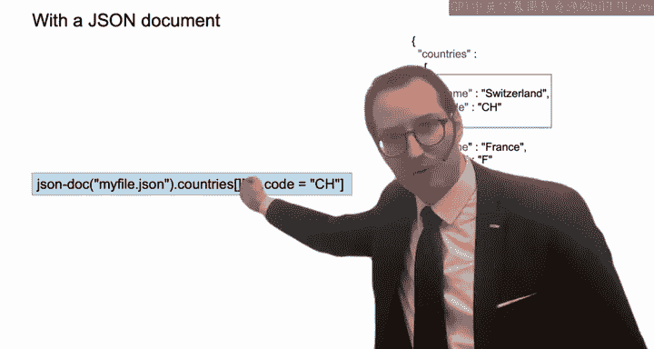

And we evaluate the predicate。C equals C So dola dola dot code here。

 the preddicate is going to return true because dola do la that's the object dot code that's C equals C。

 that's true here， Do， Do the second time Dola Dola is this Dola do la dot code is F equals C that's false。

 Here is false， Here is false， Here is false with with me。

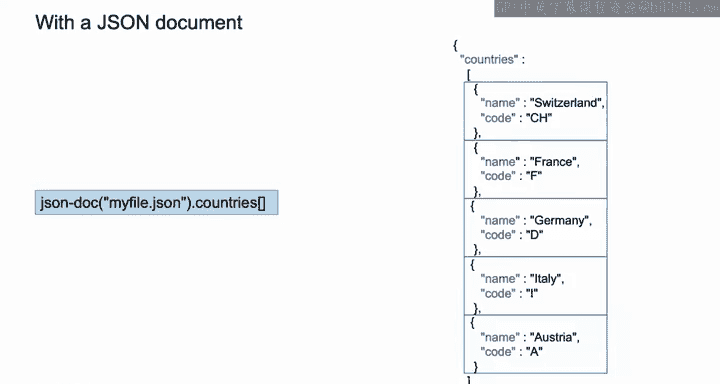

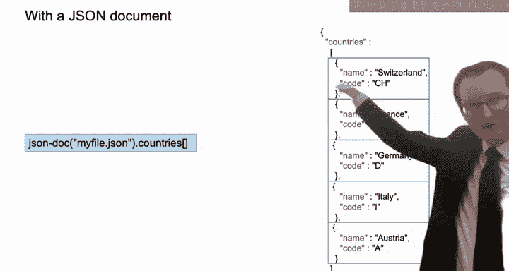

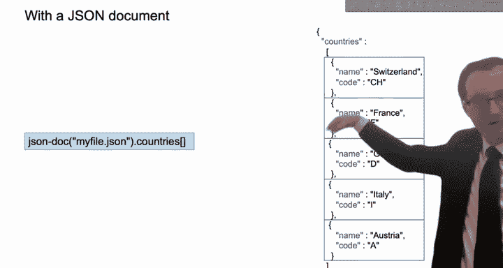

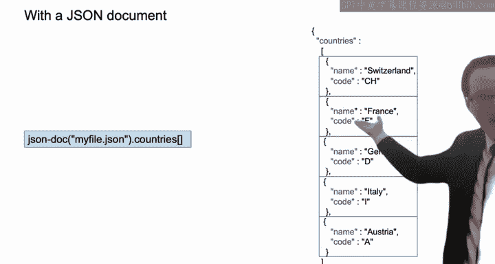

Alright， very good。 So again this dollar dollar， it's the context item and it's going to be bound to each item that's coming from the left。

 it might be now that what's coming from the left has a billion items then that's okay you just get the dollar do bound to each one of these billion items and every time these returns through you keep it every time it returns forth。

 you don't keep it。😊。

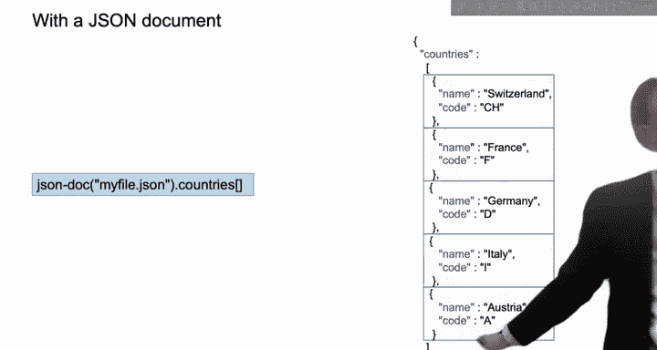

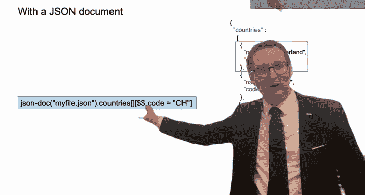

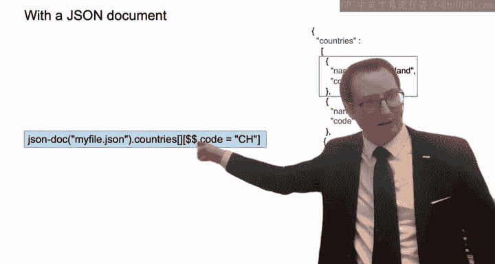

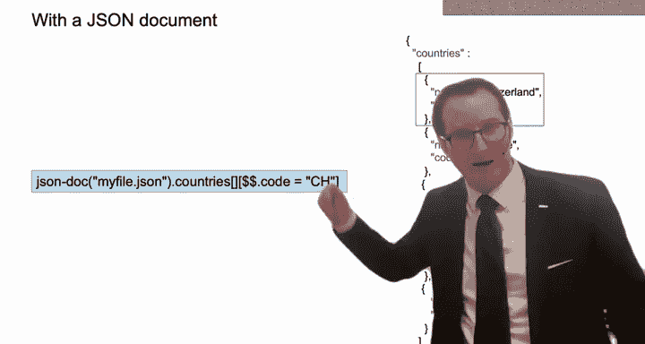

Who sees right now the use of lombda in the filter transformation of Spk？Because that's very similar。

 that's kind of those periods， right？Except that we here we don't have alamda。

 it has to be Dora Do the name of the item yes we have a question about that。You can look at this。

 I just add dot name。 You can absolutely do that。 It's like a gigantic Lego game。

 You can just assemble the queries like this in any way you want and you can absolutely do that。

 and that is basically navigating now you this was basically just after the filter after the predicate you get this and dot name is going to get Switzerland。

 So that actually looks for the name of the country， the code of which is C that's what it does。😊。

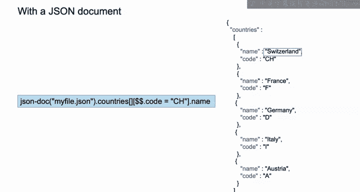

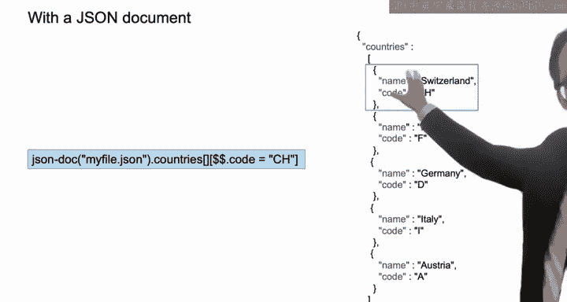

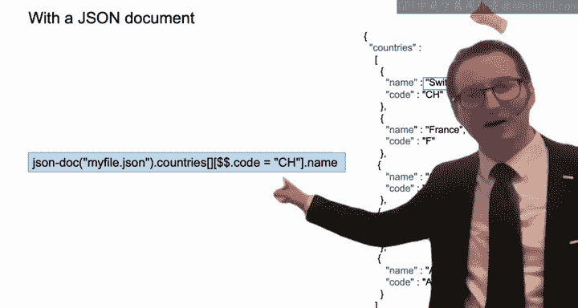

嗯。Okay， who's with me？Very good。 I'm going to accelerate if I feel that it's all that everybody's following。

Now this is a JO file， one single JON value possibly spread over multiple lines。

 but there's another kind of file that we saw before it's a J lines file。

 a JO lines file has one value per line very often one object per line right but generally one value per line。

So this is an example of Jason Ly's file that has five objects。In one on each line and so。

You see that if I call JON5， it's a different function right JO doc would be for a single JO file JON5 is really for for a JON lines file like this if I stop here how many items do I get？

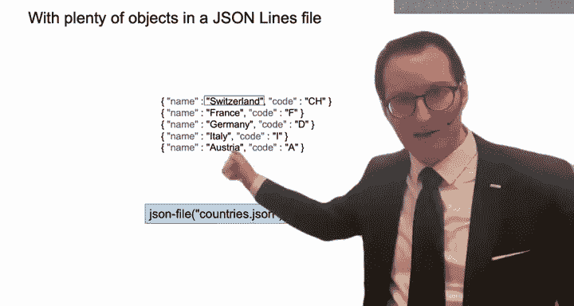

Yes five exactly these are the five items and then if I do Dola Dola code equals C I'm filtering I'm only keeping this one right here and then dot name gets me Switzerland who with me。

😊。

Right， very good。嗯。Okay so this is Jason Light， by the way。

 we are discussing with Macco who' is doing naea with me that this is maybe not the best name and we are considering renaming it Jason Lys to it to make it more intuitive right that's just a very old name that we gave seven years ago when the first prototype was built。

😊。

Okay。Now， given that that's only the start， these are so the dots lookup， the array on boxing。

 the predcate， these are only a few of the expressions in total。

 I think we have 37 expressions like that and you just assembledsemble the 37 expressions like colleggo。

😮，So I'm going to show you plenty of screens like that that have a query and the results very diy。

 but it's good we are all computer scientists here just to drive you through the language。😊。

So I told you in J file you can also put URL right it's going to work Rubledb is going to download it from the web。

 it's going to connect and download that file， I think this actually exists。

 you can really use that we actually did put a Jason file in there。So that should normally work。

So if you do that Jason file， that's a Jason Ly's file here and is going to output a gigantic sequence because that's actually a very large file and in fact it has0 items right in that file so now you see it's just because it doesn't want to crash your computer RubledB is very nice to use so instead of crashing your computer with potentially billions of items it's okay that's more than 200 so it's more than 200 I'm going to stop there with a little warning that there's more right but it's not going to display all of them in here right so it's just for convenience。

😊，So this is just returning technically a sequence of 306s，577 objects。😊。

Then I can do things like this in another expression。

 this extracts the item at a specific position starting with one， so if I say square bracket one。😊。

That's basically extracting the first item， so here I see just one object。

 it's a very large object right， but this is one object and that's the first object that there is in this file over there。

You might have noticed that technically it's the same syntax as the prediiccate right because here you have something in square brackets and here you also have something in square brackets right so it isn't need the same syntax。

😊，What you need to understand is that the way it works is it depends if that's a boolean or an integer here it's going to be a boolean。

 So what it's going to do is it's going to evaluate to true and false and keep it if it's true。

But if it doesn't evaluate to a Juliaulan but it evaluate to a number like like an integer here。

 then instead it's going to look for a position right so one then it returns the first object if that were 10。

 then it would return the 10th object with with me。Who is with me？Awesome， perfect。

 you saw a question about that。😊，到情么。Yes， absolutely evaluates too so very often。

 I mean in 80% of the cases you actually have an integer lital。

 but that would also work if instead you would put a sum or some more complex expression you could even have in there an expression that is that is 1 thousand lines as long as it evaluates to an integer or a boolean that's the idea it's a Le game again Yes can you nest these so can you put an accessory to another value inside one of those expressions that evaluates to an integer。

Yes， absolutely you can put whatever you want in there that evaluates to an integer， you can nest。

 oh， oops， are you okay？Are you okay， Yeah， all right。So。Again， it's a legal game。

 whenever you expect an integer or a string or an object or whatever。

 you can always put an expression instead that evaluates to an integer or an object and so on okay。

Good that's there's another question Yes I was wondering when we have those expressions that evaluate Booles we can track overall elements in the sequence can we also have a indexing by a sequence of integers。

Pndas right like pans or something like this。 Yeah， so no no here it doesn't exist。

 that's really either Boolean or integer。 In fact， if you think about it。

 it's simpler than it's simpler than pandas because for a computer scientist you can explain it's it's a sequence of Booleans and then you keep those that are true and so on。

😊，But for a noncomp scientist， it's not very intuitive to do this。 So instead the。

 the paradigm is slightly different instead of putting in here。

Something that evaluates to a sequence of Booleions of the same length as the original sequence。

 you do something much simpler， you just take it one at a time， you take one item。

 you evaluate it it true offers。

It's much easier to understand for a noncomp authentic。Does it make sense？All right， so。

Okay， so now we have a function called keys。😊，This function can take a very large sequence of whatever and is's going to look at the object in that sequence and it's going to output all the keys。

 but the distinct ones it's not going to repeat them if they appear at plenty of places so here if we do it on that data sets that allows us to discover the data sets to discover the schema and even though it has a lot of objects it tells me right away that there's eight strings in there。

Okay，8 keys， sorry，8 different keys。 So that means that if you look at it。

 that's kind of a data frame with eight columns， right， you could do it in that way。嗯。Now。

 what I can already tell you here， and I've already told you before。

 is that if you use it on adjacent lines file that could have billions of rows。

 that's going to take a while to do because it needs to look at all the objects。

With the power of Spk， because there's actually spark behind。

 it's not going to be so much time because it's going to be able to do it in Bael。

 but he still needs to look at all the objects。W realizes that if instead of the JON lines file。

 I had a parquet file and that's literally just writing parquet file instead of JON file and then something that parque。

Who agrees that that would be immediate？Very good and it's immediate because in the packet file the schema start at the beginning so you just look at the schema in that seat you don't even need to read the entire packet file right so this is magic。

 but the query is the same it's exactly the same pattern for the query you just use the keys function。

😊，Does this work for nested keys or iss just the top level just the top level keys yeah for the nested keys you can also use some other queries you can you can write a more elaborate query that would recursively figure out the keys this one just looks at the top level right？

Okay， then that's so this is not new right so here what I'm doing is I'm opening the file and I'm navigating to dot type and here I'm basically receiving 36000 strings in there which are basically all the values associated with typing every object right so this is not new I explained right it's a parallelette navigation we just look up the value associated with the key type for every object that there is cominging from that file。

😊，Now， if I'm interested in understanding my dataset， right， imagine it's a data。

 you freshly download it from the internet and you are trying to make sense of it or analyze it。

Then you probably want to know what are the distinct values of types。

 so you have a function for that called distinct values and that is going to return all of the distinct strings that you have in there right so very convenient for discovering data。

😊，给。😊，We also have a count function， the count function can be called on pretty much anything that returns the sequence。

 but we know that every expression returns the sequence items and counts just returns one integer that is the total number of items in the input sequence。

Okay so here we have it's a small one to keep it oh no sorry that's because we have created ads so there's a bit of a filter here。

 so we look at the data set， we navigate to create ads。

 we look at the distinct values and we count the total number of distinct values that are associated with created ads right quiz with me。

😊。

Okay， you have a question？

When we pass an array that is basically a sequence containing an array。

 does it return one or the length of when？

An array is just one item and is there a way to find the length of an array too Yes。

 absolutely you can use this unboxing with the the square brackets and then you put it in count。

 It's a Le game so you can do that。 you unbox the array and then call count then you have the total number of items There is also a function that is called size and that would also directly return the size of the array but even if it didn't exist we could just use count an array unboxing。

对。So you see these are not expressions， these are just functions and there's a very big function library。

 these are all standardout functions coming from the WS receive or the most part and a few of so these are all from the W receipts all coming from the international standardout。

 some of them are specific to JSNique these are the ones that deal with Jason Black Keys for example specific to JON。

😊，And this thing they user counts， these are all standard up functions。

If I remove these distinct values and created ads now I'm con the size of the collection， right？😊。

Now you have to imagine this is small。 this actually fits on your laptop。

 You could have that file here it's over the web， which is why it still works because you can just download the file from the web Now if you want to do it on something bigger then first you should no longer use the web because you cannot just download a gigabyte every time you do the query so then you download it to your laptop and then you can call that function on your laptop right so for example here once you've downloaded it and stop it on your laptop as a relative path then you can directly count 206978 items that's a bigger version of the dataset。

What's important to understand。Is that？Here， when you look at the query， it's the same query as here。

 right， It's always count of something， but there is magic happening because， in fact。😊，That's fine。

Is going to be in memory automatically put inside an RDD。In Sp， it's going to be an RDD of the。

 of the objects。And discount is， in fact， pushed down。 Remember the well pulled down。

 pushed down to spark。 What Ruble Db is actually doing is creating an RD and then come using counts on directly on the RD of objects。

 So this is why this query is， in fact， going to be faster。Then an iteration would be。

Because it's directly using your computer calls， even on a single laptop。

 it's going to spread it over all calls， add in every partition counts the number of objects and then do a simple addition but this is handled by Spark。

😊，But the nice thing is that whoever writes this query doesn't even know that Spar exists。

 it's all hidden and out of sight。But whom does that make sense？

That's the power of data independence we have a model with sequence of items。

 sequences of items and expressions that return sequences of items that is all the user needs to see all the rests。

 RDDs data frames and so on， this is all all hidden。😊，Okay， but I'll come back to that。😊。

What if you want even more data？😊，So the GitHub archive data set is actually so big that you have one file per hour and it keeps generating a new files that generate that are taken out of the activities on GiHub and so。

It's actually absolutely gigantic。 So at some point your laptop is going to run out of space and you can just no longer use your laptop。

 So what do you do when you just go to Amazon or Azure or Google Cloud。

 you click a few buttons spanner cluster with a few machines and then let's say you have AGFS then you just put the files on on your AGFS cluster or if you don't want to bother with AGFs and you want to keep it in the long term then use S3 right so you could download these files and put them on S3 and then you can access them using an S3 URL So here I put a relative path assuming we're already connected to the cluster on AGFS and so on。

But that can also be an absolute URL with S3 or or whatever and now the magic happens is that this counts it's exactly the same query it's exactly the same query as before right the only thing that changes the size of the file and now it's returning I need to count the number of digits because it's so many it's like 2 billion2 billion。

😊。

And the time it took， I actually did it， or this is a real evaluation that I did on an Amazon cluster and it returned in just a few seconds。

😊，And again， that is because there isPA on the cluster and Rumble DB is actually compiling JOonic to Sp。

 and this is why we get the results quite rapidly， but it's all transparent to the user。Okay。嗯。

Let's use another thing that we've seen。 Imagine I use in our pretty case。

 I basically have this large collection of 2 billion objects。

 and I want to only see those whose type is a push event。 that's basically a filter， a wearclo SQel。

😊，I can use the syntax， you know。And that's going to return all of the objects thats。

Match this predcate， okay。There is nothing new on that side。 I'm just assembling expressions。

 you already know， right， The Jason file goal and the predicates expression。 Okay， with with me。

Very good。 So let me continue。 Okay， so let's。Make a small break on all these geeky screens。

And so far， we've navigated。 So the use case is we have a data set that we take from the Internet。

We want to discover it， so we look at the keys， we look at the distinct values。

 we count the number of distinct values， we count the number of objects in the file and so on and so on。

But this is only one aspect of Jsic。In Jsonique， you can also just create new items out of nowhere。

 this is called construction just like Con in Java or CEO or C++ and so on。

So now I have really great news for you。😊，Is that whenever you want to construct something that is basically adjacent value。

 like a string， a number a boolean， a null or an object or an array。Great news for you。

 You literally copy paste the Jason inside your notebook， and that's the Jason Equium。

That was one of the core ideas of the design， Jason Nick must be a superet of Jason。

So any JSN value that you paste as a string that you copy paste as a string that is a serialized JSN value。

Any adjacent value returns itself。So you see it as a J E query so that here is a query that returns the string full these are three queries that returns these three strings it's exactly the same syntax as Jason including the backstlashes and so on right you literally copy paste Jason。

These are three queries that also return themselves right are value， these are well form J values。

 right？Now just to explain a bit more what actually happens when you actually build these values you know that in Jason there's just numbers right but we saw in the schema validation pack that we can have a huge type system with all kinds of number types right and so we've seen them right integer DCML double and so on and in fact that's exactly how RumbleDB is going to do it。

😊。

If you don't have any dot or any exponent is' just going to return an atomic item of the type integer。

 if it has a dot， but there is no scientific notation and by the way you can have absolutely any number of digits here。

 even 1 thousand00 digits if you want， then it's going to create a decimal value。

And if you have a scientific notation， you know the E is time10 times 10 to the power of。

 then it's going to create a double value， right， the Ie75 fox turnedned out。

 the floating points to out。

Okay， so here， depending on the liter role that you have for the adjacent number。

 it's going to return one of these three in here。

But the rule is still valid that you can copy paste the J number in there is going to evaluate to itself with the appropriate type。

Buulan， the same， you put true， you put false， they evaluate to themselves。

 you get the bullolean true and the Boolean force。Now what if you want some other types that are not native to Jason。

 then you just use constructors， you use the name of the type long in shock bite and you just pass a literal value as a string right non negative integer date day time time daytime stamp G E GM G multi like all of these types that you see in here you remember these star Wars like strings like with one day two hours here we have。

One year， three months and three days and so on。 So here it's a base 64 strings that's ancoding that's an encoding of of a sequence of bytes but base 64 is this you probably know it from H ETP and here in the hexaimal formats with base 60 so this is how it works just use the name of the type and pass a lital or lexical value as a string and is going to construct that value。

 Yes on the previous slide。 Why do we have dashes for the G， I think it was。Yes， so。😊。

These are really advanced， I put them in there for competence because they exist its part of the also the standout of W3C XMM schema。

What they mean is this is month this is the month of November。

 this is the year 29 where am I operating and dis operatingating the whole time anyway。

 year month basically November 2019 in here and here you have a month in a day so this is November 26 plus potentially a time zone and you just have a day so it's 26 why the dash is I have absolutely no idea that's just a stout it's the IO 8601 stout and it's defined in that way right it's always a good idea to follow a stormout if you ever need to output a month in a day or something like that instead of cooking your own thing try to follow a stormout because then this is how other processors are going to be able to back it。

Okay， did I answer your question？几。😊，Okay， let's equal you。Okay。

 so this is for supporting all of the types that are not native in JO。

 right you can just construct them in this way。What if I want to construct objects and arrays exactly the same thing。

 copypi paste them。Your grid this is Jason right， This is well from Jason。

 This is also a Jasoni query， What does it return itself。

 It returns an array that has two objects and so on， plain and simple， cookie paste， and that's it。嗯。

Now， what if you want to sequence？Well you use commas， you just separate your values。

 your values with comma， I really need to say values， it's values， key values， and so on。

 I'm trying to take the habit。

So you separate your values with commands like this is an array followed by a boan followed by a string followed by an object。

 and that returns the sequence of how many items。

Or exactly four items。And it's a heterogeneous sequence as you can see。

 because these are not items of the same kinds， but that's totally fine。

 you can absolutely do that right that would be unthinkable in sequence， something like that。😊，Okay。

 what if you want a shortcut to directly build a very large sequence of increasing integers。

 you actually have that in Python and many other languages to just use the two expression one to 100 returns the sequence of how many items。

😊，100 right is going to return allages between one and 100， okay？

So is there a question？No questions， okay。

So these are all the ways you construct items， atomic items， the objects， arrays。

 these additional built in atomic types。

And sequences of items。 So now you know how to navigate and you know how to build new items and new sequences of items okay。

Who's with me？Okay， so let's continue then。What you also have in a language。

 and here I'm going to go very quickly because you know that it's the arithmetics， right？😊。

So for example， you have addition subtraction multiplication division。

 careful notice s Integer division， ID and modo ID Ven mod。

 so these two basically give you a Euclidean division who got a Euclidean division。

RightOkay， very good。 So these are all quite sted up and you have ariythmetics。

But you need to be aware of one thing is that normally in most languages like Java Python and so on。

 these languages always have one value， everything returns one value， but here we have sequences。

 the sequences can be empty or they can have more than one item。

 so the problem is that what's on the left of the plus and on the right of the plus。

Doesn't need to be one item， it could be empty or it could be more than one。

 so it means that Jason need also needs to tell you what happens if that's the case。

 So now if you have something that's empty on the left or on the right of one of these arithmetics operations。

 then you just return the empty sequence right it's going to work。

 it's not an error but you return the empty sequence。

So empty sequence plus one returns the empty sequence。

A string plus2 returns an error there is no overloading like in Java where you can reuse the press and it automatically figures it out so we don't use press for string concatenation right that's an error you cannot add in a numeric sense a string with two that's an error。

If what is on either side？Returns the sequence of more than one item in that case， two items，3 and4。

 that's also an error。 You cannot do that right So it's either zero items or one item，0 item。

 you return the empty sequence， one item， then you add them Okay，qui with me。Very good。

Now。Now， you might ask， okay， how do you do string concatenation， Then， Well。

 you use the same as in SQl， the double verticalq bar。 That's how you concatenate strings。

But you also have plenty of these standardout die strings they all come also from a W3C standout so you can concatenate with the concad function。

 you can use string join to concatenate this but you you put a dash in between you know that in introduction to programming this is one of the first things you do you know that this is not easy to implement because you need to have a far loop but special casing the last one right not add a dash at the end but with a functional language it's nice because you just you just do it functionality right so you just say this is the sequence I want to join and this is the separator that I want to have in between right that's going to read on dash bar dashbar。

And then you have a sub stringing， string length， and so on and so on and so on and so on。

 There's a very， very large library of functions that is available right and they're all in the JOonic in the RumbleDB documentation already we did a list over there。

Okay， so arithmetics string operations， then we also have the greater Oro well then and so on and so on right so I don't need to say much about this right that works like in any other language。

😊，Except that again， it doesn't have to be just one value would be zero could be more。

 so we need to say a few words about that。So they evaluate two bulloleions， right？😊。

So the first thing is that if you try to compare a string with an integer， it's not like Mongodibi。

 you remember Mongodibi is not going to complain， it just has this arbitrary way of sorting them。

 not so here， you cannot compare a string with an integer， that's an error。

Now what happens if there's a sequence of more than one item？😊。

Right for addition and arithmetics that was an error for comparisons we don't actually throw an error we do something that's actually very useful for many use cases we do an I'm going to throw that at you we do an existential quantification what do I mean with existential quantification I just do the comparisons for all the numbers in here and if at least one succeeds then that's true so if I say all of that equals one it's true because at least one of them is equal to one。

😊。

이， 호や게요。So it's very convenient because that's a shortcut if you have a very large sequence to directly test if it containss the value。

 you can just use an equal sign and that takes care of the job。

 you don't need to iterate or anything。😊，Here its if both sides have more than one again。

 it's existential， you need at least one on the left and one on the right that compare in the way you want。

 So here one is smaller than three that's enough to return to Do we have a question。Okay。Okay。

 so we have the break actually now was it always rings when I'm in the middle of speaking anyway but I might as well thought before and let you go I'm going to grab a cup of coffee so I'd see you in 15 minutes then we'll continue the journey through Jasonic thank you。

😊。

