# 苏黎世联邦理工《大数据｜Big Data - ETH Zurich - Fall 2024》中英字幕（deepseek - P41：-41-12. Querying trees (3_4) -.zh_en - GPT中英字幕课程资源 - BV1sHPKeoEJU

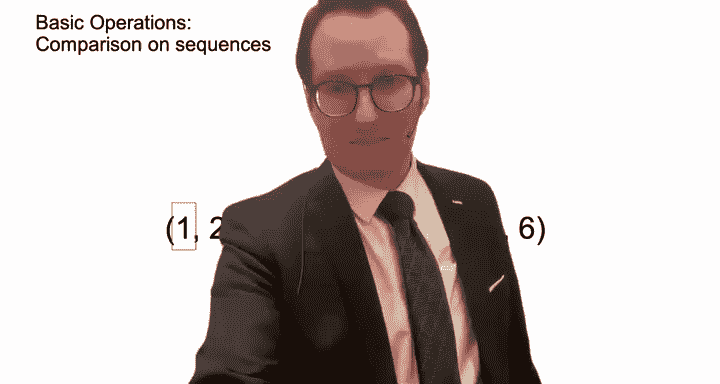

Welcome back， everybody， so let's continue。😊，So you probably wonder why that is it's really just a convenience thing。

 it's a convenient thing that it works this way， in fact， let me directly show you why。

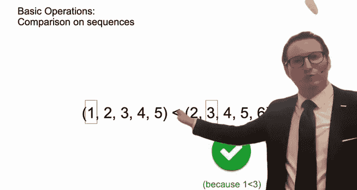

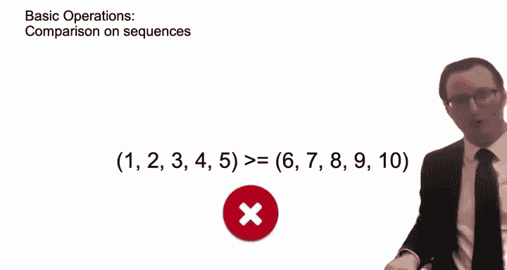

The reason is that then people can go ahead and write things like this。

 so you have a very large data set here like millions of adjacent objects dot name so here you have a huge sequence of strings and then you can write this huge sequence of strings equal Switzerland and what that actually means at least one of them equal Switzerland so you test for the presence of Switzerland in that huge list right it's really just a shortcuts and it's very especially by X people it's very appreciated to be able to do that kind of things because it makes the code shorter right so in that case is' going to return on true。

😊。

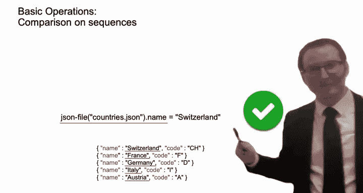

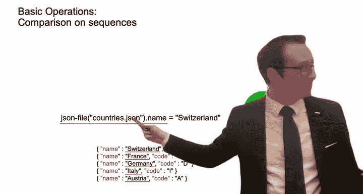

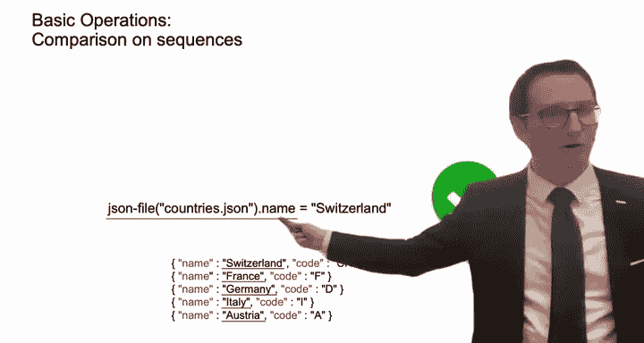

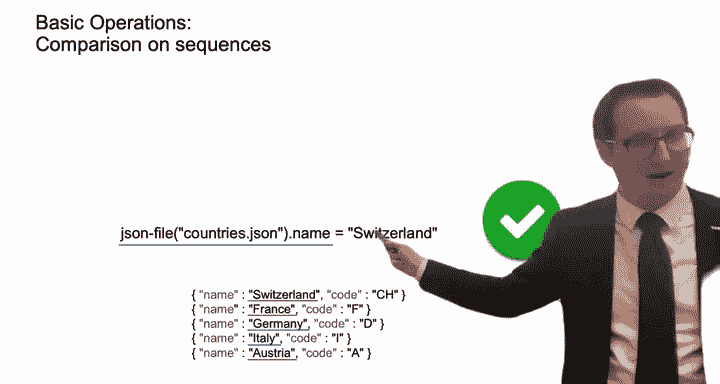

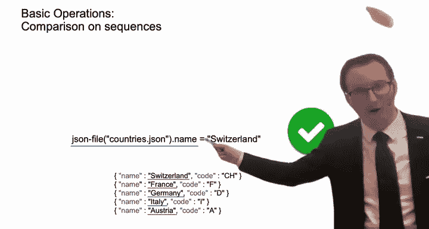

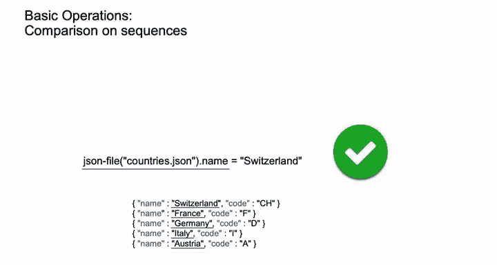

Because at least one of them， so this one here equals Switzerland， so this is true。

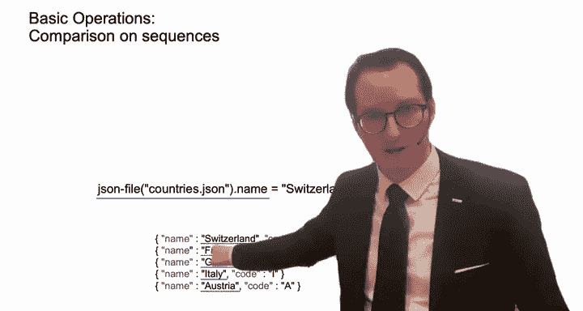

Now here it's an example why it's false， but you know， the negation of an existential quantifier。

 you know what it is。😊，It's the universal quantifier。

 that's what you're able to say right it's the universal quantifier on the negated predicate。

So the negation of at least one fulfills the predicate is none of them fulfills the predicate。

 so you would return false is whatever number on the left and whatever number on the right you choose it will never be the case that the one on the left is greater than or equal to the one on the right Can you convince yourself that this is true here。

You will not find a single number on the left that is larger or equal than the number on the right。

 This is why it's first， okay。嗯。If you have strings， then you can read on an error。

 but that was a very clever question that was asked before the break。

 we want to support lazy evaluation。Imagine that。In that case， imagine that these consequences。

 there are the billion items in here and there are the billion items in there。

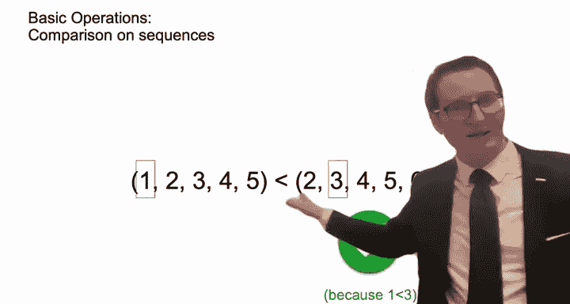

And you only so far looked at the first one here and the first one here。

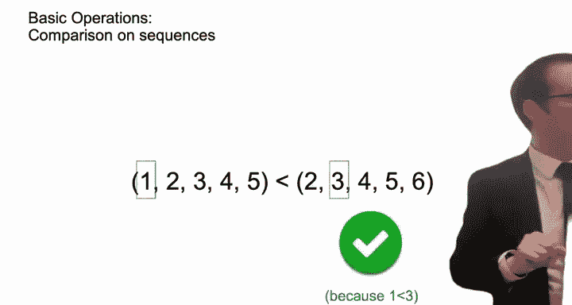

Do you agree that assuming that they all compare， you can already say it's true because it's an existential quantifier。

 you don't need to evaluate the rest right so with lazy evaluation。

 you can stop here and say it's true。

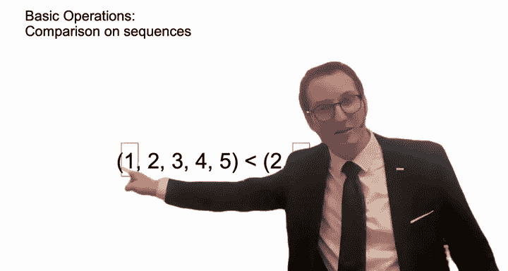

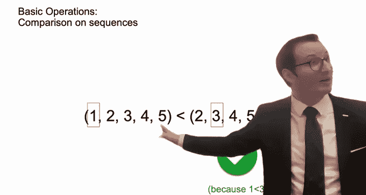

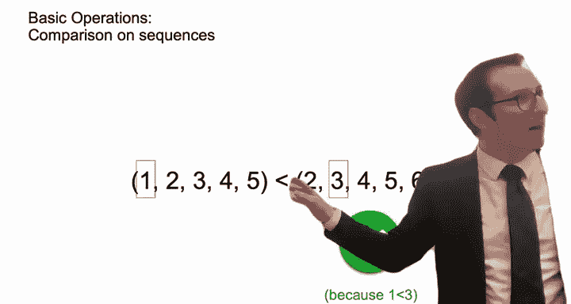

But now， imagine that。There's a Quintillion items in there that are all numbers。

 And then at the very end， the  Quintillion。And once and the Quintilion first。

 thing you would say is a string。So does it mean you cannot lazily evaluate anymore and you need to really check that there's no string anywhere。

That wouldn't make sense right that would be a waste of resources So in order to allow for lazy evaluation。

 you are not required to check the entire sequence for uncomparable values。

 It's totally fine to stop early and stay that's true So basically if you have something incomparable you can either return an error or it would be fine to also return true if you would find a correspondence The reason here why it's an error is that there is no correspondence it would be false right So here you have to return the error。

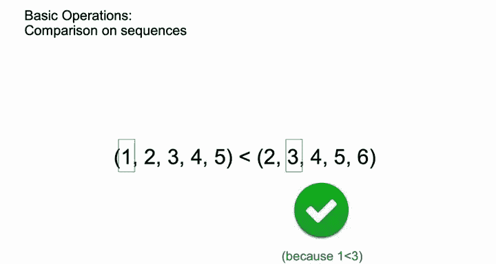

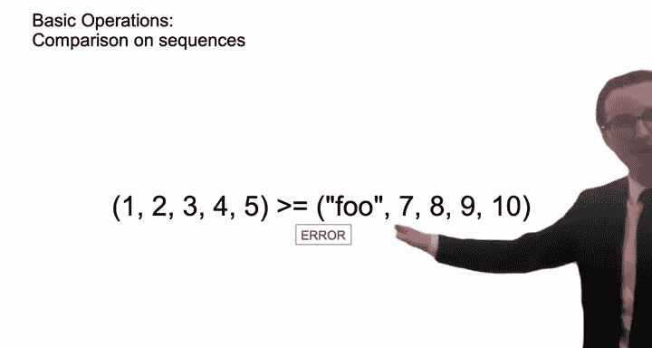

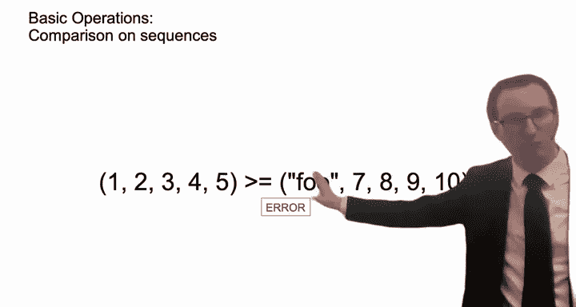

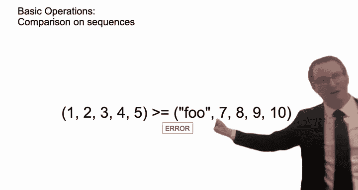

Okay， and then obviously， you know that the existential quantification on an empty set is。😊。

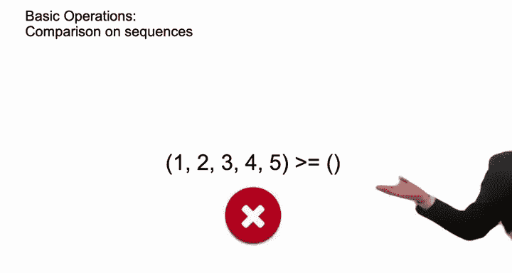

For， right， it's just saying that you cannot find anything because there is nothing right So if you look at the empty set。

 you will not find anything in the empty set。 So this is why when you have an empty sequence。

 it's going to be force。

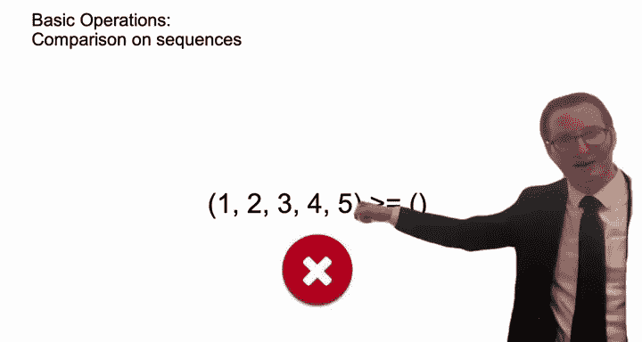

B is that there。For is that not clear？It's really just the law of logic right if you say there exists an element in the empty sets that satisfies something。

 it's always going to be false because there doesn't exist any element in the empty sets。

 but who is that here now。😊，Okay， awesome。Very good so this is the typical use case then we have logic and or not that's the usual the usual syntax that you can use in order to combine so that you see in many languages okay。

😊。

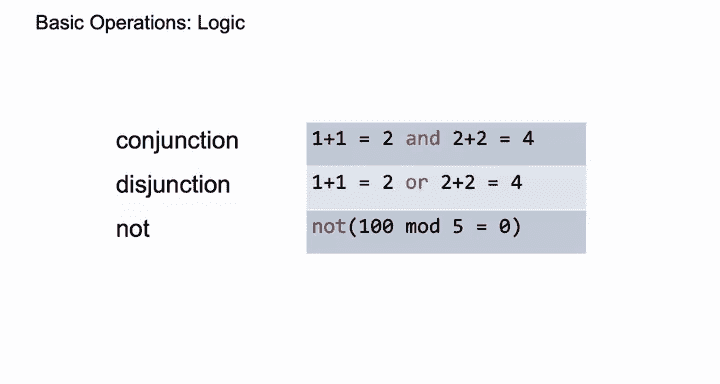

By the way， if it's not a boolean， if you use and not and or on things that are not Boolean。

 what happens is a bit similar to c plus plus right so a number that is0 that's going to be false a number that is nonze that's going to be true。

 a string that is empty is going to be considered false a string that is non empty is going to be considered true and so on so it's a bit flexible with something that's not a boolean。

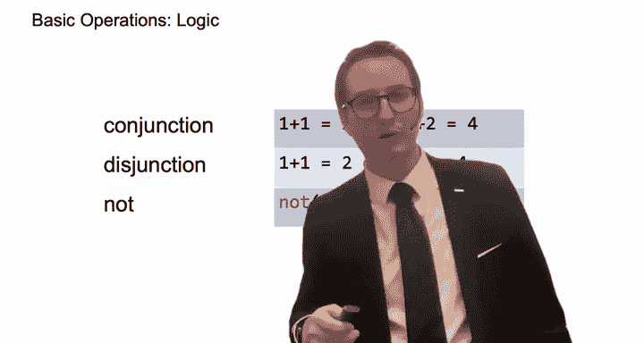

Okay。😊，So this is for arithmetics， for logic， and for comparison， right？😊，Will you sit with me。Okay。

 right now I'm just throwing at through the 37 expressions right。

 and then you play the legal game and assembledsemble them。

So what about that Lego game So the idea is that you can just put any expression inside any other expression that's basically the question you asked earlier right so whenever you have an expression you can just replace it with an even more complicated expression and it just works of course it could return errors if that doesn't make sense。

 but in taically you can do that。😊，For example， this here is a Jsononic query。

 So Jsononic expression。 Now， if you want to make sense of it， you just need to evaluate。

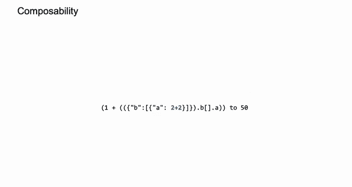

Step by step， two plus two is。4 thank you。 So this is for then we have a4 in an array and so on dot B。

 So that's extracting this B right so I replace it with the array。😊。

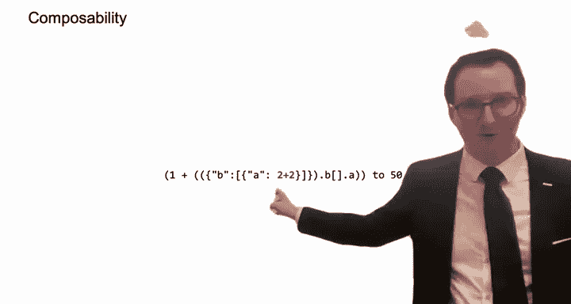

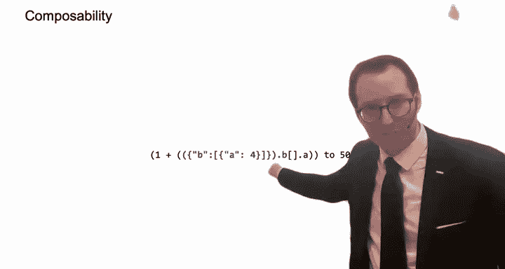

Then this array popped open， right， so now I can open it and extract the object inside the object dot a thats0 Json query。

 right， That's4。 and then one plus four is。

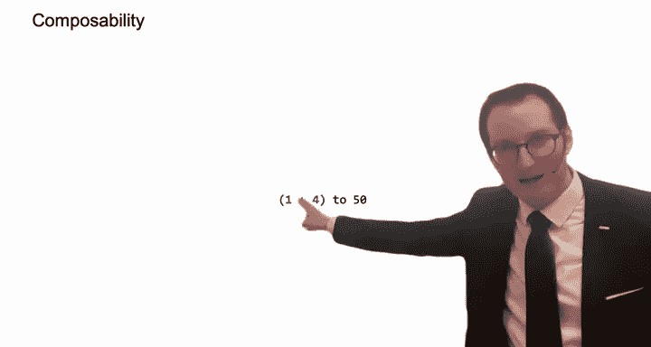

Checking your following five， yes， and 5 to 50 is going to be a list of 46 numbers。

 five all the way to 50， right？😊。

Okay， please with me？So that is how you compose expressions， you can put anything in any expression。

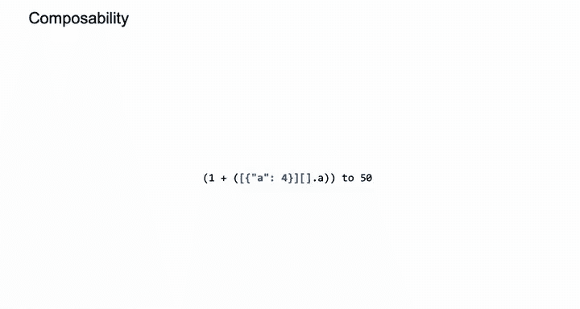

And then you have to remember what you learned in primary school。

 if you try to mix multiplications and additions， you remember that multiplication takes precedence over addition。

Who remembers these word？RightIt's very it's it's the early things you learn。 Well。

 I told you that Jsonic is just a big calculator。 So it's just like plus and multiplication。

 And there is also some precedence between the expressions。

 Some expressions take precedence or some others。😊。

So this is the list of the precedence of the expression。

 so those that are very low precedents like addition and those that are very high precedents like multiplication are at the bottom。

Now， I don't know for you。 I'm totally unable to remember that by health， To unable to do that。

 What do you do when you don't remember the precedent。You used。

Pentthesis exactly that's the solution if you don't know just put parentesis then you're safe right you have full control over how that works right so。

You cannot have enough parentheses if you're not sure about the precede。

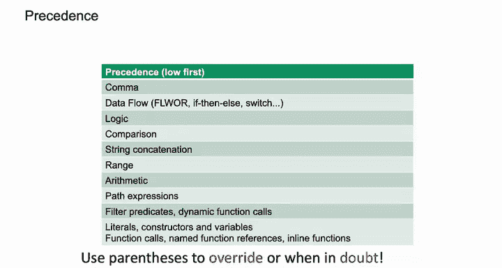

Okay。Now， what are the cool things that we can do with this Lego game Well， for example。

 I can basically start writing something that kind of looks like adjacent object。😊。

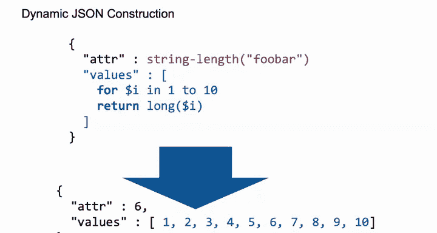

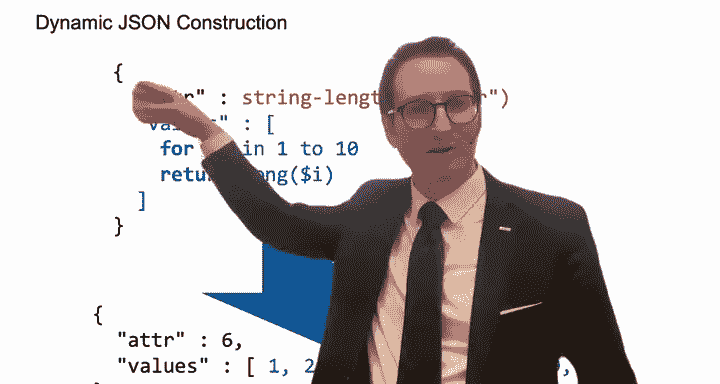

Except that at that point， it stops being Jason。 That wouldn't be a J well form value。 right。

 This is also not a J well form value。

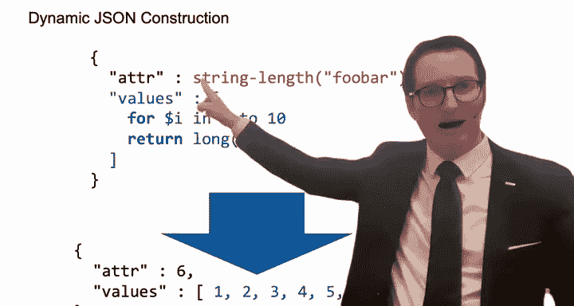

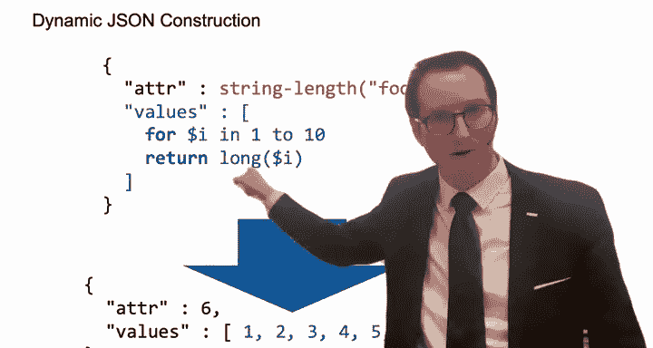

But what we did is we replaced the adjacent value with an expression。

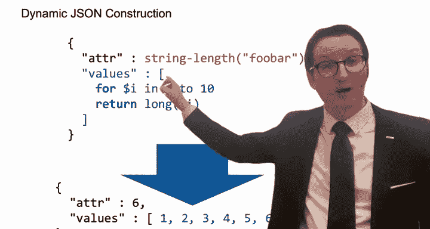

Re replacedplace here the values inside this array with an expression I haven't explained yet what that does。

 although perhaps your intuition tells you what it does。

 but basically this evaluates to 6 the length of the string。

 and this is iterating from one to 10 converting them to longs long integer 64 bits。

 And then you populate the array like this。 So you see that there is something dynamic in there。

 you dynamically。😊。

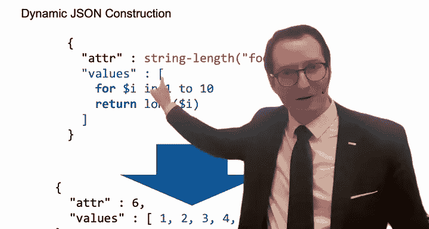

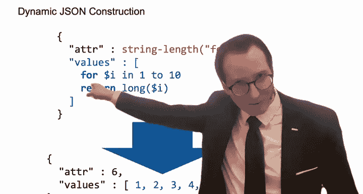

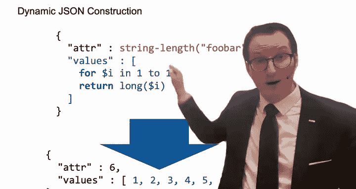

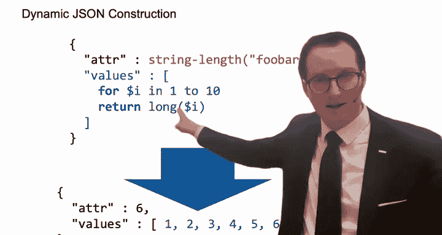

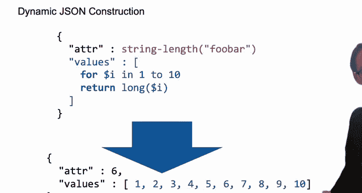

Computute the values that you then put in an array in here。

 You dynamically compute the value that you store in association with a key。

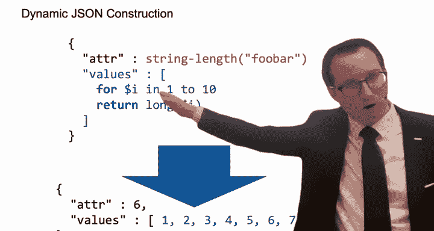

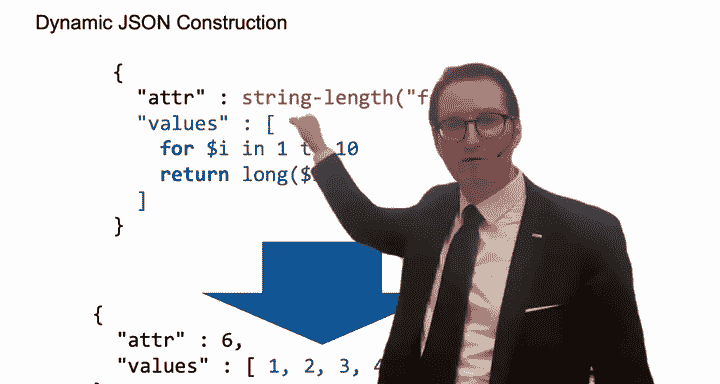

You can even have dynamic keys， you can even replace the key with an expression that also works right so any value you can replace with an expression for whom is that here。

😊。

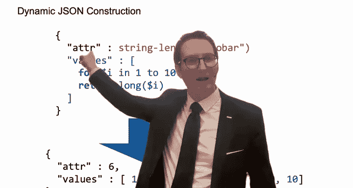

Right very good and so this is how the Lego game work， you can just compose them in any way you want。

Let me throw a few more expressions that are going to be natural to you because you're all computer scientist。

 we have an if then else expression right it's obvious what it does right if whatever is after the E evaluates to true。

 then it's returning whatever the then expression returns if it for then it returns what the else expression returns right。

😊，So this is Den else， then we have a switch right so you know the switch that exists in many languages that it's a functional switch。

 it's not an imperative switch。😊，So here what happens is that it looks at that value and it looks for the first match right and as soon as you have a match。

😊，Then you return on whatever you have here， that can be any expression here。Even here， in fact。

 it can't be any expression and here too。Okay， or whom does that make sense？Right， the switch。

If you don't want to remember the switch， you know， you can do it with a cascade of if than， right。

 So then just use if then else than else。 I mean， you can also nest if than。

 but it's sometimes easier if you have a lot of if than else to just flatter it to a switch case。

 just a bit easier to read than a cascade of if than else。Okay， then we have tri catchch。

Try catch is nice to catch like division by zero or that kind of issues。

 right all the dynamic errors， then you can catch them。 And if that would return on an error。

 then instead you just return that。😊，Okay， for whom does that make sense？

Your computer scientist or I assume tricatch should be known to you， just remember it's functional。

 it's not an imperative thing， it's a functional thing。

 so the idea is that you attempt an evaluation of this， if that would result in an error。

 then you evaluate this instead that's the functional way of looking at tricatch。

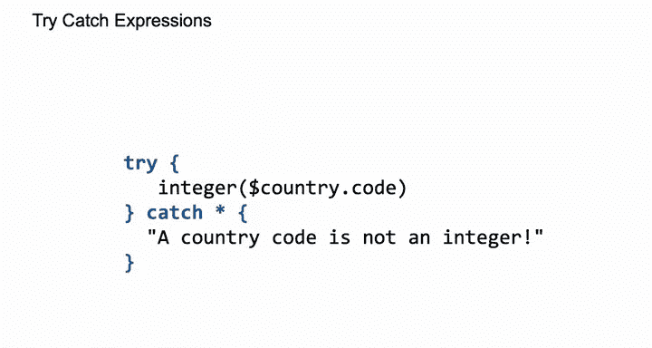

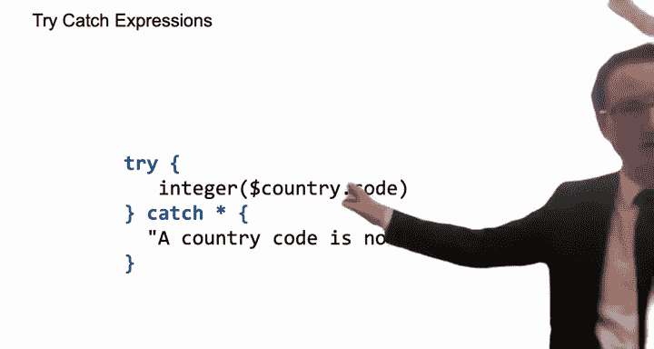

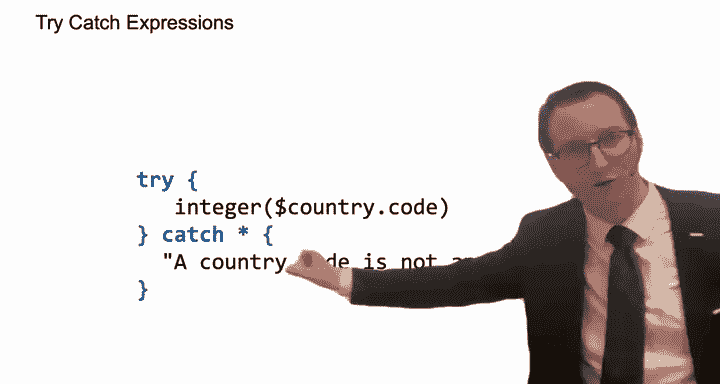

诶。So let's get back to the queries then and do other cool things so here we have JON file and then what I did is do payload。

combits so I basically picked inside at two levels down inside the payload object inside the commits associated with the commitit key well technically that's an array I don't know if you maybe it was it was in the area of sides if you look closer then you will see that wesat payload。

 commits is an array。😊，So if we do that， that's going to return a sequence of arrays， right？😊。

But that's because my data sets has always an array in there， right。 So basically。

 that's the sequence of arrays。 And these arrays contain object。

 You can see some  structure in there， right， so。😊，It's not a fully clean data set。

 it's not perfectly validboard against a schema because there's a bit of heterogeneity。

But it's not fully heterogeneous either。 It's kind of 98% homogeneous， if you want。

 So here you do see some structure。 And so from the moments that you explore the data sets and see that。

Who has this urge to unbox the race？RightYou have to unbox them so let's unbox them didn do what it does right it's just going to extract the values now you have objects and when you see a sequence of such beautifully similar objects。

 what do you want to do dot author， dotty mail and so on and you can in fact do that right and navigate in this way right for whom is that natural to do these kind of things now。

😊，Right very good， so this is how it works。😊，And then you can start doing more complex things So this size function that was the question you asked earlier right what if I want to the size of an array not of a sequence。

 then you use size so that would be an array right do do payload dot commits that's a single item so that's a single object and that's a single array and you call size that's going to return the size now it checks if it's greater or equal to5 this is the same thing as greater or equal the only difference is that it doesn't like sequences of more than one items so that that's only in order to throw an error if it's more than one item but anyway it could have written greater than or equal as well so。

😊。

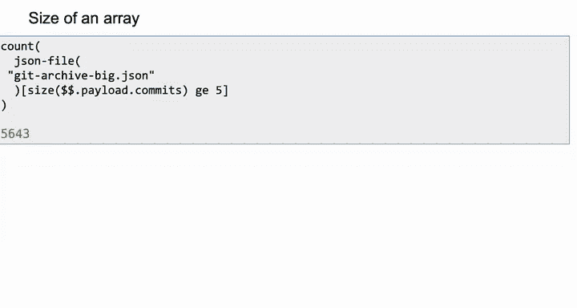

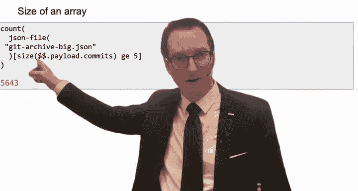

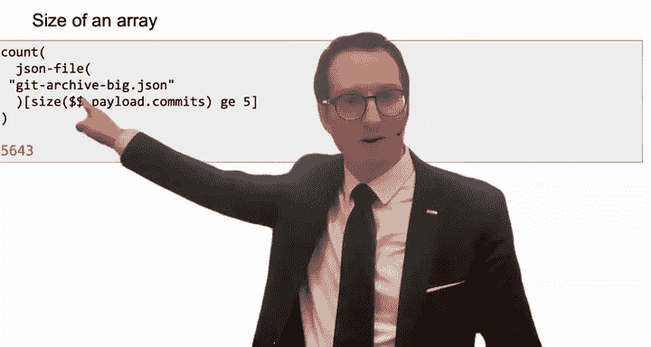

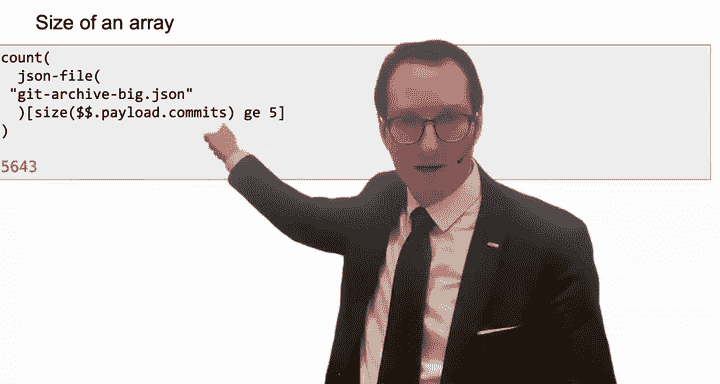

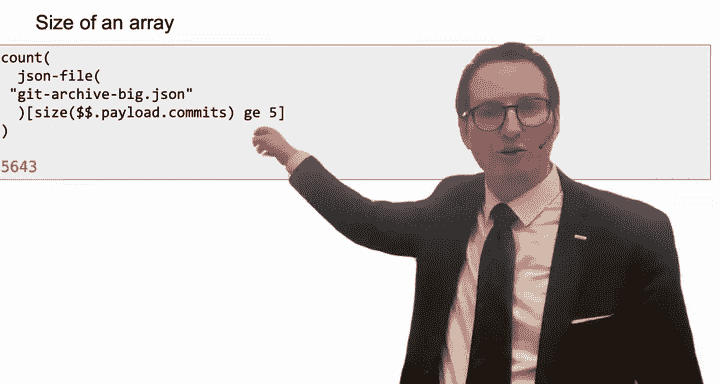

That a prediccate that is only going to give me the object for which the commit array has at least five items。

We agree。RightIt a predicates and I want those that have a array of at least five items in there。

 and then I count， and I can see that in that data set that has 2 billion，2 billion objects。😊。

In that data set， it found500 that have an array with at least five commits。

So this is the sort of things you can do， and it just takes a few lights of codes to do that sort of things。

And you really need to understand because you could think， okay， it's trivial also in Python。

 but really， remember， it's the same code。😊，For a small data set of just 10 objects。

As for a data set with a trillion objects， it's exactly the same good。

 It's just automatically going to take care of it of a spark。

 transforming it to the appropriate transformations。は。Okay， here's another one。

 what do we do here where we navigate to payload commits， this is new， this one here。

That is extracting the first item of an array if it's only one that that's of a sequence。

 the first item in a sequence， if you double the square brackets that is the first one of an array inside the array so here you look at the first commit。

And you look at the email of the first commit right and now you look at the distinct emails and you look at how many distinct emails were in the first commit of any one of the GiHub events。

 34000。

Who understand that query。

Yeah， very good。 do we have a question about that yeah？

Could we also put the square brackets one after the outer square brackets would be the same？Yes。

 absolutely you can also， if that didn't exist， you could also use the double square bracket to open the array and then you could use this square bracket one to then take the first item in the sequence because when you open an array it becomes a sequence of more than one item often。

What's the difference？The difference is that。When you use this unbox operator。😮，嗯。

If the left contains more than an array， you could have a millionaire array and then your unbox is going to unbox each one of the millionre arrays and then flatten right then if you do the position one after the unboxing。

 it's really just going to return the first item in the first array。

If on the contrary what you do is you have your sequence of a millionn arrays and then double square bracket one。

 it's going to return the first item of every array that is the difference between the tweets a subtle difference if of course you only have one array that it's the same if you know that there's only an array you can use one or the other。

Does it make sense。哎。And again， the key is to remember the sequence are always flat whenever you do something that produces a sequence it's always flattened。

 so if you do look up if you do array ray on boxing and so on。

 always always always you get a flat sequence。And the way to nest is with a race。

 This is how you nest。OkayDid that raise your question？Awesome that's a very good question。

 it's nice to think trying to relate these with each other。

Now， something else that I haven't shown you yet， who has already seen a functional language before？

Who has already seen a lead close？Okay， it works in the same way as in many functional languages。

The key path is to understand that this is not a variable assignment。

 It's not like in Java where you assign a value to a variable and then you assign it a different value and so on that's not this is a mathematical construct this should be interpreted as give me the account of the distinct logins knowing that the distinct logs are distinct values of logins。

 knowing that logins is the login of the actors， knowing that the actors are the actor of the events。

 knowing that the events are in that JSson file located at path knowing that path is Gi archive big JO right This is how it's interpretive you just declare some variable values and that's just a way of making your  query easier to read right by。

Dividing your expression into into several paths right for whom is that clear？

Right， very good Cascade of lets。Now what's really cool is that we don't only have lets。

 we also have false。😊，And the thoughts are going to reiterate。The magic。

Life in the understanding that。Everything is a sequence of items。And as a consequence。

 you can iterate over a sequence of items。So it means that。If you have here， amin items。

Then you can just in turn bind this variable to each one of the item one by one and for every item then you do the rest。

 so for every event you're going to evaluate the number of commits。😊，Just the size of the array。

 and then you return that object。But since you have the four it's going to return that object for every event that came from the Gi archive right and that's how you basically transform or map this original sequence of objects to another sequence of object Not here it's dynamic I have an object construct。

 but this is dynamic here it's the returning some calculated value and some calculated value and you see the results in here for whom is that here。

😊，ok。No。There is one thing you need to notice here。

Is that if you use an object construction like this？This syntax is a bit static。

In the sense that the number of keys。Is defined that compile time， it's in the syntax。

 you have two keys and you cannot make it dynamic the number of keys。

 it's really something comma number of COIs， you could make the keys themselves dynamic。

 but you cannot make the number of keys dynamic it has to be two because there's only one coa in there。

Yes。😊，Yeah， so wouldn't you get the same thing if you just， I don't know。

 took the filtering like you did usually with a square bracket。

 you would not even need the poll loop here， right。

Because like every query language does automatically followlook through the。For the roles， right。

So you could， if you would use a predicate， that would also be an iteration。

But that iteration would select a subset of the original collection。

 then if you continue to navigate， that would also just take a subset。

 you would be unable to create new objects。What you need to understand here is that。

We want this I would put in here。😡，These objects here， they are really new。

 They are created by the query。 They cannot come from this data set in here。 They have to be created。

 So this is why we we need to have an explicit construction of these objects in here。

 That would be the difference with using a prediiccate。 Does it make sense。Yeah。

 so is it like the same as in SQL when you have like in the select query where you put like。

Yeah I got your question now yes， this here is like a SQL query where this is the from from blah。

 blah， blah this is select ID number of commits more precise it would be select ID as ID and then NB commits as number of commits right so you could see it as the select closing SQL。

But in SQL， you do not have lead clothes。That is whatever right like width isn't that lead plums also Well you can use the the width construction。

 but it's not it would be a lead close on the entire table the width basically but here you don't want the lead to bind to the entire collection you want to do it for each event so it's it's more fine grains than the width of sQL that's basically the idea and so。

This is really this lead clause is one of the features that you get with no SQL prairie languages that you don't have in the original SQL language that really processes the whole table and the reason why we like these lead clause so much is because of heterogeneity。

Basically， when you have a homogeneous relational table。

 you can do with that with diette clause kind of for many cases， because it's all homogeneous。

 but as soon as you have something heterogeneous， then you really appreciate theette clause because that allows you to do something different on every on every event。

 Does it make sense。😊，But it's a very good observation indeed that this correspond to a from plus in SQL and this correspond to select and this would correspond to the projection that is absolutely correct to say that way。

 it's just the let that doesn't matter to SQL。😊，Right。Okay。😊，Okay。

 which brings me to how does this lead and this for generalizes to something bigger and this is something called the flower expressions。

😊。

Plower expressions are in fact， an abbreviation， or you guessed it。4our。Let。Where。Order by return。

Plower and it's on purpose there are no spending mistake in there。

I think it's probably a hint to one of the very early inventors of even X query is Danana Floressco。

 and so that's probably the origin of this choice in here。😊，Right， as a recognition for her work。

So the lead clause， this one is easy if if you remember what I told you。

 we just want to return x times x knowing that x is 2 and then we get four okay with with me on this one。

 this is an easy one， right？Now this is a simple flow return。

 we just bind x to every integer between 1 and 10 and for every one of these 10 integers we return a new object。

 we return a new object with x as the number and x times x as the square and we get this。

Wmollf sense what's going on here。Very good。 So you see though。

 this is how we map a sequence to another。Sequque in this way。The wear cloth。😮。

Can appear in the middle between4 and return， for example， it acts as a filter。

But you need to be very careful on the subtle distinction with the kind of filter that it is I'm not talking about a filter like the prediiccate expression that filters the items on a sequence。

 this is not what we are doing here。😊，Here。I'm really reasoning on variables。

I'm iterating for x taking values between1 and 10 and I throw away some of the variable bindings。

 I'm throwing away the bindings of x where this is not true。

 so it means that if you look its basically only keeping x equals8。

9 and 10 right that's the only survivors it means that all the x's between one and7 get lost at that point and only eight910 survive leading to these three who understands that。

😊。

Right intuitive read the same as the where in SQL， but we will see that flower expressions are in fact much more generic and powerful than the select from where right that I will come back to that so this is the where clause。

😊，This is the order by clause， so this is reordering the bindings right so here you bind x in turn to every object in that JO lines file。

And then you reorder by population and then you read the name right。

 and then you get this list on the right of the most populous countries in the world， okay。

Gandolph sends the query。Who doesn't understand the query？W now sends the query。Okay， that's great。

 Again， it's like the secret or the al bioer right， in effect， it' it's very it's very similar。😊。

Then I have group by group by again， it's just like the select the SQL group by。

 look at what happens here。😊。

I'm binding X in turns to every country in the world。

 I'm assuming I have the well there's not millions of countries that's actually just around 200 or something。

 but let's pretend it's huge， so we have an iteration of other countries grouped by continent。

Here I'm only going to have， depending how you count， let's say six of them， right，6 continents。

 I'm grouping them。 What is happening with a group by。

 This is something that is slightly different than sQL and in a great way in a more generic way。

 What happens is that this continent here is a grouping key。

 So just like in sQl is going to contain the current continent。

 What's very interesting is that the Dora X becomes a sequence。😊。

Of all these country objects within the same group it becomes a sequence and that is with the magic of the sequences of items that we don't have in SQL so that's why we can't do it in SQL But what happens is that now after the group by I'm going to have six groups six bindings and for every one of these six bindings I read on that so the code is the continent and look at what happens here Do x。

😊，Where does it return， always a sequence of items， any expression returns the sequence of items。

 which items the ones that correspond to the current continent？

And if I do dot name， then I'm just listing them。We understand this query。Right。

 very good and chrry on the cake， I nested it into another query。

 meaning that I even put that inside an array， which is itself inside an object。

 but since it's a Lego game， I can do all of that。😊。

RightSo you see how at the same time it kind of takes over what SQL does。

 but in a more generic way in a much more powerful way。

 there is a reason for that is that the people who designeds that this flower expression。

 it's not actually just Jsonique it's also xque， it's a A3C standout and many people in the working group that designed the W3C standout were also involved in SQL。

 the chair of the working group was an editor of the SQL Soundout so this is why it's not a coincidence that this is more powerful than SQL because these are the actual SQL people who learned from the experience and generalize the SQL fromware idea to something more generic。

😊，Now， what do I mean with more generic， So this is one example that the group by is more generic than in SQL because you can have sequences for the non grouping case。

But there is something else that is more general。Who remembers that in Sequel。

 the clause must be in a certainult order。 Do you remember， select。From everybody select from。😮。

Where group by having order by limit offset， right， it has to be in that order。

Not so ineququariial Jsonic。There's a few constraints such as it has to start with four or let and it has to end with return in between whatever you want。

Absolutely， whatever you want。You can have， for example， for let lets where group by let for or buy。

 lets for where group by or by group by let where or buy for retail。

 that is an absolutely fine power expression。So you see how it's more generic than SQL right and that's extremely powerful and once you get the intuition of flower expressions。

 you can write extremely powerful queries in a way that is more compact and intuitive than would have been with SQL in the presence of heterogeneous data。

😊，ok。Who's with me？Right， very good。 I keep asking because I'm throwing so many things that you hear that I really don't want to lose you。

But again， the best way to practice right you have Jupyter notebooks。

 you have an engine you can just go ahead and execute queries。

 that's really the best way to learn and of course there is the textbook that has plenty of the example queries as well。

Now， what if I want to be a bit more formal because so far I told you what these flower expressions are doing but I just waved my hands right I said okay let is this knowing that。

 knowing that， knowing that for is you iterate over values where you throw away some bindings that don't pass predicate？

But I just waved my hands when I explained that so。

How do you make it make sense when you have a flower expression？😮。

That has 20 clauses that are an arbitrary sequence of clauses。

 how do you make sense of that and here you need a mathematical formalism。😊。

It's a formalism that you do not have in SQL because you do not need it in SQL and the reason you do not need it in SQL is that in SQL it's always the same order。

 that's why you don't need it， but in a language like J Sonic you do need it。

 you do need a formalism for the clauses。And in fact， what I hope to show you。

Is that that formalism first it's very intuitive， it's really a flow that goes from the top to the bottom of the query。

 right so it's just flowing down。With variable bindings。😊，But normally， if I got it right。

 I'm going to not tell you in that way， but if I got it right， you should see in your minds。

Data frames。And Sp SQL transformations or data frame transformations。

 so now I'm going to see if you see them if you don't， then I will explain。

 but hopefully you will notice that there is a link with SQL data frames。

So if I want to now formalize something like this。

What I need to do is。Go。😮，Close by close from the top to the bottom。 right。

 So I start with the foreclos。

So the for clause is going to bind the variable x to every item in that sequence， or many of them 10。

 the way you can visual visualize it that's only a visualization is that there is this x that that is then first one。

 then two then three then4 so you have the list of all values that is going to be bound to right I'm just putting my list in there right。

😊。

So if that's so good， this is a plan， it's all the binding I can do between1 and 10。Then I move over。

To the second clause， that's select， that's of where close。 So it a wear close。

 So what happens is that we have this。

Being here it's an expression。

That needs a value for x。 So it depends on x and is going to evaluate to true or whose。

 So what happens when the warehouse is evaluated？ It's basically evaluating this expression for every one of the rows in every one of the values。

So now if you compute x minus2 greater than or equal to5。

You will find that it's full fold full fold fold false and then route do to right， for example。

8 minus2 is6 so that's greater than five and so on who agrees with that。😊。

And now you have this array of bulls。

So I'm going to do it Pomas style because some of you appreciate Poas。

 so if you now feed that array of gus that has the same size as this series。

 then you get that sub series， right？😊。

But what's beautiful here is that it's simplicitylicit。😊。

That is nowhere in Jsonic in Jsonic you just write that directly it's very intuitive。

 even people who don't visualize this in their head might still find it intuitive。

 that is just the formalism when you actually do it in that way and then you get 8910 and then you evaluate x times x for every one of these and then you return on it so you have again the sequence of three integrals for whom is that theory。

😊。

Right that's generic any flower expression is evaluating in that way you go close by close。

 close by close and you just process the the variable bindings in this way and now I hope that you see。

😊，That when in ponds。You expose the user。

To doing this that you actually have in Python， this list of bulloleans that you feed into the list of integers。

 that's a breach of data independence。

You're basically fing the user to deal with that。😮，But in a functional query language。

 you hide it from the user， this is all hidden， this is just hidden behind that query over here。

Right。Okay， but if you know upon this， that's useful because then you can kind of map it in your mind to this。

😊。

Here's another one。 Let's do it Oh x 125。 That's what you get， right， What does the let do。 Oh。

 there's another variable。 Let's just add a second column in there right it's x minus-2。

 So you see one minus-2 that's minus-1，2 minus-2 that's0 and so on with with me so far right So that's the let clause at the second column and then return x times y。

 we just multiply x and y on every line。😊，Again。All of that， what you see here。😮。

Is a mathematical formalism， it doesn't pop up anywhere in the sequence of items and so on it's just an internal formalism。

 that's what pop at oh。

That's what pops out of the flower expression what you see here， and that is only a visualization。

 only a visualization。

But how many of you feel like this is starting to look like data frames in here？

Right。And， in fact。

What it means。Is that physically and I insist on physically you can implement this as data frames and that's exactly what RumbledB is doing internally。

 but in a way that the user doesn't see it's actually going to create these data frames。

 but do you see that because it can create these data frames。

 it can create these with billions of rows， so it means that RumbledB can compute that with billions of bindings in parallelL on a spark cluster。

😊。

Because internally， it's modeling that as data frames。When they sends that。Right， very good。

 but again， it's physically the user doesn't need to know about that， it's all hidden from the user。

😊，It just works。All right， what about group by， so let's do the same year for x，1 to  five。

 you get that。😊，What does the group I do Well， first。

 you need to evaluate the grouping here for each one of them。So that's 10，10，1。

 but now we need to have the group by， what does it do the group by is's going to figure out that these go together when。

 when， when they are together。ze0 they are together and when it does the grouping it does this and this is something you don't have in SQL so it has these I need to put myself on the other side otherwise I keep operating and disappearappating so y and zero these are my two groups but if you see what happened to x it's just now a sequence because yes with sub sequences of itemss it's a sequence of135。

😊。

When evaluated in conjunction with y equals1， and it's the sequence24 of two items when evaluated in conjunction with y equals u。

 or whom is that here？😊。

So this is how you visualize the good buy and then when you create that object。

 you just evaluate this with y and x。😊。

Taken from here。 So you do a fast evaluation with。A first evaluation with x being this and y being this。

 and then you find this。

And the second evaluation with x being this sequence and y being this singleton sequence。

 and then you get this for whom is that here？

So this is the formalmatism。😊，And again， if you understand the formalism that's great for most user。

 they don't even think of the formalism it's just intuitive。

 they have an intuition of how it's going to work。😊。

So yes， that's the formalism of the flower expressions and hopefully now if I give you an absolutely gigantic flower expression with 30 clauses with a mix of all kinds of clauses。

 you should be able to draw these visuals and go down close by close how it computes the values。😊。

Okay。😊，All right okay， so now if I go back to my geky views here I can have now an example with four letter by Ri that's a perfectly fine combination of clauses so you see for every event I compute the number of commits I order by the number of commits descending just like in SQL I can specify descending。

😊，And then I project。 So here I need an X function to project。Project event to just I D and type。

 So I just take the I D and type keys， and I have I D here and type here。

 And this is what I'm getting。 So this is an example of query。 This is an example with groupby。

 So now I have four group by order by retail。In fact。

 in that case it happens to be an order that you could also do in SQL right but again it's not generic but in particular you can do what you can do with SQL so for group by order by return here you group by the size of the commits right and then you order so you have zero commits one commit two commits this is basically a histogram here right I'm doing a histogram by the number of commits I'm looking at the event how many commits do they have I group them and for every number of commits I say the number of events right we see that this is a histogram。

😊，Okay。So， yeah， and you might have noticed some trick。Right here。Why do I have these size blah。

 blah， blah and0， And then I take the first one。 It's so tricky because this array might not exist。

That's because it's no SQL。 Its Jason， it's not necessarily valid against the same schema。

 The commit might not exist at all。 In that case， that's going to be empty。

 That's also going to be empty。And what happens is that empty concatenated with zero is just zero。

 and then you take the first one that's going to be zero。 So this is a trick to just if it's empty。

 then you take zero right so this is the sort of things you can do with the language that deals with heterogeneity。

😊，Right， you could also have the need with don need then else like ifM blah， blah blah。

 but this is just more compact to to do。

All right。Still have five minutes， can I still throw some queries at you？It's nothing new。

 it's things you already know， but I just show you how you do things in JS。

So imagine that now I have。

Two data sets。To simplify just a few products in here and a few stores。

 knowing that the store here is a foreign key that points to the idea of the store here。

 So there's a link between these two data sets in here。

And what I want to show you is that all the relational algebra we can do it in Jsonic。

 so this is a select fromware far rare return that just only peaks the ones that have store equals one。

😊，This is a projection。 So here you need to use。

The project function。To ID and type， by the way， you can do a dynamic projection。

 if you replace that with an expression， you can dynamically create the keys that you project to。

 Its also something SQL cannot do。

And then you have ID and type in here， so that's your projection。

Ordering you just use order by that you already know I'm ordering by ID that's nicely。

Nicely ordering like this， then you have aggregation with group I've already shown to you right if we group by type。

 then I'm going to have TV phone and Tpot and that I aggregate here。😊。

Notice that that here would be doable in SQL。

Because even though this now is a sequence， I immediately take account and that in SQL you can do if you immediately aggregate。

 immediately take account or a sum or a mean on max。

 then in SQL you can do it right so you can see that in particular it can do what SQL can do。😊。

Joins。Probably my last slide before I see I let you go。For a join， I just need a double4。

Double 4 would do the carn product。 Who sees that。Double4 is the car product followed by a warehouse clause that has my joining criterion you remember that a joint is basically a cargen product followed by a selection right we have a question about there。

😊，Sorry。It is efficient。Because Ruble DB is going to figure out that it's a join and automatically with fast。

 that is the benefit of data independence， that's the benefit of a functional language。

 as a user you can write this absolutely beautiful query that is easy to read and it is going to be executed very fast just because it looks simple and plain doesn't mean it's going to be so。

😊，That is the difference with Python or Java or in an imperative language。

 right to whom does that make sense？great， that's an excellent question because this is very important to understand this is efficient。

 very efficient。😊，Allright should we stop here and maybe I can continue tomorrow so i'm almost done tomorrow I will mostly give you implementation details like what's the internals of Ru Db how it's all implemented the beautiful work by the 20 plus students who have been working on it in the previous years so thank you very much and see you tomorrow。

😊。

