# 苏黎世联邦理工《大数据｜Big Data - ETH Zurich - Fall 2024》中英字幕（deepseek - P43：-43-13. Graph databases (1_3) -.zh_en - GPT中英字幕课程资源 - BV1sHPKeoEJU

Welcome everybody in the lecture hall， welcome everybody on Zoom， welcome everybody from the Fu。

Today is actually a major change in material because we've been talking about tables and entries pretty much the entire of semester。

 And today， we are going to stop thinking about tables entries for a moment。 And instead。

 look at another shape called graph。 And that's the beautiful world of graph databases。😊。

I completely redesigned the the lecture and try to change it in perspective compared to the to the last year。

 what I'm going to try to do today is actually made of two。 I have two goals。The first goal is。

 of course， to introduce you to graph databases so that you can use them。

 But the second goal is to have throughout the graph database lecture。

 the connection with what we've been doing for trees and tables。

 because what I would like you to see is that the principles are the same syntax， modeling languages。

 data types and so on and so on。 It's the same principles。

And next week we are going to speak about data cubes。

 which is yet another shape and that's exactly the same idea once again of data independence。

 and hopefully at the end of the semester， you'll understand that what we've been learning。

 even though it was for specific technologies and for specific shapes is actually something that be valid for the next decades。

 because pretty much any shape that might actually be invented or added to to the mix will follow the same general principles。

 and I hope that having learned SQL and Jsononic that you will find that learning the language of today。

 which is called cipher is actually not so difficult because you will notice you've already done the hard part of of the work。

嗯。Alright， so I have two questions to ask you before we start。So， the first one is。

Which of the following adjectives。Yeah呵。😊，The more effect。

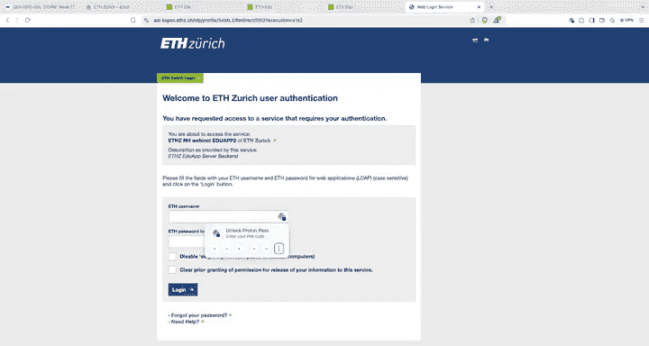

诶。I don't know which one please， yes。

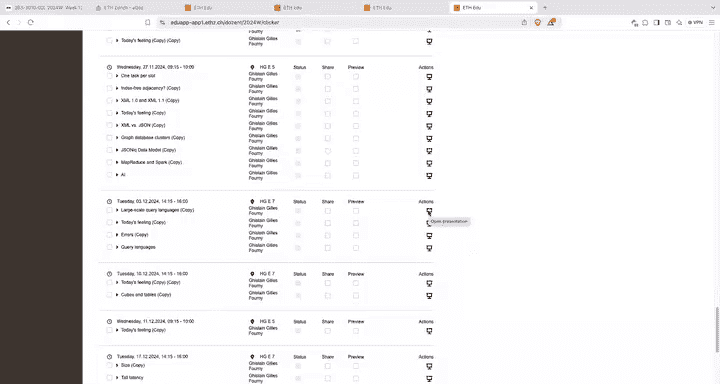

I was lucky because the other question has the answer or the first one you need。

 So I'm happy I didn't open the wrong one。Which one， which ones， possibly multi prouns。

 Which one of the following adjectives qualify a web design query language， functional， imperative。

 low level declarative。Or what did I do。Okay， that， that helps probably a little bit。 But Im。

 I wasn't supposed to show you the answers right away。Wow， I'm so proud of you。This is awesome。

So you are right， of course， declarative and functional。So remember that functional means。

 So let's start with declarative。 Declarative means that it's a language that is not focusing on giving instructions to the system on how to do things。

 but it's about giving instructions to do to the system about what you want。

 And in a declarative language， you let the system figure it all out what's the best way to actually give you what you want。

 So this is a declarative language。 Declarative language means that you can just improve performance behind the scenes。

 just making it faster， but without modifying the the out。

 This is a discussion we are having with Marco writing in master now。

 because it is exactly what he's doing about finding ways to make it even faster or without changing the correctness。

 So this is the idea of a declarative language。😊，A functional language means that it's typically a language that can be whose expressions can be seen as mathematical functions。

 It's basically mathematically functions that transform the data model into other instances of the data model。

 And every expression is basically a function that takes， for example。

 the sequence of items and reach on the sequence of items。😊，However。

 do not make the mistake of thinking that just because it's called functional and it has function in it。

 that the syntax of a functional language must be made of function chs。 If you have an API， then。

 yes， there's going to be function courses or of other place。

 But an API is not a functional language。It resembles one， but it is not a real query language。

 functional language manages to carefully hide behind very nice design。 all the functions。

 So basically， you end up with expressions。 like， for example， for addition。

 You don't call addition parenthses，1，2， you say one plus two。 So the use of operators， for example。

 is one example of hiding the functions。 But other examples are all the the expressions that we saw for object lookup array lookup mathematically。

 you can see them as function。 But actually in the expression。

 you just use a dots and you use square brackets， and then the flower expressions starlet return and so on。

 you basically don't see so many parenthsesis。 But behind the scenes。

 it's actually all made of mathematical functions。 And that's the reason because we have these mathematical functions that we can represent a query as a big tree。

 as I explained last week。 And then that tree can be converted to。😊，And execution。

 runtime iterate or three。But whom is that ti。Right， very good。

 So the difference between functional and decla is quite subtle because very often you have both of them that you could find example of one without the other。

imperativemative is the opposite of the declarative。 It means that you。

 you exactly tell the computer what it's supposed to do。 So think of Java， Python。

 C plus plus and so on， where you have variable assignments， white loops and so on。

 All of these are basically imperative in the infrastructure structure。And low level。 no。

 that's a query language should be high level because it should be something easy to use productively by a user。

 What you do not want to give to the end user is an APII。

 I'm really sorry for the panas influenceenrs， but you really want to give a full fl query language to the end user so that they they can be very productive。

And， and an example of low level， for example， for imperative languages， would be assembly code。 And。

 of course， we don't write in assembly code。 We write using Python or languages like this。嗯。😊。

Alright， so that wass my last question。

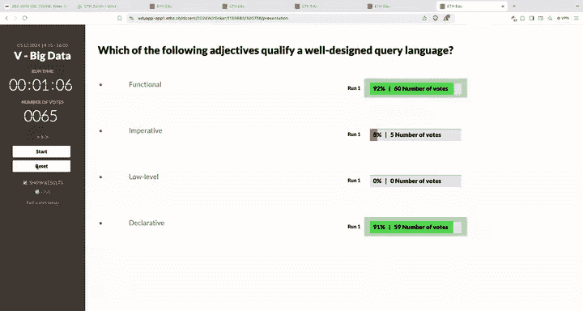

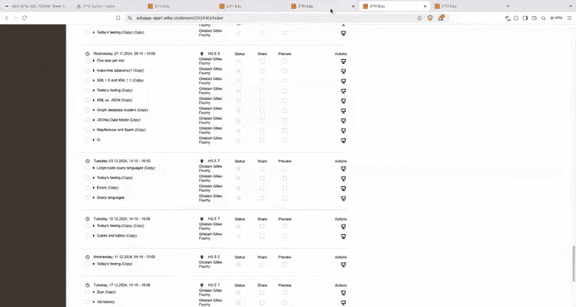

And then。The question is， why？Why am I telling you that a query language should not be low level。

 should not be imperative， that it should be functional in declar。

Is it because then we can parallelize queries or is it because then an optimizer can make the query faster than it would have been with a literal execution of the user's query。

 or is it in order to delegatedicate the details of the execution of the query to a machine rather than doing it yourself。

 or is it because queries are more concise and easier to read and understand。😊。

Multip perlonunces possible。Alright， let's see。What you said， aha， there's competition。

Well I have good news for you， because all four are actually good reasons for functional inlar。

 all of that。😊，We can parallellyize because as I told you， as long as the resulting in co is correct。

 you can do whatever you want to get it， including parallellyzing over a cluster in the data center。

 including streaming， also， as I told you last week。😊，Oh， speaking of streaming， I thought。

 you know of the question that a very wise question that somebody asked last Friday last Wednesday about why is streaming valuable of materializing like what other cases that streaming is preferable to materializing because you could think we can just materialize all the time。

 But of course， the most important reason is because you save memory。 memory is costly。

 And of course， if you stream， then you don't have to consume as much memory as with materialization。

 So you avoid a lot of of problem。 So that's actually probably the most important reason。

 So parallelizing streaming then an optimizer can make the query faster。 Yes， absolutely。

 that's the whole point of a declarative language right you can rewrite what the user de wrong by making it even faster to execute。

 So it means that a user that is completely unaware of everything should also have their query executed faster because the query engine should figure。

😊，Outubs by the user。嗯。Then to delegate the details of the， the execution of the query， Exly。

 the engineers that implemented the engine spent years implementing it in order to do exactly that to。

 to evaluate it on your behalf， yes。Why does the query language need to be functional and declarative to parallelize it。

 Cant you， for example， also do that with API calls and hide it behind an API call or something similar？

Yes， absolutely。 So， indeed。 So you， you're now getting in the fine grain of the question because there' are the two objectivesdjectives。

 right， functional and declarative。So it is true that in order to paralyize， it is。

 it is technically。嗯。It is sufficient to be declarative， Basically。

 that gives you the right to do whatever you want。Functional， though， is desirable， I would say。

 in terms of the architecture， because then you have a modular design。

 when you have a finite number of expressions in the language that you can assemble in a very generic way。

 then typically that gives you the design of a query engine， just like Rambled be is an example。

 but that's true of many database engines that you basically。

 if you want so quick recipe for a database engine you。Pas the query， you build a tree an A S T。

 Then you build an expression tree。 Then you convert it to a runtime iterator tree。

 What it means is that when you implement this， you focus on each expression 1 by one。

 and then you implement it well。 That's what the functional list gives you。 So I would say。

It doesn't enable parallelism by itself， but it is parallelism。 That's what I would say。 For example。

 the fact that Sp has a menu of transformation， you could consider it in a way that is's functional。

 even though it's an API， but it's a functional API。And then it means that the Sp engineers。

 they implemented filter。 They implemented a flatmap。

 They implemented map like each one of them separately。

 But when you combine it all together in a job， it just works。 And。

 and the parallelism just works across the transformations that they explained to you。 right。

 So that's how I would put it。Does it make sense， Yes， thank you， yeah。

So declarative enables functional eases。Alright， then we have。Yes。

 because queries are more concise and easier to read and understand。 Yes， absolutely。

 This is something that sometimes is neglected in research。

 because if you look at most of the papers published nowadays， it's all about performance。

 You see these these plots showing that your system is twice as fast or 10% faster and so on and so on。

😊，But the thing is， it's totally useless to make a query twice as fast if you need two weeks in order to write the code。

 right， If it executes in in one hour instead of two hours。Then it。

 it doesn't help if you need two weeks to write the codes， because the other important thing。

 besides the performance of the query is the productivity。

 It's how long it takes you to write the code。 So you both need a query language that allows you to be performance。

 parallelli stream and on。 but you also need a query language that short turns the time that it takes for an average user to write a good query。

So this is also an essential part of the prairie language design。

That is one of the reasons why SQL was so massively adopted and so powerful。

 because SQL is very easy to learn and you don't even need a computer science degree to。

 to learn SQL。 There are plenty of people outside computer science that can very well write PQl queries because it makes it concise and easier to。

 to read and understand。😊，Okay， so these are all these four reasons are effectively valid。

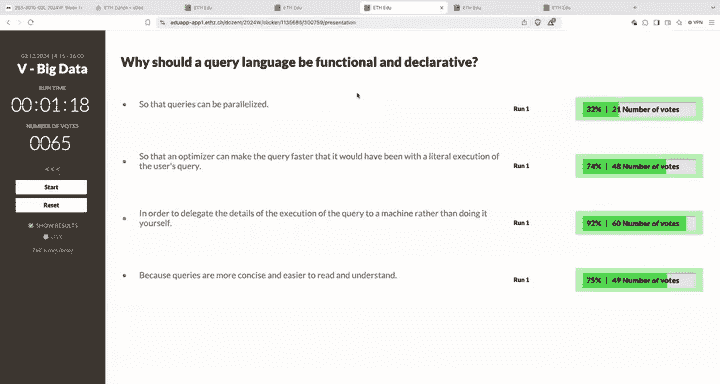

And now I'm going to come back。To the slides。

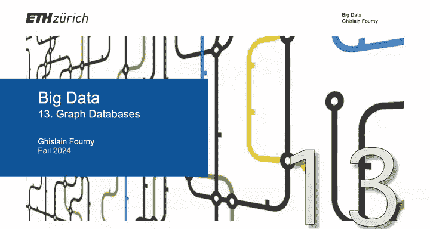

Alright。Okay。Alright， graph databases。So I need to say why， because after all we could think， okay。

 we can use tables， we can use trees， right after all， that's already very useful。嗯。

So when you hear the term NosQl， graph database are one of the four。

 You very often see these four categories in NosQl or in big data the keyvalue stars。

 the triple stall， the column stall and the document stall Well it's great because in this course。

 we cover all four the keyvalue style that was dynamo and dynamo Db。

 the column stalls that was big tables s H base document stall that was Mongo DB and the triple stall is what we are going to to cover today。

 it' actually not our name for graph database， even though when people say triple stall。

 they think more like RDF I talk about that。😊，So now you basically are very familiar with these things。

 And even though we use every time one specific example like Dynamo H based Mongo D B Neo4 J。

 you will see that it's actually quite generic。 Once you have learned one system。

 you can very easily learn any other system that works in the same way。 So today。

 it's going to be the top right one， the missing one that we are going to cover。😊。

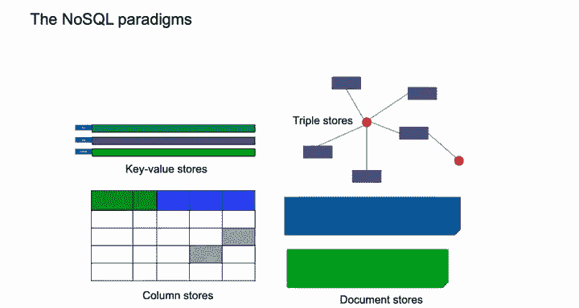

No。What is a relational database？When a relational database is basically made of tables and it's called relational because of mathematical relations。

 right， that table is basically a relation。 But， in fact， relations also means relationship。

 And typically， when you teach relational databases at the bachelor's level。

 you also include the entity T T relationship model。 Who heard of that entity T T relationship。😊。

And the idea is that you have tables that express entities like coies， a table of coies。

 a table of people， a table of products and so on。 And then you have relationships that basically link these table together。

 And relationships can even be tables by themselves， right， You could have， for example。

 lectures and coes。 And then you have a table with just two columns that links the lecturers to the coes。

 right， And that is called a relationship。Now， this whole thing works。

 and the entire entity relationship model works because we strive to have high normal forms to have many tables that are nicely each doing their own thing。

 And then how do you bring this table together， you。Join them。 Exly。 That's a join。

 And so in relational databases， you have to join everything， right， You have to， to。

 to join all of these tables， as you do in SQL with the， with the the join clause， for example。

 the problem。😊，Is that joints can be expensive。 So now， of course， some people might react。 no， no。

 no， but joints are actually can be done in linear time。 Yes， equi joins。

 E joins can be done in linear time。 if you use a hash table。 But this is not true of all joints。

 not always always true if you have more generic predicates。 And also they are quite inefficient。

 That relationship per vesselal， because what's the spirit of a join。

 The spirit of a join is just that， for example， you have this value。 This value。

 and you would like to associate it with this value right here， because that might be a primary key。

 and that's a foreign key that points to that primary key， right。

 So the spirit of the join is to actually connect the rows with the rows， right。

 That's what a join is about。😊。

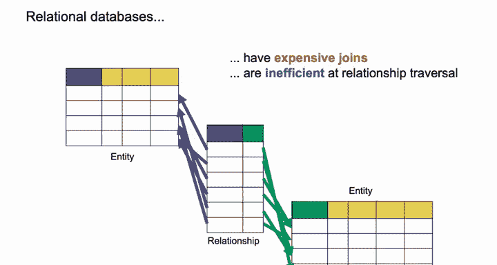

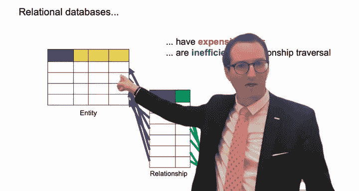

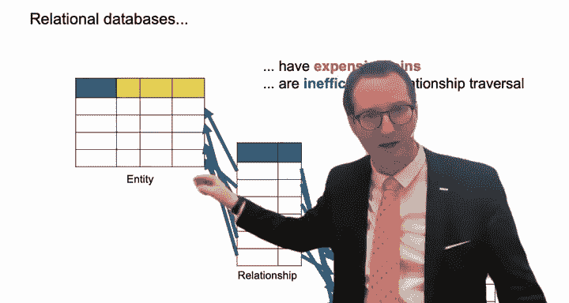

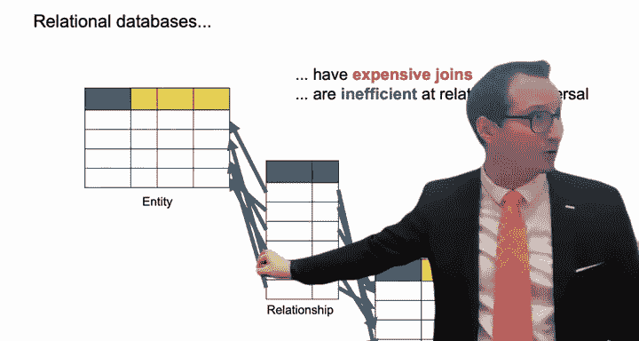

But if when you want to do a join， you need to actually build a bigger table that mels all of these tables together。

 technical or car products。Followed by by a selection predicate， which your join is。

And even if you can implement it efficiently， of course。

 because nobody implements a join by actually taking the cafeian product in the selection。 Of course。

 you you use these the better algorithms。 But nevertheless， this is quite inefficient。 You。

 You're basically trying to kill a fly with an envil as we stay in French。

So we can do better than that in order to to deal with relationships。 And so in order to do that。

 we try to basically avoid the joints。

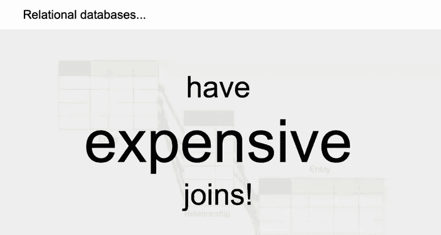

Because they are not efficient at relationships。 Now that should actually remind you of something。

 because it's not the first time that I told you we want to avoid the join。

 And in order to avoid the joins， we be nor malize exactly。 So then you could think， okay。

 let's use trees because when you denormalize， you basically get trees， right。

 So we could just denormalize。 And then we just use the document store。 And。

 and that's it problemble solved， I can go home。 My lecture is over， right， But it's not that simple。

 because when you denormalize。

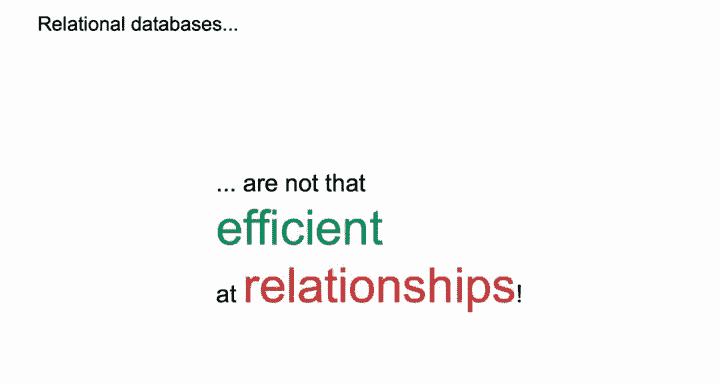

Dormalizing is basically equivalent to joining on a very superficial level。

 But you have more than one way to join。 So when you deormalize like this。

 you do it in a specific way because you expect that this is the join that the user is actually going to need。

 But actually， if you talk with industry players。 for example。

 was data breaks guess lecture a while ago。 and what the engineer that somewhereuel is his name。

 what he was explaining is that in many cases， of course。

 you can predict what would be needed as a join in advance and then precomp the joins by deormalizing but in some cases。

 you cannot know in advance what join the user is going to need because there are so many ways that you could you could actually join the data。

 And so and so that actually has its limits and sometimes you just have to to do dynamically and that would be statically before run time。

 you just deormalize the tables。 But we need a way to dynamically connect the cells。

 So it it has its den。😊。

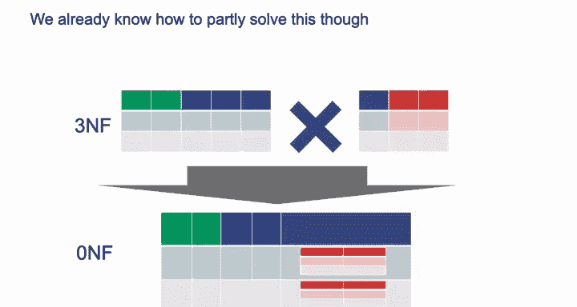

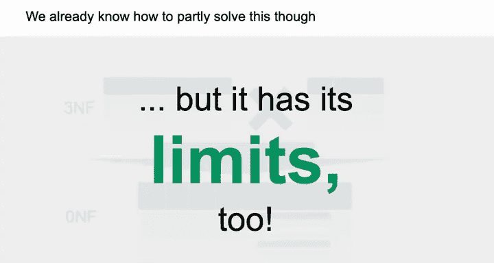

And what's even worse is that in practice， if you start to have a very。

 very large database with a lot of tables， you might even have used cases that in the same query。

 you need to do a lot of joints。 An example of that is you take a genealogy called tree。

 and you're trying to find your great， great， great， great， great， great， great， great， great， great。

 great grandparents， right。😊，Now， imagine that we have a table of people and the。

 the parentch relationship is just with a selfjo， right， The table is joined with itself。

 That's how typically you do it。 But if then if you want to find your great， great， great。

 great and so on， great parents。😊，That involves as many joints as the， the number of great in great。

 great， great， great parents， right， plus -1 or2。So basically。

 if you try to join so many tables at the same time， the performance is even worse right。

 trying to join many tables just for one query is is actually quite a challenge for the database system。

ESomething even worse because theres even worse than that。

When you do a join like that， typically， in many cases。

 it's because you have a foreign key and a primary key， right， You， for example。

 you have the foreign key here that points to that primary key。

 Then you have the foreign key that points to that primary key。

 You have a foreign key that points to that primary key。

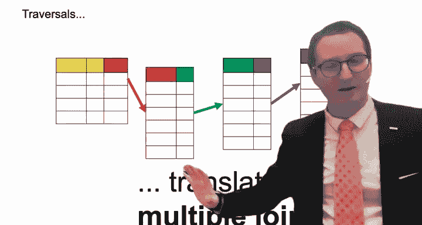

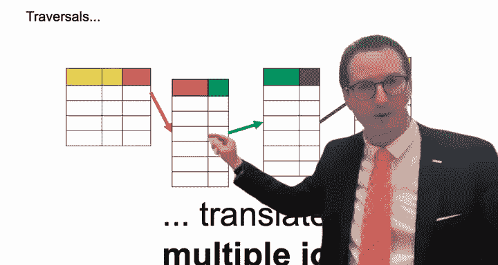

What if you want to do the reverse thing。You have the， the primary key。

 and you want to search for all the records that have a foreign key pointing to that primary key。

 right。That's the reverse pattern。 You're trying to， to traverse the database in the opposite order。

 Now， you might think， okay， how do we handle that if we are looking， for example。

 not for the entire joint， but just the specific records。

 And we just want to traverse Let's say the specific records， specifically here， here， here。

 just these records right here。

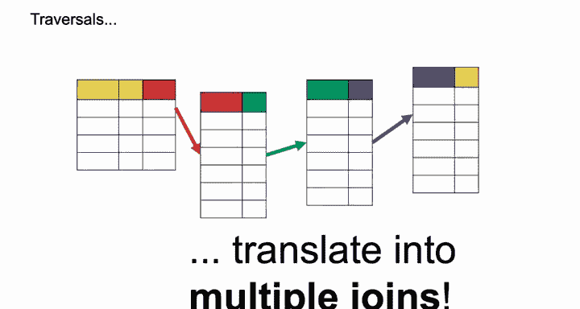

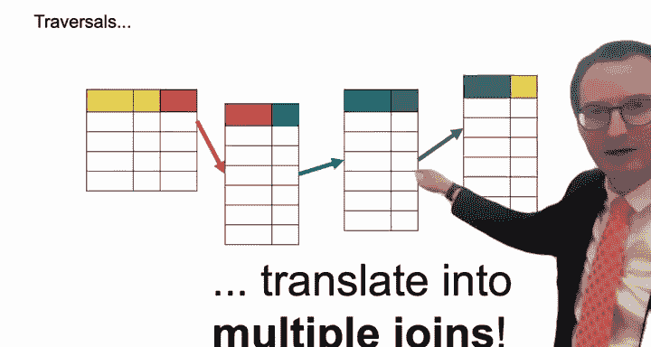

Now you might think， okay， we don't need to join them。 We just use indices。 We have an index。

 Basically， we have that record。 We take the foreign key。

 We use a hash index to directly get that record， O of one， right， Hah index。

 then O of one or of one and so on， right， But the problem is that the hash index only works in one direction。

 In the other direction。 Tyically， you have a hash index on the primary key or a true index on the primary key。

😊。

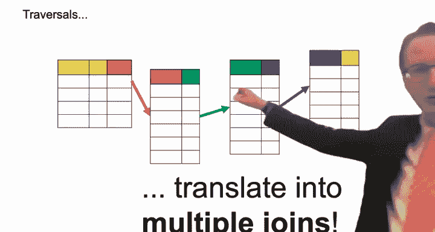

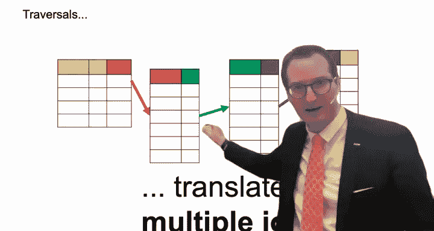

But you might not have a hh index or a tree index on the4 key。Right。

 and so that means that in the other direction is going to be slow。 Unless， of course。

 you build an index on the foreign key。 But then you build。

 you need to build a lot of index to be ready for that。 And then you。

 you have the problem that it's eating up eating up a lot of space。

 Who sees the challenge that we have here。 We are stuck， right， Who sees it。😊。

Get a general impression。 Okay， so basically， the lesson here is that relational databases are not good enough for that。

But even just deormalizing the data and music document stores and maybe evenry and hshing disease is still not good enough。

So now we really have a reason to want to do something new because the existing systems just do not do the job。

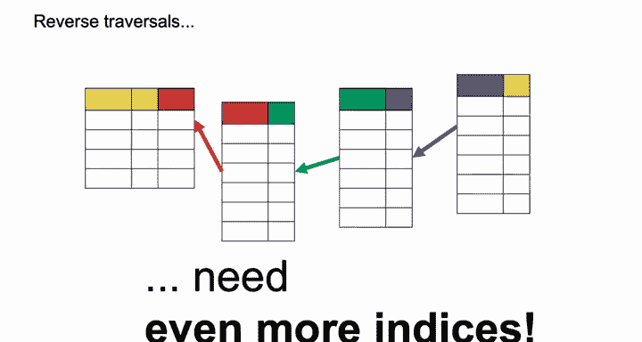

And this is why we have a way。To make it more direct。嗯。

What is the most direct way that you know of in memory to basically find some data related to some other data。

On the physical level。Pointers， that's exactly it。 And that is the key to graph database。

 It is pointers。 And using pointers in memory instead of primary keys and foreign keys。

 which logically is the same thing， right， Imagine that instead here， basically。

 when I talk about foreign keys and primary keys， This is not a pointer。

 This is not a pointer in memory， it's just a logical connection I'm making to saying that these value。

 these values are related。😊。

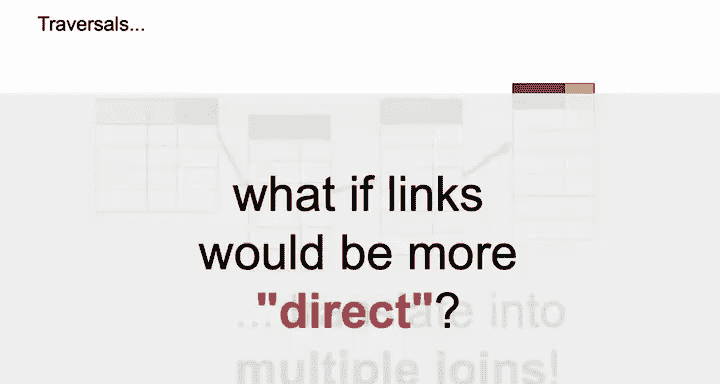

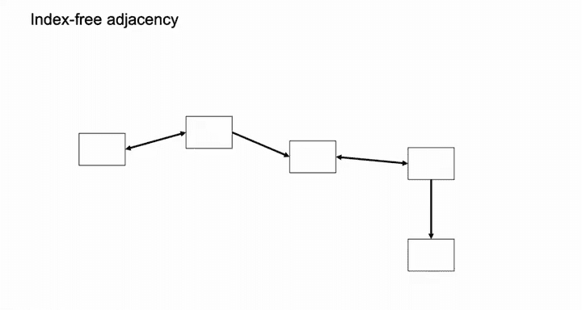

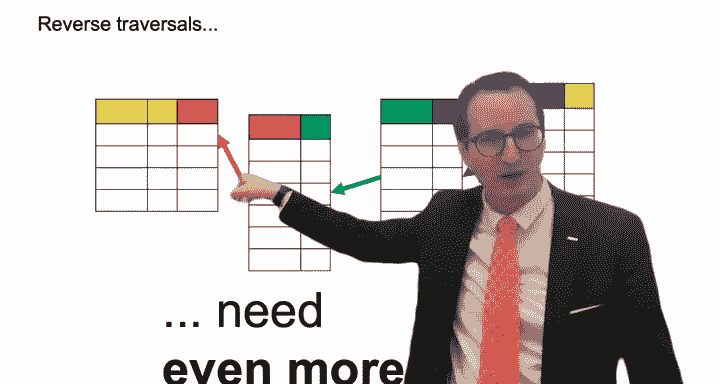

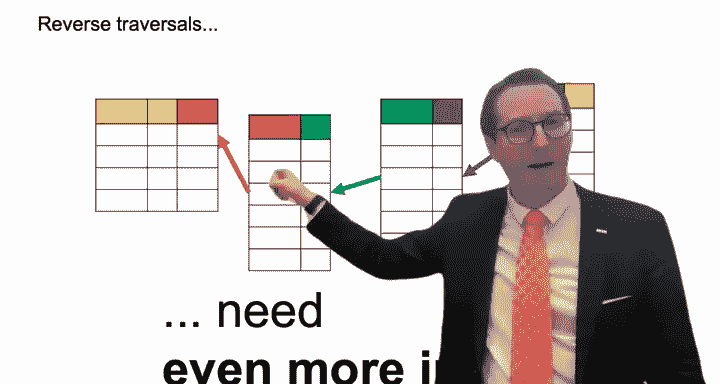

But if this here， we are not just the logical connection。

 but an actual physical pointer in the memory， then do you see that this is instance， right。

 of course。

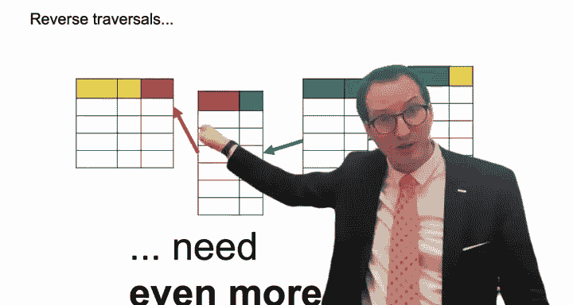

InIn relative terms， right， But compared to actually a join and looking up in an index。

 just following a pointer in memory is much faster。 Who sees that。😊，Okay。

 it's very important because this is the core motivation for graph database。

 It's the fact that we use memory pointers to connect the data instead of primary keys and foreign keys and denormalized data。

 That's the whole idea。😊。

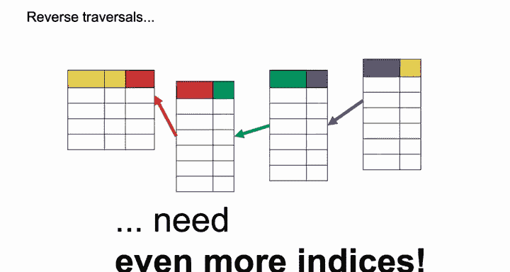

And it has a very cool name that you might want to learn。 It's index free acancy。😊。

Index 3 Ad C is just a fancy way to say that we use memory pointers， right， Ad C。

 because it's just connected directly in in memory。 And now you see memory pointers。

 They have no problems going both ways， right， you can just have a pointer in both directions。

 and that works。 In fact， if you think of doubly link lists that you cover in data structures and algorithms。

 That's exactly what it does。 doub link list is exactly this kind of points going in both in both directions。

 right， So that's exactly the idea。 But this is only the embryo of the idea， because that's a simple。

 you know， we use memory pointers。 Yes， but we still need to be careful about how we design that。

 because if we start designing now this idea， what do we have here on my screen。 I have a graph。😊。

It's not a tree。 It's not a table。 So we are talking about a different shape。

 And that means we need a data model， just like we had a data model for relational tables and the data model for trees for Jasonson and X。

 M， L。We need a data model for graphs， logical data model。Then， of course。

 that logical data model will be physically cementmented with memory pos and structures in the I come back to that。

Then once we have a data model， we need a query language， and that query language will be cipher。And。

 and that's basically the same principles as with SQL and tables or with Jonic entries。

 This is what I would like you to see。

Okay。So the example I'm going to take for this lecture is Neo4 J。

 The name of the data model that that we are going to use is the labeled property graph。 That's the。

 that's the model we are going to use。Remember of that for a data shape。

 there is not a unique model for that shape。 For example， for trees， you have the X M info set。

 you have the Json data model。 You have the Jonic data model with sequences of items。

 You have plenty of models， right？ And every query language has one model。

 but you could have several models。In the case of graph databases。

 there are basically two high level competing models。

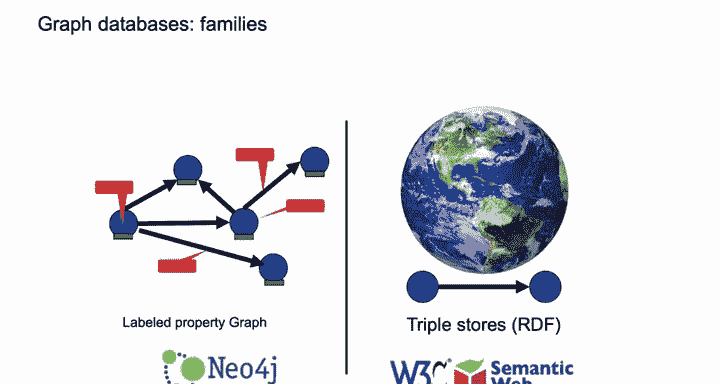

They are basically a team labeled property graph， and there is team triple stores。

 And people have debates。 It's another way to tro a forum。

 If you ask is triple stores better or labeled property graphs。

 you will see how polarized people are on， on this。 And they will。

 they will release that debates on the on the。

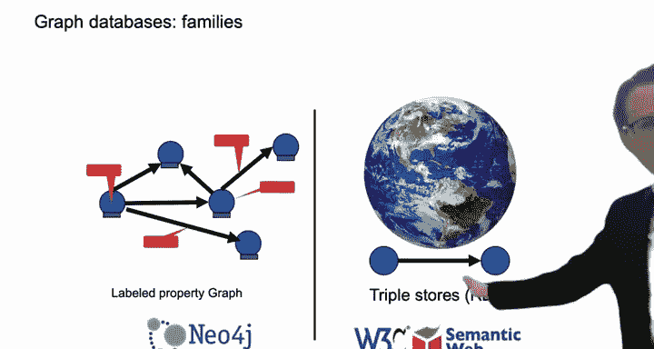

On this topic。 So I try to talk about both label property graphs and and and triple stores to。

 to give you overview view。 And specifically， the technology we are going to use is Ne4 J。

 which is one of the most known database engines that that cover them。

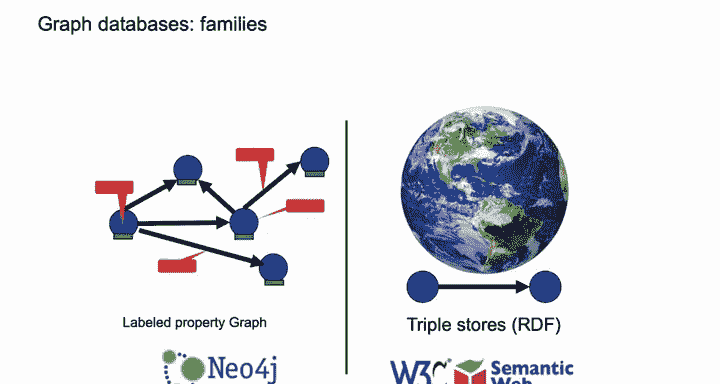

All right。Now there is another， it's actually kind of oknmal， but。😊。

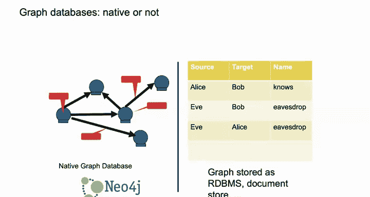

You have the concept of a native graph database， and you have the concept of a database implemented on top of another one。

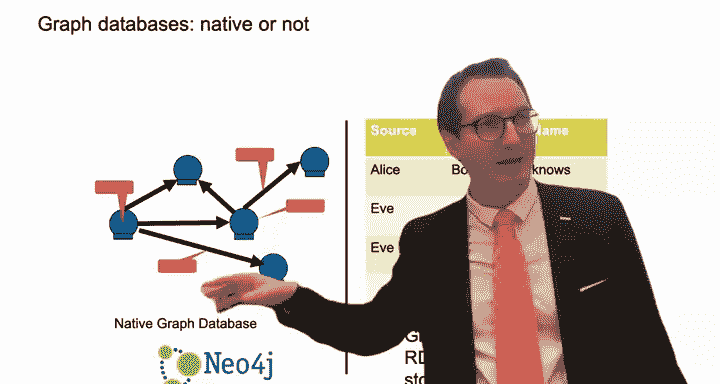

This is something I actually briefly mention when we talked about document stores before we looked at Mongodibi。

 I said， if you have a collection of trees。Why don't you try？To implement that collection of trees。

 to store it in a relational database systems system and to just compile everything to sQL。

 Sound like a good idea， but it's very difficult。 And that's the reason why instead。

 Mongodi B went for a native implementation of tree based data models， right。

 It's a native implementation。An implementation that puts trees in relational tables。

 They actually exist。 They are a bit less efficient， but then it's not a native implementation。

 It's basically just a multi layer architecture that implements a database system on top of another database system。

 Just like you can compile a language in another language， right， For example。

 C plus plus compile to see。Alright， and so in the case of the triple store， actually。

 triple stores are very easy to implement in a relational table with just three three columns。

 triple store， three columns。 It would become obvious why when I come to it is basically because it's just a triplet is basically a subject or property and an object。

 just like a very small sentence and every triple corresponds to a row in in this table。

 So in that case， that wouldn't be a native database because it would actually be implemented on top of of a relational database。

 right。😊，We'll see next week， that cubes。Can also be implemented on top of a relational database。

 So you don't need a native database system for cubes。 You can， but you don't need。Alright。

 but let's first focus on the， on the neo4 J and the labeled property graph。

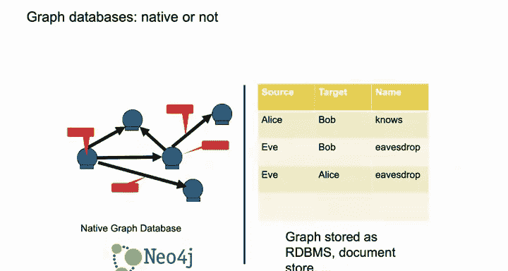

So let's rewind a little bit and go back to data modeling。When I told you about data models。

 I told you that the point of a data model is to have a very simple way of describing reality。

 For example， in the for the relational model， you say that everything is a table。

 Everything has rows and columns， right， Pre simple to describe rows and columns。

 primary keys and so on。In the case of XM and Json or a document stars。

 then instead of saying everything is a table， you say everything is a tree or everything is a collection of trees。

 right， And then the data model involves the notion of parent and of child within a tree and so on and so on。

 the notion of atomic values， the notion of structured values。

 like objects and arrays or elements and attributes。But still， it's rather concise to explain what。

 what the data model is。So now for a labeled property graph， what do you think。

We would see the world as what would be the component of a model like that。

 Can throw a few ideas before I show you。What would there be in in， in， in a graph data model。

 Maybe the name label label property graph would be useful to make guesses。Anybody。

You can also write on zoom。fi。If he太す。Yes I see your raise hands there。每く。一。Yes， absolutely。

 So you basically said I'm repeating for the people on Zoom。 You said nodes and edges。

 That's exactly it。 We need nodes and edges。 In fact， that's how mathematicians define a graph。

 That's actually beautiful， because whenever you design a data model。

 you want to have the mathematicalmaticians as your friends。

 You really want to rely on something abstract。 Just like for tables。

 we relied on mathematical relations or sets of actual functions that's highly mathematical。😊。

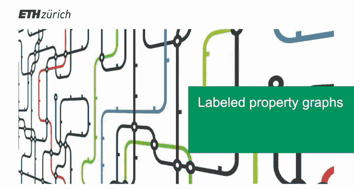

A mathematic mathematician defines a graph as a set of nodes that can be actually anything。

 just a set of nodes。 they call it v for vertics。 And then a set of edges。

 What is an edge is just a pair of nodes right， and they call it E。 And a graph。

 they call it G is V and E V。 The set of vertics and is the set of edges。

 That's the mathematical definition of of of a graph。 So now if we start with that definition。

 then the ingredients for our hook session is basically that we need a few nodes。

 and we need a few edges。 And then we're gonna connect these nodes with these edges in order to get a directed graph。

 Okay And now that becomes computer science because you can actually start implementing that in many。

 many ways in memory as I will as I will show you。 But at that point， it is purely mathematical。

 Of course， the graph can also be undirect it just means that you remove the direction of of thearrows in there。

😊。

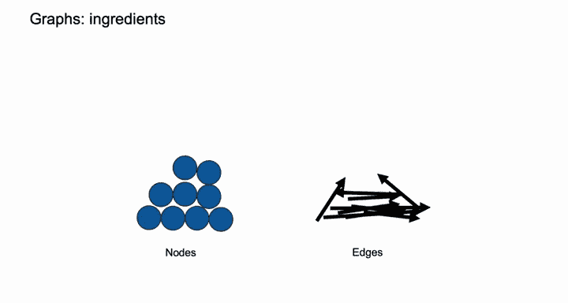

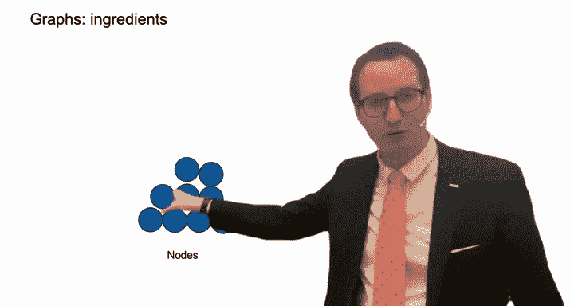

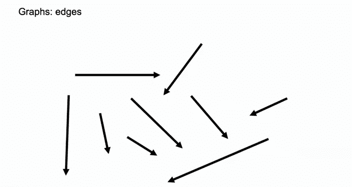

It sounds pretty simple， but you wouldn't imagine the。

 the number of challenges that they are in graph theory。

 There's a whole course of G graph theory at T， T， H。 maybe who who took the course very。

 very difficult and formal。 maybe data science students。Right， I see some ray sense。 Very difficult。

 You have the， I think it's called the maxflow mean cut problems and so on。

 There was actually a recent advancement here at E TH regarding this。 But yeah。

 this is more complex than it seems。 But as a computer scientist。

 you want to store a graph like this。 So， for example， if you have three nodes and three edges。

 You could just saw it as a list of nodes。 And then you have the a array that gives you all the the destination that it's connected to。

 right， A is connected to nothing thing B is connected to A and C， and C is connected to a。

 for example， So that's called a adjacent and C。 Then you have a C mattresses where you basically have the nodes。

😊。

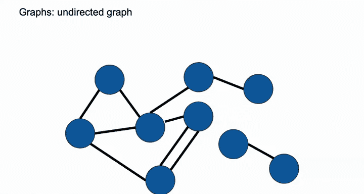

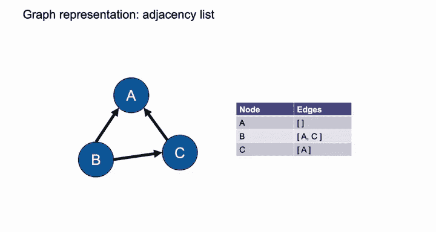

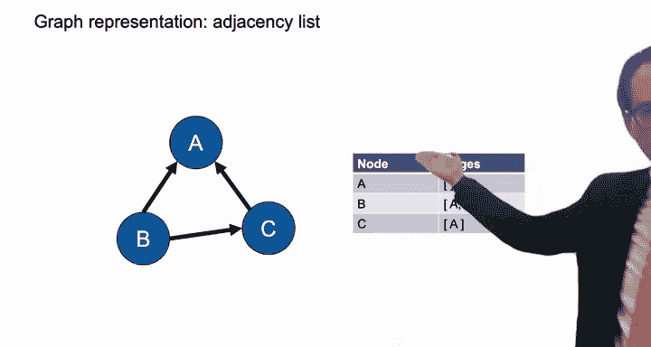

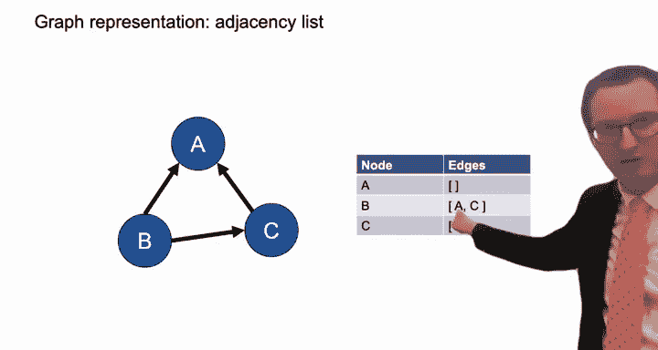

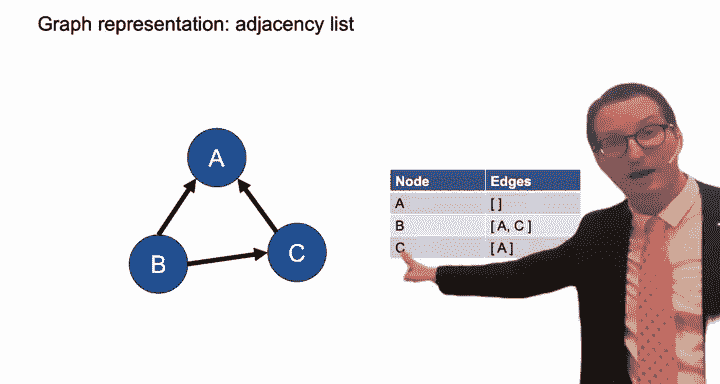

On the rows and on the columns。 And then you put a one when they connect。 So， for example。

 A is connected to nothing。 B is connected to A and to C marked as a one。

 and C is connected to a right here。Okay， so this is called an adjust matrix。

Then you have the incidence matrix where instead of nodes on both roads and columns。

 you have only the nodes on the rows and the  edges on the columns。Basically， every edge。

 the -1 tells you the source of the edge and the one gives you the destination。 So from B to A。

 from C to A and from B to C。

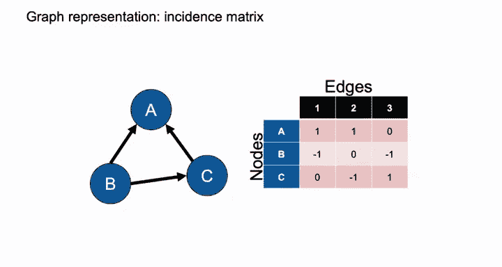

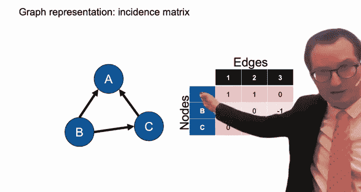

Okay， will still with me。All right。But this is not how we are going to implement labeled property graphs。

 So these are， these are possible ways。 In fact， for labeled property graphs， as the name indicates。

 we need to add two things labels， two things， labels and properties。

 So now we are extending our list of ingredients。 We have the nodes。 We have the edges。

 And we have properties。 we see that they are actually very close to JO objects。

 But I come back to it。 And then the labels that we put in there。 And when we put that all together。

 we get。

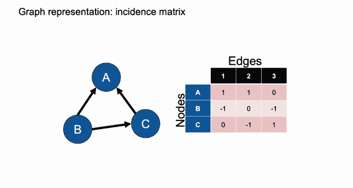

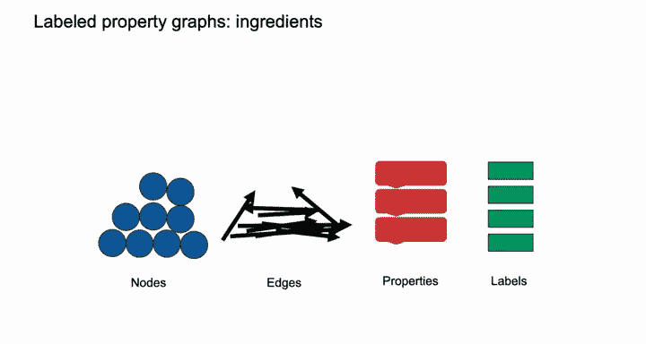

An instance of a labeled property graph。 And now I'm going to go slightly more in the details of that。

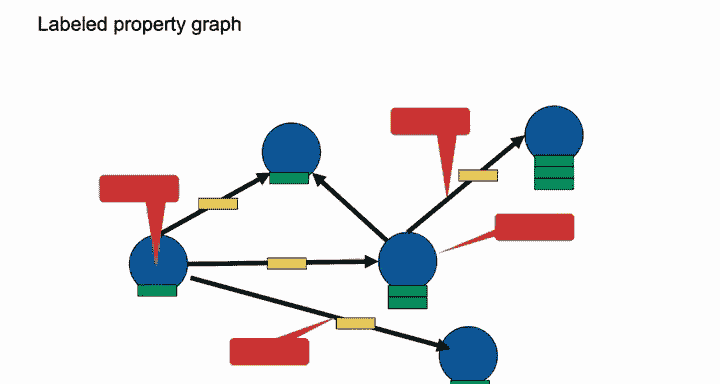

But you probably already noticed that these are labels。 Basically， the labels can。

 label can be on a edge or on a node， and the property can also be on a node or on a edge， right。

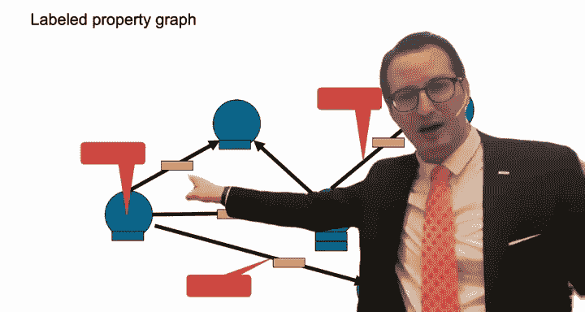

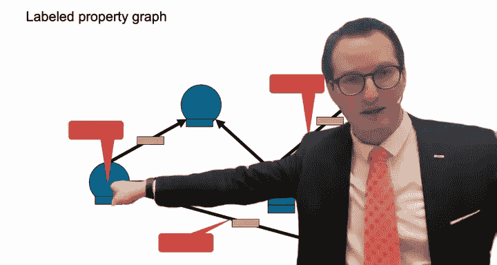

This is the， this is the idea。

So now let's look at a property。the properties should use the par form， the properties of the node。

 For example， this is a node， when of them in our set V。And it has three properties。 Na is Einstein。

 First name is Albert。 Profession is physicist。Now， you can look at it in two ways。

 Maybe you see actually just a database record like this。 Who sees that。Everybody， hopefully。

 you' right。 And who sees a object。You would be right to， right， It's。

 it could be seen as a flat Jasonson object， but that's not news because we know that a flatja object is the same as。

 as a flat。Relational record， right？ Okay， so this is basically the idea of properties。

 What's important。 And here I'm connecting it to what we already know， it's flat。 It's flat。

 We do not allow for nested nest。 We do not allow generic J documents with nested nest。

 It has to be flat， right？ You just have the top level properties。 And that's it。

 There is one exception and come back to it。 But generally， it's completely flat。

 So no nested nest in there。Why， because the nested net。

 we handled it with the memory pointer and connected the nodes together。

 So if we also lot for nested nest in there， that would be redundant in our model。

 So it's much easier to just keep it flat in here and to just consider that we have。

 we have a flat topers。😊。

Okay。嗯。So now on the same note， you're going to have。

The properties。And you're going to have what's called labors，1 or more labors。 For example。

 this note here， whose name is Einstein， whose first name is Albert and whose profession is a physicist。

Has the label person。

And has the label in Switzerland， for example， maybe as a specific point point in time。

Now， it might seem like totally out of the blue and a bit weird compared to a relational table。

 like this is a completely different kind of of objects that we that we have here compared to to Json or radiational tables。

 but we can actually easily make a connection between the two。 And once you see that。

 then you will get the intuition behind the graph databases and also understand why it's easy to store any relational database as a graph。

 but it's not easy to go the other way around because graph databases are， in fact。

 more generic than than。

Vational database。So here's what I want you to see here。When you have。Green notes。

Or any number of notes。That share a label。 They can have more labels than that。

 but they all share the same label， scientists。And if you look at the properties。

 you notice that these are the same property names。 The values， of course， might be different。

 but it's the same property names。 Ki of stuff looking like a schema here， right， some。

 some validation and so on that they have the same structure。

When you see that same label and same schema， let's say a closed schema without any exactly key。

 In fact， this is equivalent to this relational table right here。 Who sees that。Very good。

 So every record here that you see is a node， and the values of the record are basically in the properties。

 and the name of the radiation scientist is the label。

 So that's how you actually recognize that they are basically， they have the same labels。

 This is this correspond to a relational table。 Who sees that it doesn't work the other way around。

 that you might not be able to reconstruct relational tables。😊，The other way around。

We have a question。 And I think on Zoom， I， I also saw something happened on Zoom。

Unlike a relational record。At least I don't quite see that there is an equivalent of a primary key or similar thing in the properties。

 Now， if you for some reason would have multiple nodes with the same properties。

 would you summarize them in one node and have multiple edges to that node。

 or is it also possible to have multiple nodes with the same properties。So it's a design decision。

 Basically， you can， there is a natural mapping。 So there is a straightforward mapping。

 but it's not the only one you could， you could implement the same thing in many ways。 Typically。

 the idea。Is that in the same way that。A record in a highly normalized or high normal form。

A record complete basically corresponds to some real life thing。 For example， a record is a person。

 A record is a course。 a record is a country， and the same words or node。 Basically。

 every node represent a thing or a person or a concept of real life。 This is how you think about it。

 And then you have this duality between seeing it as a record or seeing it as a node in the in the database。

 But this is how it corresponds。 Now， getting to the primary key。

 we also have something like this in a graph databases。 because I will show you in the language。

 So in SQl is's basically using a select from where。

 and you use where with a prediiccate on the primary key。

 And if you have an index that's going to be fast， right。😊，We will see that for graphs。 We。

 we will have a language。 But instead of focusing on the table structure and on the primary key。

 we focus on the pattern in the graph。 We are looking for a pattern。

 If you look for a specific person named Einstein， then you can express in the language that you look for the nodes。

 the node on the nodes whose property name is equal to Einstein。

 and then you can also be the diseasees that are going to accelerate this。 It's below the the the。

The logical level。 So you still have indices。But you。

 you still need to see that you have the memory pointers that replace what world joins before。

 that you don't need an index for that。 You just follow the pointer。

 But what the ind are for in the graph database is to very quickly locate the nodes that you're looking for。

 When you just start the query and bootstrap out of nowhere。

 you need a way to directly get the nodes that you want to start with。 Does it make sense。

哎 think so yep。Alright， hopefully， it will make more sense as， as I go through the。

 through the material。All right， there's one question。猫冰。

Why does the notion of label have to be first class。

 Wouldn't it be possible to simply have one or more properties corresponding to the labels。

 I told you that triple stores versus labeled property graphs that's polaring。

 That's exactly what the triple store people are going to say to the label property graphs。

 they exactly have this argument。 So you are absolutely right。

 And the argument is absolutely totally valid。 Then it means that you probably will prefer to use the triple stored and the labeled property graph。

 right， So you can absolutely make this argument。 in the end。

Whether you use a labeled property graph or a triple store is a bit of a matter of look and feel。

 right， The advantage of the triple stores， they are much simpler in the data model。

 but it means that you have a bit more work to do in order to actually force the data in there。

 right in a labeled property graph， It might be more appealing to some people because it's it's a more it's a more natural design。

 right， So I cannot argue against what you just said， you just made an argument for triple stores。

 And I'm going to come to them a bit later。😊，Right。😊，Is that a satisfactory answer。

 I basically didn't say no， so。

Yeah， alright。 Very good。Okay。

Now， so we saw that we can have one or more labels for the nodes。 That's also a difference。

 by the way， with tables， because you can only be in one table。

 but you can have multiple labels for a node。 We have another question one， yeah。

So does it mean that for for label scientists， every node has to have the same properties so we could get this relational table。

 It doesn't mean that you could actually absolutely put the same label of multiple nodes and you could have totally different properties。

In fact， that shouldn't surprise you when you know that the same goes for tables。

 if you take a table and you no longer require that the records have the same attributes and types。

 you basically have a document store。This is heterogeneity and， and and potentially in nestiness。

 Does it make sense。So you're absolutely not obligated to have the same properties。

 even for the same levers。 That's you can。 Of course， it's good design。

 If you try to have a few enforcements like that， that you don't have to。

Alright， so that's another way that it's more generic than radiational tables。All right。

Then we can also have labels on the relations on the edges， but we don't call them labels。 actually。

 we call them types。 We call them relationship types。

 But the difference with the node is that a relationship can only have one type， only one。

 So typically， you put it graph graph theory people still call them labels。

 But you basically put a label on the edge， right， And so here I have two types of relationships。

 A and B。 And to make it a bit visual， I represent it the B with the dash lines and the A's with full lines。

 right， whom does that make sense。

And example of relationship types is are is located in is a friend of produced this movie。 And so on。

 typically， it's a verb very often， right， And that corresponds to a relationship in the entity relationship model could have a relationship type that's called visits between a student and a lecture。

 for example， right， So this is the idea of the relationship types。 in practice。

 there can be any string。😊。

And now that's how it connects just before the break。 we， we might need to， I， I might need to。

Interruptive featurings。 Let's see if I have time to answer。 Go ahead just a short question。

 If I have multiple relationships between nodes， Can I just add multiple edges， Like。

 is it a multigraph， Yes， absolutely， you can have as many edges as as you want between nodes。

 Theres no limitation on that， right。

Not to be confused with Hygraph， right， which is something different。

 A Hygraph is relationships between more than two nodes。

 but you can absolutely have have multiple relationships between the same node。

 which brings us to our break。 So I' see you in 15 minutes and then we we'll continue exploration。😊。

